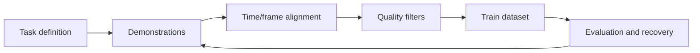
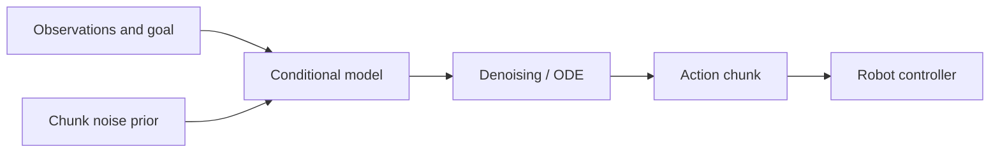

# Data Collection and Imitation Learning

<!-- course-meta:start -->
[Course home](https://github.com/zengxiong111/Foundation_of_Embodied_AI) · [简体中文](https://github.com/zengxiong111/Foundation_of_Embodied_AI/blob/main/md/Data_Imitation_Learning_ZH.md) · [PDF](https://zengxiong111.github.io/zengxiong.github.io/files/Data_Imitation_Learning_EN.pdf)

| Item | Details |
|---|---|
| Applicability | Concepts and code-free lab design; ACT / Diffusion Policy / Flow Matching comparison, not a validated reproduction |
| Documentation review date | 2026-10-18 |
| License | CC BY 4.0 · Xiong Zeng and contributors |

**Verification scope:** Documentation and reference check only; no unified training run or real-robot validation. See [version notes](https://github.com/zengxiong111/Foundation_of_Embodied_AI/blob/main/VERSIONS.md). Original materials use [CC BY 4.0](https://creativecommons.org/licenses/by/4.0/); cited third-party work retains its own license.
<!-- course-meta:end -->

<!-- course-toc:start -->
## Contents

- [1. From Demonstrations to a Trainable Dataset](#course-section-01)
  - [1.1 What One Demonstration Must Contain](#course-section-02)
  - [1.2 Time and Frames Come Before Architecture](#course-section-03)
- [2. Collection and Quality Control](#course-section-04)
  - [2.1 Beyond Successful Demonstrations](#course-section-05)
  - [2.2 Splits Matter More Than a Headline Score](#course-section-06)
- [3. Imitation Learning: BC to Interactive Correction](#course-section-07)
  - [3.1 Why Low Training Loss May Still Fail](#course-section-08)
  - [3.2 What DAgger Adds](#course-section-09)
- [4. From Single Actions to Generative Action Chunks](#course-section-10)
  - [4.1 ACT in One Picture](#course-section-11)
  - [4.2 Diffusion Policy and Flow Matching](#course-section-12)
- [5. Augmentation, Recalibration and Simulation](#course-section-13)
  - [5.1 Contact Events and Recovery Samples](#course-section-14)
  - [5.2 Safe Augmentation Boundaries](#course-section-15)
- [6. A Shared Panda Tabletop Experiment](#course-section-16)
  - [6.1 Minimum Experiment Matrix](#course-section-17)
  - [6.2 Debugging Checklist](#course-section-18)
- [7. Where This Fits and References](#course-section-19)
<!-- course-toc:end -->

**Learning outcomes：** Identify data quality risks; compare BC, ACT, and generative action policies; design reproducible grasping experiments.

## 1. From Demonstrations to a Trainable Dataset

Imitation learning is not just storing a successful video. It turns observations, robot states, actions and task conditions into aligned and reproducible supervision. A closed-loop robot ultimately learns a conditional policy $\pi_\theta(a_t\mid o_{\le t},g)$, where $g$ is the goal.

### 1.1 What One Demonstration Must Contain

Each episode should at least log task/scene IDs, image timestamps, RGB or RGB-D, joint feedback, executed actions, action reference frame, control mode, success, and exceptional events. **The action label must identify the command actually issued**; do not mix commanded joint targets, measured positions, and joint velocities. For vision, specify whether camera extrinsics are fixed or time-varying.

### 1.2 Time and Frames Come Before Architecture

Use one clock basis or verified timestamp alignment. Define $T_{B}^{C}$, $T_{B}^{E}$ and $T_{B}^{O}$ under one transform convention. Cameras often run slower than proprioception; match past observations to action timestamps or use documented delay-aware interpolation, never future frames.

## 2. Collection and Quality Control

Common sources include teleoperation, kinesthetic teaching, scripted experts, simulated RL experts, and retargeted human video. They differ in throughput, action quality, contact fidelity, and hardware cost.

**Practical principle:** start with a smaller coherent dataset rather than accumulating large volumes of unaligned video.

### 2.1 Beyond Successful Demonstrations

Retain informative failures, corrective behavior, and recovery segments, with event boundaries such as first contact, slip, and regrasp. Do not blindly imitate every failed action: distinguish useful recovery demonstrations from unsafe commands. Record consent, data permissions, licensing, and robot safety review.

### 2.2 Splits Matter More Than a Headline Score

Split by object instance, scene layout, operator, initial configuration, and collection session. **Never put chunks from the same continuous trajectory in both train and test sets.** Report episode success, not only per-action MSE. Group synchronized views and adjacent frames together to prevent leakage.

## 3. Imitation Learning: BC to Interactive Correction

Behavior cloning (BC) fits actions from demonstrations. Deterministic regression can minimize $\mathcal{L}_{BC}=\mathbb{E}_{(o,a)\sim D}\|\pi_\theta(o)-a\|_2^2$; stochastic policies maximize conditional action likelihood. Neither objective automatically fixes deployment-time distribution shift.

### 3.1 Why Low Training Loss May Still Fail

In closed-loop execution, small action errors change future observations and push the robot outside the demonstration distribution. Record state drift, failed contacts, interventions, and recovery from perturbed states. Safe, supervised recovery demonstrations can expand coverage.

### 3.2 What DAgger Adds

DAgger collects states visited by the learner, queries an expert for suitable actions, and aggregates labeled data. A real robot needs safe intervention procedures. Offline retraining without expert relabeling of learner-visited states should not be called DAgger.

## 4. From Single Actions to Generative Action Chunks

Action chunks reduce the need to replan every servo tick but may use stale observations during execution. Distinguish prediction horizon, execution horizon, and policy query rate. The chunk's command frame must agree with the actual controller interface.

### 4.1 ACT in One Picture

ACT uses a Transformer to predict a sequence of actions; the original formulation includes a latent-variable mechanism for demonstration variation. Chunks suit continuous structured demonstrations, but alignment and overlap policies still matter.

### 4.2 Diffusion Policy and Flow Matching

Diffusion Policy and Flow Matching can both represent multimodal action distributions, but **denoising dynamics or generative velocity fields are not robot joint velocities**.

For fair comparison, control observation modalities, demonstration budget, inference budget, controller rate, and evaluation scenarios. Offline action loss alone is insufficient.

## 5. Augmentation, Recalibration and Simulation

Geometric augmentation must transform images, object goals, reference trajectories, and action labels consistently. Rotating images without transforming the appropriate action target can create incorrect supervision. Simulated expert trajectories expand coverage, but contact, rendering, and latency gaps require separate validation.

### 5.1 Contact Events and Recovery Samples

Start from a uniform-sampling baseline before oversampling near first contact, grasp failure, or object drop. Event sampling changes the training distribution; document weights and always evaluate on an unbiased test distribution.

### 5.2 Safe Augmentation Boundaries

Do not propagate arbitrary initial conditions into physically inconsistent contact trajectories. Check reachability, collision, contact consistency, and actuator limits after rotation, translation, scaling, or timing perturbations; short physics replay is useful before admitting data.

## 6. A Shared Panda Tabletop Experiment

**Task:** in Isaac Lab or MuJoCo, use a Panda arm to grasp a randomized cube; collect scripted or teleoperated demonstrations and train BC, ACT, and a generative policy.

**Control variables:** camera view, task count, command interface, control rate, object split, and episode count. Simple BC is a required baseline for generative methods.

**Metrics:** success, contact failure, trajectory drift, recovery, policy inference latency, servo latency, and demonstrations used. Report seeds and failure modes rather than claiming one family always wins.

### 6.1 Minimum Experiment Matrix

| Comparison | Purpose |
|---|---|
| One-step BC | Verify labels and controller |
| Chunked BC | Isolate chunking benefit |
| ACT | Test Transformer chunk prediction |
| Flow/Diffusion | Test multimodal action modelling |
| Recovery demos | Test closed-loop robustness |

### 6.2 Debugging Checklist

Check timestamps, command/feedback confusion, camera extrinsics, action scale, latency, execution horizon, data splits, and initial-state coverage before scaling the model. Training-set action MSE is not a substitute for robot task success.

## 7. Where This Fits and References

This chapter bridges [camera calibration](Robot_Camera_Calibration_Tutorial_EN.md), [visual state estimation](Visual_State_Estimation_EN.md), [Flow Matching](Flow_Matching_Step_by_Step_Derivation_EN.md), and [GR00T / SONIC](System1_System0_GR00T_SONIC_EN.md).

- [ACT / ALOHA](https://arxiv.org/abs/2304.13705)
- [Diffusion Policy](https://arxiv.org/abs/2303.04137)
- [DAgger](https://arxiv.org/abs/1011.0686)
- [LeRobot](https://github.com/huggingface/lerobot)

**Verification boundary:** this chapter is a methods and experiment-design primer, not a claim that those policies were reproduced in the shared Panda setup.
