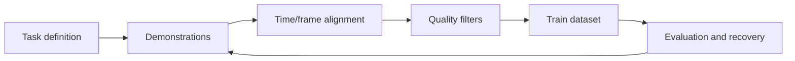
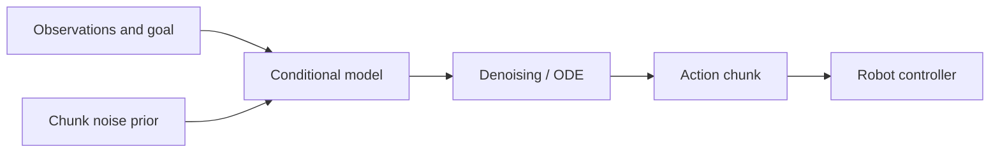

# Data Collection and Imitation Learning

<!-- course-meta:start -->
[Course home](https://github.com/zengxiong111/Foundation_of_Embodied_AI) · [简体中文](https://github.com/zengxiong111/Foundation_of_Embodied_AI/blob/main/md/Data_Imitation_Learning_ZH.md) · [PDF](https://zengxiong111.github.io/zengxiong.github.io/files/Data_Imitation_Learning_EN.pdf)

| Item | Details |
|---|---|
| Applicability | Demonstrations, BC, DAgger, ACT and generative chunk policies |
| Documentation review date | 2026-10-18 |
| License | CC BY 4.0 · Xiong Zeng and contributors |

**Verification scope:** Methods survey and proposed experiments; no validated training results. See [version notes](https://github.com/zengxiong111/Foundation_of_Embodied_AI/blob/main/VERSIONS.md) for pinned source references. Original teaching content uses [CC BY 4.0](https://creativecommons.org/licenses/by/4.0/); third-party quotations, figures and code retain their original licenses. Citation alone does not grant relicensing rights.
<!-- course-meta:end -->

<!-- course-toc:start -->
## Contents

- [1. From Demonstrations to a Trainable Dataset](#course-section-01)
  - [1.1 What One Demonstration Must Contain](#course-section-02)
  - [1.2 Time and Frames Come Before Architecture](#course-section-03)
- [2. Collection and Quality Control](#course-section-04)
  - [2.1 Beyond Successful Demonstrations](#course-section-05)
  - [2.2 Splits Matter More Than a Headline Score](#course-section-06)
- [3. Imitation Learning: BC to Interactive Correction](#course-section-07)
  - [3.1 Why Low Training Loss May Still Fail](#course-section-08)
  - [3.2 What DAgger Adds](#course-section-09)
- [4. From Single Actions to Generative Action Chunks](#course-section-10)
  - [4.1 ACT in One Picture](#course-section-11)
  - [4.2 Diffusion Policy and Flow Matching](#course-section-12)
- [5. Augmentation, Recalibration and Simulation](#course-section-13)
  - [5.1 Contact Events and Recovery Samples](#course-section-14)
  - [5.2 Safe Augmentation Boundaries](#course-section-15)
- [6. A Shared Panda Tabletop Experiment](#course-section-16)
  - [6.1 Minimum Experiment Matrix](#course-section-17)
  - [6.2 Debugging Checklist](#course-section-18)
- [7. Unified Data Model: From Demonstrations to Action Chunks](#course-section-19)
  - [7.1 Distinguish Latent State, Observations, and Commands](#course-section-20)
  - [7.2 The Action-Chunk Prediction Problem](#course-section-21)
  - [7.3 Time Alignment, Frames, and Action Normalization](#course-section-22)
- [8. Behavior Cloning: Objectives, Intuition, and Failure Modes](#course-section-23)
  - [8.1 Deterministic and Probabilistic BC](#course-section-24)
  - [8.2 Covariate Shift and Compounding Error](#course-section-25)
  - [8.3 Chunk Loss and Smoothness Trade-offs](#course-section-26)
- [9. Interactive Imitation and Recovering from Failure](#course-section-27)
  - [9.1 DAgger: Expert Queries on Learner-Visited States](#course-section-28)
  - [9.2 Failures, Recoveries, and Event-Biased Sampling](#course-section-29)
- [10. ACT, Diffusion Policy, and Flow Matching for Actions](#course-section-30)
  - [10.1 ACT: Conditional VAE and Transformer Chunks](#course-section-31)
  - [10.2 Diffusion Policy: Predict Noise in Action Space](#course-section-32)
  - [10.3 Flow Matching: Generative Velocity Is Not Joint Velocity](#course-section-33)
  - [10.4 Fair Comparisons Against BC](#course-section-34)
- [11. Human Video Retargeting, Contact, and Augmentation](#course-section-35)
  - [11.1 Human-to-Robot Is Not Pixel Imitation](#course-section-36)
  - [11.2 Augmentation Must Preserve Geometry and Physics](#course-section-37)
- [12. Training and Evaluation Protocol](#course-section-38)
  - [12.1 Offline Metrics, Closed-Loop Success, and Recovery](#course-section-39)
  - [12.2 A Shared Panda Tabletop Benchmark](#course-section-40)
- [13. Where This Fits and References](#course-section-41)
- [8. Deeper Foundations: Demonstrations and Supervised Objectives](#course-section-42)
  - [8.1 Episodes, Behavior Policies, and Causality](#course-section-43)
  - [8.2 Deterministic and Probabilistic BC](#course-section-44)
  - [8.3 Compounding Error and DAgger](#course-section-45)
- [9. Action Chunking, ACT, and Generative Imitation](#course-section-46)
  - [9.1 Prediction Versus Execution Horizon](#course-section-47)
  - [9.2 ACT and the CVAE Objective](#course-section-48)
  - [9.3 Diffusion Policy](#course-section-49)
  - [9.4 Flow Matching for Action Chunks](#course-section-50)
- [10. Data Quality and Evaluation](#course-section-51)
  - [10.1 Contacts, Failures, and Event-Aware Sampling](#course-section-52)
  - [10.2 Shared Panda Evaluation](#course-section-53)
  - [10.3 Connection to Agentic Robotics](#course-section-54)
<!-- course-toc:end -->

**Learning outcomes：** Identify data quality risks; compare BC, ACT, and generative action policies; design reproducible grasping experiments.

## 1. From Demonstrations to a Trainable Dataset

Imitation learning is not just storing a successful video. It turns observations, robot states, actions and task conditions into aligned and reproducible supervision. A closed-loop robot ultimately learns a conditional policy $\pi_\theta(a_t\mid o_{\le t},g)$, where $g$ is the goal.

### 1.1 What One Demonstration Must Contain

Each episode should at least log task/scene IDs, image timestamps, RGB or RGB-D, joint feedback, executed actions, action reference frame, control mode, success, and exceptional events. **The action label must identify the command actually issued**; do not mix commanded joint targets, measured positions, and joint velocities. For vision, specify whether camera extrinsics are fixed or time-varying.

### 1.2 Time and Frames Come Before Architecture

Use one clock basis or verified timestamp alignment. Define $T_{B}^{C}$, $T_{B}^{E}$ and $T_{B}^{O}$ under one transform convention. Cameras often run slower than proprioception; match past observations to action timestamps or use documented delay-aware interpolation, never future frames.

## 2. Collection and Quality Control

Common sources include teleoperation, kinesthetic teaching, scripted experts, simulated RL experts, and retargeted human video. They differ in throughput, action quality, contact fidelity, and hardware cost.

**Practical principle:** start with a smaller coherent dataset rather than accumulating large volumes of unaligned video.

### 2.1 Beyond Successful Demonstrations

Retain informative failures, corrective behavior, and recovery segments, with event boundaries such as first contact, slip, and regrasp. Do not blindly imitate every failed action: distinguish useful recovery demonstrations from unsafe commands. Record consent, data permissions, licensing, and robot safety review.

### 2.2 Splits Matter More Than a Headline Score

Split by object instance, scene layout, operator, initial configuration, and collection session. **Never put chunks from the same continuous trajectory in both train and test sets.** Report episode success, not only per-action MSE. Group synchronized views and adjacent frames together to prevent leakage.

## 3. Imitation Learning: BC to Interactive Correction

Behavior cloning (BC) fits actions from demonstrations. Deterministic regression can minimize $\mathcal{L}_{BC}=\mathbb{E}_{(o,a)\sim D}\|\pi_\theta(o)-a\|_2^2$; stochastic policies maximize conditional action likelihood. Neither objective automatically fixes deployment-time distribution shift.

### 3.1 Why Low Training Loss May Still Fail

In closed-loop execution, small action errors change future observations and push the robot outside the demonstration distribution. Record state drift, failed contacts, interventions, and recovery from perturbed states. Safe, supervised recovery demonstrations can expand coverage.

### 3.2 What DAgger Adds

DAgger collects states visited by the learner, queries an expert for suitable actions, and aggregates labeled data. A real robot needs safe intervention procedures. Offline retraining without expert relabeling of learner-visited states should not be called DAgger.

## 4. From Single Actions to Generative Action Chunks

Action chunks reduce the need to replan every servo tick but may use stale observations during execution. Distinguish prediction horizon, execution horizon, and policy query rate. The chunk's command frame must agree with the actual controller interface.

### 4.1 ACT in One Picture

ACT uses a Transformer to predict a sequence of actions; the original formulation includes a latent-variable mechanism for demonstration variation. Chunks suit continuous structured demonstrations, but alignment and overlap policies still matter.

### 4.2 Diffusion Policy and Flow Matching

Diffusion Policy and Flow Matching can both represent multimodal action distributions, but **denoising dynamics or generative velocity fields are not robot joint velocities**.

For fair comparison, control observation modalities, demonstration budget, inference budget, controller rate, and evaluation scenarios. Offline action loss alone is insufficient.

## 5. Augmentation, Recalibration and Simulation

Geometric augmentation must transform images, object goals, reference trajectories, and action labels consistently. Rotating images without transforming the appropriate action target can create incorrect supervision. Simulated expert trajectories expand coverage, but contact, rendering, and latency gaps require separate validation.

### 5.1 Contact Events and Recovery Samples

Start from a uniform-sampling baseline before oversampling near first contact, grasp failure, or object drop. Event sampling changes the training distribution; document weights and always evaluate on an unbiased test distribution.

### 5.2 Safe Augmentation Boundaries

Do not propagate arbitrary initial conditions into physically inconsistent contact trajectories. Check reachability, collision, contact consistency, and actuator limits after rotation, translation, scaling, or timing perturbations; short physics replay is useful before admitting data.

## 6. A Shared Panda Tabletop Experiment

**Task:** in Isaac Lab or MuJoCo, use a Panda arm to grasp a randomized cube; collect scripted or teleoperated demonstrations and train BC, ACT, and a generative policy.

**Control variables:** camera view, task count, command interface, control rate, object split, and episode count. Simple BC is a required baseline for generative methods.

**Metrics:** success, contact failure, trajectory drift, recovery, policy inference latency, servo latency, and demonstrations used. Report seeds and failure modes rather than claiming one family always wins.

### 6.1 Minimum Experiment Matrix

| Comparison | Purpose |
|---|---|
| One-step BC | Verify labels and controller |
| Chunked BC | Isolate chunking benefit |
| ACT | Test Transformer chunk prediction |
| Flow/Diffusion | Test multimodal action modelling |
| Recovery demos | Test closed-loop robustness |

### 6.2 Debugging Checklist

Check timestamps, command/feedback confusion, camera extrinsics, action scale, latency, execution horizon, data splits, and initial-state coverage before scaling the model. Training-set action MSE is not a substitute for robot task success.

## 7. Unified Data Model: From Demonstrations to Action Chunks

### 7.1 Distinguish Latent State, Observations, and Commands

In real manipulation the full world state $s_t$ (object motion, friction, contact modes) is usually not observed. We record images $o_t^{\mathrm{cam}}$, joint feedback $q_t$, actual actuator commands $a_t$, and a goal $g$. A demonstration may be represented as

$$
\tau_i=\{g_i,(o_t^{\mathrm{cam}},q_t,a_t,r_t^{\mathrm{event}})_{t=0}^{T_i-1}\}.
$$

The event label $r_t^{\mathrm{event}}$ may encode contact, slip, recovery, or completion; it need not be an RL reward. Ground-truth simulated object poses, future expert commands, or post-hoc outcome labels must not leak into the deployed policy observations. Keep issued commands distinct from delayed joint feedback.

### 7.2 The Action-Chunk Prediction Problem

Construct conditioning information $c_t=(o_{t-L+1:t},q_t,g)$ from an observation window, current proprioception and goal. The policy predicts an $H$-step sequence:

$$
A_t=(a_t,a_{t+1},\ldots,a_{t+H-1}),\qquad
p_\theta(A_t\mid c_t).
$$

Prediction horizon $H$ is **not** the number of steps that must run open-loop. Execute only $h\le H$ steps, observe, then replan. Document control interval, inference call interval, queueing and interpolation. For example, 30-Hz vision and 100-Hz servo feedback do not imply that the large VLA must run at 100 Hz; it does require a safe interpolation, hold and timeout policy.

### 7.3 Time Alignment, Frames, and Action Normalization

At action time $t_k^a$, training inputs must already have been available. Accounting for acquisition/transport lag $\delta$, choose a historical frame satisfying $t_j^{\rm image}\le t_k^a-\delta$ rather than a future frame. For Cartesian pose commands, base-frame left-multiplied increments $T_{BE,t+1}=\Delta T_{B,t}T_{BE,t}$ differ from end-effector-frame right-multiplied increments $T_{BE,t+1}=T_{BE,t}\Delta T_{E,t}$.

Estimate action normalization statistics only on the training set:

$$
\tilde a=(a-\mu_D)/(\sigma_D+\varepsilon),\qquad
a_{\rm deployed}=\tilde a(\sigma_D+\varepsilon)+\mu_D.
$$

Different joints, gripper apertures, rotations and force commands require consistent units and independent safety limits. Never use test data to fit normalization parameters.

## 8. Behavior Cloning: Objectives, Intuition, and Failure Modes

### 8.1 Deterministic and Probabilistic BC

Given expert samples $(c,a)\sim d_E$, a deterministic baseline minimizes

$$
\mathcal L_{\rm BC}(\theta)=\mathbb E_{(c,a)\sim d_E}\|\pi_\theta(c)-a\|_2^2.
$$

Under squared loss it converges toward the conditional mean $\mathbb E[a\mid c]$. This works for sufficiently unimodal behavior. If going left and going right around an obstacle are equally valid, the mean could collide with the obstacle. A probabilistic policy instead minimizes the negative log-likelihood

$$
\mathcal L_{\rm NLL}(\theta)=-\mathbb E_{(c,a)\sim d_E}\log p_\theta(a\mid c).
$$

For a Gaussian distribution with fixed isotropic variance, NLL is MSE up to scaling and constants. Mixtures or generative action distributions can represent multiple modes. **High dimensionality alone is not proof that ordinary BC is inadequate.**

### 8.2 Covariate Shift and Compounding Error

Offline BC learns on the expert occupancy $d_{\pi_E}$, while the deployed policy visits $d_{\pi_\theta}$:

$$
\min_\theta\mathbb E_{s\sim d_{\pi_E}}\ell(\pi_\theta(s),\pi_E(s))
\quad\not\Rightarrow\quad
\min_\theta\mathbb E_{s\sim d_{\pi_\theta}}\ell(\pi_\theta(s),\pi_E(s)).
$$

A small contact error may move the object to a state absent from expert training data. Collect intervention and recovery data; evaluate under deliberate safe perturbations, not solely on shuffled held-out action labels.

### 8.3 Chunk Loss and Smoothness Trade-offs

For variable-length episodes use a validity mask $m_{t,k}$ and optional horizon weight $w_k$:

$$
\mathcal L_{\rm chunk}=
\frac{\sum_{t,k}m_{t,k}w_k\|\hat a_{t+k\mid t}-a_{t+k}\|_1}
{\sum_{t,k}m_{t,k}w_k}.
$$

A smoothness penalty $\lambda_s\sum_k\|\hat a_{k+1}-\hat a_k\|^2$ may suppress unwanted oscillation, yet can also erase necessary changes at contact onset or release. Measure task success and contact-force peaks before choosing it based on visual smoothness.

## 9. Interactive Imitation and Recovering from Failure

### 9.1 DAgger: Expert Queries on Learner-Visited States

DAgger gathers the states the current learner actually visits and requests safe expert labels. At iteration $i$, a mixture $\pi_i=\beta_i\pi_E+(1-\beta_i)\pi_{\theta_i}$ visits $s\sim d_{\pi_i}$; the expert supplies $\pi_E(s)$:

$$
D_{i+1}=D_i\cup\{(s,\pi_E(s)):s\sim d_{\pi_i}\},\qquad
\theta_{i+1}=\arg\min_\theta\sum_{(s,a)\in D_{i+1}}\ell(\pi_\theta(s),a).
$$

The expert mixing probability $\beta_i$ is often decreased gradually. Hardware requires human intervention authority, velocity/force limits and emergency stops. Merely retraining from static offline trajectories is not DAgger.

### 9.2 Failures, Recoveries, and Event-Biased Sampling

Classify demonstrations as successful, recoverable failure, irrecoverable failure, or intervention. Annotate first contact, slip, drop, reacquisition and regrasp. Imitate only **safe and meaningful recovery actions**; unsafe failures may still be kept as negative outcome labels.

Compare uniform time sampling against event-biased sampling. A weighted loss is $\mathcal L=\sum_tw_t\ell_t/\sum_tw_t$, but modified sampling changes the training distribution. Always report unbiased test performance as well.

## 10. ACT, Diffusion Policy, and Flow Matching for Actions

### 10.1 ACT: Conditional VAE and Transformer Chunks

Action Chunking with Transformers (ACT) predicts a sequence of commands with a Transformer. Its original formulation uses a conditional variational autoencoder (CVAE) to represent variation in demonstrations. An encoder approximates $q_\phi(z\mid A,c)$, and a decoder models $p_\theta(A\mid z,c)$:

$$
\mathcal L_{\rm ACT}=
\mathbb E_{z\sim q_\phi}[-\log p_\theta(A\mid z,c)]
+\beta D_{\rm KL}(q_\phi(z\mid A,c)\|p(z)).
$$

The KL term regularizes the posterior against the latent prior. At inference there is no future ground-truth action chunk $A$; use the declared prior or a deterministic representative. Large $\beta$ can cause posterior collapse; tiny $\beta$ can create a mismatch between training posterior and inference prior.

### 10.2 Diffusion Policy: Predict Noise in Action Space

Let $A_0$ be a demonstrated action chunk, $\epsilon\sim\mathcal N(0,I)$, and $k$ the diffusion step. Construct

$$
A_k=\sqrt{\bar\alpha_k}A_0+\sqrt{1-\bar\alpha_k}\epsilon
$$

and fit the conditional noise prediction objective

$$
\mathcal L_{\rm diff}=
\mathbb E_{A_0,c,k,\epsilon}\|\epsilon-\epsilon_\theta(A_k,k,c)\|_2^2.
$$

At deployment, iterative denoising produces an action chunk. Execute a subset and replan from the next observation. The denoising step count, visual encoder and network architecture all affect latency; "generative" does not imply real-time.

### 10.3 Flow Matching: Generative Velocity Is Not Joint Velocity

Use data endpoint $A_1\sim p_{\rm data}(\cdot\mid c)$ and noise $A_0\sim\mathcal N(0,I)$. For a straight interpolation $A_\tau=(1-\tau)A_0+\tau A_1$, one possible training loss is

$$
\mathcal L_{\rm FM}=
\mathbb E_{c,A_0,A_1,\tau}
\|v_\theta(A_\tau,\tau,c)-(A_1-A_0)\|_2^2.
$$

Sample by solving $dA_\tau/d\tau=v_\theta(A_\tau,\tau,c)$. This vector field is a derivative in **generative time**, not the robot's physical $\dot q$. Path choices and time orientations vary by implementation. The continuity equation, conditional-expectation argument and OpenPI time convention are derived exclusively in the [Flow Matching tutorial](Flow_Matching_Step_by_Step_Derivation_EN.md); this chapter focuses on the imitation-learning interface.

### 10.4 Fair Comparisons Against BC

Use the same demonstrations, observation encoder, action representation, prediction/execution horizons and evaluation protocol for one-step BC, chunked BC, ACT, Diffusion Policy and Flow Matching. Record data volume, model calls, generation steps, inference latency and closed-loop success. Do not mistake the benefit of action chunking for the benefit of a Transformer, or of extra test-time computation for the learning algorithm itself.

## 11. Human Video Retargeting, Contact, and Augmentation

### 11.1 Human-to-Robot Is Not Pixel Imitation

A realistic pipeline is hand/tool pose recovery → scale and frame calibration → embodiment-specific retargeting → contact event detection → short physics replay and trajectory repair → policy training. Humans and robot hands differ in kinematics, reachability and contact friction. One task-dependent objective is

$$
\mathcal L_{\rm retarget}
=w_p\|p_{\rm robot}-p_{\rm target}\|^2+
w_R d_{SO(3)}(R_{\rm robot},R_{\rm target})^2+
w_c\mathcal L_{\rm contact}+w_j\mathcal L_{\rm limits}.
$$

Define $\mathcal L_{\rm contact}$ for the task, e.g. contact point error, surface normals, grasp maintenance or object slip. Mere proximity does not certify physical contact.

### 11.2 Augmentation Must Preserve Geometry and Physics

When perturbing object position, scale or orientation, transform task goals, observable geometry, trajectories and reference-frame-dependent labels consistently. Rotating an image without adjusting Cartesian action labels is typically invalid. Contact phases should be physically replayed to check penetration, limits, slip and unreasonable forces before accepting augmented episodes.

## 12. Training and Evaluation Protocol

### 12.1 Offline Metrics, Closed-Loop Success, and Recovery

| Test | Report | Does not replace |
|---|---|---|
| Held-out demonstrations | NLL / action error and chunk alignment | Closed-loop task success |
| Randomized starts | Success, completion time, collision/contact failures | Perturbation tests |
| Drop or disturbance | Recovery success, recovery latency, regrasp count | Nominal performance |
| Held-out objects/scenes | Generalization success with grouped splits | Data leakage checks |
| Runtime | Policy p50/p95 latency, actuation latency | A bare GPU FPS number |

For $k$ successes in $N$ independent episodes, report $\hat p=k/N$ and a confidence interval. The rough standard error is $\sqrt{\hat p(1-\hat p)/N}$; use a Wilson interval for small $N$ or near-boundary success rates. Frames from the same episode are not independent trials.

### 12.2 A Shared Panda Tabletop Benchmark

Use the same Panda arm, cube, and tabletop in simulation. First validate control labels, then compare one-step versus chunked BC, then ACT versus diffusion/flow, and finally add recovery demonstrations and contact perturbations. When transferring across Isaac and MuJoCo, disclose differences in contact solvers, actuator dynamics and timing.

**Chapter ownership:** this tutorial owns demonstration quality, supervised imitation, distribution shift and action-policy comparisons. Complete PPO/SAC derivations belong to their respective chapters; formal FM derivations belong to the [Flow Matching tutorial](Flow_Matching_Step_by_Step_Derivation_EN.md); the visual model toolbox belongs to [Visual Perception and State Estimation](Visual_State_Estimation_EN.md).

## 13. Where This Fits and References

This chapter bridges [camera calibration](Robot_Camera_Calibration_Tutorial_EN.md), [visual state estimation](Visual_State_Estimation_EN.md), [Flow Matching](Flow_Matching_Step_by_Step_Derivation_EN.md), and [GR00T / SONIC](System1_System0_GR00T_SONIC_EN.md).

- [ACT / ALOHA](https://arxiv.org/abs/2304.13705)
- [Diffusion Policy](https://arxiv.org/abs/2303.04137)
- [DAgger](https://arxiv.org/abs/1011.0686)
- [Flow Matching for Generative Modeling](https://arxiv.org/abs/2210.02747)
- [LeRobot](https://github.com/huggingface/lerobot)

**Verification boundary:** this chapter is a methods and experiment-design primer, not a claim that those policies were reproduced in the shared Panda setup.

## 8. Deeper Foundations: Demonstrations and Supervised Objectives

### 8.1 Episodes, Behavior Policies, and Causality

Represent an episode by $\\tau_i=(g_i,\\{o_t,q_t,a_t,r_t,\\delta_t\\}_{t=0}^{T_i-1})$ and a dataset by $D=\\{\\tau_i\\}_{i=1}^N$. Preserve camera and control timestamps separately. The logged label $a_t$ must specify the **actual command** rather than confusing commands with measured joint positions. Separate the expert $\\pi_E$, the collection policy $\\mu$, and the learner $\\pi_\\theta$; a mixed collection policy is not automatically an expert.

For a causal controller, $t_{\\mathrm{obs}}\\le t_{\\mathrm{act}}$. With observation and communication delay $d$, the deployed conditioning resembles $\\pi_\\theta(a_t\\mid o_{t-d},q_{t-d},g)$. Using future frames during offline training leaks information into the policy.

### 8.2 Deterministic and Probabilistic BC

Deterministic behavioral cloning minimizes

$$
\\mathcal L_{\\mathrm{BC}}(\\theta)=\\frac1{|D|}\\sum_{(o,a)\\in D}\\|\\pi_\\theta(o)-a\\|_2^2.
$$

A multimodal task, such as approaching an object from either side, may make the conditional mean unsafe. Stochastic BC instead minimizes

$$
\\mathcal L_{\\mathrm{NLL}}=-\\mathbb E_{(o,a)\\sim D}\\log\\pi_\\theta(a\\mid o,g).
$$

For a Gaussian policy, the objective contains $\\frac12(a-\\mu_\\theta)^\\top\\Sigma_\\theta^{-1}(a-\\mu_\\theta)+\\frac12\\log|\\Sigma_\\theta|$. MSE is an appropriate special case only when covariance assumptions are fixed. Normalize action units across joints, end-effector pose and hands.

### 8.3 Compounding Error and DAgger

Offline BC fits the state distribution $d^{\\pi_E}$ of collected demonstrations, whereas deployment visits $d^{\\pi_\\theta}$. Small one-step deviations can compound with horizon. DAgger collects learner-visited states and asks the expert for corresponding actions:

$$
D_{k+1}=D_k\\cup\\{(o,\\pi_E(o)):o\\sim d^{\\pi_{\\theta_k}}\\},\\qquad
\\theta_{k+1}=\\arg\\min_\\theta\\mathbb E_{(o,a)\\sim D_{k+1}}\\ell(\\pi_\\theta(o),a).
$$

Expert relabeling is essential. Retraining on an unchanged offline dataset is not DAgger. Human intervention and physical safety limits are necessary on robots.

## 9. Action Chunking, ACT, and Generative Imitation

### 9.1 Prediction Versus Execution Horizon

Let $A_t=(a_t,\\ldots,a_{t+H-1})$ be a predicted action chunk. Conditioning $c_t=(o_{t-k:t},q_t,g)$ leads to $\\hat A_t=f_\\theta(c_t)$. Execute only the first $h\\le H$ steps and replan. Distinguish policy inference rate $f_\\pi$, servo rate $f_c$ and execution time $h/f_c$. A controller must be able to interrupt a chunk after slip, tracking loss, or unexpected contact.

### 9.2 ACT and the CVAE Objective

In its original formulation, ACT uses a Transformer and a CVAE-like latent variable. A representative training objective is

$$
\\mathcal L_{\\mathrm{ACT}}=\\mathbb E_{q_\\phi(z\\mid A,c)}\\|A-f_\\theta(c,z)\\|_1+\\beta D_{\\mathrm{KL}}\\left(q_\\phi(z\\mid A,c)\\|p(z)\\right).
$$

The reconstruction term fits chunked actions; the KL term aligns the training posterior with the inference prior. Temporal ensembling between overlapping predictions should be evaluated particularly around discontinuous contact events.

### 9.3 Diffusion Policy

Given a clean chunk $A^0$ and noise $\\epsilon\\sim\\mathcal N(0,I)$, define $A^k=\\sqrt{\\bar\\alpha_k}A^0+\\sqrt{1-\\bar\\alpha_k}\\epsilon$. A common noise prediction objective is

$$
\\mathcal L_{\\mathrm{diff}}=\\mathbb E_{A^0,c,k,\\epsilon}\\|\\epsilon-\\epsilon_\\theta(A^k,k,c)\\|_2^2.
$$

Iterative denoising generates a chunk. Denoising steps are **generative compute steps**, not robot servo updates. Compare runtime and episode success under a fixed hardware budget.

### 9.4 Flow Matching for Action Chunks

Sample $x_0\\sim\\mathcal N(0,I)$ and take $x_1=A$. For the linear interpolation $x_s=(1-s)x_0+s x_1$, train

$$
\\mathcal L_{\\mathrm{FM}}=\\mathbb E_{s,x_0,x_1,c}\\|v_\\theta(x_s,s,c)-(x_1-x_0)\\|_2^2.
$$

Inference solves $\\mathrm dx_s/\\mathrm ds=v_\\theta(x_s,s,c)$. This notation integrates noise to data; implementations with reversed time require corresponding sign changes. **Full conditional/marginal velocity field derivations live in the [Flow Matching chapter](Flow_Matching_Step_by_Step_Derivation_EN.md)**. Here we focus on demonstration supervision and robot action interfaces.

## 10. Data Quality and Evaluation

### 10.1 Contacts, Failures, and Event-Aware Sampling

Maintain separate labels for successful expert behavior, expert recovery, informative failures, and unsafe failures not suitable for imitation. A contact label $c_t\\in\\{0,1\\}$ should come from a sensor or validated physical event; vision-only inferred contact must be labeled as estimated.

An optional event-biased sampler uses $w_t=1+\\lambda\\sum_j\\exp[-(t-t_j)^2/(2\\sigma^2)]$ around contact transition times $t_j$. This modifies the training distribution and is not necessarily better than uniform sampling. Compare both methods experimentally.

### 10.2 Shared Panda Evaluation

Use the shared Panda + table + cube task, with fixed cameras, controls, randomization seeds, and evaluation splits. Compare one-step BC, chunk BC, ACT, Diffusion Policy, and Flow Matching while separately ablating dataset size, execution horizon, recovery examples, perception noise, and inference budget.

Over $N$ test episodes, report $\\hat p=\\frac1N\\sum_i\\mathbf1[\\mathrm{success}_i]$ with uncertainty intervals, object and scene holdout protocols, contact failures, recovery, inference latency and total episode duration. Training action MSE alone is insufficient.

### 10.3 Connection to Agentic Robotics

This chapter owns the **demonstration-to-skill training process**. Task-level planning, verification and replanning are described in [Robot Agents](Robot_Agent_Workflow_EN.md); visual model selection and tracking live in [Visual State Estimation](Visual_State_Estimation_EN.md).
