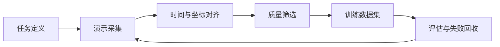
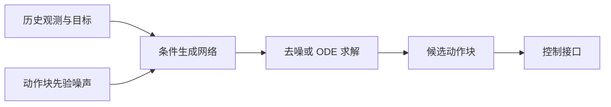

# 数据采集与模仿学习

<!-- course-meta:start -->
[课程首页](https://github.com/zengxiong111/Foundation_of_Embodied_AI/blob/main/README.zh-CN.md) · [English](https://github.com/zengxiong111/Foundation_of_Embodied_AI/blob/main/md/Data_Imitation_Learning_EN.md) · [PDF](https://zengxiong111.github.io/zengxiong.github.io/files/Data_Imitation_Learning_ZH.pdf)

| 项目 | 说明 |
|---|---|
| 适用范围 | 示教数据、BC、DAgger、ACT、生成式动作块策略 |
| 文档核验日期 | 2026-10-18 |
| 许可 | CC BY 4.0 · Xiong Zeng and contributors |

**核验边界：** 方法与实验设计，未实际复现训练。 版本与固定源码引用见[版本说明](https://github.com/zengxiong111/Foundation_of_Embodied_AI/blob/main/VERSIONS.zh-CN.md)。原创教材采用 [CC BY 4.0](https://creativecommons.org/licenses/by/4.0/)，第三方引用、图片及代码遵循其原有许可；注明来源不等于拥有再许可权。
<!-- course-meta:end -->

<!-- course-toc:start -->
## 目录

- [1. 从演示到可训练的数据](#course-section-01)
  - [1.1 一条轨迹应包含什么](#course-section-02)
  - [1.2 时间和坐标系先于网络结构](#course-section-03)
- [2. 数据采集与质量控制](#course-section-04)
  - [2.1 成功演示之外，还需要什么](#course-section-05)
  - [2.2 数据划分比指标数字更重要](#course-section-06)
- [3. 模仿学习：从 BC 到交互式纠错](#course-section-07)
  - [3.1 为什么训练误差低也会失败](#course-section-08)
  - [3.2 DAgger 是什么](#course-section-09)
- [4. 从单步动作到生成式动作块](#course-section-10)
  - [4.1 ACT 的核心思路](#course-section-11)
  - [4.2 Diffusion Policy 与 Flow Matching](#course-section-12)
- [5. 增强、再标定与仿真数据](#course-section-13)
  - [5.1 接触事件和恢复样本](#course-section-14)
  - [5.2 数据增强的安全边界](#course-section-15)
- [6. 统一 Panda 桌面抓取实验](#course-section-16)
  - [6.1 最小实验表](#course-section-17)
  - [6.2 常见失败排查](#course-section-18)
- [7. 统一数据模型：从轨迹到动作块](#course-section-19)
  - [7.1 为什么要区分真实状态、观测与命令](#course-section-20)
  - [7.2 Action Chunk 的学习目标](#course-section-21)
  - [7.3 时间戳、坐标系与归一化](#course-section-22)
- [8. BC 的数学形式、设计动机与局限](#course-section-23)
  - [8.1 确定性 BC 与概率 BC](#course-section-24)
  - [8.2 分布偏移：为什么测试时误差会累积](#course-section-25)
  - [8.3 动作块监督与平滑的取舍](#course-section-26)
- [9. 从离线 BC 到交互式模仿学习](#course-section-27)
  - [9.1 DAgger 的数据聚合与专家查询](#course-section-28)
  - [9.2 失败轨迹、恢复示教与标签质量](#course-section-29)
- [10. ACT、Diffusion Policy、Flow Matching 与 RTC：训练和执行](#course-section-30)
  - [10.1 ACT：CVAE 与 Transformer 动作块](#course-section-31)
  - [10.2 Diffusion Policy：以噪声预测学习动作块分布](#course-section-32)
  - [10.3 Flow Matching：动作速度场与物理速度不是一回事](#course-section-33)
  - [10.4 生成式策略和 BC 的公平对照](#course-section-34)
  - [10.5 RTC 为什么重要：从同步动作块到异步执行](#course-section-35)
  - [10.6 Inference-time RTC：把两段动作块衔接变成 Inpainting](#course-section-36)
  - [10.7 Training-time RTC：在模仿学习阶段学会遵守已承诺动作](#course-section-37)
  - [10.8 RTC 和 Temporal Ensembling、普通异步执行如何比较](#course-section-38)
- [11. 人类视频重定向、接触与数据增强](#course-section-39)
  - [11.1 从人类视频到机器人动作不是直接复制像素](#course-section-40)
  - [11.2 轨迹增强必须保持物理和标签一致](#course-section-41)
- [12. 建议的训练与评估规范](#course-section-42)
  - [12.1 区分离线预测、闭环成功率和扰动恢复](#course-section-43)
  - [12.2 一个贯穿课程的最小实验](#course-section-44)
- [13. 课程衔接与参考资料](#course-section-45)
<!-- course-toc:end -->

**学习目标：** 识别示教数据质量问题；理解 BC、DAgger、ACT、Diffusion/Flow 的动作块训练；区分 Inference-time 与 Training-time RTC，并设计兼顾延迟、连续性和任务成功率的实验。

## 1. 从演示到可训练的数据

模仿学习的目标不是保存一段看起来正确的视频，而是把观察、机器人状态、动作和任务条件组织成可对齐、可复现的监督信号。对于闭环机器人，最终学习的是条件策略 $\pi_\theta(a_t\mid o_{\le t},g)$，其中 $g$ 是目标。

### 1.1 一条轨迹应包含什么

建议每条 episode 至少保存：任务与场景 ID、相机时间戳、RGB 或 RGB-D、关节状态、执行动作、动作坐标系、控制模式、成功与否、异常事件。**动作标签必须表示实际发给机器人的命令**，不能把目标关节角、实际反馈位置和关节速度混为一谈。对视觉模型，还需注明相机外参是静态还是时变。

### 1.2 时间和坐标系先于网络结构

使用统一的时钟基准或经验证的时间对齐。标明 $T_{B}^{C}$、$T_{B}^{E}$、$T_{B}^{O}$ 的定义，所有姿态矩阵使用相同的乘法约定。相机通常低频，机器人本体状态可能更高频；可采用与动作时刻对齐的最近帧或带明确延迟的插值，避免未来信息泄漏。

## 2. 数据采集与质量控制

典型数据源包括遥操作、拖动示教、脚本专家、仿真 RL 专家和人类视频重定向。它们在采样效率、动作精度、接触真实性和设备成本上各有差异。

**实用原则：** 一开始优先获得质量稳定且可复现的小数据集，而不是尽快积累大量未标注或不同步的视频。

### 2.1 成功演示之外，还需要什么

保留有效的失败轨迹、纠错动作与恢复片段，并标注事件边界，例如接触开始、滑落、重新抓取。不要把所有失败都作为“照做”的标签；区分应模仿的恢复策略与应避免的危险命令。明确数据使用权限、隐私、许可证及真实机器人安全审核。

### 2.2 数据划分比指标数字更重要

按对象实例、场景布局、操作者、初始姿态和采集日期划分训练与测试；**禁止同一连续轨迹切块后同时出现在训练集和测试集**。记录真实 episode 级成功率，而不仅是逐动作 MSE。多相机或多帧观测应整体划分，防止相邻帧泄漏。

## 3. 模仿学习：从 BC 到交互式纠错

Behavior Cloning（BC）直接优化数据上的动作预测。对于确定性回归可采用 $\mathcal{L}_{BC}=\mathbb{E}_{(o,a)\sim D}\|\pi_\theta(o)-a\|_2^2$；对于概率策略则最大化动作条件对数似然。这两种目标并不自动解决测试时的分布偏移。

### 3.1 为什么训练误差低也会失败

闭环执行中，小的动作误差会改变下一时刻的观测，机器人可能进入训练集从未覆盖的状态。应在测试时记录状态偏移、触碰失败、纠错次数，以及是否能从偏离轨迹的状态恢复。可加入安全受控的小扰动或恢复示教，扩大有效状态覆盖。

### 3.2 DAgger 是什么

DAgger 的思想是让当前策略收集会访问的状态，并由专家为这些状态提供适当动作，再聚合数据更新策略。对真实机器人要有明确的安全干预机制；如果无法在线查询专家，就不能简单地把普通离线训练称为 DAgger。

## 4. 从单步动作到生成式动作块

生成动作块可减少频繁重规划的开销，但会引入执行中观测过时的风险。区分 chunk horizon（预测长度）、execution horizon（执行长度）与 policy query rate（模型调用频率）。动作块的控制参考系必须和机器人的实际执行器接口一致。

### 4.1 ACT 的核心思路

ACT 使用 Transformer 预测一段连续的动作，并在论文实现中借助潜变量建模演示差异。与逐步 BC 相比，动作块适合示教数据中连续且结构化的操作，但需要正确处理 chunk 的对齐与组合。

### 4.2 Diffusion Policy 与 Flow Matching

Diffusion Policy 与 Flow Matching 都可用生成式机制表示多模态动作分布，但**扩散去噪过程、概率流或速度场求解与机器人关节速度是不同概念**。

在比较方法时，固定观察模态、示教数据量、推理预算、控制频率与评估环境；不能只比较离线训练损失。

## 5. 增强、再标定与仿真数据

在机器人操作中，几何变换必须一致地作用于图像、物体目标、轨迹参考和动作标签。仅把图像旋转而不调整动作的增强通常会产生错误监督。仿真专家轨迹可以扩充姿态覆盖，但接触参数、视觉渲染和执行器时延的 Sim-to-Real 差异需要单独验证。

### 5.1 接触事件和恢复样本

报告均匀采样基线，再评估接触切换、夹持失败和物体掉落附近的增采样。事件采样改变训练数据分布，需要明确其权重以及是否扭曲自然状态分布；也要评估无事件偏置的测试集。

### 5.2 数据增强的安全边界

不应把任意初始条件直接传播到不满足物理约束的接触轨迹。对旋转、平移、尺度、时序扰动都检查可达性、碰撞、接触一致性和控制限幅；可先做短时物理回放再收录。

## 6. 统一 Panda 桌面抓取实验

**实验任务：** 在 Isaac Lab 或 MuJoCo 中让 Panda 抓取随机放置的方块，先生成脚本专家或遥操作轨迹，再训练 BC / ACT / 生成式策略。

**控制变量：** 固定相机视角、训练任务数、机器人动作接口、控制频率、训练/测试对象划分、评估回合数。以简单 BC 作为所有生成式方法的必要基线。

**指标：** 成功率、接触失败率、轨迹偏差、恢复率、平均策略推理延迟、平均控制延迟与数据量。每种方法报告多个随机种子和失败模式，而非宣称某方法天然最优。

### 6.1 最小实验表

| 对照 | 目的 |
|---|---|
| BC 单步 | 数据与控制接口是否正确 |
| BC 动作块 | 排除 chunking 本身的贡献 |
| ACT | 检验 Transformer 行为生成 |
| Flow/Diffusion | 检验多模态动作建模 |
| 增加恢复示教 | 检验闭环扰动恢复 |

### 6.2 常见失败排查

优先检查时间对齐、动作/反馈混淆、相机外参、动作缩放、延迟、策略执行长度、数据划分与初始化分布，最后再考虑扩大模型。不能用只在训练集上计算的 action MSE 代替真机任务成功率。

## 7. 统一数据模型：从轨迹到动作块

### 7.1 为什么要区分真实状态、观测与命令

在机器人控制中，真实世界状态 $s_t$（物体速度、摩擦系数、接触模式等）一般无法被完整观测。机器人可以记录图像 $o_t^{\mathrm{cam}}$、关节反馈 $q_t$、实际发送的控制命令 $a_t$ 和任务目标 $g$。将一条示教定义为

$$
\tau_i=\{g_i,(o_t^{\mathrm{cam}},q_t,a_t,r_t^{\mathrm{event}})_{t=0}^{T_i-1}\}.
$$
事件标注 $r_t^{\mathrm{event}}$ 可以表示接触、滑落、恢复与任务完成，**不是必须使用的强化学习奖励**。不要把仿真器的真实物体位姿、示教者未来的动作或后处理的成功标签偷放到部署策略输入。若监督信号来自动作命令而观测来自延迟的反馈，应明确这一时序关系。

### 7.2 Action Chunk 的学习目标

策略从最近 $L$ 帧观测、当前本体状态和目标构造条件 $c_t=(o_{t-L+1:t},q_t,g)$，预测长度为 $H$ 的动作块

$$
A_t=(a_t,a_{t+1},\ldots,a_{t+H-1}),\qquad
p_\theta(A_t\mid c_t).
$$
$H$ 是**预测长度**，不是必须开环执行的步数。实际执行 $h\le H$ 步后重新观测，构成滚动时域控制。策略查询周期、机器人低层控制周期、动作块执行长度必须分别记录。例如视觉为 30 Hz、低层伺服为 100 Hz 时，策略可以低于伺服频率运行，但中间的插值和超时机制不可省略。

### 7.3 时间戳、坐标系与归一化

动作时间为 $t_k^a$ 时，输入图像必须满足其**可用时间**不晚于 $t_k^a$。图像采集、传输与推理的延迟记为 $\delta$，采用 $t_j^{\rm image}\le t_k^a-\delta$ 的历史图像；不要使用未来图像对齐训练样本。对末端位姿动作，若增量定义在基座系可写作 $T_{BE,t+1}=\Delta T_{B,t}T_{BE,t}$；若定义在末端系则为 $T_{BE,t+1}=T_{BE,t}\Delta T_{E,t}$。**两种约定不可混用。**

对训练集中的动作分量计算 $\mu_D,\sigma_D$ 后归一化：

$$
\tilde a=(a-\mu_D)/(\sigma_D+\varepsilon),\qquad
a_{\rm deployed}=\tilde a(\sigma_D+\varepsilon)+\mu_D .
$$
不同关节角、夹爪开合或末端旋转需要正确的单位与限幅。检查归一化统计是否意外使用测试集数据。

## 8. BC 的数学形式、设计动机与局限

### 8.1 确定性 BC 与概率 BC

给定示教数据分布 $d_E(c,a)$，最简单的确定性 BC 优化

$$
\mathcal L_{\rm BC}(\theta)=\mathbb E_{(c,a)\sim d_E}\|\pi_\theta(c)-a\|_2^2.
$$
它在均方损失下趋向条件均值 $\mathbb E[a\mid c]$。当专家行为近似单峰时，它是低成本、值得保留的强基线；当同一条件下“从左绕开”和“从右绕开”都是合理动作时，平均行为可能撞上障碍物。

用概率模型更一般地写为最大似然：

$$
\mathcal L_{\rm NLL}(\theta)=-\mathbb E_{(c,a)\sim d_E}\log p_\theta(a\mid c).
$$
对于一般高斯 $p_\theta(a\mid c)=\mathcal N(\mu_\theta(c),\Sigma_\theta(c))$，NLL 包含 $\frac12(a-\mu_\theta)^\top\Sigma_\theta^{-1}(a-\mu_\theta)$ 和 $\frac12\log|\Sigma_\theta|$；因此只有协方差固定时才退化为加权 MSE。

若 $p_\theta$ 为方差固定的各向同性高斯分布，NLL 与带常数系数的 MSE 等价。多峰分布需要混合密度模型或生成式动作策略，**不能只因为动作维度高就认定 BC 必然失败**。

### 8.2 分布偏移：为什么测试时误差会累积

离线 BC 在专家访问的状态分布 $d_{\pi_E}$ 上训练，但部署后的数据来自 $d_{\pi_\theta}$，两者可能不同：

$$
\min_\theta\,\mathbb E_{s\sim d_{\pi_E}}\ell(\pi_\theta(s),\pi_E(s))
\quad\not\Rightarrow\quad
\min_\theta\,\mathbb E_{s\sim d_{\pi_\theta}}\ell(\pi_\theta(s),\pi_E(s)).
$$
一个小的接触误差可能触发物体滑动，使后续观察脱离训练分布。专家示教集中在成功轨迹时，模型可能根本没有见过“物体掉落后重新抓取”的状态。这解释了为什么测试需要扰动恢复回合，而不仅是随机抽样的动作回归误差。

### 8.3 动作块监督与平滑的取舍

在带掩码的变长轨迹中，动作块回归可以写为

$$
\mathcal L_{\rm chunk}=
\frac{\sum_{t,k}m_{t,k}w_k\|\hat a_{t+k\mid t}-a_{t+k}\|_1}
{\sum_{t,k}m_{t,k}w_k},
$$
其中 $m_{t,k}\in\{0,1\}$ 排除越界步，$w_k$ 可以减小远期预测权重。可选的动作平滑正则为 $\lambda_s\sum_k\|\hat a_{k+1}-\hat a_k\|^2$，但精密插装、接触切换时动作变化可能是必要的，**过度平滑会抹掉真实接触事件**。比较正则前后成功率和力/速度峰值，而不是只看曲线是否光滑。

## 9. 从离线 BC 到交互式模仿学习

### 9.1 DAgger 的数据聚合与专家查询

DAgger 的要点不是简单再训练，而是让当前策略暴露它自己会遇到的状态，专家再标注这些状态。第 $i$ 轮执行混合策略 $\pi_i=\beta_i\pi_E+(1-\beta_i)\pi_{\theta_i}$，采集 $s\sim d_{\pi_i}$，专家提供动作 $\pi_E(s)$，然后更新

$$
D_{i+1}=D_i\cup\{(s,\pi_E(s)):s\sim d_{\pi_i}\},\qquad
\theta_{i+1}=\arg\min_\theta\sum_{(s,a)\in D_{i+1}}\ell(\pi_\theta(s),a).
$$
$\beta_i$ 通常逐步降低。真实机器人上必须给专家接管、安全停止和强制限幅预留控制权；不能直接让未经审查的探索命令在硬件上自由执行。

### 9.2 失败轨迹、恢复示教与标签质量

示教可以分为成功完成、可恢复失败、不可恢复失败、人工中断四类。只对**可安全模仿的动作**建立监督，记录接触开始、滑移、掉落、重新定位、重新抓取等事件。对于不可安全复现的行为，应保留结果标签与日志用于分析，而不是直接做正例 BC。

可选的事件采样权重为 $w_t=1+\lambda\sum_j\exp[-(t-t_j)^2/(2\sigma^2)]$，其中 $t_j$ 表示接触/滑移等事件时刻。

建议在均匀时间采样的 baseline 之后再加入 event-biased sampling。若事件权重为 $w_t$，可以采用 $\mathcal L=\sum_tw_t\ell_t/\sum_tw_t$；必须披露其改变的训练分布，并在无偏的测试集上评估。

## 10. ACT、Diffusion Policy、Flow Matching 与 RTC：训练和执行

### 10.1 ACT：CVAE 与 Transformer 动作块

Action Chunking with Transformers（ACT）通过 Transformer 预测整段关节命令，原始方案还使用条件变分自编码器处理示教的风格差异。训练时编码器近似 $q_\phi(z\mid A,c)$，解码器给出 $p_\theta(A\mid z,c)$，常见的损失为

$$
\mathcal L_{\rm ACT}=
\mathbb E_{z\sim q_\phi}\big[-\log p_\theta(A\mid z,c)\big]
+\beta\,D_{\rm KL}(q_\phi(z\mid A,c)\|p(z)).
$$
第二项把示教编码分布约束到先验 $p(z)$；推理阶段没有真实未来动作块 $A$ 可用，应从约定先验采样或使用其确定性代表。$\beta$ 过大可能造成后验塌缩，过小则易使训练与推理潜变量分布不一致。

### 10.2 Diffusion Policy：以噪声预测学习动作块分布

令 $A_0$ 为真实动作块、$\epsilon\sim\mathcal N(0,I)$、扩散时间 $k$，构造

$$
A_k=\sqrt{\bar\alpha_k}A_0+\sqrt{1-\bar\alpha_k}\epsilon.
$$
一个常见的条件噪声预测目标为

$$
\mathcal L_{\rm diff}=
\mathbb E_{A_0,c,k,\epsilon}
\|\epsilon-\epsilon_\theta(A_k,k,c)\|_2^2.
$$
推理时从高斯噪声迭代去噪得到动作块，并只执行其中一部分，再基于新观测重规划。计算量由去噪步数、动作维度和视觉编码器共同决定；“生成式”本身不保证实时。

### 10.3 Flow Matching：动作速度场与物理速度不是一回事

为便于解释，设数据端点 $A_1\sim p_{\rm data}(\cdot\mid c)$、噪声 $A_0\sim\mathcal N(0,I)$，选择直线路径 $A_\tau=(1-\tau)A_0+\tau A_1$。一个条件速度回归目标为

$$
\mathcal L_{\rm FM}=
\mathbb E_{c,A_0,A_1,\tau}
\|v_\theta(A_\tau,\tau,c)-(A_1-A_0)\|_2^2.
$$
采样时求解生成空间 ODE：$dA_\tau/d\tau=v_\theta(A_\tau,\tau,c)$。其中 $v_\theta$ 是**动作样本在生成时间 $\tau$ 上的变化方向**，不是机械臂关节速度 $\dot q$。不同论文的时间方向和路径不同；严格的连续性方程、条件期望推导及 OpenPI 的时间约定统一放在 [Flow Matching 专题](Flow_Matching_详细推导_精简版.md)，本章只说明与模仿学习的接口。

### 10.4 生成式策略和 BC 的公平对照

先用相同数据、同一观测编码、同一动作表示和相同执行长度比较：单步 BC、chunked BC、ACT、Diffusion Policy、Flow Matching。报告训练数据量、推理频率、生成步数、动作延迟和实际任务成功率。不能把“ACT 的动作块收益”误记成“Transformer 架构收益”，也不能把更多推理计算导致的增益归因于算法本身。

### 10.5 RTC 为什么重要：从同步动作块到异步执行

**Real-Time Chunking（RTC）不是另一个 BC 损失函数，也不是一种新的机器人动作策略。** 它是使现有的 Diffusion / Flow Matching 动作块策略在高推理延迟下持续闭环工作的执行与条件生成方法。普通同步执行在每个动作块结束后等待下一次推理，机器人会暂停；简单地异步生成下一块虽能消除暂停，却可能在切换时跳到另一条合理但不连续的轨迹。Temporal Ensembling 将多条动作预测取平均，在多模态接触任务中也可能把两条可行轨迹平均成不可行轨迹。

设动作块长度为 $H$，每次实际执行 $s\le H$ 步，低层控制周期为 $\Delta t$，从观测采集到下一动作块可用的总推理延迟为 $\delta$。用控制步数表示延迟：

$$
d\approx\left\lceil\frac{\delta}{\Delta t}\right\rceil,\qquad
A_t=(a_t,\ldots,a_{t+H-1}).
$$
这里的向上取整是**工程调度中的保守近似**；原始 RTC 论文为便于分析使用 $\lfloor\delta/\Delta t\rfloor$，并通过近期观测延迟估计下一次 $d$。对原论文的异步调度，需要同时满足 $d\le s\le H-d$：$d\le s$ 确保能够在下一次切换前启动并完成推理，$d\le H-s$ 确保旧动作块覆盖生成延迟。还应为延迟抖动、初始化及超时预留余量。例如 50 Hz 控制对应 $\Delta t=20$ ms，实测延迟 140 ms 对应约 $d=7$ 步，若 $H=50$、$s=20$，则可提前启动下一块推理，而旧块继续提供控制命令。这个条件不替代丢包、超时与急停机制。

~~~mermaid
flowchart LR
  A["采集当前观测"] --> B["新动作块异步推理"]
  C["继续执行上一动作块"] --> D["推理时已经承诺的前缀"]
  B --> E["约束前缀并生成后缀"]
  D --> E
  E --> F["切换到平滑一致的新动作块"]
  F --> G["更新观测并再次重规划"]
~~~

### 10.6 Inference-time RTC：把两段动作块衔接变成 Inpainting

令 $\mathbf Y$ 表示**上一动作块中与新动作块的绝对时间索引对齐**的动作计划，$A^\tau$ 为新动作块生成过程在生成时间 $\tau\in[0,1]$ 的变量。由于前 $d$ 步已由上一块承诺执行，新块的前缀不能改变；其后仍与旧块重叠的动作可以软约束，以允许新观测修正计划。论文中的 Soft Mask 可以写为

$$
W_i=
\begin{cases}
1,& 0\le i<d,\\
c_i(e^{c_i}-1)/(e-1),&d\le i<H-s,\\
0,&H-s\le i<H,
\end{cases}
$$
$$
c_i=\frac{H-s-i}{H-s-d+1}.
$$
$W_i=1$ 的区间是已经决定执行的动作前缀；中间区间权重逐渐下降；最后 $s$ 步没有旧计划约束。这是**生成时的约束权重**，不能理解为对两个完整轨迹做后处理加权平均。

对于噪声到数据方向的 Flow Matching，一个局部的终点预测是

$$
\widehat A^1=A^\tau+(1-\tau)v_\theta(A^\tau,\tau,c).
$$
论文的 Pseudoinverse Guidance（Eq. 2–4）可等价写成加权误差负梯度形式：

$$
\widetilde v_\theta=
v_\theta-\lambda_\tau\nabla_{A^\tau}
\left[\frac12\|W^{1/2}\odot(\widehat A^1-Y)\|_2^2\right].
$$

其中原论文的权重截断精确为

$$
r_\tau^2=\frac{(1-\tau)^2}{\tau^2+(1-\tau)^2},\qquad
\lambda_\tau=\min\!\left(\beta,\frac{1-\tau}{\tau\,r_\tau^2}\right).
$$

$\beta$ 用于避免生成末期引导项数值过大；分母中的 $\tau$ 接近 0 或 1 时需采用实现规定的裁剪或数值保护。
更新 $A^{\tau+\Delta\tau}=A^\tau+\Delta\tau\,\widetilde v_\theta$，使生成动作块既兼容已经执行或承诺的前缀，又可更新未承诺的未来部分。梯度项需要在生成步骤计算向量–Jacobian 乘积，因此**Inference-time RTC 不必重新训练模型，但会增加推理计算**。该机制面向可做连续生成/引导的 Flow Matching 或 Diffusion Policy；对普通确定性 ACT 输出，不能直接假定同一 Inpainting 求解器可用。

### 10.7 Training-time RTC：在模仿学习阶段学会遵守已承诺动作

[Training-Time Action Conditioning for Efficient Real-Time Chunking](https://arxiv.org/abs/2512.05964) 进一步把“固定动作前缀”纳入监督训练。它直接学习：

$$
p_\theta(A_{d:H}\mid c,A_{0:d}),
$$
其中 $A_{0:d}$ 表示索引 $0,\ldots,d-1$ 的已承诺动作，$A_{d:H}$ 表示尚需生成的后缀（区间均采用左闭右开约定）。对一条完整专家动作块 $A$，随机采样部署延迟步数 $0\le d<H$、生成时间 $\tau$ 与噪声 $\epsilon$，构造逐动作的时间与输入：

$$
\bar\tau_i=
\begin{cases}1,&i<d,\\ \tau,&i\ge d,\end{cases}
\qquad
\widetilde A_i=\bar\tau_i A_i+(1-\bar\tau_i)\epsilon_i.
$$
因此前 $d$ 个动作是**未加噪的真值前缀**，后续动作才学习去噪；网络需要支持每个 action token 不同的生成时间条件。只对后缀计算条件 Flow Matching 损失：

$$
\mathcal L_{\mathrm{RTC-train}}=
\mathbb E_{A,c,d,\tau,\epsilon}\left[
\frac{1}{H-d}\sum_{i=d}^{H-1}
\|v_\theta(\widetilde A,\bar{\boldsymbol\tau},c)_i
-(A_i-\epsilon_i)\|_2^2
\right].
$$
部署时把上一块中已经确定的动作作为前缀传给生成器，固定其值，**仅生成未来后缀**。这样不需要 Inference-time RTC 每步额外的梯度引导，但需要针对延迟分布重新训练或微调，并可能丧失前述软重叠约束的灵活性。训练用的前缀来自专家示教，部署前缀可能来自模型自身计划；仍需用受控 rollout 测试这种分布偏移。

这一方法特别适合本章，因为它直接改变**模仿学习的训练样本构造、token 条件与损失掩码**；严格的速度场与 ODE 数学推导依旧留在 [Flow Matching 专章](Flow_Matching_详细推导_精简版.md)。训练时应从实测延迟分布采样 $d$，而不是无依据地指定统一延迟；例如论文在 $\pi_{0.6}$ 实验中训练了随机延迟前缀，并比较了模型延迟与任务性能。

### 10.8 RTC 和 Temporal Ensembling、普通异步执行如何比较

| 执行方法 | 是否等待推理 | 如何保证新旧动作块兼容 | 是否要改训练 |
|---|---|---|---|
| 同步 Chunking | 需要 | 块间通常停顿，动作从新观测开始 | 否 |
| Naive Asynchronous | 通常不等待 | 直接切换，可能有轨迹跳跃 | 否 |
| Temporal Ensembling | 可以异步 | 对重叠预测加权平均，多峰策略不一定有效 | 否 |
| Inference-time RTC | 异步 | 固定承诺前缀 + Soft Mask / 生成时引导 | **否**，但推理开销更高 |
| Training-time RTC | 异步 | 训练时以前缀为条件，部署时固定 Hard Prefix | **是**，推理不再额外做梯度引导 |

**最小实验：** 对同一个 Flow Matching 策略、同一动作频率、相同初始状态和相同控制安全层，比较上述五种模式，并注入 0/100/200 ms 的额外延迟。除了任务成功率、完成时间和每分钟吞吐量，还应记录实际端到端推理延迟 p50/p95、控制空档次数、块间动作跳变 $\|a_t-a_{t-1}\|$、加速度/jerk、接触失败率和掉落后的恢复率。要区分“模型推理时间”“动作交接延迟”和“机器人执行时间”，不能只展示离线 FPS。

**进一步阅读：** [RTC 原论文（NeurIPS 2025）](https://arxiv.org/abs/2506.07339)、[训练时前缀条件（2025）](https://arxiv.org/abs/2512.05964)、[Physical Intelligence 视频与解释](https://www.pi.website/research/real_time_chunking)、[LeRobot RTC 文档](https://huggingface.co/docs/lerobot/main/rtc)。2026 年的 [Soft RTC](https://arxiv.org/abs/2605.25537) 与 [DiscreteRTC](https://arxiv.org/abs/2604.25050) 进一步探索软重叠先验与离散动作生成器的原生 Inpainting，属于扩展阅读，**不能把它们的实验结论直接当作基础 RTC 的通用优势**。

## 11. 人类视频重定向、接触与数据增强

### 11.1 从人类视频到机器人动作不是直接复制像素

可采用“视频中的手/工具位姿估计 → 相机与尺度对齐 → 目标机器人运动学重定向 → 接触时间段识别 → 物理回放与不可达轨迹修复 → 学习”的链条。人类手与灵巧手的自由度、连杆长度及摩擦条件不同，简单的关节角映射通常不足以复现接触。重定向的目标可包含手部追踪、接触位置和约束软惩罚：

$$
\mathcal L_{\rm retarget}
=w_p\|p_{\rm robot}-p_{\rm target}\|^2
+w_R\,d_{SO(3)}(R_{\rm robot},R_{\rm target})^2
+w_c\mathcal L_{\rm contact}+w_j\mathcal L_{\rm limits}.
$$
这里 $\mathcal L_{\rm contact}$ 必须针对具体任务定义，例如接触点距离、接触法线、抓握保持或物体相对滑移；不等于“两个物体距离近”就保证存在力学接触。

### 11.2 轨迹增强必须保持物理和标签一致

对物体姿态的随机旋转与平移，需同步变换目标、观测几何和所有依赖参考系的动作标签。图像旋转不伴随动作坐标变换通常会导致错误监督。接触阶段还应在短时物理回放中检查指尖穿透、物体滑落、关节限位、控制频率和接触力，删去不可信增强片段。

## 12. 建议的训练与评估规范

### 12.1 区分离线预测、闭环成功率和扰动恢复

| 测试 | 应测指标 | 不能替代什么 |
|---|---|---|
| 留出示教集 | NLL / 动作误差、chunk 接口一致性 | 不能代替闭环成功率 |
| 常规随机初始位 | 成功率、完成时间、碰撞与接触失败率 | 不能代替扰动测试 |
| 扰动 / 掉落后恢复 | Recovery success、恢复时长、重新抓取次数 | 不能代替正常性能 |
| 跨场景和跨对象 | 分组划分的泛化成功率 | 不能使用相邻轨迹帧泄漏 |
| 系统实时性 | 策略推理 p50/p95 延迟、执行器延迟 | 不能只报告 GPU 帧率 |

成功率估计 $\hat p=k/N$ 应同时报告独立试验数 $N$、训练随机种子及置信区间；粗略标准误差为 $\sqrt{\hat p(1-\hat p)/N}$，当 $N$ 小或成功率接近 0/1 时采用 Wilson 区间。不能将相互相关的同一条轨迹的动作帧当作独立 episode。

### 12.2 一个贯穿课程的最小实验

在同一 Panda + 方块 + 桌面场景训练五个基线，固定训练 episode 数、相机、控制模式与任务划分。按阶段报告：首先验证动作标签，随后比较 BC 与 chunked BC，再比较 ACT、Diffusion/Flow，最后专门加入恢复示教并做随机外力或物体位姿扰动。在 Isaac / MuJoCo 交叉测试时明确控制器和接触模型可能不等价。

**章节边界：** 本章深入讲采集、示教监督、分布偏移、生成动作策略和数据设计；PPO/SAC 的理论推导仍在各自专题，Flow Matching 的严格数学推导见相应章节，视觉 6D 位姿与 SAM/Foundation 系列见 [视觉感知与状态估计](Visual_State_Estimation_ZH.md)。

## 13. 课程衔接与参考资料

本章连接[相机标定](Robot_Camera_Calibration_Tutorial_ZH.md)、[视觉状态估计](Visual_State_Estimation_ZH.md)、[Flow Matching](Flow_Matching_详细推导_精简版.md)与[GR00T / SONIC](System1_System0_GR00T_SONIC_CN.md)。

- [ACT / ALOHA](https://arxiv.org/abs/2304.13705)
- [Diffusion Policy](https://arxiv.org/abs/2303.04137)
- [DAgger](https://arxiv.org/abs/1011.0686)
- [Flow Matching for Generative Modeling](https://arxiv.org/abs/2210.02747)
- [LeRobot](https://github.com/huggingface/lerobot)

**核验边界：** 本章是方法与实验设计导论；没有声称这些算法已在本课程统一 Panda 环境复现。

