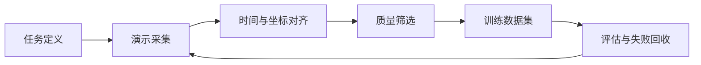
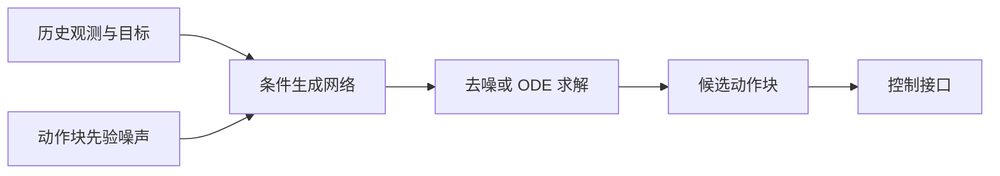

# 数据采集与模仿学习

<!-- course-meta:start -->
[课程首页](https://github.com/zengxiong111/Foundation_of_Embodied_AI/blob/main/README.zh-CN.md) · [English](https://github.com/zengxiong111/Foundation_of_Embodied_AI/blob/main/md/Data_Imitation_Learning_EN.md) · [PDF](https://zengxiong111.github.io/zengxiong.github.io/files/Data_Imitation_Learning_ZH.pdf)

| 项目 | 说明 |
|---|---|
| 适用范围 | 示教数据、BC、DAgger、ACT、生成式动作块策略 |
| 文档核验日期 | 2026-10-18 |
| 许可 | CC BY 4.0 · Xiong Zeng and contributors |

**核验边界：** 方法与实验设计，未实际复现训练。 版本与固定源码引用见[版本说明](https://github.com/zengxiong111/Foundation_of_Embodied_AI/blob/main/VERSIONS.zh-CN.md)。原创教材采用 [CC BY 4.0](https://creativecommons.org/licenses/by/4.0/)，第三方引用、图片及代码遵循其原有许可；注明来源不等于拥有再许可权。
<!-- course-meta:end -->

<!-- course-toc:start -->
## 目录

- [1. 从演示到可训练的数据](#course-section-01)
  - [1.1 一条轨迹应包含什么](#course-section-02)
  - [1.2 时间和坐标系先于网络结构](#course-section-03)
- [2. 数据采集与质量控制](#course-section-04)
  - [2.1 成功演示之外，还需要什么](#course-section-05)
  - [2.2 数据划分比指标数字更重要](#course-section-06)
- [3. 模仿学习：从 BC 到交互式纠错](#course-section-07)
  - [3.1 为什么训练误差低也会失败](#course-section-08)
  - [3.2 DAgger 是什么](#course-section-09)
- [4. 从单步动作到生成式动作块](#course-section-10)
  - [4.1 ACT 的核心思路](#course-section-11)
  - [4.2 Diffusion Policy 与 Flow Matching](#course-section-12)
- [5. 增强、再标定与仿真数据](#course-section-13)
  - [5.1 接触事件和恢复样本](#course-section-14)
  - [5.2 数据增强的安全边界](#course-section-15)
- [6. 统一 Panda 桌面抓取实验](#course-section-16)
  - [6.1 最小实验表](#course-section-17)
  - [6.2 常见失败排查](#course-section-18)
- [7. 课程衔接与参考资料](#course-section-19)
<!-- course-toc:end -->

**学习目标：** 识别数据质量问题；比较 BC、ACT 与生成式动作策略；设计可复现的抓取实验。

## 1. 从演示到可训练的数据

模仿学习的目标不是保存一段看起来正确的视频，而是把观察、机器人状态、动作和任务条件组织成可对齐、可复现的监督信号。对于闭环机器人，最终学习的是条件策略 $\pi_\theta(a_t\mid o_{\le t},g)$，其中 $g$ 是目标。

### 1.1 一条轨迹应包含什么

建议每条 episode 至少保存：任务与场景 ID、相机时间戳、RGB 或 RGB-D、关节状态、执行动作、动作坐标系、控制模式、成功与否、异常事件。**动作标签必须表示实际发给机器人的命令**，不能把目标关节角、实际反馈位置和关节速度混为一谈。对视觉模型，还需注明相机外参是静态还是时变。

### 1.2 时间和坐标系先于网络结构

使用统一的时钟基准或经验证的时间对齐。标明 $T_{B}^{C}$、$T_{B}^{E}$、$T_{B}^{O}$ 的定义，所有姿态矩阵使用相同的乘法约定。相机通常低频，机器人本体状态可能更高频；可采用与动作时刻对齐的最近帧或带明确延迟的插值，避免未来信息泄漏。

## 2. 数据采集与质量控制

典型数据源包括遥操作、拖动示教、脚本专家、仿真 RL 专家和人类视频重定向。它们在采样效率、动作精度、接触真实性和设备成本上各有差异。

**实用原则：** 一开始优先获得质量稳定且可复现的小数据集，而不是尽快积累大量未标注或不同步的视频。

### 2.1 成功演示之外，还需要什么

保留有效的失败轨迹、纠错动作与恢复片段，并标注事件边界，例如接触开始、滑落、重新抓取。不要把所有失败都作为“照做”的标签；区分应模仿的恢复策略与应避免的危险命令。明确数据使用权限、隐私、许可证及真实机器人安全审核。

### 2.2 数据划分比指标数字更重要

按对象实例、场景布局、操作者、初始姿态和采集日期划分训练与测试；**禁止同一连续轨迹切块后同时出现在训练集和测试集**。记录真实 episode 级成功率，而不仅是逐动作 MSE。多相机或多帧观测应整体划分，防止相邻帧泄漏。

## 3. 模仿学习：从 BC 到交互式纠错

Behavior Cloning（BC）直接优化数据上的动作预测。对于确定性回归可采用 $\mathcal{L}_{BC}=\mathbb{E}_{(o,a)\sim D}\|\pi_\theta(o)-a\|_2^2$；对于概率策略则最大化动作条件对数似然。这两种目标并不自动解决测试时的分布偏移。

### 3.1 为什么训练误差低也会失败

闭环执行中，小的动作误差会改变下一时刻的观测，机器人可能进入训练集从未覆盖的状态。应在测试时记录状态偏移、触碰失败、纠错次数，以及是否能从偏离轨迹的状态恢复。可加入安全受控的小扰动或恢复示教，扩大有效状态覆盖。

### 3.2 DAgger 是什么

DAgger 的思想是让当前策略收集会访问的状态，并由专家为这些状态提供适当动作，再聚合数据更新策略。对真实机器人要有明确的安全干预机制；如果无法在线查询专家，就不能简单地把普通离线训练称为 DAgger。

## 4. 从单步动作到生成式动作块

生成动作块可减少频繁重规划的开销，但会引入执行中观测过时的风险。区分 chunk horizon（预测长度）、execution horizon（执行长度）与 policy query rate（模型调用频率）。动作块的控制参考系必须和机器人的实际执行器接口一致。

### 4.1 ACT 的核心思路

ACT 使用 Transformer 预测一段连续的动作，并在论文实现中借助潜变量建模演示差异。与逐步 BC 相比，动作块适合示教数据中连续且结构化的操作，但需要正确处理 chunk 的对齐与组合。

### 4.2 Diffusion Policy 与 Flow Matching

Diffusion Policy 与 Flow Matching 都可用生成式机制表示多模态动作分布，但**扩散去噪过程、概率流或速度场求解与机器人关节速度是不同概念**。

在比较方法时，固定观察模态、示教数据量、推理预算、控制频率与评估环境；不能只比较离线训练损失。

## 5. 增强、再标定与仿真数据

在机器人操作中，几何变换必须一致地作用于图像、物体目标、轨迹参考和动作标签。仅把图像旋转而不调整动作的增强通常会产生错误监督。仿真专家轨迹可以扩充姿态覆盖，但接触参数、视觉渲染和执行器时延的 Sim-to-Real 差异需要单独验证。

### 5.1 接触事件和恢复样本

报告均匀采样基线，再评估接触切换、夹持失败和物体掉落附近的增采样。事件采样改变训练数据分布，需要明确其权重以及是否扭曲自然状态分布；也要评估无事件偏置的测试集。

### 5.2 数据增强的安全边界

不应把任意初始条件直接传播到不满足物理约束的接触轨迹。对旋转、平移、尺度、时序扰动都检查可达性、碰撞、接触一致性和控制限幅；可先做短时物理回放再收录。

## 6. 统一 Panda 桌面抓取实验

**实验任务：** 在 Isaac Lab 或 MuJoCo 中让 Panda 抓取随机放置的方块，先生成脚本专家或遥操作轨迹，再训练 BC / ACT / 生成式策略。

**控制变量：** 固定相机视角、训练任务数、机器人动作接口、控制频率、训练/测试对象划分、评估回合数。以简单 BC 作为所有生成式方法的必要基线。

**指标：** 成功率、接触失败率、轨迹偏差、恢复率、平均策略推理延迟、平均控制延迟与数据量。每种方法报告多个随机种子和失败模式，而非宣称某方法天然最优。

### 6.1 最小实验表

| 对照 | 目的 |
|---|---|
| BC 单步 | 数据与控制接口是否正确 |
| BC 动作块 | 排除 chunking 本身的贡献 |
| ACT | 检验 Transformer 行为生成 |
| Flow/Diffusion | 检验多模态动作建模 |
| 增加恢复示教 | 检验闭环扰动恢复 |

### 6.2 常见失败排查

优先检查时间对齐、动作/反馈混淆、相机外参、动作缩放、延迟、策略执行长度、数据划分与初始化分布，最后再考虑扩大模型。不能用只在训练集上计算的 action MSE 代替真机任务成功率。

## 7. 课程衔接与参考资料

本章连接[相机标定](Robot_Camera_Calibration_Tutorial_ZH.md)、[视觉状态估计](Visual_State_Estimation_ZH.md)、[Flow Matching](Flow_Matching_详细推导_精简版.md)与[GR00T / SONIC](System1_System0_GR00T_SONIC_CN.md)。

- [ACT / ALOHA](https://arxiv.org/abs/2304.13705)
- [Diffusion Policy](https://arxiv.org/abs/2303.04137)
- [DAgger](https://arxiv.org/abs/1011.0686)
- [LeRobot](https://github.com/huggingface/lerobot)

**核验边界：** 本章是方法与实验设计导论；没有声称这些算法已在本课程统一 Panda 环境复现。
