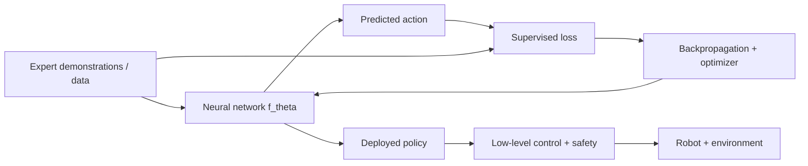
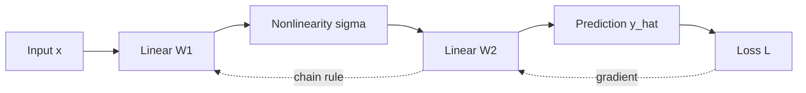
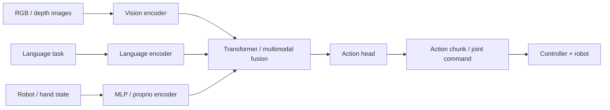

# Deep Learning Foundations for Embodied AI: From Gradient Descent to Transformers

[Course home](https://github.com/zengxiong111/Foundation_of_Embodied_AI) · [中文 Markdown](Deep_Learning_Foundations_ZH.md) · [English PDF](https://zengxiong111.github.io/zengxiong.github.io/files/Deep_Learning_Foundations_EN.pdf)

*Supervised learning, backpropagation, MLPs, Transformers, and robot policy networks*  
**Updated: October 19, 2026**

**Central questions.** How does a robot learn an action from demonstrations? How does an objective change network parameters through backpropagation? What are the distinct roles of an MLP and a Transformer? How do vision, language, and proprioception produce commands that a robot can execute?

## Contents

- [1. Deep learning as a robot-learning problem](#deep-section-01)
- [2. Supervised learning: examples, objectives, generalization](#deep-section-02)
- [3. Gradient descent and backpropagation: a step-by-step derivation](#deep-section-03)
- [4. MLPs: the simplest neural robot policies](#deep-section-04)
- [5. Transformers: from tokens to Attention](#deep-section-05)
- [6. Multimodal Transformers and robot action heads](#deep-section-06)
- [7. Pretraining, fine-tuning, and RL post-training](#deep-section-07)
- [8. Stable learning and evaluation for robotic data](#deep-section-08)
- [9. Real-time inference and deployment](#deep-section-09)
- [10. Model choice, misconceptions, and reading paths](#deep-section-10)
- [11. Glossary and references](#deep-section-11)

---

## 1. Deep learning as a robot-learning problem

### 1.1 Learn a conditional mapping, not merely the next word

At physical time $t$, let $o_t$ denote visual observations, $q_t$ denote proprioception (joint position, velocity, gripper state), and $g$ denote the task condition. A minimal policy is

$$
\hat a_t=f_\theta(o_t,q_t,g),\qquad
u_t=\operatorname{Controller}(\hat a_t,q_t),
$$

where $\theta$ contains the trainable parameters, $\hat a_t$ is the **intended policy action**, and $u_t$ is the actual command after control, filtering, clipping, and safety checks. These quantities can have different units and rates. An action may be a joint target, an end-effector pose increment, or a predicted action chunk $A_t=(a_t,\ldots,a_{t+H-1})$.

Deep learning addresses **how to represent a conditional mapping or probability distribution with trainable parameters**. Physical feasibility, contact constraints, delay, safety, and generalization do not follow automatically from model scale.

<!--PDFFIG:overview-->

*Figure 1. The training loop uses labels to compute errors and update parameters. The execution loop still requires control and safety interfaces.*

### 1.2 Four layers of terminology that should not be mixed

| Layer | Question it answers | Examples in embodied AI |
|:--|:--|:--|
| **Network architecture** | How are inputs mapped to outputs? | MLP, CNN, ViT, Transformer |
| **Training objective** | What prediction counts as a good one? | MSE, cross-entropy, NLL, Flow Matching loss |
| **Parameter optimizer** | How are parameters updated for a loss? | SGD, momentum, AdamW |
| **Learning paradigm / algorithm** | Which data and feedback drive improvement? | BC, DAgger, PPO, SAC, RL post-training |

**BC can use an MLP or a Transformer.** **Flow Matching is an objective, not a uniquely prescribed network architecture.** **PPO and SAC are RL algorithms, not merely gradient optimizers.** A VLA is a system of encoders, conditioning mechanisms, action representations, and training procedures rather than one Attention equation.

## 2. Supervised learning: examples, objectives, generalization

### 2.1 Constructing examples from demonstrations

Write a labeled dataset as $\mathcal D=\{(x_i,y_i)\}_{i=1}^{N}$. For robot behavior cloning (BC), $x_i=(o_i,q_i,g_i)$ and $y_i=a_i^E$ is an expert action. Supervised learning minimizes empirical risk:

$$
\hat\theta=\arg\min_\theta\frac1N\sum_{i=1}^{N}\ell(f_\theta(x_i),y_i).
$$

Input-to-label **time alignment** is essential. A camera exposure timestamp, a command dispatch timestamp, and a measured robot-state timestamp are generally different. Pairing a post-action observation with a pre-action label can introduce leakage or an invalid causal relationship.

### 2.2 Regression losses for continuous actions

The most familiar regression objective is mean squared error:

$$
\mathcal L_{\mathrm{MSE}}=\frac1N\sum_{i=1}^N\|f_\theta(x_i)-a_i^E\|_2^2.
$$

A positive-semidefinite weighting matrix can account for differing scales of joint angles, translations, and rotations:

$$
\mathcal L_W=\frac1N\sum_i(\hat a_i-a_i^E)^\top W(\hat a_i-a_i^E),\qquad W\succeq0.
$$

Always specify angular units, reference frames, and normalization. Plain Euclidean losses on orientation coordinates need not respect the geometry of $SO(3)$; geometric pose losses belong in a subsequent robotics course.

For an $H$-step chunk padded near the end of an episode, use validity indicators $m_{ik}\in\{0,1\}$:

$$
\mathcal L_{\rm chunk}=\frac{\sum_{i,k}m_{ik}\,\ell(\hat a_{ik},a_{ik}^E)}{\sum_{i,k}m_{ik}+\varepsilon}.
$$

Otherwise, padding values may be learned as if they were valid expert commands.

### 2.3 Classification, probabilistic prediction, and maximum likelihood

For discrete grasps or contact modes, cross-entropy is suitable:

$$
\mathcal L_{\rm CE}=-\frac1N\sum_i\log p_\theta(y_i\mid x_i).
$$

If continuous actions follow a Gaussian model $p_\theta(a\mid x)=\mathcal N(a;\mu_\theta(x),\Sigma)$ with fixed covariance, the negative log-likelihood (NLL), ignoring constants independent of $\theta$, is

$$
\mathcal L_{\rm NLL}=\frac1{2N}\sum_i(a_i-\mu_\theta(x_i))^\top\Sigma^{-1}(a_i-\mu_\theta(x_i)).
$$

With fixed isotropic covariance, minimizing MSE and maximizing Gaussian likelihood give the same optimal mean. If covariance is learned too, retain the $\tfrac12\log\det\Sigma_\theta(x)$ term. Omitting it lets the model trivially reduce the quadratic term by inflating uncertainty.

### 2.4 Why low supervised loss does not imply successful manipulation

Action distributions can be multimodal: an obstacle may be bypassed on either side. Point-estimate MSE training tends toward the conditional mean $\mathbb E[a\mid x]$, which may be an infeasible action between the two expert modes. ACT, Diffusion, and Flow Matching can model richer distributions, but **expressive multimodality** is not the same as **closed-loop recovery**.

In addition, the BC dataset samples states from the expert distribution $d^{\pi_E}$, while deployment visits states under $d^{\pi_\theta}$. Small early errors can lead to unfamiliar contact configurations; interactive labeling, DAgger, corrective demonstrations, or RL can improve coverage. Those mechanisms are addressed in the imitation-learning and post-training tutorials.

## 3. Gradient descent and backpropagation: a step-by-step derivation

### 3.1 What gradient descent actually changes

For a differentiable loss $\mathcal L(\theta)$, the gradient points in the local direction of steepest increase. The simplest update is

$$
\boxed{\theta^{(k+1)}=\theta^{(k)}-\eta\nabla_\theta\mathcal L(\theta^{(k)})},
$$

where $\eta>0$ is the learning rate. A first-order Taylor approximation gives

$$
\mathcal L(\theta-\eta g)\approx\mathcal L(\theta)-\eta\nabla\mathcal L(\theta)^\top g.
$$

Choosing $g=\nabla\mathcal L(\theta)$ decreases the linear approximation by $\eta\|\nabla\mathcal L\|^2$. This does **not** guarantee that the actual step decreases loss when the learning rate is too large or curvature and gradient noise are significant.

### 3.2 Compute one update for a linear action predictor

Let $\hat a=wx+b$, with a single-example loss $L=\tfrac12(wx+b-y)^2$. Setting $e=wx+b-y$ yields

$$
\frac{\partial L}{\partial w}=ex,\qquad\frac{\partial L}{\partial b}=e.
$$

For $x=2,y=3,w=1,b=0$, the prediction is $2$, the error is $-1$, and the gradient is $(-2,-1)$. With $\eta=0.1$,

$$
(w^+,b^+)=(1,0)-0.1(-2,-1)=(1.2,0.1).
$$

The new prediction is $2.5$, and the loss drops from $0.5$ to $0.125$. **Gradient descent is not directly moving the robot's arm; it changes the network so that future action predictions change.**

### 3.3 The chain rule for a two-layer MLP

Consider

$$
z_1=W_1x+b_1,\qquad h=\sigma(z_1),\qquad \hat y=W_2h+b_2,
$$

with $L=\tfrac12\|\hat y-y\|_2^2$. Define the output error $\delta_2=\hat y-y$. The chain rule gives

$$
\begin{aligned}
\nabla_{W_2}L&=\delta_2 h^\top, &\nabla_{b_2}L&=\delta_2,\\
\delta_1&=(W_2^\top\delta_2)\odot\sigma'(z_1),\\
\nabla_{W_1}L&=\delta_1x^\top, &\nabla_{b_1}L&=\delta_1.
\end{aligned}
$$

The symbol $\odot$ denotes elementwise multiplication. The backward signal $\delta_1$ transports the output's loss information to earlier layers. **Backpropagation is an efficient way to evaluate the chain rule on a computation graph; it is not itself an optimizer competing with gradient descent.**

For $x\in\mathbb R^{d}$, $h\in\mathbb R^{m}$, and $\hat y\in\mathbb R^{p}$, the matrices have shapes $W_1\in\mathbb R^{m\times d}$ and $W_2\in\mathbb R^{p\times m}$. Gradients have the same shapes as their corresponding parameters. Dimensional checks catch many errors in manual derivations.

<!--PDFFIG:backprop-->

*Figure 2. Forward computation produces a prediction; backward computation propagates local derivatives through the graph.*

### 3.4 Mini-batches, SGD, and AdamW

In practice, a mini-batch of size $B$ estimates the gradient:

$$
g_k=\frac1B\sum_{i\in\mathcal B_k}\nabla_\theta\ell_i(\theta_k),\quad\theta_{k+1}=\theta_k-\eta g_k.
$$

**SGD** uses the current stochastic gradient; momentum averages directions across iterations; **Adam** also adapts steps using second moments of gradient components. Its basic statistics are

$$
\begin{aligned}
m_k&=\beta_1m_{k-1}+(1-\beta_1)g_k,\\
v_k&=\beta_2v_{k-1}+(1-\beta_2)g_k\odot g_k,\\
\hat m_k&=m_k/(1-\beta_1^k),\qquad\hat v_k=v_k/(1-\beta_2^k).
\end{aligned}
$$

AdamW decouples weight decay from the adaptive gradient update:

$$
\theta_{k+1}=(1-\eta\lambda)\theta_k-\eta\frac{\hat m_k}{\sqrt{\hat v_k}+\epsilon}.
$$

Here $\lambda$ is the weight-decay coefficient. Not every parameter group (for instance, many bias and normalization parameters) must use the same decay settings. Learning-rate schedules, gradient clipping, and mixed precision improve numerical behavior but cannot fix incorrect expert labels.

## 4. MLPs: the simplest neural robot policies

### 4.1 Feed-forward layers and nonlinear activations

A multilayer perceptron composes affine maps with nonlinear activations:

$$
h^{(0)}=x,\quad h^{(\ell+1)}=\sigma(W_\ell h^{(\ell)}+b_\ell),\quad f_\theta(x)=W_Lh^{(L)}+b_L.
$$

If every $\sigma$ is the identity, a stack of linear layers collapses to one linear map; nonlinearity is essential. ReLU uses $\max(0,z)$, while GELU and SiLU are smooth alternatives popular in modern networks. Activation choice affects optimization and compute costs, but no activation is universally optimal for robotic tasks.

### 4.2 MLP actors, critics, and estimators

| Network | Typical input | Output | Training signal |
|:--|:--|:--|:--|
| MLP Actor | $q_t,\dot q_t,\hat x_t,g$ | $a_t$ or policy parameters | BC / policy gradients |
| MLP Value Critic | $s_t$ or available observation | $V_\phi(s_t)$ | Return / TD targets |
| MLP Q Critic | $(s_t,a_t)$ | $Q_\phi(s_t,a_t)$ | Bellman target |
| Proprioceptive estimator | IMU, current, observation history | Velocity, contact, latent state | Supervised / self-supervised |
| Action Head | Backbone hidden features | Commands / action tokens | MSE / NLL / generative objective |

These are common starting points, not restrictions: critics can consume images or Transformer features, and actors and critics may use different observations (asymmetric Actor-Critic). **Architecture** and **training signal** are separate choices.

### 4.3 Why MLPs remain useful in foundation-model robotics

For low-dimensional proprioception or high-rate low-level feedback, an MLP often offers low latency and a simple numerical interface. It does not need to tokenize every scalar. However, long observation histories, image patches, object relationships, and language instructions motivate mechanisms for explicit interaction among many elements; that is a central reason for Transformers.

Residual connections of the form $h_{l+1}=h_l+F_l(h_l)$ help deeper networks train; initialization, normalization, and scaling matter as well. Importantly, **the feed-forward subnetwork inside a Transformer block is usually itself an MLP** with shared parameters applied separately to each token position.

## 5. Transformers: from tokens to Attention

### 5.1 Replacing one fixed vector with token sequences

A Transformer processes a sequence $X=[x_1;\ldots;x_n]\in\mathbb R^{n\times d}$. Language tokens come from embedding lookup; images can be split into patches and projected into visual tokens; joint states, action history, and end-effector goals can likewise be encoded as one or multiple tokens. **An internal token is not automatically one physical robot control command.**

Without time or positional information, attention alone does not specify the distinction between “grasp, then rotate” and “rotate, then grasp.” Models therefore use learned/absolute position embeddings, relative biases, rotary position embeddings, or another explicit ordering mechanism.

### 5.2 Deriving Self-Attention

From the same token matrix, construct Query, Key, and Value:

$$
Q=XW_Q,\quad K=XW_K,\quad V=XW_V,
$$

where $Q,K\in\mathbb R^{n\times d_k}$ and $V\in\mathbb R^{n\times d_v}$. A Query $q_i$ scores Key $k_j$ by the scaled dot product $q_i^\top k_j/\sqrt{d_k}$. Row-wise Softmax normalizes the scores:

$$
\alpha_{ij}=\frac{\exp(q_i^\top k_j/\sqrt{d_k})}{\sum_{r=1}^{n}\exp(q_i^\top k_r/\sqrt{d_k})}.
$$

The updated token is $z_i=\sum_j\alpha_{ij}v_j$, or in matrix form

$$
\boxed{\operatorname{Attention}(Q,K,V)=\operatorname{softmax}\!\left(\frac{QK^\top}{\sqrt{d_k}}+M\right)V.}
$$

$M$ is an optional attention mask: inaccessible entries receive $-\infty$, making their normalized weights zero. **Self-Attention performs information exchange; it is not a robot-safety monitor.**

### 5.3 Multi-Head Attention, FFNs, residuals, and LayerNorm

Separate heads can represent different relations:

$$
\operatorname{MHA}(X)=\operatorname{Concat}(Z_1,\ldots,Z_h)W_O.
$$

A common Pre-Norm block can be summarized as

$$
Y=X+\operatorname{MHA}(\operatorname{LN}(X)),\qquad
Z=Y+\operatorname{FFN}(\operatorname{LN}(Y)).
$$

The FFN uses shared weights at each token position; mixing information **between** token positions mainly occurs through Attention. LayerNorm normalizes features, and residuals provide a more direct gradient path. Other valid Transformer designs use different placement of normalization and other components.

### 5.4 Encoders, causal decoders, and Cross-Attention

An **encoder-style** block allows bidirectional interaction among observations, making it natural for perception and fusion. An **autoregressive decoder** uses a causal mask so that a position reads only allowed preceding context. **Cross-Attention** uses Queries from one representation to retrieve Keys and Values from another:

$$
Q=HW_Q,\quad K=CW_K,\quad V=CW_V,\quad
\operatorname{CrossAttn}(H,C)=\operatorname{Attention}(Q,K,V).
$$

For example, $H$ can be action queries, and $C$ an encoded visual-language context. ACT can use queries to read fused multiview and proprioceptive features and produce an action chunk in parallel. VLAs can employ separate vision-language backbones and action experts, among many other fusion designs. **Transformers are not restricted to World Action Models.**

### 5.5 Attention complexity and temporal context

Naive full Attention creates an $n\times n$ score matrix, so time and attention-score memory can scale approximately quadratically with sequence length. Multi-camera, high-resolution, or long-video inputs motivate token compression, sparse or hierarchical designs, and efficient kernels. FlashAttention reduces data movement and can improve the implementation of exact Attention; it does not itself determine the temporal horizon needed by a robot.

## 6. Multimodal Transformers and robot action heads

### 6.1 Fusing images, instructions, and proprioception

A conceptual robot foundation model is

$$
\begin{aligned}
Z_v&=E_v(I_{t-k:t}),\qquad Z_g=E_g(g),\\
Z_q&=E_q(q_{t-k:t}),\qquad
H=F_\theta(Z_v,Z_g,Z_q),\\
A_t&\sim p_\theta(\cdot\mid H).
\end{aligned}
$$

$E_v$ might be a CNN or ViT, $E_g$ a language Transformer, and $E_q$ an MLP. The fusion module $F_\theta$ may use concatenation, Cross-Attention, or another mechanism. The action head transforms a hidden representation into robot actions. This equation describes **responsibilities**, not a universal architecture or mandatory end-to-end training procedure.

<!--PDFFIG:multimodal-->

*Figure 3. A schematic modular multimodal robot policy; specific systems may share, rearrange, or omit encoders.*

### 6.2 Four action-head families and their objectives

| Action head | Objective | Output | Benefit and limitation |
|:--|:--|:--|:--|
| Deterministic MLP | MSE / L1 | One continuous action | Simple, fast; limited multimodality |
| Probabilistic head | NLL / CE | Gaussian or discrete tokens | Captures uncertainty within chosen family |
| ACT / Chunked head | Reconstruction + latent KL | $H$ future actions | Produces smooth chunks; timing matters |
| Diffusion / Flow head | Denoising / velocity regression | Iteratively sampled chunks | Complex distributions; sampling delay |

For a straight-path conditional Flow Matching example, sample $A_0\sim\mathcal N(0,I)$, $A_1\sim p_{\rm demo}(\cdot\mid H)$, and $\tau\sim U[0,1]$, then let $A_\tau=(1-\tau)A_0+\tau A_1$. A standard training objective is

$$
\mathcal L_{\rm FM}=\mathbb E\big[\|v_\theta(A_\tau,\tau,H)-(A_1-A_0)\|^2\big].
$$

Here $v_\theta$ is a **generative velocity field** and $\tau$ is artificial sampling time, not physical joint velocity or the robot control clock. Full generative-policy details belong in the Flow Matching course.

### 6.3 The network cannot guess an incorrectly specified action interface

Robot execution time, camera sampling time, inference time, and future action horizon are different quantities. If a policy predicts an end-effector displacement $\Delta x$, deployment must not interpret it as an absolute pose $x$. **A neural architecture learns only within the input, label, and control contracts provided to it.**

## 7. Pretraining, fine-tuning, and RL post-training

### 7.1 One policy may pass through several learning stages

Pretraining extracts reusable representation or behavior priors from larger datasets. Supervised fine-tuning (SFT/BC) increases performance on task-specific demonstrations. RL post-training uses interaction and rewards to improve success, precision, robustness, or recovery. These phases are not distinct network architectures, nor does every project need to follow all phases in exactly this order.

$$
\underbrace{\theta_0=\arg\min_\theta\mathcal L_{\rm pre}}_{\text{pretraining}}
\quad\longrightarrow\quad
\underbrace{\theta_1=\arg\min_\theta\mathcal L_{\rm BC}}_{\text{SFT / BC}}
\quad\longrightarrow\quad
\underbrace{\text{Improve }J(\pi_\theta)}_{\text{interaction / RL}}.
$$

RL actors may still be MLPs or Transformers, and critics are still trained through gradients. The crucial difference is the source of targets, feedback, and trajectory data. Using AdamW is not synonymous with supervised learning. Likewise, freezing a Transformer does not imply that no learning occurs if an action head, adapter, or residual policy is still trainable.

### 7.2 Full fine-tuning, partial updates, frozen backbones, and LoRA

Partition parameters into backbone $\theta_b$ and head $\theta_h$. Full fine-tuning updates both; a frozen backbone imposes $\Delta\theta_b=0$ and optimizes the head. Low-Rank Adaptation (LoRA) changes a selected weight matrix by a low-rank increment:

$$
W'=W+\Delta W,\qquad\Delta W=BA,\qquad\operatorname{rank}(BA)\le r.
$$

Usually the original $W$ is fixed while $A$ and $B$ are trainable. **LoRA is a parameter-efficient update mechanism, not an objective and not a form of reward feedback.** Altering the trainable interface alone does not solve generative sampling delay, credit assignment, or safe exploration.

### 7.3 Why RL post-training depends on the underlying network

An implicit generative policy need not expose tractable $\log\pi_\theta(A\mid o)$. Therefore a conventional probability-ratio policy update may require additional parameterization, surrogate objectives, value networks, or adapters outside a frozen generator. The dedicated RL post-training tutorial treats these methods; the central prerequisite here is to separate **architecture, trainable parameter subset, and policy-optimization interface**.

## 8. Stable learning and evaluation for robotic data

### 8.1 Dataset splits and evaluation metrics

Split training and validation by **independent trajectories, scenes, objects, or recording sessions**, not merely by random adjacent video frames. Evaluate both prediction loss and task performance: success rate, pose error, contact failure types, end-to-end latency, collisions, and recovery. A lower offline BC loss does not imply a higher closed-loop success rate.

### 8.2 Learning rate, normalization, and numerical stability

Inputs are often normalized from training-set statistics: $\tilde x=(x-\mu_x)/(\sigma_x+\varepsilon)$. Action denormalization must preserve actuator units. Gradient clipping limits extreme updates; mixed precision may reduce accelerator memory use but demands checks for NaN/Inf and scaling issues. Visual preprocessing, joint order, axis convention, camera extrinsics, and control rate all form part of the model interface.

### 8.3 Underfitting, overfitting, and shift

Underfitting can result from insufficient capacity, poor optimization, noisy labels, or unobservable states. Overfitting may show up as success on training objects but failure on unseen configurations. Regularization, data augmentation, broader training scenes, and suitable freezing may help generalization, but cannot guarantee recovery of hidden contact information or correct physical dynamics. Robustness to pose noise, occlusions, and friction variations must be demonstrated through separate closed-loop evaluation.

## 9. Real-time inference and deployment

### 9.1 Forward passes, action chunks, and servo periods

Deployment usually executes forward inference; it does not automatically backpropagate at every control tick. Let the low-level servo period be $\Delta t_c$ and the sensor-to-new-action-chunk latency be $T_{\rm lat}$. The approximate number of elapsed control steps is

$$
d=\left\lceil\frac{T_{\rm lat}}{\Delta t_c}\right\rceil.
$$

If a policy predicts $H$ future actions and typically executes $K$ before querying again, safe chunk handoff must account for latency, remaining overlap, and a fallback strategy. $H$ (prediction horizon), $K$ (execution length), and $d$ (latency in ticks) are distinct. Real-Time Chunking and asynchronous execution are explored in the imitation-learning tutorial.

### 9.2 KV caches, FlashAttention, and Flow sampling steps

KV caching reuses earlier Keys and Values during **autoregressive token generation**, avoiding repeated processing of unchanged context. It cannot be carried over automatically to every bidirectional vision encoder that re-encodes complete images. FlashAttention optimizes memory traffic in Attention evaluation, but does not on its own resolve robot chunk discontinuities or tail latency. Generative action-head latency further depends on sampling iterations, backbone cost per evaluation, and solver choices. Fast training is not equivalent to stable real-time control.

### 9.3 Safety remains a systems problem

Vision-based network actions often need unit conversion, joint and velocity/torque limits, collision checking, low-level servo control, and failure recovery. Precise contact operations also suffer from visual occlusion, unmeasured contact forces, and estimation error. Simply increasing Transformer capacity cannot remove those sensing and safety limits.

## 10. Model choice, misconceptions, and reading paths

### 10.1 Choosing an initial architecture from task requirements

| Requirement | Reasonable starting point | When to consider richer models |
|:--|:--|:--|
| Low-dimensional fast feedback | MLP Actor / Critic | Need long history or richer perception |
| Simple demonstration imitation | MLP BC / chunked BC | Multimodal actions or long consistency |
| Multi-camera + language + state | Visual encoder + Transformer fusion | Longer time, 3D relations, transfer |
| Multimodal continuous chunks | ACT / Diffusion / Flow head | Choose by distribution and latency budget |
| Adapt a frozen foundation model | Action head / adapter / LoRA | Compare update surfaces at fixed budgets |

Before choosing, identify available sensors, reference frames for labeled actions, servo period, permitted online interaction, and the train/test robot mismatch. These recommendations are **architectural starting points, not an empirical leaderboard**.

### 10.2 Six misconceptions to avoid

1. **“Backpropagation is gradient descent.”** The first computes derivatives; the second uses them to update parameters.
2. **“A Transformer is a robot foundation model.”** It is a component. The full model also needs observation, action, and training interfaces.
3. **“Flow Matching must be slower than an MLP.”** The comparison ignores network, solver steps, and hardware; these are different taxonomy axes.
4. **“Lower training loss proves higher robot success.”** Offline prediction does not measure closed-loop contact or recovery.
5. **“An Actor–Critic must have exactly two fixed architectures.”** The networks can share or separate features, observations, and learning targets.
6. **“A VLA that predicts actions makes low-level control unnecessary.”** Prediction, physical execution, and independent safety supervision remain distinct.

### 10.3 Recommended next readings

After this course, follow two complementary paths in the repository. **Imitation and foundation models:** BC/DAgger → ACT → Flow Matching → RL Post-training → GR00T/SONIC. **Robot-control RL:** Robot Dynamics → Isaac/MuJoCo → PPO/SAC → Motion-Control RL. For Robot Agents, add the separate concerns of planning, tool use, policy execution, and physical verification.

## 11. Glossary and references

| Term | Meaning in this course |
|:--|:--|
| Supervised learning | Fit an input-output mapping from labeled examples |
| Empirical risk | Average objective over the training dataset |
| Backpropagation | Efficient chain-rule evaluation of parameter gradients |
| Gradient descent | Update parameters against their local loss gradient |
| Multilayer perceptron (MLP) | Composition of affine maps and nonlinear activations |
| Self-Attention | Token interactions within a sequence |
| Cross-Attention | Queries that retrieve information from another context |
| Action head | Converts hidden features into a robot action representation |
| Frozen backbone | Keeps selected pretrained parameters fixed |
| Post-training | Further adaptation of a previously pretrained system |

**Key papers and further reading (ordered by prerequisites):**

1. Rumelhart, Hinton & Williams (1986), *Learning representations by back-propagating errors*. [Nature](https://doi.org/10.1038/323533a0).
2. Kingma & Ba (2015), *Adam: A Method for Stochastic Optimization*. [arXiv:1412.6980](https://arxiv.org/abs/1412.6980).
3. Loshchilov & Hutter (2019), *Decoupled Weight Decay Regularization*. [arXiv:1711.05101](https://arxiv.org/abs/1711.05101).
4. Vaswani et al. (2017), *Attention Is All You Need*. [arXiv:1706.03762](https://arxiv.org/abs/1706.03762).
5. Dosovitskiy et al. (2021), *An Image Is Worth 16x16 Words*. [arXiv:2010.11929](https://arxiv.org/abs/2010.11929).
6. Hu et al. (2022), *LoRA: Low-Rank Adaptation of Large Language Models*. [arXiv:2106.09685](https://arxiv.org/abs/2106.09685).
7. Zhao et al. (2023), *Learning Fine-Grained Bimanual Manipulation with Low-Cost Hardware* (ACT). [arXiv:2304.13705](https://arxiv.org/abs/2304.13705).
8. Chi et al. (2023), *Diffusion Policy: Visuomotor Policy Learning via Action Diffusion*. [arXiv:2303.04137](https://arxiv.org/abs/2303.04137).
9. Lipman et al. (2023), *Flow Matching for Generative Modeling*. [arXiv:2210.02747](https://arxiv.org/abs/2210.02747).
10. Kim et al. (2024), *OpenVLA: An Open-Source Vision-Language-Action Model*. [arXiv:2406.09246](https://arxiv.org/abs/2406.09246).

Original instructional text is available under [CC BY 4.0](https://creativecommons.org/licenses/by/4.0/). Diagrams are conceptual, not official end-to-end architecture claims for a particular VLA. Papers and third-party projects retain their respective licenses.
