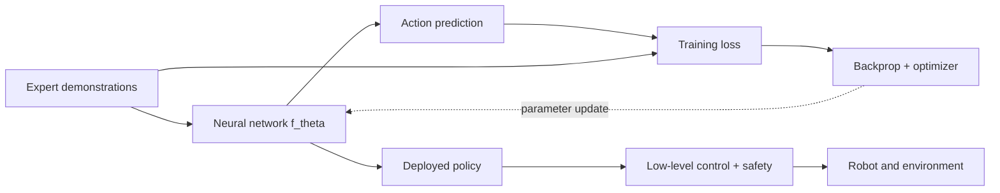
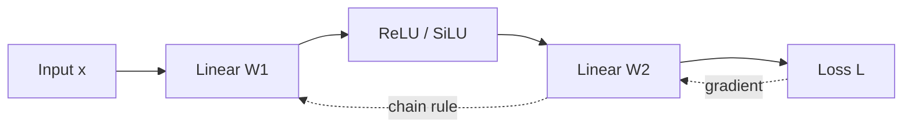
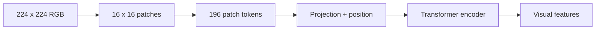
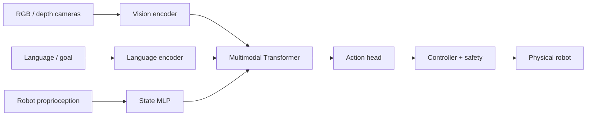

# Deep Learning Foundations for Embodied AI: From Gradient Descent to Transformers

[Course homepage](https://github.com/zengxiong111/Foundation_of_Embodied_AI) · [中文 Markdown](Deep_Learning_Foundations_ZH.md) · [English PDF](../pdf/Deep_Learning_Foundations_EN.pdf)

| Item | Description |
|:--|:--|
| Topic | Deep Learning Foundations |
| Updated | 2026-10-29 |
| Prerequisites | Basic linear algebra, calculus, and Python |
| License | CC BY-NC-SA 4.0 · Xiong Zeng and contributors |

**A unifying example:** Throughout these notes, a camera-equipped robot learns to locate a screwdriver, pick it up, and execute the learned behavior on physical hardware. This single task connects problem formulation, neural networks, losses, gradients, visual features, multimodal fusion, action generation, training, and deployment.

## Contents

- [1. Understanding deep learning through a robot task](#deep-section-01)
- [2. From linear models to multilayer perceptrons](#deep-section-02)
- [3. Loss functions, probability models, and behavior cloning](#deep-section-03)
- [4. Backpropagation and neural-network optimization](#deep-section-04)
- [5. Training a reliable neural network](#deep-section-05)
- [6. Visual representations: from CNNs to Vision Transformers](#deep-section-06)
- [7. Transformers: from tokens to attention](#deep-section-07)
- [8. Multimodal models and robot action generation](#deep-section-08)
- [9. From pretraining to RL post-training](#deep-section-09)
- [10. From network training to robot deployment](#deep-section-10)
- [Appendix A. BPTT and differentiable world models](#deep-appendix-a)
- [Appendix B. Glossary, reading paths, and references](#deep-appendix-b)

<!--PDFBODY-->

<a id="deep-section-01"></a>

## 1. Understanding deep learning through a robot task

### 1.1 A running example: picking up a screwdriver

Consider a camera-equipped robot with an arm and dexterous hand that must pick up a screwdriver from a table. At time $t$, its image is $I_t$, proprioceptive state is $q_t$ (possibly including joint positions, velocities, and hand state), and task condition is $g$. Define the policy input $x_t=(I_t,q_t,g)$ and learn

$$
\boxed{\hat a_t=f_\theta(I_t,q_t,g),\qquad u_t=\operatorname{Controller}(\hat a_t,q_t).}
$$

The parameters are $\theta$. The policy proposes an action $\hat a_t$, while $u_t$ is the actual command after frame transforms, interpolation, rate limits, servo feedback, and safety checks. The proposed action might be a joint target, joint increment, end-effector pose, relative end-effector displacement, or a length-$H$ action chunk. **These interfaces are not interchangeable.** Lower prediction error during training does not automatically resolve friction, contact, collision avoidance, or servo stability.

<!--PDFFIG:overview-->


*Figure 1. During training, the policy connects to labels and an optimizer; during deployment, it connects to the controller and physical world.*

### 1.2 From demonstrations to supervised examples

An expert trajectory is $\tau=(x_0,a_0^E,x_1,a_1^E,\ldots)$, where $E$ denotes expert actions. The dataset can be represented as

$$
\mathcal D=\{(x_i,a_i^E)\}_{i=1}^{N}.
$$

Camera exposure, frame arrival, action transmission, and robot feedback occur at different times. One must specify the timestamp of $x_t$ and the meaning of $a_t^E$: for example, the target selected when the image was observed rather than the arm configuration **after** the action finished. Using future observations can produce leakage or an incorrect causal alignment. Joint order, angular units, world/base/tool frames, and action rates should also be recorded.

### 1.3 Six design axes that should not be conflated

| Design axis | Question | Examples |
|:--|:--|:--|
| Architecture | What trainable computation processes information? | MLP, CNN, ViT, Transformer, DiT |
| Observations and conditioning | What can the policy actually observe? | RGB-D, joint state, instructions, history |
| Action representation | What exactly is predicted? | One-step joint delta, Cartesian pose, action chunk, action token |
| Training objective | What discrepancy is minimized? | MSE, cross-entropy, NLL, denoising, Flow Matching |
| Optimizer and trainable subset | How are which parameters updated? | SGD, AdamW, frozen backbone, LoRA |
| Learning paradigm | Where does supervision or improvement come from? | BC, DAgger, offline data, online RL |

For example, **Flow Matching is a generative training objective, not another name for a Transformer.** An action chunk is a temporal output representation, not a standalone neural architecture. PPO and SAC are RL algorithms; they are not optimizers in the same sense as SGD and AdamW. We will use these distinctions throughout the course.

**Recap and exercise:** Write down $x_t$, $\hat a_t$, $u_t$, timestamps, and reference frames for your own robot policy. Why can a predicted Cartesian displacement not be treated as an absolute pose?

<a id="deep-section-02"></a>

## 2. From linear models to multilayer perceptrons

### 2.1 A linear policy: the smallest trainable model

First suppose another module has already estimated the screwdriver position and we only use a normalized scalar input $x$ to predict a joint target $\hat a$:

$$
\hat a=wx+b.
$$

With $x=2,w=1,b=0$, the prediction is $\hat a=2$. The multi-input, multi-output version is

$$
\hat a=Wx+b,\quad x\in\mathbb R^{d},\quad W\in\mathbb R^{p\times d},\quad\hat a\in\mathbb R^p.
$$

Linear models are fast and interpretable, but they cannot represent complicated piecewise rules such as “rotate the wrist when the object is on the left, but move the arm first when it is on the right.” Composing multiple linear layers **without nonlinearities** is still equivalent to a single affine transformation.

### 2.2 Nonlinear activations and the forward pass of an MLP

A one-hidden-layer MLP is

$$
\boxed{z_1=W_1x+b_1,\quad h=\sigma(z_1),\quad\hat a=W_2h+b_2.}
$$

Here $\sigma$ is an elementwise nonlinearity. ReLU is $\max(0,z)$; GELU and SiLU are also common in modern models. Hidden width $m$ determines the number of intermediate features, while depth refers to stacked transformations. Both affect representational capacity, optimization difficulty, and inference cost. Always check dimensions: if $x\in\mathbb R^d$, $h\in\mathbb R^m$, and $\hat a\in\mathbb R^p$, then $W_1\in\mathbb R^{m\times d}$ and $W_2\in\mathbb R^{p\times m}$.

As a scalar example, take $x=2,W_1=1,b_1=0,W_2=1,b_2=0$. ReLU produces $h=2$ and the prediction is $\hat a=2$. This is a **forward pass**, not training: it only evaluates the current network weights.

### 2.3 Why deeper is not necessarily better

A small network may underfit; a large one with limited data may memorize training objects and tabletop textures instead of learning transferable grasping behavior. Residual connections $h_{\ell+1}=h_\ell+F_\ell(h_\ell)$ create short paths for gradient propagation; initialization, normalization, and activations also influence deep optimization. For high-frequency low-level robot policies, compact MLPs remain attractive because their inference cost and latency are predictable.

### 2.4 One architecture, several possible roles

| Role | Typical input | Output | Supervision / training signal |
|:--|:--|:--|:--|
| BC actor | Robot state, estimated object pose | Continuous action | Expert action labels |
| Value critic | State or available observations | $V_\phi(s)$ | Returns or TD targets |
| Q critic | State and action | $Q_\phi(s,a)$ | Bellman targets |
| Proprioceptive estimator | IMU, current, history | Velocity/contact/hidden state | Supervised or self-supervised |
| Foundation-model action head | Fused vision-language features | Action parameters or tokens | BC, NLL, generative targets |

Actors, critics, and estimators do not necessarily require different architectural families. These role names specify inputs, outputs, and learning signals.

**Recap and exercise:** For $d=10,m=64,p=7$, count the parameters (including biases) of a two-layer MLP. Why does removing ReLU prevent stacked affine layers from gaining nonlinear expressivity?

<a id="deep-section-03"></a>

## 3. Loss functions, probability models, and behavior cloning

### 3.1 Empirical risk minimization

Given $N$ pairs of expert inputs and labels, behavior cloning (BC) solves

$$
\boxed{\hat\theta=\arg\min_\theta\frac1N\sum_{i=1}^N\ell(f_\theta(x_i),a_i^E).}
$$

The loss $\ell$ penalizes predictions on training examples; it is not a measurement of deployed task success. A common objective for continuous actions is mean squared error (MSE):

$$
\mathcal L_{\rm MSE}=\frac1N\sum_{i=1}^N\|\hat a_i-a_i^E\|_2^2.
$$

Action components may have different physical units. Joint angles, Cartesian translations, and normalized finger coordinates should not be combined without a convention. A positive-semidefinite weighting matrix $W\succeq0$ defines $\ell_W=(\hat a-a^E)^\top W(\hat a-a^E)$. For orientation prediction, Euclidean losses on a chosen coordinate representation do not automatically respect the geometry of $SO(3)$; the loss must be consistent with the representation.

### 3.2 Why MSE is related to a Gaussian model

Suppose an expert continuous action follows a conditional Gaussian:

$$
p_\theta(a\mid x)=\mathcal N(a;\mu_\theta(x),\Sigma).
$$

The negative log-likelihood (NLL) of one example is

$$
-\log p_\theta(a\mid x)=\frac12(a-\mu_\theta(x))^\top\Sigma^{-1}(a-\mu_\theta(x))
+\frac12\log\det\Sigma+\frac p2\log(2\pi).
$$

When $\Sigma=\sigma^2 I$ is fixed, the terms depending on $\theta$ are proportional to MSE: both objectives optimize the same conditional mean. If the covariance is predicted, the $\log\det\Sigma_\theta(x)$ term **must be retained**, otherwise the network can reduce the quadratic term simply by inflating its predicted uncertainty. Probability models express uncertainty, but a single Gaussian cannot capture two well-separated valid grasp modes.

### 3.3 Classification and cross-entropy

For a discrete contact class or action token, a Softmax distribution produces $p_\theta(k\mid x)$. Given class label $y_i$, the cross-entropy is

$$
\mathcal L_{\rm CE}=-\frac1N\sum_{i=1}^N\log p_\theta(y_i\mid x_i).
$$

MSE for continuous regression, cross-entropy for discrete categories, and Gaussian NLL rely on different output semantics and probabilistic assumptions. They cannot be swapped without considering the target representation.

### 3.4 Multimodal actions: a mean may not be executable

Consider a scene where the robot can move around the screwdriver either left or right. Two equally likely scalar demonstrations are $a=-1$ and $a=+1$. The best point prediction under squared loss is $\mathbb E[a\mid x]=0$, which might cause a frontal collision. Increasing MLP width does not necessarily resolve this objective-induced averaging. Generative action models aim to represent richer shapes of $p(a\mid x)$ or $p(A\mid x)$ and sample one valid behavioral mode.

### 3.5 Masks and temporal alignment for action chunks

An action chunk is $A_t=(a_t,\ldots,a_{t+H-1})$. Short trajectories padded to length $H$ require a validity mask $m_{ik}\in\{0,1\}$:

$$
\mathcal L_{\rm chunk}=\frac{\sum_{i,k}m_{ik}\,\ell(\hat a_{ik},a_{ik}^E)}{\sum_{i,k}m_{ik}+\varepsilon}.
$$

If labels combine a 30 Hz camera stream and 100 Hz joint data, define the action-chunk sampling rate and interpolation before training. Saying “the chunk contains 10 actions” does not specify its physical duration.

**Recap and exercise:** Show that Gaussian NLL with fixed $\sigma^2 I$ is proportional to MSE up to constants. Explain why a point estimate can be a poor action when the demonstrations contain two equally valid but opposite motions.

<a id="deep-section-04"></a>

## 4. Backpropagation and neural-network optimization

### 4.1 Start with gradient descent for one parameter

Let $\hat a=wx+b$, with one-example loss $L=\tfrac12(wx+b-y)^2$. Define $e=wx+b-y$. The chain rule yields

$$
\frac{\partial L}{\partial w}=ex,\qquad\frac{\partial L}{\partial b}=e.
$$

If $x=2,y=3,w=1,b=0$, then $\hat a=2$, $e=-1$, $L=0.5$, and the gradients are $(-2,-1)$. With learning rate $\eta=0.1$:

$$
(w^+,b^+)=(1,0)-0.1(-2,-1)=(1.2,0.1).
$$

The new prediction is $2.5$, and the loss becomes $0.125$. **Training updates network weights, rather than physically pushing the current robot action toward its label.**

### 4.2 Backpropagation through a computation graph

Reuse the two-layer MLP from Chapter 2 and define $L=\tfrac12\|\hat a-y\|_2^2$. The forward computation goes from $x$ through an affine map, a nonlinearity, and a second affine map to $L$. Backpropagation accumulates derivatives in reverse dependency order. Gradients from multiple branches are summed when they meet at a shared variable.

<!--PDFFIG:backprop-->


*Figure 2. A forward pass computes predictions, and the reverse pass accumulates local derivatives along the dependency graph.*

Define output and hidden-layer error signals:

$$
\delta_2=\hat a-y,\qquad\delta_1=(W_2^\top\delta_2)\odot\sigma'(z_1).
$$

All parameter gradients follow:

$$
\boxed{\begin{aligned}
\nabla_{W_2}L&=\delta_2h^\top,&\nabla_{b_2}L&=\delta_2,\\
\nabla_{W_1}L&=\delta_1x^\top,&\nabla_{b_1}L&=\delta_1.
\end{aligned}}
$$

Here $\odot$ denotes elementwise multiplication. In the scalar example from Chapter 2, $x=2,h=2,\hat a=2,y=3$, and ReLU's derivative is 1. Thus $\delta_2=-1$, $\partial L/\partial W_2=-2$, $\delta_1=-1$, and $\partial L/\partial W_1=-2$. Automatic differentiation computes the same quantities.

### 4.3 Backpropagation is not gradient descent

Backpropagation answers “What is $\nabla_\theta L$?” Gradient descent answers “How should $\theta$ be updated given this gradient?” For a differentiable objective, the first-order approximation is

$$
L(\theta-\eta g)\approx L(\theta)-\eta\nabla L(\theta)^\top g.
$$

Setting $g=\nabla L$ gives a local reduction of $\eta\|\nabla L\|_2^2$ in this approximation. This does not guarantee that the true loss falls for an excessively large step or under high curvature or noisy gradients.

### 4.4 From mini-batch SGD to AdamW

A mini-batch of size $B$ estimates the gradient as

$$
g_k=\frac1B\sum_{i\in\mathcal B_k}\nabla_\theta\ell_i(\theta_k),\qquad\theta_{k+1}=\theta_k-\eta g_k.
$$

Momentum smooths updates using historical gradients. Adam additionally estimates first and second moments:

$$
\begin{aligned}
m_k&=\beta_1m_{k-1}+(1-\beta_1)g_k,\\
v_k&=\beta_2v_{k-1}+(1-\beta_2)g_k\odot g_k,\\
\hat m_k&=m_k/(1-\beta_1^k),\quad\hat v_k=v_k/(1-\beta_2^k).
\end{aligned}
$$

AdamW decouples weight decay from the adaptive gradient step:

$$
\boxed{\theta_{k+1}=(1-\eta\lambda)\theta_k-\eta\frac{\hat m_k}{\sqrt{\hat v_k}+\epsilon}.}
$$

The square root and division operate elementwise, and $\lambda$ controls weight decay. Biases and some normalization parameters often use different decay rules. Gradient clipping, learning-rate warmup and scheduling, and mixed precision improve stability, but do not correct mislabeled demonstrations.

**Recap and exercise:** Without automatic differentiation, give the matrix shapes of $\nabla_{W_1}L$ and $\nabla_{W_2}L$. Why is “backpropagation optimizer” a misleading phrase?

<a id="deep-section-05"></a>

## 5. Training a reliable neural network

### 5.1 Data preparation: align first, then split

Each example should retain observation timestamps, expert-command timestamps, action units, robot model version, and coordinate-frame conventions. For screwdriver picking, distinguish training tables, objects, recording sessions, and independent trajectories. **Do not randomly divide adjacent frames from the same video between training and validation**, as this creates an overly optimistic estimate.

When input and action dimensions have different scales, standardize using training-set statistics:

$$
\tilde x_j=\frac{x_j-\mu_j}{\sigma_j+\varepsilon},\qquad
\tilde a_j=\frac{a_j-\mu_{a,j}}{\sigma_{a,j}+\varepsilon}.
$$

Estimate $\mu,\sigma$ only on training data. Deployment must reuse them and invert action normalization correctly. Angles, quaternions, and discrete contact flags should not blindly share one normalization procedure.

### 5.2 A minimal PyTorch training loop

This code illustrates **state-to-continuous-action** behavior cloning. Data loading and the deployment interface are omitted, but the forward/loss/backward/update sequence is explicit.

```python
import torch
from torch import nn

policy = nn.Sequential(nn.Linear(10, 64), nn.ReLU(), nn.Linear(64, 7))
optimizer = torch.optim.AdamW(policy.parameters(), lr=3e-4)

for states, expert_actions in loader:  # shapes: [B, 10] and [B, 7]
    prediction = policy(states)
    loss = (prediction - expert_actions).square().mean()
    optimizer.zero_grad(set_to_none=True)
    loss.backward()
    torch.nn.utils.clip_grad_norm_(policy.parameters(), max_norm=1.0)
    optimizer.step()
```

The illustrative `lr=3e-4` is not an empirically optimal hyperparameter for arbitrary robots. Compare training and validation curves, action errors, and closed-loop behavior. Record random seeds, dataset versions, and checkpoints for reproducibility.

### 5.3 Diagnosing common problems

| Symptom | Possible cause | First check |
|:--|:--|:--|
| Training loss stays large | Unit mismatch, label offset, capacity, learning rate | Try overfitting a tiny subset |
| Training loss low, validation loss high | Overfitting, leakage, distribution shift | Resplit by independent episodes/objects |
| NaN or Inf appears | Exploding gradients, normalization, numerical precision | Gradient norms, input range, AMP config |
| Good offline loss but failed grasps | Multimodality, occlusion, contact errors, closed-loop shift | Closed-loop trials and failure categories |
| Simulation works but hardware fails | Camera extrinsics, action semantics, friction, latency | Interface replay, actuator calibration, Sim2Real tests |

### 5.4 Generalization, distribution shift, and evaluation

BC observes expert states sampled from $d^{\pi_E}$, whereas the deployed policy visits states from $d^{\pi_\theta}$. Small early mistakes can put the fingers into contact configurations not represented in training. This covariate shift motivates DAgger, corrective demonstrations, and RL for expanding state coverage; changing optimizers alone does not solve it.

Report at least three groups of metrics: **offline metrics** (MSE/NLL, per-axis error), **closed-loop task metrics** (success rate, task duration, contact failures, recovery), and **system metrics** (P50/P95 end-to-end latency, command violations). For example, 16 successes in 20 trials gives an observed 80% success rate; it does not tightly determine the underlying probability. More trials and uncertainty intervals are useful.

**Recap and exercise:** Why is a random per-frame split misleading for robot video? Name three reasons training loss might improve while physical grasp success degrades.

<a id="deep-section-06"></a>

## 6. Visual representations: from CNNs to Vision Transformers

### 6.1 Why not feed every image pixel to an MLP?

A $224\times224\times3$ RGB image has $150{,}528$ scalar values. Flattening it and connecting it to a width-512 dense layer takes approximately $150{,}528\times512\approx77$ million weights, before biases. Such a layer also lacks an explicit local spatial prior. Screwdriver edges and finger contours are naturally represented by shared local feature extractors.

### 6.2 Convolutions: local receptive fields and weight sharing

For a stride-one convolution-like operation, a feature-map value combines neighboring pixels and applies a nonlinearity:

$$
Y_{i,j,o}=\sigma\!\left(\sum_{u,v,c}K_{u,v,c,o}\,X_{i+u,j+v,c}+b_o\right).
$$

The same kernel $K$ is reused across image positions. A $3\times3$ mapping from 3 input channels to 64 output channels needs only $3\times3\times3\times64+64=1{,}792$ parameters, not a separate dense mapping for every pixel location. Common deep-learning implementations technically compute cross-correlation; the conventional name “convolution” does not change the intuition.

Downsampling expands effective receptive fields while lowering spatial resolution. A typical CNN maps $I\in\mathbb R^{H\times W\times3}$ to $F\in\mathbb R^{H'\times W'\times d}$. Aggressive resolution reduction can erase fine details such as screwdriver tips or finger contacts, so visual fidelity must be balanced against real-time latency.

### 6.3 ViT: how patch embeddings become tokens

A Vision Transformer (ViT) partitions an image into nonoverlapping patches. For a $224\times224$ image with patch size 16, there are $224/16=14$ patches per spatial axis, hence

$$
\boxed{N=14\times14=196.}
$$

Each RGB patch is flattened to $16\times16\times3=768$ elements and projected to feature dimension $d$:

$$
z_i=W_E\,\operatorname{vec}(P_i)+b_E,\qquad
Z=[z_1;\ldots;z_{196}]\in\mathbb R^{196\times d}.
$$

Position information is added, and a Transformer exchanges information between patch tokens. An optional classification token would increase the sequence length to 197; dense robotic perception does not require that token. ViT is not a spatially oblivious MLP: patches and positions preserve image structure, but its inductive biases differ from those of CNNs.

<!--PDFFIG:vision-->


*Figure 3. ViT transforms pixels into a collection of feature tokens; patch size controls token count and attention cost.*

### 6.4 CNNs, ViTs, and robot visual tasks

| Aspect | CNN | ViT |
|:--|:--|:--|
| Main mechanism | Local kernels and hierarchical downsampling | Patch tokens and global/local attention |
| Common strength | Strong locality prior, mature deployment options | Convenient integration with language/sequence tokens |
| Typical cost | Global interactions propagate across layers | Attention cost grows with token count |
| Robot concern | Tiny contact features and scale changes | Patch resolution, positions, transfer from pretraining |

A practical robot model may use a CNN, ViT, or hybrid encoder. Which works best depends on demonstrations, views, occlusion, compute, and latency. RGB-D or multiview inputs additionally require valid depth scales, camera intrinsics/extrinsics, and temporal synchronization. Patch embedding alone does not yield reliable 3D object poses.

**Recap and exercise:** How many tokens result from $256\times256$ images with $16\times16$ patches? Why can increasing image resolution increase dense Attention cost dramatically?

<a id="deep-section-07"></a>

## 7. Transformers: from tokens to attention

### 7.1 Why tokens need dynamic interactions

A robot may simultaneously receive object-region tokens, joint-state tokens, language tokens, and recent-action tokens. The relevant object region for the current action depends on the scene. An MLP independently applied to each token cannot, by that operation alone, exchange information across token positions; Attention uses input-dependent weights to aggregate information dynamically.

Let $X\in\mathbb R^{n\times d}$ contain $n$ tokens. Their order is often represented using absolute position embeddings, relative biases, RoPE, or temporal embeddings. Without positional signals, pure Self-Attention is permutation-equivariant and does not inherently distinguish “grasp then twist” from “twist then grasp.”

### 7.2 The Q/K/V interpretation and matrix formula

Project the same token sequence into

$$
Q=XW_Q,\quad K=XW_K,\quad V=XW_V,
$$

where $Q,K\in\mathbb R^{n\times d_k}$ and $V\in\mathbb R^{n\times d_v}$. A useful analogy is: a Query describes what information a token seeks, a Key is the index to match against, and a Value is what gets aggregated after matching. This analogy does not mean the learned matrices have fixed human-readable meanings.

The score between query $i$ and key $j$ is $s_{ij}=q_i^\top k_j/\sqrt{d_k}$. Row-wise Softmax produces

$$
\alpha_{ij}=\frac{\exp(s_{ij})}{\sum_{r=1}^{n}\exp(s_{ir})},\qquad z_i=\sum_j\alpha_{ij}v_j.
$$

In matrix form,

$$
\boxed{\operatorname{Attention}(Q,K,V)=\operatorname{softmax}\!\left(\frac{QK^\top}{\sqrt{d_k}}+M\right)V.}
$$

An optional mask $M$ sets forbidden scores to $-\infty$ before Softmax. Why divide by $\sqrt{d_k}$? When feature dimensions are approximately independent with comparable zero-mean variance, dot-product variance grows with $d_k$. Scaling keeps scores at a manageable magnitude and helps prevent early Softmax saturation.

### 7.3 A hand-worked three-token Attention example

Suppose the three tokens represent an “object image region,” “robot state,” and “task instruction.” For illustration, take one query $q=(1,0)$ and the keys

$$
k_1=(1,0),\quad k_2=(0,1),\quad k_3=(1,1),\qquad d_k=2.
$$

The scores are $(1/\sqrt2,0,1/\sqrt2)\approx(0.707,0,0.707)$ and their Softmax is approximately

$$
(\alpha_1,\alpha_2,\alpha_3)\approx(0.401,0.198,0.401).
$$

If $v_1=(1,0)$, $v_2=(0,1)$, and $v_3=(1,1)$, then

$$
z=0.401v_1+0.198v_2+0.401v_3\approx(0.802,0.599).
$$

Attention therefore forms a weighted sum of Values rather than necessarily selecting exactly one token. In real networks Q/K/V change during training, multiple heads coexist, and token semantics do not need to be specified manually.

### 7.4 Multi-Head Attention, FFNs, residuals, and LayerNorm

Different heads use different learned projections and can represent different interactions. If $Z_r$ is the output of head $r$, then

$$
\operatorname{MHA}(X)=\operatorname{Concat}(Z_1,\ldots,Z_h)W_O.
$$

A common Pre-Norm Transformer block is

$$
Y=X+\operatorname{MHA}(\operatorname{LN}(X)),\qquad
Z=Y+\operatorname{FFN}(\operatorname{LN}(Y)),
$$

with $\operatorname{FFN}(x)=W_2\sigma(W_1x+b_1)+b_2$ shared across token positions. Attention exchanges information **between** positions; the FFN transforms features **within** each position; residuals provide short gradient pathways; and LayerNorm normalizes features. This is a common block, not a mandatory blueprint for every Transformer.

### 7.5 Encoders, causal decoders, and Cross-Attention

An **encoder-style** block generally allows bidirectional interactions inside an observation window. An **autoregressive decoder** uses a causal mask so position $i$ can only read eligible tokens no later than $i$. **Cross-Attention** lets Queries from one set retrieve Keys and Values from another:

$$
Q=HW_Q,\quad K=CW_K,\quad V=CW_V,\qquad
\operatorname{CrossAttn}(H,C)=\operatorname{Attention}(Q,K,V).
$$

For example, $H$ can contain action queries and $C$ the encoded image, language, and robot state. ACT can use this kind of interaction to produce a chunk in parallel. Other foundation policies may concatenate modalities, use several fusion stages, or employ a separate action expert.

### 7.6 Complexity and temporal context

Dense Self-Attention often requires arithmetic on the order of $n^2d$ and an explicit score matrix uses $O(n^2)$ storage. More cameras, smaller patches, and longer histories all increase $n$. FlashAttention reduces actual memory traffic and runtime with efficient exact-Attention kernels, but does not select the correct robot history length. KV caches reuse past Keys/Values during autoregressive generation and should not be assumed to work unchanged for a bidirectional vision encoder that re-encodes entire images each step.

**Recap and exercise:** Write the shapes of every Self-Attention matrix and reproduce the three-token Softmax above. What ambiguity arises in a sequence without positional information?

<a id="deep-section-08"></a>

## 8. Multimodal models and robot action generation

### 8.1 The complete information flow from camera to actions

A conceptual Vision-Language-Action (VLA) policy can be written as

$$
\begin{aligned}
Z_v&=E_v(I_{t-k:t}),\quad Z_g=E_g(g),\quad Z_q=E_q(q_{t-k:t}),\\
H_t&=F_\theta(Z_v,Z_g,Z_q),\qquad A_t\sim p_\theta(\cdot\mid H_t).
\end{aligned}
$$

The vision encoder $E_v$ may be a CNN or ViT, $E_g$ a text Transformer, and $E_q$ an MLP. The fusion module $F_\theta$ may concatenate tokens or use Self-/Cross-Attention. The action representation must match the actual actuator and controller contract. This modular description does not require end-to-end training of every component and does not claim to reproduce the official architecture of any specific paper.

<!--PDFFIG:multimodal-->


*Figure 4. A general multimodal robot policy: conditioning and perception, fusion, action generation, control, and execution.*

### 8.2 Classify action heads along independent axes

| Classification axis | Options | Interpretation |
|:--|:--|:--|
| Network architecture | MLP, Transformer, DiT | Which network predicts parameters or velocity fields? |
| Temporal structure | One step, length-$H$ action chunk | How far ahead are actions predicted? |
| Numerical action representation | Joint position, Cartesian delta, discrete token | How do outputs map to robot commands? |
| Distribution family | Deterministic, Gaussian, autoregressive, Diffusion/Flow | How are multiple valid actions represented? |
| Learning objective | MSE, NLL, CE, denoising, velocity regression | What quantity is optimized? |

**ACT is not identical to all action chunking, and Flow Matching is not tied to a particular Transformer architecture.** For example, an MLP may predict a chunk of $H$ actions; a Flow Matching velocity field can be parameterized by an MLP or a Transformer.

### 8.3 From deterministic regression to generative policies

A deterministic head directly predicts $\hat A=f_\theta(H_t)$ and may be trained with MSE. A probabilistic head models parameters of $p_\theta(A\mid H_t)$. When valid actions form separated modes, Diffusion or Flow Matching may be useful. For a straight-path conditional Flow Matching example, draw $A_0\sim\mathcal N(0,I)$, $A_1\sim p_{\rm demo}(\cdot\mid H_t)$, and $\tau\sim U[0,1]$, then define

$$
A_\tau=(1-\tau)A_0+\tau A_1,\qquad
\mathcal L_{\rm FM}=\mathbb E\!\left[\left\|v_\theta(A_\tau,\tau,H_t)-(A_1-A_0)\right\|_2^2\right].
$$

At inference, start from $A_0$ and integrate the learned velocity field to generate an action:

$$
\boxed{\frac{\mathrm d A_\tau}{\mathrm d\tau}=v_\theta(A_\tau,\tau,H_t),\qquad A_{\tau=0}\sim\mathcal N(0,I).}
$$

The variable $\tau$ is artificial **generative time** and $v_\theta$ is a velocity field in action space. Neither is physical joint velocity nor a camera timestamp. Sampling fidelity and latency depend on network cost, integration method, and solver steps. The dedicated Flow Matching course covers the fuller derivation.

### 8.4 Why expressive action distributions do not guarantee robustness

A generative policy may describe many plausible screwdriver grasps, yet generative training alone does not guarantee recovery when the object slips, becomes occluded, or is mislocalized. Recovery also requires updated observations, sufficient feedback frequency, training coverage of failures, and sometimes interactive learning. Generating physical actions and executing them safely are distinct requirements.

**Recap and exercise:** Describe a VLA in terms of architecture, action representation, training objective, and execution frequency. Why is the unit of $v_\theta$ not simply the robot's joint-speed unit?

<a id="deep-section-09"></a>

## 9. From pretraining to RL post-training

### 9.1 Three phases, not three different network families

Pretraining learns reusable visual/language representations or action priors from broad data. Supervised fine-tuning (SFT/BC) adapts behavior to task-specific demonstrations. RL post-training uses interaction and rewards to improve success, precision, contact robustness, or recovery. An abstract workflow is

$$
\underbrace{\theta_0=\arg\min_\theta\mathcal L_{\rm pre}}_{\text{pretraining}}
\longrightarrow
\underbrace{\theta_1=\arg\min_\theta\mathcal L_{\rm BC}}_{\text{demonstration fine-tuning}}
\longrightarrow
\underbrace{\text{Improve }J(\pi_\theta)}_{\text{interaction and reward}}.
$$

Phases may be omitted, alternated, or combined; these arrows are not a mandatory training recipe. Using AdamW does not imply supervised training, and RL does not require training a new large backbone from scratch.

### 9.2 Full tuning, frozen backbones, and LoRA

Partition parameters into backbone $\theta_b$ and head $\theta_h$. Full fine-tuning updates both; a frozen backbone updates only $\theta_h$ or an attached residual/adapter. LoRA introduces a low-rank increment into a selected weight matrix:

$$
W'=W+\Delta W,\qquad\Delta W=BA,\qquad\operatorname{rank}(BA)\le r.
$$

Typical LoRA freezes the original $W$ and trains $A,B$. **LoRA is a parameter-efficient update mechanism, not a loss, reward signal, or RL algorithm.** A frozen vision-language backbone does not imply learning stops if the action head or adapter remains trainable.

### 9.3 Why RL requires another optimization interface

BC directly uses expert action labels, whereas RL improves expected cumulative reward and often involves actors, value/Q critics, interactions, and credit assignment. For an explicit stochastic policy, some policy-gradient methods rely on $\nabla_\theta\log\pi_\theta(a\mid o)$. Generative Flow/Diffusion policies may not expose a tractable normalized $\log\pi_\theta$; standard PPO probability ratios therefore cannot simply be reused without modifications. Alternatives may involve auxiliary probabilistic parameterizations, critic guidance, residual actions, or velocity-field adaptation, whose effectiveness and sample efficiency require experiments.

### 9.4 Interpreting these phases on the same screwdriver task

Pretraining teaches a vision model reusable object and interaction cues. SFT learns approach, close, and lift from screwdriver demonstrations. RL then targets slips, pose errors, varying friction, and recovery through simulation or carefully controlled physical interactions. Report success on new objects, disturbance recovery, and the online interaction budget to establish whether post-training adds genuine value.

**Recap and exercise:** Is training only a residual action head while freezing a pretrained backbone still post-training? Why should we not assume every generative robot policy supports conventional PPO probability ratios?

<a id="deep-section-10"></a>

## 10. From network training to robot deployment

### 10.1 Four time axes and three frequencies

Suppose the camera runs at 30 Hz, the policy issues an update every 100 ms (10 Hz), and low-level servo control runs at 100 Hz. If the policy predicts $H=10$ actions sampled on the 10 Hz policy grid, the chunk covers approximately one second. A servo controller usually converts these policy-level points into finer-grained commands. The three rates must not be conflated.

Let the low-level control period be $\Delta t_c=10\,\mathrm{ms}$ and observation-to-new-action latency be $T_{\rm lat}=60\,\mathrm{ms}$. The number of low-level ticks elapsed is approximately

$$
d=\left\lceil\frac{T_{\rm lat}}{\Delta t_c}\right\rceil=6.
$$

However, $d=6$ counts **servo ticks**, not six action-chunk elements on the policy grid. Also distinguish prediction horizon $H$, executed number of policy steps $K$, and total latency $T_{\rm lat}$. A large $K$ reduces feedback frequency, while a small $K$ paired with slow inference can cause discontinuities during chunk handoff.

### 10.2 End-to-end latency is more than one forward pass

The closed-loop delay may contain exposure, image transport, preprocessing, detection/visual encoding, policy forward execution, generative sampling, network transmission, controller interpolation, and actuator response. Low average inference time does not guarantee acceptable worst-case behavior. Measure P50/P95/P99 end-to-end latency and dropped frames separately.

KV caching is useful for autoregressive computations with reusable past tokens, FlashAttention optimizes Attention kernels, and reducing Flow Matching solver steps can shorten sampling. They address **different bottlenecks** and do not replace joint limits, velocity/torque constraints, collision checks, or emergency stops.

### 10.3 From action semantics to the controller interface

If an output is a Cartesian displacement $\Delta x$, deployment must use the proper reference frame, current end-effector pose, and kinematic/inverse-kinematic mapping. If it is a joint target $q^*$, the joint order, saturation, smooth interpolation, and servo API must be specified. An estimated object pose in camera coordinates also needs calibrated transforms to the robot base frame. A separate control layer normally connects policy predictions to physical commands; slow policy inference does not force slow low-level servo control.

### 10.4 A minimal training-to-deployment checklist

| Stage | Required verification |
|:--|:--|
| Data and timing | Which moment does each expert label describe? Is future information leaked? |
| Frames and units | Are joint order, degrees/radians, base/tool frames consistent? |
| Observations | How are views, depth scales, missing frames, and occlusion handled? |
| Policy output | Absolute/relative, position/velocity/torque, one-step/chunk semantics? |
| Inference | Have end-to-end tail latency and fallback behavior been tested? |
| Safety | Independent saturation, collision supervision, and emergency stop? |
| Evaluation | Unseen objects, disturbances, recovery tests, and failure logs? |

### 10.5 Architecture choices and a continuation path

For low-dimensional, fast closed-loop feedback, start with a compact MLP. For visual and spatial information, introduce a CNN or ViT. For multiple tokens, modalities, or long contexts, consider a Transformer. For multimodal continuous actions, add an appropriate probability family or Diffusion/Flow objective. Choose by observations, available data, compute, and time budget—not by the novelty of an algorithm's name.

Two complementary paths follow: **imitation and foundation policies**: BC/DAgger → ACT → Flow Matching → VLA/World Action Models → RL post-training; **robot control and dynamics**: dynamics/low-level control → Isaac/MuJoCo → PPO/SAC → Sim2Real and closed-loop deployment. They meet at perception, stable learning, action interfaces, and safety.

**Recap and exercise:** With a 10 Hz vision policy and 100 Hz actuators, which module fills in the intermediate control ticks? Why can P95 latency matter more to a robot than nominal network FLOPs?

<a id="deep-appendix-a"></a>

## Appendix A. BPTT and differentiable world models

> **Advanced supplement (retained and integrated from the previous tutorial):** Prerequisites are the chain rule in Chapters 2–4. Read alongside Model-Based RL and SuperMimic. A learned differentiable model should not be confused with globally differentiable real contact physics.

### A.1 Unroll a closed-loop controller into a graph

One-step supervised learning differentiates $\hat y=f_\theta(x)$; in model-predicted closed-loop control, parameters also influence later states through current actions:

$$
a_t=\pi_\theta(o_t,g),\qquad\hat s_{t+1}=f_\omega(\hat s_t,a_t,\xi),\qquad\hat o_{t+1}=h_\omega(\hat s_{t+1},\xi).
$$

Here $f_\omega$ is a learned dynamics/world model, $h_\omega$ an observation model, and $\xi$ possible environment or task parameters. Connecting the models for $t=0,\ldots,H-1$ yields a time-unrolled graph. **Backpropagation through time (BPTT)** is the chain rule on that graph; it does not require the policy itself to be recurrent.

### A.2 How total derivatives propagate across time

Define $D_t=\mathrm d\hat s_t/\mathrm d\theta$. For clarity, suppose $o_t=h(\hat s_t)$, the goal $g$ is fixed, and the model parameters $\omega$ are frozen during an actor update. Then

$$
\begin{aligned}
\frac{\mathrm da_t}{\mathrm d\theta}
&=\frac{\partial\pi_\theta}{\partial\theta}
+\frac{\partial\pi_\theta}{\partial o_t}\frac{\partial h}{\partial s_t}D_t,\\
D_{t+1}
&=\frac{\partial f_\omega}{\partial s_t}D_t
+\frac{\partial f_\omega}{\partial a_t}\frac{\mathrm da_t}{\mathrm d\theta}.
\end{aligned}
$$

The first actor term is the direct parameter effect; the second includes indirect effects from earlier actions that changed the state. Accidentally calling `detach()` on intermediate states removes cross-time gradient paths.

### A.3 Frozen model weights do not mean blocked input derivatives

During an actor update, $\omega$ can stay fixed while retaining $\partial f_\omega/\partial a_t$ and $\partial f_\omega/\partial s_t$. Wrapping every model rollout in `torch.no_grad()` would sever the actor's path through actions and states to future reward. Gradient correctness is also distinct from one-step prediction MSE: a model can predict near-term states accurately while providing poor local action Jacobians, particularly near nonsmooth friction or contact transitions.

### A.4 Truncated horizons and terminal value functions

For imagination horizon $H$, a typical truncated model-based return is

$$
\hat J_H(\theta)=\mathbb E\!\left[
\sum_{t=0}^{H-1}\gamma^t\hat c_t\hat r_{t+1}
+\gamma^H\hat c_HV_\psi(\hat s_H,g,\xi)
\right],
$$

where $\hat c_t$ denotes predicted survival/nontermination and $V_\psi$ approximates value beyond the horizon. Very long rollouts compound model error and may produce exploding or vanishing gradients; very short rollouts without a terminal critic ignore delayed effects. In contrast, PPO commonly updates from sampled trajectories, advantage estimates, and $\nabla\log\pi$ rather than pathwise derivatives through real contact dynamics.

**Self-check:** (1) Why must model input Jacobians remain available when $\omega$ is frozen? (2) Why does low prediction MSE not guarantee reliable BPTT gradients? (3) What delayed effects disappear for $H=1$ without a terminal value?

<a id="deep-appendix-b"></a>

## Appendix B. Glossary, reading paths, and references

### B.1 Glossary

| Term | Meaning in these notes |
|:--|:--|
| Supervised learning / BC | Fitting a mapping from labeled observations to expert actions |
| MLP | A network of affine transformations and nonlinear activations |
| Backpropagation | Efficient chain-rule computation of gradients on a graph |
| Gradient descent / AdamW | Rules that use gradients to update trainable parameters |
| CNN / ViT | Visual encoders based on convolutions or patches/Attention |
| Self / Cross Attention | Token interactions within one sequence or across contexts |
| Action chunk | A temporal representation of multiple predicted future actions |
| Flow Matching | A family of objectives for training generative velocity fields |
| Frozen backbone / LoRA | Parameter freezing and low-rank parameter-efficient adaptation |
| BPTT | Backpropagation on a time-unrolled computation graph |
| Sim2Real / Covariate shift | Differences between simulated and physical systems / expert and deployed state distributions |

### B.2 References (ordered by prerequisites)

1. Rumelhart, Hinton & Williams (1986). *Learning representations by back-propagating errors*. [Nature](https://doi.org/10.1038/323533a0).
2. LeCun et al. (1998). *Gradient-based learning applied to document recognition*. [Proceedings of the IEEE](https://doi.org/10.1109/5.726791).
3. Kingma & Ba (2015). *Adam: A Method for Stochastic Optimization*. [arXiv:1412.6980](https://arxiv.org/abs/1412.6980).
4. Loshchilov & Hutter (2019). *Decoupled Weight Decay Regularization*. [arXiv:1711.05101](https://arxiv.org/abs/1711.05101).
5. He et al. (2016). *Deep Residual Learning for Image Recognition*. [arXiv:1512.03385](https://arxiv.org/abs/1512.03385).
6. Vaswani et al. (2017). *Attention Is All You Need*. [arXiv:1706.03762](https://arxiv.org/abs/1706.03762).
7. Dosovitskiy et al. (2021). *An Image Is Worth 16x16 Words*. [arXiv:2010.11929](https://arxiv.org/abs/2010.11929).
8. Ross, Gordon & Bagnell (2011). *A Reduction of Imitation Learning and Structured Prediction to No-Regret Online Learning* (DAgger). [AISTATS](https://proceedings.mlr.press/v15/ross11a.html).
9. Hu et al. (2022). *LoRA: Low-Rank Adaptation of Large Language Models*. [arXiv:2106.09685](https://arxiv.org/abs/2106.09685).
10. Zhao et al. (2023). *Learning Fine-Grained Bimanual Manipulation with Low-Cost Hardware* (ACT). [arXiv:2304.13705](https://arxiv.org/abs/2304.13705).
11. Chi et al. (2023). *Diffusion Policy: Visuomotor Policy Learning via Action Diffusion*. [arXiv:2303.04137](https://arxiv.org/abs/2303.04137).
12. Lipman et al. (2023). *Flow Matching for Generative Modeling*. [arXiv:2210.02747](https://arxiv.org/abs/2210.02747).
13. Kim et al. (2024). *OpenVLA: An Open-Source Vision-Language-Action Model*. [arXiv:2406.09246](https://arxiv.org/abs/2406.09246).
14. Xu et al. (2022). *Accelerated Policy Learning with Parallel Differentiable Simulation* (SHAC). [arXiv:2204.07137](https://arxiv.org/abs/2204.07137).
15. *SuperMimic* (2026). [arXiv:2610.28480](https://arxiv.org/abs/2610.28480).

**Links to other course modules:** For control and Sim2Real, see Robot Dynamics, Low-Level Control, Isaac/MuJoCo, and Policy Deployment. For generative actions, see Flow Matching, Imitation Learning, and RL Post-training. For foundation vision models and WAMs, continue with Visual State Estimation and World Action Models.

**License note:** This revision follows the original academic course format. Earlier text previously distributed under [CC BY 4.0](https://creativecommons.org/licenses/by/4.0/) retains that license. New original material first released on or after 2026-10-22 follows the project's [CC BY-NC-SA 4.0](https://creativecommons.org/licenses/by-nc-sa/4.0/) boundary where the contributors hold the necessary rights. Third-party papers and projects keep their own licenses. Diagrams are instructional abstractions, not official architecture claims for any particular VLA.
