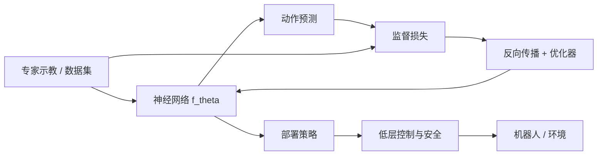
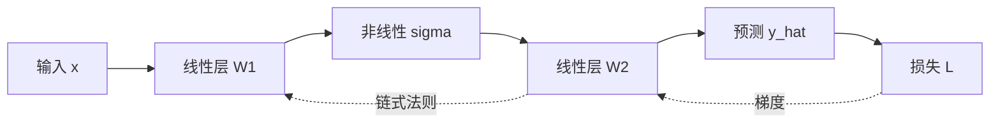
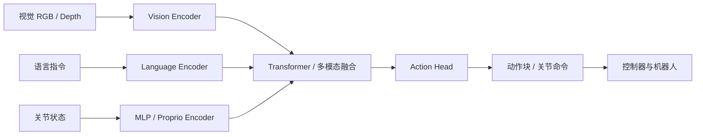

# 具身智能中的深度学习基础：从梯度下降到 Transformer

[课程首页](https://github.com/zengxiong111/Foundation_of_Embodied_AI) · [English Markdown](Deep_Learning_Foundations_EN.md) · [中文 PDF](https://zengxiong111.github.io/zengxiong.github.io/files/Deep_Learning_Foundations_ZH.pdf)

**Foundation of Embodied AI · 课程讲义**  
*监督学习、反向传播、MLP、Transformer 与机器人策略网络*  
**更新日期：2026 年 10 月 19 日**

**核心问题：**机器人如何从示教数据中学习动作？损失函数如何通过反向传播改变网络参数？MLP 与 Transformer 各自负责什么？视觉、语言、本体状态怎样形成可执行的动作？

**学习目标：**从数据集、损失函数、链式法则推导一次网络更新；理解 MLP、Attention、位置编码、Cross-Attention 和多模态 Token；区分网络架构、训练目标、优化器与强化学习算法；建立连接 BC、ACT、Flow Matching、PPO、SAC 和 VLA 的统一概念图。**本讲义不含编程或实验环节**，也不重复上述专题的完整算法推导。

## 目录

- [1. 从机器人任务理解深度学习](#deep-section-01)
- [2. 监督学习：样本、目标与泛化](#deep-section-02)
- [3. 梯度下降与反向传播：逐步推导](#deep-section-03)
- [4. MLP：最简单的机器人策略网络](#deep-section-04)
- [5. Transformer：从 Token 到 Attention](#deep-section-05)
- [6. 多模态 Transformer 与机器人动作头](#deep-section-06)
- [7. 预训练、微调与强化学习后训练的关系](#deep-section-07)
- [8. 稳定训练与评估：机器人数据的特殊性](#deep-section-08)
- [9. 实时推理与部署：模型计算不等于机器人控制](#deep-section-09)
- [10. 架构选择、误区与学习路径](#deep-section-10)
- [11. 术语对照与参考资料](#deep-section-11)

---

## 1. 从机器人任务理解深度学习

### 1.1 不是“预测下一个词”，而是学一个条件映射

设机器人在时刻 $t$ 获得视觉观测 $o_t$、本体感知 $q_t$（关节角、关节速度、夹爪状态）以及任务条件 $g$。最简单的策略是

$$
\hat a_t=f_\theta(o_t,q_t,g),\qquad
u_t=\operatorname{Controller}(\hat a_t,q_t),
$$

其中 $\theta$ 为网络参数，$\hat a_t$ 是**希望执行**的策略动作，$u_t$ 是经控制器、滤波、限幅或安全约束处理后的实际命令。二者可能具有不同的单位或频率，不能混为一谈。策略输出可能是关节目标、末端位姿增量，也可能是未来 $H$ 步的动作块 $A_t=(a_t,\ldots,a_{t+H-1})$。

深度学习解决的是**如何以可训练参数表示输入到输出的映射或概率分布**。物理正确性、接触约束、时延、安全与泛化并不会仅因模型够大而自动成立。

<!--PDFFIG:overview-->

*图 1. 训练环路用标签计算误差并更新参数；部署环路还必须经过低层控制与安全接口。*

### 1.2 四个容易混淆的层次

| 层次 | 回答的问题 | 具身智能中的例子 |
|:--|:--|:--|
| **网络架构** | 如何表示输入与输出之间的关系？ | MLP、CNN、ViT、Transformer |
| **训练目标** | 什么预测被认为是好的？ | MSE、交叉熵、NLL、Flow Matching 损失 |
| **参数优化器** | 给定目标后如何更新参数？ | SGD、Momentum、AdamW |
| **学习范式 / 算法** | 通过什么数据与反馈学习？ | BC、DAgger、PPO、SAC、RL Post-training |

例如，**BC 可以使用 MLP 或 Transformer**；**Flow Matching 是训练目标，不是特定神经网络架构**；**PPO 与 SAC 是强化学习算法而不只是梯度优化器**。一个 VLA 也不是单独一种 Attention 公式，它是一套包含编码器、条件融合、动作表示与训练协议的系统。

## 2. 监督学习：样本、目标与泛化

### 2.1 从专家示教构造训练集

监督数据集写为 $\mathcal D=\{(x_i,y_i)\}_{i=1}^{N}$。在机器人行为克隆（Behavior Cloning, BC）中，$x_i=(o_i,q_i,g_i)$，$y_i=a_i^E$ 是专家动作。监督学习最小化经验风险：

$$
\hat\theta=\arg\min_\theta\frac1N\sum_{i=1}^{N}\ell(f_\theta(x_i),y_i).
$$

必须区分**观测与标签的时间对应关系**：相机帧产生时刻、动作命令下发时刻和机器人反馈时刻并非总相同。把执行后的画面当作该动作执行前的条件，会引入数据泄漏或错误因果对应。

### 2.2 连续动作的回归损失

最常见的是均方误差：

$$
\mathcal L_{\mathrm{MSE}}=\frac1N\sum_{i=1}^N\|f_\theta(x_i)-a_i^E\|_2^2.
$$

若不同关节、平移与旋转尺度不同，可使用半正定权重矩阵 $W$：

$$
\mathcal L_W=\frac1N\sum_i(\hat a_i-a_i^E)^\top W(\hat a_i-a_i^E),\qquad W\succeq0.
$$

对多维动作，训练前应明确角度单位、坐标系以及归一化规则。对旋转姿态直接使用欧氏距离并不总能尊重 $SO(3)$ 的几何结构；具体运动学损失属于机器人动力学与操作学习课程的范围。

若输出长度为 $H$ 的动作块并存在补齐，使用有效掩码 $m_{ik}\in\{0,1\}$：

$$
\mathcal L_{\rm chunk}=\frac{\sum_{i,k}m_{ik}\,\ell(\hat a_{ik},a_{ik}^E)}{\sum_{i,k}m_{ik}+\varepsilon}.
$$

### 2.3 分类、概率预测和最大似然

离散抓取模式或接触模式可以用交叉熵：

$$
\mathcal L_{\rm CE}=-\frac1N\sum_i\log p_\theta(y_i\mid x_i).
$$

如果连续动作采用固定协方差的高斯分布，$p_\theta(a\mid x)=\mathcal N(a;\mu_\theta(x),\Sigma)$，则负对数似然（NLL）去掉与 $\theta$ 无关的常数后为

$$
\mathcal L_{\rm NLL}=\frac1{2N}\sum_i(a_i-\mu_\theta(x_i))^\top\Sigma^{-1}(a_i-\mu_\theta(x_i)).
$$

所以固定各向同性协方差时，**MSE 与高斯最大似然的最优均值预测一致**。若连协方差也学习，还必须保留 $\tfrac12\log\det\Sigma_\theta(x)$ 项；否则仅增大预测方差就可能降低二次误差项。

### 2.4 为什么监督误差低不代表操作成功率高

动作可多模态：同一障碍物可左绕或右绕，MSE 训练的点预测趋向条件均值 $\mathbb E[a\mid x]$，均值动作可能恰好不可执行。ACT、Diffusion 和 Flow Matching 等方法可表达更丰富的动作分布，但**多模态表达**不等于**闭环恢复能力**。

另外，BC 训练样本来自专家状态分布 $d^{\pi_E}$，部署时状态来自学习策略的 $d^{\pi_\theta}$。早期小误差造成偏移后，模型可能进入未见过的接触状态；需要 DAgger、纠错示教或 RL 等机制改善分布覆盖。这些机制将在模仿学习与后训练课程详细讨论。

## 3. 梯度下降与反向传播：逐步推导

### 3.1 梯度下降到底修改什么

假设目标函数为 $\mathcal L(\theta)$。梯度指出损失在参数空间的局部上升方向，故最基本的更新是

$$
\boxed{\theta^{(k+1)}=\theta^{(k)}-\eta\nabla_\theta\mathcal L(\theta^{(k)})},
$$

其中 $\eta>0$ 是学习率。若 $\mathcal L$ 可微，则一阶泰勒近似给出

$$
\mathcal L(\theta-\eta g)\approx\mathcal L(\theta)-\eta\nabla\mathcal L(\theta)^\top g.
$$

取 $g=\nabla\mathcal L(\theta)$ 时，右侧减小 $\eta\|\nabla\mathcal L\|^2$；但较大学习率、高曲率、随机梯度噪声都可能使**真实一步损失反而升高**。

### 3.2 一维线性策略：手算一次更新

令 $\hat a=wx+b$，单个样本的损失取 $L=\tfrac12(wx+b-y)^2$。记误差 $e=wx+b-y$，则

$$
\frac{\partial L}{\partial w}=ex,\qquad\frac{\partial L}{\partial b}=e.
$$

例如 $x=2,y=3,w=1,b=0$，则 $\hat a=2,e=-1$，梯度为 $(-2,-1)$。学习率 $\eta=0.1$ 时，

$$
(w^+,b^+)=(1,0)-0.1(-2,-1)=(1.2,0.1).
$$

更新后的预测为 $2.5$，损失由 $0.5$ 降为 $0.125$。**梯度下降并不是直接移动机器人的动作；它改变网络参数，使以后对相同条件的动作预测发生变化。**

### 3.3 两层 MLP 的链式法则

考虑

$$
z_1=W_1x+b_1,\qquad h=\sigma(z_1),\qquad \hat y=W_2h+b_2,
$$

以及 $L=\tfrac12\|\hat y-y\|_2^2$。先计算输出误差 $\delta_2=\hat y-y$：

$$
\begin{aligned}
\nabla_{W_2}L&=\delta_2 h^\top, &\nabla_{b_2}L&=\delta_2,\\
\delta_1&=(W_2^\top\delta_2)\odot\sigma'(z_1),\\
\nabla_{W_1}L&=\delta_1x^\top, &\nabla_{b_1}L&=\delta_1.
\end{aligned}
$$

这里 $\odot$ 是逐元素乘法，$\delta_1$ 将输出端的误差沿网络结构向后传播。**反向传播（Backpropagation）是对计算图高效应用链式法则以求梯度，不是一种与梯度下降并列的优化算法。**

若 $x\in\mathbb R^{d}$、$h\in\mathbb R^{m}$、$\hat y\in\mathbb R^{p}$，则 $W_1\in\mathbb R^{m\times d}$、$W_2\in\mathbb R^{p\times m}$，梯度与对应参数矩阵同形。检查维度可以捕获大量初学者推导错误。

<!--PDFFIG:backprop-->

*图 2. 前向计算生成预测；反向计算沿计算图传递局部导数。*

### 3.4 从全量梯度到 Mini-batch、SGD 与 AdamW

实际训练在大小为 $B$ 的 Mini-batch 上估计梯度

$$
g_k=\frac1B\sum_{i\in\mathcal B_k}\nabla_\theta\ell_i(\theta_k),\quad\theta_{k+1}=\theta_k-\eta g_k.
$$

**SGD** 使用当前随机梯度；Momentum 对梯度方向做时间平均；**Adam** 还对梯度平方作自适应缩放。Adam 的基本递推为

$$
\begin{aligned}
m_k&=\beta_1m_{k-1}+(1-\beta_1)g_k,\\
v_k&=\beta_2v_{k-1}+(1-\beta_2)g_k\odot g_k,\\
\hat m_k&=m_k/(1-\beta_1^k),\qquad\hat v_k=v_k/(1-\beta_2^k).
\end{aligned}
$$

AdamW 将权重衰减与梯度更新解耦，典型形式为

$$
\theta_{k+1}=(1-\eta\lambda)\theta_k-\eta\frac{\hat m_k}{\sqrt{\hat v_k}+\epsilon}.
$$

$\lambda$ 是权重衰减系数；并非所有参数（如某些 Bias、LayerNorm 系数）都应该使用相同衰减设置。学习率调度、梯度裁剪与混合精度是训练稳定性工具，不能替代正确的监督标签。

## 4. MLP：最简单的机器人策略网络

### 4.1 多层感知机的结构与非线性

MLP 由仿射变换与非线性激活交替组成：

$$
h^{(0)}=x,\quad h^{(\ell+1)}=\sigma(W_\ell h^{(\ell)}+b_\ell),\quad f_\theta(x)=W_Lh^{(L)}+b_L.
$$

如果所有 $\sigma$ 都是恒等映射，则多层线性层的复合仍然只是一个线性映射。因此非线性激活至关重要。常见的 ReLU 为 $\max(0,z)$；GELU 与 SiLU 是现代网络中常见的平滑激活。激活选择影响优化性质、推理成本与输出分布，但不存在对所有机器人任务都最佳的激活函数。

### 4.2 MLP 如何实现 Actor、Critic 和状态估计器

| 网络 | 典型输入 | 典型输出 | 学习信号 |
|:--|:--|:--|:--|
| MLP Actor | $q_t,\dot q_t,\hat x_t,g$ | $a_t$ 或策略分布参数 | BC 标签 / 策略梯度 |
| MLP Value Critic | $s_t$ 或可得观测 | $V_\phi(s_t)$ | 回报 / TD 目标 |
| MLP Q Critic | $(s_t,a_t)$ | $Q_\phi(s_t,a_t)$ | Bellman 目标 |
| 本体状态估计器 | 观测历史、IMU/电流 | 速度、接触或隐状态特征 | 监督 / 自监督 |
| Action Head | 主干模型隐藏特征 | 连续动作、离散 Token | 回归 / NLL / 生成损失 |

以上只是常见设计，Critic 也可以使用图像或 Transformer；Actor 与 Critic 的观测集合甚至可能不同（例如非对称 Actor–Critic）。需区分**网络结构**和**训练信号**。

### 4.3 为什么 MLP 在具身智能中仍然重要

对低维本体状态或高频低层闭环，MLP 往往具有较低延迟和明确的数值接口。它不需要先把每个标量变成 Token 再做 Attention。然而，当策略必须融合长时历史、许多视觉 Patch、对象关系或语言指令时，MLP 缺乏 Transformer 所具备的显式跨 Token 交互机制。

残差连接可以缓解深层网络的优化难度，例如 $h_{l+1}=h_l+F_l(h_l)$；归一化、初始化、合适的残差尺度也影响训练稳定性。**Transformer Block 本身通常包含由线性层与激活函数组成的 FFN/MLP。**

## 5. Transformer：从 Token 到 Attention

### 5.1 从固定维度向量走向 Token 序列

Transformer 处理表示序列 $X=[x_1;\ldots;x_n]\in\mathbb R^{n\times d}$。语言 Token 来自词表嵌入；图像可被切成 Patch，再映射为视觉 Token；机器人的关节状态、历史动作、末端目标也可以编码为一个或多个 Token。**Token 是模型内部的表示单元，不自动等价于一次物理控制命令。**

仅堆叠 Token 而不表达顺序，Attention 无法直接辨别“先抓取、后旋转”和“先旋转、后抓取”。因此需要位置或时间信息，例如位置嵌入、相对位置 Bias 或旋转位置编码；不同模型采用不同形式。

### 5.2 Self-Attention 的矩阵推导

由同一序列构造 Query、Key 和 Value：

$$
Q=XW_Q,\quad K=XW_K,\quad V=XW_V,
$$

其中 $Q,K\in\mathbb R^{n\times d_k}$，$V\in\mathbb R^{n\times d_v}$。第 $i$ 个 Query 与第 $j$ 个 Key 的相似度是 $q_i^\top k_j/\sqrt{d_k}$；对每行做 Softmax 得到权重

$$
\alpha_{ij}=\frac{\exp(q_i^\top k_j/\sqrt{d_k})}{\sum_{r=1}^{n}\exp(q_i^\top k_r/\sqrt{d_k})}.
$$

第 $i$ 个 Token 的新表示为 $z_i=\sum_j\alpha_{ij}v_j$，整体写为

$$
\boxed{\operatorname{Attention}(Q,K,V)=\operatorname{softmax}\!\left(\frac{QK^\top}{\sqrt{d_k}}+M\right)V.}
$$

$M$ 可以是遮挡矩阵：在不允许访问的位置添加 $-\infty$，从而使权重为零。**Self-Attention 关注的是信息交互，不是机器人控制意义上的注意力或安全判断。**

### 5.3 Multi-Head、FFN、Residual 与 LayerNorm

多个 Attention Head 分别学习不同的关系：

$$
\operatorname{MHA}(X)=\operatorname{Concat}(Z_1,\ldots,Z_h)W_O.
$$

典型 Pre-Norm Block 可表示为

$$
Y=X+\operatorname{MHA}(\operatorname{LN}(X)),\qquad
Z=Y+\operatorname{FFN}(\operatorname{LN}(Y)).
$$

FFN 对各 Token 位置共享参数并独立作用于每个位置；Token 间的信息混合主要发生在 Attention 中。LayerNorm 通常沿特征维度归一化，Residual 为梯度传播和深层表达提供直接路径。这里展示的是一种常见实现，不能把它视为所有 Transformer 的唯一形式。

### 5.4 Encoder、Decoder、因果掩码与 Cross-Attention

**Encoder 风格**允许观测 Token 彼此双向交互，适合感知和特征融合。**自回归 Decoder**的因果掩码限制每个位置只能读取已生成或允许的前文，适合序列逐步生成。**Cross-Attention**使一组 Query 读取另一组上下文 Key/Value：

$$
Q=HW_Q,\quad K=CW_K,\quad V=CW_V,\quad
\operatorname{CrossAttn}(H,C)=\operatorname{Attention}(Q,K,V).
$$

例如 $H$ 是动作查询，$C$ 是视觉与语言的上下文表示。ACT 中可以由动作 Query 读取编码后的多视角视觉与机器人状态，并行形成动作块。VLA 则可以选用独立视觉主干、语言主干与 Action Expert，或使用其他条件融合方式。**Transformer 不仅用于 World Action Model。**

### 5.5 Attention 的计算代价与时间信息

朴素全 Attention 需要形成 $n\times n$ 权重矩阵，其时间与注意力矩阵存储开销通常随 $n$ 近似呈二次增长。长视频、高分辨率图像与多相机输入因此需要 Token 压缩、稀疏化、分层建模或高效 Attention 实现。FlashAttention 主要减少内存读写、改善精确 Attention 的实现效率，并不会自动改变任务所需的时间感受野。

## 6. 多模态 Transformer 与机器人动作头

### 6.1 图像、语言和本体状态如何融合

一个概念性机器人基础模型可写成

$$
\begin{aligned}
Z_v&=E_v(I_{t-k:t}),\qquad Z_g=E_g(g),\\
Z_q&=E_q(q_{t-k:t}),\qquad
H=F_\theta(Z_v,Z_g,Z_q),\\
A_t&\sim p_\theta(\cdot\mid H).
\end{aligned}
$$

$E_v$ 可以是 CNN/ViT，$E_g$ 可以是文本 Transformer，$E_q$ 可以是 MLP；$F_\theta$ 通过串接、Cross-Attention 或其他机制融合特征。动作头把隐藏特征映射到机器人的动作空间。此式描述模块**职责**，不强制要求端到端训练或某种固定数据流。

<!--PDFFIG:multimodal-->

*图 3. 典型多模态机器人策略的模块划分；具体模型可共享或省略部分编码器。*

### 6.2 四类动作头对应不同的学习目标

| 动作头 | 训练目标 | 典型输出 | 优点与边界 |
|:--|:--|:--|:--|
| 确定性 MLP | MSE / L1 | 单步连续动作 | 简单、低延迟；多模态表示有限 |
| 概率动作头 | NLL / CE | 高斯参数或离散 Token | 可表示不确定性；取决于分布族 |
| ACT / Chunked Head | 重建 + 潜变量 KL | $H$ 步动作块 | 一次产生连续动作；依赖时间对齐 |
| Diffusion / Flow Head | 去噪或速度场回归 | 迭代生成动作块 | 表达复杂多模态；有采样时延 |

以常见的直线路径条件 Flow Matching 为例，令 $A_0\sim\mathcal N(0,I)$、$A_1\sim p_{\rm demo}(\cdot\mid H)$，$\tau\sim U[0,1]$，并定义 $A_\tau=(1-\tau)A_0+\tau A_1$。训练目标为

$$
\mathcal L_{\rm FM}=\mathbb E\big[\|v_\theta(A_\tau,\tau,H)-(A_1-A_0)\|^2\big].
$$

这里 $v_\theta$ 是**生成过程的速度场**，$\tau$ 是人工构造的生成时间，而非机械臂关节速度与物理时钟。完整的生成策略推导应在已有 Flow Matching 课程完成。

### 6.3 时间轴和动作语义不可由网络“自动学对”

机器人执行时间、相机采样时间、策略推理时间、动作块预测时间是四个不同概念。若模型输出的是末端相对位移 $\Delta x$，部署端就不能把它直接解释为绝对位姿 $x$。**模型结构只能在给定的数据契约内学习，无法纠正错误定义的控制语义。**

## 7. 预训练、微调与强化学习后训练的关系

### 7.1 一个训练系统可以经历不同的学习阶段

预训练（Pretraining）利用大规模数据形成通用表示或行为先验；监督微调（SFT/BC）用任务相关示教提高特定操作能力；强化学习后训练（RL Post-training）利用交互和奖励进一步改进成功率、精度、稳健性或恢复能力。它们并不是不同的网络架构，也不保证所有项目都必须依次经历全部阶段。

$$
\underbrace{\theta_0=\arg\min_\theta\mathcal L_{\rm pre}}_{\text{预训练}}
\quad\longrightarrow\quad
\underbrace{\theta_1=\arg\min_\theta\mathcal L_{\rm BC}}_{\text{示教微调}}
\quad\longrightarrow\quad
\underbrace{\text{Improve }J(\pi_\theta)}_{\text{交互式 RL}}.
$$

RL 中的 Actor 仍可由 MLP 或 Transformer 表示，Critic 也仍通过梯度学习；差别在于损失所依据的数据与回报估计。不能将“使用 AdamW”误认为就是“监督学习”，也不能将“冻结 Transformer”误认为模型不会从数据中学习，因为动作头或残差模块仍可更新。

### 7.2 全参数、部分参数、冻结主干、LoRA

将参数划分为基础模型 $\theta_b$ 与动作头 $\theta_h$。全参数微调更新 $\nabla_{\theta_b,\theta_h}\mathcal L$；冻结主干则约束 $\Delta\theta_b=0$，只更新 $\theta_h$。LoRA 在选定权重 $W$ 上使用低秩增量

$$
W'=W+\Delta W,\qquad\Delta W=BA,\qquad\operatorname{rank}(BA)\le r.
$$

其中一般固定原始 $W$，仅训练 $A,B$。LoRA 是**参数高效微调机制**，并非一种监督或强化学习目标。只有修改了可训练接口，并不意味着解决了动作采样时延、Reward Credit Assignment 或安全探索问题。

### 7.3 为什么后训练需要理解基础网络

对隐式生成策略，不能默认精确得到 $\log\pi_\theta(A\mid o)$。因此基于概率比的标准策略更新可能需要重参数化、替代更新目标、额外价值网络或冻结生成器的适配层。这是已有 RL Post-training 讲义讨论的重点；本课只解释为什么**网络架构、可训练参数和优化接口**必须分开理解。

## 8. 稳定训练与评估：机器人数据的特殊性

### 8.1 数据集划分与指标

为了评估泛化能力，应按**独立轨迹、场景、物体或采集轮次**划分训练与验证数据，而不是简单随机打散高度相邻的视频帧。应同时报告监督损失和任务指标：成功率、位置/姿态误差、接触失败类型、运行时延、碰撞及恢复次数。较低的离线 BC Loss 不等于较高的闭环成功率。

### 8.2 学习率、归一化与数值稳定性

输入 $x$ 常按训练数据统计量归一化为 $\tilde x=(x-\mu_x)/(\sigma_x+\varepsilon)$；输出动作的反归一化必须与执行器物理单位一致。梯度裁剪可限制大梯度更新，混合精度可节省显存，但应监测 NaN/Inf 和损失缩放。图像预处理、关节索引、坐标轴方向、相机外参与动作控制频率都是模型接口的一部分。

### 8.3 过拟合、欠拟合与分布偏移

欠拟合可能来自网络容量、优化不足、标签噪声或观测不可辨识；过拟合可能表现为训练任务成功却无法适应新物体和新背景。正则化、数据增强、更多场景与适当的冻结策略有助于泛化，但并不保证解决接触动力学或遮挡造成的信息缺失。对位置噪声、视觉遮挡和随机摩擦的鲁棒性，应通过独立闭环评估来验证。

## 9. 实时推理与部署：模型计算不等于机器人控制

### 9.1 前向计算、动作块和控制周期

部署时通常只执行前向传播；不会在每个控制周期自动运行反向传播。设低层控制周期为 $\Delta t_c$，从传感器观测到得到新动作块的端到端时延为 $T_{\rm lat}$，则可估计等待控制步数

$$
d=\left\lceil\frac{T_{\rm lat}}{\Delta t_c}\right\rceil.
$$

如果策略预测 $H$ 步，而每次执行 $K$ 步再查询，必须保证新动作块衔接时的时延、旧块剩余覆盖时间与安全降级策略相容。$H$（预测长度）、$K$（每次使用的长度）与 $d$（推理占用周期）是不同概念。RTC/异步动作块策略属于模仿学习课程的深入内容。

### 9.2 KV Cache、FlashAttention 和 Flow 采样步数

KV Cache 可在**自回归生成**时复用历史 Token 的 Key/Value，减少重复计算；但对每次重新编码完整图像的双向 Encoder，不能直接照搬语言模型的 Cache 结论。FlashAttention 优化 Attention 计算的内存访问，不会直接解决机器人动作块切换或网络尾部时延。Flow/Diffusion Head 的推理速度还取决于迭代次数、每次网络评估成本及求解器。训练效率与闭环控制稳定性是不同指标。

### 9.3 安全边界属于系统设计

视觉—策略网络输出的动作，通常还需进行单位转换、关节限幅、速度/力矩约束、碰撞检查、低层伺服和异常恢复。在精密接触操作中，模型推理误差、相机遮挡和触觉缺失都会影响可观测性，不能仅用“更大的 Transformer”补救。

## 10. 架构选择、误区与学习路径

### 10.1 给定任务，如何选择网络

| 主要需求 | 常见起点 | 何时升级架构 |
|:--|:--|:--|
| 低维本体闭环、短延迟 | MLP Actor / Critic | 需要长历史、多模态感知时 |
| 从简单专家示教学习 | MLP BC / Chunked BC | 动作显著多模态或要求长时一致性时 |
| 多相机+语言+状态 | 视觉 Encoder + Transformer 融合 | 更复杂时序、3D 几何或跨机器泛化时 |
| 多模态连续动作块 | ACT / Diffusion / Flow Head | 依据分布复杂度与推理预算选择 |
| 冻结基础模型后适应 | 可训练 Action Head / Adapter / LoRA | 在可控资源下比较不同可训练接口 |

选择之前应明确：输入可得哪些传感器、标签动作的坐标系是什么、控制周期是多少、是否允许在线交互、训练与测试机器人是否一致。表中的方案是**合理起点，不是实证排名**。

### 10.2 六个必须避免的误解

1. **“反向传播就是梯度下降”**：前者求导，后者使用导数更新参数。
2. **“Transformer 等于具身基础模型”**：Transformer 是部件；完整模型还需要观测、动作与训练接口。
3. **“Flow Matching 一定比 MLP 慢”**：应比较具体网络、求解步数和部署硬件；二者并非同一分类维度。
4. **“训练 Loss 越低，机器人成功率越高”**：离线拟合不直接评估闭环接触与恢复。
5. **“Actor–Critic 必须使用两种固定网络”**：两者可以共享或分离表示，并使用不同的观测和目标。
6. **“VLA 输出动作就不需要控制器”**：动作预测与物理执行、安全监督始终是不同层次。

### 10.3 建议后续阅读顺序

本课学完后，可沿两条路线阅读仓库：**模仿学习方向**：BC/DAgger → ACT → Flow Matching → RL Post-training → GR00T/SONIC；**强化学习运控方向**：机器人动力学 → Isaac/MuJoCo → PPO/SAC → 运动控制 RL。学习 Robot Agent 时，再把任务规划、工具调用、策略和物理验证区分为不同层次。

## 11. 术语对照与参考资料

| 中文 | English | 在本讲义中的含义 |
|:--|:--|:--|
| 监督学习 | Supervised Learning | 从带标签输入—输出对拟合映射 |
| 经验风险 | Empirical Risk | 在训练样本上的平均损失 |
| 反向传播 | Backpropagation | 以链式法则计算参数梯度 |
| 梯度下降 | Gradient Descent | 沿负梯度方向更新参数 |
| 多层感知机 | MLP | 仿射层与非线性激活的复合 |
| 自注意力 | Self-Attention | 同一序列内部的 Token 交互 |
| 交叉注意力 | Cross-Attention | 用 Query 读取另一上下文序列 |
| 动作头 | Action Head | 将隐藏表征转为机器人动作 |
| 冻结主干 | Frozen Backbone | 固定一部分预训练参数 |
| 后训练 | Post-training | 在预训练基础上进一步适应任务 |

**基础论文与延伸阅读（按学习路线排序）**：

1. Rumelhart, Hinton & Williams (1986), *Learning representations by back-propagating errors*. [Nature](https://doi.org/10.1038/323533a0).
2. Kingma & Ba (2015), *Adam: A Method for Stochastic Optimization*. [arXiv:1412.6980](https://arxiv.org/abs/1412.6980).
3. Loshchilov & Hutter (2019), *Decoupled Weight Decay Regularization*. [arXiv:1711.05101](https://arxiv.org/abs/1711.05101).
4. Vaswani et al. (2017), *Attention Is All You Need*. [arXiv:1706.03762](https://arxiv.org/abs/1706.03762).
5. Dosovitskiy et al. (2021), *An Image Is Worth 16x16 Words*. [arXiv:2010.11929](https://arxiv.org/abs/2010.11929).
6. Hu et al. (2022), *LoRA: Low-Rank Adaptation of Large Language Models*. [arXiv:2106.09685](https://arxiv.org/abs/2106.09685).
7. Zhao et al. (2023), *Learning Fine-Grained Bimanual Manipulation with Low-Cost Hardware*（ACT）. [arXiv:2304.13705](https://arxiv.org/abs/2304.13705).
8. Chi et al. (2023), *Diffusion Policy: Visuomotor Policy Learning via Action Diffusion*. [arXiv:2303.04137](https://arxiv.org/abs/2303.04137).
9. Lipman et al. (2023), *Flow Matching for Generative Modeling*. [arXiv:2210.02747](https://arxiv.org/abs/2210.02747).
10. Kim et al. (2024), *OpenVLA: An Open-Source Vision-Language-Action Model*. [arXiv:2406.09246](https://arxiv.org/abs/2406.09246).

**版权与定位：**Foundation of Embodied AI · Xiong Zeng and contributors，原创教学文字按 [CC BY 4.0](https://creativecommons.org/licenses/by/4.0/) 许可共享。示意图用于概念教学，并不表示某一特定 VLA 的完整官方架构；所引论文与第三方项目遵循各自许可。
