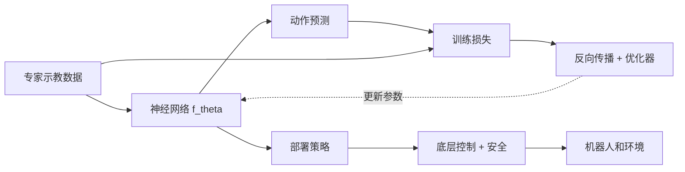
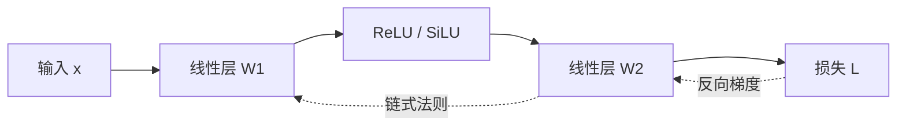
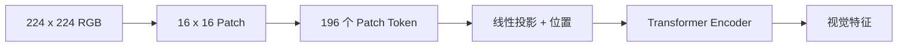
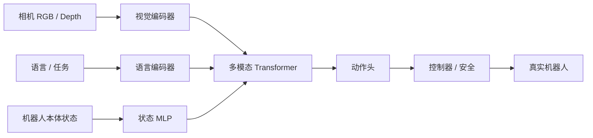

# 具身智能中的深度学习基础：从梯度下降到 Transformer

[课程首页](https://github.com/zengxiong111/Foundation_of_Embodied_AI) · [English Markdown](Deep_Learning_Foundations_EN.md) · [中文 PDF](../pdf/Deep_Learning_Foundations_ZH.pdf)

| 项目 | 说明 |
|:--|:--|
| 主题 | 深度学习基础 / Deep Learning Foundations |
| 修订日期 | 2026-10-29 |
| 适用读者 | 具备基础线性代数、微积分与 Python 知识的具身智能学习者 |
| 许可 | CC BY-NC-SA 4.0 · Xiong Zeng and contributors |

**本讲义的主线：** 以“机器人通过视觉找到螺丝刀、学习抓取并在真实设备上执行”为统一案例，依次回答如何定义学习问题、构造神经网络、计算损失与梯度、提取视觉特征、融合多模态信息、生成动作，以及进行可靠训练和部署。

## 目录

- [1. 从机器人任务理解深度学习](#deep-section-01)
- [2. 从线性模型到多层感知机](#deep-section-02)
- [3. 损失函数、概率建模与行为克隆](#deep-section-03)
- [4. 反向传播与神经网络优化](#deep-section-04)
- [5. 如何训练一个可靠的神经网络](#deep-section-05)
- [6. 视觉表征：从 CNN 到 Vision Transformer](#deep-section-06)
- [7. Transformer：从 Token 到 Attention](#deep-section-07)
- [8. 多模态模型与机器人动作生成](#deep-section-08)
- [9. 从预训练到强化学习后训练](#deep-section-09)
- [10. 从网络训练到机器人部署](#deep-section-10)
- [附录 A. BPTT 与可微世界模型](#deep-appendix-a)
- [附录 B. 术语、阅读路线与参考文献](#deep-appendix-b)

<!--PDFBODY-->

<a id="deep-section-01"></a>

## 1. 从机器人任务理解深度学习

### 1.1 一个贯穿教程的例子：抓取桌面上的螺丝刀

设一台带相机、机械臂与灵巧手的机器人需要抓起桌面上的螺丝刀。相机给出图像 $I_t$，编码器或传感器给出机器人本体状态 $q_t$（可包括关节位置、速度和手部状态），语言或结构化指令为 $g$。将策略的条件输入记为 $x_t=(I_t,q_t,g)$，希望学习

$$
\boxed{\hat a_t=f_\theta(I_t,q_t,g),\qquad u_t=\operatorname{Controller}(\hat a_t,q_t).}
$$

$\theta$ 是网络权重；$\hat a_t$ 是策略建议的动作，$u_t$ 是经过坐标变换、插值、限速、闭环伺服和安全检查后交给机器人的实际命令。$\hat a_t$ 可以是关节目标、关节增量、末端位姿、末端增量或未来 $H$ 步的动作块；**这些表示不能互换**。在训练中降低预测误差，并不等于已经解决碰撞、摩擦、接触或伺服稳定性。

<!--PDFFIG:overview-->


*图 1. 同一策略在训练时连接标签和优化器，在部署时连接控制器和物理世界。*

### 1.2 从示教记录到监督数据

一次示教是 $\tau=(x_0,a_0^E,x_1,a_1^E,\ldots)$，其中上标 $E$ 表示专家动作。数据集可以表示为

$$
\mathcal D=\{(x_i,a_i^E)\}_{i=1}^{N}.
$$

但相机曝光、图像到达、动作命令和控制反馈不是同一个时刻。应明确 $x_t$ 的采集时间戳及 $a_t^E$ 的定义：例如，标签是“拍到该画面时专家选择的目标位置”，而不是动作执行完后的机械臂位置。误用未来帧会造成数据泄漏或错误的因果对应。还需记录关节顺序、角度单位、世界系/基座系/工具系以及训练与部署的动作频率。

### 1.3 区分六个常被混为一谈的设计轴

| 设计轴 | 回答的问题 | 示例 |
|:--|:--|:--|
| 网络架构 | 信息怎样经过可训练的计算模块？ | MLP、CNN、ViT、Transformer、DiT |
| 观测与条件 | 模型实际看到了什么？ | RGB-D、关节状态、语言、历史窗口 |
| 动作表示 | 模型预测的对象是什么？ | 单步关节增量、末端位姿、Action Chunk、Action Token |
| 训练目标 | 如何衡量预测偏差？ | MSE、交叉熵、NLL、去噪与 Flow Matching |
| 优化器与参数范围 | 用什么规则更新哪些参数？ | SGD、AdamW、冻结主干、LoRA |
| 学习范式 | 监督信息或改进信号来自哪里？ | BC、DAgger、离线数据、在线 RL |

例如，**Flow Matching 是生成训练目标，不等同于 Transformer；Action Chunk 是时间上的动作表示，不是独立的神经网络架构；PPO/SAC 是强化学习算法，不是 SGD/AdamW 的同类优化器。** 全教程会反复使用这个分类法。

**本章小结与思考：**请写出自己的机器人策略的 $x_t$、$\hat a_t$、$u_t$、时间戳与坐标系。若策略输出末端增量，为什么不能直接把它当作绝对位姿？

<a id="deep-section-02"></a>

## 2. 从线性模型到多层感知机

### 2.1 线性策略：最小可训练模型

先假设螺丝刀的位置已由其他模块估计好，只使用一个归一化标量 $x$ 预测一个关节目标 $\hat a$：

$$
\hat a=wx+b.
$$

例如 $x=2,w=1,b=0$ 给出 $\hat a=2$。推广到多维观测与动作，线性层为

$$
\hat a=Wx+b,\quad x\in\mathbb R^{d},\quad W\in\mathbb R^{p\times d},\quad\hat a\in\mathbb R^p.
$$

线性模型计算快、容易解释，但它不能表达“螺丝刀在左侧时转腕，右侧时先移动手臂”等复杂分段规则。简单叠加多个**没有非线性**的线性层仍等价于一个线性层。

### 2.2 非线性激活与 MLP 的前向传播

一个具有单个隐藏层的 MLP 写成

$$
\boxed{z_1=W_1x+b_1,\quad h=\sigma(z_1),\quad\hat a=W_2h+b_2.}
$$

$\sigma$ 是逐元素非线性。ReLU 定义为 $\max(0,z)$，GELU 与 SiLU 在现代模型中也很常见。隐藏层的宽度 $m$ 表示特征数，深度表示串联的非线性变换次数；它们同时影响模型容量、训练难度和推理开销。训练前至少应能检查维度：若 $x\in\mathbb R^d,h\in\mathbb R^m,\hat a\in\mathbb R^p$，则 $W_1\in\mathbb R^{m\times d}$，$W_2\in\mathbb R^{p\times m}$。

一个具体的标量例子：$x=2,W_1=1,b_1=0,W_2=1,b_2=0$，ReLU 给出 $h=2$，于是 $\hat a=2$。此时已完成**前向传播**，还没有训练；网络只是根据当前权重计算预测。

### 2.3 为什么“更深”不一定“更好”

模型太小可能欠拟合；太大但数据不足则可能记住桌面纹理和训练物体，而不是学会泛化的抓取规则。残差结构 $h_{\ell+1}=h_\ell+F_\ell(h_\ell)$ 为梯度传播提供较直接的路径；初始化、归一化和非线性也影响深层优化。在高频机器人底层策略中，小型 MLP 因确定的计算开销和低延迟而非常有用。

### 2.4 一个架构能承担多种角色

| 角色 | 典型输入 | 输出 | 监督/优化信号 |
|:--|:--|:--|:--|
| 行为克隆 Actor | 机器人状态、估计目标位姿 | 连续动作 | 专家动作标签 |
| Value Critic | 状态或可用观测 | $V_\phi(s)$ | 回报或 TD 目标 |
| Q Critic | 状态、动作 | $Q_\phi(s,a)$ | Bellman 目标 |
| 本体状态估计器 | IMU、电流和历史 | 速度、接触等隐变量 | 监督/自监督 |
| 大模型动作头 | 视觉语言融合后的特征 | 动作参数或 Token | BC / NLL / 生成目标 |

Actor、Critic 和视觉估计器并不因为角色不同就必须采用完全不同的网络架构；角色描述的是输入输出与训练信号。

**本章小结与思考：**给定输入维度 $d=10$、隐藏层宽度 $m=64$、动作维度 $p=7$，计算两层 MLP（含 Bias）的参数总数。为什么去掉 ReLU 后无法获得更强的非线性表达？

<a id="deep-section-03"></a>

## 3. 损失函数、概率建模与行为克隆

### 3.1 经验风险最小化

给定 $N$ 对专家输入和标签，行为克隆（Behavior Cloning, BC）求解

$$
\boxed{\hat\theta=\arg\min_\theta\frac1N\sum_{i=1}^N\ell(f_\theta(x_i),a_i^E).}
$$

损失 $\ell$ 是对每个训练样本的处罚规则；它不是部署成功率本身。对于连续动作，最常见的均方误差（MSE）为

$$
\mathcal L_{\rm MSE}=\frac1N\sum_{i=1}^N\|\hat a_i-a_i^E\|_2^2.
$$

不同维度的单位可能相差很多。例如弧度、米与归一化手指量不能不加说明地直接求和。可定义半正定权重 $W\succeq0$ 得到 $\ell_W=(\hat a-a^E)^\top W(\hat a-a^E)$。若预测姿态，欧氏坐标误差并不自动遵守 $SO(3)$ 的几何结构，姿态损失应与表示法相匹配。

### 3.2 MSE 为什么和高斯概率模型有关？

假设给定观测 $x$ 后，专家连续动作满足

$$
p_\theta(a\mid x)=\mathcal N(a;\mu_\theta(x),\Sigma),
$$

则每个样本的负对数似然（NLL）为

$$
-\log p_\theta(a\mid x)=\frac12(a-\mu_\theta(x))^\top\Sigma^{-1}(a-\mu_\theta(x))
+\frac12\log\det\Sigma+\frac p2\log(2\pi).
$$

当 $\Sigma=\sigma^2 I$ 且固定时，与 $\theta$ 有关的项正比于 MSE，因此二者优化相同的预测均值。若协方差也由网络预测，$\log\det\Sigma_\theta(x)$ **不能删除**，否则网络可能仅靠放大方差来减小二次项。概率建模使我们能够表达不确定性，但单峰高斯本身不能表示两种分离很远的抓取模式。

### 3.3 分类与交叉熵

对离散接触状态或 Action Token，用 Softmax 得到类别概率 $p_\theta(k\mid x)$。若标签为 $y_i$，交叉熵为

$$
\mathcal L_{\rm CE}=-\frac1N\sum_{i=1}^N\log p_\theta(y_i\mid x_i).
$$

连续回归的 MSE、离散类别的交叉熵以及高斯 NLL 不应简单互换；它们对应不同的输出语义和概率假设。

### 3.4 多模态动作：为什么均值不一定可执行

假设同一画面下，专家可从螺丝刀左侧或右侧绕行，两个同样可能的标量动作是 $a=-1$ 和 $a=+1$。平方损失的最优点预测是条件均值 $\mathbb E[a\mid x]=0$；但动作 $0$ 可能恰好导致正面碰撞。这个问题不是增大 MLP 宽度就一定能消除的。生成式动作模型尝试描述 $p(a\mid x)$ 或 $p(A\mid x)$ 的更复杂形状，随后可以采样一种可行模式。

### 3.5 Action Chunk 的掩码与时间一致性

动作块定义为 $A_t=(a_t,\ldots,a_{t+H-1})$。不足 $H$ 步的序列可能需要 Padding，应使用有效掩码 $m_{ik}\in\{0,1\}$：

$$
\mathcal L_{\rm chunk}=\frac{\sum_{i,k}m_{ik}\,\ell(\hat a_{ik},a_{ik}^E)}{\sum_{i,k}m_{ik}+\varepsilon}.
$$

若标签来自 30 Hz 相机和 100 Hz 关节记录，必须先明确定义动作块的采样频率与插值规则；“一块包含 10 个动作”本身无法告诉你对应多少物理时间。

**本章小结与思考：**推导固定 $\sigma^2 I$ 时高斯 NLL 与 MSE 的比例关系。对于两个相反方向的合理抓取动作，为什么点估计可能变成错误动作？

<a id="deep-section-04"></a>

## 4. 反向传播与神经网络优化

### 4.1 从单参数梯度下降开始

设标量策略 $\hat a=wx+b$，对一个样本使用 $L=\tfrac12(wx+b-y)^2$。定义误差 $e=wx+b-y$，链式法则给出

$$
\frac{\partial L}{\partial w}=ex,\qquad\frac{\partial L}{\partial b}=e.
$$

令 $x=2,y=3,w=1,b=0$，则 $\hat a=2,e=-1,L=0.5$，梯度为 $(-2,-1)$。学习率 $\eta=0.1$ 时

$$
(w^+,b^+)=(1,0)-0.1(-2,-1)=(1.2,0.1).
$$

更新后预测为 $2.5$，损失变为 $0.125$。**一次训练更新改变的是权重，并不是把机器人当前动作直接推动到标签位置。**

### 4.2 沿计算图反向应用链式法则

复用第 2 章的两层 MLP，令损失为 $L=\tfrac12\|\hat a-y\|_2^2$。计算图从 $x$ 出发，依次经过仿射层、非线性和第二个仿射层，最终到达 $L$。反向传播从末端产生梯度并沿依赖关系反向累计；当同一变量影响多个分支时，梯度应相加。

<!--PDFFIG:backprop-->


*图 2. 前向传播产生预测，反向传播沿依赖图累计局部导数。*

定义输出误差与隐藏层误差：

$$
\delta_2=\hat a-y,\qquad\delta_1=(W_2^\top\delta_2)\odot\sigma'(z_1).
$$

完整梯度为

$$
\boxed{\begin{aligned}
\nabla_{W_2}L&=\delta_2h^\top,&\nabla_{b_2}L&=\delta_2,\\
\nabla_{W_1}L&=\delta_1x^\top,&\nabla_{b_1}L&=\delta_1.
\end{aligned}}
$$

其中 $\odot$ 是逐元素乘法。例如在第 2 章的标量网络中，$x=2,h=2,\hat a=2,y=3$，ReLU 的导数为 1，于是 $\delta_2=-1$、$\partial L/\partial W_2=-2$、$\delta_1=-1$、$\partial L/\partial W_1=-2$。这与自动微分所计算的结果一致。

### 4.3 反向传播不是梯度下降

反向传播（Backpropagation）回答“$\nabla_\theta L$ 是多少”；梯度下降回答“有了梯度，如何更新 $\theta$”。对可微损失的一阶近似是

$$
L(\theta-\eta g)\approx L(\theta)-\eta\nabla L(\theta)^\top g.
$$

选择 $g=\nabla L$，右侧下降量为 $\eta\|\nabla L\|_2^2$，但这只是一阶局部论证；学习率过大、曲率高或梯度带噪时，真实损失仍可能升高。

### 4.4 从 Mini-batch SGD 到 AdamW

在大小为 $B$ 的 Batch 上估计随机梯度

$$
g_k=\frac1B\sum_{i\in\mathcal B_k}\nabla_\theta\ell_i(\theta_k),\qquad\theta_{k+1}=\theta_k-\eta g_k.
$$

Momentum 使用梯度历史平滑更新；Adam 进一步估计一阶矩 $m_k$ 和二阶矩 $v_k$：

$$
\begin{aligned}
m_k&=\beta_1m_{k-1}+(1-\beta_1)g_k,\\
v_k&=\beta_2v_{k-1}+(1-\beta_2)g_k\odot g_k,\\
\hat m_k&=m_k/(1-\beta_1^k),\quad\hat v_k=v_k/(1-\beta_2^k).
\end{aligned}
$$

AdamW 将权重衰减与梯度步解耦：

$$
\boxed{\theta_{k+1}=(1-\eta\lambda)\theta_k-\eta\frac{\hat m_k}{\sqrt{\hat v_k}+\epsilon}.}
$$

其中除法与平方根均按元素进行，$\lambda$ 为衰减系数。实际训练时通常对 Bias 和部分归一化参数采用不同的权重衰减策略。梯度裁剪、学习率 Warmup、调度器及混合精度是辅助稳定工具，不会自动修正错误标签。

**本章小结与思考：**在不使用自动微分的情况下写出 $\nabla_{W_1}L$ 与 $\nabla_{W_2}L$ 的维度。为什么将反向传播称为一种“优化器”并不准确？

<a id="deep-section-05"></a>

## 5. 如何训练一个可靠的神经网络

### 5.1 数据整理：先对齐，再划分

每条样本都应携带观测时间戳、专家命令时间戳、动作单位、机器人模型版本与坐标系定义。对螺丝刀抓取，应区分训练桌面、不同物体、记录 Session 和独立轨迹；**不要把同一段视频相邻帧随机划到训练集和验证集**，否则验证结果会过于乐观。

若输入和动作不同维度的尺度差异较大，可以按训练集统计量标准化：

$$
\tilde x_j=\frac{x_j-\mu_j}{\sigma_j+\varepsilon},\qquad
\tilde a_j=\frac{a_j-\mu_{a,j}}{\sigma_{a,j}+\varepsilon}.
$$

仅用训练集估计 $\mu,\sigma$；部署时严格使用同一统计量并执行动作反归一化。对角度、四元数与离散接触标志，不能无差别地套用同一个归一化函数。

### 5.2 一次最小的 PyTorch 训练循环

下面的代码只展示**状态到连续动作**的 BC。它省略了数据加载和部署接口，但保留正确的“前向—损失—反向—更新”顺序。

```python
import torch
from torch import nn

policy = nn.Sequential(nn.Linear(10, 64), nn.ReLU(), nn.Linear(64, 7))
optimizer = torch.optim.AdamW(policy.parameters(), lr=3e-4)

for states, expert_actions in loader:  # shapes: [B, 10] and [B, 7]
    prediction = policy(states)
    loss = (prediction - expert_actions).square().mean()
    optimizer.zero_grad(set_to_none=True)
    loss.backward()
    torch.nn.utils.clip_grad_norm_(policy.parameters(), max_norm=1.0)
    optimizer.step()
```

这里的 `lr=3e-4` 只是示意，并不是任何机器人数据集的最优超参数。应在验证集上比较训练曲线、动作误差与闭环表现，并记录随机种子、数据版本和模型 Checkpoint。

### 5.3 如何判断训练出了什么问题

| 现象 | 可能原因 | 最先做的检查 |
|:--|:--|:--|
| 训练 Loss 一直很高 | 单位错误、标签错位、容量不足、学习率问题 | 先尝试过拟合少量样本 |
| 训练 Loss 低，验证 Loss 高 | 过拟合、数据泄漏或分布变化 | 按独立轨迹/物体重新划分 |
| 数值出现 NaN/Inf | 梯度爆炸、归一化或精度问题 | 梯度范数、输入范围、AMP 设置 |
| 离线误差小，抓取失败 | 多模态、遮挡、接触误差、闭环分布偏移 | 真机闭环与失败类型统计 |
| 仿真成功，真机失败 | 视觉外参、控制语义、摩擦与时延不同 | 接口回放、执行器标定与 Sim2Real 测试 |

### 5.4 泛化、分布偏移与评估指标

BC 的训练状态来自专家分布 $d^{\pi_E}$，部署时却由当前策略生成状态分布 $d^{\pi_\theta}$。初期轻微动作误差可能让手指进入训练集中未出现的接触区域，这被称为协变量偏移（Covariate Shift）；DAgger、纠错示教和 RL 可增加困难状态覆盖，但不是单纯换优化器就能解决。

至少同时报告三类指标：**离线指标**（MSE/NLL、每轴误差）、**闭环任务指标**（成功率、完成时间、接触失败率、恢复率）和**系统指标**（P50/P95 端到端延迟、控制命令超限率）。例如 20 次实验中成功 16 次只得到样本成功率 80%，不代表真实成功率已被精确估计；应增加重复与置信区间。

**本章小结与思考：**为什么按“视频帧”随机划分会污染验证结果？列出三种会导致 Loss 下降却让真机操作失败的原因。

<a id="deep-section-06"></a>

## 6. 视觉表征：从 CNN 到 Vision Transformer

### 6.1 为什么不直接将整张图像输入 MLP？

一张 $224\times224\times3$ 的 RGB 图像包含 $150{,}528$ 个标量。将它直接展平并连接到 512 维全连接层，需要约 $150{,}528\times512\approx77$ 百万个权重（还未计 Bias）；同时丢失了网络架构中的局部空间先验。螺丝刀的边缘、手指的轮廓等局部图像模式更适合通过共享的局部特征提取器获取。

### 6.2 卷积：局部感受野与参数共享

以步长为 1 的卷积为例，输出特征图某个位置的通道值由邻域像素线性组合后经过非线性获得：

$$
Y_{i,j,o}=\sigma\!\left(\sum_{u,v,c}K_{u,v,c,o}\,X_{i+u,j+v,c}+b_o\right).
$$

相同的卷积核 $K$ 在不同位置共享参数。若使用 $3\times3$ 卷积，将 3 个输入通道映射到 64 个输出通道，只需要 $3\times3\times3\times64+64=1{,}792$ 个参数，而不是为每个像素位置分别学习一套全连接权重。这里通常把“卷积”一词用于实现中的互相关运算；这一命名差异不影响基本直觉。

下采样扩大有效感受野并减少空间分辨率。典型 CNN 把输入 $I\in\mathbb R^{H\times W\times3}$ 映射为 $F\in\mathbb R^{H'\times W'\times d}$。但空间分辨率降低也可能丢失螺丝刀尖端或手指接触点等精细结构，因此实际选择要考虑分辨率与实时延迟。

### 6.3 ViT：Patch Embedding 怎样产生 Token？

Vision Transformer（ViT）将图像分成不重叠的 Patch。取 $224\times224$ 图像，Patch 边长为 16，则每轴有 $224/16=14$ 个 Patch，总数

$$
\boxed{N=14\times14=196.}
$$

每个 RGB Patch 展平为 $16\times16\times3=768$ 维向量，经可训练矩阵 $W_E$ 投影到 $d$ 维：

$$
z_i=W_E\,\operatorname{vec}(P_i)+b_E,\qquad
Z=[z_1;\ldots;z_{196}]\in\mathbb R^{196\times d}.
$$

模型再加入位置信息，随后由 Transformer 在 Patch 之间交换信息。若引入额外的分类 Token，序列长度可能变成 197；对密集机器人感知不必采用分类 Token。ViT 并不是“没有图像结构”的 MLP，它通过 Patch 划分与位置编码保留空间信息，但局部归纳偏置与 CNN 不同。

<!--PDFFIG:vision-->


*图 3. ViT 将视觉输入变成一组特征 Token；Patch 大小影响 Token 数量和 Attention 成本。*

### 6.4 CNN、ViT 与机器人视觉任务

| 方面 | CNN | ViT |
|:--|:--|:--|
| 主要机制 | 局部卷积和层级下采样 | Patch Token 和全局/局部 Attention |
| 常见优势 | 局部先验强，部署生态成熟 | 容易与语言/序列 Token 统一表示 |
| 典型代价 | 全局关系常需多层传播 | Token 数较多时 Attention 成本上升 |
| 操作任务需关注 | 接触小特征、尺度变化 | Patch 分辨率、空间位置、预训练迁移 |

真正的机器人模型可以使用 CNN、ViT 或混合骨干，是否优越取决于训练数据、相机视角、遮挡、算力与延迟。对 RGB-D 或多视角输入还需处理深度尺度、内外参和视角时间同步；仅做 Patch Embedding 不能得到可靠的 3D 物体位姿。

**本章小结与思考：**计算 $256\times256$ 图像使用 $16\times16$ Patch 时的 Token 数。为什么提升图像分辨率可能使全 Attention 显著变慢？

<a id="deep-section-07"></a>

## 7. Transformer：从 Token 到 Attention

### 7.1 为什么需要 Token 间动态交互？

机器人可能同时获得视觉目标 Token、关节状态 Token、语言任务 Token 和历史动作 Token。不同场景下，网络需要动态地决定“当前关节动作最应参考哪个物体区域”。普通逐 Token 的 MLP 只对各位置做相同变换，无法单靠这一操作在 Token 之间传递信息；Attention 通过数据相关权重实现信息聚合。

记 $X\in\mathbb R^{n\times d}$ 为 $n$ 个 Token。其顺序通常通过绝对位置编码、相对位置 Bias、RoPE 或时间嵌入等表示；若缺乏位置信息，纯 Self-Attention 对 Token 排列是置换等变的，难以区分“先抓取后旋转”和“先旋转后抓取”。

### 7.2 Query、Key、Value 的含义与矩阵公式

将同一个序列投影为

$$
Q=XW_Q,\quad K=XW_K,\quad V=XW_V,
$$

其中 $Q,K\in\mathbb R^{n\times d_k}$、$V\in\mathbb R^{n\times d_v}$。可以把 Query 理解为“当前 Token 需要的信息”，Key 理解为“每个 Token 供匹配的索引”，Value 理解为“匹配后实际聚合的内容”。这只是帮助理解的类比，并不意味着三个矩阵具有固定的人类语义。

第 $i$ 个 Query 与第 $j$ 个 Key 的打分是 $s_{ij}=q_i^\top k_j/\sqrt{d_k}$，行 Softmax 给出

$$
\alpha_{ij}=\frac{\exp(s_{ij})}{\sum_{r=1}^{n}\exp(s_{ir})},\qquad z_i=\sum_j\alpha_{ij}v_j.
$$

整体写为

$$
\boxed{\operatorname{Attention}(Q,K,V)=\operatorname{softmax}\!\left(\frac{QK^\top}{\sqrt{d_k}}+M\right)V.}
$$

$M$ 是可选的 Mask：不允许访问的元素在 Softmax 前加 $-\infty$。缩放因子 $1/\sqrt{d_k}$ 的作用是：若各维独立、均值约零、方差量级相近，点积方差随维度 $d_k$ 增长；缩放后分数的量级较稳定，避免 Softmax 过早饱和。

### 7.3 手算一个三 Token Attention

设三个 Token 分别代表“目标视觉区域”“机器人当前状态”“任务指令”，为了演示，取某个 Query 为 $q=(1,0)$，Key 为

$$
k_1=(1,0),\quad k_2=(0,1),\quad k_3=(1,1),\qquad d_k=2.
$$

对应分数为 $(1/\sqrt2,0,1/\sqrt2)\approx(0.707,0,0.707)$，Softmax 后约为

$$
(\alpha_1,\alpha_2,\alpha_3)\approx(0.401,0.198,0.401).
$$

若 $v_1=(1,0)$、$v_2=(0,1)$、$v_3=(1,1)$，那么

$$
z=0.401v_1+0.198v_2+0.401v_3\approx(0.802,0.599).
$$

这说明输出不是“选择一个 Token”，而是对 Value 按权重求和。实际模型中的 $q,k,v$ 会随训练改变，且有多个 Head，不需要预先指定某个 Token 的语义。

### 7.4 Multi-Head、FFN、Residual 与 LayerNorm

不同 Head 通过各自的投影学习不同的相互作用。令第 $r$ 个 Head 输出为 $Z_r$，则

$$
\operatorname{MHA}(X)=\operatorname{Concat}(Z_1,\ldots,Z_h)W_O.
$$

常见 Pre-Norm Transformer Block 为

$$
Y=X+\operatorname{MHA}(\operatorname{LN}(X)),\qquad
Z=Y+\operatorname{FFN}(\operatorname{LN}(Y)),
$$

其中 $\operatorname{FFN}(x)=W_2\sigma(W_1x+b_1)+b_2$，对每个 Token 独立应用且共享权重。Attention 负责 Token 间信息交换；FFN 负责每个位置的特征变换；Residual 提供短梯度路径；LayerNorm 在特征维度上做标准化。这里展示的是常见结构，而非所有 Transformer 必须遵守的唯一实现。

### 7.5 Encoder、Decoder、因果掩码与 Cross-Attention

**Encoder 风格**通常允许一个观测窗口内的 Token 双向交互；**自回归 Decoder**通过因果 Mask 限制位置 $i$ 只读取不晚于 $i$ 的 Token，以逐步生成序列；**Cross-Attention**让一组 Query 访问另一组 Key/Value：

$$
Q=HW_Q,\quad K=CW_K,\quad V=CW_V,\qquad
\operatorname{CrossAttn}(H,C)=\operatorname{Attention}(Q,K,V).
$$

例如 $H$ 是需要预测的动作 Query，$C$ 是已编码的图像、语言与机器人状态。ACT 可以利用这类机制并行生成动作块；其他机器人基础模型也可能采用串接、多路融合或独立的动作专家。

### 7.6 复杂度与时间信息

密集 Self-Attention 的算术量通常与 $n^2d$ 同阶，显式注意力矩阵需要 $O(n^2)$ 存储。图片更多、Patch 更小、历史窗口更长都会增加 $n$。FlashAttention 可以通过改善数据搬运显著降低实际内存开销与运行时间，但不会替模型选择合适的机器人历史窗口；KV Cache 在自回归场景中复用历史 Key/Value，不能直接假设对每次重编码整张图像的双向视觉编码器同样适用。

**本章小结与思考：**独立写出 Self-Attention 的每个矩阵维度，并复算三 Token 的 Softmax。没有位置编码会带来什么序列歧义？

<a id="deep-section-08"></a>

## 8. 多模态模型与机器人动作生成

### 8.1 从相机到动作的完整信息流

一个概念性的视觉语言动作（Vision-Language-Action, VLA）策略可写为

$$
\begin{aligned}
Z_v&=E_v(I_{t-k:t}),\quad Z_g=E_g(g),\quad Z_q=E_q(q_{t-k:t}),\\
H_t&=F_\theta(Z_v,Z_g,Z_q),\qquad A_t\sim p_\theta(\cdot\mid H_t).
\end{aligned}
$$

$E_v$ 可为 CNN/ViT，$E_g$ 可为文本 Transformer，$E_q$ 可为 MLP，$F_\theta$ 可利用串接、Self/Cross-Attention 等方式融合。网络最终输出的动作表示必须与执行器和控制器契约一致。上述分模块形式并不规定所有部件都需端到端训练，也不代表任何特定论文的完整官方结构。

<!--PDFFIG:multimodal-->


*图 4. 多模态机器人策略的通用模块图：感知与条件编码、融合、动作生成、控制与执行。*

### 8.2 动作头应按不同维度分类

| 分类维度 | 选项 | 解释 |
|:--|:--|:--|
| 网络架构 | MLP、Transformer、DiT | 用哪个计算网络预测参数或速度场 |
| 动作时间表示 | 单步、$H$ 步 Action Chunk | 一次预测多远的时间范围 |
| 动作数值表示 | 关节位置、末端增量、离散 Token | 动作与机器人控制接口的关系 |
| 概率表达 | 确定性、单峰高斯、自回归、Diffusion/Flow | 如何描述多个可能动作 |
| 训练目标 | MSE、NLL、CE、去噪、速度场回归 | 什么量被优化 |

**ACT 不等于所有 Action Chunking；Flow Matching 也不等于某种固定的 Transformer 架构。** 例如一个 MLP 可以预测长度为 $H$ 的动作块，Flow Matching 的速度场网络可以是 MLP 也可以是 Transformer。

### 8.3 从确定性回归到生成式动作

确定性头直接输出 $\hat A=f_\theta(H_t)$，可用 MSE 训练。概率头可预测 $p_\theta(A\mid H_t)$ 的参数；当动作分布有多个相距较远的模式时，可考虑 Diffusion 或 Flow Matching。以条件直线路径 Flow Matching 为例，令 $A_0\sim\mathcal N(0,I)$、$A_1\sim p_{\rm demo}(\cdot\mid H_t)$ 且 $\tau\sim U[0,1]$，定义

$$
A_\tau=(1-\tau)A_0+\tau A_1,\qquad
\mathcal L_{\rm FM}=\mathbb E\!\left[\left\|v_\theta(A_\tau,\tau,H_t)-(A_1-A_0)\right\|_2^2\right].
$$

推理时从 $A_0$ 出发，沿学到的速度场积分生成动作：

$$
\boxed{\frac{\mathrm d A_\tau}{\mathrm d\tau}=v_\theta(A_\tau,\tau,H_t),\qquad A_{\tau=0}\sim\mathcal N(0,I).}
$$

这里 $\tau$ 是人工定义的**生成时间**，$v_\theta$ 是动作空间的生成速度场；它既不是机械臂物理速度，也不是相机时间戳。采样精度和延迟取决于速度场网络、数值积分器及求解步数。更完整的推导见课程中的 Flow Matching 专题。

### 8.4 为什么复杂动作分布仍不等于鲁棒操作

生成模型可以描述“从不同角度抓取螺丝刀”，但无法单凭生成式训练保证在物体滑动、遮挡或位置估计错误后自动恢复。恢复还依赖观察更新、反馈频率、包含失败状态的数据与适当的交互训练。模型能够生成物理动作，并不意味着它能够安全执行这些动作。

**本章小结与思考：**在一张表中描述某个 VLA 的“架构、动作表示、训练目标、执行频率”。为什么 $v_\theta$ 的单位不能直接解释为关节速度？

<a id="deep-section-09"></a>

## 9. 从预训练到强化学习后训练

### 9.1 三个阶段并不是三种不同的网络

预训练利用大规模数据学习通用视觉语言表征或机器人动作先验；监督微调（SFT/BC）用特定任务示教优化模仿能力；RL Post-training 利用交互和奖励改善成功率、精度、接触稳健性或恢复能力。一个抽象的训练过程是

$$
\underbrace{\theta_0=\arg\min_\theta\mathcal L_{\rm pre}}_{\text{预训练}}
\longrightarrow
\underbrace{\theta_1=\arg\min_\theta\mathcal L_{\rm BC}}_{\text{示教微调}}
\longrightarrow
\underbrace{\text{改善 }J(\pi_\theta)}_{\text{交互与奖励优化}}.
$$

这些阶段可以部分省略、交替或联合训练，不能把箭头视为强制流程。使用 AdamW 不意味着一定是监督训练；进行 RL 也不意味着一定要训练一个新的大规模网络骨干。

### 9.2 全量微调、冻结主干与 LoRA

将参数分为主干 $\theta_b$ 和动作头 $\theta_h$。全量微调更新两者；冻结主干只更新 $\theta_h$ 或附加的残差/适配器。LoRA 对选定的权重矩阵构造低秩增量

$$
W'=W+\Delta W,\qquad \Delta W=BA,\qquad\operatorname{rank}(BA)\le r.
$$

典型 LoRA 固定原有 $W$，仅优化 $A$ 和 $B$。**LoRA 是参数高效更新方式，不是损失函数、奖励机制或 RL 算法**。冻结视觉语言主干也不代表系统不再学习，只要动作头或适配器仍然更新。

### 9.3 RL 为什么还需要新的接口

BC 用专家标签直接计算动作预测误差；RL 优化累计奖励，常需要 Actor、Value/Q Critic、交互数据和信用分配。对显式概率策略，部分策略梯度方法使用 $\nabla_\theta\log\pi_\theta(a\mid o)$；生成式 Flow/Diffusion Policy 可能没有容易计算的归一化 $\log\pi_\theta$，因而不能不加修改就使用依赖该量的 PPO 形式。可以采用额外的概率参数化、Critic 引导、残差动作或速度场适配等方案，但其有效性与样本效率必须通过实验验证。

### 9.4 以同一抓取任务理解训练阶段

预训练阶段让视觉网络识别常见物体与操作线索；SFT 阶段从螺丝刀抓取示教中学习接近、闭合与抬升；RL 阶段在仿真或受控实机交互中，对滑动、错位、不同摩擦和失败恢复进行优化。对同一任务分别报告新物体上的成功率、扰动恢复率与在线交互预算，才能判断后训练是否真正带来增益。

**本章小结与思考：**冻结预训练主干、只训练残差动作头是否仍属于“后训练”？为什么不能直接假设所有生成式机器人策略都支持标准 PPO 的概率比率？

<a id="deep-section-10"></a>

## 10. 从网络训练到机器人部署

### 10.1 四种时间轴与三个频率

假设相机为 30 Hz，策略每 100 ms 更新一次（10 Hz），低层伺服在 100 Hz 运行。若策略生成 $H=10$ 个按 10 Hz 定义的动作点，那么其预测范围约为 1 秒；伺服控制器通常需要把这些点转换为更细的控制指令。三种频率不应混淆。

记低层周期为 $\Delta t_c=10\,\mathrm{ms}$，观测到新动作输出的端到端延迟为 $T_{\rm lat}=60\,\mathrm{ms}$，则此期间经过的低层控制步数约为

$$
d=\left\lceil\frac{T_{\rm lat}}{\Delta t_c}\right\rceil=6.
$$

但 $d=6$ 是**低层伺服 tick**，不是动作块内的 6 个策略时间步。还应区分：$H$ 为预测长度、$K$ 为每次实际执行的策略步数、$T_{\rm lat}$ 为计算及通信延迟。若 $K$ 太大，反馈变慢；若 $K$ 太小而计算较慢，可能造成动作块切换不连续。

### 10.2 部署时延不只包含一次 Forward

一次完整的闭环延迟可能包含曝光、图像传输、预处理、目标检测/视觉编码、策略前向、生成式采样、网络通信、控制器插值以及执行器响应。平均推理时间较短不等于最坏情况时延满足要求；应分别测量 P50/P95/P99 与长尾掉帧。

KV Cache 适用于可复用历史 Token 的自回归计算；FlashAttention 优化注意力实现；减少 Flow Matching 求解步数可能降低采样耗时。这些方法优化的是**不同瓶颈**，无法替代低层关节限位、速度/力矩限制、碰撞约束和 Emergency Stop。

### 10.3 从动作语义到控制器接口

若输出的是末端增量 $\Delta x$，部署端需要正确的参考坐标系、当前末端位姿与运动学/逆运动学映射；若输出关节目标 $q^*$，需要关节顺序、限幅、平滑插值及伺服接口。视觉世界坐标中的物体位姿还应通过外参变换到机器人基座系。策略输出与物理命令之间通常存在一个独立的控制层，低频推理并不意味着低频伺服。

### 10.4 一份最小的训练到部署检查表

| 环节 | 必须确认 |
|:--|:--|
| 数据与时间 | 专家动作对应哪一时刻？是否存在未来信息泄漏？ |
| 坐标与单位 | 关节顺序、弧度/角度、基座/工具坐标系是否一致？ |
| 观测 | 相机视角、RGB-D 深度尺度、缺帧及遮挡如何处理？ |
| 策略输出 | 绝对/增量、位置/速度/力矩、单步/动作块如何定义？ |
| 推理 | 是否统计端到端尾延迟及推理失败后的回退路径？ |
| 安全 | 是否有独立限位、碰撞监测与紧急停止？ |
| 评估 | 是否有新物体、扰动与恢复测试及失败日志？ |

### 10.5 全课程的架构选择与学习路线

面对低维、实时、高频控制，优先考虑小型 MLP；面对图像与空间信息，引入 CNN/ViT；面对多 Token、多模态与长时上下文，引入 Transformer；面对多模态连续动作，可以再考虑概率头、Diffusion 或 Flow Matching。选择依据是数据、时间预算和任务需求，而不是算法名称越新越好。

随后可按两个方向深入：**模仿学习方向**：BC/DAgger → ACT → Flow Matching → VLA/World Action Model → RL Post-training；**机器人控制方向**：动力学与底层控制 → Isaac/MuJoCo → PPO/SAC → Sim2Real 与闭环部署。两条路径在感知、训练稳定性、动作表示与安全接口处汇合。

**本章小结与思考：**如果视觉策略 10 Hz 而执行器 100 Hz，应该由哪个模块填补中间的控制时刻？为什么对机器人而言，P95 延迟有时比纯模型 FLOPs 更重要？

<a id="deep-appendix-a"></a>

## 附录 A. BPTT 与可微世界模型

> **进阶专题（保留并融入原教程新增内容）：**需要掌握第 2–4 章的链式法则，建议结合 Model-Based RL / SuperMimic 阅读。本附录不把世界模型训练等同于真实机器人的物理可微性。

### A.1 将闭环运动展开成计算图

单步监督学习只需对 $\hat y=f_\theta(x)$ 求导；在模型预测的闭环控制中，参数还会通过当前动作影响后续状态：

$$
a_t=\pi_\theta(o_t,g),\qquad\hat s_{t+1}=f_\omega(\hat s_t,a_t,\xi),\qquad\hat o_{t+1}=h_\omega(\hat s_{t+1},\xi).
$$

其中 $f_\omega$ 是学习到的动力学/世界模型，$h_\omega$ 为观测模型，$\xi$ 可表示任务或环境参数。将 $t=0,\ldots,H-1$ 的模型串联，反向传播通过时间（BPTT）就是在这个展开图上使用链式法则，**不要求策略一定是 RNN**。

### A.2 总导数如何跨时间传播？

令 $D_t=\mathrm d\hat s_t/\mathrm d\theta$，为简洁假设 $o_t=h(\hat s_t)$、目标 $g$ 固定、更新 Actor 时冻结模型参数 $\omega$。那么

$$
\begin{aligned}
\frac{\mathrm da_t}{\mathrm d\theta}
&=\frac{\partial\pi_\theta}{\partial\theta}
+\frac{\partial\pi_\theta}{\partial o_t}\frac{\partial h}{\partial s_t}D_t,\\
D_{t+1}
&=\frac{\partial f_\omega}{\partial s_t}D_t
+\frac{\partial f_\omega}{\partial a_t}\frac{\mathrm da_t}{\mathrm d\theta}.
\end{aligned}
$$

第一项是当前策略参数的直接影响，第二项包含过去动作改变状态后产生的间接影响。在展开过程里意外 `detach()` 中间状态会删除跨时间的梯度路径。

### A.3 冻结世界模型不等于不通过模型求导

Actor 更新时可以固定 $\omega$，但仍需保留 $\partial f_\omega/\partial a_t$ 和 $\partial f_\omega/\partial s_t$。把所有模型 Rollout 包进 `torch.no_grad()` 会切断 Actor 经状态和动作通往未来奖励的路径。模型梯度的正确性又与单步状态预测 MSE 不同：一个模型即使短期预测准确，局部动作 Jacobian 也可能不可靠，尤其在接触切换和摩擦非光滑处。

### A.4 有限预测窗口与终端 Value

对于预测长度 $H$，一个常见的截断想象回报写为

$$
\hat J_H(\theta)=\mathbb E\!\left[
\sum_{t=0}^{H-1}\gamma^t\hat c_t\hat r_{t+1}
+\gamma^H\hat c_HV_\psi(\hat s_H,g,\xi)
\right],
$$

其中 $\hat c_t$ 是存活/未终止权重，$V_\psi$ 估计窗口后的价值。窗口过长会放大模型误差并造成梯度爆炸或消失；过短且无终端价值则可能忽视延迟奖励。与此对照，PPO 通常通过采样轨迹、优势估计与 $\nabla\log\pi$ 优化，而不要求对真实接触动力学作路径导数。

**自检问题：**（1）为什么冻结 $\omega$ 后仍需计算模型输入 Jacobian？（2）为什么低预测 MSE 不保证 BPTT 梯度准确？（3）$H=1$ 且无终端价值时，哪些延迟后果会被遗漏？

<a id="deep-appendix-b"></a>

## 附录 B. 术语、阅读路线与参考文献

### B.1 术语速查

| 术语 | 本讲义中的含义 |
|:--|:--|
| Supervised Learning / BC | 从标注或专家示教中学习输入到动作的关系 |
| MLP | 仿射映射与非线性激活组成的网络 |
| Backpropagation | 在计算图上高效使用链式法则计算梯度 |
| Gradient Descent / AdamW | 根据梯度更新可训练参数的规则 |
| CNN / ViT | 分别用卷积与 Patch/Attention 处理视觉输入 |
| Self / Cross Attention | 同一序列内部，或跨两个上下文的 Token 信息聚合 |
| Action Chunk | 一次预测多个未来动作的时间表示 |
| Flow Matching | 训练连续生成速度场的目标函数族 |
| Frozen Backbone / LoRA | 参数冻结与低秩参数高效适配方式 |
| BPTT | 在按时间展开的计算图上反向传播 |
| Sim2Real / Covariate Shift | 仿真与真实系统差异 / 专家与部署状态分布不一致 |

### B.2 参考资料（按先修关系排序）

1. Rumelhart, Hinton & Williams (1986). *Learning representations by back-propagating errors*. [Nature](https://doi.org/10.1038/323533a0).
2. LeCun et al. (1998). *Gradient-based learning applied to document recognition*. [Proceedings of the IEEE](https://doi.org/10.1109/5.726791).
3. Kingma & Ba (2015). *Adam: A Method for Stochastic Optimization*. [arXiv:1412.6980](https://arxiv.org/abs/1412.6980).
4. Loshchilov & Hutter (2019). *Decoupled Weight Decay Regularization*. [arXiv:1711.05101](https://arxiv.org/abs/1711.05101).
5. He et al. (2016). *Deep Residual Learning for Image Recognition*. [arXiv:1512.03385](https://arxiv.org/abs/1512.03385).
6. Vaswani et al. (2017). *Attention Is All You Need*. [arXiv:1706.03762](https://arxiv.org/abs/1706.03762).
7. Dosovitskiy et al. (2021). *An Image Is Worth 16x16 Words*. [arXiv:2010.11929](https://arxiv.org/abs/2010.11929).
8. Ross, Gordon & Bagnell (2011). *A Reduction of Imitation Learning and Structured Prediction to No-Regret Online Learning* (DAgger). [Proceedings of AISTATS](https://proceedings.mlr.press/v15/ross11a.html).
9. Hu et al. (2022). *LoRA: Low-Rank Adaptation of Large Language Models*. [arXiv:2106.09685](https://arxiv.org/abs/2106.09685).
10. Zhao et al. (2023). *Learning Fine-Grained Bimanual Manipulation with Low-Cost Hardware* (ACT). [arXiv:2304.13705](https://arxiv.org/abs/2304.13705).
11. Chi et al. (2023). *Diffusion Policy: Visuomotor Policy Learning via Action Diffusion*. [arXiv:2303.04137](https://arxiv.org/abs/2303.04137).
12. Lipman et al. (2023). *Flow Matching for Generative Modeling*. [arXiv:2210.02747](https://arxiv.org/abs/2210.02747).
13. Kim et al. (2024). *OpenVLA: An Open-Source Vision-Language-Action Model*. [arXiv:2406.09246](https://arxiv.org/abs/2406.09246).
14. Xu et al. (2022). *Accelerated Policy Learning with Parallel Differentiable Simulation* (SHAC). [arXiv:2204.07137](https://arxiv.org/abs/2204.07137).
15. *SuperMimic* (2026). [arXiv:2610.28480](https://arxiv.org/abs/2610.28480).

**与其他课程的关系：**深入控制与 Sim2Real 参阅 Robot Dynamics、Low-Level Control与 Isaac/MuJoCo；深入生成式动作参阅 Flow Matching、Imitation Learning 与 RL Post-training；理解视觉基础模型与 WAM 则继续阅读 Visual State Estimation 与 World Action Models。

**版权说明：**本文延续原项目的学术课程格式。原教程中先前以 [CC BY 4.0](https://creativecommons.org/licenses/by/4.0/) 授权的内容维持该授权；符合权利条件、2026-10-22 后首发的新增原创内容按项目约定采用 [CC BY-NC-SA 4.0](https://creativecommons.org/licenses/by-nc-sa/4.0/)。引用论文及第三方项目遵循各自许可；本讲义中的结构图为教学示意，非对特定 VLA 官方架构的声明。
