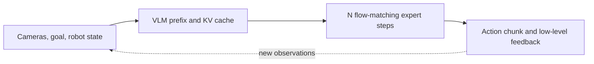

# Efficient Training and Real-Time Inference for Embodied Foundation Models

[Course repository](https://github.com/zengxiong111/Foundation_of_Embodied_AI) · [中文版](Efficient_Training_Real_Time_Inference_ZH.md) · [Flow Matching](https://github.com/zengxiong111/Foundation_of_Embodied_AI/blob/main/md/Flow_Matching_Step_by_Step_Derivation_EN.md) · [RL Post-training](https://github.com/zengxiong111/Foundation_of_Embodied_AI/blob/main/md/RL_Post_Training_EN.md)

> **Scope.** This chapter follows the VLA, flow-matching, and robot policy learning lectures. Rather than repeating a full Transformer derivation, it answers three practical questions: Why is training expensive? How can inference be accelerated? How can a slow foundation model control a continuously moving robot? No experiments or code are included.

**Attribution and evidence.** Prepared in the academic-notes style of [Foundation of Embodied AI](https://github.com/zengxiong111/Foundation_of_Embodied_AI) ([CC BY 4.0](https://creativecommons.org/licenses/by/4.0/)). Technical descriptions refer to primary papers and official documentation accessible by October 19, 2026; no independent benchmarking or hardware validation is claimed.

**Learning outcomes.** Readers should be able to distinguish FlashAttention from KV caching, explain prefix caching in π0/π0.5-style action models, build an end-to-end VLA latency budget, describe real-time chunking (RTC), and decide when LoRA, activation checkpointing, distillation, or inference-system optimizations are appropriate.

## Contents

- [1. Begin with Three Different Optimization Objectives](#efficient-section-01)
- [2. Why Are Transformers Expensive to Train and Deploy?](#efficient-section-02)
- [3. FlashAttention: Efficient Exact Attention](#efficient-section-03)
- [4. Efficient Training: Match the Technique to the Bottleneck](#efficient-section-04)
- [5. KV Cache: What Is Cached, and When Is It Valid?](#efficient-section-05)
- [6. Accelerating Flow-Matching Action Generation](#efficient-section-06)
- [7. Real-Time Robotics: Why Faster Inference Is Not Enough](#efficient-section-07)
- [8. Comparing π0.5, GR00T, and WAM Optimization](#efficient-section-08)
- [9. Practical Priorities: Diagnose Before Optimizing](#efficient-section-09)
- [10. Five Frequently Confused Questions](#efficient-section-10)
- [11. Conclusion](#efficient-section-11)
- [References](#efficient-section-12)

## 1. Begin with Three Different Optimization Objectives

An embodied foundation model may contain a vision encoder, a vision-language backbone, and an action generator. A world-action model (WAM) may additionally predict future images or latent world states. Transformers can appear in all of these components, yet the optimization objectives are different.

| Setting | Primary constraint | Relevant metrics |
|:--|:--|:--|
| Large-scale pretraining | GPU compute, memory, and data throughput | Effective tokens/s, steps/s, peak memory, convergence |
| VLA fine-tuning / online RL | Update cost and policy learning efficiency | GPU-hours, update delay, sample efficiency, policy quality |
| Robot inference | End-to-end latency and timing jitter | Observation-to-action latency, p95/p99 latency, update rate |
| High-frequency servo control | Feedback period and closed-loop stability | Servo frequency, tracking error, deadline misses, safety limits |

**High-frequency servo control does not imply high-frequency Transformer inference.** A common architecture periodically produces an action chunk with the VLA while a separate low-level position, velocity, torque, or impedance controller executes and corrects commands at a higher frequency. VLA update rate, action horizon, and servo frequency must be designed separately.

<!-- course-visual:start -->
**Figure 1: Compute and control loop of a VLA**

<!-- course-visual:end -->

An approximate request-time decomposition is

$$
T_{\mathrm{req}} \approx T_{\mathrm{camera}} + T_{\mathrm{pre}} + T_{\mathrm{vision}} + T_{\mathrm{prefix}} + N T_{\mathrm{expert}} + T_{\mathrm{transfer}} + T_{\mathrm{queue}},
$$

where $N$ is the number of flow-matching integration steps or diffusion denoising steps. Since real pipelines may overlap operations, this is a **diagnostic decomposition**, not an exact serial-timing identity. Accelerating one kernel need not improve total latency by the same factor.

## 2. Why Are Transformers Expensive to Train and Deploy?

### 2.1 Attention Compute and Memory

For a sequence of length $L$, scaled dot-product attention is

$$
Q=XW_Q,\quad K=XW_K,\quad V=XW_V,\qquad
\operatorname{Attn}(Q,K,V)=\operatorname{softmax}\!\left(\frac{QK^\top}{\sqrt{d_k}}+M\right)V.
$$

$M$ denotes a causal, modality, or valid-token attention mask. Dense attention usually incurs compute that scales quadratically with $L$; a naive materialization of the attention matrix also consumes quadratic intermediate storage. Multiple cameras, high-resolution inputs, video history, and predicted future-world tokens can all increase $L$ considerably.

**FlashAttention** uses tiling and IO-aware computation to reduce transfers between GPU high-bandwidth memory and on-chip memory. This reduces intermediate memory requirements and often improves speed, while still computing exact attention; it **does not remove the quadratic arithmetic complexity of ordinary dense attention**. PyTorch's scaled dot-product attention (SDPA) may automatically dispatch to optimized backends when the input and hardware are compatible. [4–5]

### 2.2 What Actually Consumes Training Memory?

A useful decomposition is

$$
M_{\mathrm{train}} \approx M_{\mathrm{params}}+M_{\mathrm{grads}}+M_{\mathrm{optim}}+M_{\mathrm{act}}+M_{\mathrm{temp}}.
$$

Gradients, optimizer states, and activations retained for backpropagation often determine whether a training configuration fits in memory. For long multi-camera sequences, activation memory can be a dominant term. A quantized checkpoint's file size is not a reliable estimate of the VRAM required for full-parameter training.

### 2.3 Embodied Learning Has Additional System Costs

Robot training also performs video decoding, geometric transformations, data loading, timestamp alignment, and action-label processing. Online RL adds communication among actors, replay buffers, and learners. **Distinguish GPU-bound workloads from input-pipeline bottlenecks before selecting an optimization.**

## 3. FlashAttention: Efficient Exact Attention

### 3.1 Start from the Intermediate-Memory Problem

For a single attention head, let $Q,K,V\in\mathbb R^{L\times d}$. The textbook implementation forms

$$
S=QK^\top/\sqrt d,\quad P=\operatorname{softmax}(S),\quad O=PV.
$$

Although $O$ contains only $L\times d$ elements, both the score matrix $S$ and the attention weights $P$ contain $L^2$ elements. Materializing these arrays in GPU high-bandwidth memory (HBM) incurs substantial intermediate storage and traffic when processing long multi-camera sequences or videos. Training also needs a backward pass. **Attention FLOPs alone do not determine wall-clock cost: off-chip memory traffic can be a major bottleneck.**

For scale, with $L=4096$ and BF16 (2 bytes per element), **one** explicit $L\times L$ matrix for **one head** occupies roughly $32\,\mathrm{MiB}$. This excludes other heads, gradients, projections, workspace and parameters; it is an illustrative calculation, not a measured model footprint.

### 3.2 Tiling and Online Softmax

FlashAttention partitions $Q,K,V$ into small tiles, processes them using on-chip storage, and updates numerically stable softmax statistics without materializing the complete $S$ or $P$. For one query row, let $(m,\ell,u)$ denote the running maximum logit, exponential normalizer, and unnormalized weighted value sum. Given a new block of logits $s_j$ and values $v_j$, update

$$
\begin{aligned}
m'&=\max\!\big(m,\max_j s_j\big),\\
\ell'&=e^{m-m'}\ell+\sum_j e^{s_j-m'},\\
u'&=e^{m-m'}u+\sum_j e^{s_j-m'}v_j,\\
o&=u'/\ell'\quad\text{(after all blocks)}.
\end{aligned}
$$

The rescaling factors combine contributions from different tiles stably. **Online Softmax computes exact softmax attention up to floating-point rounding; it does not obtain speed by dropping tokens.** Efficient backward recomputation further reduces intermediate storage.[4]

### 3.3 Why IO-Awareness Matters and When It Helps

FlashAttention primarily reduces HBM reads and writes; it does **not** turn standard dense-attention arithmetic from $O(L^2d)$ into linear complexity. FlashAttention-2 further improves work partitioning and GPU occupancy. Its realized speed depends on the accelerator, head dimension, context length, dtype, attention masks, and implementation.[10]

In robotics, high-resolution multi-view images, long temporal contexts, and future-vision tokens in a WAM can enlarge the sequence. However, accelerate attention only after measuring its share of end-to-end latency. For short sequences or a pipeline bottlenecked by the vision encoder, sampling loop, or communication, a faster attention kernel may yield a small overall gain.

**Practical interface.** PyTorch `scaled_dot_product_attention` (SDPA) can select optimized backends for compatible inputs. Researchers should know when fused kernels are supported, why a configuration falls back to a math implementation, and how masks and precision affect selection; writing CUDA/Triton kernels is not a prerequisite.[5]

| Aspect | Naive attention | FlashAttention |
|:--|:--|:--|
| Mathematical operation | Exact softmax attention | Exact softmax attention (within rounding) |
| Intermediates | May materialize $L\times L$ arrays | Processes tiles without a full matrix |
| Primary optimization | General operator execution | Less HBM traffic and intermediate memory |
| Dense compute | $O(L^2d)$ | Still $O(L^2d)$ |
| Typical motivation | Reference/general fallback | Efficient SDPA on long multimodal sequences |

## 4. Efficient Training: Match the Technique to the Bottleneck

| Technique | Primary benefit | Cost or caveat |
|:--|:--|:--|
| BF16 / mixed precision | Lower memory and faster supported computations | Numerical sensitivity and hardware compatibility; FP16 may need loss scaling |
| FlashAttention / SDPA | Faster and less memory-intensive long-sequence attention | Depends on masks, dtype, accelerator, and kernel support |
| Activation checkpointing | Discards selected forward activations to save VRAM | Recomputes activations during backward, potentially reducing steps/s |
| LoRA / PEFT | Reduces trainable weights, gradients, and optimizer state | Does not automatically eliminate backbone forward or activation costs |
| FSDP / parameter sharding | Distributes parameter, gradient, or optimizer memory across GPUs | Communication and synchronization overhead |
| Vision/video token reduction | Less attention and vision-pipeline work | May discard contacts, small objects, or temporal details |
| Data prefetch / caching / parallel decode | Reduces data stalls and improves GPU utilization | Depends on CPU, SSD, RAM, and network resources |

Three distinctions matter. **Activation checkpointing trades computation for memory**; it is not automatically a speedup. **LoRA reduces trainable-state memory**, not necessarily wall-clock inference or fine-tuning latency. **FSDP is especially useful when sharding is needed**, not an automatic first choice when a single device already fits the model efficiently. [6]

For a π0.5-style VLA, first choose which modules should actually be updated: the image encoder, VLM, and action expert need not share the same freeze or fine-tuning policy. For online off-policy RL, separately ask whether policy inference blocks environment sampling, learner updates lag behind actors, and replay observations can be decoded without bottlenecks. Not every bottleneck is a Transformer kernel.

### 4.1 Prioritize Training Optimizations by Memory Source

When a model does not fit, separate **weights and optimizer state**, **backward activations**, and **excessive context length**. Training only an Action Expert or using LoRA saves trainable state, yet a VLM that still participates in the gradient-bearing forward graph can retain expensive visual activations. If the backbone is completely frozen and its inputs have fixed augmentation semantics, feature precomputation can help, at the cost of reduced ability to update that backbone.

When throughput is low, profile data preparation, visual encoding, attention, action expert, backward computation, communication, and optimizer steps independently. Less peak memory does not imply faster training: activation checkpointing and FSDP can trade recomputation or communication for trainability.

### 4.2 Online RL Is More Than Accelerated Backpropagation

Online off-policy RL adds an asynchronous **actor → environment → replay → learner → policy rollout** loop. Even if FlashAttention speeds up each learner update, robot interaction, resets and safety supervision may still dominate the improvement cycle. Report $\mathrm{updates/s}$, $\mathrm{actions/s}$, GPU-hours, robot-hours and model-publication delay separately. See the [RL post-training lecture](https://github.com/zengxiong111/Foundation_of_Embodied_AI/blob/main/md/RL_Post_Training_EN.md) for algorithms and infrastructure.

## 5. KV Cache: What Is Cached, and When Is It Valid?

### 5.1 The Core Idea

Each Transformer layer produces keys and values. If subsequent computations repeatedly attend to an **unchanged context**, those representations can be cached:

$$
\mathcal{C}^{(\ell)}_{t}=\bigl(K^{(\ell)}_{1:t},V^{(\ell)}_{1:t}\bigr).
$$

Autoregressive language models use historical KV caches so that generating the next token need not recompute all previous tokens. In a conventional cache layout, memory grows approximately linearly with cached sequence length:

$$
M_{\mathrm{KV}}\approx 2\,n_{\ell}\,B\,L\,h_{\mathrm{kv}}\,d_h\,b,
$$

where $n_{\ell}$ is the number of layers, $B$ the batch size, $L$ the cached token count, $h_{\mathrm{kv}}$ the number of KV heads, $d_h$ the head dimension, and $b$ the bytes per element. This is separate from model-weight memory.

### 5.2 Prefill, Decode, and Cache Memory

Autoregressive inference separates **prefill** (processing a known context once and computing per-layer K/V) from **decode** (processing new tokens while attending to the saved context). As new tokens arrive, their K/V can be appended without recomputing earlier tokens. This reduces redundant computation, but the resident cache consumes memory and requires memory-bandwidth-intensive reads during decoding.

KV memory scales with the number of **KV heads**, which need not equal the number of query heads. Grouped-query or multi-query attention (GQA/MQA) uses $h_{\mathrm{kv}}<h_{\mathrm q}$ and can substantially reduce cache storage. For example, 32 layers, 8 KV heads, head dimension 128, BF16, batch size 1 and a 2048-token context require approximately $256\,\mathrm{MiB}$ of KV cache according to the equation above. This excludes weights and other buffers.

Cache validity is not simply a matter of unchanged text. **Cached tokens must have no computational dependence, in any relevant layer, on the tokens that change later**, while the model parameters, position encoding, masks, and relevant configuration remain consistent. With ordinary causal attention, past tokens cannot attend to future ones, so their cached representations remain valid.

For a fixed prefix $p$ and a changing action suffix $a^{(k)}$, a cache-compatible attention mask can be idealized as

$$
M=\begin{bmatrix}M_{pp}&-\infty\\M_{ap}&M_{aa}\end{bmatrix},
\qquad\text{rows are queries and columns are keys.}
$$

The upper-right block **prevents prefix tokens from attending to the varying action suffix**. Thus, the prefix representation at later layers is independent of the denoising state. If prefix tokens instead attend bidirectionally to the changing actions at every layer, caching their old K/V is not exact. This matrix is a dependency schematic; positional encodings, padding, modality masks and residual connections must also be handled correctly.

### 5.3 KV Cache in π0/π0.5-Style Flow Matching

Let $c=(I,l,s)$ denote the current image, language, and robot-state conditions; $a$ an expert action chunk; and $\epsilon$ Gaussian noise. One common interpolation convention is

$$
x_{\tau}=(1-\tau)a+\tau\epsilon,\qquad
v^*(x_{\tau},\tau,c)=\epsilon-a,\quad \tau\in[0,1].
$$

The action expert is trained to predict the velocity field:

$$
\mathcal{L}_{\mathrm{FM}}=\mathbb{E}_{a,\epsilon,\tau,c}
\left[\bigl\|v_{\theta}(x_{\tau},\tau,c)-(\epsilon-a)\bigr\|^2\right].
$$

At inference time, generation starts from $x_1\sim\mathcal N(0,I)$ and integrates backward with a negative time step:

$$
x_{\tau+\Delta\tau}=x_{\tau}+\Delta\tau\,v_{\theta}(x_{\tau},\tau,c),\qquad \Delta\tau<0.
$$

The **action state changes on each step**, while the conditioning observation can remain fixed for the entire action-chunk generation. An efficient implementation therefore:

1. Processes the current image-language prefix once and stores its KV representations.
2. Updates the action-related tokens at every integration step, attending to cached prefix KV.
3. Produces an action chunk and then checks which caches are invalid when the next sensor observation arrives.

OpenPI's `pi0.py` explicitly pre-fills prefix KV in `sample_actions()` and passes the cache to subsequent action-suffix passes. Its visible default is `num_steps=10`, but **ten steps are not a universal requirement for every π0.5 deployment**. [1]

### 5.4 Three Crucial Limits

**The cache is not automatically reusable across camera frames.** New images change visual tokens. If visual and language tokens share bidirectional prefix attention, the deep-layer KV for unchanged text may also depend on the changed image. An unchanged command does **not** guarantee a reusable full-prefix cache. [1]

**A prefix cache does not eliminate action-expert computation.** Action tokens and diffusion/flow time change at each integration step, so their corresponding suffix generally has to be recomputed.

**Inference caches cannot simply be recycled during training.** Parameter updates, gradient paths, and random augmentations can invalidate cached representations. Features of a strictly frozen module may sometimes be precomputed, but this requires careful validation of dependencies.

## 6. Accelerating Flow-Matching Action Generation

Approximate the latency of one generated action chunk by

$$
T_{\mathrm{chunk}}\approx T_{\mathrm{encode}}+T_{\mathrm{prefill}}+N T_{\mathrm{denoise}}+T_{\mathrm{overhead}}.
$$

If action-expert execution dominates and per-step costs are comparable, reducing $N$ is often effective. Actual gains also depend on kernel launches, compilation, caching, batch size, and parallel pipeline stages.

| Optimization | Why it can help | Main risk |
|:--|:--|:--|
| Fewer integration/denoising steps | Fewer action-expert forward passes | Lower trajectory and contact accuracy |
| Better numerical integration | Similar accuracy with fewer steps | Added solver overhead or train/inference mismatch |
| Distillation / few-step policies | Compress multi-step generation | Additional training; possible loss of action diversity |
| Reuse stable conditioning features | Avoid redundant VLM or prefix computation | Stale caches or incorrect masks |
| Compilation / operator fusion | Fewer launches and unnecessary transfers | Dynamic shapes, backend support, numerical differences |
| Improve camera and networking | Reduces latency outside the model | Requires complete system profiling |

For dexterous manipulation and precision assembly, **latency is not the only objective**. Contact initiation, slip, release, and rapid object-pose changes may be unusually sensitive to small action errors. An effective acceleration preserves closed-loop task performance.

## 7. Real-Time Robotics: Why Faster Inference Is Not Enough

Let $f_c$ be the action-execution or low-level control frequency and $H$ the number of actions in a chunk. The nominal coverage time is

$$
T_H=\frac{H}{f_c}.
$$

$f_c$ is **not** necessarily the frequency at which the VLA Transformer executes.

### 7.1 Synchronous, Naive Asynchronous, and RTC Execution

- **Synchronous execution:** Finish one chunk before inferring the next; simple, but may introduce pauses.
- **Naive asynchronous execution:** Predict the next chunk while executing the current one; removes waiting, but abrupt switching can create discontinuities in position, velocity, or contact strategy.
- **Real-time chunking (RTC):** Keep inference asynchronous while conditioning the next chunk on actions already committed for execution. Inference-time inpainting makes the remaining actions more consistent with the current trajectory. [2–3]

A conceptual constraint is

$$
\widetilde a_{0:k-1}=a^{\mathrm{committed}}_{0:k-1},
\qquad
\widetilde a_{k:H-1}\sim p_{\theta}\bigl(\cdot\mid o_t,\,a^{\mathrm{committed}}_{0:k-1}\bigr).
$$

This expresses the principle that committed actions are preserved and the future plan should be compatible with them. **It is a conceptual description, not the full RTC integration rule.** RTC can additionally apply a softer constraint to overlapping future actions, balancing consistency against responsiveness. [3]

Follow-up work in 2025 studied **training-time action-prefix conditioning**, removing the need for the same inference-time inpainting overhead. Distinguish original inference-time RTC from this later training-time variant. [8]

### 7.2 Mean Latency Is Not Enough

Suppose $R$ actions remain buffered when a new inference request begins. A conservative condition for avoiding buffer underrun is

$$
T^{\mathrm{p99}}_{\mathrm{inference}}+T_{\mathrm{network}}+T_{\mathrm{jitter}}+T_{\mathrm{margin}} < \frac{R}{f_c}.
$$

This is a **scheduling-margin heuristic**, not a sufficient condition for robot stability or task success. Even a timely result may use stale visual observations. Variance, packet losses, and camera queue buildup can also cause failures.

Practical deployment must monitor observation timestamps, p50/p95/p99 latency, buffered horizon, position/velocity continuity at chunk switches, low-level tracking error, and a safe timeout behavior. In contact-rich manipulation, feedback control and torque/collision constraints belong in an appropriate low-level control and safety layer. RTC does not replace that layer.

## 8. Comparing π0.5, GR00T, and WAM Optimization

| Model family | Main Transformer workload | Typical optimization priorities |
|:--|:--|:--|
| π0/π0.5-style VLA | VLM prefix + flow-matching action expert | Prefix KV cache, integration steps, vision tokens, RTC |
| GR00T N1-style VLA | Vision-language understanding + diffusion Transformer actions | Image preprocessing, attention backend, DiT inference, chunk scheduling |
| Autoregressive world model | Sequential future-state or visual-token prediction | Autoregressive KV cache, temporal context, video token compression |
| Diffusion / joint video-action WAM | Repeated world-and-action prediction | Denoising cost, conditioning reuse, temporal coherence, control delay |

π0.5 emphasizes open-world VLA generalization; GR00T N1 couples a VLM with a diffusion Transformer in a dual-system design. [7,9] A WAM is not a single fixed architecture. An autoregressive world predictor may benefit from conventional decoding caches, whereas a diffusion/flow-based world-action generator requires analyzing **which tokens genuinely remain unchanged between sampling steps**.

## 9. Practical Priorities: Diagnose Before Optimizing

| Confirmed bottleneck | First interventions to consider | Poor first move |
|:--|:--|:--|
| Training out of memory | BF16, shorter sequences, checkpointing, PEFT/FSDP | Write custom CUDA kernels immediately |
| Low GPU utilization | Data loading, decoding, CPU/network stalls, synchronization | Add GPUs without profiling |
| Attention dominates | SDPA/FlashAttention, token reduction, mask review | Assume all masks run on the fastest kernel |
| Slow flow-matching generation | Prefix cache, fewer steps, few-step models | Minimize steps without evaluating contact quality |
| Reasonable inference but jerky motion | Async execution, RTC/training-time conditioning, chunk transitions | Continue optimizing attention alone |
| High remote-inference latency | Nearby deployment, payload compression, asynchronous pipelines, buffering | Benchmark only GPU forward time |
| Instability in precision tasks | Fresh observations, robust low-level control and safety constraints | Assume action chunking guarantees contact stability |

A sensible order is: **first ensure continuous and safe closed-loop execution, then reduce total observation-to-action latency, and finally optimize attention kernels if profiling demonstrates that they are the actual bottleneck.**

## 10. Five Frequently Confused Questions

**Q1. Is KV caching only for language models?** No. Any computation with reusable key/value context can potentially benefit. A fixed conditioning prefix in flow matching is one example.

**Q2. Are FlashAttention and KV caching interchangeable?** No. FlashAttention makes individual attention passes more efficient; caching avoids recomputing unchanged contexts.

**Q3. Can KV caching remove all future image encoding?** No. New images change the condition, so dependencies and acceptable approximation errors must be assessed.

**Q4. Does RTC make the Transformer itself faster?** Not necessarily. Original RTC is mainly a latency-tolerance and continuity mechanism; inpainting may add computation. Training-time conditioning can reduce this inference-time overhead. [8]

**Q5. Must dexterous-hand, bimanual, or WAM researchers master CUDA?** Not initially. First understand attention, caching, memory, latency profiling, and asynchronous control. Learn Triton/CUDA when a measured kernel bottleneck justifies it.

## 11. Conclusion

Efficiency in embodied foundation models is not a single tokens-per-second metric. It combines **training cost, action-generation latency, observation freshness, motion continuity, and closed-loop task success**.

**Remember: FlashAttention optimizes one attention computation; KV caching avoids repeated context computation; fewer flow-matching steps reduce action-expert calls; RTC coordinates a slow policy with a continuously moving robot; and high-frequency low-level control handles tracking and safety.**

## References

1. Physical Intelligence, [OpenPI `pi0.py`: prefix KV caching and flow-matching sampling](https://github.com/Physical-Intelligence/openpi/blob/215abfb217dbac7d5f1273282331b9b1866c0479/src/openpi/models/pi0.py).
2. Black, Galliker, and Levine, [Real-Time Execution of Action Chunking Flow Policies](https://arxiv.org/abs/2506.07339), NeurIPS 2025.
3. Physical Intelligence, [Real-Time Action Chunking with Large Models](https://www.pi.website/research/real_time_chunking), 2025.
4. Dao et al., [FlashAttention: Fast and Memory-Efficient Exact Attention with IO-Awareness](https://arxiv.org/abs/2205.14135), 2022.
5. PyTorch, [Official Scaled Dot Product Attention documentation](https://docs.pytorch.org/docs/stable/generated/torch.nn.functional.scaled_dot_product_attention.html).
6. PyTorch, [Maximizing Training Throughput Using PyTorch FSDP](https://pytorch.org/blog/maximizing-training/), 2024.
7. Physical Intelligence et al., [π0.5: a Vision-Language-Action Model with Open-World Generalization](https://arxiv.org/abs/2504.16054), 2025.
8. Black et al., [Training-Time Action Conditioning for Efficient Real-Time Chunking](https://arxiv.org/abs/2512.05964), 2025.
9. NVIDIA et al., [GR00T N1: An Open Foundation Model for Generalist Humanoid Robots](https://arxiv.org/abs/2503.14734), 2025.

10. Dao, [FlashAttention-2: Faster Attention with Better Parallelism and Work Partitioning](https://arxiv.org/abs/2307.08691), 2023.
