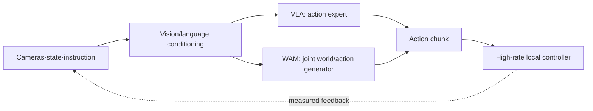

# Efficient Training and Real-Time Inference for Embodied Foundation Models

[Course repository](https://github.com/zengxiong111/Foundation_of_Embodied_AI) · [中文版](Efficient_Training_Real_Time_Inference_ZH.md) · [Flow Matching](https://github.com/zengxiong111/Foundation_of_Embodied_AI/blob/main/md/Flow_Matching_Step_by_Step_Derivation_EN.md) · [Post-training](https://github.com/zengxiong111/Foundation_of_Embodied_AI/blob/main/md/Embodied_Post_Training_EN.md) · [PDF](https://zengxiong111.github.io/zengxiong.github.io/files/Efficient_Training_Real_Time_Inference_EN.pdf)

> **Scope.** This lecture connects Transformers, flow matching, vision-language-action models (VLAs), world action models (WAMs), and robot control. It addresses three questions: how to train with less compute, how to generate actions at low latency, and how to keep a physical robot moving continuously while a relatively slow VLA or WAM runs. Full WAM architectures, RL post-training algorithms, code, and hands-on experiments are outside its scope.

**Attribution and evidence.** This chapter follows the academic-notes style of [Foundation of Embodied AI](https://github.com/zengxiong111/Foundation_of_Embodied_AI) ([CC BY 4.0](https://creativecommons.org/licenses/by/4.0/)). Quantitative claims refer to original papers or official announcements available by October 20, 2026, and are not independent reproductions. A WAM denotes a family that aligns action generation with predictions of how the world evolves, not necessarily a video-diffusion architecture.

**Learning outcomes.** Distinguish FlashAttention, KV caching, and DiT caching; identify video-token and joint video-action generation costs; explain DreamZero-Flash's decoupled training noise; construct an inference budget that includes networking; and select closed-loop execution mechanisms for contact-rich tasks.

## Contents

- [1. Begin with Three Optimization Objectives](#efficient-section-01)
- [2. Why Are Transformers and WAMs Expensive?](#efficient-section-02)
- [3. FlashAttention: Efficient Exact Attention](#efficient-section-03)
- [4. Efficient Training: VLA versus WAM Bottlenecks](#efficient-section-04)
- [5. KV Cache and DiT Caching: When Reuse Is Valid](#efficient-section-05)
- [6. Few-Step Flow Matching and WAM Inference](#efficient-section-06)
- [7. Real-Time Robots: Asynchronous Closed-Loop Execution](#efficient-section-07)
- [8. Comparing π0.5, GR00T, DreamZero, and Dream-1](#efficient-section-08)
- [9. Practical Priorities: Diagnose Before Optimizing](#efficient-section-09)
- [10. Six Common Confusions](#efficient-section-10)
- [11. Conclusion](#efficient-section-11)
- [References](#efficient-section-12)

## 1. Begin with Three Optimization Objectives

Embodied foundation models commonly contain vision encoders, language and temporal backbones, and action-generation modules. A VLA primarily produces actions from observations and instructions. Some WAMs additionally predict future video, geometric states, or compact latent world representations, aligning these predictions with the actions. **Using a Transformer and predicting the future world are distinct architectural choices.**

| Setting | Primary constraint | Metrics that matter |
|:--|:--|:--|
| Pretraining and fine-tuning | Compute, VRAM, data throughput | GPU-hours, steps/s, peak VRAM, validation-task quality |
| VLA / WAM inference | Prefix processing, iterative generation, visual tokens | Per-request p50/p95/p99, VRAM, action-chunk latency |
| Robot closed-loop execution | Observation freshness, jitter, motion continuity | Observation-to-action delay, action-buffer slack, tracking error |
| High-frequency servo loop | Feedback, contact, safety | Control rate, force/pose tracking, deadline and safety limits |

<!-- course-visual:start -->
**Figure 1: VLA / WAM inference and closed-loop control (conceptual)**

<!-- course-visual:end -->

**Fast servo control does not require equally fast foundation-model inference.** A practical hierarchy periodically generates action chunks in the VLA or WAM, while a separate position, velocity, torque, or impedance controller executes and corrects them at a higher rate. Model request rate, action horizon, low-level servo frequency, and actual feedback frequency must be distinguished.

An approximate request-latency breakdown is

$$
T_{\mathrm{req}}\approx T_{\mathrm{camera}}+T_{\mathrm{pre}}+T_{\mathrm{encoder}}+T_{\mathrm{context}}+T_{\mathrm{generator}}+T_{\mathrm{transfer}}+T_{\mathrm{queue}}.
$$

This is a **profiling decomposition**, not a strict serial identity: stages can overlap. Accelerating an individual kernel will not necessarily produce the same end-to-end speedup. For a WAM, $T_{\mathrm{generator}}$ may include joint video-action denoising; decoding pixels for an external display is an optional extra step, depending on the deployment.

## 2. Why Are Transformers and WAMs Expensive?

### 2.1 Attention Compute and Memory

For $X\in\mathbb R^{L\times d}$, scaled dot-product attention is

$$
Q=XW_Q,\quad K=XW_K,\quad V=XW_V,\qquad
\operatorname{Attn}(Q,K,V)=\operatorname{softmax}\!\left(\frac{QK^\top}{\sqrt{d_k}}+M\right)V.
$$

$M$ denotes a causal, modality, or valid-token mask. Standard dense attention has approximately $O(L^2d)$ arithmetic complexity; materializing the attention matrix requires $O(L^2)$ intermediate storage. Multi-camera high-resolution observations, video history, and future-video tokens increase $L$. Long-horizon WAMs may therefore be more exposed to attention and activation-memory costs, although not every WAM is inherently slower than a VLA.

### 2.2 Video Tokens Introduce an Additional Cost Dimension

Suppose a latent-video representation contains $F$ frames, each spatially encoded into $H'\times W'$ positions after VAE compression and patchification. A useful scaling approximation is

$$
L_{\mathrm{video}}\propto F\,H'W',\qquad
L_{\mathrm{total}}=L_{\mathrm{context}}+L_{\mathrm{future}}+L_{\mathrm{action}}.
$$

Even when future RGB frames are never displayed, future-video latent tokens can still participate in every iteration of the joint video-action DiT. Increasing frame count, camera count, or resolution may raise training activation memory, attention compute, and inference time. Excessive compression, however, can remove fingertip contacts, small clearances, or rapid slip. **Minimizing token count is not equivalent to optimizing robotic competence.**

### 2.3 Training Memory and Input Pipelines

$$
M_{\mathrm{train}}\approx M_{\mathrm{params}}+M_{\mathrm{grads}}+M_{\mathrm{optim}}+M_{\mathrm{act}}+M_{\mathrm{temp}}.
$$

Weights, gradients, optimizer state, retained activations, and temporary tensors should be tracked separately. A quantized checkpoint's file size is not the VRAM needed for full-parameter training. Video policies also pay for multi-view decoding, VAE encoding, frame-rate alignment, and action-image timestamp synchronization. **When the GPU is underutilized, inspect CPU decoding, storage/network throughput, and augmentations before adding more accelerators.**

## 3. FlashAttention: Efficient Exact Attention

### 3.1 The Problem Is Intermediate Matrices and HBM Traffic

For one attention head, the naive implementation forms

$$
S=QK^\top/\sqrt d,\qquad P=\operatorname{softmax}(S),\qquad O=PV.
$$

Although $O$ has only $L\times d$ elements, both $S$ and $P$ contain $L^2$ entries. For $L=4096$ with BF16 (2 bytes per element), **one** explicit $4096\times4096$ matrix for **one head** occupies approximately $32\,\mathrm{MiB}$, excluding other heads, gradients, and workspace.

### 3.2 Tiling and Online Softmax

FlashAttention tiles $Q,K,V$, keeping stable softmax statistics on chip instead of materializing full $S$ and $P$ in GPU high-bandwidth memory (HBM). For one query row, suppose the running maximum, exponential normalizer, and unnormalized value sum are $(m,\ell,u)$. For new logits $s_j$ and values $v_j$, update

$$
\begin{aligned}
m'&=\max(m,\max_j s_j),\\
\ell'&=e^{m-m'}\ell+\sum_j e^{s_j-m'},\\
u'&=e^{m-m'}u+\sum_j e^{s_j-m'}v_j,\\
o&=u'/\ell'\quad\text{(after all tiles)}.
\end{aligned}
$$

The result is **exact softmax attention up to floating-point rounding**, not an approximation obtained by discarding tokens. Standard dense-attention arithmetic remains $O(L^2d)$. FlashAttention-2 improves work partitioning; PyTorch `scaled_dot_product_attention` (SDPA) can dispatch to an optimized implementation when supported.[4,5,10]

| Technique | What is reused or reduced? | Approximate? |
|:--|:--|:--|
| FlashAttention | HBM traffic and intermediates within one attention pass | No (apart from rounding) |
| KV cache | K/V of **unchanged context** across computations | No, if dependencies truly permit reuse |
| DiT caching | Velocity or features from neighboring denoising steps | Usually yes |
| Few-step generation / distillation | Calls to the iterative generative model | Typically changes the model or trajectory |

**Implication for WAMs.** First profile attention-layer time and memory. Only then decide whether SDPA/FlashAttention, token compression, or fewer joint-DiT iterations provides the greatest benefit. FlashAttention cannot by itself remove repeated forward passes through a multi-billion-parameter DiT.

## 4. Efficient Training: VLA versus WAM Bottlenecks

| Technique | Main benefit | Important limitation |
|:--|:--|:--|
| BF16 / mixed precision | Lower compute and some memory costs | Requires numerical and device checks |
| FlashAttention / SDPA | Less attention memory traffic for long sequences | Depends on masks, length, and hardware |
| Activation checkpointing | Trades recomputation for activation VRAM | Backward can be slower |
| LoRA / freezing modules | Reduces trainable state and optimizer memory | Full backbone forward may remain expensive |
| FSDP / parameter sharding | Shares parameters and optimizer states across GPUs | Communication and synchronization overhead |
| Cached VAE features | Avoids repeated encoding when encoder is frozen | Invalid when augmentations/temporal sampling change meanings |
| Video tokens / temporal subsampling | Shortens attention context | May lose fine motion and contact alignment |
| Prefetch / asynchronous decoding | Prevents data-loading stalls | Consumes CPU, RAM, and storage bandwidth |

### 4.1 VLA: Separate the Visual Prefix from the Action Expert

For $\pi0/\pi0.5$-style fine-tuning, the vision encoder, VLM backbone, and action expert need not use the same update policy. Freezing or LoRA reduces trainable state, but gradient-bearing computation through a large backbone can still retain substantial activation memory. In online off-policy RL, actor inference, replay decoding, and learner updates are distinct bottlenecks; these are post-training infrastructure issues, not necessarily attention-kernel issues.[1,7]

### 4.2 WAM: Account for Video Compute Explicitly

A simplified way to express joint video-action training is

$$
\mathcal L_{\mathrm{joint}}=\mathcal L_{\mathrm{video}}+\lambda_a\mathcal L_{\mathrm{action}}.
$$

This is **only a conceptual cost decomposition**; not every WAM literally sums two independently defined losses. DreamZero, for example, trains a weighted joint flow-matching velocity field.[11] Such models should profile video VAE encoding, spatiotemporal DiT layers, action heads, sequence length, and gradient flow separately. Cache video features **only if the corresponding encoder is frozen and preprocessing semantics stay fixed**. Next consider prediction horizon, latent resolution, and trainable-module selection.

**Contact-rich tasks impose a constraint.** In insertion, tool rotation, and dexterous manipulation, aggressive video subsampling or latent compression may hide collision edges, initial contact, and slip. GPU-hours alone are not sufficient: action error, contact continuity, and real-task success still matter.

## 5. KV Cache and DiT Caching: When Reuse Is Valid

### 5.1 KV Memory and Conditions for Correct Reuse

For Transformer layer $\ell$, cached past keys and values can be written as

$$
\mathcal C_t^{(\ell)}=\bigl(K_{1:t}^{(\ell)},V_{1:t}^{(\ell)}\bigr),\qquad
M_{\mathrm{KV}}\approx 2n_\ell BLh_{\mathrm{kv}}d_hb.
$$

Here $n_\ell$ is the number of layers, $B$ the batch size, $L$ the context length, $h_{\mathrm{kv}}$ the number of KV heads, $d_h$ each head dimension, and $b$ bytes per element. For 32 layers, eight KV heads, dimension 128, BF16, batch one, and 2,048 tokens, the cache alone is about $256\,\mathrm{MiB}$, excluding weights.[1]

A cache is **exactly reusable** only if cached hidden representations do not depend on subsequently changing tokens, and the weights, positions, masks, and input semantics remain compatible. With fixed prefix $p$ and changing generative suffix $g$, a conceptual dependency mask is

$$
M=\begin{bmatrix}M_{pp}&-\infty\\M_{gp}&M_{gg}\end{bmatrix}
\quad\text{(rows: queries; columns: keys)}.
$$

The upper-right block prevents the **prefix from attending to the mutable suffix**. This is an illustrative mask, not a universal design for all Transformer variants.

### 5.2 π0 / π0.5: Fixed Conditioning Prefix and Mutable Actions

Let $c=(I,l,s)$ contain image, instruction, and robot state. Under the convention "$\tau=0$ is clean, $\tau=1$ is noise," a flow-matching path is

$$
x_\tau=(1-\tau)a+\tau\epsilon,\quad
v^*(x_\tau,\tau,c)=\epsilon-a,
\qquad
\mathcal L_{\mathrm{FM}}=\mathbb E\|v_\theta(x_\tau,\tau,c)-(\epsilon-a)\|^2.
$$

Sampling starts at $x_1\sim\mathcal N(0,I)$ and integrates backward. **The current visual/language condition usually stays fixed across integration steps for one action request**, enabling prefix prefill and KV reuse while the action suffix changes. After a new camera observation, some or all cached representations must be refreshed. An unchanged language instruction does not guarantee that a multimodal prefix is unchanged after bidirectional processing.[1]

### 5.3 WAM: Autoregressive History Is Not a Frozen Prediction

An autoregressive WAM may cache confirmed history while jointly denoising the next predicted video-and-action chunk. After executing a chunk, DreamZero **updates its historical visual context with real observations**, reducing the compounding of open-loop video prediction errors.[11] Implementations must respect timestamps, masks, and dependency invalidation: if the observed world differs from the previously predicted world, the affected cached representations require updating or recomputation.

**DiT caching is different.** DreamZero exploits similarity in velocity directions across adjacent flow-matching steps; if a similarity criterion is satisfied, some velocity computation is reused. The paper reports an effective reduction from 16 to approximately four DiT passes in its setting. This is **approximate cross-denoising-step reuse**, unlike strictly valid causal KV reuse.[11]

## 6. Few-Step Flow Matching and WAM Inference

### 6.1 Two Distinct Inference Cost Profiles

For a VLA dominated by an action expert, an approximate latency profile is

$$
T_{\mathrm{VLA}}\approx T_{\mathrm{encode}}+T_{\mathrm{prefill}}+N_aT_{\mathrm{expert}}+T_{\mathrm{overhead}}.
$$

For a WAM with a joint video-action DiT, it may be closer to

$$
T_{\mathrm{WAM}}\approx T_{\mathrm{encode}}+T_{\mathrm{history}}+N_{\mathrm{eff}}T_{\mathrm{DiT}}(L_{\mathrm{video}}+L_{\mathrm{action}})+T_{\mathrm{overhead}}.
$$

Both are **diagnostic approximations**, not assumptions of strictly serial execution. Shortening the sampling trajectory, reducing video context, accelerating a DiT pass, and removing CPU-GPU synchronization can all help. Cutting $N$ by a factor of four does not necessarily cut the complete request time by four.

### 6.2 DreamZero: System-, Implementation-, and Model-Level Improvements

DreamZero uses a 14B-parameter pretrained video-diffusion backbone to jointly generate future video and actions. Its paper reports approximately **5.7 s/chunk** for a naive setup. A combined optimization stack—two-GPU CFG parallelism, DiT caching, `torch.compile` and CUDA Graphs, kernel/scheduler improvements, quantization, and DreamZero-Flash—reaches **approximately 150 ms/chunk, a cumulative 38× speedup on the specified GB200 setup, and roughly 7 Hz closed-loop action updates**.[11,12]

| Optimization level | Mechanism | Role in DreamZero |
|:--|:--|:--|
| System: CFG parallelism | Separate conditional and unconditional branches across GPUs | Lower denoising-step wall time |
| System: DiT caching | Approximately reuse velocity predictions between steps | Fewer effective DiT calls |
| Implementation: compilation/CUDA Graphs | Reduce Python and launch overhead | Less CPU scheduling delay |
| Implementation: mixed precision/quantization | Reduce memory and arithmetic costs | Requires numerical and policy validation |
| Model: DreamZero-Flash | Adjust the joint video/action training noise distribution | More reliable few-step actions |

**Metric discipline.** The **38×** figure comes from the cumulative, hardware-dependent stack in paper Table 1; it is not the contribution of Flash training in isolation. The separate **2.33×** figure in Table 3 compares 350 ms with 150 ms on a specific task. Those numbers must not be conflated.

### 6.3 DreamZero-Flash: Why Not Simply Reduce Four Steps to One?

With a shared video-action denoising time $t$, training primarily exposes the model to modalities at similar noise levels. But one-step inference may require **nearly clean motor actions even when the predicted video remains noisy**. This creates a train/inference distribution mismatch.

During its final training stage, DreamZero-Flash decouples the time distributions. One configuration in the paper is

$$
t_{\mathrm{video}}=1-\eta,\quad \eta\sim\operatorname{Beta}(7,1),\qquad
t_{\mathrm{action}}\sim\mathcal U(0,1),\qquad
\mathbb E[t_{\mathrm{video}}]=0.125.
$$

**Time-parameter convention matters:** DreamZero uses $t=0$ for the high-noise endpoint, **opposite** to the $\pi0$ notation used in Section 5.2. Biasing video $t$ toward zero therefore teaches the model to recover useful actions despite noisy video latents. It does not simply disable the video branch: world prediction still contributes training supervision.[11]

| Method (paper Table 3) | Denoising steps | Table-bussing task progress | Latency per chunk |
|:--|--:|--:|--:|
| DreamZero | 4 | $83\%\pm6.1\%$ | 350 ms |
| DreamZero (naive one step) | 1 | $52\%\pm10.2\%$ | 150 ms |
| DreamZero-Flash | 1 | $74\%\pm10.1\%$ | 150 ms |

These are **task-progress results (mean ± standard error) on the evaluated table-bussing task**, not general multi-task success rates. The 150 ms latency is not a universal promise for any accelerator, resolution, or workload. The key result is that **training-distribution design can improve the speed–action-quality tradeoff more effectively than merely shortening a sampler.**

## 7. Real-Time Robots: Asynchronous Closed-Loop Execution

### 7.1 Servo Rate versus Action Horizon

If the low-level controller runs at $f_c$ and a chunk contains $H$ control steps, its nominal duration is

$$
T_H=\frac H{f_c}.
$$

For example, one DreamZero bimanual setting uses 48 actions at 30 Hz, yielding a **1.6 s** action horizon. This duration is **not** the model replanning interval or the closed-loop reaction rate.[11]

**Synchronous generation** risks stalls at chunk boundaries. **Naive asynchronous execution** overlaps computation and execution, but can introduce discontinuities when switching chunks. **Real-Time Chunking (RTC)** conditions the new chunk on already committed actions, reducing action-switch transients by inpainting or constraining the generated continuation. Conceptually,

$$
\widetilde a_{0:k-1}=a^{\mathrm{committed}}_{0:k-1},\qquad
\widetilde a_{k:H-1}\sim p_\theta(\cdot\mid o_t,a^{\mathrm{committed}}_{0:k-1}).
$$

This is a conceptual continuity condition, not the complete RTC algorithm. Original RTC does not necessarily make the underlying Transformer faster. Training-time action-prefix conditioning is a related but distinct development.[2,3,8]

### 7.2 WAM: Correcting the World History Asynchronously

WAMs must distinguish **predicted future** from **observed reality**. While the robot executes the current chunk, the model computes the next one. After receiving timestamped camera/state feedback, the historical context is refreshed so subsequent predictions do not keep trusting already falsified visual futures. This mechanism can complement RTC, but **DreamZero's asynchronous controller must not be described as automatically implementing RTC**.[11]

If an action buffer contains $R$ remaining control steps, a conservative scheduling check is

$$
T^{\mathrm{p99}}_{\mathrm{infer}}+T_{\mathrm{network}}+T_{\mathrm{jitter}}+T_{\mathrm{margin}}<\frac R{f_c}.
$$

This is a **buffer-deadline engineering criterion**, not a proof of control stability or contact safety. Deployments should monitor observation age (Age of Information), p95/p99 latency, velocity/acceleration continuity at chunk transitions, tracking error, and safe fallback after timeouts.

### 7.3 The Additional Difficulty of Cloud WAMs

A remote WAM can centralize costly accelerators, but video upload, model queues, downlink actions, and network jitter all enter the effective feedback loop. The system should specify whether compressed frames or latent features are transmitted, how robot and server timestamps are reconciled, when stale replies are discarded, and whether missed deadlines trigger slowing, holding, or a controlled safe stop. **Server-side model throughput is not an adequate substitute for end-to-end latency distributions.**

For insertion, tool rotation, and dexterous contact, high-rate feedback, collision handling, and torque/impedance constraints should remain in suitable local control and safety layers. A cloud WAM should not be expected to serve as a high-bandwidth force-stability controller by itself.

## 8. Comparing π0.5, GR00T, DreamZero, and Dream-1

### 8.1 Optimization Priorities Vary by Model Family

| Model family | Generated output | Main optimization priorities | Deployment challenge |
|:--|:--|:--|:--|
| $\pi0/\pi0.5$-style VLA | Flow-matching action chunks | Prefix KV, solver steps, RTC | Image encoding and chunk transitions |
| GR00T N1-style VLA | VLM-conditioned DiT action chunks | SDPA, DiT scheduling, image pipeline | Action latency, memory, interfaces |
| Autoregressive world model | Future state/vision tokens | Causal KV, history length, token reduction | History cache and drift |
| DreamZero-like joint WAM | Future video latents and actions | Video tokens, DiT caching, Flash, async execution | Video generation and system complexity |

A blanket claim that "WAMs are always more expensive than VLAs" would be incorrect. A WAM can use latent states, low-resolution predictions, or a smaller network. Meaningful comparisons must fix the task, control requirements, hardware, and quality target.[7,9,11]

### 8.2 Dream-1: Cloud Service Pricing Is Not Local GPU Cost

Dream Labs' October 2026 public introduction describes Dream-1 as an API-accessible WAM that can operate previously unseen robot embodiments. Its advertised **service prices** are **US$3/hour for Dream-1** and **US$2/hour for Dream-1-flash**. The announcement also states that **each call returns 1.6 s of actions**.[13]

Those figures describe **published service billing and returned action horizon**, not a disclosed accelerator count, training budget, actual network latency per call, or guaranteed local deployment cost. In particular, a 1.6-second action horizon **does not imply a 1.6-second inference time**. Remote deployments still need independent p99 API latency, queueing, video uplink, and robot-interface measurements.

### 8.3 What Should a VLA–WAM Benchmark Report?

At minimum: accelerator model and count; precision/quantization; camera count and resolution; observation/prediction horizon; denoising steps; action-chunk length; actual model latency (preferably p50/p95/p99); network latency; model output rate; low-level execution rate; and success/task-progress metrics on the **same** tasks. **Tokens/s, parameter count, or hourly cloud pricing alone cannot determine suitability for contact-rich manipulation.**

## 9. Practical Priorities: Diagnose Before Optimizing

| Measured bottleneck | First interventions | Poor first step |
|:--|:--|:--|
| Training OOM | BF16, shorter video context, checkpointing, PEFT/FSDP | Write custom CUDA kernels immediately |
| Low GPU utilization | Video decoding, VAE caching, prefetch, synchronization | Add GPUs without profiling |
| Attention dominates | SDPA/FlashAttention, mask review, token reduction | Assume every mask supports the fastest kernel |
| VLA action generation is slow | Prefix KV, fewer solver steps, distillation, compilation | Reduce steps without checking contact success |
| WAM video-action DiT dominates | Fewer video tokens, DiT caching, few-step training, quantization | Confuse KV with DiT caching |
| Motion stutters despite fast inference | Async execution, RTC, synchronization, action-buffer slack | Continue focusing only on model FLOPs |
| Cloud requests occasionally time out | End-to-end p99, closer serving, stale-reply rejection, local fallback | Measure only average server latency |
| Precision contact is unstable | Fresh feedback, impedance/force control, safety constraints | Treat WAM/RTC as a safety controller |

**Recommended priority order:** first make execution continuous and safe; next profile full observation-to-action latency; finally optimize attention, joint DiT passes, samplers, or communication according to evidence. The attraction of WAMs is a learned prior over world evolution, not immunity from timing, contact, and systems engineering.

## 10. Six Common Confusions

**Q1. Is FlashAttention the same as DreamZero-Flash?** No. FlashAttention reduces IO within a given attention operation. DreamZero-Flash changes the training noise distribution of a joint video-action generator to improve few-step action quality.

**Q2. Are KV caching and DiT caching interchangeable?** No. KV caching can exactly retain stable historical context when dependencies permit. DiT caching generally reuses approximate predictions or features across adjacent sampling steps.

**Q3. Must a WAM decode predicted video into RGB to control the robot?** No. Joint generation can occur in a latent space. Skipping pixel rendering does not necessarily eliminate the cost of predicting video latents.

**Q4. Is DreamZero's 38× improvement solely due to one-step generation?** No. It is a cumulative systems-and-model improvement. The separate four-step-to-one-step comparison in Table 3 is 2.33× with different task progress.

**Q5. Does 150 ms/chunk imply a 30 Hz policy feedback loop?** No. The model's chunk-production rate differs from low-level action execution frequency. Observation updates, timestamps, and scheduling determine reactivity.

**Q6. Must a VLA/WAM researcher start by mastering CUDA and implementing KV caches?** No. First learn how to characterize workloads, verify cache validity, budget VRAM, measure latency, and retain local control safeguards. Triton/CUDA becomes important when profiling establishes a kernel bottleneck.

## 11. Conclusion

Efficiency in embodied foundation models is not one latency number. It jointly concerns **training compute, model delay, observation freshness, action continuity, task success, and serving cost**. VLAs often concentrate on conditioning-prefix reuse and fast action-expert generation. WAMs additionally manage video-token budgets, joint-DiT computation, and the correction of predicted world history.

**In one sentence:** FlashAttention improves **one** attention pass; KV caching avoids recomputing an unchanged prefix; DiT caching approximates reuse **across denoising steps**; DreamZero-Flash trains for **reliable few-step actions**; RTC and asynchronous execution connect slower models to continuously moving robots; and high-rate feedback and safety remain the responsibility of local control layers.

## References

1. Physical Intelligence, [OpenPI `pi0.py`: prefix KV caching and flow-matching sampling](https://github.com/Physical-Intelligence/openpi/blob/215abfb217dbac7d5f1273282331b9b1866c0479/src/openpi/models/pi0.py).
2. Black, Galliker, and Levine, [Real-Time Execution of Action Chunking Flow Policies](https://arxiv.org/abs/2506.07339), NeurIPS 2025.
3. Physical Intelligence, [Real-Time Action Chunking with Large Models](https://www.pi.website/research/real_time_chunking), 2025.
4. Dao et al., [FlashAttention: Fast and Memory-Efficient Exact Attention with IO-Awareness](https://arxiv.org/abs/2205.14135), 2022.
5. PyTorch, [Official Scaled Dot Product Attention documentation](https://docs.pytorch.org/docs/stable/generated/torch.nn.functional.scaled_dot_product_attention.html).
6. PyTorch, [Maximizing Training Throughput Using PyTorch FSDP](https://pytorch.org/blog/maximizing-training/), 2024.
7. Physical Intelligence et al., [$\pi0.5$: a Vision-Language-Action Model with Open-World Generalization](https://arxiv.org/abs/2504.16054), 2025.
8. Black et al., [Training-Time Action Conditioning for Efficient Real-Time Chunking](https://arxiv.org/abs/2512.05964), 2025.
9. NVIDIA et al., [GR00T N1: An Open Foundation Model for Generalist Humanoid Robots](https://arxiv.org/abs/2503.14734), 2025.
10. Dao, [FlashAttention-2: Faster Attention with Better Parallelism and Work Partitioning](https://arxiv.org/abs/2307.08691), 2023.
11. Ye et al., [World Action Models are Zero-shot Policies (DreamZero)](https://arxiv.org/abs/2602.15922), 2026; quantitative claims from Tables 1 and 3 and Sections 3.1–3.2.
12. DreamZero authors, [Official project page](https://dreamzero0.github.io/), 2026.
13. Dream Labs, [Zero-Shot to New Robots: Introducing Dream-1](https://dreamlabs.ai/research/dream-1/), October 2026; pricing is the vendor's published service rate.
