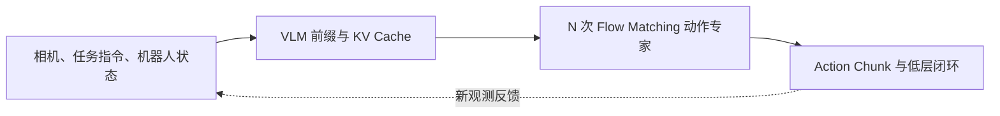

# 具身基础模型的高效训练与实时推理

[课程仓库](https://github.com/zengxiong111/Foundation_of_Embodied_AI) · [English](Efficient_Training_Real_Time_Inference_EN.md) · [Flow Matching](https://github.com/zengxiong111/Foundation_of_Embodied_AI/blob/main/md/Flow_Matching_详细推导_精简版.md) · [RL Post-training](https://github.com/zengxiong111/Foundation_of_Embodied_AI/blob/main/md/RL_Post_Training_ZH.md)

> **本章定位。** 本讲义接在 VLA、Flow Matching 与机器人策略学习之后。它不重复 Transformer 的完整推导，也不包含代码或实验步骤，而是回答三个工程与研究问题：训练为何昂贵、推理怎样变快，以及较慢的基础模型如何驱动要求连续控制的机器人。

**署名与核验边界。** 课程内容编排沿用 [Foundation of Embodied AI](https://github.com/zengxiong111/Foundation_of_Embodied_AI) 的学术讲义规范（[CC BY 4.0](https://creativecommons.org/licenses/by/4.0/)）。技术细节基于截至 2026-10-19 可查阅的原论文与官方文档；本讲义不宣称自行完成性能复现或机器人测试。

**学习目标。** 完成本章后，应能够区分 FlashAttention 与 KV Cache，解释 π0/π0.5 风格动作模型中的前缀缓存，建立 VLA 的端到端时延预算，理解 RTC 的动作衔接机制，并判断何时值得采用 LoRA、Activation Checkpointing、模型蒸馏或推理服务优化。

## 目录

- [1. 先分清三个优化目标](#efficient-section-01)
- [2. 为什么 Transformer 训练与推理昂贵？](#efficient-section-02)
- [3. FlashAttention：为什么能高效计算精确 Attention？](#efficient-section-03)
- [4. 高效训练：按瓶颈选择技术](#efficient-section-04)
- [5. KV Cache：它缓存了什么、什么时候有效？](#efficient-section-05)
- [6. Flow Matching 推理：除了 KV Cache，还能怎么加速？](#efficient-section-06)
- [7. 实时机器人：为什么仅加速网络还不够？](#efficient-section-07)
- [8. π0.5、GR00T 与 WAM 的优化差别](#efficient-section-08)
- [9. 实际技术选择：先诊断，再优化](#efficient-section-09)
- [10. 五个容易混淆的问题](#efficient-section-10)
- [11. 结论](#efficient-section-11)
- [参考资料](#efficient-section-12)

## 1. 先分清三个优化目标

具身基础模型通常包含视觉编码器、视觉—语言主干、动作生成器；WAM 还可能包含未来图像或潜在状态预测模块。这些模块可能都使用 Transformer，但优化目标并不相同。

| 场景 | 核心约束 | 最值得关心的指标 |
|:--|:--|:--|
| 大规模预训练 | GPU 算力、显存、数据吞吐 | 有效 token/s、step/s、显存峰值、收敛速度 |
| VLA 微调 / 在线 RL | 数据与训练成本、策略更新效率 | GPU-hours、更新延迟、样本效率、策略质量 |
| 机器人推理部署 | 端到端延迟与时延抖动 | 感知到动作延迟、p95/p99、动作更新率 |
| 高频伺服控制 | 控制周期、状态反馈、稳定性 | 控制频率、跟踪误差、超时与安全约束 |

**高频控制不要求 Transformer 高频运行。** 一种常见分层方式是：VLA 间歇生成一段动作（Action Chunk），低层位置、速度、力矩或阻抗控制器在更高频率执行与修正动作。VLA 更新频率、Action Chunk 大小和低层伺服频率应分别设计，不能混为一谈。

<!-- course-visual:start -->
**图 1：VLA 的计算与控制回路**

<!-- course-visual:end -->

形式化地，将一次动作请求的粗略端到端延迟写作

$$
T_{\mathrm{req}} \approx T_{\mathrm{camera}} + T_{\mathrm{pre}} + T_{\mathrm{vision}} + T_{\mathrm{prefix}} + N T_{\mathrm{expert}} + T_{\mathrm{transfer}} + T_{\mathrm{queue}},
$$

其中 $N$ 是 Flow Matching 或 Diffusion 的积分/去噪步数。实际流水线存在重叠执行，上式是定位瓶颈的**粗略分项**，不能直接当作严格的串行时延恒等式。降低某一个算子的耗时，不代表端到端延迟一定按比例下降。

## 2. 为什么 Transformer 训练与推理昂贵？

### 2.1 Attention 的计算与显存

对于长度为 $L$ 的输入序列，Scaled Dot-Product Attention 为

$$
Q=XW_Q,\quad K=XW_K,\quad V=XW_V,\qquad
\operatorname{Attn}(Q,K,V)=\operatorname{softmax}\!\left(\frac{QK^\top}{\sqrt{d_k}}+M\right)V.
$$

这里 $M$ 表示因果性、模态或有效 Token 掩码。标准稠密 Attention 的计算复杂度通常随 $L^2$ 增长；直接物化注意力矩阵也引入与 $L^2$ 成比例的中间存储。多视角相机、高分辨率图像、视频历史和未来世界 Token 都可能明显增大 $L$。

**FlashAttention** 通过分块和 IO-aware 计算，减少 GPU 高带宽显存与片上存储之间的数据移动，从而降低中间显存需求并常常提高速度；它仍计算精确 Attention，**不意味着标准稠密 Attention 的理论二次计算量消失**。现代 PyTorch 的 SDPA 可以在满足条件时自动选择优化后的 Attention 后端。[4–5]

### 2.2 训练显存到底花在哪里？

粗略写作

$$
M_{\mathrm{train}} \approx M_{\mathrm{params}}+M_{\mathrm{grads}}+M_{\mathrm{optim}}+M_{\mathrm{act}}+M_{\mathrm{temp}}.
$$

其中梯度、优化器状态和反向传播需要保留的激活往往决定了“能否训练”；对多相机长序列模型，$M_{\mathrm{act}}$ 也可能成为主要瓶颈。不能把权重量化后模型的文件大小误认为全参数训练需要的显存。

### 2.3 为什么具身任务还有额外成本？

机器人训练不仅运行网络：多路相机解码、几何变换、数据加载、时间戳对齐和动作标签处理都会消耗 CPU、内存、PCIe/网络带宽。在线 RL 还要求采样端、回放缓冲区与学习端及时交换数据。**先区分 GPU 计算瓶颈与数据流水线瓶颈，才有意义选择加速技术。**

## 3. FlashAttention：为什么能高效计算精确 Attention？

### 3.1 从标准 Attention 的显存问题出发

考虑一个 Attention Head，令 $Q,K,V\in\mathbb R^{L\times d}$。朴素实现先计算

$$
S=QK^\top/\sqrt d,\quad P=\operatorname{softmax}(S),\quad O=PV.
$$

虽然输出 $O$ 仅有 $L\times d$ 个元素，分数矩阵 $S$ 与权重矩阵 $P$ 却各包含 $L^2$ 个元素。如果必须写入 GPU 高带宽显存（HBM），那么长序列、多相机或视频输入会造成很高的显存占用与访存流量。训练还要处理反向传播所需的中间量。**Attention 的 FLOPs 并不是唯一瓶颈；昂贵的片外数据搬运也可能支配耗时。**

以 $L=4096$、单个 Head、BF16（每个元素 2 Byte）为例，**仅一张**显式 $L\times L$ 矩阵就需要约 $32\,\mathrm{MiB}$，尚不包括其他 Head、梯度、投影、临时张量或模型参数。此例只用于理解量级，并不代表具体模型的显存实测。

### 3.2 Tiling 与 Online Softmax

FlashAttention 不先保存完整的 $S$ 和 $P$，而是把 $Q$、$K$、$V$ 分为较小的块（tiles），在 GPU 片上存储中完成局部计算，并逐块更新 Softmax 的稳定统计量。对于某一行，设已经处理块的最大分数、指数和、未归一化加权输出分别为 $(m,\ell,u)$。新块分数为 $s_j$，则

$$
\begin{aligned}
m'&=\max\!\big(m,\max_j s_j\big),\\
\ell'&=e^{m-m'}\ell+\sum_j e^{s_j-m'},\\
u'&=e^{m-m'}u+\sum_j e^{s_j-m'}v_j,\\
o&=u'/\ell'\quad\text{（处理全部块后）}.
\end{aligned}
$$

这里的重缩放因子使不同块的指数能够在数值稳定的条件下合并。**Online Softmax 保留了标准 Softmax 的数学结果（允许浮点舍入差异），而不是通过丢弃 Token 近似注意力。** FlashAttention 在反向传播阶段也利用重计算策略减少中间张量存储。[4]

### 3.3 为什么叫 IO-aware？什么时候收益显著？

FlashAttention 的关键是减少 HBM 与片上存储之间的读写，而不是把标准稠密 Attention 的计算量从 $O(L^2d)$ 变为线性。FlashAttention-2 进一步改进并行工作划分和 GPU 利用率；具体性能取决于硬件、Head Dimension、序列长度、dtype、Mask 与实现后端。[10]

对机器人视觉—语言模型而言，多视角高分辨率图像、长历史视频和 WAM 的未来视觉 Token 都可能增加序列长度；因此应先测量 Attention 在总推理时间中的占比。短序列、小网络或视觉编码器之外的瓶颈，使用更快的 Attention Kernel 可能对端到端时延帮助有限。

**使用层面：** PyTorch 的 `scaled_dot_product_attention`（SDPA）可以按兼容性选择优化后端。研究者应理解为何启用、为何退回数学实现，以及不同 Attention Mask 或精度配置会改变后端选择；不必首先学习编写 CUDA/Triton Kernel。[5]

| 对比 | 朴素 Attention | FlashAttention |
|:--|:--|:--|
| 数学目标 | 精确 Softmax Attention | 精确 Softmax Attention（浮点差异除外） |
| 中间矩阵 | 容易显式存储 $L\times L$ | 分块处理，避免物化整个矩阵 |
| 主要优化 | 常规算子执行 | 减少 HBM 访存与中间激活 |
| 算术复杂度 | 标准稠密计算 $O(L^2d)$ | 标准稠密计算仍为 $O(L^2d)$ |
| 常见使用场景 | 基准或通用回退 | 长视觉 Token、训练和推理时高效 SDPA |

## 4. 高效训练：按瓶颈选择技术

| 技术 | 主要收益 | 代价与适用边界 |
|:--|:--|:--|
| BF16 / 混合精度 | 降低部分显存与算力成本 | FP16 可能需要损失缩放；BF16 仍须检查数值稳定性与硬件支持 |
| FlashAttention / SDPA | 加速长序列 Attention、减少中间显存 | 取决于 Attention Mask、数据类型、GPU 与算子实现 |
| Activation Checkpointing | 不保存部分前向激活，减少训练显存 | 反向传播时重新计算，可能降低 step/s |
| LoRA / PEFT | 降低可训练参数、梯度和优化器状态成本 | 不会自动消除完整主干网络的前向计算或激活成本 |
| FSDP / 参数分片 | 将参数、梯度或优化器状态分散到多卡 | 需要通信、同步与显存—速度权衡 |
| 减少视觉 / 视频 Token | 直接减轻 Attention 与图像管线负担 | 可能丢失接触点、细小物体或长时序信息 |
| 数据预取 / 缓存 / 并行解码 | 减轻输入停顿，提高 GPU 利用率 | 依赖 CPU、SSD、内存与网络资源 |

理解三个常见误区尤为重要。第一，**Activation Checkpointing 主要是“以计算换显存”**，并不是无条件训练加速。第二，**LoRA 降低可训练权重的内存成本，但并不保证训练或推理延迟线性下降**。第三，**FSDP 值得在多卡显存不足时考虑，不应在模型可以单卡高效运行时默认开启**。[6]

对于 π0.5 这类 VLA 微调，应先决定哪些模块真的需要更新：视觉编码器、VLM、动作专家可以采取不同的冻结或微调策略。对于在线 Off-policy RL，还应单独评估：策略推理是否阻塞环境采样、Learner 更新是否拖慢 Actor、Replay 中的观察与动作预处理是否足够高效。这里的问题不只是 Transformer 算子速度。

## 5. KV Cache：它缓存了什么、什么时候有效？

### 5.1 最基本的思想

每个 Transformer 层都从输入生成 Key 与 Value。如果后续计算需要重复关注**不会变化的前文**，可以保存它们：

$$
\mathcal{C}^{(\ell)}_{t}=\bigl(K^{(\ell)}_{1:t},V^{(\ell)}_{1:t}\bigr).
$$

在自回归 LLM 中，新的 Token 可以读取历史 KV，而不必反复计算整个历史前缀。对于标准缓存布局，KV 显存随缓存的 Token 数量近似线性增长：

$$
M_{\mathrm{KV}}\approx 2\,n_{\ell}\,B\,L\,h_{\mathrm{kv}}\,d_h\,b,
$$

其中 $n_{\ell}$ 为层数，$B$ 为 batch size，$L$ 为缓存长度，$h_{\mathrm{kv}}$ 为 KV Head 数，$d_h$ 为每头维度，$b$ 为每个元素字节数。这个量不是模型权重显存。

### 5.2 Prefill、Decode 与缓存内存

标准自回归解码分成 **Prefill**（先处理已知上下文，得到逐层 KV）与 **Decode**（依次输入新 Token，查询过去的 KV）。假设缓存长度为 $L$，增加新 Token 时通常只需要新算 Query、Key、Value，再将新的 KV 追加到缓存，而不是重新处理全部历史。它降低了重复计算，却增加了常驻显存和逐步读取缓存的带宽需求。

缓存的显存与 *KV Head* 数量有关，不一定等于 Query Head 数量。对于 GQA / MQA，$h_{\mathrm{kv}}<h_{\mathrm q}$，因此可以明显减小缓存。以 32 层、8 个 KV Head、每头 128 维、BF16、batch=1、上下文 2048 Token 为例，上式给出约 $256\,\mathrm{MiB}$ 的 KV Cache；这**不包括**任何模型权重和其他缓存。

KV 能够安全复用的重要条件不是“文字相同”，而是**待缓存 Token 在所有相关层的表示没有依赖于随后变化的 Token**，且模型参数、位置编码和 Mask 等配置保持一致。在标准 Causal Attention 中，历史 Token 不会读取未来 Token，所以它们的 KV 可直接保留。

对前缀 $p$ 和逐步变化的动作后缀 $a^{(k)}$，可以抽象地把可缓存 Attention Mask 写为

$$
M=\begin{bmatrix}M_{pp}&-\infty\\M_{ap}&M_{aa}\end{bmatrix},
\qquad\text{行表示查询，列表示可读取的键。}
$$

左上角允许前缀内部根据设计相互关注，右上角屏蔽**前缀读取动作后缀**；这样前缀的深层表示不依赖动作迭代状态。如果让前缀在每一层都双向读取变化的动作 Token，旧缓存就不再严格有效。这里的矩阵是依赖关系示意，具体实现还需处理位置编码、padding、模态 Mask 与残差路径。

### 5.3 π0 / π0.5 风格 Flow Matching 如何使用？

设 $c=(I,l,s)$ 为当前视觉、语言与机器人状态条件，$a$ 为真实动作块，$\epsilon$ 为高斯噪声。一种常用约定为

$$
x_{\tau}=(1-\tau)a+\tau\epsilon,\qquad
v^*(x_{\tau},\tau,c)=\epsilon-a,\quad \tau\in[0,1].
$$

训练动作专家预测速度场：

$$
\mathcal{L}_{\mathrm{FM}}=\mathbb{E}_{a,\epsilon,\tau,c}
\left[\bigl\|v_{\theta}(x_{\tau},\tau,c)-(\epsilon-a)\bigr\|^2\right].
$$

生成时从 $x_1\sim\mathcal N(0,I)$ 开始，以负时间步沿速度场积分：

$$
x_{\tau+\Delta\tau}=x_{\tau}+\Delta\tau\,v_{\theta}(x_{\tau},\tau,c),\qquad \Delta\tau<0.
$$

每一步**动作状态 $x_{\tau}$ 变化，条件输入 $c$ 却可保持不变**。因此一种高效实现是：

1. 对当前图像和语言前缀做一次 Transformer 前向计算，生成前缀 KV Cache。
2. 每次 Flow Matching 积分，只更新动作相关 Token，并读取已经缓存的前缀 KV。
3. 积分结束得到 Action Chunk；下一次传感器观测改变后，再判断哪些缓存失效。

OpenPI 的 `pi0.py` 在 `sample_actions()` 中明确先执行前缀预填充，再于各积分步为动作后缀传入 `kv_cache`；默认参数中可见 `num_steps=10`，但**10 并非所有 π0.5 部署都必须采用的固定步数**。[1]

### 5.4 缓存何时失效？三个必须知道的限制

**一是 Cache 不是跨视频帧永久有效。** 新图像改变了视觉 Token；若语言与图像在同一前缀中使用双向 Attention，语言 Token 的深层 KV 也可能受图像影响，所以“指令不变”不意味着完整前缀可无条件复用。[1]

**二是缓存不能消除动作专家计算。** 动作块与时间变量在每轮积分中改变，对应后缀通常仍须重新计算。

**三是推理缓存不能直接套到训练。** 训练时权重、梯度和随机增强等可能改变计算图；跨更新复用旧 KV 可能使梯度错误或条件过时。冻结模型与严格不变的特征允许某些预计算，但需要验证正确性。

## 6. Flow Matching 推理：除了 KV Cache，还能怎么加速？

将一次生成动作块的耗时粗略拆为

$$
T_{\mathrm{chunk}}\approx T_{\mathrm{encode}}+T_{\mathrm{prefill}}+N T_{\mathrm{denoise}}+T_{\mathrm{overhead}}.
$$

在动作专家耗时占主导且单步成本近似不变时，降低积分步数 $N$ 通常有效，但实际效果还受 GPU 启动开销、编译、缓存、batch size 和其他并行部分影响。

| 优化方向 | 为什么有效 | 必须防范什么 |
|:--|:--|:--|
| 减少积分/去噪步数 | 减少动作专家前向次数 | 轨迹质量、接触细节、成功率可能下降 |
| 更好的数值求解器 | 用较少的步取得相近近似精度 | 算法开销与训练分布是否匹配 |
| 蒸馏 / 少步生成策略 | 将多步策略压缩为少步策略 | 需要额外训练，可能损失多模态动作覆盖 |
| 缓存稳定条件特征 | 避免重复 VLM/前缀计算 | 避免缓存过时，正确处理 Attention Mask |
| 编译、融合与推理引擎 | 降低 Kernel 启动及数据搬运 | 动态尺寸、设备后端与数值一致性问题 |
| 优化摄像头与通信链路 | 降低模型之外的端到端时延 | 需要真实流水线时延分解 |

**对精密装配和灵巧手任务，不应只以毫秒数决定积分步数。** 接触建立、滑移、松脱与物体姿态变化，可能对少量动作误差更敏感。有效的速度优化必须保持闭环任务表现。

## 7. 实时机器人：为什么仅加速网络还不够？

设低层控制频率为 $f_c$，每个动作块包含 $H$ 个控制动作，则名义动作覆盖时间为

$$
T_H=\frac{H}{f_c}.
$$

这里的 $f_c$ 是动作执行/低层控制频率，**不等于 VLA Transformer 的推理频率**。

### 7.1 同步推理、朴素异步与 RTC

- **同步执行**：完成当前 Action Chunk 后才计算下一块；逻辑简单，但每个块之间可能停顿。
- **朴素异步**：旧动作块执行时预测新块；消除了等待，但直接切换可能产生位置、速度或接触策略不连续。
- **RTC（Real-Time Chunking）**：保持异步推理，同时把已经确定要执行的动作作为新块的条件，通过冻结/修复（inpainting）生成剩余动作，从而提高动作块之间的一致性。[2–3]

可以用下面的约束直观理解 RTC：

$$
\widetilde a_{0:k-1}=a^{\mathrm{committed}}_{0:k-1},
\qquad
\widetilde a_{k:H-1}\sim p_{\theta}\bigl(\cdot\mid o_t,\,a^{\mathrm{committed}}_{0:k-1}\bigr).
$$

它表达“已承诺动作不再随意改变，新动作要与它们相容”；**这是概念式，不是 RTC 论文完整的积分更新公式**。RTC 还可对一部分重叠动作做软约束，以兼顾一致性和对新观测的响应。[3]

2025 年后续工作还研究了**在训练时直接进行动作前缀条件化**，使策略推理时不必再承受同样的 inpainting 代价。应区分原始的 inference-time RTC 与这种 training-time 方案。[8]

### 7.2 不能只看平均延迟

若发起新推理时，当前动作缓冲区还可执行 $R$ 个动作，则不发生缓冲区耗尽的保守条件为

$$
T^{\mathrm{p99}}_{\mathrm{inference}}+T_{\mathrm{network}}+T_{\mathrm{jitter}}+T_{\mathrm{margin}} < \frac{R}{f_c}.
$$

这是**调度安全裕度的工程判据**，不是保证机器人稳定或任务成功的充分条件。即便计算按时完成，输出仍可能基于过时的视觉观测；同时，推理抖动、丢包、相机队列积压也会带来风险。

因此实际部署应同时关注：观测时间戳、p50/p95/p99 延迟、Action Chunk 覆盖时间、切换时的位置/速度连续性、低层跟踪误差，以及推理超时后的安全回退。对灵巧手接触任务，快速闭环控制与碰撞/力矩安全约束应由具备相应反馈的低层控制链路负责；不能把 RTC 视为安全控制器的替代。

## 8. π0.5、GR00T 与 WAM 的优化差别

| 模型路线 | Transformer 主要任务 | 典型优化重点 |
|:--|:--|:--|
| π0/π0.5 风格 VLA | VLM 前缀与 Flow Matching 动作专家 | 前缀 KV Cache、积分步数、视觉 Token、RTC |
| GR00T N1 风格 VLA | 视觉语言理解与 Diffusion Transformer 动作生成 | 视觉前处理、Attention 后端、DiT 推理、动作块调度 |
| 自回归世界模型 | 逐步预测未来状态或视觉 Token | 自回归 KV Cache、时间上下文、视频 Token 压缩 |
| 扩散式 / 联合视频动作 WAM | 多步预测未来世界与动作 | 反复去噪成本、条件复用、时序一致性与动作延迟 |

π0.5 的核心贡献是开放场景中的 VLA 泛化能力；GR00T N1 采用 VLM 与 Diffusion Transformer 联合建模的双系统架构。[7,9] WAM 不等于某一种固定网络：若未来世界是自回归生成，标准自回归 KV Cache 往往适用；若由扩散或 Flow Matching 反复更新整个预测块，更需要分析**哪些 Token 在每轮迭代中真正保持不变**。

## 9. 实际技术选择：先诊断，再优化

| 已经定位的瓶颈 | 优先采取的思路 | 不应先做的事 |
|:--|:--|:--|
| 训练显存不足 | BF16、缩短序列、Checkpointing、PEFT/FSDP | 先编写自定义 CUDA Kernel |
| GPU 利用率很低 | 检查数据加载、解码、CPU/网络、同步点 | 盲目增大模型或 GPU 数量 |
| Attention 成本很高 | SDPA/FlashAttention、Token 压缩、Mask 检查 | 假设所有 Mask 都能走最快 Kernel |
| Flow Matching 生成过慢 | Prefix KV Cache、优化积分步数、少步策略 | 一味降低步数而不看接触表现 |
| 推理速度尚可但动作卡顿 | 异步执行、RTC/训练时动作条件化、改进块衔接 | 只继续优化 Transformer |
| 远程推理时延高 | 就近部署、压缩数据、异步流水线、可靠缓冲 | 仅统计服务器 GPU forward 时间 |
| 精密操作中失稳 | 提高观测新鲜度、加强低层闭环与安全约束 | 依靠 Action Chunk 本身保证接触稳定 |

建议依次处理三层问题：**先保证闭环连续性与安全，再减少端到端推理延迟，最后在明确算子瓶颈时深入优化 Attention 或 Kernel。** 这通常比从 KV Cache 或 CUDA 优化直接入手更符合机器人系统的价值排序。

## 10. 五个容易混淆的问题

**Q1：KV Cache 只属于大语言模型吗？** 否。只要存在跨步骤可复用的 Key/Value 上下文就可能受益；Flow Matching 的固定前缀就是例子。

**Q2：FlashAttention 和 KV Cache 是同一种优化吗？** 否。FlashAttention 使一次 Attention 更高效；KV Cache 避免对稳定上下文重复计算。

**Q3：KV Cache 能让相机图像一直不重新编码吗？** 不能。相机更新后条件发生改变，必须分析缓存的依赖关系以及是否允许近似复用。

**Q4：RTC 会让 Transformer 推理本身变快吗？** 不一定。原始 RTC 核心在于延迟容忍与动作连续执行；在某些实现中，inpainting 甚至增加计算成本。训练时动作条件化可以降低这部分额外开销。[8]

**Q5：灵巧手、双臂和 WAM 研究都必须精通 CUDA 吗？** 不必。先理解 Attention、KV Cache、训练显存、时延剖析与异步控制；只有在证明确实受 Kernel 限制时再深入 Triton/CUDA。

## 11. 结论

具身基础模型的高效性不是单一“每秒 Token 数”问题，而是**训练成本、动作生成延迟、观测新鲜度、动作连续性和闭环任务成功率**共同决定的系统问题。

**一句话记忆：FlashAttention 优化一次 Attention，KV Cache 减少重复计算，Flow Matching 少步推理减少动作专家调用，RTC 让较慢的策略与持续运动的机器人协同；高频低层控制负责跟踪与安全。**

## 参考资料

1. Physical Intelligence, [OpenPI `pi0.py`：前缀 KV Cache 与 Flow Matching 推理实现](https://github.com/Physical-Intelligence/openpi/blob/215abfb217dbac7d5f1273282331b9b1866c0479/src/openpi/models/pi0.py)。
2. Black, Galliker & Levine, [Real-Time Execution of Action Chunking Flow Policies](https://arxiv.org/abs/2506.07339), NeurIPS 2025。
3. Physical Intelligence, [Real-Time Action Chunking with Large Models](https://www.pi.website/research/real_time_chunking), 2025。
4. Dao et al., [FlashAttention: Fast and Memory-Efficient Exact Attention with IO-Awareness](https://arxiv.org/abs/2205.14135), 2022。
5. PyTorch, [Scaled Dot Product Attention 官方文档](https://docs.pytorch.org/docs/stable/generated/torch.nn.functional.scaled_dot_product_attention.html)。
6. PyTorch, [Maximizing Training Throughput Using PyTorch FSDP](https://pytorch.org/blog/maximizing-training/), 2024。
7. Physical Intelligence et al., [π0.5: a Vision-Language-Action Model with Open-World Generalization](https://arxiv.org/abs/2504.16054), 2025。
8. Black et al., [Training-Time Action Conditioning for Efficient Real-Time Chunking](https://arxiv.org/abs/2512.05964), 2025。
9. NVIDIA et al., [GR00T N1: An Open Foundation Model for Generalist Humanoid Robots](https://arxiv.org/abs/2503.14734), 2025。

10. Dao, [FlashAttention-2: Faster Attention with Better Parallelism and Work Partitioning](https://arxiv.org/abs/2307.08691), 2023。
