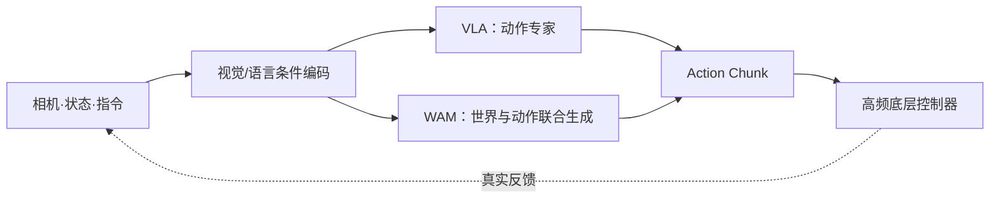

# 具身基础模型的高效训练与实时推理

[课程仓库](https://github.com/zengxiong111/Foundation_of_Embodied_AI) · [English](Efficient_Training_Real_Time_Inference_EN.md) · [流匹配](https://github.com/zengxiong111/Foundation_of_Embodied_AI/blob/main/md/Flow_Matching_详细推导_精简版.md) · [后训练](https://github.com/zengxiong111/Foundation_of_Embodied_AI/blob/main/md/Embodied_Post_Training_ZH.md) · [PDF](https://zengxiong111.github.io/zengxiong.github.io/files/Efficient_Training_Real_Time_Inference_ZH.pdf)

> **本章定位。** 本讲义衔接 Transformer、Flow Matching、VLA、WAM 与机器人控制课程，集中回答三个问题：基础模型如何更省算力地训练，生成模型如何低延迟地推理，以及较慢的 VLA / WAM 如何持续驱动真实机器人。不重复 WAM 架构综述或后训练算法的完整推导；不包含代码和实验操作。

**证据边界。** 本文沿用 [Foundation of Embodied AI](https://github.com/zengxiong111/Foundation_of_Embodied_AI) 的学术讲义风格（[CC BY 4.0](https://creativecommons.org/licenses/by/4.0/)）。截至 2026-10-20 的模型数值均注明来源和统计口径；不宣称进行了独立复现。本文将 WAM 视为能够以未来世界预测辅助动作生成的模型族，不限定其一定采用视频扩散。

**学习目标。** 区分 FlashAttention、KV Cache 与 DiT Caching；理解视频 Token 和视频—动作联合生成的成本；解释 DreamZero-Flash 的解耦噪声训练；建立包含云端通信的时延预算；选择适合精密操作的闭环执行方案。

## 目录

- [1. 先分清三个优化目标](#efficient-section-01)
- [2. 为什么 Transformer 与 WAM 训练昂贵？](#efficient-section-02)
- [3. FlashAttention：高效而精确的 Attention](#efficient-section-03)
- [4. 高效训练：VLA 与 WAM 分别优化什么？](#efficient-section-04)
- [5. KV Cache 与 DiT Caching：复用的边界](#efficient-section-05)
- [6. Flow Matching 与 WAM 少步推理](#efficient-section-06)
- [7. 实时机器人：异步推理与闭环执行](#efficient-section-07)
- [8. π0.5、GR00T、DreamZero 与 Dream-1 对比](#efficient-section-08)
- [9. 实际技术选择：先诊断，再优化](#efficient-section-09)
- [10. 六个容易混淆的问题](#efficient-section-10)
- [11. 结论](#efficient-section-11)
- [参考资料](#efficient-section-12)

## 1. 先分清三个优化目标

具身基础模型通常包含视觉编码、语言/时序主干与动作生成模块。VLA 主要从当前观测输出动作；一些 WAM 还预测未来视频、几何状态或紧凑潜在世界表征，并使世界预测与动作相互约束。**“是否使用 Transformer”与“是否预测未来世界”是两个不同维度。**

| 场景 | 主要约束 | 应关注的指标 |
|:--|:--|:--|
| 预训练和微调 | 算力、显存、数据吞吐 | GPU-hours、step/s、峰值显存、验证任务表现 |
| VLA / WAM 推理 | 前缀处理、迭代生成、视觉 Token | 每次请求的 p50/p95/p99、GPU 显存、Action Chunk 延迟 |
| 机器人闭环执行 | 观测新鲜度、时延抖动、连续性 | 观测到动作时延、动作缓冲余量、跟踪误差 |
| 高频底层控制 | 状态反馈、接触与安全 | 控制频率、力/位姿跟踪、超时保护 |

<!-- course-visual:start -->
**图 1：VLA / WAM 的计算与闭环控制链路（概念图）**

<!-- course-visual:end -->

**高频控制不要求基础模型高频前向。** 一种可行的分层方式是：VLA / WAM 每隔一段时间生成动作块，低层位置、速度、力矩或阻抗控制器以较高频率执行和修正。必须区分模型请求频率、Action Chunk 覆盖时长、低层伺服频率与实际反馈频率。

把一次请求的延迟粗略拆分为

$$
T_{\mathrm{req}}\approx T_{\mathrm{camera}}+T_{\mathrm{pre}}+T_{\mathrm{encoder}}+T_{\mathrm{context}}+T_{\mathrm{generator}}+T_{\mathrm{transfer}}+T_{\mathrm{queue}}.
$$

这是**排查瓶颈的分项**；实际各阶段可能重叠执行，不能简单把任何单项加速比当成端到端加速比。WAM 的 $T_{\mathrm{generator}}$ 可能包含视频和动作联合去噪；是否真的解码视频像素供外部展示，取决于部署方式。

## 2. 为什么 Transformer 与 WAM 训练昂贵？

### 2.1 Attention 的计算与显存

对于输入 $X\in\mathbb R^{L\times d}$，Scaled Dot-Product Attention 为

$$
Q=XW_Q,\quad K=XW_K,\quad V=XW_V,\qquad
\operatorname{Attn}(Q,K,V)=\operatorname{softmax}\!\left(\frac{QK^\top}{\sqrt{d_k}}+M\right)V.
$$

$M$ 表示因果、模态或有效 Token 掩码。标准稠密 Attention 的算术复杂度约为 $O(L^2d)$；显式中间注意力矩阵需要 $O(L^2)$ 存储。高分辨率多相机输入、视频历史和未来视频 Token 增大序列长度 $L$，因此长时域 WAM 更容易遇到 Attention 或激活显存瓶颈，但不是所有 WAM 都更慢。

### 2.2 视频 Token 为什么可能成为 WAM 的独立瓶颈？

若潜在视频包含 $F$ 帧，每帧被编码为 $H'\times W'$ 个空间位置，再按 patch 分组，那么可用以下近似量级理解视频 Token 数：

$$
L_{\mathrm{video}}\propto F\,H'W',\qquad
L_{\mathrm{total}}=L_{\mathrm{context}}+L_{\mathrm{future}}+L_{\mathrm{action}}.
$$

这里 $H',W'$ **已经包含** VAE 压缩与 patch 化带来的有效分辨率变化。未来视频即使最终不被显示，在联合视频—动作 DiT 中仍可能参与多轮计算。增加预测帧数、相机数或分辨率，可能同时提高训练激活、Attention 计算和推理延迟。高倍压缩又可能丢失手指接触、微小间隙和快速滑移信息，因此不能只追求 Token 数最小。

### 2.3 训练显存与数据管线

$$
M_{\mathrm{train}}\approx M_{\mathrm{params}}+M_{\mathrm{grads}}+M_{\mathrm{optim}}+M_{\mathrm{act}}+M_{\mathrm{temp}}.
$$

权重、梯度、优化器状态与中间激活应分别测量。量化 checkpoint 的文件大小不能代表全参数训练显存。视频模型还承担多视角解码、VAE 编码、帧率重采样、动作与图像时间戳对齐等成本。**当 GPU 利用率低时，优先排查 CPU 解码、SSD/网络吞吐及数据增强，而非直接叠加 GPU。**

## 3. FlashAttention：高效而精确的 Attention

### 3.1 问题源自中间矩阵与 HBM 访存

对单个 Head，朴素实现为

$$
S=QK^\top/\sqrt d,\qquad P=\operatorname{softmax}(S),\qquad O=PV.
$$

虽然输出 $O$ 只有 $L\times d$ 个元素，$S$ 与 $P$ 却都含 $L^2$ 个元素。以 $L=4096$、BF16（2 Byte）为例，**仅一个 Head 的一张** $4096\times4096$ 矩阵就约需 $32\,\mathrm{MiB}$，还未计入其他 Head、梯度或临时张量。

### 3.2 Tiling 与 Online Softmax

FlashAttention 分块处理 $Q,K,V$，在片上保存稳定的 Softmax 统计量，避免将完整 $S,P$ 物化到 HBM。设某一查询行已经累计最大值 $m$、指数和 $\ell$ 与未归一化值和 $u$；新块中的 logit 与 value 分别为 $s_j,v_j$，则

$$
\begin{aligned}
m'&=\max(m,\max_j s_j),\\
\ell'&=e^{m-m'}\ell+\sum_j e^{s_j-m'},\\
u'&=e^{m-m'}u+\sum_j e^{s_j-m'}v_j,\\
o&=u'/\ell'\quad\text{（处理全部块后）}.
\end{aligned}
$$

它在浮点舍入误差范围内仍计算**精确 Softmax Attention**；没有把常规稠密 Attention 的 $O(L^2d)$ 算术复杂度变为线性。FlashAttention-2 改进并行任务划分；PyTorch 的 `scaled_dot_product_attention`（SDPA）可以在兼容时调用优化内核。[4,5,10]

| 技术 | 主要复用或节省什么？ | 是否近似？ |
|:--|:--|:--|
| FlashAttention | 单次 Attention 内部的 HBM 访存/中间矩阵 | 否（舍入误差除外） |
| KV Cache | 跨步骤**不变的上下文**所产生的 K/V | 严格不变时否 |
| DiT Caching | 相邻去噪步中的速度/特征等计算 | 通常是近似复用 |
| 少步生成 / 蒸馏 | 减少生成器的模型调用次数 | 通常改变生成轨迹或模型 |

**对 WAM 的启示。** 先测量每个 Attention 层的时延和显存，再判断使用 SDPA / FlashAttention、压缩 Token，还是减少联合 DiT 的迭代次数。FlashAttention 加速单次 Attention，无法直接消除几十亿参数 DiT 的重复前向。

## 4. 高效训练：VLA 与 WAM 分别优化什么？

| 技术 | 适用收益 | 主要代价或边界 |
|:--|:--|:--|
| BF16 / 混合精度 | 降低计算和部分显存成本 | 注意数值范围、支持的 GPU 与算子 |
| FlashAttention / SDPA | 降低长序列 Attention 访存 | 效果依赖 Mask、长度与设备 |
| Activation Checkpointing | 用重算换激活显存 | 反向传播更慢，不是自动提速 |
| LoRA / 模块冻结 | 减少可训练权重和优化器状态 | 完整 Backbone 前向仍可能昂贵 |
| FSDP / 参数分片 | 多卡分担参数及优化器显存 | 增加同步和通信 |
| VAE 特征缓存 | 冻结视频编码器时避免重复编码 | 随机图像增强或时间采样改变时可能失效 |
| 视频 Token 压缩 / 时间下采样 | 降低 DiT 的上下文长度 | 可能损失运动、接触与时间对齐细节 |
| 数据预取 / 异步视频解码 | 避免 GPU 等待 CPU 或存储 | 需权衡 RAM、SSD 和 CPU 预算 |

### 4.1 VLA：分清视觉前缀与动作专家

在 $\pi0/\pi0.5$ 风格 VLA 微调中，视觉编码器、VLM 与动作专家不必采用相同的更新策略。冻结 Backbone 或使用 LoRA 可以减少可训练状态，但如果仍穿过完整网络做梯度传播，激活和前向计算不一定明显降低。在线 Off-policy RL 还应区分 Actor 推理、Replay 数据解码与 Learner 更新的瓶颈；这属于后训练基础设施问题，而非单一 Attention 算子问题。[1,7]

### 4.2 WAM：把“视频计算成本”单独列账

视频—动作联合训练可以抽象为

$$
\mathcal L_{\mathrm{joint}}=\mathcal L_{\mathrm{video}}+\lambda_a\mathcal L_{\mathrm{action}},
$$

但这只是**便于计算分析的概念式**，并不代表所有 WAM 都采用独立相加的训练损失；例如 DreamZero 使用带权重的联合 Flow Matching 速度场目标。[11] 对这种模型应单独测量：视频 VAE、时空 DiT、动作头、序列长度以及梯度回传。可优先缓存**冻结且输入预处理稳定**的视频特征，再考虑减少预测帧数或改变参数更新范围。

**精密操作限制。** 在旋拧、插入与灵巧手接触任务中，视频降采样与激进的潜在压缩可能隐藏碰撞边缘、接触建立和滑移。必须同时观察动作预测误差、接触连续性和真实任务成功率，而不是只看 GPU-hours。

## 5. KV Cache 与 DiT Caching：复用的边界

### 5.1 KV Cache 的内存与有效性

对 Transformer 第 $\ell$ 层，可缓存历史前缀的 Key / Value：

$$
\mathcal C_t^{(\ell)}=\bigl(K_{1:t}^{(\ell)},V_{1:t}^{(\ell)}\bigr),\qquad
M_{\mathrm{KV}}\approx 2n_\ell BLh_{\mathrm{kv}}d_hb.
$$

其中 $n_\ell$ 为层数、$B$ 为批量、$L$ 为历史长度、$h_{\mathrm{kv}}$ 为 KV Head 数、$d_h$ 为每头维度、$b$ 为每元素字节数。举例：32 层、8 KV Heads、每头 128 维、BF16、batch=1、2048 Token，约占 $256\,\mathrm{MiB}$；这不包括模型权重。[1]

KV 能被**严格复用**的前提是缓存位置的深层表示不依赖后续变化的 Token，且权重、位置编码、Attention Mask 与输入语义保持一致。在条件前缀 $p$、变化的生成后缀 $g$ 的场景下，可以用依赖关系示意：

$$
M=\begin{bmatrix}M_{pp}&-\infty\\M_{gp}&M_{gg}\end{bmatrix}
\quad\text{（行：Query；列：Key）}.
$$

右上角禁止**前缀读取可变后缀**，使前缀 KV 不受每次生成迭代影响。这个示意矩阵不是任意架构的通用 Mask。

### 5.2 π0 / π0.5：固定前缀与可变动作

令当前条件为 $c=(I,l,s)$，采用“$\tau=0$ 干净、$\tau=1$ 噪声”的约定：

$$
x_\tau=(1-\tau)a+\tau\epsilon,\quad
v^*(x_\tau,\tau,c)=\epsilon-a,
\qquad
\mathcal L_{\mathrm{FM}}=\mathbb E\|v_\theta(x_\tau,\tau,c)-(\epsilon-a)\|^2.
$$

采样时从 $x_1\sim\mathcal N(0,I)$ 反向积分。**当前视觉/语言前缀在一次动作采样的多步积分中通常不变**，因此可先 Prefill，随后每个动作专家积分步骤只更新后缀并读取前缀 KV。传感器图像变化后，部分或全部缓存必须重算；“指令不变”并不保证图文混合前缀可继续原样复用。[1]

### 5.3 WAM：自回归上下文缓存不等于冻结未来视频

自回归 WAM 可以缓存已确认的历史上下文，对下一个未来视频/动作块进行联合去噪。DreamZero 在执行一个块后**用真实观测更新作为上下文的历史视频信息**，以限制开环生成误差沿后续块累积。[11] 工程实现必须维护时间戳、Attention Mask 与缓存状态一致性；若新的真实观测改变了旧 KV 所依赖的输入，相关状态需要更新或重算，不能无限期地把预测视频视为真实历史。

**区别于 DiT Caching：** DreamZero 的 DiT Caching 利用相邻 Flow Matching 步的预测速度方向相似性，在满足阈值条件时复用部分速度计算。论文报告，在其配置下有效 DiT 前向次数由 16 降至约 4；这种近似复用与具有因果依赖保证的 KV Cache 不等价。[11]

## 6. Flow Matching 与 WAM 少步推理

### 6.1 先辨认两种不同的推理开销

对以动作专家为主的 VLA，粗略分解为

$$
T_{\mathrm{VLA}}\approx T_{\mathrm{encode}}+T_{\mathrm{prefill}}+N_aT_{\mathrm{expert}}+T_{\mathrm{overhead}}.
$$

对视频—动作联合 DiT WAM，更接近

$$
T_{\mathrm{WAM}}\approx T_{\mathrm{encode}}+T_{\mathrm{history}}+N_{\mathrm{eff}}T_{\mathrm{DiT}}(L_{\mathrm{video}}+L_{\mathrm{action}})+T_{\mathrm{overhead}}.
$$

两式均为**诊断用近似**，不预设各阶段严格串行。减少采样步数、缩短视频上下文、加速单步 DiT、合并 CPU—GPU 调度都可能有效。不能认为减少 $N$ 就按 $N$ 的比例降低端到端延迟。

### 6.2 DreamZero：系统、实现、模型三级优化

DreamZero 使用 14B 参数的预训练视频扩散主干，对未来视频与动作进行联合生成。论文对一项朴素推理实现报告约 **5.7 秒/动作块**，通过 CFG 两卡并行、DiT Caching、`torch.compile` / CUDA Graphs、内核与调度优化、量化以及 DreamZero-Flash，最终在其 GB200 配置下报告 **约 150 ms/动作块、累计 38× 加速、约 7 Hz 闭环动作更新**。[11,12]

| 优化层级 | 核心思想 | DreamZero 论文的定位 |
|:--|:--|:--|
| 系统：CFG 并行 | 将条件/无条件分支分配给多卡 | 减少每次去噪的墙钟时间 |
| 系统：DiT Caching | 近似复用相邻去噪步的速度 | 降低有效 DiT 调用次数 |
| 实现：编译/CUDA Graphs | 减少 Python 与 Kernel 启动开销 | 降低 CPU 调度等待 |
| 实现：混合精度/量化 | 降低显存带宽与算力需求 | 需验证数值和动作质量 |
| 模型：DreamZero-Flash | 调整联合视频—动作的训练噪声分布 | 使少步动作生成更加可靠 |

**统计口径。** 38× 是论文 Table 1 在指定硬件和优化链路下的累计速度比，不是 DreamZero-Flash 单独带来的 38×；论文 Table 3 的 **2.33×** 则是特定任务中 350 ms 与 150 ms 的比较，二者不能混用。

### 6.3 DreamZero-Flash：为什么不能直接把四步砍成一步？

视频与动作使用同一个去噪时间 $t$ 时，模型主要见到“两种模态噪声水平相近”的训练分布。但单步推理可能需要在**预测视频仍较嘈杂**的条件下输出**接近干净的动作**，形成训练—推理不匹配。

DreamZero-Flash 在训练后期采用解耦时间采样，论文示例为

$$
t_{\mathrm{video}}=1-\eta,\quad \eta\sim\operatorname{Beta}(7,1),\qquad
t_{\mathrm{action}}\sim\mathcal U(0,1),\qquad
\mathbb E[t_{\mathrm{video}}]=0.125.
$$

**注意时间约定：这里 DreamZero 的 $t=0$ 对应高噪声，恰与第 5.2 节展示的 $\pi0$ 记号约定相反。** 因此，视频 $t$ 偏向 0 是让模型反复学习“视频仍含较强噪声时怎样预测动作”，而不是更快地生成高质量视频。这不是把视频分支简单关掉；世界预测仍为联合建模提供监督。[11]

| 方法（论文 Table 3） | 去噪步数 | Table bussing 任务进度 | 每块推理时间 |
|:--|--:|--:|--:|
| DreamZero | 4 | $83\%\pm6.1\%$ | 350 ms |
| DreamZero（直接改为一步） | 1 | $52\%\pm10.2\%$ | 150 ms |
| DreamZero-Flash | 1 | $74\%\pm10.1\%$ | 150 ms |

这些是**特定桌面清理任务的 Task Progress（均值 ± 标准误）**，不是跨任务成功率；150 ms 不是任意 GPU、任意分辨率下都可达到的普适推理时间。结果揭示：**改变训练噪声分布，可能比直接减少求解器步数更有效地改善速度—动作质量折中。**

## 7. 实时机器人：异步推理与闭环执行

### 7.1 高频控制与动作块覆盖时间

设低层控制频率为 $f_c$，一个动作块含 $H$ 个动作，则名义覆盖时间为

$$
T_H=\frac H{f_c}.
$$

例如 DreamZero 的一项双臂设置为 48 个动作、30 Hz，因此单块约覆盖 **1.6 秒**；但动作块长度 **不等于** 模型重新规划的间隔，也不等于闭环刷新率。[11]

**同步生成**容易产生块间等待；**朴素异步**可重叠执行和推理，却可能在切换时不连续；**RTC（Real-Time Chunking）** 使用已经承诺执行的动作作为条件，通过约束/修复新块减少衔接突变。概念式为

$$
\widetilde a_{0:k-1}=a^{\mathrm{committed}}_{0:k-1},\qquad
\widetilde a_{k:H-1}\sim p_\theta(\cdot\mid o_t,a^{\mathrm{committed}}_{0:k-1}).
$$

这是动作衔接约束的示意，不是 RTC 完整算法。RTC 不保证原始 Transformer 推理更快；训练时动作前缀条件化是不同于推理时 inpainting 的后续技术。[2,3,8]

### 7.2 WAM：真实观测重置与异步生成

WAM 还必须维护“**预测未来**”与“**实际发生**”的区别：执行当前 Action Chunk 的同时预测下一块；收到带时间戳的真实相机/状态反馈后，更新历史上下文，使下一次生成不再依赖已被证伪的视觉预测。该机制与 RTC 可以互补，但**DreamZero 的异步执行不应自动等同于已实现 RTC**。[11]

对动作缓冲区剩余 $R$ 个控制动作的调度，实用的保守裕度条件为

$$
T^{\mathrm{p99}}_{\mathrm{infer}}+T_{\mathrm{network}}+T_{\mathrm{jitter}}+T_{\mathrm{margin}}<\frac R{f_c}.
$$

它仅说明在该时延预算下较不容易“饿死”动作缓冲区，**不能证明闭环稳定或接触安全**。还需监测观测年龄（Age of Information）、p95/p99、块切换的速度/加速度连续性、控制跟踪误差及通信超时后的安全回退。

### 7.3 云端 WAM 的特殊问题

远程 WAM 可以集中部署大型 GPU，但网络时延、图像上行带宽、模型队列和动作下行同时进入控制闭环。设计时应明确：是否发送压缩图像还是潜在特征；传感器和机器人是否共享时间基准；过时回复是否丢弃；无法按期收到新块时是否减速、保持或安全停止。**服务端“推理很快”不能替代端到端时延分布。**

对于旋拧、插入和灵巧手接触，应让本地伺服与安全控制处理高频反馈、碰撞和力矩限制；网络模型负责相对低频的任务级动作更新，而不应独自承担高速力控稳定性。

## 8. π0.5、GR00T、DreamZero 与 Dream-1 对比

### 8.1 不同模型族的瓶颈不同

| 模型/架构路线 | 主要生成内容 | 优先优化项 | 核心部署限制 |
|:--|:--|:--|:--|
| $\pi0/\pi0.5$ 风格 VLA | Flow Matching 动作块 | 条件前缀 KV、积分步数、RTC | 视觉编码及块切换延迟 |
| GR00T N1 风格 VLA | VLM 条件 + DiT 动作块 | SDPA、DiT 调度、视觉前处理 | 动作块延迟、显存和接口 |
| 自回归世界模型 | 未来状态/视觉 Token | 因果 KV、历史长度、Token 压缩 | 长历史缓存与误差累积 |
| DreamZero 类联合 WAM | 未来视频潜变量 + 动作 | 视频 Token、DiT Caching、Flash、异步 | 视频生成开销与系统复杂度 |

不能简单得出“所有 WAM 都比 VLA 贵”的结论：WAM 可以在潜在状态、低分辨率视频或不同模型规模上运行；相应比较应固定任务、动作频率、硬件与质量目标。[7,9,11]

### 8.2 Dream-1：云端服务的经济性不等于本地 GPU 成本

Dream Labs 于 2026 年 10 月发布 Dream-1 的官方介绍，称其通过 API 控制未见过的新机器人；文章公开的**服务标价**为 Dream-1 **3 美元/小时**、Dream-1-flash **2 美元/小时**，并称每次调用返回 **1.6 秒的动作序列**。[13]

这些数字只说明**官方公布的服务计费口径及返回动作时域**，不能用于推断其底层 GPU 数量、训练预算、单次请求真实网络延迟或本地部署能否达到同样的成本。特别是 $1.6$ 秒的动作时域，并不意味着服务器需要 $1.6$ 秒才产生动作。对云端服务，应单独测量 API 的 p99 端到端延迟、请求拥塞、图像上行和机器人执行接口。

### 8.3 比较 VLA 与 WAM 时必须同时报告什么？

至少报告：GPU 类型与数量、精度/量化方式、相机数与分辨率、历史/预测时域、去噪步数、Action Chunk 长度、模型实际推理延迟（最好 p50/p95/p99）、网络延迟、动作输出频率、低层执行频率，以及同一任务条件下的成功率/任务进度。**单独的 Tokens/s、模型参数量或每小时服务价格，都不足以判定哪种路线适合精密操作。**

## 9. 实际技术选择：先诊断，再优化

| 已测得瓶颈 | 优先方案 | 不建议先做 |
|:--|:--|:--|
| 训练 OOM | BF16、缩短视频上下文、Checkpointing、PEFT/FSDP | 从自写 CUDA Kernel 开始 |
| GPU 忙碌度低 | 视频解码、VAE 缓存、数据预取、同步点排查 | 未定位瓶颈就加 GPU |
| Attention 占比高 | SDPA/FlashAttention、Mask 核验、Token 压缩 | 默认所有 Mask 都有最快内核 |
| VLA 动作生成慢 | Prefix KV、积分步数、蒸馏、编译 | 只降步数，不测接触成功率 |
| WAM 视频—动作 DiT 慢 | 预测 Token、DiT Caching、少步训练、量化 | 混淆 KV 与 DiT 缓存 |
| 模型够快但动作断续 | 异步执行、RTC、时序同步、缓冲余量 | 继续只优化网络层 |
| 云端推理偶发超时 | 端到端 p99、就近推理、丢弃过时回复、本地回退 | 只看服务端平均 latency |
| 精密接触不稳定 | 提高观测频率、低层阻抗/力控、安全约束 | 把 WAM/RTC 视作安全控制器 |

**工程优先级：** 先确保连续执行与基本安全，继而测量观测到动作的全链路延迟，最后依据剖析结果决定优化 Attention、联合 DiT、动作采样或通信。WAM 的潜在优势是引入世界演化先验；它并不免除对时序、延迟和接触反馈的系统工程。

## 10. 六个容易混淆的问题

**Q1：FlashAttention、DreamZero-Flash 是同一种“Flash”吗？** 不是。前者是在给定 Attention 运算中减少 IO；后者改变视频—动作联合生成的训练噪声分布，使少步推理更可靠。

**Q2：KV Cache 和 DiT Caching 一样吗？** 不一样。前者在依赖关系允许时严格保留稳定的 K/V；后者通常近似复用相邻采样步骤的模型预测或特征。

**Q3：WAM 是否必须把未来视频解码为 RGB 才能控制？** 不一定。联合生成时可以在潜在空间计算；是否显式渲染视频取决于结构和任务，但不渲染像素也未必消除生成视频潜变量的计算。

**Q4：DreamZero 的 38× 是否就是一步生成带来的速度？** 不是。38× 是多级优化累计效果；Table 3 的四步到一步对比约为 2.33×，且伴随特定任务进度变化。

**Q5：150 ms/Chunk 是否等于机器人 30 Hz 闭环？** 不是。模型产生新动作块的频率和低层动作执行频率不同；时间戳、观测更新和异步调度决定真正的反应能力。

**Q6：研究 VLA / WAM 必须先掌握 CUDA 与 KV Cache 实现吗？** 不必。应先理解工作负载、缓存有效性、训练显存、实时预算与本地安全控制；只有剖析证明确有算子瓶颈时，才深入 Triton/CUDA。

## 11. 结论

具身基础模型的“高效”不是单一推理毫秒数，而是**训练算力、模型延迟、观测新鲜度、动作连续性、真实任务成功率与部署成本**的共同约束。VLA 常聚焦视觉条件复用和动作专家的少步生成；WAM 还需管理视频 Token、联合 DiT 计算与历史世界状态的更新。

**一句话记忆：** FlashAttention 优化**一次** Attention；KV Cache 避免计算不变前缀；DiT Caching 近似复用**相邻去噪步**；DreamZero-Flash 用训练噪声调度支持**少步动作生成**；RTC 与异步执行让较慢的模型持续驱动机器人；高频反馈与安全仍由底层控制负责。

## 参考资料

1. Physical Intelligence, [OpenPI `pi0.py`: Prefix KV caching and flow-matching sampling](https://github.com/Physical-Intelligence/openpi/blob/215abfb217dbac7d5f1273282331b9b1866c0479/src/openpi/models/pi0.py).
2. Black, Galliker & Levine, [Real-Time Execution of Action Chunking Flow Policies](https://arxiv.org/abs/2506.07339), NeurIPS 2025.
3. Physical Intelligence, [Real-Time Action Chunking with Large Models](https://www.pi.website/research/real_time_chunking), 2025.
4. Dao et al., [FlashAttention: Fast and Memory-Efficient Exact Attention with IO-Awareness](https://arxiv.org/abs/2205.14135), 2022.
5. PyTorch, [Scaled Dot Product Attention 官方文档](https://docs.pytorch.org/docs/stable/generated/torch.nn.functional.scaled_dot_product_attention.html).
6. PyTorch, [Maximizing Training Throughput Using PyTorch FSDP](https://pytorch.org/blog/maximizing-training/), 2024.
7. Physical Intelligence et al., [$\pi0.5$: a Vision-Language-Action Model with Open-World Generalization](https://arxiv.org/abs/2504.16054), 2025.
8. Black et al., [Training-Time Action Conditioning for Efficient Real-Time Chunking](https://arxiv.org/abs/2512.05964), 2025.
9. NVIDIA et al., [GR00T N1: An Open Foundation Model for Generalist Humanoid Robots](https://arxiv.org/abs/2503.14734), 2025.
10. Dao, [FlashAttention-2: Faster Attention with Better Parallelism and Work Partitioning](https://arxiv.org/abs/2307.08691), 2023.
11. Ye et al., [World Action Models are Zero-shot Policies (DreamZero)](https://arxiv.org/abs/2602.15922), 2026；数值来自论文 Table 1、Table 3 与 §§3.1–3.2。
12. DreamZero authors, [官方项目页](https://dreamzero0.github.io/), 2026.
13. Dream Labs, [Zero-Shot to New Robots: Introducing Dream-1](https://dreamlabs.ai/research/dream-1/), 2026-10；价格为官方宣传的服务标价。
