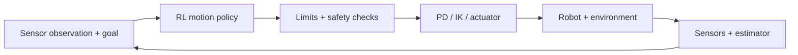
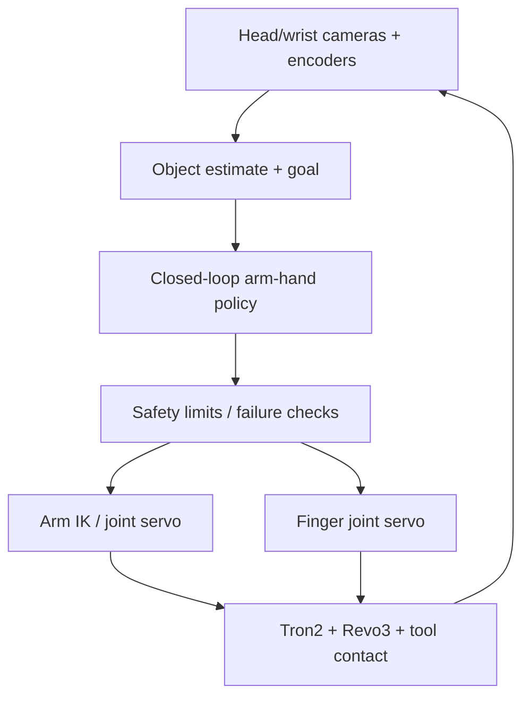

# Reinforcement Learning for Embodied Motion Control

[Course home](https://github.com/zengxiong111/Foundation_of_Embodied_AI) · [简体中文](Embodied_Motion_Control_RL_Tutorial_ZH.md) · [PDF](../pdf/Embodied_Motion_Control_RL_Tutorial_EN.pdf)

| Item | Details |
|---|---|
| Topic | Motion Control RL |
| Revision | 2026-10-30 |
| Prerequisites | Robot dynamics, low-level control and introductory RL |
| License | CC BY-NC-SA 4.0 · Xiong Zeng and contributors |

## Contents

- [1. What Is Reinforcement Learning for Motion Control?](#motion-section-01)
- [2. How Do We Formulate a Motion-Control RL Task?](#motion-section-02)
- [3. How Do We Train a Motion-Control Policy?](#motion-section-03)
- [4. How Can Robots Learn Motion from Human Demonstrations?](#motion-section-04)
- [5. How Do We Scale from One Motion to Generalist Control?](#motion-section-05)
- [6. How Do We Bridge Simulation and Reality?](#motion-section-06)
- [7. Two Connected Case Studies and Evaluation](#motion-section-07)
- [References and Open-Source Resources](#motion-section-08)

## 1. What Is Reinforcement Learning for Motion Control?

### 1.1 The position of motion-control RL in a robot system

A robot typically coordinates three levels. A high-level planner decides **what to do** (task planning, VLA, and related systems). A motion-level controller decides **how to move** (motion planning, Motion Tracking, RL). Low-level control determines **how commands are executed** (PD, impedance control, inverse kinematics, and motor drives). Motion-control RL primarily learns a feedback policy at the motion level, although some implementations directly produce torque commands. It is not a replacement for classical control; learned policies routinely work together with existing controllers.

A goal-conditioned policy can be written as

$$
a_t=\pi_\theta(o_t,c_t),
$$

where $o_t$ is a sensor-derived observation, $c_t$ is a desired velocity, pose, or reference motion, and $a_t$ is a policy action. **The network output need not be the signal sent directly to the motor.** It often passes through limits, IK/PD, or a device-specific actuator interface.

The state estimator may provide camera- or history-based estimates rather than the true underlying state. A practical control stack can involve **different clocks**: the policy update rate $f_\pi$, the low-level servo rate $f_c$, and the physics or actuator update rate $f_{\mathrm{phys}}$. These rates need not coincide. Command holding, latency, and timestamp consistency must be verified in deployment; copying neural-network weights alone does not reproduce a control system.

### 1.2 How does this differ from foundation-policy RL post-training?

| Dimension | Motion-control RL | Post-training VLA/WAM-type policies |
|:--|:--|:--|
| Starting point | New or pre-existing low-level policy | Pretrained perception-to-action model |
| Main objective | Stability, tracking, contact, recovery | Task success and adaptation to new conditions |
| Typical observation | Joints, IMU, local goal, estimated pose | Images, language, proprioception, etc. |
| Typical action | Joint target, torque, Cartesian command | Action chunks, Cartesian or joint commands |

The distinction is not absolute. A high-level VLA may set goals for a low-level RL controller; a motion policy may also be the execution component of a foundation model. This tutorial focuses on **closed-loop physical motion control through environment interaction**.

### 1.3 Two examples throughout the tutorial

**Case A: Unitree G1 velocity tracking.** Given forward, lateral, and yaw-rate commands, a biped must maintain balance and track the requested motion. The primary challenges are ground contact, disturbances, and body stability.

**Case B: Tron2 + Revo3 screwdriver manipulation.** A robot picks a screwdriver from varying poses on a table, transports it to a target area, rotates it by a specified angle (without turning an actual screw), and responds to slips and disturbances. The challenges are arm–hand coordination, multiple contacts, visual estimation, and recovery.

Locomotion, whole-body tracking, arm manipulation, and dexterous manipulation are **task categories**, not alternative optimization algorithms.

## 2. How Do We Formulate a Motion-Control RL Task?

A useful task definition specifies **Observation, Command/Goal, Action, Reward, Reset, Termination, and Dynamics**. Clear interfaces often matter more than changing the neural-network architecture.

### 2.1 Observation: what does the policy actually know?

A typical proprioceptive observation is

$$
o_t=[q_t,\dot q_t,\omega_t,\hat g_t,a_{t-1},c_t],
$$

where $q_t$ and $\dot q_t$ denote joint states, $\omega_t$ is base angular velocity, $\hat g_t$ is the projected gravity vector in the base frame, and $a_{t-1}$ is the previous action. Dexterous manipulation may additionally require an estimated object pose $\hat T_{\mathrm{obj},t}$ and target pose $T_{\mathrm{goal}}$.

| Design question | G1 locomotion | Tron2 + Revo3 manipulation |
|:--|:--|:--|
| Deployable inputs | Encoders, IMU, velocity command | Arm/hand encoders, head/wrist cameras, goal |
| Partially observed variables | Ground friction, contact, external pushes | Contact, slip, occluded 6D object pose |
| Typical responses | Observation history, state estimation, adaptation | Temporal filtering, visual re-localization, history |

**Key distinction:** a simulator may expose perfect friction coefficients, contact forces, and object velocities, but these are often suitable only for a privileged teacher or critic. A deployed actor must not silently depend on simulator-only information. To address partial observability, a history window $h_t=(o_{t-k},\ldots,o_t)$ can be processed by an MLP, GRU, or another history encoder.

### 2.2 Action: what does the policy output?

A common locomotion baseline uses **joint-position targets**:

$$
a_t=\pi_\theta(o_t,c_t),\qquad
q_t^{\mathrm{target}}=q^{\mathrm{default}}+s_a a_t.
$$

A low-level PD loop can map these targets to torque commands:

$$
\tau_t=K_p(q_t^{\mathrm{target}}-q_t)
       +K_d(\dot q_t^{\mathrm{target}}-\dot q_t).
$$

Here $K_p,K_d$ are control gains; with zero target velocity, the damping term becomes $-K_d\dot q_t$. The actual hardware API and any internal servo loops must be checked before making this assumption.

A robot arm may output a Cartesian pose increment $\Delta x_t$ and use IK or operational-space control to obtain joint commands. A dexterous hand may output finger joint targets. **The action space, controller input space, and motor-command space are not necessarily identical.**

### 2.3 Reward: what constitutes good behavior?

Start from the task objective, then add essential stability and control-cost terms:

$$
r_t=r_t^{\mathrm{task}}+r_t^{\mathrm{stability}}-r_t^{\mathrm{cost}}.
$$

For example, a G1 velocity reward and a smoothness penalty can be written as

$$
r_t^{v}=\exp\!\left(-\frac{\|v_t-v_t^{\mathrm{cmd}}\|^2}{\sigma_v^2}\right),\qquad
r_t^{\mathrm{smooth}}=-\|a_t-a_{t-1}\|^2.
$$

Balance, foot-slip, joint-limit, and energy terms are additional constraints. A high forward-speed reward must not justify falling or violently swinging the legs. For the screwdriver task, signals can reflect grasping, lifting, transport, rotation, and stability, but the **complete-task success rate** must be reported independently of the shaping reward. Example formulas do not specify hardware-safe numerical weights.

### 2.4 Reset and termination: where does learning begin and end?

Basic walking can start from a standing configuration. Motion tracking and multistage manipulation should also visit intermediate states; otherwise the policy may never learn recovery. **Reference State Initialization (RSI)** samples different phases along a motion:

$$t_0\sim\mathrm{Uniform}(0,T).$$

**Event-biased RSI** increases the probability of important events, such as landing, contact creation, and object slip. Reset states must still be kinematically and physically consistent: an object cannot simply be placed into an impossible stable contact configuration.

Termination criteria should distinguish success, falling or collisions, dropped objects, safety violations, and timeouts. Overly aggressive early termination can inadvertently teach the policy to avoid difficult states rather than recover from them.

## 3. How Do We Train a Motion-Control Policy?

### 3.1 Three different decisions that should not be conflated

| Layer | Question | Examples |
|:--|:--|:--|
| **Learning starting point** | Where does behavior come from? | From scratch, reference motions, a residual on a controller |
| **Optimizer** | How is the policy updated? | PPO, SAC, Model-Based RL |
| **Deployment strategy** | How do we handle limited real observations? | Asymmetric Actor-Critic, Teacher–Student, RMA |

Consequently, “PPO versus Residual RL” is a false choice: we can **train a residual policy with PPO**, or **train a Motion Tracking teacher with PPO and later distill a student**.

### 3.2 From-scratch RL, Motion Tracking, and Residual RL

**From-scratch RL** relies on task feedback. It works well when useful rewards can be discovered, such as basic velocity tracking. Sparse rewards and high-dimensional contact exploration are frequent obstacles.

**Motion Tracking RL** provides a reference $m_t^{\mathrm{ref}}$. Through interaction with a dynamics environment, the policy learns to follow it despite physical constraints and disturbances. This defines a **training objective**, not a separate optimizer.

**Residual RL** locally adjusts the command of an existing controller or reference:

$$
u_t=\operatorname{Shield}\!\left(\nu_t^{\mathrm{base}}+\alpha\,\Delta\nu_\theta(o_t),\,o_t\right).$$

Here $\nu$ denotes a command sent downstream; $\alpha$ and the shield constrain residual magnitude and execution. In this equation, “Shield” denotes engineering checks or saturation, **not a formal safety guarantee**. Motion Tracking can produce the full joint command or be combined with a residual. The two concepts are not equivalent.

### 3.3 When should we use PPO, SAC, or Model-Based RL?

| Optimizer | Favorable setting | Principal limitation |
|:--|:--|:--|
| PPO (on-policy) | Massively parallel simulation, strong baseline for tracking | Requires fresh rollouts after updates; limited data reuse |
| SAC (off-policy) | Continuous action and replay-based reuse of expensive interaction | Critic bias, distribution shift, contact-task instability |
| Model-Based RL | A sufficiently accurate short-horizon dynamics model is available | Model error, discontinuous contact, compounding bias |

We do not repeat the derivations of PPO, GAE, SAC, or Q-learning here. **Selection rule:** first assess reward discoverability, the source and cost of data, and simulation throughput; then choose an optimizer. Higher parallelism by itself is not proof of a better final policy.

### 3.4 A practical learning path

For G1, begin with “from scratch + PPO + proprioceptive actor,” then introduce disturbances and dynamics randomization and evaluate robustness. For screwdriver manipulation, teleoperated demonstrations or an existing controller often make “reference tracking or residual control + RL” a more sensible starting point, followed by a student policy using deployable observations. Evaluate either system on held-out tasks instead of judging success only from a training reward curve.

## 4. How Can Robots Learn Motion from Human Demonstrations?

### 4.1 From demonstrations to executable references

Human hands, robot arms, and humanoids have different degrees of freedom and joint limits. **Motion retargeting** must preserve the intended interaction while checking workspace limits, velocity, collision, and contact feasibility. The retargeted trajectory is a *learning target*, not necessarily something that can be replayed frame by frame on real hardware.

### 4.2 Behavior Cloning is not Motion Tracking RL

Behavior Cloning (BC) fits demonstration actions with supervised learning:

$$
\mathcal L_{\mathrm{BC}}(\theta)
=\mathbb E_{(o,a^{\mathrm{demo}})}\!\left[\|\pi_\theta(o)-a^{\mathrm{demo}}\|^2\right].
$$

Motion Tracking RL instead maximizes the long-horizon tracking return of a closed-loop policy:

$$
\max_\theta\;\mathbb E_{\pi_\theta}\left[\sum_{t=0}^{T}\gamma^t
r_{\mathrm{track}}(s_t,m_t^{\mathrm{ref}})\right].
$$

BC directly fits action labels and can accumulate errors under distribution shift. Motion Tracking RL may learn corrective actions through interaction with physics. However, RL cannot repair an intrinsically impossible retargeted contact trajectory merely by optimizing harder. BC initialization followed by RL is a valid combination.

### 4.3 Tracking rewards and reference conditioning

A tracking reward may combine joint, root, end-effector, and contact errors, for example

$$
r_t^{\mathrm{track}}
=w_q\exp\!\left(-\frac{\|q_t-q_t^{\mathrm{ref}}\|^2}{\sigma_q^2}\right)
+w_e\exp\!\left(-\frac{\|p_{e,t}-p_{e,t}^{\mathrm{ref}}\|^2}{\sigma_e^2}\right).
$$

Real tasks also need appropriate root orientation, goal completion, stability, and smoothness terms. All errors must use a consistent coordinate frame: world-frame and root-relative tracking are not interchangeable. A deployed actor should not depend on perfect global pose information unavailable on the robot. Short **future-reference windows** can aid anticipation, provided the referenced commands are genuinely available at inference time and temporal alignment is handled correctly.

### 4.4 DeepMimic, AMP, and RSI solve different problems

**DeepMimic [2]** uses per-frame imitation rewards and physical interaction to acquire complex motion skills; reference imitation does not mean open-loop playback.

**AMP [3]** trains a discriminator-based motion-style reward from motion data, without requiring precise tracking of a particular trajectory at a specific time. This is useful when matching a motion distribution matters more than exact phase alignment.

**RSI** broadens state coverage by initializing from different reference phases. Event-biased sampling can emphasize landing and contact transitions. RSI is a reset strategy, neither an imitation reward nor an optimizer.

These are not three mutually exclusive “algorithms.” A DeepMimic-style tracking task can use more effective resets and curriculum design at the same time.

### 4.5 SuperMimic improves optimization efficiency, not the task definition

**SuperMimic [7]** tackles large-scale humanoid Motion Tracking using a **shared differentiable world model** fitted to transition data from a simulator. The controller can be updated by propagating gradients through short imagined rollouts with backpropagation through time (BPTT). Relative to repeated simulation rollouts and model-free updates, its objective is substantially more efficient policy optimization.

The essential distinction from SONIC is whether a learned differentiable dynamics model supports optimization, **not whether the task is Motion Tracking**. Such models can be inaccurate at novel contacts or unseen states. Training throughput and real-world robustness must therefore be evaluated separately; high imagined return alone is not evidence of safe deployment.

## 5. How Do We Scale from One Motion to Generalist Control?

### 5.1 Generality depends on the command space and training coverage

A single-motion controller asks, “Can the robot follow this clip?” A more general controller must interpret different requests: base velocity, root pose, head-and-hand goals, joint reference segments, or motion tokens. A compact formulation is

$$a_t=\pi_\theta(o_{\le t},c_t,z_t),$$

where $c_t$ is the task command and $z_t$ may encode history or adaptation. Different modes must agree on **semantics, masks, physical units, coordinate frames, and continuity at transitions**. Generality is not achieved by increasing network width alone.

### 5.2 Three representative lines of work

| Work | Main contribution | Lesson for control design |
|:--|:--|:--|
| **HOVER [4]** | Unified representation and distillation for multiple whole-body control modes | A shared policy can use mode masks to support different goals |
| **BeyondMimic [5]** | High-quality tracking primitives plus guided diffusion for downstream composition | Tracking and higher-level motion generation are distinct modules |
| **SONIC [6]** | Scaled motion-tracking data and a unified motion-token interface | Motion diversity and shared interfaces support different upstream commands |

**Do not confuse these dimensions:** HOVER emphasizes multimode control; BeyondMimic includes generative composition; SONIC emphasizes tracking at scale and interface reuse; SuperMimic mainly changes **how efficiently a motion tracker is trained**. They do not constitute a single ranking on a shared performance metric.

### 5.3 What counts as “generalist” performance?

Report separately: (1) tracking quality and completion on held-out motions; (2) stability under unseen commands and mode switching; (3) performance under changes in friction, payload, and perception; (4) disturbance recovery; and (5) real closed-loop latency. Reproducing a large set of training clips does not, by itself, imply cross-embodiment transfer, visual reasoning, or high-level planning.

## 6. How Do We Bridge Simulation and Reality?

### 6.1 What differs between simulation and a real robot?

| Uncertainty | Example | First response |
|:--|:--|:--|
| Dynamics | Mass, inertia, friction, actuator response | Calibration, system identification, plausible randomization |
| Perception | IMU noise, occlusion, object-pose errors | Estimation, observation history, re-localization |
| Timing | Inference, communication, and actuator delay | Timestamps, latency models, update-rate checks |
| Geometry/interface | Encoder zero, joint sign, TCP, camera extrinsics | **Correct calibration**; do not rely on RL alone |
| Unseen states | Slip, lost grasp, external impact | Perturbation training, event resets, recovery |

**Sim-to-Real is not one algorithm.** It is an engineering and learning pipeline spanning models, state estimation, training distributions, control timing, and protective mechanisms.

### 6.2 Asymmetric Actor-Critic, Teacher–Student, and RMA

**Asymmetric Actor-Critic:** the actor sees only deployable observations $o_t$, while the critic may access the fuller simulation state $s_t$ during training. This can improve value estimation. **It does not require a second actor to be distilled.**

**Teacher–Student:** first train a teacher $\pi_T(s_t)$ with additional information; then train a student $\pi_S(h_t)$ using only deployable observation history:

$$\mathcal L_{\mathrm{distill}}=\mathbb E\left[\|\pi_S(h_t)-\pi_T(s_t)\|^2\right].$$

The student's own closed-loop state distribution must be evaluated or incorporated into training, since one-shot supervised distillation can suffer from distribution shift.

**RMA [8]:** estimates hidden environment or dynamics information from observation history and conditions a base policy on this estimate. The emphasis is **online latent-state adaptation**, not merely the existence of a teacher and a student.

### 6.3 Domain Randomization and Sim-to-Sim

Let $\xi$ collect mass, friction, contact, noise, and latency parameters. During training, sample them from a calibrated distribution:

$$\xi\sim p_{\mathrm{train}}(\xi),\qquad
\max_\theta\;\mathbb E_{\xi}\left[J(\pi_\theta;\xi)\right].$$

The distribution must respect hardware specifications and measured uncertainty. **Wider randomization is not always better.** A policy trained in Isaac Lab can be checked in MuJoCo (or vice versa) to identify reliance on simulator-specific contact or actuator behavior. Passing Sim-to-Sim tests **does not establish real-robot safety**.

### 6.4 Closed-loop recovery matters more than one successful replay

A robot must repeatedly perform “observe → estimate → act → receive feedback → correct.” For screwdriver manipulation, head/wrist cameras provide object-pose estimates while joint encoders provide robot states. Occlusion or estimator failure may require confidence thresholds, short-horizon prediction, a fresh view, re-localization, or a safe stop. Slip, a loosening grasp, and a dropped object are **different events** with different responses: stabilize contact, re-grasp, or terminate and reset.

Recovery does not emerge automatically from adding a single reward term. The training distribution must include states away from the nominal trajectory, and the policy should not depend on privileged knowledge of future contacts or unobservable object states.

### 6.5 Minimal checks before hardware deployment

Verify joint order, signs, units, coordinate frames, camera extrinsics, and goals. Validate action scaling, control period, low-level gains, actuator limits, and latency against training assumptions. Provide handling for inference timeout, communication loss, unexpected collision, and emergency stop. Expand the task envelope gradually from low-risk conditions. A converged RL policy is **not a safety certificate**; real contact tasks require independent hardware and software protections.

## 7. Two Connected Case Studies and Evaluation

### 7.1 Case A: G1 velocity tracking

**Task.** Given $c_t=(v_x^{\mathrm{cmd}},v_y^{\mathrm{cmd}},\omega_z^{\mathrm{cmd}})$, keep the robot upright, track motion commands, and reject moderate disturbances.

| Element | Suggested baseline | What to verify |
|:--|:--|:--|
| Observation | Joints, IMU, gravity, previous action, command | No privileged ground-truth contact labels in actor |
| Action | Joint targets with low-level PD | Mapping, control rate, command hold |
| Reward | Linear/yaw tracking, posture, smoothness | Avoid violent swing, slip, and falls |
| Reset/failure | Standing start; falling, collision, timeout | Evaluate recovery explicitly |
| Starting method | From-scratch RL with PPO | Expand velocity and terrain distributions |

Training logic: establish flat-ground velocity tracking, extend command speed and turning, and then introduce pushes, friction variation, and payload changes. **Add complex randomization only after the baseline is reliable.** Evaluation should include velocity error, fall rate, recovery rate, foot slip, and policy latency—not just reward.

### 7.2 Case B: Tron2 + Revo3 screwdriver manipulation

**Task sequence.** Pick a screwdriver from varied table poses → maintain a stable grasp → move to a target region → rotate it by a specified angle → preserve or recover the grasp after perturbation. “Rotate” means manipulating the tool itself; the task does not include threaded engagement or screw-tightening torque.

| Element | Recommended formulation |
|:--|:--|
| Observation | Arm/hand states, camera-estimated object pose, task goal, previous action; do not assume contact force without appropriate sensing |
| Action | Arm Cartesian increment or joint targets plus finger targets; optionally add bounded residuals |
| Reward | Grasp, lift, target position, rotation, stability, smoothness; track end-to-end success separately |
| Reset | Random initial object pose and physically feasible grasp/contact phases; upweight slip and release events |
| Failure/recovery | Loss of vision, lost contact, collision, limits, dropped tool; re-localize, re-grasp, or stop safely |

Three possible learning routes have different prerequisites. **From-scratch RL** avoids demonstrations but faces difficult contact exploration. **Motion Tracking RL** uses retargeted human or teleoperation references to improve exploration. **Residual RL** learns limited contact corrections around IK, a tracking controller, or a learned grasping policy. They may be composed rather than treated as exclusive choices. Check the physical feasibility of retargeting and match the real control interface before adding challenging visual closed-loop conditions and recovery training.

### 7.3 A common evaluation framework

| Dimension | G1 locomotion | Screwdriver manipulation |
|:--|:--|:--|
| Task performance | Velocity/yaw error, command-holding time | End-to-end success, target pose/rotation error |
| Stability | Falls, slip, body orientation | Drops, unintended contact, action smoothness |
| Generalization | New velocities, terrain, payload | New object poses, friction, occlusion |
| Recovery | Recovery rate and time after push | Recovery rate and time after slip/target loss |
| Deployment | Update rates, latency, API consistency | Visual latency, re-localizations, safe-stop rate |

Evaluation sets must be **explicitly separated** from training randomization and demonstration trajectories. At minimum, distinguish seen and held-out conditions, disturbed and undisturbed trials, and simulation versus hardware. Report sample counts and failure categories; mean tracking error alone can conceal rare but serious failures.

### 7.4 Takeaways

**The central workflow:** define the task → build closed-loop observation and action interfaces → select the learning starting point and optimizer → introduce references or generalist commands → address the reality gap → evaluate success, generalization, and recovery independently.

## References and Open-Source Resources

**Foundations and motion learning**

1. [Rudin et al. — Learning to Walk in Minutes (CoRL 2022)](https://proceedings.mlr.press/v164/rudin22a.html): parallel locomotion RL and curriculum learning.
2. [Peng et al. — DeepMimic (2018)](https://arxiv.org/abs/1804.02717): reference motions, physics tracking, and recovery.
3. [Peng et al. — AMP (2021)](https://arxiv.org/abs/2104.02180): adversarial motion priors.
4. [He et al. — HOVER (ICRA 2025)](https://arxiv.org/abs/2410.21229): unified multimode whole-body control.
5. [Liao et al. — BeyondMimic](https://arxiv.org/abs/2508.08241): tracking primitives and guided diffusion.
6. [Luo et al. — SONIC (Science Robotics, 2026)](https://nvlabs.github.io/GEAR-SONIC/): scaled tracking and shared motion interface.
7. [Liao et al. — SuperMimic (CoRL 2026)](https://arxiv.org/abs/2610.28480): shared differentiable world models and BPTT.
8. [Kumar et al. — RMA (RSS 2021)](https://arxiv.org/abs/2107.04034): online dynamics adaptation for legged robots.

**Tools (links only; no installation instructions)**

- [Isaac Lab documentation](https://isaac-sim.github.io/IsaacLab/main/index.html); [RSL-RL documentation](https://leggedrobotics.github.io/rsl_rl/).
- [MuJoCo Playground](https://github.com/google-deepmind/mujoco_playground); [Unitree RL Lab](https://github.com/unitreerobotics/unitree_rl_lab).
