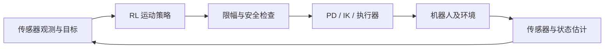
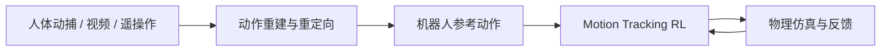
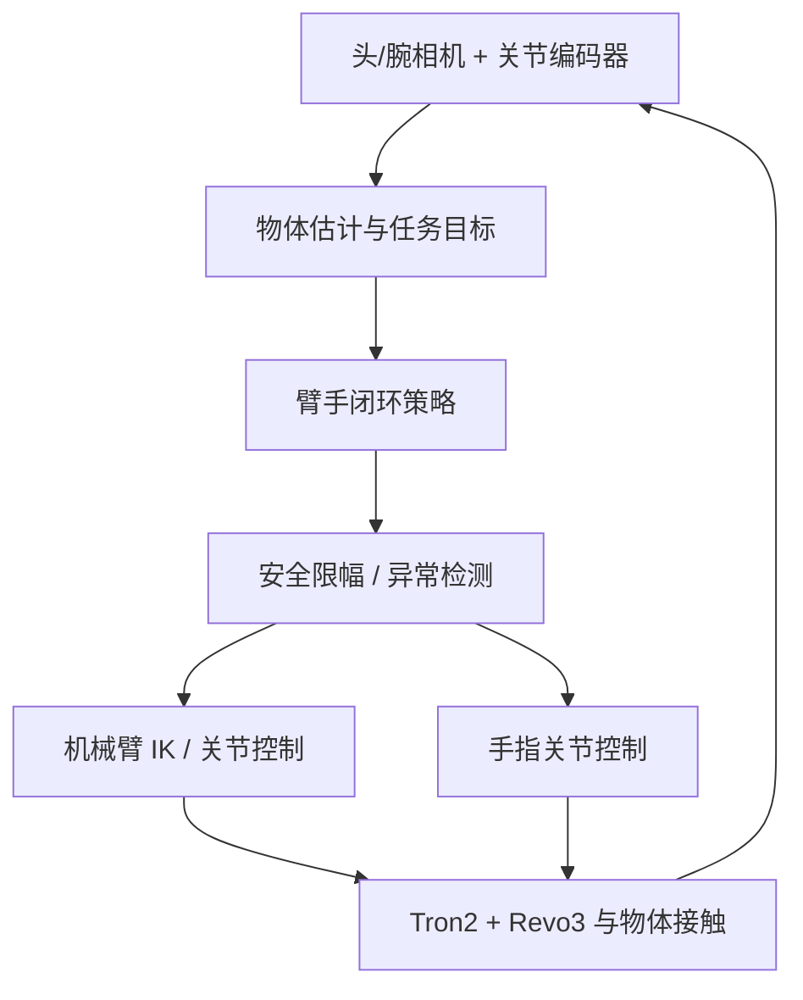

# 具身智能运动控制强化学习

[课程首页](https://github.com/zengxiong111/Foundation_of_Embodied_AI) · [English](Embodied_Motion_Control_RL_Tutorial_EN.md) · [PDF](../pdf/Embodied_Motion_Control_RL_Tutorial_ZH.pdf)

| 项目 | 说明 |
|---|---|
| 主题 | 运动控制强化学习 |
| 修订日期 | 2026-10-30 |
| 前置知识 | 机器人动力学、底层控制与入门强化学习 |
| 许可 | CC BY-NC-SA 4.0 · Xiong Zeng and contributors |

## 目录

- [1. 什么是运动控制强化学习？](#motion-section-01)
- [2. 如何定义一个运动控制 RL 任务？](#motion-section-02)
- [3. 如何训练运动控制策略？](#motion-section-03)
- [4. 如何从人类动作学习机器人运动？](#motion-section-04)
- [5. 如何从单一动作扩展到通用运动控制？](#motion-section-05)
- [6. 如何实现 Sim-to-Real？](#motion-section-06)
- [7. 两个贯穿案例与评价方法](#motion-section-07)
- [参考阅读与开源入口](#motion-section-08)

## 1. 什么是运动控制强化学习？

### 1.1 运动控制 RL 在机器人系统中的位置

机器人通常需要三个相互协作的层次：高层决定**做什么**（任务规划、VLA 等）；运动层决定**怎样运动**（运动规划、Motion Tracking、RL）；底层决定**如何执行**（PD、阻抗控制、逆运动学、驱动器）。运动控制 RL 主要学习中间层的反馈策略，也可以根据动作接口直接学习力矩控制。它不是对传统控制的替代，而是与已有控制器组合。

对于目标条件控制器：

$$
a_t=\pi_\theta(o_t,c_t),
$$

其中 $o_t$ 是可获得的传感器观测，$c_t$ 是目标速度、目标位姿或参考运动，$a_t$ 是策略动作。**动作不是电机必然直接接收的指令**；它通常先经限幅、IK/PD 或执行器接口变换。

上述闭环中，状态估计器可能根据相机和历史观测提供估计值，而非真实状态。控制系统通常存在**不同的时钟**：策略推理频率 $f_\pi$、底层控制频率 $f_c$、物理积分或执行器更新频率 $f_{\mathrm{phys}}$；三者不必相等。实际部署要验证命令保持、延迟及时间戳一致性，不能仅复制网络权重。

### 1.2 与具身基础模型 RL 后训练的区别

| 对比维度 | 运动控制 RL | VLA/WAM 等基础模型后训练 |
|:--|:--|:--|
| 典型起点 | 新建或已有低层运动策略 | 已预训练的感知—动作模型 |
| 主要目标 | 稳定性、轨迹精度、接触与恢复 | 提高复杂任务的成功率、适应新条件 |
| 常见观测 | 关节、IMU、局部目标或估计位姿 | 图像、语言、本体感知等 |
| 常见动作 | 关节目标、力矩、末端命令 | 动作序列、末端命令或关节动作 |

二者边界并不绝对。高层 VLA 可以输出目标，低层 RL 负责稳定执行；低层运动策略也可以作为基础模型的动作执行模块。本教程重点研究**物理交互驱动的闭环运动控制**。

### 1.3 用两类任务贯穿全文

**案例 A：Unitree G1 速度跟踪**。给定前进、侧移和转向指令，让双足机器人保持平衡并跟踪速度。核心难点是地面接触、抗扰与身体稳定。

**案例 B：Tron2 + Revo3 螺丝刀操作**。从桌面变化的初始位姿抓取螺丝刀，搬运至目标区域并完成指定旋转（不涉及拧螺钉），同时应对滑动与扰动。核心难点是臂手协同、多接触、视觉估计和恢复。

腿式、全身动作跟踪、机械臂操作和灵巧手操作是**任务类别**，不是彼此竞争的算法。

## 2. 如何定义一个运动控制 RL 任务？

最基本的任务接口包括 **Observation、Command/Goal、Action、Reward、Reset、Termination、Dynamics**。决定训练能否成功的第一步，通常不是选择更复杂的网络，而是把这些接口定义清楚。

### 2.1 Observation：策略真正知道什么？

一个常见的本体感知观测为：

$$
o_t=[q_t,\dot q_t,\omega_t,\hat g_t,a_{t-1},c_t],
$$

其中 $q_t,\dot q_t$ 表示关节状态，$\omega_t$ 表示机身角速度，$\hat g_t$ 表示机身坐标系中的重力方向，$a_{t-1}$ 是前一步动作。对于灵巧操作，还可加入视觉估计的物体位姿 $\hat T_{\mathrm{obj},t}$ 和目标 $T_{\mathrm{goal}}$。

| 观测设计问题 | G1 行走 | Tron2 + Revo3 操作 |
|:--|:--|:--|
| 关键可部署信息 | 编码器、IMU、速度命令 | 臂/手编码器、头/腕相机、任务目标 |
| 部分可观测量 | 地面摩擦、真实接触、外部扰动 | 物体接触、滑动、遮挡下的 6D 位姿 |
| 常见补救 | 观测历史、状态估计、适应模块 | 时间滤波、视觉重定位、观测历史 |

**重要边界**：仿真器提供的真实摩擦、接触力、物体速度等可能只适合教师或 Critic。部署 Actor 不应依赖真机无法测得的“特权状态”。若使用观测历史，记为 $h_t=(o_{t-k},\ldots,o_t)$，可交由 MLP、GRU 等模块编码。

### 2.2 Action：策略输出什么？

腿式运动常用**关节位置目标**：

$$
a_t=\pi_\theta(o_t,c_t),\qquad
q_t^{\mathrm{target}}=q^{\mathrm{default}}+s_a a_t.
$$

底层 PD 可进一步转为力矩命令：

$$
\tau_t=K_p(q_t^{\mathrm{target}}-q_t)
       +K_d(\dot q_t^{\mathrm{target}}-\dot q_t),
$$

其中 $K_p,K_d$ 是控制增益；若目标速度取零，则退化为常见的 $-K_d\dot q_t$。需要核对执行器是否真的接受关节目标，及其内部是否已有控制环。

机械臂可以输出笛卡尔位姿增量 $\Delta x_t$，再通过 IK 或操作空间控制转换为关节命令；灵巧手可输出手指关节目标。**策略动作空间、控制器输入空间和驱动器命令空间可以不同**。

### 2.3 Reward：如何定义“做得好”？

先写清任务目标，再增加必要的稳定性与代价约束：

$$
r_t=r_t^{\mathrm{task}}+r_t^{\mathrm{stability}}-r_t^{\mathrm{cost}}.
$$

例如，G1 的速度跟踪奖励可写成：

$$
r_t^{v}=\exp\!\left(-\frac{\|v_t-v_t^{\mathrm{cmd}}\|^2}{\sigma_v^2}\right),\qquad
r_t^{\mathrm{smooth}}=-\|a_t-a_{t-1}\|^2.
$$

平衡、足部滑动、关节限位和能耗项是补充约束；不要因为“速度奖励高”就容许跌倒或异常摆腿。对于螺丝刀任务，可分别设置抓取、抬起、搬运、旋转和稳定性信号，但**最终成功率**始终应独立于训练奖励报告。所有权重必须经任务验证，不能把示例数值当作现成参数。

### 2.4 Reset 与 Termination：从哪里学习，何时结束？

普通行走可从站立姿态开始；复杂动作与多阶段操作若总从初始状态出发，策略很难遇到中途恢复情形。**Reference State Initialization（RSI）**从参考轨迹的不同时刻初始化：

$$t_0\sim\mathrm{Uniform}(0,T).$$

进一步可对接触建立、足部落地、物体滑移等困难事件**加权采样**（event-biased RSI）。前提是重置后的状态满足运动学与接触一致性，不能把物体凭空置于不可实现的稳定接触状态。

Termination 应明确区分：任务成功、碰撞或跌倒失败、对象掉落、安全越界和时间超时。若过早结束训练，可能让策略学会规避困难状态，而不是恢复。

## 3. 如何训练运动控制策略？

### 3.1 首先区分三种不同的“选择”

| 层次 | 回答的问题 | 典型选项 |
|:--|:--|:--|
| **学习起点** | 从哪里获得行为？ | 从零探索、参考动作、已有控制器加残差 |
| **优化器** | 如何用数据更新策略？ | PPO、SAC、Model-Based RL |
| **部署方式** | 真机观测不足怎么办？ | Asymmetric Actor-Critic、Teacher–Student、RMA |

因此“PPO vs Residual RL”是一个错误的二选一：可以**用 PPO 训练残差动作**，也可以**用 PPO 训练 Motion Tracking 教师，再蒸馏成学生**。

### 3.2 从零学习、Motion Tracking 与 Residual RL

**从零 RL**只利用任务反馈，适合能够探索到奖励信号的任务，例如基础速度控制；难点是稀疏奖励和高维接触探索。

**Motion Tracking RL**给出目标运动 $m_t^{\mathrm{ref}}$，策略通过与动力学环境交互，学习在外部扰动和物理约束下跟踪运动。它是**任务/训练目标**，不是一种独立的优化器。

**Residual RL**在已有控制器或参考命令上进行局部修正：

$$
u_t=\operatorname{Shield}\!\left(\nu_t^{\mathrm{base}}+\alpha\,\Delta\nu_\theta(o_t),\,o_t\right).
$$

其中 $\nu$ 表示发送给下一级控制器的命令；$\alpha$ 与 Shield 分别限制残差范围与执行约束。Shield 在这里只表示工程限幅或校验逻辑，**不意味着形式化安全保证**。Motion Tracking 可以输出全量关节目标，也可以与 Residual RL 组合；二者不能画等号。

### 3.3 PPO、SAC 与 Model-Based RL 分别适合什么？

| 优化方法 | 有利条件 | 主要限制 |
|:--|:--|:--|
| PPO（on-policy） | 大量并行仿真、稳定训练基线、动作跟踪 | 采样更新后需要新轨迹；数据复用有限 |
| SAC（off-policy） | 连续动作、回放池可复用、交互成本较高 | Critic 偏差、回放分布与接触任务稳定性 |
| Model-Based RL | 可学习足够准确的短时动力学并用于规划或梯度优化 | 模型误差累积、接触不连续和模型偏差 |

这里不重复 PPO、GAE、SAC 或 Q-learning 的数学推导。**选型原则**：先检查任务是否可被探索、数据如何获得、能否可靠批量仿真，再决定优化器；并行程度并不自动决定最终策略的好坏。

### 3.4 一条合理的学习路线

对于 G1，先选择“从零 + PPO + 本体感知 Actor”；加入扰动和随机化后评估鲁棒性。对于螺丝刀操作，若已有遥操作轨迹或传统控制器，通常更适合从“参考跟踪或残差 + RL”出发，并使用可部署观测训练学生策略。两者最终都要通过独立测试集评价，不能仅观察训练 reward 曲线。

## 4. 如何从人类动作学习机器人运动？

### 4.1 从演示到可执行的参考运动

人类手指、机械臂与人形机器人的自由度和关节限位不同。**Motion Retargeting**需要对齐运动语义与末端接触，同时检查机器人工作空间、速度、碰撞和接触可行性。重定向轨迹只是训练目标，通常不能直接逐帧回放在真实机器人上。

### 4.2 Behavior Cloning 不是 Motion Tracking RL

Behavior Cloning（BC）通过监督学习拟合演示动作：

$$
\mathcal L_{\mathrm{BC}}(\theta)
=\mathbb E_{(o,a^{\mathrm{demo}})}\!\left[\|\pi_\theta(o)-a^{\mathrm{demo}}\|^2\right].
$$

Motion Tracking RL 则优化闭环的累计跟踪回报：

$$
\max_\theta\;\mathbb E_{\pi_\theta}\left[\sum_{t=0}^{T}\gamma^t
r_{\mathrm{track}}(s_t,m_t^{\mathrm{ref}})\right].
$$

BC 直接拟合动作标签，可能因分布偏移积累误差；Motion Tracking RL 可以在物理交互中探索纠偏行为。不过，若重定向参考本身不可行，RL 也不能凭空创造有效接触。BC 预训练 + RL 改进也是合理组合。

### 4.3 如何设计跟踪奖励与参考条件？

典型跟踪奖励由关节、根部、末端和接触误差组成，例如：

$$
r_t^{\mathrm{track}}
=w_q\exp\!\left(-\frac{\|q_t-q_t^{\mathrm{ref}}\|^2}{\sigma_q^2}\right)
+w_e\exp\!\left(-\frac{\|p_{e,t}-p_{e,t}^{\mathrm{ref}}\|^2}{\sigma_e^2}\right).
$$

实际任务还需要根部姿态、目标完成、稳定性和动作平滑等项。注意用统一坐标系计算误差，明确采用世界坐标还是机器人局部坐标；不要让 Actor 偷看真机无法获得的全球真值。向策略提供短时**未来参考窗口**时，还要考虑实时可用的参考信息与命令延迟。

### 4.4 DeepMimic、AMP 与 RSI 解决不同问题

**DeepMimic [2]**：用逐帧参考动作奖励加物理交互学习复杂动作；说明“模仿运动”并非机械回放。

**AMP [3]**：用判别器从动作数据学习运动风格奖励，不要求严格跟踪给定时刻的一条轨迹；适合关注动作分布而非精确相位同步的情况。

**RSI**：通过不同参考相位的初始化增加训练覆盖；对落地、接触变化等关键事件可偏置采样。RSI 是初始化策略，不是模仿奖励，也不是优化算法。

这三者不应被排列成完全互斥的算法；DeepMimic 风格的跟踪任务可以与更合理的重置和任务课程共同使用。

### 4.5 SuperMimic：改变的是优化效率，不是任务定义

**SuperMimic [7]**针对大规模人形 Motion Tracking，使用从仿真器转移数据拟合的**共享可微世界模型**，在短时想象轨迹上通过 BPTT 将梯度传播至控制策略。与在真实/高精度仿真器中反复采样并用 model-free RL 更新相比，它尝试提高策略学习效率。

它与 SONIC 的关键区别在于**动力学是否通过学习的可微模型辅助优化**，不是“是否属于 Motion Tracking”。可微模型可能在强接触或未见状态处产生偏差；训练效率与真机鲁棒性必须分别验证，不能仅凭模型内回报判断部署效果。

## 5. 如何从单一动作扩展到通用运动控制？

### 5.1 通用性的核心是命令空间与训练覆盖

单条轨迹控制器主要回答“跟上这段动作”。通用运动控制器还需要理解多种条件：目标速度、根部姿态、头手目标、关节片段、运动 token 等。可写为：

$$a_t=\pi_\theta(o_{\le t},c_t,z_t),$$

其中 $c_t$ 是任务命令，$z_t$ 可以是历史编码或适应变量。需要处理不同目标模式的**语义、掩码、单位、坐标系和切换时的连续性**，而不是简单把网络做大。

### 5.2 三个代表性方向

| 工作 | 核心贡献 | 对教程的启示 |
|:--|:--|:--|
| **HOVER [4]** | 多种全身控制模式的统一命令表示与策略蒸馏 | 共享策略可以通过 mode mask 支持不同控制目标 |
| **BeyondMimic [5]** | 高质量动作跟踪基元 + 引导式扩散来生成/组合下游动作 | 低层跟踪能力与上层运动生成是不同模块 |
| **SONIC [6]** | 大规模动作跟踪训练与统一运动 token 接口 | 数据规模、运动覆盖与统一接口可支持多类上层指令 |

**不要混淆**：HOVER 着重多控制模式，BeyondMimic 引入生成式动作组合，SONIC 着重扩展跟踪数据与控制覆盖；SuperMimic 则主要研究怎样**更高效地训练**运动跟踪器。它们不是同一指标下的一条单向演进链。

### 5.3 什么才算“通用”？

至少分开报告：（1）训练集中未见运动的跟踪误差与完成率；（2）未见目标/命令及切换时的稳定性；（3）摩擦、载荷和感知误差变化时的性能；（4）扰动恢复；（5）实际闭环延迟。一个能复现大量训练轨迹的模型，不自动具备跨本体泛化、视觉任务规划或高层推理能力。

## 6. 如何实现 Sim-to-Real？

### 6.1 仿真与真实世界究竟差在哪里？

| 不确定性 | 例子 | 优先处理方式 |
|:--|:--|:--|
| 动力学差异 | 质量、惯量、摩擦、执行器响应 | 标定、系统辨识、合理随机化 |
| 感知差异 | IMU 噪声、遮挡、物体位姿误差 | 状态估计、历史观测、重定位 |
| 时间差异 | 推理、通信、执行器延迟 | 统一时间戳、时延建模与频率验证 |
| 几何/接口差异 | 零位、关节方向、TCP、相机外参 | **先修复校准**，不能只依赖 RL 补偿 |
| 未覆盖状态 | 侧滑、失抓、外力冲击 | 扰动训练、事件采样、恢复策略 |

**Sim-to-Real 不是单一算法**；它是模型、估计、训练分布、控制频率与安全工程共同组成的链路。

### 6.2 Asymmetric Actor-Critic、Teacher–Student 与 RMA

**Asymmetric Actor-Critic**：Actor 只读真机可用观测 $o_t$，Critic 在训练阶段可利用更完整的仿真状态 $s_t$，以改善价值估计。**不需要有第二个要蒸馏的 Actor**。

**Teacher–Student**：先训练可使用额外信息的教师 $\pi_T(s_t)$，再由只看部署观测的学生 $\pi_S(h_t)$ 学习其行为：

$$\mathcal L_{\mathrm{distill}}=\mathbb E\left[\|\pi_S(h_t)-\pi_T(s_t)\|^2\right].$$

学生需要在自身访问到的状态分布上得到检查或再训练，否则单纯监督蒸馏会出现闭环分布偏移。

**RMA [8]**：通过历史观测估计隐含环境/动力学信息，结合基础策略进行快速适应。它关注的是**随时间变化的隐变量估计与控制适应**，不是 Teacher–Student 的别名。

### 6.3 Domain Randomization 与 Sim-to-Sim

将质量、摩擦、接触、传感器噪声、延迟等参数记为 $\xi$，训练时从经校准的分布中采样：

$$\xi\sim p_{\mathrm{train}}(\xi),\qquad
\max_\theta\;\mathbb E_{\xi}\left[J(\pi_\theta;\xi)\right].$$

随机化范围应被硬件规格和测量结果约束，**不是越大越好**。可在 Isaac Lab 训练后用 MuJoCo 进行 Sim-to-Sim 检查，重点排查控制接口、接触参数与数值差异；跨仿真器成功也**不等于**真机可安全部署。

### 6.4 闭环恢复比“只会成功的一次执行”更重要

真实控制应形成“观测 → 估计 → 动作 → 反馈 → 误差修正”的循环。对螺丝刀任务，头/腕相机提供物体位姿估计，编码器提供机器人状态；若存在遮挡或估计失效，需要置信度门限、短时预测、重新观测或安全停止。接触滑动、抓取松动和物体掉落是**不同事件**，对应不同的恢复选择：增大接触稳定性、重新抓取或终止重置。

恢复不是奖励函数里加一项就自动出现的能力；训练还要覆盖偏离参考轨迹的状态，并避免让策略借助仿真特权信息预测不可观测的未来。

### 6.5 部署前的最小核验

确认关节顺序、正负号、单位、坐标系、相机外参和目标定义一致；确认动作比例、控制周期、底层增益、执行器限位和延迟与训练假设一致；定义推理超时、通信失联、异常碰撞和紧急停止处理；从低风险条件逐步扩大工作范围。所有实机接触任务必须具备硬件与软件保护，不能将“RL 策略已经收敛”等同于安全性证明。

## 7. 两个贯穿案例与评价方法

### 7.1 案例 A：G1 速度跟踪

**任务**：给定 $c_t=(v_x^{\mathrm{cmd}},v_y^{\mathrm{cmd}},\omega_z^{\mathrm{cmd}})$，保持直立、跟踪速度并应对适度扰动。

| 设计要素 | 建议基线 | 关键检查 |
|:--|:--|:--|
| Observation | 关节状态、IMU、重力方向、历史动作、速度命令 | 不输入真机无来源的精确接触真值 |
| Action | 关节位置目标 + 底层 PD | 关节映射、速率、目标保持 |
| Reward | 线/角速度跟踪 + 姿态稳定 + 平滑约束 | 避免高速摆腿、滑动和异常摔倒 |
| Reset/失败 | 站立起步；跌倒、碰撞、超时终止 | 扰动后的恢复应专门测试 |
| 训练起点 | 从零 RL + PPO | 扩展目标速度与地形分布 |

训练逻辑：首先让策略在平地实现基本速度跟踪，再扩展转向/变速命令；之后引入推力、地面摩擦和负载变化。**更复杂的随机化只应在基线可靠后加入**。评价时报告速度跟踪误差、跌倒率、扰动恢复率、足部滑动与推理延迟，而不只是 Reward。

### 7.2 案例 B：Tron2 + Revo3 螺丝刀操作

**任务顺序**：从变化的桌面位姿拾取螺丝刀 → 保持可靠抓取 → 移至目标区域 → 旋转指定角度 → 在扰动后保持或恢复。这里的“旋转”指操纵工具自身，不包含真实螺纹啮合或拧紧扭矩控制。

| 设计要素 | 具体建议 |
|:--|:--|
| Observation | 臂/手关节状态、头/腕相机的估计物体位姿、目标、历史动作；无触觉硬件时不要假设有真实接触力 |
| Action | 机械臂末端增量或关节目标 + 手指关节目标；必要时加入有界残差 |
| Reward | 抓取、抬起、目标位置、旋转角度、稳定性和动作平滑；完整任务成功单独统计 |
| Reset | 随机物体位姿、夹持状态及可行的关键接触阶段；对滑动/释放事件加权采样 |
| Failure/Recovery | 视觉失效、接触丢失、碰撞、越界、掉落；采取重定位、重抓或安全终止 |

三种训练路线对应不同起点：**从零 RL**不依赖演示但接触探索困难；**Motion Tracking RL**利用人手/遥操作重定向参考降低探索难度；**Residual RL**在 IK、轨迹跟踪或已有抓取策略上学习有限接触修正。它们可以串联，不必互斥。优先保证重定向轨迹的物理可行性与真机执行频率一致，再引入更复杂的视觉闭环和扰动恢复。

### 7.3 用统一的评估框架比较两类任务

| 维度 | G1 速度控制 | 螺丝刀操作 |
|:--|:--|:--|
| 任务表现 | 速度/转向误差、目标保持时间 | 完整成功率、目标位姿/旋转误差 |
| 稳定性 | 摔倒率、滑动、姿态误差 | 掉落率、异常接触、动作平滑度 |
| 泛化 | 未见速度、地形、负载 | 未见物体位姿、接触摩擦、遮挡 |
| 恢复 | 推力后恢复率及恢复时间 | 滑动/丢失目标后的恢复率及时间 |
| 部署 | 频率、推理延迟、接口一致性 | 视觉延迟、重定位次数、安全停机率 |

评估集应与训练随机化分布和演示轨迹**明确隔离**；结果至少区分已见/未见任务、无扰动/有扰动条件及仿真/真机。报告样本数与失败类型，避免以平均跟踪误差掩盖少量严重失败。

### 7.4 核心结论

**一条主线**：定义任务 → 设计闭环观测与执行接口 → 选择学习起点与优化器 → 引入参考运动/通用命令 → 处理真实世界差异 → 独立评估成功、泛化与恢复。

## 参考阅读与开源入口

**基础与动作学习**：

1. [Rudin et al. — Learning to Walk in Minutes (CoRL 2022)](https://proceedings.mlr.press/v164/rudin22a.html)：并行运动控制 RL 与课程学习。
2. [Peng et al. — DeepMimic (2018)](https://arxiv.org/abs/1804.02717)：参考动作、物理跟踪与恢复。
3. [Peng et al. — AMP (2021)](https://arxiv.org/abs/2104.02180)：对抗式运动先验。
4. [He et al. — HOVER (ICRA 2025)](https://arxiv.org/abs/2410.21229)：多模式统一全身控制。
5. [Liao et al. — BeyondMimic](https://arxiv.org/abs/2508.08241)：动作跟踪基元与引导式扩散。
6. [Luo et al. — SONIC (Science Robotics, 2026)](https://nvlabs.github.io/GEAR-SONIC/)：大规模运动跟踪与统一运动接口。
7. [Liao et al. — SuperMimic (CoRL 2026)](https://arxiv.org/abs/2610.28480)：共享可微世界模型与 BPTT。
8. [Kumar et al. — RMA (RSS 2021)](https://arxiv.org/abs/2107.04034)：腿式机器人的在线动力学适应。

**工具入口（这里只提供入口，不讲安装命令）**：

- [Isaac Lab 官方文档](https://isaac-sim.github.io/IsaacLab/main/index.html)；[RSL-RL 官方文档](https://leggedrobotics.github.io/rsl_rl/)。
- [MuJoCo Playground](https://github.com/google-deepmind/mujoco_playground)；[Unitree RL Lab](https://github.com/unitreerobotics/unitree_rl_lab)。
