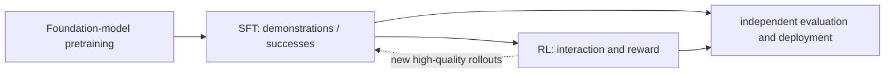
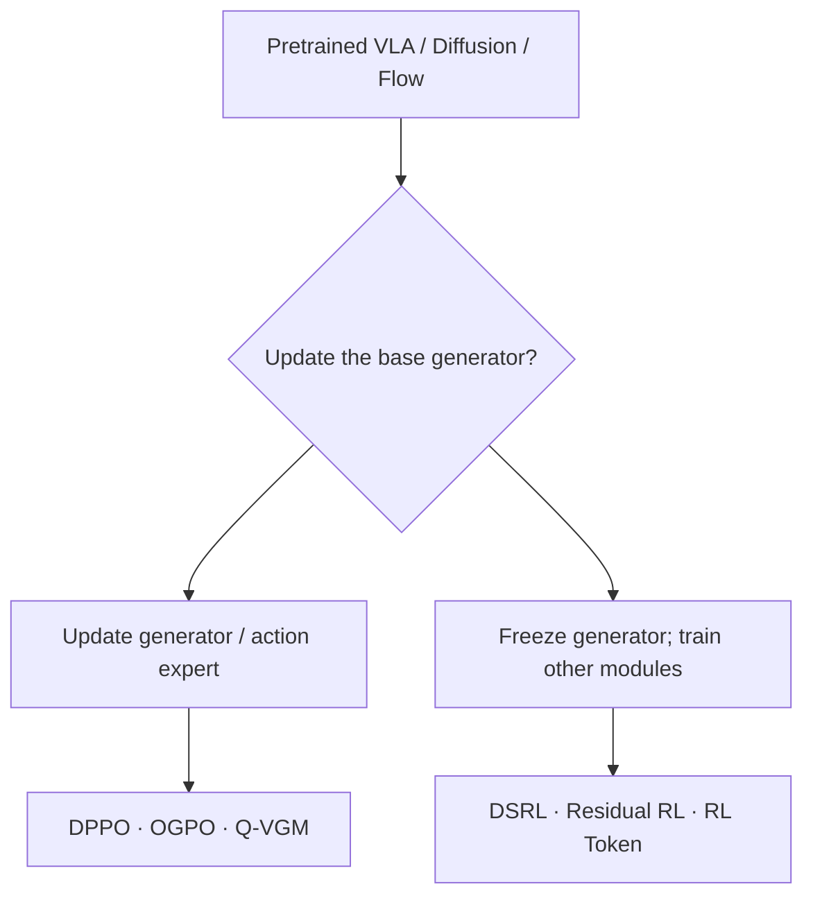
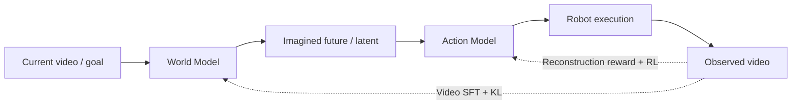
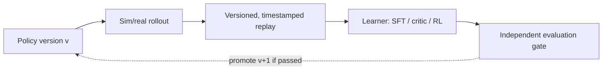

# Post-Training for Embodied Foundation Models: SFT and RL

**Supervised Fine-Tuning and Reinforcement Learning for Vision–Language–Action Models and World Action Models**  
**Objectives, trainable interfaces, implementation boundaries, and deployment · October 2026**

[Course repository](https://github.com/zengxiong111/Foundation_of_Embodied_AI) · [WAM-RL paper](https://arxiv.org/abs/2606.17906) · [RLinf documentation](https://rlinf.readthedocs.io/en/latest/) · [简体中文](Embodied_Post_Training_ZH.md) · [PDF](https://zengxiong111.github.io/zengxiong.github.io/files/Embodied_Post_Training_EN.pdf)

>
>
> WAM-RL methods and metrics are attributed to [Qian et al.](https://arxiv.org/abs/2606.17906).

## Contents

- [1. What is post-training?](#post-section-01)
- [2. SFT and RL objectives](#post-section-02)
- [3. VLA SFT post-training](#post-section-03)
- [4. VLA RL post-training: six routes retained from the original tutorial](#post-section-04)
- [5. WAM architecture and SFT post-training](#post-section-05)
- [6. WAM RL post-training: the WAM-RL case study](#post-section-06)
- [7. Systematic VLA versus WAM post-training comparison](#post-section-07)
- [8. Shared online RL and actor–critic semantics](#post-section-08)
- [9. RLinf infrastructure: retain VLA capabilities, identify WAM integration requirements](#post-section-09)
- [10. Real-robot deployment and unresolved questions](#post-section-10)
- [11. Decision guide](#post-section-11)
- [12. Primary papers and official resources](#post-section-12)

## 1. What is post-training?

**Pretraining** builds broad visual, linguistic, and motor priors. **Post-training** adapts an existing model with weights $\theta_0$ to specific tasks, robot embodiments, data distributions, or feedback. SFT versus RL describes the **learning signal**; VLA versus WAM describes the **architecture**. They are orthogonal axes.

| Architecture | SFT: supervised target data | RL: environment interaction and reward |
|:---|:---|:---|
| **VLA** | Fit expert actions by updating an action expert, backbone, or adapter | Optimize the generator, or freeze it and learn noise-, feature-, or action-level actors |
| **WAM** | Learn future-video/world-state prediction and the video-to-action mapping | Improve the actor's execution fidelity; WAM-RL also adapts the world model through online Video SFT |

*Figure 1. SFT and RL can alternate or be interleaved. SFT followed by RL is a common recipe, not a universal sequencing requirement.*

Let $o_t$ denote observation, $g_t$ the goal or language instruction, and $A_t=(a_t,\ldots,a_{t+H-1})$ a candidate action chunk of length $H$. The number of low-level steps actually executed before replanning is $K$, which need **not equal $H$**. For either architecture, we must identify the supervised target, parameter update scope, reward origin, replay semantics, and skill-preservation constraints.

## 2. SFT and RL objectives

### 2.1 SFT: predict the demonstrated action or future

For an explicit conditional action distribution, the VLA behavior-cloning objective is

$$
\mathcal L_{\mathrm{SFT}}^{\mathrm{VLA}}(\theta)
=-\mathbb E_{(o,g,A)\sim\mathcal D_{\mathrm{sup}}}
\log\pi_\theta(A\mid o,g).
$$

Diffusion and flow action experts usually use a **denoising or velocity-matching objective**, rather than the above likelihood in its naive form. A representative conditional flow-matching loss for $x_\tau=(1-\tau)x_0+\tau x_1$ is

$$
\mathcal L_{\mathrm{FM}}=\mathbb E_{x_0,x_1,\tau,c}
\big[\|v_\theta(x_\tau,\tau,c)-(x_1-x_0)\|_2^2\big],
$$

where $c=(o,g)$ and $x_1$ is the target action chunk or future-video sample. Other probability paths and flow parameterizations exist. SFT may specialize a pretrained policy to a domain, a robot, or a skill; SFT on **new successful rollouts during RL** is also post-training.

### 2.2 RL: learn from the quality of outcomes

The standard discounted-return objective is

$$
J(\pi)=\mathbb E_{\tau\sim\pi}
\left[\sum_{t=0}^{T}\gamma^t r_t\right].
$$

SFT answers, “What should the model imitate?” RL answers, “Which behavior produces more return in the environment?” RL can improve beyond the demonstration support but requires useful exploration, credible reward, suitable value estimates, and interaction. Imitation constraints, reference-policy regularization, and periodic SFT may mitigate forgetting during RL.

**Do not conflate Online with On-policy.** Online means new environment data are collected during learning. Off-policy means the learner may also reuse transitions from earlier behavior policies. Likewise, Online Video SFT inside an RL training loop does not mean the world model receives a policy-gradient update.

## 3. VLA SFT post-training

### 3.1 Which parameters are updated?

A typical VLA pipeline is **image + language + robot state → visual-language representation → action chunk**. An action-token head commonly uses cross-entropy, whereas a continuous diffusion/flow expert typically uses denoising/flow matching. These are not interchangeable log-probability interfaces.

| Parameterization | What changes? | Main cost or risk |
|:---|:---|:---|
| **Full fine-tuning** | All selected pretrained parameters | High memory and compute; representation and skill drift |
| **LoRA / adapters** | Low-rank or additional modules | Limited adaptation capacity or unsuitable insertion points |
| **Action Expert only** | Motor-generation network; backbone remains fixed | Cannot fix all vision/language domain gaps |
| **Frozen backbone + new head** | An embodiment-specific action interface | Requires correct action semantics and time scales |

### 3.2 Data, time alignment, and evaluation

A useful supervised sample includes $(o_t,g_t,A_t)$ along with embodiment information, action units (joint versus end-effector), normalization, acquisition rates, camera calibration, and timestamps. Multi-task SFT requires a sensible mixture across robots, instructions, successes, and recovery segments. **Only imitating idealized successful demonstrations is often insufficient for recovery**.

The practical logic is: **multimodal data → spatial/temporal alignment → chunked supervision → selective fine-tuning → independent closed-loop evaluation**. SFT can be connected to RL only if observation, executed action, termination, reward, and model-version semantics agree. A lower supervised loss is not a substitute for real task success or contact safety.

## 4. VLA RL post-training: six routes retained from the original tutorial

A major obstacle is that a diffusion/flow policy may not expose a tractable **marginal action log-probability or policy KL**. Ordinary Gaussian PPO/SAC cannot be directly bolted onto an arbitrary generative head. The first organizing question is **what actually receives the RL update?**

*Figure 2. Alternative trainable interfaces, not six sequential optimization stages. LoRA and hybrid approaches can cross the two branches.*

### 4.1 Directly update the generator or action expert

**DPPO — diffusion policy gradients.** [DPPO](https://arxiv.org/abs/2409.00588) incorporates the denoising chain into a policy-optimization formulation instead of pretending the final diffusion action is a simple Gaussian policy. PPO's clipped surrogate provides intuition:

$$
L_{\mathrm{clip}}=\mathbb E\left[\min\left(
\rho\hat A,\operatorname{clip}(\rho,1-\epsilon,1+\epsilon)\hat A\right)\right].
$$

This is **not DPPO's complete loss**. On-policy rollouts, repeated denoising, gradient cost, and potential degradation of pretrained skills matter.

**OGPO — off-policy replay for generative policy improvement.** [OGPO](https://arxiv.org/abs/2605.03065) learns an off-policy critic from older and new trajectories and passes value information to the generator: **replay → critic/advantage → generator update**. PPO-like loss components do not make the algorithm on-policy PPO. Critic bias, behavior-policy shift, and long generation-chain optimization are important.

**Q-VGM — Q-guided flow matching.** [Q-VGM](https://arxiv.org/abs/2606.08015) constructs a local value-guided velocity-matching objective for the Flow Action Expert without backpropagating through the full generation trajectory. Its value learning combines offline IQL and online TD estimation. **The pretrained generator is updated** in this route.

### 4.2 Freeze the generator and optimize auxiliary modules

**DSRL — noise/latent actor.** [DSRL](https://arxiv.org/abs/2506.15799) learns a smaller proposal policy while keeping the generator fixed:

$$
z\sim q_\phi(z\mid o,g),\qquad
A=G_{\theta_0}(o,g,z),\quad \theta_0\ \mathrm{fixed}.
$$

This preserves the base generator and reduces trainable parameters, but reachable behavior remains constrained by the **frozen generator's action support**. A noise interface validated for a specific diffusion model cannot automatically be transferred to all VLA/flow models.

**Residual RL — restricted corrections in action space.** Let the frozen policy produce $A_0$ and a small actor produce $\Delta A_\phi$:

$$
A_{\mathrm{cmd}}=\operatorname{Safe}(A_0+\lambda\Delta A_\phi).
$$

Residual RL is an **architecture**, not one specified on- or off-policy algorithm. Safe action scaling, coordinate frames, chunk boundaries, and contact stability matter.

**RL Token — lightweight feature-based actor–critic.** [RL Token](https://arxiv.org/abs/2604.23073) constructs a compact VLA feature interface and then supports online off-policy actor–critic updates with the main representation network frozen. Creating this feature interface may itself require demonstration-based adaptation. It should not be confused with an action residual.

### 4.3 VLA RL method-selection table

| Method | RL update target | Common data setup | Main constraint |
|:---|:---|:---|:---|
| **DPPO** | Diffusion generator | Mostly on-policy | High rollout/denoising cost |
| **OGPO** | Generative policy | Online off-policy | Replay drift and critic reliability |
| **Q-VGM** | Flow velocity field | Offline-to-online | Accurate local Q gradients |
| **DSRL** | Noise/latent actor | Can be off-policy | Frozen generator, limited action support |
| **Residual RL** | Action-correction actor | Algorithm-dependent | Chunk alignment and contact safety |
| **RL Token** | Feature actor–critic | Online off-policy | Feature compatibility and preliminary adaptation |

First choose a **trainable interface**, then an **optimization objective and data regime**. Full/partial updates, velocity matching versus policy gradients, and on-policy versus off-policy are distinct classification axes.

## 5. WAM architecture and SFT post-training

### 5.1 World prediction and executable action are distinct roles

In the **World–Action** architecture studied by WAM-RL, a world model forecasts future visual observations or their latent representations, and an actor maps the predicted information to motor commands:

$$
\underbrace{\hat X_{t+1:t+H},\ z_t=f_\theta(X_{\le t},g)}_{\text{World Model}}
\quad\longrightarrow\quad
\underbrace{A_t=\pi_\phi(z_t,o_t,g)}_{\text{Action Model}}.
$$

$X$ denotes a video/observation sequence. Not every model labeled “WAM” has identical modules; this is the **working decomposition for WAM-RL**. It explicitly couples “what the future might look like” and “which actions realize it.”

*Figure 3. WAM-RL combines online Video SFT for the world model and reconstruction-reward RL for the actor.*

### 5.2 Two possible supervised interfaces

General WAM SFT can include **video prediction/world dynamics supervision** and **action mapping supervision**, or a joint video-and-action generative objective. Consequently, “WAM SFT only trains videos” is not a universal claim. The specific **online post-training** recipe in WAM-RL adapts the world model using successful rollout videos while optimizing the actor through RL.

The paper's video objective is

$$
\mathcal L_{\mathrm{video}}=
\mathbb E_{X_{1:T}\sim\mathcal D_{\mathrm{success}}}
\big[\ell(f_\theta(X_{<t}),X_t)\big],
$$

where $\ell$ can be a reconstruction or flow-matching loss. A trajectory labeled ultimately successful may nevertheless contain a failed grasp followed by a corrective retry: such segments expose the model to **recovery dynamics**. Successful-only filtering still leaves many failure modes underrepresented.

### 5.3 Latent KL regularization to protect actor compatibility

The actor depends on features produced by the world model. Updating the world model can shift those features and destabilize an actor trained on the old representation. WAM-RL constructs **diagonal Gaussian proxies** for deterministic latent features:

$$
q_\theta(z_t)=\mathcal N(z_t,\Sigma_\theta),\qquad
q_0(z_t)=\mathcal N(z_t^0,\Sigma_0),
$$

with $z_t=f_\theta(X_{<t})$, $z_t^0=f_{\theta_0}(X_{<t})$, a frozen reference world model $\theta_0$, an EMA estimate of current feature-scale covariance, and a fixed reference covariance. **The Gaussian assumption is a tractable surrogate**, not a claim that these deterministic features naturally follow known distributions.

$$
\mathcal L_{\mathrm{WM}}
=\mathcal L_{\mathrm{video}}
+\lambda_{\mathrm{KL}}\mathbb E_t
\big[D_{\mathrm{KL}}(q_\theta(z_t)\|q_0(z_t))\big].
$$

The analytical Gaussian KL penalizes abrupt feature drift and helps the world model and actor remain compatible. The tradeoff is that stronger regularization can limit the world model's ability to depart from the pretrained distribution.

## 6. WAM RL post-training: the WAM-RL case study

### 6.1 Reward: realize the imagined future

The world model predicts $\hat X_{t+1:t+H}$. Actions are executed to obtain $X_{t+1:t+H}$. WAM-RL builds a dense reconstruction reward:

$$
r_t^{\mathrm{recon}}
=\operatorname{sim}(\hat X_{t+1:t+H},X_{t+1:t+H}).
$$

The study compares pixel MSE, optical-flow MSE, DINOv2 feature error, and V-JEPA2 feature error. A negative pixel MSE is one natural similarity score. **Reconstruction consistency is not itself task success**: executing an incorrect world-model prediction faithfully does not guarantee satisfying the user's objective. The quality and task relevance of the imagined plan therefore constrain this reward.

### 6.2 RL for a flow-based actor via Flow-SDE

A deterministic flow ODE is not automatically a stochastic policy with a convenient action likelihood. WAM-RL uses a Flow-SDE construction to introduce noise and tractable sampling transitions:

$$
dx_\tau=v_\phi(x_\tau,\tau)\,d\tau+\sigma\,dW_\tau,
$$

$$
p_\phi(x_{i-1}\mid x_i)
=\mathcal N(x_{i-1};\mu_\phi(x_i,i),\sigma^2 I).
$$

The log-probabilities of a **sampled path** can then be accumulated for policy-gradient optimization:

$$
\nabla_\phi J\approx\mathbb E
\big[\nabla_\phi\log p_\phi(\text{sampling path}\mid s_t)\,\hat A_t\big].
$$

This deliberate distinction matters: a joint sampling-path density should not automatically be equated with the exact marginal log-probability of the final action. Implementations must optimize the quantity justified by their stochastic generation formulation; generic PPO on any deterministic flow head is not sufficient.

### 6.3 Coordinated updates, not a single RL loss for everything

The conceptual training loop consists of four activities:

1. **Predict:** the world model generates an imagined future and the actor maps its representation to actions.
2. **Interact:** execute actions and record synchronized video, action, and task outcomes.
3. **Actor RL:** compare imagined and executed video, compute dense reward/advantages, and update the action model.
4. **Online World Model Video SFT:** use successful trajectories to refine predictions while keeping latent statistics close to a reference through KL.

Thus, WAM-RL is **joint post-training/co-adaptation**, not the claim that policy gradients update every component. Its world-model update is supervised; its actor update is reinforcement-based.

### 6.4 Reported results and their limits

The following are the paper's **reported success rates in specified benchmark settings**:

| Method | LIBERO-Object | RLBench Water Plants |
|:---|---:|---:|
| Pretrained WA base | 68% | 19% |
| Actor-only RL ($\pi_{\mathrm{RL}}$) | 78% | 18% |
| **WAM-RL (actor RL + online world-model SFT)** | **82%** | **22%** |

These results support the claim that actor-only learning may be limited when long-horizon errors are dominated by the predictive world model. They do **not** establish universal WAM superiority to VLA, or universal post-training superiority to all task-specialized alternatives. The authors implement WAM-RL on **Genie Envisioner-ACT** and report **eight NVIDIA A800 GPUs for eight hours** for their training setting; that configuration is not a general minimum requirement for WAMs.

In a **separate reward ablation setting** on RLBench Water Plants, Pixel MSE, Optical Flow MSE, DINO MSE, and V-JEPA2 yield **21%, 19%, 16%, and 17%**, compared with 19% for base and 18% for actor-only in that table. The ablation's Pixel MSE **21% must not be silently substituted for the main table's WAM-RL 22%**. Greater separation between successful and failed trajectory rewards (optical flow) did not translate into the highest task success; alignment with the world-model objective also matters.

The paper explicitly notes two limitations: KL-constrained video adaptation may restrict capability growth, and reconstruction rewards based on hand-designed metrics or pretrained features may insufficiently discriminate task success from failure. Scalable video updating, safe real-robot learning, reliable contact rewards, and long-term cross-embodiment adaptation remain research questions.

## 7. Systematic VLA versus WAM post-training comparison

| Dimension | VLA post-training | WAM post-training (WAM-RL as example) |
|:---|:---|:---|
| **Architecture** | Visual-language features → action head/chunk | World prediction → latent → action model |
| **SFT target** | Expert action tokens or continuous generative action loss | Future video/dynamics and optionally supervised action mapping |
| **RL update** | Generator, adapter, noise actor, feature actor, or residual | Actor execution fidelity; world model adapted with Video SFT |
| **RL reward** | Task success, progress, contact, learned value, etc. | Imagined-versus-realized visual reconstruction consistency |
| **Stability concern** | Policy likelihood, critic bias, forgetting | These issues plus world/actor latent mismatch |
| **Inference compute** | Depends on VLM/expert and sampling steps | Typically adds future generation, depending on architecture/horizon |
| **Training compute** | Model gradients plus rollouts/replay | Additionally maintains/updates a video world model |
| **Hypothesized advantage** | Direct action-generation interface | Explicit future prediction may support recovery and long-horizon decisions |
| **Principal risk** | Contact precision, OOD behavior, chunk drift | Prediction errors, reward misalignment, latent drift, video latency |

**Compute claims require matched conditions.** Compare parameter counts, frame resolution, predicted horizon, denoising steps, batch size, hardware, GPU-hours, robot-hours, and actual success gains. A single paper's 8×A800 result does not provide a fair VLA-versus-WAM compute ranking. A high success rate on one benchmark does not imply that a WAM always needs less SFT/RL than a VLA.

## 8. Shared online RL and actor–critic semantics

An off-policy experience store can contain $\mathcal D=\{(o_t,A_t,r_t,o_{t+K},d_{t+K},K)\}$. A **pedagogical** chunk-aware Bellman target is

$$
y_t^{(K)}=\sum_{j=0}^{K-1}\gamma^j r_{t+j}
+\gamma^K(1-d_{t+K})\mathbb E_{A'\sim\pi}
\big[Q_{\bar\psi}(o_{t+K},A')\big].
$$

The generated action chunk length $H$ and physically executed length $K$ are not the same variable. Replay, discounting, timestamps, chunk overrides, and critic targets should refer to executed steps. This is an illustrative Bellman expression, **not the full objective of SAC, OGPO, Q-VGM, or WAM-RL**.

*Figure 4. Model synchronization, data semantics, and independent deployment gates are part of post-training, not guaranteed by a learning loss.*

## 9. RLinf infrastructure: retain VLA capabilities, identify WAM integration requirements

[RLinf](https://github.com/RLinf/RLinf) provides components for model training, rollout scheduling, actor–learner workflows, SFT/RL, evaluation, and several physical-robot pathways. It is a useful infrastructure example, **not proof of universal compatibility** across arbitrary models, algorithms, and robot hardware.

### 9.1 Documented VLA-side recipes and limitations

| Public recipe / capability | What it supports | What it does not establish |
|:---|:---|:---|
| [$\pi_0/\pi_{0.5}$ PPO/GRPO](https://rlinf.readthedocs.io/en/latest/rst_source/examples/embodied/pi0.html) | Specific on-policy VLA RL settings | General off-policy adaptation of any flow VLA |
| [DSRL with frozen $\pi_0$](https://rlinf.readthedocs.io/en/latest/rst_source/examples/embodied/dsrl.html) | Noise-actor updates while base policy is frozen | Drop-in noise interface for any new model |
| [SAC-Flow](https://rlinf.readthedocs.io/en/latest/rst_source/examples/embodied/sac_flow.html) | SAC on a dedicated flow actor | Verified frozen-$\pi_{0.5}$ SAC training |
| [RLT / RL Token](https://rlinf.readthedocs.io/en/latest/rst_source/examples/embodied/rlt.html) | Feature preparation and lightweight actor–critic | Residual RL without representation adaptation |
| [Real-robot guidance](https://rlinf.readthedocs.io/en/latest/rst_source/guides/realworld_robot.html) | Examples of real-data and multi-robot workflows | Automatic adaptation to arbitrary hands/arms |
| [RTC](https://rlinf.readthedocs.io/en/latest/rst_source/guides/rtc.html) | Overlap of policy inference and robot execution | Hard real-time guarantees or safe motor control |
| [Adding a Robot](https://rlinf.readthedocs.io/en/latest/rst_source/extending/new_robot.html) | Extension interfaces for hardware and tasks | Universal ready-made robot SDK integration |

It is incorrect to say that RLinf supports **only RL**, or that it categorically lacks **off-policy training or real robots**. It is equally incorrect to infer that **WAM-RL is already integrated end-to-end** merely because RLinf has VLA, SFT, and RL capabilities. A new WAM interface would require verification of future-video supervision, imagined and realized video alignment, latent extraction, frozen reference/KL statistics, actor gradients, and multi-model resource scheduling.

### 9.2 Incremental engineering requirements for WAM-RL

| Subsystem | Frequent VLA requirement | Additional WAM-RL requirement |
|:---|:---|:---|
| **Data** | Observation, executed action, reward, termination | Imagined video, realized video, successful-rollout filtering |
| **Learners** | Expert/actor and critic optimization | Coupled video SFT and actor RL updates |
| **Representation** | Compatible action and vision features | Stable world-model latent contract; reference/KL |
| **Reward** | Task completion, progress, contact | Time-aligned reconstruction similarity |
| **Inference** | Action chunks and perhaps RTC | Future generation, latency/cache/memory budget |
| **Evaluation** | Skill success, recovery, regression | Prediction error, execution match, actual task outcome |

This table is an **integration checklist inferred from WAM-RL**, not a source-code audit claiming each component is absent from RLinf.

### 9.3 Retain the original RLinf training-side limitations

| Gap | Why it does not disappear automatically | Checks for a new model |
|:---|:---|:---|
| **Model × algorithm compatibility** | $\pi_{0.5}$ + PPO/GRPO, frozen $\pi_0$ + DSRL, and dedicated Flow + SAC are distinct recipes | Path likelihood, gradients, parameter freezing, sampling noise |
| **Generic online off-policy flow/VLA** | Experience reuse requires a critic and a compatible generative-policy update | Updated tensors, policy lineage, replay mixture |
| **Contact-aware critic reliability** | Occlusion, sparse feedback, and OOD replay can amplify Q errors | Q calibration, failures, success labels, risk constraints |
| **Action chunk semantics** | Generated $H$ and executed $K$ may differ | $K$-step return, $\gamma^K$, termination, timestamps, overrides |
| **Compute and throughput** | VLA inference, environment throughput, distributed learners, and robot resets all matter | GPU-/robot-hours, worker backpressure, checkpoints, reproducibility |
| **Multi-task skill preservation** | Task-specific online RL may damage old behaviors | Held-out regression, SFT/replay mixing, rollback |

These gaps span **limits of validated model/algorithm combinations** and **open reliability problems**. They must not be collapsed into the claim that RLinf simply lacks a code feature. A WAM additionally requires dual-learner coordination, latent compatibility, and trustworthy reconstruction rewards.

## 10. Real-robot deployment and unresolved questions

A training reward is not a safety controller. Simulated rollouts must not be silently identified with physical interactions, and large-model inference is distinct from high-frequency servo control.

| Risk domain | Independent checks and metrics |
|:---|:---|
| **Timing** | Mean/P95/P99 latency, network jitter, chunk discontinuities, servo frequency |
| **Runtime safety** | Joint/current limits, collision checks, watchdog, emergency stop, rollback |
| **Reward validity** | Independent success evaluator; false positives and correlation with reconstruction reward |
| **Continual learning** | Replay/model lineage, old-skill regression, GPU/robot-hours, reset overhead |
| **New robot integration** | Vendor SDK, CAN/RS485/ROS, action units, reset and failure recovery |
| **Multimodal perception** | Calibration, camera clocks, occlusion, reward uncertainty, OOD detection |
| **Deployment versioning** | Independent candidate-policy gating, safe rollout and rollback |
| **WAM-specific** | Prediction horizon versus execution delay, latent drift, misleading imagined futures |

Avoid five incorrect equivalences: **Online = On-policy; Frozen generator = no training; Velocity matching = full fine-tuning; PPO/GRPO examples = online off-policy recipes; Simulated success = real-robot safety.** None is valid.

Research opportunities include **data-efficient real-robot online off-policy VLA updates**, **expanding control capability beyond frozen generator support**, **contact-aware critics**, **stable WAM world/actor co-adaptation**, **long-horizon video prediction under real-time constraints**, and **multi-robot continual learning**. None follows automatically from a documented training recipe.

## 11. Decision guide

| Starting point | Primary post-training route | What to verify |
|:---|:---|:---|
| VLA lacks demonstration-based task competence | **VLA SFT** | Action semantics, head objective, prior-skill retention |
| VLA has a skill but low task success | **VLA RL**: DPPO / OGPO / Q-VGM / DSRL / Residual / RL Token | Critic quality, rollout cost, executable chunk |
| WAM predicts inaccurate futures | **World Model SFT**, possibly with online successful videos | Prediction fidelity and actor latent compatibility |
| WAM predicts adequately but acts unreliably | **Actor RL**, e.g., reconstruction reward | Time alignment, genuine task outcomes |
| WAM suffers from long-horizon prediction drift | **Coordinated World Model Video SFT + Actor RL** | KL strength, synchronized updates, closed-loop success |

**Takeaway.** SFT learns from high-quality targets; RL improves policy performance using feedback. VLA post-training primarily exposes **action-generation and auxiliary actor interfaces**. WAM-RL explicitly coordinates **world prediction and executable action**, while preserving the difference between a supervised world-model update and a reinforcement-based actor update.

## 12. Primary papers and official resources

| Topic | Resources |
|:---|:---|
| **Foundations** | [PPO](https://arxiv.org/abs/1707.06347) · [SAC](https://arxiv.org/abs/1801.01290) · [Diffusion Policy](https://diffusion-policy.cs.columbia.edu/) |
| **Update the generator** | [DPPO](https://arxiv.org/abs/2409.00588) · [OGPO](https://arxiv.org/abs/2605.03065) · [Q-VGM](https://arxiv.org/abs/2606.08015) |
| **Frozen/auxiliary actor** | [DSRL](https://arxiv.org/abs/2506.15799) · [RL Token](https://arxiv.org/abs/2604.23073) |
| **WAM and post-training** | [DreamZero](https://dreamzero0.github.io/) · [WAM-RL](https://arxiv.org/abs/2606.17906) |
| **Training/deployment infrastructure** | [RLinf](https://github.com/RLinf/RLinf) · [RLinf-USER](https://arxiv.org/abs/2602.07837) · [RTC](https://rlinf.readthedocs.io/en/latest/rst_source/guides/rtc.html) |

*Materials checked through 20 October 2026. Mathematical formulations are pedagogical unless explicitly attributed; research results retain the original benchmark context.*
