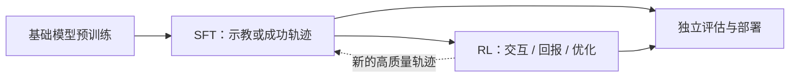
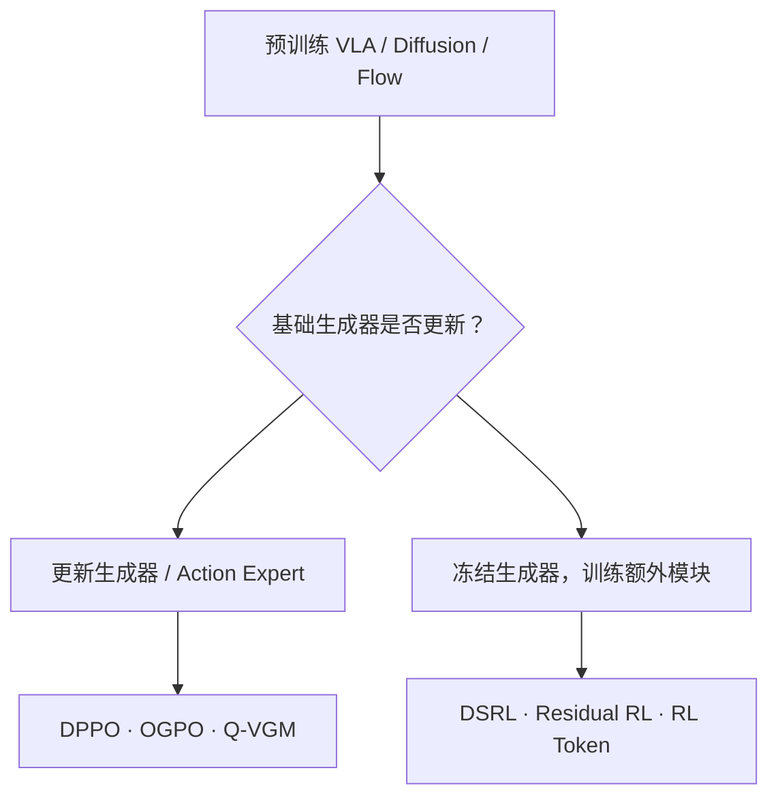
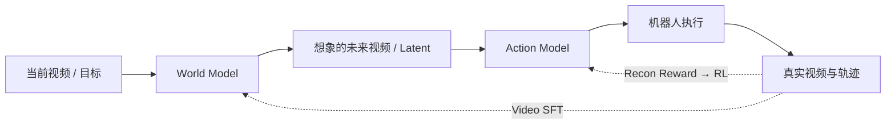
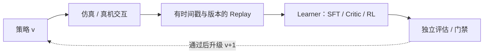

# 具身基础模型的后训练：SFT 与强化学习

**Post-Training for Embodied Foundation Models: SFT and Reinforcement Learning**  
**VLA 与 World Action Model（WAM）的训练目标、算法接口和部署边界 · 2026 年 10 月**

[课程仓库](https://github.com/zengxiong111/Foundation_of_Embodied_AI) · [WAM-RL 原论文](https://arxiv.org/abs/2606.17906) · [RLinf 文档](https://rlinf.readthedocs.io/en/latest/) · [English](Embodied_Post_Training_EN.md) · [PDF](https://zengxiong111.github.io/zengxiong.github.io/files/Embodied_Post_Training_ZH.pdf)

> **课程定位**：讨论如何在**已有预训练模型**上进行监督微调（SFT）和强化学习后训练（RL post-training）；分别讨论视觉–语言–动作模型（VLA）与世界动作模型（WAM）。VLA 的 RL 部分沿用原课程的 DPPO、OGPO、Q-VGM、DSRL、Residual RL、RL Token、RLinf 等内容，并补齐 SFT；WAM 部分以 Qian et al. 的 WAM-RL 为主线。只引入必要的数学公式，不涉及从零训练低层控制器或实验代码。
>
> **证据边界**：论文中的成功率属于指定模型、任务和评估设置；不能由一篇论文推断“WAM 普遍优于 VLA”，也不能把框架分别支持的组件视为可无修改组合。以下对尚未在原论文验证的扩展明确标为研究方向。本文不声称独立复现或真机验证。
>
> **署名**：改编自 Xiong Zeng and contributors 的 [Foundation of Embodied AI](https://github.com/zengxiong111/Foundation_of_Embodied_AI) 教学材料（[CC BY 4.0](https://creativecommons.org/licenses/by/4.0/)）；WAM-RL 的具体方法和数据引自 [Qian et al., 2026](https://arxiv.org/abs/2606.17906)。

## 目录

- [1. 后训练究竟训练什么？](#post-section-01)
- [2. SFT 与 RL：目标函数及相互关系](#post-section-02)
- [3. VLA 的 SFT 后训练](#post-section-03)
- [4. VLA 的 RL 后训练：保留原课程的六类路线](#post-section-04)
- [5. WAM 的结构和 SFT 后训练](#post-section-05)
- [6. WAM 的 RL 后训练：以 WAM-RL 为核心案例](#post-section-06)
- [7. VLA 与 WAM 后训练：系统比较](#post-section-07)
- [8. 两种模型共用的 Online RL 与 Actor–Critic 闭环](#post-section-08)
- [9. RLinf：保留原有 VLA 基础设施讨论，补充 WAM 边界](#post-section-09)
- [10. 真机部署与研究难题](#post-section-10)
- [11. 总结：一张选择路线图](#post-section-11)
- [12. 原始论文与扩展阅读](#post-section-12)

## 1. 后训练究竟训练什么？

**预训练（pretraining）**赋予模型跨任务的视觉、语言和动作先验；**后训练（post-training）**是在已有模型 $\theta_0$ 上，针对目标任务、机器人、数据分布或反馈信号进行进一步适配。SFT 和 RL 是按**优化信号**划分；VLA 和 WAM 是按**策略结构**划分，两个维度正交。

| 模型架构 | SFT：用带目标的监督数据 | RL：利用交互与回报优化 |
|:---|:---|:---|
| **VLA** | 微调视觉语言骨干、Action Expert 或适配器，拟合专家动作 | 直接优化生成器，或冻结生成器训练噪声、特征、残差 Actor |
| **WAM** | 学习未来视频/世界状态预测与视频到动作的映射；可使用在线成功轨迹 | 优化动作模型的实际执行一致性；在 WAM-RL 中同时以在线 Video SFT 适配世界模型 |

*图 1：SFT 与 RL 可以交替执行，也可以联合安排；“先 SFT、后 RL”是常见路线，不是全部方法的硬性顺序。*

统一记号：$o_t$ 为当前观测，$g_t$ 为语言指令或任务目标，$A_t=(a_t,\ldots,a_{t+H-1})$ 为长度 $H$ 的候选动作块。实际执行的控制步数记为 $K$；通常 **$K\neq H$**。后训练需要分别回答：**监督目标是什么、可更新哪些权重、RL 奖励从哪里来、哪些数据能够重用、怎样保持预训练能力与安全性**。

## 2. SFT 与 RL：目标函数及相互关系

### 2.1 监督微调：最大化示教或成功轨迹的可解释性

对于显式动作分布 $\pi_\theta$，VLA 的行为克隆可写作

$$
\mathcal L_{\mathrm{SFT}}^{\mathrm{VLA}}(\theta)
=-\mathbb E_{(o,g,A)\sim\mathcal D_{\mathrm{sup}}}
\log\pi_\theta(A\mid o,g).
$$

如果动作头是 Flow Matching 或 Diffusion，通常不直接最小化上式，而使用**速度场匹配**或**去噪损失**。例如在 $x_\tau=(1-\tau)x_0+\tau x_1$ 上，条件 Flow Matching 可以写成

$$
\mathcal L_{\mathrm{FM}}=\mathbb E_{x_0,x_1,\tau,c}
\big[\|v_\theta(x_\tau,\tau,c)-(x_1-x_0)\|_2^2\big],
$$

其中 $c=(o,g)$，$x_1$ 表示真实动作块或未来视频样本。这个公式给出了一个常用的线性插值训练目标；并非所有 Flow 模型都采用完全相同的路径。SFT 既可用于预训练后的任务专门化，也可在 RL 过程中利用**新产生的高质量轨迹**进行在线微调。

### 2.2 强化学习：用奖励决定“哪个动作更好”

RL 典型目标为

$$
J(\pi)=\mathbb E_{\tau\sim\pi}\!\left[\sum_{t=0}^{T}\gamma^t r_t\right].
$$

SFT 拟合“数据中的动作或未来”；RL 提升“环境中得到的长期回报”。RL 可以超出示教分布，但依赖探索、奖励、价值估计和实际交互。实践中往往要在 RL 目标中加入模仿约束、参考策略约束或定期 SFT，以防遗忘和不稳定。

**关键区别**：Online/Offline 说明是否在训练期间新增环境数据；On-policy/Off-policy 说明学习器是否复用旧策略数据。因此 **Online 不等于 On-policy**。RL 中嵌入 Online Video SFT 也不意味着“世界模型正在做策略梯度优化”。

## 3. VLA 的 SFT 后训练

### 3.1 模型和可训练层

VLA 的典型路径为 $\text{image} + \text{language} + \text{robot state}\rightarrow \text{visual-language features}\rightarrow \text{action chunk}$。采用离散动作 token 时，SFT 通常是 token 交叉熵；采用连续的 Diffusion / Flow Action Expert 时，SFT 通常是去噪或 Flow Matching。两种输出形式不能混用同一个 log-prob 实现。

| 可训练范围 | 作用 | 主要代价或风险 |
|:---|:---|:---|
| **全参数微调** | 适配模型所有可学习层 | 显存与优化成本高；原有能力易漂移 |
| **LoRA / Adapter** | 只更新低秩或附加参数 | 目标能力受适配容量与插入位置影响 |
| **只训练 Action Expert** | 保留视觉语言表征，专门调动作 | 视觉或语言表示不匹配时难以根治 |
| **冻结骨干 + 新动作头** | 面向新机器人动作空间或控制频率 | 需要认真核对动作单位、坐标系与时间语义 |

### 3.2 怎样组织 SFT 数据

示教样本除了 $(o_t,g_t,A_t)$，还应包含机器人构型、动作表达（关节/末端）、归一化统计、采集频率、相机标定与时间戳。多任务 SFT 要合理平衡机器人、任务和成功/恢复轨迹；对真正需要闭环恢复的任务，**只看理想成功演示往往不够**。

SFT 的常见训练路径是：**原始多模态数据 → 坐标与时间对齐 → 动作块监督 → 选定可训练层 → 独立闭环评估**。要将它与后续的 RL 相接，必须使 observation、action、reward、done、版本号等语义一致。SFT 的损失降低并不能替代真实成功率或接触安全的评估。

## 4. VLA 的 RL 后训练：保留原课程的六类路线

VLA 的关键困难是：Diffusion / Flow 的**动作块概率密度及其 KL 未必易于精确计算**，所以直接套用 Gaussian PPO / SAC 可能不成立。对预训练生成器，最清晰的组织方式是按**更新哪一部分**分类。

*图 2：方法是并列的更新接口，不是先后依次执行的六个训练步骤。LoRA 和混合方案可能同时跨越多个接口。*

### 4.1 直接更新生成器 / Action Expert

**DPPO：逐步去噪的策略梯度。** [DPPO](https://arxiv.org/abs/2409.00588) 将 Diffusion Policy 的去噪链转化为可优化的策略过程。PPO 的裁剪目标提供直观背景：

$$
L_{\mathrm{clip}}=\mathbb E\!\left[\min\!\left(
\rho\hat A,\operatorname{clip}(\rho,1-\epsilon,1+\epsilon)\hat A\right)\right].
$$

上式**不是 DPPO 的完整损失**；真实成本来自 On-policy Rollout、去噪采样与梯度计算，且更新过大时可能损害原技能。

**OGPO：借助 Off-policy Replay 优化生成过程。** [OGPO](https://arxiv.org/abs/2605.03065) 复用历史与新交互数据训练 Critic，再将价值信号传给生成器：**Replay → Critic / Advantage → Generator**。即便目标含有 PPO 风格项，也不能据此把 OGPO 归为 On-policy PPO；需要控制行为策略漂移、价值偏差与反向传播开销。

**Q-VGM：价值引导的 Flow Matching。** [Q-VGM](https://arxiv.org/abs/2606.08015) 用 Q 梯度构造局部速度场更新目标，作用于 Flow Action Expert，而不是通过完整 Flow 采样轨迹传播策略梯度。其价值学习结合离线 IQL 和在线 TD。**Q-VGM 更新生成器**，不能被归到冻结策略类。

### 4.2 冻结生成器，训练轻量模块

**DSRL：学习采样噪声 / 潜变量 Actor。** [DSRL](https://arxiv.org/abs/2506.15799) 通过

$$
z\sim q_\phi(z\mid o,g),\qquad
A=G_{\theta_0}(o,g,z),\quad \theta_0\ \mathrm{fixed}
$$

优化一个比生成器小得多的 Actor。优点是减少可训练权重、保留预训练主体；限制是改善范围受**冻结生成器可到达的动作分布**约束。特定 Diffusion Policy 的噪声接口不能不经验证推广到任意 Flow/VLA。

**Residual RL：执行前对动作做受限修正。** 冻结生成器产生 $A_0$，残差 Actor 给出 $\Delta A_\phi$：

$$
A_{\mathrm{cmd}}=\operatorname{Safe}(A_0+\lambda\Delta A_\phi).
$$

Residual RL 是一种**策略组合架构**，并非指定唯一 PPO 或 SAC 优化器。部署时需要处理新旧动作块拼接、尺度、坐标系、接触稳定性与独立的限幅安全层。

**RL Token：在可读出的 VLA 特征上训练 Actor–Critic。** [RL Token](https://arxiv.org/abs/2604.23073) 建立紧凑特征接口后，在冻结主体特征网络的条件下进行轻量 Online Off-policy RL。建立特征接口可能需要前置的示教适配；RL Token 不等同于动作残差。

### 4.3 VLA 方法对照

| 方法 | RL 更新对象 | 数据机制 | 主要条件与风险 |
|:---|:---|:---|:---|
| **DPPO** | Diffusion 生成器 | 主要 On-policy | Rollout 和去噪成本高 |
| **OGPO** | 生成式策略 | Online Off-policy | Replay 分布偏差与 Critic 精度 |
| **Q-VGM** | Flow Expert 速度网络 | Offline-to-Online | 局部价值梯度可靠性 |
| **DSRL** | 噪声/潜变量 Actor | 可 Off-policy | 生成器冻结、动作支持集受限 |
| **Residual RL** | 动作修正 Actor | 依所选优化器而定 | Chunk/控制安全与邻域限制 |
| **RL Token** | 特征 Actor–Critic | Online Off-policy | 特征语义一致性与前置适配 |

**选型顺序**：先检查原模型能否提供可训练的采样/动作接口，再检查数据能否复用、Critic 是否可信，最后比较计算与真实采样成本。不要将“全参/LoRA”“On/Off-policy”“Velocity Matching/Policy Gradient”三个独立维度混成一棵分类树。

## 5. WAM 的结构和 SFT 后训练

### 5.1 WAM 为什么不是“另一种 VLA Action Head”？

以 WAM-RL 所研究的 **World-Action（WA）结构**为例，模型包含两个相互依赖的部分：

$$
\underbrace{\hat X_{t+1:t+H},\ z_t=f_\theta(X_{\le t},g)}_{\text{World Model：预测未来与潜在表征}}
\quad\longrightarrow\quad
\underbrace{A_t=\pi_\phi(z_t,o_t,g)}_{\text{Action Model：转换为可执行动作}}.
$$

这里 $X$ 表示图像/视频观测序列。**并非所有叫作 WAM 的模型都严格采用相同的两模块接口**；上式是理解 WAM-RL 的工作假设。与只以动作输出为主要训练目标的 VLA 相比，WA 结构把“预测接下来会看到什么”和“怎样让它发生”显式耦合。

*图 3：WAM-RL 的两条不同更新路径：世界模型用成功视频做 SFT，动作模型用重建一致性奖励做 RL。*

### 5.2 预训练后的 WAM SFT 有两个监督接口

第一种是**视频/世界模型监督**：给定过去的视觉观测，拟合未来视频或隐变量。第二种是**动作映射监督**：以真实机器人动作监督从 World Model latent 到 Action Model 的映射。在不同 WAM 架构中，视频与动作还可能采用联合生成损失。由此不能认为“WAM 的 SFT 只训视频，不训动作”。

针对 WAM-RL，本文重点解释它**后训练阶段**的 World Model 更新，即从新近在线成功轨迹中继续学习视频预测；作者在该阶段对 World Model 执行 SFT，对 Actor 执行 RL。其基本视频损失为

$$
\mathcal L_{\mathrm{video}}=
\mathbb E_{X_{1:T}\sim\mathcal D_{\mathrm{success}}}
\big[\ell(f_\theta(X_{<t}),X_t)\big],
$$

其中 $\ell$ 可以是 Flow Matching 或重建损失，$\mathcal D_{\mathrm{success}}$ 是在线采集并筛选成功的视觉轨迹。成功轨迹内部仍可能包含**失败后调整并最终成功**的片段，因此能够提供恢复动作对应的视频动态；但仅凭成功数据不代表覆盖全部失败模式。

### 5.3 为什么需要潜空间 KL 正则化？

WAM 中 Actor 使用 World Model 的 latent。假如只用新视频更新 $f_\theta$，潜变量分布可能变化，旧 Actor 将看到不熟悉的表示。WAM-RL 为确定性中间特征构造**对角高斯近似**：

$$
q_\theta(z_t)=\mathcal N\big(z_t,\Sigma_\theta\big),\qquad
q_0(z_t)=\mathcal N\big(z_t^0,\Sigma_0\big),
$$

其中 $z_t=f_\theta(X_{<t})$，$z_t^0=f_{\theta_0}(X_{<t})$；$\theta_0$ 是冻结的参考世界模型。当前协方差按特征统计的 EMA 更新，参考协方差固定。这里的**高斯是为计算 KL 构造的近似，并不意味着确定性 latent 原本具有已知的真实概率分布**。

$$
\mathcal L_{\mathrm{WM}}
=\mathcal L_{\mathrm{video}}
+\lambda_{\mathrm{KL}}\,
\mathbb E_t\!\left[D_{\mathrm{KL}}\big(q_\theta(z_t)\|q_0(z_t)\big)\right].
$$

对角高斯可以解析计算 KL，约束世界模型逐步改善，而不使动作模型的输入表示突然漂移。**代价**是强约束可能限制世界模型摆脱原分布的能力；论文也将稳定性与适应性的张力列为局限。

## 6. WAM 的 RL 后训练：以 WAM-RL 为核心案例

### 6.1 奖励针对“想象是否被执行出来”

在 WAM-RL 中，World Model 预测未来视频 $\hat X_{t+1:t+H}$，Actor 给出动作并在环境中执行，得到真实 $X_{t+1:t+H}$。用于 Actor 的密集重建奖励是

$$
r_t^{\mathrm{recon}}
=\operatorname{sim}\!\big(\hat X_{t+1:t+H},X_{t+1:t+H}\big).
$$

例如可用负的像素均方误差来实现 $\operatorname{sim}$。论文也对比 Optical Flow、DINOv2 和 V-JEPA2 特征的一致性。**这不是直接的任务成功奖励**：重建一致性衡量实际执行与想象未来的匹配，而非自动证明机器人已经完成用户任务。World Model 的任务相关性尤其重要；如果它预测了错误目标，忠实执行错误预测也可能获得高相似度。

### 6.2 怎样把 Flow Action Model 接到策略梯度？

论文借助 Flow-SDE，将用于生成的确定性 Flow ODE 加入随机扰动，以得到具有可计算转移密度的采样过程：

$$
dx_\tau=v_\phi(x_\tau,\tau)\,d\tau+\sigma\,dW_\tau,
$$

$$
p_\phi(x_{i-1}\mid x_i)
=\mathcal N\big(x_{i-1};\mu_\phi(x_i,i),\sigma^2I\big).
$$

因而可以对**采样路径**的条件 log-prob 求和，并使用优势加权的策略梯度：

$$
\nabla_\phi J\approx
\mathbb E\big[\nabla_\phi\log p_\phi(\text{sampling path}\mid s_t)\,\hat A_t\big].
$$

此处刻意写作**路径似然**：多步采样路径的联合密度并不自动等于最终动作边缘分布的精确 log-prob；实际实现需沿论文指定的随机采样过程正确构建优化量。这也说明不能对任意确定性 Flow Head 直接照搬普通 PPO。

### 6.3 两部分怎样共同进步？

WAM-RL 的协调思路可以整理为四个环节：

1. **预测**：当前 World Model 生成任务相关的想象未来，Actor 生成可执行动作。
2. **交互**：在环境中执行并收集真实视频、动作、成功与否等反馈。
3. **Actor RL**：用想象–实际的一致性定义密集奖励，更新动作模型的控制能力。
4. **World Model Online Video SFT**：筛选成功轨迹，对世界模型做视频监督更新；参考特征 KL 用于保持 Actor–World Model 兼容性。

这两种更新信号**不相同**：Actor 接收 RL 回报，World Model 接收监督视频损失与 KL。用“联合后训练（co-adaptation）”比“整个 WAM 都采用 RL 策略梯度”更准确。

### 6.4 论文证据、对照和局限

[WAM-RL](https://arxiv.org/abs/2606.17906) 报告如下指定评测上的成功率：

| 对比方法 | LIBERO-Object | RLBench Water Plants |
|:---|---:|---:|
| 预训练 WA Base | 68% | 19% |
| 只进行 Actor RL（$\pi_{\mathrm{RL}}$） | 78% | 18% |
| **WAM-RL：Actor RL + World Model Online Video SFT** | **82%** | **22%** |

从表中能支持的结论是：在论文所报告的任务和设置中，**只优化 Actor 在较长时程任务上收益有限，联合改进世界预测和动作映射更有帮助**。论文没有给出足以确立跨所有 WAM、VLA 或机器人平台普适排名的证据。其实现以 Genie Envisioner-ACT 为基础，报告的训练配置是 **8 张 NVIDIA A800、约 8 小时**；这只是论文配方，不能当作“训练任何 WAM 的最低需求”。

在论文的**重建奖励消融（另一个比较设置）**中，RLBench Water Plants 的 Pixel MSE、Optical Flow MSE、DINO MSE、V-JEPA2 分别报告 **21%、19%、16%、17%**，而相同消融表中的 Base 为 19%、Actor-only 为 18%。这些数值应保留在消融上下文中，**不可擅自将 Pixel MSE 的 21% 与主表 WAM-RL 的 22% 当作同一行的对照**。

论文给出的局限包括：世界模型的 KL 约束限制快速适应；手工构造或预训练视觉特征的重建奖励不一定充分区分成功和失败；高维视频更新可能影响吞吐与协同稳定性。独立的真实任务奖励、鲁棒的失败恢复和跨机器人持续学习仍然是开放问题。

## 7. VLA 与 WAM 后训练：系统比较

| 维度 | VLA 后训练 | WAM 后训练（以 WAM-RL 为例） |
|:---|:---|:---|
| **主要结构** | 视觉语言特征 → Action Expert / Action Chunk | World Model 预测未来 → latent → Action Model |
| **SFT 对象** | 专家动作；离散交叉熵或连续生成损失 | 视频未来预测；可包含动作监督；WAM-RL 在线阶段重点更新 World Model |
| **RL 更新对象** | 生成器、LoRA、噪声 Actor、残差或特征 Actor | Actor 的执行映射；World Model 以 Video SFT 协同适配 |
| **RL 信号** | 成功、接触、进度、奖励模型或 Critic 等 | 论文采用想象–真实视频重建一致性奖励 |
| **训练稳定性** | 生成式动作 log-prob、Critic 偏差、旧技能保持 | 除 Actor 学习外，还需控制世界模型 latent 漂移 |
| **推理计算** | 取决于 VLM/Action Expert 大小与采样步数 | 通常额外涉及未来生成与动作映射，成本取决于实现与视频长度 |
| **学习成本** | 大模型反传、环境采样与 Replay 维护 | 还需训练/使用视频预测模块，可能产生额外显存和时延 |
| **优势假设** | 直接动作生成，部署链路较短 | 显式未来预测有助于建模长时程变化、偏差与恢复 |
| **关键风险** | 分布外操作和接触精度、长时程漂移 | 预测偏差、奖励错位、latent 不兼容和视频生成延迟 |

**关于算力的准确表述**：不能笼统说 WAM 一定比 VLA 更省算力或一定更贵。必须报告模型参数规模、视频/动作生成步数、分辨率、预测 horizon、GPU、批大小、真实交互小时数及成功率提升；上述 WAM-RL 的 8×A800 数字不构成跨模型的公平对比。**关于性能的准确表述**：单项 benchmark 上成功率较高，不代表零后训练的 WAM 在所有任务上都优于需要后训练的 VLA。

## 8. 两种模型共用的 Online RL 与 Actor–Critic 闭环

典型 Off-policy 系统存储 $\mathcal D=\{(o_t,A_t,r_t,o_{t+K},d_{t+K},K)\}$。对动作块执行后的一个**教学版** Bellman 目标：

$$
y_t^{(K)}=\sum_{j=0}^{K-1}\gamma^j r_{t+j}
+\gamma^K(1-d_{t+K})\,\mathbb E_{A'\sim\pi}
\big[Q_{\bar\psi}(o_{t+K},A')\big].
$$

其中 $H$ 是生成的候选 Chunk 长度，$K$ 是真正在机器人上执行的步数。Replay、奖励折扣、时间戳、动作覆盖与 Critic 目标都应对应实际的 $K$。这个式子是**含折扣和终止标志的简化教学抽象**，不等于 SAC、OGPO 或 WAM-RL 的完整损失。

*图 4：数据质量和部署门禁是后训练闭环的组成部分，而不是算法目标自带的保证。*

## 9. RLinf：保留原有 VLA 基础设施讨论，补充 WAM 边界

[RLinf](https://github.com/RLinf/RLinf) 可组织模型、环境采样、Actor–Learner、SFT/RL 训练、评测以及部分真机接入流程。它是理解**基础设施和算法分别负责什么**的代表，而不是所有“模型 × 算法 × 机器人”组合的即插即用证明。

### 9.1 目前能从公开材料确认的 VLA 侧接口

| 公开案例/能力 | 该案例能说明什么 | 不能直接推出什么 |
|:---|:---|:---|
| [$\pi_0/\pi_{0.5}$ + PPO/GRPO](https://rlinf.readthedocs.io/en/latest/rst_source/examples/embodied/pi0.html) | 指定 VLA 的 On-policy RL 配方 | 任意 Flow Model 已有通用 Off-policy 接口 |
| [DSRL + 冻结 $\pi_0$](https://rlinf.readthedocs.io/en/latest/rst_source/examples/embodied/dsrl.html) | 冻结基础策略、训练噪声 Actor 的案例 | 新模型噪声接口无需改动 |
| [SAC-Flow](https://rlinf.readthedocs.io/en/latest/rst_source/examples/embodied/sac_flow.html) | 专用 Flow Actor 的 SAC 更新 | 冻结 $\pi_{0.5}$ 使用 SAC 已验证 |
| [RLT / RL Token](https://rlinf.readthedocs.io/en/latest/rst_source/examples/embodied/rlt.html) | 表示适配与轻量 Actor–Critic | 它是无须预处理的残差方法 |
| [RLinf-USER 与真机指南](https://rlinf.readthedocs.io/en/latest/rst_source/guides/realworld_robot.html) | 异步、多机器人、真机数据工作流的部分案例 | 新机械臂已完成驱动和安全验证 |
| [RTC](https://rlinf.readthedocs.io/en/latest/rst_source/guides/rtc.html) | 推理和动作执行重叠可降低等待 | 自动提供硬实时控制或安全保证 |
| [Adding a Robot](https://rlinf.readthedocs.io/en/latest/rst_source/extending/new_robot.html) | 机器人适配接口和开发路径 | 任意厂商 SDK、坐标系与手部控制即插即用 |

RLinf 已包含 SFT 与多类 RL 工作流，不能声称“它只支持 RL”或“不支持 Off-policy/真机”。然而，要接入一个新 WAM，仍需核验**World Model 视频训练、latent 提取、参考模型 KL、基于预测–执行一致性的奖励、Actor 梯度路径、时间对齐和资源调度**；原有 VLA 配方不等于 WAM-RL 已经在 RLinf 上完成端到端集成。

### 9.2 从“VLA RL”扩展到“WAM SFT + RL”新增的系统接口

| 组件 | VLA 中常见需求 | WAM-RL 增量需求 |
|:---|:---|:---|
| **数据通道** | 观测、动作、奖励、终止标志 | 同步的未来视频、想象视频、成功轨迹标记 |
| **优化器** | Action Expert、Actor、Critic 更新 | 独立的 World Model Video SFT + Actor RL 调度 |
| **特征契约** | 动作头与视觉表征兼容 | World Model 更新前后 latent 分布受控，参考网络与 KL |
| **奖励** | 任务成功/进度/接触等 | 视频帧或表征的一致性与严格时间同步 |
| **推理服务** | VLA/Action Expert、Chunk、RTC | 视频预测缓存、Actor 翻译、额外延迟与显存预算 |
| **评估** | 成功率、失败恢复、技能保持 | 同时检查预测质量、执行一致性和真实任务结果 |

这里的“增量需求”是**依据 WAM-RL 方法推导的系统集成清单**，不是对 RLinf 当前仓库缺失功能逐项做出的代码审计结论。

### 9.3 原课程中的 RLinf 训练侧缺口仍须保留

| 缺口 | 根本原因 | 接入新模型应检查什么 |
|:---|:---|:---|
| **模型 × 算法兼容性** | $\pi_{0.5}$ + PPO/GRPO、$\pi_0$ + DSRL、专用 Flow + SAC 是不同配方 | 可计算的路径概率、梯度路径、冻结范围与采样噪声 |
| **通用 Online Off-policy Flow/VLA** | Replay 数据复用要求 Critic 与生成器更新目标兼容 | 实际更新哪些参数、策略版本及 Replay 组成 |
| **接触任务 Critic 可信度** | 视觉遮挡、稀疏奖励及离策略偏差会放大 Q 误差 | Q 校准、失败样本、任务成功判断和风险约束 |
| **Action Chunk 的 RL 语义** | 生成长度 $H$ 与实际执行步数 $K$ 不一定相同 | $K$ 步奖励、$\gamma^K$、终止标志、时间戳和动作覆盖 |
| **计算与数据吞吐** | VLA 推理、仿真吞吐、分布式 Learner 和真机复位共同限制训练效率 | GPU-hours、Robot-hours、网络背压、Checkpoint 与复现 |
| **多任务技能保持** | 局部 Online RL 可能破坏已有能力 | 留出任务评测、SFT/Replay 比例、旧模型回退 |

这些既包括**已验证配方覆盖不足**，也包括**方法和系统可靠性的研究问题**；不能全部简化为“RLinf 尚未实现”。对 WAM 而言，前述挑战仍存在，另需解决世界模型与动作模型的双 Learner 调度、潜表示漂移和重建奖励可信度。

## 10. 真机部署与研究难题

训练奖励不能替代执行时的安全约束；仿真和真实机器人交互必须区分；模型生成频率与底层伺服频率也必须分离。

| 风险层 | 需要独立验证的指标或机制 |
|:---|:---|
| **实时控制** | 策略平均/P95/P99 延迟、网络抖动、Chunk 拼接不连续、底层频率 |
| **安全执行** | 关节限位、碰撞/电流阈值、Watchdog、急停、失联回退与人工接管 |
| **奖励可靠性** | 独立任务成功判定、视频重建奖励和真实任务成功的相关性、误报率 |
| **持续训练** | Replay 的来源与版本、旧技能回归、GPU/Robot-hours、人工复位成本 |
| **新硬件适配** | 厂商 SDK、CAN/RS485、ROS、关节/末端动作单位与故障复位接口 |
| **多模态感知** | 相机内外参、时间同步、遮挡时奖励置信度与 OOD 告警 |
| **灰度发布** | 异步候选权重的独立评测、策略版本、可回滚发布机制 |
| **WAM 特有问题** | 视频预测 horizon 与实际执行时延、latent drift、重建奖励被错误预测利用 |

需要避免五个错误等式：**Online = On-policy**、**冻结基础生成器 = 不需要训练**、**Velocity Matching = 全参微调**、**PPO/GRPO 案例 = Online Off-policy 案例**、**仿真成功 = 真机安全**。上述等式均不成立。

值得区分的开放问题包括：**低成本真机 Online Off-policy VLA**、**冻结大生成器时突破其动作支持集**、**接触任务可信 Critic**、**WAM World Model 与 Actor 的稳定共同适应**、**不牺牲实时性的长时程视频预测**、以及**跨机器人长期持续学习**。这些仍是研究问题，不应描述为某一框架“修改几个配置即可实现”。

## 11. 总结：一张选择路线图

| 已有模型与目标 | 优先考虑的后训练路径 | 特别核验 |
|:---|:---|:---|
| VLA 缺少目标任务的示教能力 | **VLA SFT**，优先对齐数据与动作语义 | Action Expert 训练目标、旧任务保持 |
| VLA 有基础技能但成功率不够 | **VLA RL**：依据更新接口选 DPPO / OGPO / Q-VGM / DSRL / Residual / RL Token | Rollout 成本、Critic、可执行 Chunk |
| WAM 预测未来不准 | **World Model SFT**；在线成功视频可提供恢复动态 | 视频预测误差、latent 与 Actor 兼容性 |
| WAM 预测合理但动作执行不可靠 | **Actor RL**，如 WAM-RL 的 reconstruction reward | 想象与执行严格对齐；奖励错位 |
| WAM 长时程错误积累或恢复不足 | **World Model SFT + Actor RL** 的协调后训练 | KL 稳定性、两模型同步更新与真实成功率 |

**核心判断**：SFT 解决“如何从高质量轨迹学习”，RL 解决“如何用反馈超越示教”；VLA 主要面向**动作生成器及其接口**，而 WAM-RL 面向**未来预测和动作落地的双组件协同**。是否需要 RL、哪部分可以冻结、以及训练成本如何，均取决于目标任务与模型架构，不能凭 VLA/WAM 名称一概而论。

## 12. 原始论文与扩展阅读

| 主题 | 原始资料 |
|:---|:---|
| **VLA/基础** | [PPO](https://arxiv.org/abs/1707.06347) · [SAC](https://arxiv.org/abs/1801.01290) · [Diffusion Policy](https://diffusion-policy.cs.columbia.edu/) |
| **更新生成器** | [DPPO](https://arxiv.org/abs/2409.00588) · [OGPO](https://arxiv.org/abs/2605.03065) · [Q-VGM](https://arxiv.org/abs/2606.08015) |
| **冻结/辅助接口** | [DSRL](https://arxiv.org/abs/2506.15799) · [RL Token](https://arxiv.org/abs/2604.23073) |
| **WAM 及其后训练** | [DreamZero](https://dreamzero0.github.io/) · [WAM-RL (arXiv:2606.17906)](https://arxiv.org/abs/2606.17906) |
| **训练与部署系统** | [RLinf](https://github.com/RLinf/RLinf) · [RLinf-USER](https://arxiv.org/abs/2602.07837) · [RTC](https://rlinf.readthedocs.io/en/latest/rst_source/guides/rtc.html) |

*资料截至 2026 年 10 月 20 日；公式与表格以教学结构呈现，论文数值均明确标注出处。*
