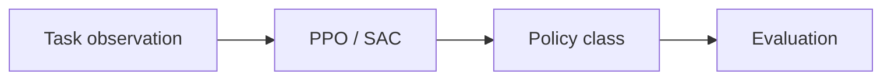

# Reinforcement Learning for Embodied AI: Algorithms, Tasks, and Use Cases

<!-- course-meta:start -->
[Course home](https://github.com/zengxiong111/Foundation_of_Embodied_AI) · [简体中文](https://github.com/zengxiong111/Foundation_of_Embodied_AI/blob/main/md/Embodied_RL_Tutorial_Full_ZH.md) · [PDF](https://zengxiong111.github.io/zengxiong.github.io/files/Embodied_RL_Tutorial_Full_EN.pdf)

| Item | Details |
|---|---|
| Applicability | Algorithm and task taxonomy; no single framework environment is prescribed |
| Documentation review date | 2026-10-18 |
| License | CC BY 4.0 · Xiong Zeng and contributors |

**Verification scope:** Documentation organization and upstream reference snapshot; no tutorial runtime, training or hardware validation. See [version notes](https://github.com/zengxiong111/Foundation_of_Embodied_AI/blob/main/VERSIONS.md) for pinned source references. Original teaching content uses [CC BY 4.0](https://creativecommons.org/licenses/by/4.0/); third-party quotations, figures and code retain their original licenses. Citation alone does not grant relicensing rights.
<!-- course-meta:end -->

<!-- course-toc:start -->
## Contents

- [1. Overall Classification of Embodied Reinforcement Learning](#course-section-01)
  - [1.1 Classification Framework](#course-section-02)
  - [1.2 Core Classification Table](#course-section-03)
- [2. Classification by Algorithm: PPO and SAC](#course-section-04)
  - [2.1 On-policy RL: PPO](#course-section-05)
  - [2.2 Off-policy RL: SAC](#course-section-06)
  - [2.3 Comparing PPO and SAC](#course-section-07)
- [3. Classification by Task: Robot Motion-Control Reinforcement Learning](#course-section-08)
  - [3.1 Locomotion RL: Robot Motion Control](#course-section-09)
  - [3.2 Manipulation RL: Robot Manipulation Reinforcement Learning](#course-section-10)
- [4. Classification by Task: Embodied Foundation-Model RL Post-Training](#course-section-11)
  - [4.1 What Is Foundation-Model RL Post-Training?](#course-section-12)
  - [4.2 What Problems Does RL Post-Training Solve?](#course-section-13)
  - [4.3 Five Types of Foundation-Model RL Post-Training](#course-section-14)
  - [4.4 Summary of the Five Types](#course-section-15)
- [5. How PPO and SAC Are Used Across the Two Task Categories](#course-section-16)
  - [5.1 PPO + Locomotion](#course-section-17)
  - [5.2 SAC + Manipulation](#course-section-18)
  - [5.3 PPO-Style Methods + VLA](#course-section-19)
  - [5.4 SAC / Off-policy Critic-Style Methods + VLA](#course-section-20)
- [6. How to Choose an RL Method for Your Task](#course-section-21)
- [7. Typical Experimental Paths for the Two Research Directions](#course-section-22)
  - [7.1 Robot Motion-Control RL](#course-section-23)
  - [7.2 Embodied Foundation-Model RL Post-Training](#course-section-24)
- [8. Final Summary](#course-section-25)
<!-- course-toc:end -->

**Chapter concept map**




<a id="course-section-01"></a>

## 1. Overall Classification of Embodied Reinforcement Learning

<a id="course-section-02"></a>

### 1.1 Classification Framework

```text
                 Embodied Reinforcement Learning
                                |
                  +------------+------------+
                  |                         |
              By algorithm                By task
                  |                         |
          +-------+-------+       +---------+-------------+
          |               |       |                       |
       On-policy      Off-policy Robot control         Foundation-model
          |               |       |                    RL post-training
          |               |       |                       |
         PPO             SAC   +---+----------+       +------+------+
                               |              |       |             |
                          Locomotion    Manipulation Diffusion     Flow/VLA
                               |              |       |             |
                          Walking       Dexterous    DPPO/DSRL   OGPO/Q-VGM
                          control       manipulation
```

Robot manipulation can employ either conventional low-level control policies or Diffusion Policies and VLAs.

Therefore, **the same manipulation task can fall under conventional robot-control RL or foundation-model RL post-training; what matters is the policy model and training objective.**

<a id="course-section-03"></a>

### 1.2 Core Classification Table

| Classification dimension | Category | Representative algorithm or method | Main use |
|---|---|---|---|
| Algorithm | On-policy | PPO | Large-scale simulation training and motion control |
| Algorithm | Off-policy | SAC | Continuous control, data-efficient learning, and online improvement |
| Task | Locomotion RL | PPO, SAC | Bipedal, quadrupedal, and humanoid movement |
| Task | Manipulation RL | PPO, SAC | Grasping, in-hand manipulation, and dexterous control |
| Task | Foundation Model RL | DPPO, DSRL, OGPO, etc. | Improve pretrained Diffusion / Flow / VLA policies |

Note that DPPO, DSRL, and OGPO were developed for generative policies and cannot all be classified directly as standard PPO or SAC.

---

<a id="course-section-04"></a>

## 2. Classification by Algorithm: PPO and SAC

<a id="course-section-05"></a>

### 2.1 On-policy RL: PPO

**PPO (Proximal Policy Optimization)** is a widely used reinforcement-learning algorithm for robot locomotion and motion control.

Its main characteristics are:

- It is trained using interaction data collected by the current policy.
- After each sampling round, it updates the policy a limited number of times.
- Training is generally relatively stable.
- It integrates readily with large-scale, GPU-parallel simulation.
- It is not well suited to repeatedly using large amounts of old data over long periods.

#### Which tasks mainly use PPO?

| Application | Specific tasks |
|---|---|
| Quadruped robots | Walking, running, jumping, traversing complex terrain |
| Humanoid robots | Bipedal walking, balancing, and disturbance recovery |
| Whole-Body Control | Coordinated whole-body control and motion tracking |
| Dexterous manipulation | Dexterous-hand object rotation, grasping, and contact-rich operation |
| Sim-to-Real | Train a control policy in simulation and deploy it on physical hardware |
| Generative-policy post-training | Policy-gradient approaches such as DPPO for Diffusion Policies |

#### Why is PPO popular in robot locomotion?

Locomotion tasks can often run thousands of robots simultaneously in simulators such as Isaac Lab.

For example:

```text
                4,096 parallel robots
                          |
                          v
                 Collect motion data
                          |
                          v
                     PPO training
                          |
                          v
                   Update control policy
                          |
                          v
               Continue large-scale sampling
```

In this setting, large quantities of environment interaction data are readily available, so PPO's on-policy use of data is often acceptable.

**Typical technical combination:**

`Isaac Lab + RSL-RL + PPO`

The official Isaac Lab documentation also recommends RSL-RL as one starting point for a new robot RL project. ([Isaac Lab documentation](https://isaac-sim.github.io/IsaacLab/develop/source/concepts/reinforcement_learning.html))

<a id="course-section-06"></a>

### 2.2 Off-policy RL: SAC

**SAC (Soft Actor-Critic)** is a representative off-policy algorithm for continuous robot control.

Its main characteristics are:

- It can reuse historical interaction data.
- It stores experience in a replay buffer.
- It usually offers higher sample efficiency measured in environment interactions.
- It is well suited to online policy improvement.
- It can use a critic to guide action selection.
- It is sensitive to the quality of critic learning.

#### Which tasks mainly use SAC?

| Application | Specific tasks |
|---|---|
| Robot-arm control | Grasping, placing, and pushing objects |
| Dexterous manipulation | In-hand rotation, object reorientation, and precision operations |
| Real-robot RL | Improving a policy with limited physical interaction data |
| Residual RL | Learning action corrections on top of an existing controller |
| Latent RL | Learning the latent variables of a pretrained generative policy |
| Embodied-model post-training | Off-policy policy optimization guided by a critic |

#### Why is SAC suitable for learning on physical robots?

Interactions with a physical robot are costly.

For example, one dexterous-hand grasp may involve:

- Robot-arm movement;
- Finger contact;
- Execution of the grasp;
- A determination of task success or failure;
- Robot reset.

If every policy update required collecting large amounts of new data, training would be very expensive.

SAC can reuse existing experience through a replay buffer, making it a common choice for research on data-efficient online robot learning.

However, **SAC's advantage in interaction sample efficiency does not mean that it outperforms PPO on every robot task.** In particular, when large-scale parallel simulation is available, PPO may achieve higher training throughput.

<a id="course-section-07"></a>

### 2.3 Comparing PPO and SAC

| Dimension | PPO | SAC |
|---|---|---|
| Type | On-policy | Off-policy |
| Training data | Primarily the current policy | Current and historical policy data |
| Reuse of old data | Limited | More extensive |
| Replay buffer | Usually no long-term replay buffer | Required |
| Sample efficiency | Typically lower | Typically higher |
| Parallel simulation | Very mature ecosystem | Also supported |
| Training stability | Often easier to manage | Depends on critic quality |
| High-cost physical interaction | Usually less advantageous | Often more advantageous |
| Typical tasks | Locomotion | Manipulation, online RL |
| Representative framework | RSL-RL | Stable-Baselines3 and other SAC implementations |

#### How should you choose?

**Choose PPO when:**

Robot simulation is fast; a large number of environments can run in parallel; and the goal is to train a stable motion-control policy from scratch.

**Choose SAC when:**

Physical interaction data are expensive; historical experience needs to be reused; and the goal is continued online policy improvement.

In practice, the choice also depends on the policy architecture. If the policy is a large Diffusion or Flow Matching model, standard PPO/SAC cannot simply be applied without modifications.

---

<a id="course-section-08"></a>

## 3. Classification by Task: Robot Motion-Control Reinforcement Learning

The main objective of robot motion-control RL is:

**To enable a robot to learn, through interaction with its environment, to execute specific physical movements stably and efficiently.**

Usually, a relatively lightweight control policy is trained directly and then deployed to the robot's control system.

<a id="course-section-09"></a>

### 3.1 Locomotion RL: Robot Motion Control

Locomotion RL mainly targets robot mobility and whole-body movement capabilities.

#### Typical applications

| Area | Task | Main use |
|---|---|---|
| Quadruped Locomotion | Quadrupedal walking, running, and jumping | Robot-dog motion control |
| Humanoid Locomotion | Bipedal walking and stair climbing | Humanoid locomotion |
| Motion Tracking | Tracking human or reference motions | Humanoid motion imitation |
| Whole-Body Control | Coordinated whole-body movement | Mobile manipulation and complex whole-body actions |
| Push Recovery | Recovery from external pushes | Improve robot stability |
| Terrain Adaptation | Slopes, gravel, and stairs | Adaptation to challenging terrain |

#### Typical training process

```text
Robot model
    |
    v
Build a physics simulation environment
    |
    v
Define the motion task and rewards
    |
    v
Train with PPO
    |
    v
Domain Randomization
    |
    v
Sim-to-Real
    |
    v
Deploy on a physical robot
```

#### What are the major research topics?

**1. Motion capabilities**

Enable robots to perform increasingly complex motion tasks, for example:

- Progress from flat-ground walking to stairs;
- Progress from slow walking to running;
- Progress from simple gaits to whole-body motion tracking.

**2. Robustness**

Improve how well robots cope with different environments, for example:

- External pushes;
- Friction changes;
- Unknown payloads;
- Actuator errors.

**3. Sim-to-Real**

Reduce the difference between simulated and physical robots.

Main techniques include:

- Domain Randomization;
- System Identification;
- Teacher-Student Learning;
- Privileged Learning;
- Online Adaptation.

#### Typical technical stack

| Module | Common choice |
|---|---|
| Simulation | Isaac Lab, MuJoCo |
| RL | PPO |
| Implementation | RSL-RL |
| Control policy | MLP, RNN |
| Low-level control | PD / Torque Control |
| Training approach | Large-scale parallel simulation |
| Deployment | Real-time robot control system |

**Defining feature of this direction:**

It is often possible to train from scratch in simulation. The main bottlenecks are physics simulation, reward design, task complexity, and robustness after deployment on physical hardware.

<a id="course-section-10"></a>

### 3.2 Manipulation RL: Robot Manipulation Reinforcement Learning

Manipulation RL mainly addresses robot-arm and dexterous-hand operation.

Although it and locomotion RL are both forms of robot control RL, manipulation tasks often involve more complicated contact dynamics.

#### Typical applications

| Area | Task | Main use |
|---|---|---|
| Reaching | Move a robot arm to a target | Basic end-effector control |
| Grasping | Grasp different objects | Robotic grasping |
| In-hand Manipulation | In-hand rotation and repositioning | Fine dexterous-hand manipulation |
| Object Reorientation | Adjust object orientation | Dexterous manipulation |
| Tool Manipulation | Use tools such as screwdrivers | Tool operation |
| Contact-Rich Manipulation | Insertion, rotation, assembly | Precision contact operations |
| Bimanual Manipulation | Coordinated two-arm control | Two-handed manipulation and assembly |

#### Differences from locomotion RL

Locomotion focuses more on:

- Body balance;
- Velocity tracking;
- Ground contact;
- Periodic movement.

Manipulation focuses more on:

- Multiple contact points;
- Object pose;
- Grasp stability;
- Contact-mode transitions;
- Finger coordination;
- Precision operation.

#### Should you use PPO or SAC?

**PPO:**

Suitable for training many dexterous manipulation tasks in parallel simulation.

For example, train a dexterous hand to rotate objects from different initial object poses.

**SAC:**

Suitable for research on real-robot online learning and manipulation tasks requiring high environment-interaction sample efficiency.

For example, start from an existing manipulation policy and use a small number of real-world interactions to progressively improve grasp success.

#### Important distinction

Here, the trained policy may still be a conventional low-level controller:

```text
Observation
    |
    v
MLP Actor
    |
    v
Joint Position / Torque
    |
    v
Robot
```

This is a different problem setting from VLA reinforcement-learning post-training in the next section.

---

<a id="course-section-11"></a>

## 4. Classification by Task: Embodied Foundation-Model RL Post-Training

<a id="course-section-12"></a>

### 4.1 What Is Foundation-Model RL Post-Training?

Embodied foundation models are usually pretrained on large amounts of demonstration data and then improved through reinforcement learning.

Examples include:

- Diffusion Policy;
- Flow Matching Policy;
- VLAs such as π0 and π0.5;
- Other vision-language-action generative models.

The typical training process is:

```text
          Large-scale robot demonstrations
                         |
                         v
                  Imitation Learning
                         |
                         v
                   Pretrained Policy
                         |
                         v
                   RL Post-training
                         |
                         v
                   Improved Robot Policy
```

The main difference from training a locomotion policy from scratch is that:

**The post-training stage begins with a pretrained policy that already has some task capability.**

The purpose of RL is no longer to learn basic movements from scratch, but to further improve performance based on existing capabilities.

<a id="course-section-13"></a>

### 4.2 What Problems Does RL Post-Training Solve?

| Problem | Role of RL post-training |
|---|---|
| Insufficient success rate | Improve success at grasping, placing, insertion, and related tasks |
| Slow execution | Reduce task-completion time |
| Insufficient precision | Improve end-effector positioning and precision manipulation |
| Failure in new environments | Adapt online to environmental changes |
| Performance limited by imitation learning | Use autonomous experience to exceed demonstration performance |
| No recovery after failure | Learn recovery and retry behaviors |
| Few demonstrations for real tasks | Improve further through autonomous exploration |

For example:

A pretrained VLA can already grasp a screwdriver, but its success rate is only 70%.

We would like to use reinforcement learning to improve success rate, eliminate unnecessary movements, and increase robustness to variations in initial pose.

<a id="course-section-14"></a>

### 4.3 Five Types of Foundation-Model RL Post-Training

These methods can be divided into five categories according to **which part of the model reinforcement learning updates.**

#### Type 1: Full Policy Fine-tuning

**Directly update the pretrained generative policy.**

Representative methods:

- DPPO;
- OGPO.

DPPO uses policy gradients to fine-tune Diffusion Policies. OGPO uses an off-policy critic and an optimization objective adapted to the generation process to perform full fine-tuning of generative control policies. ([DPPO](https://arxiv.org/abs/2409.00588))

**Main use:**

Full policy fine-tuning is appropriate when a pretrained policy's capabilities are clearly insufficient and its action-generation behavior needs to change substantially.

The advantage is a broader scope for modifying the policy and potentially improving its capabilities.

The drawbacks are high training costs and the need to avoid damaging previously learned capabilities.

#### Type 2: Latent / Noise-Space RL

**Freeze the pretrained model and optimize only its input latent variables or noise distribution.**

Representative methods:

- DSRL;
- LP-DS.

DSRL improves a Diffusion Policy by learning a distribution over its initial noise, without updating the parameters of the base policy. ([DSRL](https://arxiv.org/abs/2506.15799))

**Main use:**

When a pretrained model already generates fairly good actions and the main objective is to select better modes of behavior.

Advantages:

- No need to fine-tune the entire large model;
- Relatively lightweight online training;
- Reuse of the pretrained policy.

Limitation:

It is difficult to go beyond the representational capabilities of the frozen generator itself.

#### Type 3: Action Residual RL

**Add RL-based corrections to the actions produced by a pretrained policy.**

For example:

```text
Observation
    |
    v
Pretrained VLA
    |
    v
Base Action -----------+
                        |
Observation             |
    |                   |
    v                   |
Residual RL Policy      |
    |                   |
    v                   v
Residual Action ----> Add
                        |
                        v
                   Final Action
```

**Main use:**

The pretrained policy is mostly correct, but end-effector errors, pose errors, or contact control are not accurate enough.

For example:

- Increase insertion accuracy;
- Correct grasp pose;
- Add local control for tool operations;
- Improve actions during contact phases.

This category usually does not require retraining the base VLA.

#### Type 4: Feature / Token-Level RL

**Train a lightweight RL module using internal features of a pretrained VLA.**

Representative method:

- RL Token.

RL Token uses the pretrained VLA to provide compact task-relevant representations and trains a lightweight actor-critic module for online policy improvement. ([RL Token](https://arxiv.org/abs/2604.23073))

**Main use:**

Online reinforcement learning for large VLAs.

Examples:

- Precision assembly;
- Insertion;
- Tool operation;
- Improving execution speed online.

This category is appropriate when the goal is to preserve the foundation model's representations while reducing online training costs.

#### Type 5: Velocity Field Fine-tuning

**Directly optimize the velocity field of a Flow Matching Action Expert.**

Representative research:

- Q-VGM;
- Approaches related to Reward / Advantage-Guided Velocity Matching.

Q-VGM uses value-gradient signals provided by a critic to improve a pretrained Flow Matching Policy through local Velocity Matching. ([Q-VGM](https://arxiv.org/abs/2606.08015))

**Main use:**

When the goal is to genuinely improve a Flow Matching action-generation model without expensive backpropagation through the entire generative trajectory for every policy update.

This is a research direction highly relevant to post-training large Flow Matching VLAs.

<a id="course-section-15"></a>

### 4.4 Summary of the Five Types

| Method | Representative | Updated component | Main use |
|---|---|---|---|
| Full Fine-tuning | DPPO, OGPO | Entire generative policy or main Action Expert | Improve the model's action-generation capabilities |
| Latent RL | DSRL, LP-DS | Input noise or latent policy | Lightweight online improvement |
| Action Residual RL | Residual SAC, etc. | Residual of the output action | Precision control and local action correction |
| Feature / Token RL | RL Token | Lightweight actor-critic module | Efficient online learning for large VLAs |
| Velocity Field RL | Q-VGM, etc. | Flow Matching velocity field | Directly improve the Flow Matching Action Expert |

The first four categories mainly differ in where parameters are optimized; the fifth additionally exploits the generative structure of Flow Matching.

These categories are not completely mutually exclusive. For example, training only a velocity-field residual module falls under both residual adaptation and velocity-field fine-tuning.

---

<a id="course-section-16"></a>

## 5. How PPO and SAC Are Used Across the Two Task Categories

Combining the two classification dimensions gives the following core table.

| | Robot motion control | Foundation-model RL post-training |
|---|---|---|
| **On-policy PPO** | Train locomotion control policies in large-scale simulation | Generative-policy fine-tuning such as DPPO |
| **Off-policy SAC** | Dexterous manipulation and real-robot online learning | Adapted methods such as DSRL based on SAC or an off-policy critic |

<a id="course-section-17"></a>

### 5.1 PPO + Locomotion

**Typical task:**

Teach a humanoid robot to climb stairs.

**Common setup:**

Isaac Lab + RSL-RL + PPO.

**Main advantage:**

Make full use of large-scale simulation environments.

<a id="course-section-18"></a>

### 5.2 SAC + Manipulation

**Typical task:**

A robot learns grasping and object manipulation through online interactions.

**Main advantage:**

Reuse experiences in the replay buffer and reduce the need to obtain new training data.

<a id="course-section-19"></a>

### 5.3 PPO-Style Methods + VLA

**Typical task:**

Use DPPO to post-train a Diffusion Policy with reinforcement learning.

**Main advantage:**

Directly improve the generative policy using policy gradients.

<a id="course-section-20"></a>

### 5.4 SAC / Off-policy Critic-Style Methods + VLA

**Typical task:**

Use DSRL to optimize a pretrained generative policy's latent variables, or use OGPO, Q-VGM, and similar methods to improve the generative policy.

**Main advantage:**

Improve data efficiency by using historical interaction experience.

An especially important distinction is:

OGPO and Q-VGM are off-policy generative-policy optimization approaches, but they are not equivalent to standard SAC.

---

<a id="course-section-21"></a>

## 6. How to Choose an RL Method for Your Task

The following table provides practical guidelines for project selection.

| Project goal | First options to consider | Reason |
|---|---|---|
| Train a quadruped to walk from scratch | PPO | Mature parallel simulation workflows |
| Train motion control for humanoids such as G1 | PPO | Established motion-control RL workflows |
| Train a dexterous hand to rotate objects in simulation | PPO | Parallel simulation can be exploited |
| Improve manipulation on a physical dexterous hand online | SAC or demonstration-initialized off-policy RL | Historical data can be reused |
| Fine-tune an existing Diffusion Policy | DPPO, OGPO | Direct improvement of the generative policy |
| Keep an existing Diffusion / Flow model unchanged | DSRL | Freeze the generator and optimize the noise policy |
| Improve VLA precision manipulation | Residual RL, RL Token | Train lightweight modules |
| Directly fine-tune a Flow Matching velocity field | Q-VGM and related methods | Update the generator using value-based signals |
| Avoid backpropagation through the full generation chain | Latent RL, Token RL, local Velocity Matching | Reduce online optimization cost |

Practical choices should also consider model size, the availability of simulation, reward sparsity, and the budget for physical interactions and computation.

---

<a id="course-section-22"></a>

## 7. Typical Experimental Paths for the Two Research Directions

<a id="course-section-23"></a>

### 7.1 Robot Motion-Control RL

Recommended path:

```text
Isaac Lab / MuJoCo
         |
         v
      PPO / SAC
         |
         v
 Train motion-control policy
         |
         v
  Domain Randomization
         |
         v
    Teacher-Student
         |
         v
      Sim-to-Real
         |
         v
 Physical robot control
```

This route mainly focuses on:

**How to make robots move more stably and flexibly, with stronger adaptability to physical environments.**

Recommended starting points:

[Isaac Lab](https://github.com/isaac-sim/IsaacLab) + [RSL-RL](https://github.com/leggedrobotics/rsl_rl)

<a id="course-section-24"></a>

### 7.2 Embodied Foundation-Model RL Post-Training

Recommended path:

```text
       Robot Demonstrations
                |
                v
          Pretraining
                |
                v
     Diffusion / Flow / VLA
                |
                v
          RL Post-training
                |
     +---------+----------+
     |         |          |
     v         v          v
 Latent RL Residual RL Full Fine-tuning
     |         |          |
    DSRL    RL Token   DPPO / OGPO
                           |
                           v
                     Velocity Field
                        Q-VGM
                |
                v
         Improved Robot Policy
                |
                v
          Real Robot Deployment
```

This route mainly focuses on:

**How reinforcement learning can improve the task capabilities of pretrained foundation models with relatively little robot interaction data.**

Recommended starting path:

[DSRL](https://github.com/ajwagen/dsrl) → [DPPO](https://diffusion-ppo.github.io/) → [OGPO](https://arxiv.org/abs/2605.03065) → [Q-VGM](https://arxiv.org/abs/2606.08015)

---

<a id="course-section-25"></a>

## 8. Final Summary

For reinforcement learning in embodied AI, the field is best understood using the following three-level classification.

| Classification level | Main categories | Core question |
|---|---|---|
| **Level 1: Algorithm** | PPO, SAC | How can environmental feedback improve a policy? |
| **Level 2: Task** | Locomotion, Manipulation, Foundation Model Post-training | Which robot task should RL solve? |
| **Level 3: Optimization target** | Low-level controller, Residual, Latent, Action Expert, Velocity Field | Which part of the policy does RL actually update? |

In particular:

**Robot motion-control reinforcement learning** primarily follows the technical route of PPO, large-scale physics simulation, motion control, and Sim-to-Real.

**Embodied foundation-model RL post-training** builds on Diffusion / Flow / VLA models and focuses on improving pretrained policies with RL, including Latent RL, Residual RL, Token-Level RL, and Full Policy Fine-tuning.

The core distinction between them is:

- **Motion-control RL:** Primarily addresses how a robot acquires stable motion and manipulation control capabilities.
- **Foundation-model RL post-training:** Primarily addresses how to improve a model that already knows how to manipulate, further increasing success rate, speed, precision, and robustness.

Thus, embodied RL is not only a choice between PPO and SAC; it also requires choices about **task type, policy architecture, the source of training data, and the scope of policy updates.**
