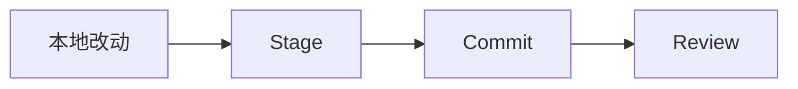

# Git 使用教程：从零基础到科研项目协作

<!-- course-meta:start -->
[课程首页](https://github.com/zengxiong111/Foundation_of_Embodied_AI/blob/main/README.zh-CN.md) · [English](https://github.com/zengxiong111/Foundation_of_Embodied_AI/blob/main/md/Git_Tutorial_English.md) · [PDF](https://zengxiong111.github.io/zengxiong.github.io/files/Git_Tutorial_CN.pdf)

| 项目 | 说明 |
|---|---|
| 适用范围 | Git 2.x；Ubuntu 终端；GitHub 协作示例 |
| 文档核验日期 | 2026-10-18 |
| 许可 | CC BY 4.0 · Xiong Zeng and contributors |

**核验边界：** 文档整理与上游引用快照核对；未进行教程环境、训练或硬件验证。 版本与固定源码引用见[版本说明](https://github.com/zengxiong111/Foundation_of_Embodied_AI/blob/main/VERSIONS.zh-CN.md)。原创教材采用 [CC BY 4.0](https://creativecommons.org/licenses/by/4.0/)，第三方引用、图片及代码遵循其原有许可；注明来源不等于拥有再许可权。
<!-- course-meta:end -->

<!-- course-toc:start -->
## 目录

- [1. Git 是什么：概念与工作区模型](#course-section-01)
  - [1.1 Git 能解决哪些问题？](#course-section-02)
  - [1.2 Git、GitHub、GitLab 和 VS Code](#course-section-03)
  - [1.3 理解工作区、暂存区、本地仓库、远程仓库](#course-section-04)
  - [1.4 最先记住的 10 个命令](#course-section-05)
- [2. Ubuntu 安装与初始配置](#course-section-06)
  - [2.1 安装 Git](#course-section-07)
  - [2.2 设置提交者身份](#course-section-08)
  - [2.3 统一新仓库默认分支名](#course-section-09)
  - [2.4 VS Code](#course-section-10)
- [3. 创建第一个本地 Git 项目](#course-section-11)
  - [第 1 步：创建目录和文件](#course-section-12)
  - [第 2 步：初始化仓库](#course-section-13)
  - [第 3 步：查看文件状态](#course-section-14)
  - [第 4 步：加入暂存区](#course-section-15)
  - [第 5 步：提交](#course-section-16)
  - [第 6 步：查看历史](#course-section-17)
- [4. 连接 GitHub：SSH、上传、克隆和同步](#course-section-18)
  - [4.1 配置 SSH 密钥](#course-section-19)
  - [4.2 将本地项目上传到 GitHub](#course-section-20)
  - [4.3 从 GitHub 下载开源项目](#course-section-21)
  - [4.4 更新本地仓库：Fetch 与 Pull](#course-section-22)
- [5. Git 分支管理](#course-section-23)
  - [5.1 查看、创建与切换分支](#course-section-24)
  - [5.2 在功能分支开发并提交](#course-section-25)
  - [5.3 合并到主分支](#course-section-26)
  - [5.4 删除已完成的分支](#course-section-27)
- [6. 多人协作与 Pull Request](#course-section-28)
  - [6.1 从最新主分支开始](#course-section-29)
  - [6.2 开发、检查并提交](#course-section-30)
  - [6.3 上传分支并创建 PR](#course-section-31)
- [7. 查看状态、差异和历史](#course-section-32)
  - [7.1 查看工作区状态](#course-section-33)
  - [7.2 比较代码](#course-section-34)
  - [7.3 查看提交图](#course-section-35)
- [8. 撤销操作与恢复旧版本](#course-section-36)
  - [8.1 尚未暂存：放弃某个文件的修改](#course-section-37)
  - [8.2 已 `git add`，尚未 commit：取消暂存](#course-section-38)
  - [8.3 已 commit，尚未共享：撤销提交并保留改动](#course-section-39)
  - [8.4 已 push / 其他人可能已拉取：用 Revert](#course-section-40)
- [9. 合并冲突与处理步骤](#course-section-41)
  - [9.1 解决冲突](#course-section-42)
  - [9.2 VS Code 解决冲突](#course-section-43)
- [10. `.gitignore`：忽略科研产物](#course-section-44)
  - [10.1 推荐模板](#course-section-45)
  - [10.2 `.gitignore` 的作用范围](#course-section-46)
  - [10.3 模型、数据与代码分离](#course-section-47)
- [11. 常用进阶命令：Stash、Rebase、Show、Blame](#course-section-48)
  - [11.1 `git stash`：临时收起未提交改动](#course-section-49)
  - [11.2 `git rebase`：把实验分支移到新基线](#course-section-50)
  - [11.3 查看某个提交、追踪某行代码](#course-section-51)
  - [11.4 查看所有分支](#course-section-52)
- [12. 完整科研开发工作流](#course-section-53)
  - [阶段 1：克隆自己的仓库](#course-section-54)
  - [阶段 2：从最新 `main` 创建实验分支](#course-section-55)
  - [阶段 3：开发并检查变化](#course-section-56)
  - [阶段 4：提交第一个独立功能](#course-section-57)
  - [阶段 5：继续增加算法功能](#course-section-58)
  - [阶段 6：将分支上传 GitHub](#course-section-59)
  - [阶段 7：测试并合并](#course-section-60)
- [13. Git 命令速查表](#course-section-61)
- [14. 常见错误及排查](#course-section-62)
  - [14.1 `fatal: not a git repository`](#course-section-63)
  - [14.2 `Permission denied (publickey)`](#course-section-64)
  - [14.3 `Updates were rejected`](#course-section-65)
  - [14.4 `Your local changes would be overwritten`](#course-section-66)
  - [14.5 常见错误处理原则](#course-section-67)
- [15. 在 VS Code 中使用 Git](#course-section-68)
- [16. 科研项目最佳实践与实验复现](#course-section-69)
  - [16.1 按任务创建分支](#course-section-70)
  - [16.2 每次训练记录 Commit ID](#course-section-71)
  - [16.3 把代码、配置和大文件管理分开](#course-section-72)
  - [16.4 新手先熟练掌握的一条完整路线](#course-section-73)
  - [16.5 官方参考资料](#course-section-74)
<!-- course-toc:end -->

**章节概念图**




<a id="course-section-01"></a>

## 1. Git 是什么：概念与工作区模型

**Git 是分布式版本控制系统（Version Control System, VCS）**。它记录代码的修改历史，使你能够比较版本、恢复旧版本、在独立分支上尝试新算法，并与团队成员合并工作。

<a id="course-section-02"></a>

### 1.1 Git 能解决哪些问题？

- **版本管理**：每次提交都对应一个可追溯的代码状态。
- **安全试验**：在实验分支上尝试新奖励函数或训练算法，不干扰稳定版本。
- **错误恢复**：找回被误改的代码，或撤销引入 Bug 的提交。
- **团队协作**：独立开发 PPO、SAC、视觉感知和 Sim2Real 模块，再合并。
- **跨机器同步**：借助 GitHub/GitLab 在本地电脑与 GPU 服务器同步源码。
- **实验复现**：记录某次训练对应的 Commit ID，与配置、随机种子、数据版本关联。

<a id="course-section-03"></a>

### 1.2 Git、GitHub、GitLab 和 VS Code

| 工具 | 作用 |
|---|---|
| **Git** | 在本地管理版本、提交、分支和合并；大部分操作无需联网。 |
| **GitHub** | 在线托管 Git 仓库，提供 Pull Request、代码审查和自动化功能。 |
| **GitLab** | Git 托管与协作平台的另一种选择。 |
| **VS Code** | 编辑器；内置 Source Control 界面，可操作 Git。 |

Git 不是 GitHub。即使没有 GitHub 账号，你仍能运行 `git init`、`git add`、`git commit`、`git branch` 等命令。

<a id="course-section-04"></a>

### 1.3 理解工作区、暂存区、本地仓库、远程仓库

```text
                      本地计算机
  ┌────────────────────────────────────────┐
  │  Working Directory / 工作区            │
  │     你正在修改的文件                    │
  │                │ git add               │
  │                ▼                       │
  │  Staging Area / 暂存区                  │
  │     本次准备提交的文件变化              │
  │                │ git commit            │
  │                ▼                       │
  │  Local Repository / 本地仓库 (.git)     │
  │     保存 Commit、分支和历史             │
  └────────────────┬───────────────────────┘
                   │ git push
                   ▼
             GitHub / 远程仓库
                   │ git fetch / git pull
                   ▼
             本地仓库 / 工作分支
```

三条最常用的命令含义不同：

```bash
git add .
git commit -m "Implement PPO training"
git push
```

- `git add`：将**选定的文件变化**放入暂存区。
- `git commit`：将**暂存内容**记录为本地提交。
- `git push`：将**本地提交**发送到远程仓库。

一个 Commit 可以理解为项目在某个时刻的一份版本快照；其哈希 ID 用于唯一标识该提交。工作区修改若未提交，**不会因为执行 `git push` 就自动上传**。

<a id="course-section-05"></a>

### 1.4 最先记住的 10 个命令

| 命令 | 用途 |
|---|---|
| `git init` | 初始化本地仓库 |
| `git clone URL` | 克隆远程仓库 |
| `git status` | 查看当前状态 |
| `git add PATH` | 暂存文件变化 |
| `git commit -m "..."` | 创建本地提交 |
| `git push` | 推送提交 |
| `git pull` | 获取并整合远程变更 |
| `git log --oneline` | 查看简短提交历史 |
| `git switch -c NAME` | 创建并切换分支 |
| `git merge NAME` | 合并指定分支 |

---

<a id="course-section-06"></a>

## 2. Ubuntu 安装与初始配置

<a id="course-section-07"></a>

### 2.1 安装 Git

打开 Ubuntu 终端：

```bash
sudo apt update
sudo apt install git
git --version
```

安装成功后会输出类似 `git version 2.x.y` 的版本信息；具体版本取决于 Ubuntu 发行版和软件源。

<a id="course-section-08"></a>

### 2.2 设置提交者身份

```bash
git config --global user.name "Your Name"
git config --global user.email "your_email@example.com"
```

这两个值写入新提交的作者身份；建议邮箱与你希望关联的 GitHub 邮箱一致。查看全局配置：

```bash
git config --global --list
```

也可以只给**当前仓库**设置不同的身份（移除 `--global`）：

```bash
git config user.name "Lab Account"
git config user.email "lab@example.com"
```

<a id="course-section-09"></a>

### 2.3 统一新仓库默认分支名

```bash
git config --global init.defaultBranch main
```

它影响之后通过 `git init` 创建的新仓库，不会自动重命名已有仓库。

<a id="course-section-10"></a>

### 2.4 VS Code

VS Code 内置 Git 集成功能；安装 Git 并在 VS Code 中打开项目即可使用 Source Control。若 `code` 命令已添加到 PATH，可通过：

```bash
code .
```

打开当前项目。Ubuntu 下日常操作建议使用“**终端执行命令 + VS Code 比较代码与解决冲突**”的组合。

---

<a id="course-section-11"></a>

## 3. 创建第一个本地 Git 项目

假设要开发一个机器人强化学习项目：

```text
robot-policy/
├── train.py
├── evaluate.py
├── configs/
│   └── ppo.yaml
├── policies/
│   ├── ppo.py
│   └── sac.py
└── README.md
```

<a id="course-section-12"></a>

### 第 1 步：创建目录和文件

```bash
mkdir robot-policy
cd robot-policy
echo 'print("Hello Git")' > train.py
```

<a id="course-section-13"></a>

### 第 2 步：初始化仓库

```bash
git init
```

此时会出现隐藏目录 `.git/`，其中存放仓库对象、历史和配置。不要随意删除或手动编辑它。

<a id="course-section-14"></a>

### 第 3 步：查看文件状态

```bash
git status
```

可能看到：

```text
On branch main
Untracked files:
  train.py
```

`Untracked` 表示文件尚未被 Git 跟踪。

<a id="course-section-15"></a>

### 第 4 步：加入暂存区

```bash
git add train.py
# 或暂存当前目录下的所有变化
git add .
git status
```

状态中的 `Changes to be committed` 表示文件已经暂存。`git add .` 很方便，但实验目录中应先确认 `.gitignore`，避免误加大型模型或数据。

<a id="course-section-16"></a>

### 第 5 步：提交

```bash
git commit -m "Initial commit"
```

以后每完成一个明确的开发任务就可以提交一次：

```bash
git commit -m "Implement PPO training"
git commit -m "Add SAC algorithm"
git commit -m "Fix observation normalization"
```

**提交信息应说明“本次改动做了什么”**，而不是只写 `update` 或 `fix`。

<a id="course-section-17"></a>

### 第 6 步：查看历史

```bash
git log
git log --oneline
```

示例：

```text
f72bc15 Fix PPO reward computation
d43a812 Implement PPO training
a81c32f Initial commit
```

现在你已经可以在**离线环境**下完成 Git 版本管理。

---

<a id="course-section-18"></a>

## 4. 连接 GitHub：SSH、上传、克隆和同步

<a id="course-section-19"></a>

### 4.1 配置 SSH 密钥

在 Ubuntu 上长期开发，推荐为自己的 GitHub 账号配置 SSH。

先检查是否已有密钥：

```bash
ls -al ~/.ssh
```

如果没有可用的 Ed25519 密钥，创建一个：

```bash
ssh-keygen -t ed25519 -C "your_email@example.com"
```

按照提示保存密钥并设置口令。若密钥文件已存在，**不要不加判断地覆盖原文件**。

启动 SSH Agent，添加私钥：

```bash
eval "$(ssh-agent -s)"
ssh-add ~/.ssh/id_ed25519
```

输出并复制**公钥**：

```bash
cat ~/.ssh/id_ed25519.pub
```

在 GitHub 网页进入 **Settings → SSH and GPG keys → New SSH key**，粘贴公钥并保存。注意：`id_ed25519` 是私钥，**绝不能上传或公开**；只能分享 `id_ed25519.pub`。

测试 SSH 连接：

```bash
ssh -T git@github.com
```

首次连接时要核对 GitHub 服务器指纹并确认。连接成功后通常会看到认证成功但不提供 Shell 访问的提示。

参考：[GitHub 官方 SSH 配置文档](https://docs.github.com/en/authentication/connecting-to-github-with-ssh)。

<a id="course-section-20"></a>

### 4.2 将本地项目上传到 GitHub

在 GitHub 网站创建一个名为 `robot-policy` 的**空仓库**；如果本地已经提交过代码，先不要在网页上添加 README、`.gitignore` 或 License，避免产生两份独立初始历史。

```bash
cd robot-policy
git remote add origin git@github.com:YOUR_USERNAME/robot-policy.git
git remote -v
git branch -M main
git push -u origin main
```

解释：

- `origin` 是远程仓库的常用**别名**，不是特殊服务器。
- `git remote -v` 显示读取与推送地址。
- `git branch -M main` 将当前分支命名为 `main`。
- `-u` 为本地分支建立上游跟踪关系，以后通常可以直接运行 `git push`。

<a id="course-section-21"></a>

### 4.3 从 GitHub 下载开源项目

例如：

```bash
git clone https://github.com/ajwagen/dsrl.git
cd dsrl
```

如果你使用 SSH 且具有相应访问权限，也可以克隆仓库提供的 SSH 地址：

```bash
git clone git@github.com:ajwagen/dsrl.git
```

`clone` 会下载仓库历史、创建项目目录，并默认配置 `origin` 远程仓库。克隆后无需再次 `git init`。

| HTTPS | SSH |
|---|---|
| 公共仓库一般可匿名克隆 | 通常需要配置 SSH 身份验证 |
| 使用 `https://...` URL | 使用 `git@github.com:...` URL |
| 推送时需要适当的账号认证 | 配置密钥后推送较方便 |

<a id="course-section-22"></a>

### 4.4 更新本地仓库：Fetch 与 Pull

```bash
cd dsrl
git fetch origin
```

`fetch` 只获取远程最新对象和远程跟踪分支，**不会直接合并到当前工作分支**。

如果当前位于跟踪 `origin/main` 的 `main` 分支，可执行：

```bash
git merge origin/main
```

把更新合并到当前分支。另一种常见写法：

```bash
git pull
```

`pull` 相当于先 `fetch`，再按配置采用 `merge` 或 `rebase` 整合。为了避免不期望的自动合并，新手在更新稳定分支时可以用：

```bash
git pull --ff-only
```

它只接受快进更新；若本地和远程历史已分叉，会停止并要求你明确处理。

> **注意**：在开源项目原仓库上通常没有推送权限。想提交自己的修改，可以先 Fork 到个人 GitHub，再克隆自己的 Fork，或者在团队仓库中通过授权分支发起 Pull Request。

---

<a id="course-section-23"></a>

## 5. Git 分支管理

分支允许你同时维护稳定版本和实验性代码。例如 `main` 保存稳定 PPO，`feature/sac` 用于新的 SAC 实现：

```text
A --- B ---------------- M       main
       \                /
        C --- D -------/         feature/sac
```

其中 `M` 代表一次可能的合并提交；如果满足快进条件，Git 也可能不创建 `M`。

<a id="course-section-24"></a>

### 5.1 查看、创建与切换分支

```bash
git branch                         # 列出本地分支
git branch feature/sac             # 只创建分支
git switch -c feature/sac          # 创建并切换（择一使用）
git switch main                    # 切回 main
git switch feature/sac             # 切回实验分支
```

如果已经用 `git branch feature/sac` 创建了分支，就用 `git switch feature/sac` 切换，而不是再次运行同名的 `switch -c`。

Git 在切换分支时会更新工作区文件；如果未提交的修改与目标分支冲突，切换会被阻止。应先提交或使用 `git stash`。

<a id="course-section-25"></a>

### 5.2 在功能分支开发并提交

```bash
git switch -c feature/sac
# 编辑 policies/sac.py
git add policies/sac.py
git commit -m "Implement SAC policy"
```

这时新的 Commit 只会推进 `feature/sac`，不会直接改变 `main`。

<a id="course-section-26"></a>

### 5.3 合并到主分支

```bash
git switch main
git merge feature/sac
```

若没有冲突即可完成；若有冲突，参见第 9 节。

<a id="course-section-27"></a>

### 5.4 删除已完成的分支

```bash
git branch -d feature/sac
```

`-d` 会检查分支是否已安全合并。删除对应远程分支：

```bash
git push origin --delete feature/sac
```

在多人项目中，更推荐通过 GitHub Pull Request 将功能分支合并到受保护的 `main`。

---

<a id="course-section-28"></a>

## 6. 多人协作与 Pull Request

科研团队可按模块建立分支：

```text
main
├── feature/ppo
├── feature/sac
├── feature/pose-estimation
└── feature/sim2real
```

推荐采用 **Feature Branch → Push → Pull Request → Review → Merge** 流程。

<a id="course-section-29"></a>

### 6.1 从最新主分支开始

```bash
git switch main
git pull --ff-only
git switch -c feature/pose-estimation
```

<a id="course-section-30"></a>

### 6.2 开发、检查并提交

```bash
# 修改视觉位姿估计模块
git status
git diff
git add .
git commit -m "Implement visual pose estimation"
```

<a id="course-section-31"></a>

### 6.3 上传分支并创建 PR

```bash
git push -u origin feature/pose-estimation
```

在 GitHub 仓库页面创建 Pull Request，通常以 `feature/pose-estimation` 为源分支、`main` 为目标分支。团队成员可以在 PR 中检查差异、审阅、讨论、运行 CI 测试，最后合并。

团队协作的基本习惯：**不要在共享主分支直接进行未验证的大型算法改动**；让新特性先在隔离分支上通过基本测试。

---

<a id="course-section-32"></a>

## 7. 查看状态、差异和历史

调试模型训练问题时，知道代码**实际改了什么**往往比记住“我应该改了什么”更重要。

<a id="course-section-33"></a>

### 7.1 查看工作区状态

```bash
git status
```

可以看到当前分支、已暂存修改、未暂存修改和未跟踪文件。

<a id="course-section-34"></a>

### 7.2 比较代码

```bash
git diff                     # 工作区 vs 暂存区
git diff --staged            # 暂存区 vs 最近提交
git diff -- train.py         # 只看某个文件
```

差异示例：

```diff
- learning_rate = 3e-4
+ learning_rate = 1e-4
```

`-` 是旧内容，`+` 是新内容。

<a id="course-section-35"></a>

### 7.3 查看提交图

```bash
git log --oneline
git log --oneline --graph --all
```

例如：

```text
* a34bd21 (HEAD -> main) Merge SAC implementation
|\
| * d72f8a1 Implement SAC algorithm
| * f61b2c9 Add replay buffer
|/
* b83fc92 Implement PPO
* 28ad613 Initial commit
```

建议经常组合使用 `git status`、`git diff`、`git log --oneline --graph --all`。每次提交前，先确认没有误加入临时文件、模型权重或敏感信息。

---

<a id="course-section-36"></a>

## 8. 撤销操作与恢复旧版本

恢复操作必须区分：修改**是否已暂存、是否已提交、是否已共享**。下面的命令不等价。

<a id="course-section-37"></a>

### 8.1 尚未暂存：放弃某个文件的修改

```bash
git restore train.py
```

把工作区的 `train.py` 恢复到暂存区对应的内容。**未另行保存的工作区修改可能丢失**。

<a id="course-section-38"></a>

### 8.2 已 `git add`，尚未 commit：取消暂存

```bash
git restore --staged train.py
```

修改仍保留在工作区，只是不再参与下一次提交。

<a id="course-section-39"></a>

### 8.3 已 commit，尚未共享：撤销提交并保留改动

假设最近两次提交：

```text
a82bc31 Bad reward modification
b41d2ab Working PPO version
```

撤销最近提交，但仍保留暂存：

```bash
git reset --soft HEAD~1
```

撤销最近提交并取消暂存，但保留工作区改动：

```bash
git reset HEAD~1
```

连同相应工作区修改一起丢弃：

```bash
git reset --hard HEAD~1
```

**`reset --hard` 是破坏性操作。** 执行前务必确认代码、实验结果和未提交内容不需要保留。

<a id="course-section-40"></a>

### 8.4 已 push / 其他人可能已拉取：用 Revert

```bash
git revert a82bc31
```

`revert` 创建一个新的提交，尝试抵消某个旧提交所引入的改动，保留可审计的共享历史。若修改已经与后续提交交织在一起，可能需要解决冲突。

| 操作 | 影响 | 典型场景 |
|---|---|---|
| `git restore FILE` | 丢弃文件未暂存修改 | 放弃本地临时改动 |
| `git restore --staged FILE` | 取消暂存，保留改动 | 文件被误加到暂存区 |
| `git reset --soft HEAD~1` | 回退分支指针，保留暂存 | 整理未共享的提交 |
| `git reset HEAD~1` | 回退分支指针，保留工作区 | 重新选择修改进行提交 |
| `git reset --hard HEAD~1` | 回退并丢弃相应修改 | 确认无需保留时 |
| `git revert HASH` | 增加反向提交 | 撤销已经共享的提交 |

基本原则：**本地未共享的历史可以谨慎 `reset`；共享历史优先 `revert`。**

---

<a id="course-section-41"></a>

## 9. 合并冲突与处理步骤

两个分支修改了同一处内容时，Git 可能无法自动判断保留哪个版本。

例如同一个 `train.py`：

```text
<<<<<<< HEAD
learning_rate = 0.0001
=======
learning_rate = 0.0003
>>>>>>> feature/sac
```

其中：

- `<<<<<<< HEAD` 到 `=======`：当前分支中的版本；
- `=======` 到 `>>>>>>> feature/sac`：传入分支中的版本。

<a id="course-section-42"></a>

### 9.1 解决冲突

1. 运行 `git status`，定位冲突文件。
2. 打开文件，理解两边修改的实际意图。
3. 选择一边，或者编写兼容两边需求的最终代码。
4. **删除所有冲突标记**（`<<<<<<<`、`=======`、`>>>>>>>`）。
5. 运行测试，确认逻辑正确。
6. `git add` 标记该文件已解决，完成合并提交。

例如决定使用：

```python
learning_rate = 0.0001
```

随后：

```bash
git add train.py
git commit
```

若想取消当前 `merge`：

```bash
git merge --abort
```

如果冲突发生在 `rebase` 中，使用的是 `git rebase --continue`、`git rebase --abort` 等命令，而不是 `merge --abort`。

<a id="course-section-43"></a>

### 9.2 VS Code 解决冲突

VS Code 的 Merge Editor 可以比较当前版本、传入版本和合并后的结果。无论通过图形界面还是终端解决，最终都应运行测试，尤其是奖励函数、动作尺度、机器人坐标系等难以仅凭文本差异判断的代码。

---

<a id="course-section-44"></a>

## 10. `.gitignore`：忽略科研产物

机器学习项目常见数 GB 的数据集、模型权重、录像和训练日志，它们通常**不适合直接提交到普通 Git 仓库**。

<a id="course-section-45"></a>

### 10.1 推荐模板

在项目根目录创建文件：

```bash
touch .gitignore
nano .gitignore
```

示例：

```gitignore
# Python cache
__pycache__/
*.pyc

# Local environments
.venv/
venv/

# Secrets
.env
*.pem

# Model artifacts
*.pt
*.pth
*.ckpt
checkpoints/

# Training outputs
outputs/
logs/
wandb/

# Large datasets
data/
datasets/

# ROS recordings
*.bag
*.db3

# Optional IDE state
.vscode/
```

**根据项目调整规则**：例如某些项目确实需要跟踪小型测试权重，或者共享部分 `.vscode/` 配置，不应机械地全部忽略。

<a id="course-section-46"></a>

### 10.2 `.gitignore` 的作用范围

规则主要影响**尚未跟踪**的文件。若 `checkpoint.pt` 以前已经被 Git 跟踪，即使现在写了 `*.pt`，它也不会自动退出版本控制。

要停止跟踪、但保留本地文件：

```bash
git rm --cached checkpoint.pt
git commit -m "Stop tracking checkpoint"
```

这不会清除历史提交中的旧副本。若意外上传 API Key、口令或其他机密，应该立即撤销/轮换凭据，并评估是否需要清理公开历史。

<a id="course-section-47"></a>

### 10.3 模型、数据与代码分离

建议：

- Git：源码、配置、脚本、文档、小型测试资源。
- 对象存储/实验平台：模型检查点、视频、训练日志和大型数据集。
- 实验元数据：保存代码 Commit ID、数据集版本、权重文件哈希和训练参数。

需要版本化大文件时，可以另行评估 Git LFS、DVC 或专门的模型/数据管理方案。

---

<a id="course-section-48"></a>

## 11. 常用进阶命令：Stash、Rebase、Show、Blame

<a id="course-section-49"></a>

### 11.1 `git stash`：临时收起未提交改动

你正在开发 SAC，却需要立即切换回 `main` 修复问题：

```bash
git stash
```

默认主要收起已跟踪文件的改动；若需要一起保存未跟踪文件：

```bash
git stash push -u -m "WIP SAC training"
```

然后：

```bash
git switch main
# 修复并提交问题
git switch feature/sac
git stash pop
```

| 命令 | 用途 |
|---|---|
| `git stash list` | 查看 Stash 记录 |
| `git stash show -p` | 查看最近 Stash 的差异 |
| `git stash pop` | 恢复修改；成功后移除该条 Stash |
| `git stash apply` | 恢复修改，但保留该条 Stash |

Stash 恢复也可能出现冲突，不能把它当作长期可靠备份。

<a id="course-section-50"></a>

### 11.2 `git rebase`：把实验分支移到新基线

原始历史：

```text
main:    A -- B -- C
feature: A -- B -- D -- E
```

运行：

```bash
git switch feature
git rebase main
```

概念上变为：

```text
main:    A -- B -- C
feature: A -- B -- C -- D' -- E'
```

`rebase` 会重放提交并生成新的提交 ID；适合整理**自己的私有分支**，不要随意重写其他人正在使用的共享历史。

<a id="course-section-51"></a>

### 11.3 查看某个提交、追踪某行代码

```bash
git show <commit-id>       # 查看一次提交的详细改动
git blame train.py         # 查看每行最近由哪次提交修改
```

`git blame` 在追踪“奖励缩放何时被修改”“哪个提交改变了控制频率”时很实用，但它是定位历史的工具，不等于判断责任。

<a id="course-section-52"></a>

### 11.4 查看所有分支

```bash
git branch -a
```

可能显示：

```text
* main
  feature/sac
  remotes/origin/main
  remotes/origin/feature/ppo
```

远程跟踪分支（`remotes/origin/...`）代表本地记录的远程状态；执行 `git fetch` 可以更新这些记录。

---

<a id="course-section-53"></a>

## 12. 完整科研开发工作流

目标：在强化学习项目中开发 `residual_velocity.py`，新增 Advantage-Guided Velocity Loss，测试后合并。

<a id="course-section-54"></a>

### 阶段 1：克隆自己的仓库

```bash
git clone git@github.com:YOUR_USERNAME/robot-policy.git
cd robot-policy
```

如果仓库来自别人的开源项目，需要先 Fork，或按照项目允许的贡献流程操作。

<a id="course-section-55"></a>

### 阶段 2：从最新 `main` 创建实验分支

```bash
git switch main
git pull --ff-only
git switch -c experiment/residual-velocity
```

<a id="course-section-56"></a>

### 阶段 3：开发并检查变化

目录结构可以是：

```text
robot-policy/
├── policies/
│   ├── sac.py
│   ├── ppo.py
│   └── residual_velocity.py
├── configs/
│   └── residual_velocity.yaml
└── train.py
```

编辑之后：

```bash
git status
git diff
```

<a id="course-section-57"></a>

### 阶段 4：提交第一个独立功能

```bash
git add policies/residual_velocity.py
git add configs/residual_velocity.yaml
git add train.py
git commit -m "Implement residual velocity adaptation"
```

<a id="course-section-58"></a>

### 阶段 5：继续增加算法功能

```bash
# 实现 Advantage-Guided Loss 并测试
git add .
git commit -m "Add advantage-guided velocity loss"
```

实验分支会形成清晰历史：

```text
A --- B --- C            experiment/residual-velocity
      │     │
      │     └─ Add advantage-guided velocity loss
      └─────── Implement residual velocity adaptation
```

<a id="course-section-59"></a>

### 阶段 6：将分支上传 GitHub

```bash
git push -u origin experiment/residual-velocity
```

后续更新该分支通常只需：

```bash
git push
```

<a id="course-section-60"></a>

### 阶段 7：测试并合并

个人仓库可采用：

```bash
git switch main
git pull --ff-only
git merge experiment/residual-velocity
git push origin main
```

团队仓库建议在 GitHub 创建 Pull Request，经审核、测试和权限检查后合并。**合并成功不代表实验可复现**，还需要记录依赖版本、数据集版本、种子和检查点对应的 Commit ID。

---

<a id="course-section-61"></a>

## 13. Git 命令速查表

| 分类 | 命令 | 用途 |
|---|---|---|
| 初始化 | `git init` | 创建本地仓库 |
| 克隆 | `git clone URL` | 下载仓库 |
| 状态 | `git status` | 查看当前状态 |
| 差异 | `git diff` | 查看未暂存改动 |
| 历史 | `git log --oneline` | 查看提交历史 |
| 暂存 | `git add .` | 暂存当前目录变化 |
| 提交 | `git commit -m "msg"` | 创建提交 |
| 上传 | `git push` | 推送本地提交 |
| 获取 | `git fetch` | 下载远程状态，不自动合并 |
| 同步 | `git pull --ff-only` | 仅允许快进更新 |
| 分支 | `git branch` | 列出本地分支 |
| 分支 | `git switch -c name` | 新建并切换分支 |
| 分支 | `git switch name` | 切换已有分支 |
| 合并 | `git merge name` | 合并指定分支 |
| 撤销 | `git restore file` | 丢弃未暂存的文件改动 |
| 撤销 | `git restore --staged file` | 取消暂存 |
| 撤销 | `git revert HASH` | 生成反向提交 |
| 暂存 | `git stash` | 临时收起改动 |
| 暂存 | `git stash pop` | 恢复 Stash |
| 信息 | `git show HASH` | 查看指定提交 |
| 信息 | `git blame file` | 追踪文件行的提交历史 |

---

<a id="course-section-62"></a>

## 14. 常见错误及排查

<a id="course-section-63"></a>

### 14.1 `fatal: not a git repository`

当前目录及其父目录都找不到有效 Git 仓库。检查：

```bash
pwd
ls -a
```

确认是否进入了项目目录；只有确实要创建**新仓库**时才运行 `git init`。

<a id="course-section-64"></a>

### 14.2 `Permission denied (publickey)`

SSH 身份验证失败。检查：

```bash
ssh -T git@github.com
```

确认本地 SSH Agent 已加载正确密钥，并且公钥已添加到 GitHub 对应账号。

<a id="course-section-65"></a>

### 14.3 `Updates were rejected`

远程通常有本地不存在的提交，直接推送无法快进。先检查：

```bash
git fetch origin
git status
```

对于你自己的功能分支且当前上游配置正确，可根据团队规范选择：

```bash
git pull --rebase
# 解决可能出现的冲突并测试
git push
```

**不要为了消除报错直接 `git push --force`**；这可能覆盖别人的提交。

<a id="course-section-66"></a>

### 14.4 `Your local changes would be overwritten`

当前未提交修改可能被切换/同步操作覆盖。先二选一：

```bash
# 方案 A：提交当前工作
git add .
git commit -m "Save work in progress"
```

```bash
# 方案 B：临时保存（包括未跟踪文件）
git stash push -u
```

然后再重复原操作。

<a id="course-section-67"></a>

### 14.5 常见错误处理原则

遇到不熟悉的 Git 报错时，先运行 `git status`，阅读 Git 给出的后续操作提示，再判断是处于 merge、rebase 还是普通状态。不要在不清楚仓库状态时连续执行 `reset --hard`、`clean -fd` 或强制推送。

---

<a id="course-section-68"></a>

## 15. 在 VS Code 中使用 Git

在项目目录运行：

```bash
code .
```

左侧打开 **Source Control（源代码管理）**，快捷键通常是 `Ctrl + Shift + G`。

| 操作 | VS Code 中的位置或方式 |
|---|---|
| 查看修改文件 | Source Control 文件列表 |
| 比较修改前后代码 | 点击列表中的修改文件 |
| 暂存 | 文件旁的 `+` / Stage Changes |
| 提交 | 输入提交信息并选择 Commit |
| 推送 | Push 或 Sync Changes |
| 切换分支 | 状态栏分支名称或命令面板 |
| 解决冲突 | Merge Editor |

假设你将：

```python
reward = success_reward
```

改成：

```python
reward = success_reward + progress_reward
```

VS Code 的 Diff Editor 会直观显示删除和新增的行。对于涉及多文件配置的强化学习实验，在提交前检查一次完整 Diff，通常可以发现意外的超参数修改。

**推荐搭配**：终端更适合准确输入和记录 Git 命令；VS Code 更适合比较改动、定位冲突、审查大段代码。

---

<a id="course-section-69"></a>

## 16. 科研项目最佳实践与实验复现

<a id="course-section-70"></a>

### 16.1 按任务创建分支

| 典型科研场景 | 推荐方式 |
|---|---|
| 新增 PPO / SAC 算法 | `feature/ppo` / `feature/sac` |
| 探索新的奖励函数 | `experiment/reward-v2` |
| 实现在线 Residual Velocity 适配 | `experiment/residual-velocity` |
| 修改位姿估计或相机标定 | `feature/pose-estimation` |
| 修复线上机器人控制 Bug | `fix/control-latency` |
| 论文复现实验 | 用 Commit ID 或 Tag 固定发布代码 |

<a id="course-section-71"></a>

### 16.2 每次训练记录 Commit ID

```bash
git rev-parse HEAD
```

建议和实验配置一起保存，例如：

```yaml
experiment:
  name: residual_velocity_v3
  git_commit: a82bc31
  random_seed: 42
training:
  learning_rate: 0.0003
  batch_size: 256
```

上述 Commit ID 是演示用短哈希，正式记录最好写入命令输出的**完整哈希**。

> 重要：Commit ID 只标记已经提交的代码状态。如果实验启动时存在未提交修改，仅保存哈希并不能完整复现。正式运行前请检查 `git status`，必要时记录补丁或先建立实验提交。

<a id="course-section-72"></a>

### 16.3 把代码、配置和大文件管理分开

- **Git 仓库**：源码、配置、训练入口、评测脚本、README、环境说明。
- **实验输出目录**：TensorBoard/W&B 日志、视频、权重和大型缓存；通常加入 `.gitignore`。
- **复现记录**：Commit ID、环境与依赖版本、数据集版本、训练随机种子、仿真器版本、GPU/驱动信息。
- **机器人部署**：在发布稳定控制策略时，可创建 Tag（如 `v1.0-deploy`）并记录对应的控制参数和硬件版本。

例如为经过验证的版本添加 Tag：

```bash
git tag -a v1.0-deploy -m "Validated robot deployment"
git push origin v1.0-deploy
```

<a id="course-section-73"></a>

### 16.4 新手先熟练掌握的一条完整路线

```bash
# 1. 克隆项目
git clone <repo_url>
cd <repo_name>

# 2. 查看状态
git status

# 3. 创建实验分支
git switch -c experiment/new-method

# 4. 修改并检查代码
git diff

# 5. 提交代码
git add .
git commit -m "Implement new method"

# 6. 第一次上传分支
git push -u origin experiment/new-method

# 7. 后续修改并上传
git add .
git commit -m "Improve training"
git push
```

掌握这条路线，就足以支持大多数个人科研项目的日常代码管理；再逐步学习冲突解决、Rebase、Pull Request 和团队约定。

<a id="course-section-74"></a>

### 16.5 官方参考资料

- [Pro Git（中文）](https://git-scm.com/book/zh/v2)
- [Pro Git（English）](https://git-scm.com/book/en/v2)
- [Git 官方命令参考](https://git-scm.com/docs)
- [GitHub：通过 SSH 连接](https://docs.github.com/en/authentication/connecting-to-github-with-ssh)
- [GitHub：Pull Request 指南](https://docs.github.com/en/pull-requests)

---

**结语**：对于科研代码，Git 最重要的价值不是“把代码上传到 GitHub”，而是将**源代码版本、实验变更与可复现结果**联系起来。先保持“小步提交、分支实验、审查 Diff、避免上传大文件”的习惯，再逐步扩展到团队协作。
