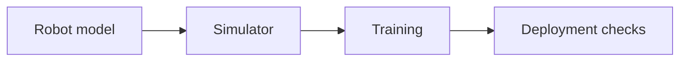

# Isaac Sim, Isaac Lab, and MuJoCo: A Complete Guide to Robot Simulation and Reinforcement Learning

<!-- course-meta:start -->
[Course home](https://github.com/zengxiong111/Foundation_of_Embodied_AI) · [简体中文](https://github.com/zengxiong111/Foundation_of_Embodied_AI/blob/main/md/Isaac_MuJoCo_RL_%E5%AE%8C%E6%95%B4%E6%95%99%E7%A8%8B_%E4%B8%AD%E6%96%87.md) · [PDF](https://zengxiong111.github.io/zengxiong.github.io/files/Isaac_MuJoCo_RL_Complete_Guide_EN.pdf)

| Item | Details |
|---|---|
| Applicability | Documented tracks: Isaac Lab 2.3.2 / Isaac Sim 5.1; Lab 3.0 Early Access / Sim 6.1. MuJoCo, MJX and MJWarp releases must be selected per task |
| Documentation review date | 2026-10-18 |
| License | CC BY 4.0 · Xiong Zeng and contributors |

**Verification scope:** Documentation organization and upstream reference snapshot; no tutorial runtime, training or hardware validation. See [version notes](https://github.com/zengxiong111/Foundation_of_Embodied_AI/blob/main/VERSIONS.md) for pinned source references. Original teaching content uses [CC BY 4.0](https://creativecommons.org/licenses/by/4.0/); third-party quotations, figures and code retain their original licenses. Citation alone does not grant relicensing rights.
<!-- course-meta:end -->

<!-- course-toc:start -->
## Contents

- [1. What are these platforms, and how do they differ?](#course-section-01)
  - [1.1 Their roles in the robotics workflow](#course-section-02)
  - [1.2 Which tool should you select?](#course-section-03)
- [2. Versions, installation strategy, and hardware precautions (without commands)](#course-section-04)
  - [2.1 Two sensible version tracks](#course-section-05)
  - [2.2 Where should the compute run?](#course-section-06)
  - [2.3 Acceptance checks: launching is not enough](#course-section-07)
- [3. Learning to operate both platforms without writing code here](#course-section-08)
  - [3.1 A practical MuJoCo learning sequence](#course-section-09)
  - [3.2 An Isaac Sim / Isaac Lab learning sequence](#course-section-10)
  - [3.3 A shared exercise: Panda, cube, and table](#course-section-11)
- [4. Modeling robots across URDF, MJCF, and USD](#course-section-12)
  - [4.1 There is no universally lossless conversion](#course-section-13)
  - [4.2 Ten checks after import](#course-section-14)
- [5. Dynamics, control interfaces, and timing](#course-section-15)
  - [5.1 A common mechanics perspective](#course-section-16)
  - [5.2 Five common control interfaces](#course-section-17)
  - [5.3 Keep three clocks separate](#course-section-18)
  - [5.4 Fair control comparisons](#course-section-19)
- [6. Contact, friction, vision, and sensing](#course-section-20)
  - [6.1 Why dexterous contact is difficult](#course-section-21)
  - [6.2 Standard contact validation tests](#course-section-22)
  - [6.3 Four sources of visual closed-loop error](#course-section-23)
  - [6.4 Should a policy observe vision or privileged state?](#course-section-24)
- [7. Define the RL task before training](#course-section-25)
  - [7.1 Six ingredients of a learning task](#course-section-26)
  - [7.2 A practical task hierarchy](#course-section-27)
- [8. Choosing PPO, SAC, and related methods](#course-section-28)
  - [8.1 Engineering differences between PPO and SAC](#course-section-29)
  - [8.2 A defensible selection rule](#course-section-30)
  - [8.3 Sample efficiency is not total efficiency](#course-section-31)
- [9. Designing a trainable RL environment: detailed checklist](#course-section-32)
  - [9.1 Observation design](#course-section-33)
  - [9.2 Action design](#course-section-34)
  - [9.3 Reward design](#course-section-35)
  - [9.4 Termination, time limits, and recovery](#course-section-36)
  - [9.5 Reset and reference-state initialization (RSI)](#course-section-37)
  - [9.6 Curriculum learning](#course-section-38)
- [10. A complete Isaac Lab reinforcement learning workflow](#course-section-39)
  - [10.1 From a benchmark to a custom manipulation task](#course-section-40)
  - [10.2 Selecting the Isaac Lab RL library](#course-section-41)
  - [10.3 Common Isaac Lab RL pitfalls](#course-section-42)
- [11. MuJoCo RL: classic CPU simulation, MJX, and MJWarp](#course-section-43)
  - [11.1 Classic MuJoCo: correctness first](#course-section-44)
  - [11.2 MJX and MJWarp: throughput-oriented training](#course-section-45)
  - [11.3 Ten steps for a MuJoCo RL project](#course-section-46)
- [12. PPO and SAC tuning: what to check and in which order](#course-section-47)
  - [12.1 PPO: diagnose the environment before tuning the optimizer](#course-section-48)
  - [12.2 SAC: what deserves the most attention?](#course-section-49)
  - [12.3 Three misleading signs of “successful learning”](#course-section-50)
- [13. Training efficiency: batches, vision, and bottlenecks](#course-section-51)
  - [13.1 Measure at least five quantities](#course-section-52)
  - [13.2 More environments are not always better](#course-section-53)
  - [13.3 Two routes to visual RL](#course-section-54)
- [14. Domain randomization and robust learning in a sensible order](#course-section-55)
- [15. Evaluation, ablations, and reproducibility for publishable experiments](#course-section-56)
  - [15.1 Core metrics](#course-section-57)
  - [15.2 Minimal ablation matrix](#course-section-58)
  - [15.3 Avoid unsupported conclusions](#course-section-59)
- [16. Sim-to-real transfer: from policy weights to a safe robot](#course-section-60)
  - [16.1 Six calibration layers](#course-section-61)
  - [16.2 A deployment validation ladder](#course-section-62)
- [17. End-to-end case study: screwdriver manipulation with Tron2 and Revo3](#course-section-63)
  - [17.1 Define the task precisely](#course-section-64)
  - [17.2 Recommended system development route](#course-section-65)
  - [17.3 Five critical choices](#course-section-66)
  - [17.4 Stage-specific measurements](#course-section-67)
- [18. Common failure symptoms and debugging priorities](#course-section-68)
- [19. Suggested six-week learning plan and deliverables](#course-section-69)
- [20. Final readiness checklist](#course-section-70)
- [Official references and further reading](#course-section-71)
<!-- course-toc:end -->

**Chapter concept map**

## 1. What are these platforms, and how do they differ?

### 1.1 Their roles in the robotics workflow

- **Isaac Sim** is NVIDIA's robotics simulation platform for scene authoring, USD assets, PhysX simulation, RTX rendering, camera simulation, and ROS 2 integration. Its primary concern is *how a robot and its environment operate and are perceived in simulation*.
- **Isaac Lab** is a robot learning framework built on simulation backends. It provides task definitions, vectorized environments, observations, actions, rewards, resets, termination rules, domain randomization, and interfaces to RL libraries. Its primary concern is *how to train and evaluate a policy systematically*.
- **MuJoCo** is a dynamics and contact simulation engine useful for rigid-body mechanics, constraints, actuators, control, and model debugging. Traditional MuJoCo is primarily CPU-based; MJX and MuJoCo Warp (MJWarp) enable accelerated batched simulation.

**Important recent development:** Isaac Lab 3.0 Early Access introduces a multiple-physics-backend architecture, including Newton/MuJoCo-Warp-based execution paths. Accordingly, “Isaac Lab always means PhysX” and “MuJoCo always means CPU simulation” are no longer generally accurate. Backend feature parity and API compatibility must still be checked for each release. [1–4]

| Dimension | Isaac Sim | Isaac Lab | MuJoCo and GPU ecosystem |
|---|---|---|---|
| Primary focus | Scenes, sensing, digital twins | Robot learning and batched tasks | Dynamics, contact, control, batching |
| Common assets | USD; URDF import | Backend-supported assets | MJCF; URDF import |
| Visualization | Strong RTX rendering | Depends on the selected renderer | Lightweight viewer; backend-dependent batched rendering |
| RL integration | Requires a learning/task layer | RSL-RL, RL-Games, skrl, etc. | MuJoCo Playground, Gymnasium, custom stacks |
| Best first use | Scene and sensor inspection | Vectorized reinforcement learning | Dynamics and control |
| Main pitfalls | GPU drivers, VRAM, RTX support | Version/API changes, rewards and resets | Actuation, contacts, CPU/GPU discrepancies |

### 1.2 Which tool should you select?

| Research goal | Suggested starting point | Why |
|---|---|---|
| Dynamics, PD/MPC, inverse dynamics | MuJoCo | Direct access to physical behavior and straightforward single-step debugging |
| Many parallel dexterous-hand PPO environments | Isaac Lab or MuJoCo Playground | Vectorized rollouts and structured tasks |
| Replay-buffer-based SAC | A compatible MuJoCo RL stack or supported Isaac Lab integration | Confirm that SAC and vectorized replay are actually implemented |
| Head and wrist RGB-D, lighting and occlusions | Isaac Sim / Isaac Lab | Integrated rendering and camera modeling |
| High-throughput state-based contact simulation | Suitable Isaac Lab backend or MJX/MJWarp | Depends on scene complexity, hardware, and data movement |
| Pre-deployment robustness checks | Both physics engines | Exposes dependence on one solver or actuator approximation |

**Selection rule:** Decide on the physical task and observations before optimizing raw simulation FPS. Photorealism, contact fidelity, and real-world compatibility may be more consequential than peak steps per second.

## 2. Versions, installation strategy, and hardware precautions (without commands)

### 2.1 Two sensible version tracks

**Stable reproduction track: Isaac Lab 2.3.2 with Isaac Sim 5.1.** This is a practical option for replicating existing 2.x research code, RSL-RL pipelines, and established PhysX manipulation tasks. Pin the Git tag, Python, PyTorch, extensions, and GPU driver rather than installing moving targets.

**New architecture track: Isaac Lab 3.0 Early Access with Isaac Sim 6.1 when full Isaac Sim integration is needed.** Version 3.0 adds selected kit-less workflows and a multi-backend architecture, but includes breaking changes. As of this guide's date it is still Early Access; older tasks and extensions should not be assumed compatible. A particularly important migration detail is the change from the common **wxyz** quaternion convention in 2.x to **xyzw** in 3.0, alongside data interface changes. [1][2]

**Recommended setup sequence:** (1) Identify the paper or feature to reproduce; (2) consult the relevant release compatibility table; (3) keep Isaac and MuJoCo dependencies isolated; (4) validate an official minimal scene; (5) check simulation stepping, asset import, and GPU use; and only then (6) connect the RL trainer. Avoid installing unrelated machine-learning packages before the simulator baseline works.

### 2.2 Where should the compute run?

- **RTX 4090, 24 GB:** Well suited to GPU physics training and carefully budgeted vision-based experiments. High-resolution multi-camera tasks still need active memory management.
- **RTX 3090, 24 GB:** Useful for compatible experiments and MuJoCo GPU training; however, Isaac Sim 5.1 lists an RTX 4080 as its minimum GPU performance tier. Treat a 3090-based Isaac Sim setup as a configuration requiring its own verification.
- **A100/A800:** Excellent for many neural-network workloads and compute paths that do not need RTX rendering. **The A100 is not supported for the full RTX-dependent Isaac Sim 5.1 experience.** High tensor throughput does not imply RTX renderer compatibility.
- **CPU machines:** Often appropriate for classic MuJoCo model validation, MPC, single-robot control, and smaller rollouts. Move to MJX/MJWarp when a measured batch-throughput need justifies it.

Official Isaac Sim 5.1 requirements specify supported Ubuntu configurations, GPU classes, memory, storage, and driver expectations. Updating every dependency to “latest” can easily break an otherwise working simulator stack. [5]

### 2.3 Acceptance checks: launching is not enough

| Check | Acceptance criterion |
|---|---|
| Basic scene | Ground, gravity, and robot load; no unintended penetration |
| Joint motion | Directions, limits, home positions, and velocities verified joint by joint |
| Robot state | Poses, velocities, and forces agree with the model definitions |
| Rendering and cameras | Correct orientation, depth interpretation, timestamps, and resolution |
| Physics stability | No persistent resting oscillation; plausible free fall |
| RL connectivity | Observation-action-step-reset-reward loop operates correctly |
| Reproducibility | Software versions, asset hashes, GPU, driver, and random seeds recorded |

## 3. Learning to operate both platforms without writing code here

### 3.1 A practical MuJoCo learning sequence

1. **Understand the model:** A robot is built from bodies, joints, geoms, actuators, sensors, and constraints. Its rendered geometry and collision geometry can be distinct.
2. **Inspect a robot:** Check joint axes, home positions, collision shapes, inertia, and tool reference frames in the viewer.
3. **Test passive motion:** Observe a pendulum or arm moving under gravity; compare physical intuition with simulated behavior.
4. **Test actuation:** Examine position, velocity, and torque control separately. An actuator's command is not necessarily an applied joint torque.
5. **Introduce contacts:** Add a tabletop and a small object. Study free fall, sliding, grasping, and release.
6. **Prepare for RL:** Specify observations, actions, resets, and randomization before integrating a trainer.

**Recommended first complete robot:** Franka Panda. It is sufficiently complex for useful manipulation while remaining easy to inspect; start from a maintained model in MuJoCo Menagerie. [6]

### 3.2 An Isaac Sim / Isaac Lab learning sequence

1. **Scene authoring in Isaac Sim:** Learn the Stage, Prims, USD assets, viewport, timeline, physical materials, and rigid-body properties.
2. **Import a robot:** Inspect the articulation root, drives, masses, joint limits, and collision geometry after URDF import.
3. **Build a simple scene:** Ground, table, fixed-base arm, manipulated object, and lighting.
4. **Validate sensors:** Place head and wrist cameras; verify intrinsics, extrinsics, depth semantics, occlusions, and synchronization.
5. **Study the Isaac Lab task abstraction:** Scene, robot assets, observations, actions, rewards, terminations, and events/domain randomization.
6. **Try maintained benchmark tasks:** Cartpole, Franka Reach, Franka Lift, then dexterous reorientation.
7. **Add RL gradually:** Start with state-based policies and limited randomization before adding vision and difficult contacts.

**Manager-based vs. Direct workflows:** Manager-based tasks emphasize reuse of observation, reward, reset, and event components. Direct tasks offer more explicit control for unusual contact phases or research algorithms. Both support reinforcement learning; the difference is software organization rather than inherent learning power. [7]

### 3.3 A shared exercise: Panda, cube, and table

Do not begin by comparing two entirely different robots in different engines. Fix the robot, cube dimensions, table height, tool frame, initial pose distribution, and action definition. Progress through **single-joint response → end-effector tracking → cube grasping → perturbed regrasping**. The same evaluation sequence can later be used with Tron2 and a Revo3 hand.

## 4. Modeling robots across URDF, MJCF, and USD

### 4.1 There is no universally lossless conversion

| Modeling aspect | URDF | MJCF | USD / Isaac |
|---|---|---|---|
| Links, joints, inertia | Standard capabilities | Supported | Supported |
| Visual and collision meshes | Supported | Rich contact modeling | Strong scene and rendering support |
| Motors and actuation | Limited in core standard | Actuators, tendons, transmissions | Joint drives and physics properties |
| Advanced contact behavior | Usually engine-specific extensions | Detailed contact parameters | PhysX contacts and materials |
| Scene composition | Relatively basic | Physics-centric | Scalable scene composition |

Maintain a **canonical physical parameter sheet** covering joint names, axis orientations, zero positions, limits, link masses, centers of mass, inertias, TCP, collision meshes, actuation modes, and sensor extrinsics. This provides better cross-engine consistency than an URDF file alone.

### 4.2 Ten checks after import

1. Base and world frames; 2. joint names and ordering; 3. positive rotation directions; 4. angle and length units; 5. tool-center-point definition; 6. mass and center of mass; 7. physically plausible inertias; 8. collision simplification; 9. appropriate self-collision filtering; and 10. actuation limits, stiffness, damping, and control period.

**Additional dexterous-hand checks:** Coupled joints, differential mechanisms, tendons, underactuation, fingertip material properties, and finger-joint friction. Matching the visible hand geometry is not enough to establish valid contact physics.

## 5. Dynamics, control interfaces, and timing

### 5.1 A common mechanics perspective

For rigid-body robots, the essential balance is:

**Inertial effects + Coriolis/centrifugal/gravity-related bias terms = generalized actuator forces + generalized contact/constraint forces.**

MuJoCo and PhysX use different numerical implementations. Before attributing discrepancies to the engine, first make robot parameters, actuation, and contact scenarios as equivalent as possible.

### 5.2 Five common control interfaces

| Control style | Policy produces | Main caveats |
|---|---|---|
| Joint position targets | Desired joint angles | Hidden PD gains, torque saturation, velocity limits |
| Joint position increments | Changes relative to a target or state | Accumulated drift, scaling, temporal smoothness |
| Joint velocity | Desired joint velocity | Stability near contact, integration error |
| Joint torque | Actuator effort | Gravity compensation, friction, saturation, hardware safety |
| Cartesian pose or impedance | TCP pose or impedance quantities | IK feasibility, singularities, frame conventions |

**Crucial distinction:** A policy that *commands* a joint position does not instantaneously *set* the simulated joint to that position. The position target must go through a comparable controller and actuator. Directly teleporting joints can bypass physical constraints and create a major sim-to-real mismatch.

### 5.3 Keep three clocks separate

- **Physics step:** Integrates motion, collision, and contact. Smaller steps often improve stability at higher cost.
- **Low-level control frequency:** Updates servo, impedance, or IK targets.
- **Policy and sensor frequencies:** RL decisions and camera acquisitions; these rates may be asynchronous.

Example: 500 Hz physics and 50 Hz policy inference imply **10 physics steps per policy action**. A 30 Hz camera requires explicit frame holding, timestamps, and delay handling. The deployed system additionally includes communication, estimation, filtering, and actuator response latency.

### 5.4 Fair control comparisons

Hold four things constant: **action meaning in joint or task space, action scaling, low-level controller semantics, and effective sampling period**. Without those controls, measured differences cannot be cleanly attributed to the physics engine.

## 6. Contact, friction, vision, and sensing

### 6.1 Why dexterous contact is difficult

Contact dynamics are highly nonlinear. Collision geometry, friction, compliance, integration time step, control stiffness, inertia, and the solver jointly determine whether an object can be held. Two engines using an identically named friction coefficient need not produce identical sliding behavior.

**Debug contacts by isolation:** First verify object free fall, then sliding under a known normal force, then static pinch grasps, and finally dynamic lifting and rotation. Increasing friction is not a universal fix for unstable contact simulation.

### 6.2 Standard contact validation tests

| Test | Measurements | Typical failure |
|---|---|---|
| Free fall | Impact time, rebound, resting position | Penetration or excessive bounce |
| Planar sliding | Deceleration, stopping distance | Unrealistic slip or jitter |
| Fingertip grasp | Slip, contact force, holding time | Implausibly strong grasp or violent ejection |
| In-hand rotation | Object pose relative to hand | Unstable contacts, grasp loss |
| Perturbation recovery | Rediscovery and regrasp after a drop | Episode incorrectly terminates at first drop |

### 6.3 Four sources of visual closed-loop error

1. **Geometry:** Intrinsics, lens distortion, extrinsics, TCP, and object CAD/mesh scale.
2. **Coordinate frames:** World/base/optical frames, transform multiplication order, quaternion convention.
3. **Perception:** Missing depth, lighting, occlusions, blur, and pose-estimator drift.
4. **Timing:** Unsynchronized camera and joint readings, network delay, action holding, and reuse of stale frames.

Depth along the optical axis is not equivalent to Euclidean distance from the camera center. Align Isaac Lab depth semantics with the real sensor and any downstream pose estimator rather than relying on a generic variable name. [8]

### 6.4 Should a policy observe vision or privileged state?

For debugging control and reward design, start with simulator state. If the real task uses head and wrist cameras, the final deployed actor must depend only on available visual and proprioceptive observations. A useful pipeline is **privileged-state teacher → visual student**: first establish that the mechanics and control task can be learned, then introduce partial observability and sensor error. Never silently include simulator ground-truth object pose in a supposedly deployable visual policy.

## 7. Define the RL task before training

### 7.1 Six ingredients of a learning task

- **Objective:** Which object, initial configuration, desired end condition, and success dwell time?
- **Observations:** What can the robot know, and what is reserved for a training-time critic?
- **Actions:** What physical quantity is commanded, at what period, with which filters and limits?
- **Rewards:** What constitutes progress, and where can reward gaming occur?
- **Termination and truncation:** Which outcomes are terminal, and which merely reach a time limit?
- **Training/evaluation distributions:** What variation is seen during learning, and how is generalization tested?

A growing average return does not necessarily mean the robot has learned the intended task. A policy may exploit collision artifacts, unusual reset states, or poorly chosen shaping terms.

### 7.2 A practical task hierarchy

**Level A:** Reach/track; **Level B:** Approach and make contact; **Level C:** Grasp and lift; **Level D:** Reorient the object; **Level E:** Pick, move, and rotate; **Level F:** Recover after slip or object drop.

Evaluate each level independently before moving on. This isolates control, contact, stage transitions, and exploration failures.

## 8. Choosing PPO, SAC, and related methods

### 8.1 Engineering differences between PPO and SAC

| Dimension | PPO | SAC |
|---|---|---|
| Data regime | Typically on-policy with fresh rollouts | Off-policy with reusable replay samples |
| Common strength | Mature GPU-parallel training, manageable stability | Data reuse when interactions are costly |
| Primary cost | Old rollouts are not reused indefinitely | More involved critic, temperature, and distribution tuning |
| Typical starting point | Isaac Lab locomotion and dexterous state control | Continuous control with a replay-friendly stack |
| Failure modes | Poor reward scales, unstable policy updates | Q overestimation, distribution shift, entropy/replay imbalance |

**Neither simulator dictates a single algorithm.** A task's available algorithms are determined by its trainer and integration. RSL-RL is frequently used for GPU PPO in Isaac Lab; RL-Games and other libraries offer additional algorithms, but changing training libraries is not necessarily a plug-and-play substitution for every task. [9]

### 8.2 A defensible selection rule

- **Start with massively parallel state-based simulation:** PPO is a sensible baseline because maintained vectorized pipelines exist.
- **When interaction samples are expensive or replay is central:** Evaluate SAC, including replay throughput and correctness in vectorized environments.
- **With a large visual backbone:** Try freezing the encoder or distilling a smaller student before assuming PPO or SAC is the primary bottleneck.
- **When demonstrations are available:** Behavioral cloning can initialize a policy; reinforcement learning need not start from random behavior.
- **When fine-tuning foundation policies:** Separate action generators, value/reward estimation, low-level control, and inference latency. Hyperparameters from low-dimensional robot control do not transfer automatically.

### 8.3 Sample efficiency is not total efficiency

An off-policy learner can reuse data, but overall project cost includes physics stepping, camera rendering, image encoding, optimization, inter-device transfer, resetting, and real-world interaction. Report **environment steps, GPU hours, wall-clock time, and final task success**, not just replay ratio or number of optimizer updates.

## 9. Designing a trainable RL environment: detailed checklist

### 9.1 Observation design

**State-based baseline:** Joint positions and velocities, previous action, end-effector pose, object-to-goal pose error, and necessary contact/grasp signals.

**Training-only privileged information:** Ground-truth object pose, accurate object velocity, contact force, friction parameters, and external perturbations. These may feed a teacher or asymmetric critic, but must not leak to a deployment actor that cannot observe them.

**Visual observations:** RGB, depth, segmentation, or estimated object pose. Define camera rate, resolution, frame history, occlusion policy, and timestamps. With partial observability, a short history or state estimator is often better than assuming every frame fully observes the object.

**Three recurring checks:** Normalize quantities appropriately; prevent large-scale features from dominating; and remove leaked future targets, contact labels, or privileged state from actor observations.

### 9.2 Action design

Begin with **joint position increments through a realistic position servo**, or **TCP pose increments through IK together with finger joint targets**. Every action component needs a physical unit, range, filter, and safety bound.

Very large actions lead to collisions and unreachable configurations; tiny actions suppress exploration. The target rate, velocity, acceleration, and torque bounds used in training should reflect real actuator capabilities.

### 9.3 Reward design

Organize terms into five groups: **task success, intermediate progress, grasp/contact quality, smoothness/energy cost, and safety/failure penalties**.

| Reward component | Encouraged behavior | Potential exploitation |
|---|---|---|
| Object approach | Reduce hand–object distance | Hover nearby without grasping |
| Grasp stability | Maintain realistic contact | Exploit artificially high friction |
| Pose alignment | Meet translation/rotation goals | Optimize only the easy error component |
| Success dwell | Hold the goal state | Repeatedly cross a success threshold |
| Action smoothness | Reduce impact and oscillation | Become inactive under excessive penalty |

Log every reward term separately. Combine a meaningful sparse success criterion with modest dense shaping, then test whether the learned policy remains useful when shaping is reduced or the task distribution changes.

### 9.4 Termination, time limits, and recovery

- **Success termination:** The goal is achieved and maintained for the required interval.
- **Failure termination:** A genuinely unrecoverable or unsafe condition occurs, such as severe collisions or hard joint-limit violations.
- **Time-limit truncation:** The episode reaches its time budget without a natural terminal event. The trainer must treat bootstrap/timeout semantics correctly.
- **Recovery tasks:** If the policy must pick up a dropped object, **a drop must not always end the episode**. Allow observation, localization, approach, and regrasp unless the object leaves the recoverable workspace.

### 9.5 Reset and reference-state initialization (RSI)

Sample from multiple phases: normal start, just before contact, stable grasp, mid-rotation, incipient slip, and post-drop states. Use **event-biased RSI** near critical contact transitions while retaining a uniform component to avoid training on an excessively narrow distribution.

For reference-tracking tasks, randomizing the object's initial position or orientation requires a **consistent transformation of all subsequent reference poses and targets**. Otherwise, the reference and reward become contradictory. Validate each reset for penetration, discontinuous joint jumps, and unstable contact resolution.

### 9.6 Curriculum learning

A sensible curriculum is: fixed pose → small translation perturbations → orientation perturbations → larger workspace → uncertain dynamics → perception errors → drops and recovery. Advance based on success and failure modes, not solely on the elapsed number of training steps.

## 10. A complete Isaac Lab reinforcement learning workflow

### 10.1 From a benchmark to a custom manipulation task

**Step 1 — Pick a starting task.** Cartpole demonstrates the end-to-end RL loop; Franka Reach checks controls and observations; Lift adds contacts; dexterous manipulation introduces multi-stage objectives.

**Step 2 — Fix the backend and release.** Established 2.x PhysX tasks and new 3.0 multi-backend workflows are not automatically interchangeable. Reproduce one supported baseline first.

**Step 3 — Specify the scene.** Record the robot, table, object, drive settings, physics material, initial configurations, and camera geometry.

**Step 4 — Define five environment interfaces.** Observations, actions, rewards, termination, and reset; make sure state and cached sensor history are synchronized after every reset.

**Step 5 — Overfit a single easy configuration.** Use fixed objects and goals, with randomization disabled. If the policy cannot solve that configuration, inspect the environment before scaling the neural network.

**Step 6 — Grow vectorization carefully.** Begin with a manageable batch, then measure environment steps per second, GPU utilization, VRAM, and contact stability. More environments do not guarantee faster end-to-end learning.

**Step 7 — Establish a PPO baseline.** Freeze seeds, rollout horizon, optimizer settings, architecture, reward scales, and control period. Change one factor family at a time.

**Step 8 — Evaluate independently.** Use a fixed evaluation protocol, archive trajectories and failure videos, and measure success and safety rather than training return alone.

**Step 9 — Introduce realistic variation.** Add dynamics uncertainty, actuator delay, observation noise, visual occlusions, and disturbances one at a time.

**Step 10 — Archive a reproducibility bundle.** Preserve model assets, full task configuration, reward weights, normalization statistics, trainer version, checkpoints, evaluation implementation, and logs.

### 10.2 Selecting the Isaac Lab RL library

| Training library | Good starting use | Caveats |
|---|---|---|
| RSL-RL | GPU-parallel PPO, state control, distillation | Verify actor/critic observation groups and architecture |
| RL-Games | Existing RL-Games projects or its supported algorithms | Capabilities and task schemas vary across releases |
| skrl | Wider algorithm range or PyTorch/JAX options | Needs careful integration and reproducibility checks |
| Stable-Baselines3 | Smaller baselines and familiar analysis ecosystem | Not necessarily optimal for large GPU-resident batches |

### 10.3 Common Isaac Lab RL pitfalls

**VRAM:** Memory can grow rapidly with camera count × resolution × environment count; benchmark again after adding vision. **Headless mode:** No interactive viewport does not imply that all offscreen rendering is disabled, or that camera-based RL works without configuring camera outputs. **Reset correctness:** Individual environments terminate asynchronously; reset indices and observation history must be updated correctly. **Reward timing:** Changing physics rate or policy decimation can unintentionally change accumulated reward magnitudes if time weighting is inconsistent.

## 11. MuJoCo RL: classic CPU simulation, MJX, and MJWarp

### 11.1 Classic MuJoCo: correctness first

Classic MuJoCo is well suited to isolated control tests, dynamics validation, small Gymnasium tasks, and CPU rollouts. It offers direct debugging and low single-step latency. In very large GPU-training workflows, repeated CPU-to-GPU movement of observations may become a bottleneck. [3]

Use classic MuJoCo to validate the robot model, reward, reset, contact behavior, and low-level control before deciding whether the environment needs a GPU-batched implementation.

### 11.2 MJX and MJWarp: throughput-oriented training

**MJX-JAX** uses JAX/XLA for batched computation. **MJWarp** targets NVIDIA GPU parallel simulation, especially many independent robot environments. Higher *aggregate throughput* does not imply lower *single-step latency*: MJWarp focuses on throughput, while classic MuJoCo is often preferable for low-latency single-system control. The current MJX-Warp route does not target automatic differentiation. [3][4]

**MuJoCo Playground** provides locomotion, dexterous manipulation, some vision-enabled tasks, and RL baselines built around MJX/MJWarp. It is a useful counterpart to Isaac Lab for evaluating state-control tasks and cross-engine robustness. [10]

### 11.3 Ten steps for a MuJoCo RL project

1. Choose a maintained Menagerie or validated MJCF robot model; 2. align the joints and actuators with hardware; 3. build a minimal scene; 4. validate free dynamics and contact; 5. define observations, actions, and normalization; 6. design rewards, resets, and terminal rules; 7. run a small deterministic debug experiment; 8. choose CPU, MJX-JAX, or MJWarp; 9. connect PPO or another supported learner; and 10. evaluate held-out initial states, physical parameters, and other simulation engines.

**Backend feature check:** GPU implementations need not have full one-to-one support for every solver feature. Revalidate tendons, unusual constraints, contact capacities, sensors, and batched resets. A CPU MuJoCo model should not automatically be assumed to produce identical results after migration to GPU simulation.

## 12. PPO and SAC tuning: what to check and in which order

### 12.1 PPO: diagnose the environment before tuning the optimizer

A useful debugging priority is **task correctness → reward scale → action scale → rollout batch → update intensity → exploration/entropy → model capacity**.

| Parameter or diagnostic | Practical initial range (heuristic, not universal) | Warning sign |
|---|---|---|
| Learning rate | Often explore ~1e−4 to 3e−4 | Oscillating performance or divergence |
| PPO clipping | Common start ~0.1–0.2 | Updates too weak or excessively large |
| GAE λ | Starting point near 0.95 | High variance or very slow learning |
| Discount γ | Often 0.99–0.995; adapt to control time scale | Myopic policy or poor return estimation |
| Rollout length per environment | Often ~16–64 policy steps; task dependent | Rollouts miss critical task transitions |
| Policy update epochs | Often ~3–5; monitor KL and data size | Overfitting each rollout batch |

**Batch size matters:** Number of environments multiplied by per-environment rollout length determines samples per iteration. Raising environment count without reconsidering minibatches or optimizer passes changes the effective algorithm. Multi-stage, long-horizon tasks may need longer temporal credit assignment than short locomotion benchmarks.

### 12.2 SAC: what deserves the most attention?

SAC needs explicit attention to **replay coverage, replay ratio, critic stability, target-network updates, entropy temperature, and actor/critic update timing**.

When training from prior interactions, distinguish demonstrations, old-policy experience, and current-policy samples. Avoid silent replay distribution shifts. Vision-based SAC adds image augmentation, encoder-training, and replay-storage concerns. A replay buffer does not automatically guarantee higher sample efficiency.

### 12.3 Three misleading signs of “successful learning”

- **Reward hacking:** Average return increases while actual task success does not.
- **Reset overfitting:** The policy works only at fixed starts or a small subset of RSI states.
- **Privileged-state leakage:** The trained actor relies on exact simulator pose despite real deployment having only noisy images or estimates.

Each failure requires targeted evaluation rather than another round of blind optimization.

## 13. Training efficiency: batches, vision, and bottlenecks

### 13.1 Measure at least five quantities

Track **environment steps per second, aggregate physics steps per second, optimizer time, peak VRAM, and wall-clock time to a fixed success threshold**. For vision-based RL, also track rendering time, encoder inference, and inter-device transfers.

FPS/SPS reported by different projects may refer to one world's physics frames, aggregate vectorized steps, or policy steps. Always report environment count, physics/control frequencies, GPU model, and camera configuration alongside throughput.

### 13.2 More environments are not always better

Too few worlds underutilize the GPU; too many exhaust VRAM or stress contact solving, rendering, transfers, and optimization. Increase batch size incrementally and select the operating point using measured **success improvement per hour**, not an arbitrary goal of thousands of environments.

### 13.3 Two routes to visual RL

- **End-to-end visual RL:** Train directly from images. Conceptually simple but more expensive and sensitive to occlusion and appearance mismatch.
- **Privileged-state teacher to visual student:** Learn competent control before introducing perception; separates “the task is mechanically hard” from “the image is ambiguous.”

When teacher and student update actions at different rates, distillation must align timestamps and action meanings, not merely array dimensions.

## 14. Domain randomization and robust learning in a sensible order

| Category | Example randomized factors | Intended generalization |
|---|---|---|
| Geometry | Initial object pose, table height, small size errors | Workspace and layout variation |
| Dynamics | Mass, inertia, friction, joint damping | Modeling uncertainty |
| Actuation | Delay, deadband, stiffness, saturation, filtering | Real servo behavior |
| Observation | Encoder noise, pose bias, dropped frames | Sensing and synchronization robustness |
| Vision | Lighting, material, background, occlusion, camera extrinsics | Visual domain shift |
| Disturbances | Pushes, slip, drops, moving targets | Recovery and corrective behavior |

**Recommended sequence:** First solve the task without randomization; then expand initial states; then dynamics and actuator uncertainty; followed by state-estimation errors, visual randomization, and finally externally induced drops/recovery. Set ranges using measured robot uncertainty or physically defensible identification intervals, not arbitrarily extreme values.

**Keep training and evaluation distributions distinct.** Use held-out combinations of poses, friction, mass, lighting, and calibration offsets to distinguish true robustness from interpolation within the training set.

## 15. Evaluation, ablations, and reproducibility for publishable experiments

### 15.1 Core metrics

| Metric | What it measures |
|---|---|
| Success rate | Fraction of episodes meeting objective completion criteria |
| Time-to-success | Steps or elapsed real time until task completion |
| Drop/slip rate | Frequency of losing or slipping the object |
| Recovery success | Success after a recoverable perturbation |
| Pose/tracking error | Object or end-effector trajectory accuracy |
| Unsafe-event rate | Collisions, excessive loads, workspace violations |
| Environment steps / wall-clock | Sample efficiency and total training efficiency |
| Real-time latency | End-to-end perception, inference, and control delay |

Use multiple random seeds, report central estimates and uncertainty, and avoid cherry-picking one unusually strong checkpoint. For algorithm comparisons, align assets, observations, action interfaces, training budgets, and evaluation distributions.

### 15.2 Minimal ablation matrix

1. No domain randomization versus domain randomization.
2. Uniform RSI versus event-biased RSI versus their mixture.
3. Proprioception only versus privileged pose versus noisy estimated pose versus images.
4. Joint-level commands versus TCP pose increments.
5. Standard grasp learning versus grasp plus drop recovery.
6. In-engine evaluation only versus MuJoCo/Isaac cross-engine evaluation.

For PPO versus SAC, additionally align interaction budgets, vectorization level, network size, rewards, termination rules, evaluation protocol, and wall-clock cost. Matching optimizer-update counts alone is generally not a fair comparison.

### 15.3 Avoid unsupported conclusions

- **Cross-engine comparison is not exact mechanics equivalence.** Report friction and contact-model differences.
- **Equal success rate does not imply equal robustness.** Break down failures by grasp, reorientation, release, and recovery phase.
- **Training frames are not automatically interaction samples.** Distinguish physics steps, policy steps, and vectorized totals.
- **Checkpoint weights are not the entire policy.** Retain normalization statistics, action scaling, and software dependencies.

## 16. Sim-to-real transfer: from policy weights to a safe robot

### 16.1 Six calibration layers

1. **Geometry:** Joint zero positions, TCP, robot base relative to the table.
2. **Dynamics:** End-effector payload, center of mass, inertia, friction, and gravity compensation.
3. **Actuation:** Command mode, position/velocity/torque limits, and response delay.
4. **Vision:** Head/wrist camera intrinsics and extrinsics, image timestamps, depth units.
5. **Software integration:** ROS 2 or vendor SDK timing, buffering, packet loss, and error recovery.
6. **Safety:** Emergency stops, workspace restrictions, collision thresholds, current limits, and dropped-object handling.

### 16.2 A deployment validation ladder

**Unloaded joint motion → contact-free tracking → slow approach → low-force grasp → object lift → object rotation → small supervised disturbance → controlled drop-and-regrasp.** Apply limits, protection, and human supervision before advancing to each stage.

**If hardware results lag behind simulation:** First inspect frames and synchronization, then action meaning and servo period, then contacts and mechanical parameters. Only afterward should you consider a larger neural network or more complex RL hyperparameter search.

## 17. End-to-end case study: screwdriver manipulation with Tron2 and Revo3

### 17.1 Define the task precisely

The robot picks up a screwdriver from **varied tabletop positions and orientations**, moves it to a target region, and executes a required rotation or reorientation. If the object slips or is dropped, the robot should use current observations to locate, approach, regrasp, and complete the objective. The assumed deployable sensors are head and wrist cameras plus robot proprioception.

### 17.2 Recommended system development route

| Stage | Platform | Main experiment | Acceptance criterion |
|---|---|---|---|
| A. Validate model | MuJoCo | Tron2/Revo3 kinematics, mass, collision, drives | Plausible joint responses, FK and contacts |
| B. Learn without vision | MuJoCo or Isaac Lab | Grasp and rotate using object ground truth | Reliable success at fixed starts |
| C. Train at scale | Isaac Lab / MJWarp | RSI, curriculum, PPO | Stable success across randomized starts |
| D. Test robustness | Both engines | Pose errors, delays, friction, drop disturbances | Quantified OOD and recovery behavior |
| E. Distill to vision | Isaac visual backend | Head/wrist images to estimates or a visual policy | Deployable actor works without privileged state |
| F. Test on hardware | Tron2 + Revo3 | Calibration, action limits, closed-loop regrasping | Safe real-world task completion |

### 17.3 Five critical choices

**Actions:** Prefer arm TCP pose increments with IK plus finger joint-position targets initially; explore force or residual control only after establishing a stable baseline. **Observations:** Begin with simulator object pose for the teacher; subsequently train on estimated pose or head/wrist images. **Resets:** Include before-contact, post-contact, rotation, slip, and post-drop states in RSI. **Termination:** A drop cannot always end an episode if the objective includes recovery. **Randomization:** Prioritize object pose, estimation bias, friction, servo delay, and joint-tracking errors.

### 17.4 Stage-specific measurements

Report not only final success but also first-grasp success, in-hand rotation success, drop probability, post-drop regrasp success, time-to-completion, and results broken down by **head-camera visibility and wrist-camera occlusion**.

## 18. Common failure symptoms and debugging priorities

| Symptom | Inspect first | Avoid the reflex to... |
|---|---|---|
| Robot jitters after reset | Joint zeros, stiffness, collisions, physics step | Raise gains immediately |
| Cube penetrates surfaces | Collision meshes, contacts, step size | Only increase friction |
| PPO reward rises but success stays low | Reward terms, success metric, rollout video | Just train longer |
| SAC critic diverges | Replay distribution, critic, target update, reward scales | Only enlarge the network |
| GPU remains underutilized | CPU/GPU transfers, rendering, batch size, sync points | Maximize environment count blindly |
| Visual training is extremely slow | Camera count, resolution, renderer, encoder | Start with full-resolution cameras |
| Hardware grasp is too weak | Contact geometry, materials, servo behavior, model error | Raise simulated friction only |
| Policy cannot recover after a drop | Termination logic, RSI, visual coverage, objective | Increase success bonuses alone |
| Arm tracking error is high | IK, TCP, delays, scaling, velocity limits | Retune PPO first |
| Behavior changes after Isaac update | Pinned dependencies, quaternion order, sensor/backend changes | Trust old checkpoints without revalidation |

**Global diagnostic order:** Model integrity → frames and units → actuator control → physics/contact → observations and delay → reward/reset design → optimization algorithm.

## 19. Suggested six-week learning plan and deliverables

| Week | Learning and experiment | Tangible deliverable |
|---|---|---|
| 1 | Tool landscape, Panda scene, individual joint checks | Parameter sheet, joint map, screenshots |
| 2 | MuJoCo tracking, contacts, and grasp validation | Free-fall/sliding/grasp tests |
| 3 | Isaac Lab benchmark tasks, environment design, PPO | A working fixed-start baseline and learning curves |
| 4 | RSI, curriculum, domain randomization | Random-start evaluation and first ablations |
| 5 | MJWarp/cross-engine tests and visual teacher-student | OOD report and engine discrepancy analysis |
| 6 | Tron2/Revo3 mapping, action limits, hardware testing | Safety checklist and real-world success/recovery report |

The schedule is illustrative, not a promise of completion time; the real pace depends on model quality, task complexity, and sensor reliability. Maintain the same parameter records and frozen evaluation suite throughout the project.

## 20. Final readiness checklist

**Model and physics:** Verified joint order, axes, limits, masses, inertias, TCP, collisions, actuators, physics step, and friction.  
**RL environment:** Explicit success criterion, no observation leakage, bounded actions, interpretable reward terms, correct timeout semantics, and reset coverage near key events.  
**Training:** Fixed-start baseline solved; seeds, trainer, task, and model releases recorded; interaction count, throughput, wall time, and peak VRAM reported.  
**Evaluation:** Multiple seeds, held-out initial states, OOD disturbances, cross-engine tests, failure categories, and drop recovery documented.  
**Deployment:** Frames and cameras calibrated; rates and delays matched; joint/force/velocity limits, supervision, and emergency stops prepared.

> **One-sentence takeaway:** MuJoCo clarifies the mechanics and actuation; Isaac Sim provides rich scenes and realistic sensing; Isaac Lab or MuJoCo Playground structures RL training; cross-engine, out-of-distribution, and real-hardware evaluation determine whether the policy is genuinely robust.

## Official references and further reading

1. Isaac Lab Releases (including 3.0 Early Access and migration notes): https://github.com/isaac-sim/IsaacLab/releases
2. Isaac Lab 3.0 Early Access installation and architecture: https://isaac-sim.github.io/IsaacLab/v3.0.0-EA/source/setup/installation/index.html
3. MuJoCo Warp documentation: https://mujoco.readthedocs.io/en/latest/mjwarp/
4. MuJoCo XLA / MJX documentation: https://mujoco.readthedocs.io/en/stable/mjx.html
5. Isaac Sim 5.1 hardware and software requirements: https://docs.isaacsim.omniverse.nvidia.com/5.1.0/installation/requirements.html
6. MuJoCo Menagerie: https://github.com/google-deepmind/mujoco_menagerie
7. Isaac Lab 2.3.2 Direct RL environment tutorial: https://isaac-sim.github.io/IsaacLab/v2.3.2/source/tutorials/03_envs/create_direct_rl_env.html
8. Isaac Lab 2.3.2 sensor reference: https://isaac-sim.github.io/IsaacLab/v2.3.2/source/api/lab/isaaclab.sensors.html
9. Isaac Lab RL-library comparison: https://isaac-sim.github.io/IsaacLab/main/source/overview/reinforcement-learning/rl_frameworks.html
10. MuJoCo Playground: https://github.com/google-deepmind/mujoco_playground
11. MuJoCo main documentation: https://mujoco.readthedocs.io/en/stable/
12. Isaac Sim main documentation: https://docs.isaacsim.omniverse.nvidia.com/

**Reference usage:** Release names, supported backends, and APIs may change. This guide deliberately omits installation commands so that version-specific commands are not accidentally used with an incompatible release.
