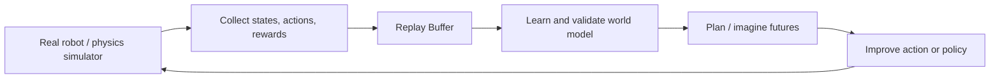
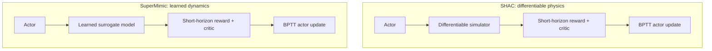

# Model-Based Reinforcement Learning: From Learned Dynamics to Differentiable Policy Optimization

[Course home](https://github.com/zengxiong111/Foundation_of_Embodied_AI) · [简体中文](Model_Based_RL_Differentiable_World_Models_ZH.md) · [SuperMimic](https://arxiv.org/abs/2610.28480) · [SHAC](https://arxiv.org/abs/2204.07137) · [PDF](../pdf/Model_Based_RL_Differentiable_World_Models_EN.pdf)

| Item | Details |
|---|---|
| Topic | Model-based reinforcement learning and differentiable policy optimization |
| Audience | Learners familiar with MDPs, PPO/SAC, and basic robot dynamics |
| Revised | 2026-10-30 |
| License | CC BY-NC-SA 4.0 · Xiong Zeng and contributors |

## Contents

1. [Why model-based reinforcement learning?](#course-01)
2. [How do we learn a world model?](#course-02)
3. [How does a world model improve actions?](#course-03)
4. [How does a differentiable model optimize a policy?](#course-04)
5. [SHAC: Why does short-horizon BPTT need a critic?](#course-05)
6. [SuperMimic: From simulator data to differentiable policy learning](#course-06)
7. [Dexterous manipulation: Contact gradients and deployment limits](#course-07)
8. [Recap, self-check, and references](#course-08)

## 1. Why model-based reinforcement learning?

### 1.1 Start with a robot task

Consider a dexterous hand trying to rotate an object to a target orientation. After a joint command, the object might rotate, slide, or fall because friction is insufficient. **If the robot can predict these outcomes before acting, it can judge which action is worth trying.** This is the central motivation behind model-based reinforcement learning (MBRL).

In a Markov decision process (MDP), states evolve according to the true transition kernel $P(s_{t+1}\mid s_t,a_t)$. The objective is to choose a policy $\pi$ maximizing discounted return:

$$
J(\pi)=\mathbb E_{P,\pi}\left[\sum_{t=0}^{T-1}\gamma^t r(s_t,a_t)\right].
$$

**Model-free RL** methods such as PPO and SAC update a policy or value function using observed transitions and returns without explicitly learning to predict the next state. **Model-based RL** additionally uses a known or learned model $\hat P$, or a deterministic model $f_\omega$:

$$
\hat s_{t+1}=f_\omega(s_t,a_t).
$$

Three questions should be kept separate: **Does a dynamics model exist? Is it differentiable? Is the actor optimized by differentiating through it?** An MPC controller can plan using a black-box simulator, MBPO can train SAC on synthetic experience, and SHAC or SuperMimic can optimize an actor directly through a differentiable computation graph.

### 1.2 The complete model-based feedback loop

*Figure 1: A general MBRL loop. Online planning chooses actions directly; policy optimization instead encodes improvements in actor parameters.*

This loop explains both the opportunity and the risk. A learned model can cheaply predict many futures, but an optimizer may also exploit its inaccuracies (**model exploitation**). World-model learning must therefore be coupled to feedback from the actual environment or reference simulator.

## 2. How do we learn a world model?

### 2.1 Define states, actions, and observations first

For a robot manipulation task, a convenient representation is

$$
\begin{aligned}
s_t&=(q_t,\dot q_t,x_t^{\mathrm{obj}},v_t^{\mathrm{obj}}),\\
a_t&=\text{actually applied joint command},\\
o_t&=h(s_t)+\eta_t.
\end{aligned}
$$

Here $q_t,\dot q_t$ are joint positions and velocities; $x_t^{\mathrm{obj}},v_t^{\mathrm{obj}}$ describe the object pose and twist. Observation noise is $\eta_t$. Environment parameters such as friction, mass, inertia, and actuator gains can be collected in $\xi$. **Privileged simulator state $s_t$ is not the same as deployable observation $o_t$.** A world model can be trained with privileged targets, but a deployed actor must operate with its available sensors.

Transitions are stored in a replay buffer:

$$
\mathcal B=\{(s_t,a_t,r_{t+1},s_{t+1},d_{t+1},g_t,\xi)\}.
$$

The variable $g_t$ denotes a goal or reference command, while $d_{t+1}$ indicates termination. Store the action **actually executed after exploration noise, clipping, and saturation**. Distinguish success/failure termination from time-limit truncation; do not treat samples spanning an episode reset as a continuous trajectory.

### 2.2 From one-step fitting to multi-step prediction

The simplest world model minimizes one-step supervised prediction error:

$$
\mathcal L_1(\omega)=\mathbb E_{\mathcal B}\bigl[\|f_\omega(s_t,a_t,\xi)-s_{t+1}\|_{W_s}^2\bigr].
$$

However, policy optimization runs the model repeatedly. At later imagined steps the input is **the model's previous prediction**, not the simulator's true state:

$$
\hat s_t=s_t,\qquad
\hat s_{t+j+1}=f_\omega(\hat s_{t+j},a_{t+j},\xi).
$$

Using recorded actions to supervise an autoregressive window of length $K$, define

$$
\mathcal L_K(\omega)=\mathbb E_{\mathcal B}\sum_{j=1}^{K}
\|\hat s_{t+j}-s_{t+j}\|_{W_s}^2.
$$

**Why is low one-step error insufficient?** A small state-prediction error at each step can feed into the next prediction and accumulate. More importantly, an updated actor may select actions that take the model into states not represented in its training data. Multi-step error and actual policy performance must therefore be checked separately.

For rotation states represented by quaternions, losses should respect the equivalence of $q$ and $-q$; an appropriate geodesic orientation loss is often preferable. Reward, noise-free observation, and termination probability can also be modeled. If reward is exactly computable from the predicted state, there is no need to train an additional reward head.

### 2.3 The fitting loop and model reliability

A standard iteration is: **collect transitions → split training and validation trajectories → fit one-step/multi-step dynamics → evaluate on held-out sequences → improve the policy with the model → collect fresh transitions**. Beyond training loss, ask:

- **Prediction:** Do 1-, $K$-, and $H$-step errors increase sharply with rollout length?
- **Coverage:** Does the improved actor visit states outside the replay distribution?
- **Uncertainty:** Do ensemble models disagree about a particular transition?
- **Reality check:** Does increasing imagined return actually improve return in the physics simulator?

PETS uses probabilistic dynamics ensembles and trajectory sampling to quantify uncertainty. A single deterministic surrogate may be cheaper, but it generally needs frequent data refresh and conservative policy updates.

## 3. How does a world model improve actions?

The central distinction is not the network architecture of a model, but **what the control algorithm does with its predictions**.

| Method | Role of the model | Optimization mechanism | Main compute stage |
|---|---|---|---|
| Dyna / MBPO | Generate extra transitions | Train actor–critic via SAC / TD | Mostly training |
| PETS / MPC | Forecast candidate action sequences | Search action chunks using CEM / MPPI | Repeated online planning |
| Dreamer | Imagine trajectories in latent states | Differentiate imagined value to train actor and critic | Mostly training |
| SHAC | Differentiate the physics simulator | Short-horizon BPTT + critic | Mostly training |
| SuperMimic | Learn a differentiable dynamics surrogate | Short-horizon BPTT + critic | Mostly training |

> **An important overlap:** Latent imagination and differentiable policy learning are not mutually exclusive. The original Dreamer itself propagates value gradients through imagined latent trajectories. SHAC uses a differentiable physics simulator rather than necessarily learning a world model.

### 3.1 Planning an action sequence versus learning a feedback policy

PETS- and MPC-style approaches search for an action sequence $A=(a_0,\ldots,a_{H-1})$ from the current state:

$$
A^*=\arg\max_A\,\mathbb E_{\hat P}\left[
\sum_{t=0}^{H-1}\gamma^t r(\hat s_t,a_t)\right].
$$

CEM updates a distribution over candidates from high-return samples, while MPPI weights action perturbations by trajectory cost or return. Either can regard the dynamics model as a black box: **computing** $\partial f_\omega/\partial a$ **is not necessary**. Online planning repeats this computation at each control step. In contrast, policy learning trains $a_t=\pi_\theta(o_t)$, which generally requires only a forward pass at deployment.

**The next question:** If the model is differentiable, can we learn what action to take in each state rather than repeatedly searching over complete action sequences? That leads directly to the pathwise gradient.

## 4. How does a differentiable model optimize a policy?

### 4.1 A two-step example: Past actions affect future states

Consider a deliberately simple one-dimensional system:

$$
s_{t+1}=s_t+a_t,\qquad a_t=\theta s_t,\qquad s_0=1.
$$

The first two states are

$$
s_1=1+\theta,\qquad s_2=(1+\theta)^2.
$$

Therefore,

$$
\frac{\mathrm ds_2}{\mathrm d\theta}=2(1+\theta).
$$

Suppose the goal is to reach $s^*$ and define $J(\theta)=-(s_2-s^*)^2$. Then

$$
\frac{\mathrm dJ}{\mathrm d\theta}
=-2(s_2-s^*)\,2(1+\theta).
$$

The gradient contains both the direct effect of the second action and the **indirect effect of the first action on the state from which the second action is chosen**. Repeated application of the chain rule over many steps is backpropagation through time (BPTT).

### 4.2 Chain rule for a differentiable feedback loop

Let the model weights $\omega$ remain fixed during the current actor update:

$$
a_t=\pi_\theta(h(\hat s_t),g_t),\qquad
\hat s_{t+1}=f_\omega(\hat s_t,a_t,\xi).
$$

Write $D_t=\mathrm d\hat s_t/\mathrm d\theta$. With goal $g_t$ and context $\xi$ held fixed,

$$
\begin{aligned}
\frac{\mathrm da_t}{\mathrm d\theta}
&=\frac{\partial\pi_\theta}{\partial\theta}
+\frac{\partial\pi_\theta}{\partial o_t}
\frac{\partial h}{\partial s_t}D_t,\\[3pt]
D_{t+1}&=\frac{\partial f_\omega}{\partial s_t}D_t
+\frac{\partial f_\omega}{\partial a_t}
\frac{\mathrm da_t}{\mathrm d\theta}.
\end{aligned}
$$

If the imagined initial state is sampled from replay and treated as constant, $D_0=0$; subsequent states still depend on earlier actions. In implementations, automatic differentiation handles these products without explicitly forming every full Jacobian.

### 4.3 From state derivatives to an actor objective

Ignoring termination for the moment, a short-horizon imagined objective is

$$
\hat J_H(\theta)=\mathbb E\left[
\sum_{t=0}^{H-1}\gamma^t\hat r(\hat s_t,a_t)
+\gamma^H V_\psi(\hat s_H)\right].
$$

Gradients propagate along $\theta\to a_t\to\hat s_{t+1}\to\hat r,V_\psi$. Unlike PPO's likelihood-ratio gradient, this direction depends on **the reliability of the dynamics Jacobian**. Strictly speaking, it optimizes surrogate return $\hat J_H$ and is not guaranteed to be an unbiased gradient of real return $J$.

**An important implementation detail:** During an actor update, freezing $\omega$ is appropriate, but wrapping the entire world model in `no_grad()` is not. Freezing model weights and cutting the input-to-state gradient are different operations.

## 5. SHAC: Why does short-horizon BPTT need a critic?

### 5.1 Longer unrolls are not necessarily better

Unrolling many steps creates two problems: **products of Jacobians can cause vanishing/exploding gradients**, and **model-prediction errors accumulate along the trajectory**. SHAC (Short-Horizon Actor–Critic) differentiates over only $H$ steps and asks a value function to estimate what happens after that:

$$
G_t^{(H)}=\sum_{j=0}^{H-1}\gamma^j r_{t+j+1}
+\gamma^H V_\psi(s_{t+H}).
$$

The reward sum supplies near-term differentiable feedback; the terminal value $V_\psi$ supplies information about the long-term objective. This does not eliminate critic error. It is a trade-off between gradient instability, model bias, and imperfect value estimation.

### 5.2 Where does the critic come from?

The critic must still learn from trajectories. A simple $k$-step bootstrapped target is

$$
\widetilde V_t^{(k)}=
\sum_{j=0}^{k-1}\gamma^j r_{t+j+1}
+\gamma^k V_{\bar\psi}(s_{t+k}),\qquad
\mathcal L_V=\mathbb E\bigl[(V_\psi(s_t)-\widetilde V_t^{(k)})^2\bigr].
$$

TD($\lambda$) can combine returns with different $k$. A true episode termination masks the bootstrap tail; time-limit truncation may not, depending on the environment semantics. Critic-training trajectories need not be exactly the same samples used for differentiating the actor.

### 5.3 Gradient paths in SHAC and SuperMimic

*Figure 2: Both optimize an actor using differentiable short-horizon returns, but differ in the source of differentiable dynamics. SHAC differentiates through physics; SuperMimic through a model learned from conventional simulator data.*

## 6. SuperMimic: From simulator data to differentiable policy learning

[SuperMimic (2026)](https://arxiv.org/abs/2610.28480) addresses large-scale humanoid whole-body motion tracking. A conventional rigid-body simulator supplies training data, while **one shared learned differentiable dynamics model** supports policy training. Backpropagation through the underlying physics simulator is not required.

### 6.1 The alternating three-stage loop

1. **Collect simulator trajectories:** Execute the current actor in a physics simulator and record applied actions, state transitions, rewards, and reference commands in a replay buffer.
2. **Update the world model:** Fit autoregressive dynamics using consecutive replay windows, together with observation, reward, or termination representations required by the task.
3. **Update actor–critic:** Initialize short imagined rollouts from replay states. Keep model parameters unchanged while retaining differentiability from actions to predicted states. Bootstrap longer-term return with a critic, then go back to stage 1.

The essential feature is that **model and actor are improved in alternating phases**, rather than indefinitely exploiting a fixed offline model that is never refreshed.

### 6.2 Do not confuse model window $K$ with imagination horizon $H$

Representative settings in the paper are an **$K=8$-step world-model fitting window** and an **$H=32$-step actor imagination horizon**:

| Quantity | Where is it used? | Purpose |
|---|---|---|
| $K=8$ | World-model fitting | Train autoregressive dynamics with supervised multi-step loss |
| $H=32$ | Actor–critic update | Evaluate short-horizon imagined return, terminal value, and pathwise actor gradient |

These lengths need not be equal. **Training with $K=8$ does not limit a recursive model to eight predictions**; it can be unrolled further, but accuracy and gradient quality beyond the supervised window must be validated. Likewise, $H=32$ does not imply that every model-training example is supervised for 32 steps.

### 6.3 Boundaries of gradients, observations, and reported performance

The world model may use privileged simulator state as a supervision target, but the deployed actor cannot depend on information unavailable to its sensors. Motion-reference phases and timestamps must also stay aligned between actor and critic. During actor updates, **freezing model parameters must not detach derivatives with respect to model inputs**.

The paper reports that about three hours on a single H100 surpassed the return of a released SONIC checkpoint, and it demonstrates large-scale motion tracking and physical Unitree G1 behavior. However, hardware, motion data, and engineering configurations are not completely matched; these figures are **not** a controlled equal-budget speedup of BPTT over PPO. The paper evaluates **humanoid whole-body tracking** and does not establish a physical dexterous-hand in-hand reorientation result.

## 7. Dexterous manipulation: Contact gradients and deployment limits

### 7.1 Why contact makes gradients difficult

Grasping and in-hand reorientation involve mode changes between separation, impact, sticking, and sliding. Even a simple piecewise map illustrates the difficulty:

$$
y=\max(0,x+a),\qquad
\frac{\partial y}{\partial a}=
\begin{cases}0,&x+a<0,\\1,&x+a>0.\end{cases}
$$

At $x+a=0$ the classical derivative is undefined. Real rigid-body contact is far more complex. A smooth neural model may predict nearby state values accurately while **smoothing away the contact-mode transition that determines which action direction is beneficial**. Low prediction MSE therefore does not guarantee a reliable BPTT policy gradient.

### 7.2 How can we test a surrogate gradient?

Besides measuring $\|f_\omega(s,a)-F_{\mathrm{sim}}(s,a)\|$, choose an action direction $u$ and measure a small symmetric perturbation of return in the actual simulator:

$$
\Delta_u J_{\mathrm{sim}}
=J_{\mathrm{sim}}(a+\varepsilon u)-J_{\mathrm{sim}}(a-\varepsilon u).
$$

Compare its sign and local trend with the model's prediction. Near an impact threshold, this is a **finite-perturbation directional test**, not a claim that the real contact dynamics have classical derivatives everywhere. If imagined return rises while true simulator success falls, suspect model bias or distribution shift before trusting the gradient.

### 7.3 A unifying in-hand reorientation example

Consider **stabilize the object → redistribute finger contact forces → rotate to a target orientation**. Useful model inputs include joint positions/velocities, object pose/twist, recent actions, target orientation, and friction/actuator context where available. With a hand such as Revo3, one must also check that the simulated executed action matches the real control interface, and that contact mechanics and sensing delay are represented faithfully.

Three complementary checks are **trajectory prediction** (object pose/velocity), **contact events** (separation, slip, drops), and **closed-loop performance** (orientation error and task success). Applying a SuperMimic-style scheme to this setting is a promising research direction, not a capability already demonstrated by the original paper.

## 8. Recap, self-check, and references

### 8.1 One sentence for each method

**MBRL** forecasts future outcomes with a model; **PETS/MPC** search for current actions within the model; **MBPO** uses the model to augment training data; **Dreamer** learns behaviors by imagining latent trajectories; **SHAC** obtains short-horizon actor gradients through differentiable physics; **SuperMimic** obtains analogous short-horizon actor–critic updates through a differentiable surrogate learned from ordinary simulation data.

### 8.2 Self-check questions

1. Why does using a model not necessarily mean differentiating through it? How do PETS and SuperMimic improve actions differently?
2. Derive $\mathrm ds_2/\mathrm d\theta$ in the two-step example and identify the indirect role of the first action.
3. Why is $K=8$ model fitting compatible with $H=32$ policy imagination?
4. Where does the **differentiable computation graph** come from in SHAC versus SuperMimic?
5. For dexterous-hand slip, how would you test whether low prediction error implies a useful action-improvement direction?

### 8.3 Primary references

- [Sutton, *Dyna: Integrated Architectures for Learning, Planning, and Reacting* (1991)](https://www.cs.utexas.edu/~pstone/Courses/394Rspring13/resources/sutton91dyna.pdf)
- [Chua et al., *PETS: Deep Reinforcement Learning in a Handful of Trials using Probabilistic Dynamics Models* (NeurIPS 2018)](https://arxiv.org/abs/1805.12114)
- [Janner et al., *When to Trust Your Model: Model-Based Policy Optimization* (NeurIPS 2019)](https://arxiv.org/abs/1906.08253)
- [Hafner et al., *Dream to Control: Learning Behaviors by Latent Imagination* (ICLR 2020)](https://arxiv.org/abs/1912.01603)
- [Xu et al., *Accelerated Policy Learning with Parallel Differentiable Simulation* (SHAC, ICLR 2022)](https://arxiv.org/abs/2204.07137)
- [Liao et al., *SuperMimic: Scaling Humanoid Whole-Body Control with One Differentiable World Model* (2026)](https://arxiv.org/abs/2610.28480)

External papers, code, and images retain their respective licenses.
