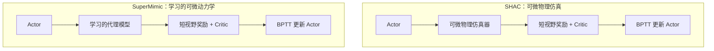

# 基于世界模型的强化学习：从模型学习到可微策略优化

[课程首页](https://github.com/zengxiong111/Foundation_of_Embodied_AI) · [English](Model_Based_RL_Differentiable_World_Models_EN.md) · [SuperMimic](https://arxiv.org/abs/2610.28480) · [SHAC](https://arxiv.org/abs/2204.07137) · [PDF](../pdf/Model_Based_RL_Differentiable_World_Models_ZH.pdf)

| 项目 | 说明 |
|---|---|
| 主题 | 基于模型的强化学习与可微策略优化 |
| 适用读者 | 已了解 MDP、PPO/SAC 与基本机器人动力学的学习者 |
| 修订日期 | 2026-10-30 |
| 许可 | CC BY-NC-SA 4.0 · Xiong Zeng and contributors |

## 目录

1. [为什么需要 Model-Based RL？](#course-01)
2. [如何学习一个世界模型？](#course-02)
3. [如何利用世界模型改善动作？](#course-03)
4. [为什么可微模型能直接优化策略？](#course-04)
5. [SHAC：短视野 BPTT 为什么需要 Critic？](#course-05)
6. [SuperMimic：从仿真数据到可微策略学习](#course-06)
7. [扩展到灵巧手：接触梯度与部署边界](#course-07)
8. [回顾、自测与参考资料](#course-08)

## 1. 为什么需要 Model-Based RL？

### 1.1 从一个直观的机器人任务开始

设机器人需要用手指将物体旋转到目标姿态。执行一个关节动作后，物体可能旋转，也可能因摩擦不足而滑落。**若能在执行前预测这些后果，就可以评估动作是否值得尝试。** 这正是基于模型的强化学习（Model-Based Reinforcement Learning, MBRL）的出发点。

在马尔可夫决策过程（MDP）中，状态按真实转移核 $P(s_{t+1}\mid s_t,a_t)$ 演化。目标是选择策略 $\pi$，最大化折扣回报：

$$
J(\pi)=\mathbb E_{P,\pi}\left[\sum_{t=0}^{T-1}\gamma^t r(s_t,a_t)\right].
$$

**Model-Free RL**（如 PPO、SAC）可直接利用收集到的转移与回报更新策略或价值函数，并不要求显式预测下一状态。**Model-Based RL** 则额外使用一个已知或学习得到的模型 $\hat P$，或者确定性模型 $f_\omega$：

$$
\hat s_{t+1}=f_\omega(s_t,a_t).
$$

需要区分三个独立问题：**是否有动力学模型、模型是否可微、是否通过模型对策略求导**。例如，MPC 可以用黑盒模拟器规划，MBPO 可以用模型生成数据再训练 SAC，而 SHAC / SuperMimic 利用可微计算图直接优化 Actor。

### 1.2 一张图理解模型如何参与闭环

*图 1：通用 MBRL 闭环。在线规划可以在当前时刻直接选择动作；策略学习则将改进结果写入 Actor 参数。*

这个闭环解释了 MBRL 的潜在优势与代价：模型可反复用于低成本预测，但模型错误也会被策略利用（**model exploitation**）。因此模型学习和真实环境反馈必须配合，不能只相信想象回报。

## 2. 如何学习一个世界模型？

### 2.1 先明确状态、动作与观测

在机器人问题中，可将状态、动作和观测写为：

$$
\begin{aligned}
s_t&=(q_t,\dot q_t,x_t^{\mathrm{obj}},v_t^{\mathrm{obj}}),\\
a_t&=\text{实际施加的关节控制命令},\\
o_t&=h(s_t)+\eta_t.
\end{aligned}
$$

$q_t,\dot q_t$ 为关节位置/速度，$x_t^{\mathrm{obj}},v_t^{\mathrm{obj}}$ 为物体位姿/速度；$\eta_t$ 表示观测噪声。摩擦、质量、惯量、执行器增益等环境参数可记为 $\xi$。**仿真器内部的特权状态 $s_t$ 不等于真机可获得的观测 $o_t$。** 学习阶段可以利用特权状态，但部署后的 Actor 必须满足传感器限制。

数据通常存入 Replay Buffer：

$$
\mathcal B=\{(s_t,a_t,r_{t+1},s_{t+1},d_{t+1},g_t,\xi)\}.
$$

其中 $g_t$ 是目标或参考动作，$d_{t+1}$ 是终止标记。记录的 $a_t$ 应是**噪声注入、裁剪、限幅之后真正执行的动作**。还应区分成功/失败终止与时间截断，避免把跨越环境 Reset 的记录当作连续轨迹。

### 2.2 从单步拟合走向多步预测

最简单的世界模型通过监督学习最小化单步预测误差：

$$
\mathcal L_1(\omega)=\mathbb E_{\mathcal B}\bigl[\|f_\omega(s_t,a_t,\xi)-s_{t+1}\|_{W_s}^2\bigr].
$$

然而，策略优化需要在模型里连续执行多步。此时模型接收的是**自己上一步预测的状态**，而不是真实状态：

$$
\hat s_t=s_t,\qquad
\hat s_{t+j+1}=f_\omega(\hat s_{t+j},a_{t+j},\xi).
$$

用真实轨迹中的动作序列监督 $K$ 步自回归预测，可以定义：

$$
\mathcal L_K(\omega)=\mathbb E_{\mathcal B}\sum_{j=1}^{K}
\|\hat s_{t+j}-s_{t+j}\|_{W_s}^2.
$$

**为何单步准确还不够？** 假设每步位置预测都有微小误差；后续预测会把前一步误差继续传入模型。更严重的是，Actor 可能改变动作，使状态进入训练数据未覆盖的区域。多步误差与策略实际得到的回报，因而都应独立检查。

对四元数姿态，应处理 $q$ 与 $-q$ 的等价性，可使用测地角误差等合适的旋转损失。奖励、无噪观测和终止概率也可以是模型输出；如果奖励能从预测状态精确计算，就无需额外学习奖励网络。

### 2.3 训练流程与可信度检验

一次完整迭代通常是：**采集数据 → 划分训练/验证轨迹 → 拟合单步或多步模型 → 在留出轨迹上评估 → 用模型改善策略 → 重新采集数据**。重点不只是减小训练损失，还要回答以下问题：

- **预测误差：**1、$K$、$H$ 步误差是否随预测长度急剧增大？
- **数据覆盖：**新策略访问的状态是否超出 Buffer 的分布？
- **不确定性：**多个模型（ensemble）在同一状态的预测是否分歧？
- **真实效果：**想象回报提高，真实仿真器中的任务回报是否也提高？

PETS 使用概率动力学集成与轨迹采样来表达预测不确定性；单个确定性代理模型更轻量，但通常更依赖持续的数据刷新与保守的策略更新。

## 3. 如何利用世界模型改善动作？

理解算法差异的关键不是模型网络结构，而是**模型输出最后怎样影响动作**。

| 方法 | 模型的作用 | 优化变量及机制 | 训练或执行时的计算 |
|---|---|---|---|
| Dyna / MBPO | 生成额外状态转移 | 用 SAC / TD 等方法训练 Actor–Critic | 训练期主要使用 |
| PETS / MPC | 预测候选动作序列 | 用 CEM / MPPI 等搜索动作块 | 执行时反复规划 |
| Dreamer | 在潜状态中想象未来 | 通过可微想象轨迹训练 Actor 与 Value | 训练期主要使用 |
| SHAC | 使用可微物理仿真器 | 短视野 BPTT + Critic | 训练期主要使用 |
| SuperMimic | 学习可微动力学代理模型 | 短视野 BPTT + Critic | 训练期主要使用 |

> **分类提醒：**“潜空间想象”和“可微策略学习”不是互斥类别：原始 Dreamer 本身也通过可微潜空间轨迹传播价值梯度。SHAC 使用的是可微物理引擎，而非必须学习的世界模型。

### 3.1 规划一段动作，还是训练一个反馈策略？

PETS / MPC 类方法在当前状态下搜索一个动作序列 $A=(a_0,\ldots,a_{H-1})$：

$$
A^*=\arg\max_A\,\mathbb E_{\hat P}\left[
\sum_{t=0}^{H-1}\gamma^t r(\hat s_t,a_t)\right].
$$

CEM 按高回报样本更新候选动作分布；MPPI 按轨迹代价/回报加权动作扰动。模型可以是黑盒，**不需要计算** $\partial f_\omega/\partial a$。在线规划每个控制周期都要重复计算；反之，策略学习训练一个 $a_t=\pi_\theta(o_t)$，部署时通常只需一次前向推理。

**下一步的问题：** 如果模型可以求导，能不能不搜索每条动作序列，而直接学习“什么状态该做什么动作”？这就引出了 Pathwise Gradient。

## 4. 为什么可微模型能直接优化策略？

### 4.1 两步例子：过去的动作也影响未来

考虑一个刻意简化的一维系统：

$$
s_{t+1}=s_t+a_t,\qquad a_t=\theta s_t,\qquad s_0=1.
$$

第一步、第二步的状态为：

$$
s_1=1+\theta,\qquad s_2=(1+\theta)^2.
$$

于是：

$$
\frac{\mathrm ds_2}{\mathrm d\theta}=2(1+\theta).
$$

如果目标是使 $s_2$ 接近 $s^*$，设 $J(\theta)=-(s_2-s^*)^2$，则

$$
\frac{\mathrm dJ}{\mathrm d\theta}
=-2(s_2-s^*)\,2(1+\theta).
$$

这里的梯度不仅包括第二步动作对状态的影响，也包括**第一步动作改变了第二步起始状态**这一间接效应。对长轨迹反复应用链式法则，就是 Through-Time Backpropagation（BPTT）。

### 4.2 一般可微闭环的链式法则

设模型参数 $\omega$ 在本次 Actor 更新中固定：

$$
a_t=\pi_\theta(h(\hat s_t),g_t),\qquad
\hat s_{t+1}=f_\omega(\hat s_t,a_t,\xi).
$$

令 $D_t=\mathrm d\hat s_t/\mathrm d\theta$。在目标 $g_t$ 与环境参数 $\xi$ 固定时，

$$
\begin{aligned}
\frac{\mathrm da_t}{\mathrm d\theta}
&=\frac{\partial\pi_\theta}{\partial\theta}
+\frac{\partial\pi_\theta}{\partial o_t}
\frac{\partial h}{\partial s_t}D_t,\\[3pt]
D_{t+1}&=\frac{\partial f_\omega}{\partial s_t}D_t
+\frac{\partial f_\omega}{\partial a_t}
\frac{\mathrm da_t}{\mathrm d\theta}.
\end{aligned}
$$

如果想象的初始状态从 Buffer 采样并视为常量，则 $D_0=0$；但此后每一步都会积累此前动作的影响。实际实现通常交给自动微分，而不是显式存储完整 Jacobian。

### 4.3 从状态梯度到策略目标

忽略终止细节，短时域想象目标可以写成：

$$
\hat J_H(\theta)=\mathbb E\left[
\sum_{t=0}^{H-1}\gamma^t\hat r(\hat s_t,a_t)
+\gamma^H V_\psi(\hat s_H)\right].
$$

梯度沿着 $\theta\to a_t\to\hat s_{t+1}\to\hat r, V_\psi$ 传播。与 PPO 的似然比梯度不同，这个方向依赖**动力学 Jacobian 是否可靠**。严格地说，它优化的是近似模型中的 $\hat J_H$，不保证等于真实系统 $J$ 的无偏梯度。

**一个重要实现细节：** 更新 Actor 时可以冻结 $\omega$，但不能把整个世界模型放进 `no_grad()`；冻结参数与切断动作到下一状态的梯度是两回事。

## 5. SHAC：短视野 BPTT 为什么需要 Critic？

### 5.1 长视野不一定更好

把轨迹展开很多步会遇到两个问题：**Jacobian 连乘造成梯度消失/爆炸**，以及**模型预测误差沿轨迹累积**。SHAC（Short-Horizon Actor–Critic）的思路是只对较短的 $H$ 步做 BPTT，同时用价值函数估计更远的未来：

$$
G_t^{(H)}=\sum_{j=0}^{H-1}\gamma^j r_{t+j+1}
+\gamma^H V_\psi(s_{t+H}).
$$

前半部分让 Actor 获得近端的可微反馈；末尾 $V_\psi$ 提供长期任务信息。这并不消除 Critic 的误差，只是通过“短视野 + 终值近似”在两种困难之间折中。

### 5.2 Critic 从哪里来？

Critic 仍需从轨迹数据中学习。一个易于理解的 $k$ 步 bootstrap 目标是：

$$
\widetilde V_t^{(k)}=
\sum_{j=0}^{k-1}\gamma^j r_{t+j+1}
+\gamma^k V_{\bar\psi}(s_{t+k}),\qquad
\mathcal L_V=\mathbb E\bigl[(V_\psi(s_t)-\widetilde V_t^{(k)})^2\bigr].
$$

可以用 TD($\lambda$) 对不同 $k$ 的回报加权。实际任务中，真实 Episode 终止后不应继续 bootstrap；时间上限截断是否保留尾项需根据环境语义决定。训练 Critic 的目标和 Actor 使用的可微轨迹，也不必是完全相同的一批样本。

### 5.3 SHAC 与 SuperMimic 的梯度路径

*图 2：两者共享优化原理，但可求导的动力学来源不同。SHAC 对可微物理仿真器求导；SuperMimic 对从普通仿真数据训练的可微代理模型求导。*

## 6. SuperMimic：从仿真数据到可微策略学习

[SuperMimic（2026）](https://arxiv.org/abs/2610.28480) 研究人形机器人的大规模全身动作跟踪。它使用普通刚体仿真器提供训练数据，用一个**共享的可微动力学模型**来训练跟踪策略，不要求对底层物理仿真器反向传播。

### 6.1 三阶段闭环训练

1. **收集真实仿真轨迹：**当前 Actor 在物理仿真器中执行，记录实际动作、状态转移、奖励及参考命令，加入 Replay Buffer。
2. **更新世界模型：**从 Buffer 取连续片段，训练自回归动力学预测（以及任务需要的观测、奖励和终止表示）。
3. **更新 Actor–Critic：**从 Buffer 中的真实状态启动短步想象；保持模型权重不更新，但保留通过模型到动作的反向传播；用 Critic 补偿想象视野以外的长期回报。然后返回第 1 步。

这个循环最值得注意的是：**模型和策略可以交替改进，而不是先离线训练一个固定模型再无限制地优化 Actor**。

### 6.2 不要混淆训练窗口 $K$ 和想象长度 $H$

论文中的代表性设置是 **$K=8$ 步模型训练窗口**和 **$H=32$ 步 Actor 想象轨迹**：

| 量 | 出现在哪一步？ | 用来做什么？ |
|---|---|---|
| $K=8$ | 世界模型训练 | 用有监督的自回归多步损失拟合动力学 |
| $H=32$ | Actor–Critic 更新 | 沿预测轨迹计算短视野回报、终值与策略梯度 |

两者不必相等。**$K=8$ 并不意味着模型只能够预测八步**；模型仍能递归展开更久，但超过监督窗口的误差和梯度可信度必须额外检验。同样，$H=32$ 也不意味着每次世界模型训练都必须取 32 步监督数据。

### 6.3 梯度、观测和论文结果的边界

世界模型可以使用仿真器特权状态作监督，但 Actor 在部署时不能依赖不可获取的特权信息；目标动作的相位与时间也应在 Actor/Critic 中对齐。在 Actor 更新阶段，**冻结模型参数不等于切断模型的输入梯度**。

原论文报告单张 H100 约 3 小时的训练即可超过已发布的 SONIC 模型回报，并报告大规模动作跟踪和 Unitree G1 真机演示。但不同系统的硬件、数据与工程配置并不完全一致，这些数字不能理解为“BPTT 相对 PPO 的严格同预算加速比”。此外，论文验证的是**人形全身动作跟踪**，并未证明相同方法已经完成灵巧手真机掌内旋转。

## 7. 扩展到灵巧手：接触梯度与部署边界

### 7.1 为什么接触会使梯度难用？

在抓取和掌内旋转中，手指与物体会在分离（separation）、碰撞（impact）、黏着（stick）和滑动（slip）之间切换。最简单的分段映射就能说明问题：

$$
y=\max(0,x+a),\qquad
\frac{\partial y}{\partial a}=
\begin{cases}0,&x+a<0,\\1,&x+a>0.\end{cases}
$$

在 $x+a=0$ 的切换点，经典导数不存在。真实刚体接触更复杂；一个光滑神经网络可能准确拟合附近状态值，却**平滑掉了决定动作方向的接触切换**。因此低预测 MSE 并不能保证 BPTT 获得正确的控制梯度。

### 7.2 怎样判断代理梯度是否可信？

除了比较 $\|f_\omega(s,a)-F_{\mathrm{sim}}(s,a)\|$，还应选取动作方向 $u$，用小幅正负扰动检查实际仿真回报：

$$
\Delta_u J_{\mathrm{sim}}
=J_{\mathrm{sim}}(a+\varepsilon u)-J_{\mathrm{sim}}(a-\varepsilon u).
$$

将其符号和局部趋势与模型预测比较。靠近碰撞阈值时，这只是**有限扰动方向性检验**，不是在声称真实动力学处处可微。若模型更新后想象回报升高、物理仿真成功率却下降，应优先怀疑模型偏差或分布漂移。

### 7.3 用灵巧手掌内旋转串起整门课

以“抓稳物体 → 手指交替施力 → 旋转到目标姿态”为例，世界模型宜包含关节位置/速度、物体位姿/速度、最近动作、目标姿态以及可能影响响应的执行器和摩擦上下文。对于 Revo3 一类灵巧手，还需确认控制命令与仿真实际执行动作一致，检查接触模型和观测延迟。

最重要的三个检验维度是：**轨迹预测**（物体姿态/速度）、**接触事件**（分离/滑移/掉落）和**闭环任务表现**（旋转误差与成功率）。从 SuperMimic 到这种任务属于有研究价值的迁移设想，而不是原论文已经验证的性能结论。

## 8. 回顾、自测与参考资料

### 8.1 一句话串起各个方法

**MBRL** 用模型预估未来；**PETS/MPC** 在模型中搜索当前动作；**MBPO** 用模型产生训练数据；**Dreamer** 在潜空间想象并学习行为；**SHAC** 通过可微物理仿真器进行短视野策略梯度优化；**SuperMimic** 用从普通仿真轨迹学到的可微代理模型实现类似的短视野 Actor–Critic 更新。

### 8.2 自测问题

1. 为什么“使用模型”不等于“对模型反向传播”？PETS 和 SuperMimic 分别怎样改善动作？
2. 推导两步例子中的 $\mathrm ds_2/\mathrm d\theta$，并指出第一步动作的间接影响。
3. 为什么 $K=8$ 的世界模型训练与 $H=32$ 的策略想象不矛盾？
4. SHAC 和 SuperMimic 的**可微计算图**分别从哪里来？
5. 对于灵巧手滑移，如何检验低模型预测误差是否也对应可信的动作改进方向？

### 8.3 主要参考资料

- [Sutton, *Dyna: Integrated Architectures for Learning, Planning, and Reacting*（1991）](https://www.cs.utexas.edu/~pstone/Courses/394Rspring13/resources/sutton91dyna.pdf)
- [Chua et al., *PETS: Deep Reinforcement Learning in a Handful of Trials using Probabilistic Dynamics Models*（NeurIPS 2018）](https://arxiv.org/abs/1805.12114)
- [Janner et al., *When to Trust Your Model: Model-Based Policy Optimization*（NeurIPS 2019）](https://arxiv.org/abs/1906.08253)
- [Hafner et al., *Dream to Control: Learning Behaviors by Latent Imagination*（ICLR 2020）](https://arxiv.org/abs/1912.01603)
- [Xu et al., *Accelerated Policy Learning with Parallel Differentiable Simulation*（SHAC，ICLR 2022）](https://arxiv.org/abs/2204.07137)
- [Liao et al., *SuperMimic: Scaling Humanoid Whole-Body Control with One Differentiable World Model*（2026）](https://arxiv.org/abs/2610.28480)

外部论文、代码及图片遵循其各自许可。
