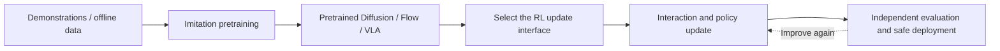
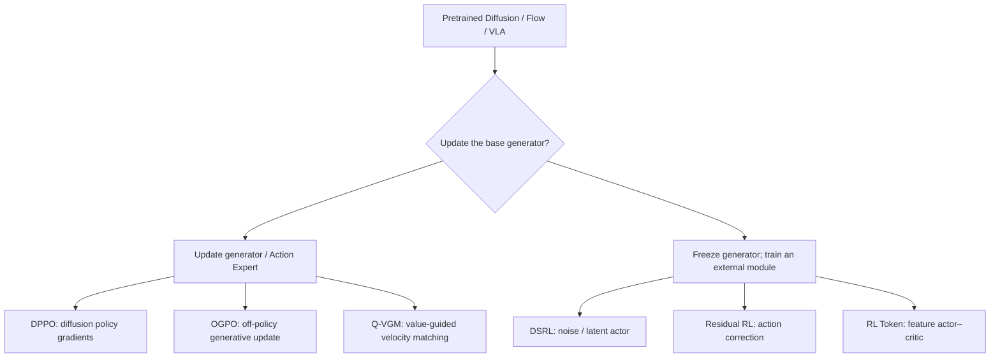
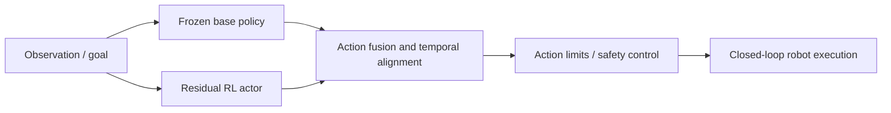
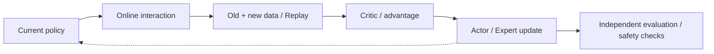
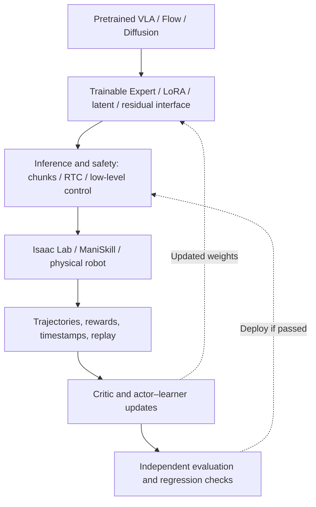

# Reinforcement Learning Post-Training for Embodied Foundation Models

**An expanded tutorial on infrastructure and open challenges · October 2026**

[Course home](https://github.com/zengxiong111/Foundation_of_Embodied_AI) · [简体中文](https://github.com/zengxiong111/Foundation_of_Embodied_AI/blob/main/md/RL_Post_Training_ZH.md) · [English PDF](https://zengxiong111.github.io/zengxiong.github.io/files/RL_Post_Training_EN.pdf)

> **Scope.** This tutorial explains how reinforcement learning improves **pretrained** Diffusion Policies, Flow Matching policies, and vision-language-action (VLA) models. It covers trainable interfaces, RL infrastructure, real-robot feedback loops, and unresolved problems. PPO and SAC are introduced only where needed. There is no discussion of learning a low-level controller from scratch and no coding exercises. The ecosystem review is based on publicly verifiable material available by October 19, 2026. A framework supporting a model, an RL algorithm, and a robot **separately** does not imply that their combination is validated.
>
> **Attribution and evidence.** Expanded from the [Foundation of Embodied AI](https://github.com/zengxiong111/Foundation_of_Embodied_AI) materials by Xiong Zeng and contributors ([CC BY 4.0](https://creativecommons.org/licenses/by/4.0/)). System capabilities are described from official project documentation; research claims refer to primary papers. No independent reproduction or robot validation is claimed here.

## Contents

1. [Scope: a pretrained generative robot policy](#rl-post-section-01)
2. [Taxonomy by the trainable interface](#rl-post-section-02)
3. [Three independent axes of classification](#rl-post-section-03)
4. [Updating the pretrained generator](#rl-post-section-04)
5. [Freezing the generator and learning additional modules](#rl-post-section-05)
6. [Actor–Critic and the online off-policy loop](#rl-post-section-06)
7. [Choosing a method](#rl-post-section-07)
8. [Evaluation and deployment pitfalls](#rl-post-section-08)
9. [Current infrastructure for embodied RL post-training](#rl-post-section-09)
10. [Unresolved research and systems challenges](#rl-post-section-10)
11. [Primary sources and projects](#rl-post-section-11)

## 1. Scope: a pretrained generative robot policy

Imitation pretraining supplies a basic repertoire of actions. RL post-training adds rewards and interaction data to improve task success, precision, recovery from mistakes, and execution efficiency. We start from an **existing pretrained policy**, not from a randomly initialized controller.

*Figure 1. RL post-training starts from an existing policy. Independent evaluation and safety constraints are not substitutes for the RL objective.*

Let $o_t$ denote an observation, $g_t$ a goal or language instruction, and $A_t$ an action chunk of horizon $H$:

$$
\pi_{\theta_0}(A_t\mid o_t,g_t),\qquad A_t=(a_t,\ldots,a_{t+H-1}).
$$

The parameters $\theta_0$ are pretrained. Diffusion and flow policies often generate continuous actions through iterative sampling; a VLA can additionally have a vision-language backbone and a separate Action Expert. The conventional objective is

$$
J(\pi)=\mathbb{E}_{\tau\sim\pi}\!\left[\sum_{t=0}^{T}\gamma^t r_t\right].
$$

An essential post-training requirement is to retain pretrained capabilities while improving reward. For implicit generative policies, **the exact action log-probability $\log\pi(A\mid o,g)$ or inter-policy KL divergence is not generally tractable**. This motivates specialized interfaces rather than a direct substitution into standard actor–critic code.

## 2. Taxonomy by the trainable interface

The clearest first distinction is **updating the pretrained generator** versus **freezing it and learning an external adapter**. This is a useful pedagogical distinction, not a mathematically exhaustive partition. LoRA updates only a subset of the generator, and hybrid systems may combine a residual actor with limited Action Expert adaptation.

*Figure 2. Representative trainable interfaces, not a sequential training pipeline.*

Full versus parameter-efficient fine-tuning describes **which parameters change**. Velocity matching versus policy gradient describes **the learning objective**. On-policy versus off-policy describes **the data-to-update relationship**. These are three separate questions.

## 3. Three independent axes of classification

| Axis | Key question | Representative options |
|---|---|---|
| Pretrained model | What type of policy is adapted? | Diffusion, Flow Matching, VLA with Action Expert |
| Trainable interface | Where do the RL gradients go? | Generator, LoRA, noise actor, residual, feature actor |
| Data and optimizer | How is new and old experience used? | Online / offline; on-policy / off-policy; replay |

**Online is not synonymous with on-policy.** Online training collects new environmental interaction, while off-policy algorithms can reuse trajectories generated by earlier behavior policies. For example, real robots can continuously produce data while an SAC-style learner trains from the current and historical contents of a replay buffer. PPO is conventionally on-policy and SAC off-policy, but DPPO and OGPO are not simply ordinary PPO or SAC attached to a generative action head.

## 4. Updating the pretrained generator

### 4.1 DPPO: diffusion-process policy gradients

[DPPO](https://arxiv.org/abs/2409.00588) brings the multi-step denoising process into RL policy optimization rather than assuming that a Diffusion Policy is an ordinary Gaussian actor with readily available log-probabilities. For intuition, PPO employs the clipped surrogate

$$
L_{\mathrm{clip}}=\mathbb{E}\left[\min\!\left(\rho\hat A,\operatorname{clip}(\rho,1-\epsilon,1+\epsilon)\hat A\right)\right].
$$

This is **not the complete DPPO objective**. DPPO must manage on-policy sample cost, the computational burden of denoising, optimization stability, and retention of pretrained behavior.

### 4.2 OGPO: off-policy replay with generative-policy updates

[OGPO](https://arxiv.org/abs/2605.03065) combines a replay buffer with an off-policy critic to propagate policy-improvement signals into the generative model. The essential information path is **old and new trajectories → value estimation → generative-policy improvement**. A PPO-inspired term in its objective does not make it on-policy PPO. Principal risks include critic error, the distribution shift of replayed transitions, and differentiating through multi-step generation.

### 4.3 Q-VGM: critic-guided Flow Matching

[Q-VGM](https://arxiv.org/abs/2606.08015) turns action-value gradients into local velocity-matching targets for a Flow Action Expert. It **updates the velocity network** without backpropagating through the entire sampling trajectory, combining offline IQL with online TD-style critic training. It therefore belongs to the *generator-updating* branch, not the frozen-base branch.

These are alternatives with different interfaces: diffusion-process policy gradients (DPPO), off-policy replay and full generative optimization (OGPO), and local critic-guided velocity matching (Q-VGM). They are not successive training stages.

## 5. Freezing the generator and learning additional modules

### 5.1 DSRL: RL over noise or latent variables

[DSRL](https://arxiv.org/abs/2506.15799) freezes a pretrained generator and trains a lightweight actor to choose controllable initial noise or latent variables:

$$
z\sim q_{\phi}(z\mid o,g),\quad A=G_{\theta_0}(o,g,z),\quad \theta_0\ \mathrm{fixed}.
$$

Only $\phi$ changes. Training fewer parameters may preserve the pretrained policy, but adaptation is limited by the behaviors reachable through its frozen generator. **A noise-steering interface demonstrated for a diffusion implementation is not automatically compatible with every Flow/VLA architecture.**

### 5.2 Residual RL: bounded action corrections

The fixed policy generates $A_0$ while an extra actor produces $\Delta A_{\phi}$. Both are temporally aligned and passed through an execution-time safety interface:

$$
A_{\mathrm{cmd}}=\operatorname{Safe}\!\left(A_0+\lambda\Delta A_{\phi}\right).
$$

*Figure 3. Base and residual actions are produced in parallel and fused before execution. Residual RL is an architectural pattern, not a particular optimizer.*

### 5.3 RL Token: lightweight RL over VLA features

[RL Token](https://arxiv.org/abs/2604.23073) first develops a compact, task-relevant readout from a VLA, then trains a small actor–critic over that representation. Creating the readout may require initial model adaptation; subsequent online RL can keep the principal VLA backbone frozen. A token-space actor should not be conflated with an action-space residual.

## 6. Actor–Critic and the online off-policy loop

An off-policy learner may store $\mathcal D=\{(o_t,A_t,r_t,o_{t+1},d_t)\}$, update a critic, and then improve the selected actor or Action Expert. An intentionally simplified one-step target is

$$
y_t=r_t+\gamma(1-d_t)\,\mathbb E_{A'\sim\pi}\!\left[Q_{\bar\psi}(o_{t+1},A')\right].
$$

For an action chunk that executes $K$ low-level steps, the transition should instead reflect the **accumulated reward, $K$-step discount $\gamma^K$, and the next decision boundary**. The one-step expression above is not the complete SAC, OGPO, or Q-VGM loss.

*Figure 4. A representative online off-policy loop. On-policy algorithms primarily train on fresh rollouts rather than uncritically replaying old trajectories.*

Keep four separations explicit: reward learning versus execution-time safety constraints, simulation versus real data, actor versus critic updates, and VLA inference frequency versus the robot's low-level control rate.

## 7. Choosing a method

| Method | What receives RL updates | Experience | Primary constraint |
|---|---|---|---|
| DPPO | Diffusion generator | Mainly on-policy | Rollout and multi-step sampling cost |
| OGPO | Generative policy | Online with off-policy critic | Critic bias and policy drift |
| Q-VGM | Flow Action Expert | Offline-to-online, value guided | Reliability of value gradients |
| DSRL | Noise / latent actor | Off-policy possible | Frozen generator's reachable behavior set |
| Residual RL | Action correction actor | Algorithm dependent | Action alignment and contact stability |
| RL Token | Feature actor–critic | Online RL | Accessible VLA features and latency |

A defensible choice begins with whether the generator can be updated, then identifies the exposed noise, velocity, action-chunk, and feature interfaces, and finally checks replay efficiency, critic reliability, and deployment latency.

## 8. Evaluation and deployment pitfalls

In addition to task return and success rate, report **real interaction hours, reset overhead, compute and memory consumption, inference latency, action-chunk discontinuities, safety interventions, recovery rate, out-of-distribution performance, and retention of existing skills**. For off-policy approaches, record the offline/online replay mixture, dataset version, and critic calibration over training.

Five invalid equivalences deserve emphasis: online = on-policy; frozen generator = no trainable weights; velocity matching versus full fine-tuning as mutually exclusive labels; DPPO → OGPO → Q-VGM as a prescribed sequence; and higher simulation success = safe real-world deployment.

## 9. Current infrastructure for embodied RL post-training (October 2026)

### 9.1 Distinguish learners, simulators, model repositories, and benchmarks

A complete post-training stack connects five components: **a pretrained policy with an adaptation interface; an interactive environment (simulated or physical); synchronized transitions and rewards; actor–learner/critic optimization; and safe deployment plus independent evaluation**. A model repository need not supply online RL, and a simulator need not support policy improvement for implicit generative models.

| Layer | Representative public infrastructure | What it supplies—and what it does not |
|---|---|---|
| **VLA RL systems** | [RLinf](https://github.com/RLinf/RLinf), [RLinf-VLA](https://rlinf-vla.github.io/) | VLA adapters, rollout/actor/environment workers, distributed execution, and selected PPO-style RL examples; validate each algorithm–model combination |
| **Real-world online learning** | [RLinf-USER](https://arxiv.org/abs/2602.07837), [HIL-SERL](https://github.com/rail-berkeley/hil-serl) | Asynchronous actor–learner pipelines, robot integration, demonstration reuse, and human intervention; HIL-SERL is not a plug-and-play fine-tuner for arbitrary VLAs |
| **Data and robot learning workflows** | [LeRobot](https://github.com/huggingface/lerobot) | Datasets, hardware adapters, training, evaluation, and a HIL-SERL implementation; support for VLAs and for RL algorithms does not imply every cross-product works |
| **Model implementations** | [OpenPI](https://github.com/Physical-Intelligence/openpi), [Isaac-GR00T](https://github.com/NVIDIA/Isaac-GR00T) | Pretrained weights, Action Expert interfaces, SFT, data transforms, and inference; not complete stand-alone online RL systems |
| **Interaction and simulation** | [Isaac Lab](https://developer.nvidia.com/isaac/lab), [ManiSkill](https://github.com/mani-skill/ManiSkill), MuJoCo | Simulation, sensors, reward and reset logic, and parallel rollout; real-world contact fidelity remains a separate question |
| **Tasks and evaluation** | [LIBERO](https://github.com/Lifelong-Robot-Learning/LIBERO), [RoboTwin 2.0](https://robotwin-platform.github.io/doc/), [RoboCasa365](https://robocasa.ai/), [BEHAVIOR-1K](https://behavior.stanford.edu/) | Standardized tasks and generalization measurements; benchmarks do not substitute for hardware evaluation |
| **Learned environments (research)** | [WoVR](https://arxiv.org/abs/2602.13977), [VLA-MBPO](https://proceedings.mlr.press/v306/zhang26ez.html) | World-model rollouts that may reduce robot interaction; cannot assume physical contact and failure trajectories are accurate |

### 9.2 Two systems worth studying in detail

**RLinf / RLinf-VLA: scalable simulation-based post-training.** RLinf exposes configurable model–environment–algorithm recipes, distinct rollout and training workers, distributed optimization, and evaluation. It is integrated with the [Isaac Lab VLA post-training interface](https://isaac-sim.github.io/IsaacLab/release/3.0.0/source/experimental-features/rlinf_vla_posttraining.html). The documentation offers distinct cases for [PPO on GR00T](https://rlinf.readthedocs.io/en/latest/rst_source/examples/embodied/gr00t.html), [DSRL on a frozen π₀](https://rlinf.readthedocs.io/en/latest/rst_source/examples/embodied/dsrl.html), and [SAC-Flow](https://rlinf.readthedocs.io/en/latest/rst_source/examples/embodied/sac_flow.html). Support for π₀.₅ weights, replay buffers, and SAC in the same project is **not proof that arbitrary π₀.₅ Flow Experts have been validated under online off-policy RL**.

**RLinf-USER / HIL-SERL: closed-loop physical interaction.** RLinf-USER treats robots as schedulable physical resources, separating online collection, weight synchronization, persistent replay, and training. The published examples include Flow + SAC and π₀ + HG-DAgger. **HG-DAgger is interactive imitation learning; it must not be reported as evidence of SAC RL for π₀.** HIL-SERL supplies a reproducible pattern of limited demonstrations, a learned reward classifier, SAC, and human interventions; a corresponding [LeRobot guide](https://github.com/huggingface/lerobot/blob/main/docs/source/hilserl.mdx) is available.

### 9.3 Interfaces needed by a real system

*Figure 5. The infrastructure is the closed loop of model, environment, data, optimization, safety, and evaluation—not a single RL algorithm.*

For generative policies, also log **sampling seeds and noise, preprocessing and normalization versions, model checkpoints, chunk horizon, policy decision rate, and actually executed steps**. Otherwise replayed actions may not match the critic's assumed transition. Asynchronous methods such as [real-time chunking (RTC)](https://rlinf.readthedocs.io/en/latest/rst_source/guides/rtc.html) can overlap inference and action execution but introduce a boundary-alignment problem between consecutive chunks.

## 10. Unresolved research and systems challenges

“Unresolved” here means that a **reliable, generally transferable solution across robots, tasks, and training scales** is missing—not that no paper has proposed a partial solution.

| Open challenge | Why it remains difficult | Promising direction and evidence required |
|---|---|---|
| **Costly physical interaction and resets** | Robots cannot be arbitrarily accelerated, replicated, or reset for free; failure may damage hardware | Asynchronous multi-robot collection, HIL, sim–real co-training; report robot-hours per unit of improvement |
| **Unreliable reward and success detection** | Sparse rewards impede learning; VLMs and reward classifiers are sensitive to viewpoint and distribution shift | Auditable rewards, human corrections, independent terminal-state checks; quantify reward-model errors |
| **Off-policy critic error and policy drift** | Replay mixes behavior policies and checkpoint versions; Q overestimation can mislead generative updates | Conservative/ensemble critics and behavioral anchors; measure OOD value error and retained task performance |
| **Stable updates of implicit generators** | Multi-step sampling, intractable exact action densities, and expensive gradients | Local velocity targets, latent RL, parameter-efficient adaptation; measure memory, time, and update variance |
| **Action chunks versus real-time feedback** | Observation delay, discontinuous chunk transitions, and a slow policy above a fast controller | RTC, overlap guidance, bounded safety layers; measure end-to-end latency and perturbation recovery |
| **Contact-rich and dexterous sim-to-real** | Friction, compliance, contact geometry, occlusion, and fingertip sensing are hard to reproduce | Contact randomization, tactile/proprioceptive feedback, system identification; test assembly, slip, and recovery on hardware |
| **Catastrophic forgetting and lost generality** | Single-task RL can degrade pretrained multi-task competence | SFT/replay mixing and regularization; compare held-out tasks and embodiments before and after RL |
| **False success in learned worlds** | Compounding visual error and inaccurate multi-view/contact physics allow exploiting model errors | Short branched rollouts and calibration with real failures; judge by real transfer, not synthetic reward alone |
| **Weak system-level comparability** | Studies vary in hardware, cameras, resets, compute, data budget, and safety assumptions | Report robot-hours, GPU-hours, interventions, recovery, calibration, and reproducible protocols |

These challenges are motivated by the original works on [RLinf-USER](https://arxiv.org/abs/2602.07837) (collection and system scaling), [π*₀.₆ / RECAP](https://arxiv.org/abs/2511.14759) (demonstrations, corrections, and experience), [VLA-MBPO](https://proceedings.mlr.press/v306/zhang26ez.html) and [VLAW](https://proceedings.mlr.press/v306/guo26i.html) (world-model error and physical fidelity).

### 10.1 Three high-value directions at the intersection of learning and systems

**(1) Online off-policy RL with a frozen foundation policy.** Can a fixed Flow/VLA generator be adapted through a compact latent or feature actor, with a reliable critic reusing physical failures, while retaining broad pretrained competence? Distinguish *local improvement within a fixed action support* from the ability to expand that support.

**(2) Safe robot learning with calibrated rewards and critics.** Reward-model errors, critic uncertainty, and execution-time action constraints should be handled jointly. Optimize success, recovery, and operational risk rather than trusting a scalar reward to make unsafe behavior disappear.

**(3) A closed loop spanning simulation, learned worlds, and physical robots.** Simulation provides throughput, world models propose low-cost supplementary interaction, and robots provide physical ground truth. The key is to measure and control synthetic-trajectory bias such that extra simulated data actually reduces—not increases—the need for real-world interaction.

## 11. Primary sources and projects

| Topic | Original papers and official resources |
|---|---|
| Foundational RL | [PPO](https://arxiv.org/abs/1707.06347) · [SAC](https://arxiv.org/abs/1801.01290) |
| Trainable generator | [DPPO](https://arxiv.org/abs/2409.00588) · [OGPO](https://arxiv.org/abs/2605.03065) · [Q-VGM](https://arxiv.org/abs/2606.08015) · [SAC-Flow](https://rlinf.readthedocs.io/en/latest/rst_source/examples/embodied/sac_flow.html) |
| Frozen or auxiliary interfaces | [DSRL](https://arxiv.org/abs/2506.15799) · [RL Token](https://arxiv.org/abs/2604.23073) |
| RL post-training systems | [RLinf](https://github.com/RLinf/RLinf) · [RLinf-VLA](https://rlinf-vla.github.io/) · [RLinf-USER](https://arxiv.org/abs/2602.07837) · [HIL-SERL](https://github.com/rail-berkeley/hil-serl) · [LeRobot](https://github.com/huggingface/lerobot) |
| Models and simulation | [OpenPI](https://github.com/Physical-Intelligence/openpi) · [Isaac Lab](https://developer.nvidia.com/isaac/lab) · [ManiSkill](https://github.com/mani-skill/ManiSkill) |
| Task and generalization benchmarks | [LIBERO](https://github.com/Lifelong-Robot-Learning/LIBERO) · [RoboTwin 2.0](https://robotwin-platform.github.io/doc/) · [RoboCasa365](https://robocasa.ai/) · [BEHAVIOR-1K](https://behavior.stanford.edu/) |
| Real data and learned worlds | [π*₀.₆ / RECAP](https://arxiv.org/abs/2511.14759) · [VLA-MBPO](https://proceedings.mlr.press/v306/zhang26ez.html) · [VLAW](https://proceedings.mlr.press/v306/guo26i.html) · [WoVR](https://arxiv.org/abs/2602.13977) |

**Takeaway.** Specify the pretrained model, the RL update interface, the experience pipeline, and measurable physical-robot improvements. The central bottleneck is system reliability—not merely a policy-gradient objective.
