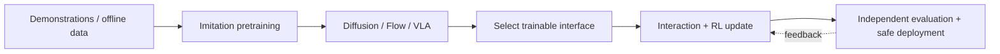
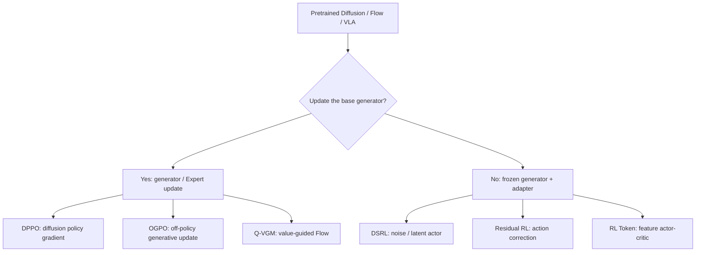
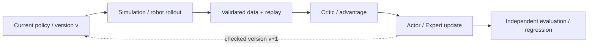
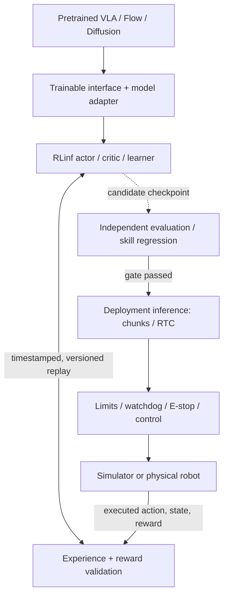

# Reinforcement Learning Post-Training for Embodied Foundation Models

**Algorithms, RLinf Infrastructure, and the Boundaries of Real-Robot Deployment · October 2026**

[Course repository](https://github.com/zengxiong111/Foundation_of_Embodied_AI) · [中文 Markdown](RL_Post_Training_ZH.md) · [RLinf documentation](https://rlinf.readthedocs.io/en/latest/)

> **Scope.** This tutorial studies RL improvement of **pretrained** Diffusion Policies, Flow Matching policies, and vision-language-action (VLA) models. The narrative follows **trainable interfaces → algorithms and experience → infrastructure → physical deployment**. PPO, SAC, and actor–critic appear only where needed. Training low-level controllers from scratch and executable tutorials are out of scope.
>
> **Evidence boundary (as of 19 October 2026).** We distinguish *documented system recipes*, *integration requirements inferred from those recipes*, and *unsolved research questions*. Support for model A, algorithm B, and robot C individually is **not evidence that A × B × C works as a validated combination**. No independent reproduction or real-robot verification is claimed.
>
> **Attribution.** Adapted from the [Foundation of Embodied AI](https://github.com/zengxiong111/Foundation_of_Embodied_AI) teaching materials by Xiong Zeng and contributors ([CC BY 4.0](https://creativecommons.org/licenses/by/4.0/)). Papers and third-party projects retain their original licenses.

## 1. Starting from a pretrained generative robot policy

Imitation learning establishes initial manipulation competence. RL post-training then exploits interaction and reward to improve task completion, precision, robustness, failure recovery, and efficiency. The object being optimized is an existing policy—not a controller initialized from scratch.

*Figure 1. RL post-training starts with a pretrained model. Training reward cannot replace independent evaluation or runtime safety.*

Let $o_t$ be the observation, $g_t$ a task goal or language instruction, and $A_t$ a generated action chunk:

$$
\pi_{\theta_0}(A_t\mid o_t,g_t),\qquad A_t=(a_t,\ldots,a_{t+H-1}),
$$

where $\theta_0$ is the pretrained parameter set and $H$ the generated action horizon. Diffusion and Flow policies may sample continuous actions iteratively; a VLA may also contain a vision-language backbone, a separate Action Expert, and additional output heads. The canonical return objective is

$$
J(\pi)=\mathbb{E}_{\tau\sim\pi}\left[\sum_{t=0}^{T}\gamma^t r_t\right].
$$

Post-training must also preserve useful pretrained competencies. Crucially, **the exact $\log\pi(A\mid o,g)$ or KL divergence of an implicit generative policy cannot generally be assumed available**. Standard PPO/SAC therefore cannot be applied to every generative action head without an appropriate policy interface.

## 2. First ask: which part of the policy is updated?

Two routes organize the methods: **update the pretrained generator / Action Expert**, or **freeze it and learn a separate adapter**. The boundary is not absolute; LoRA, partial fine-tuning, and hybrid residual approaches can combine the routes.

*Figure 2. The branches describe distinct trainable interfaces, not sequential stages of training.*

Full versus LoRA fine-tuning describes the **parameter scope**; velocity matching versus policy gradients describes the **learning objective**; on-policy versus off-policy describes the **relationship between the behavior data and policy updates**. These should not be collapsed into one mutually exclusive taxonomy.

## 3. Three independent decisions

| Axis | Essential question | Representative choices |
|:---|:---|:---|
| Pretrained model | Which existing policy is being adapted? | Diffusion, Flow Matching, VLA with Action Expert |
| Trainable interface | Which parameters receive RL signals? | Generator, LoRA, noise actor, action residual, feature actor |
| Experience and optimizer | Does new interaction continue, and can old data be replayed? | Online / offline; on-policy / off-policy; replay buffer |

**Online is not synonymous with on-policy.** Online denotes a training process in which new interaction is continuously collected; off-policy permits the reuse of experience from older behavior policies. A real-robot learner that continually gathers trajectories and trains an SAC-style critic from a replay buffer is performing **online off-policy RL**. PPO is conventionally on-policy and SAC off-policy, but generative-policy methods need algorithm-specific modifications.

## 4. Route I: updating the pretrained generator

### 4.1 DPPO: diffusion-process policy gradients

[DPPO](https://arxiv.org/abs/2409.00588) incorporates the denoising process of a Diffusion Policy into RL optimization. It does not simply treat the resulting chunk distribution as an ordinary Gaussian actor with an immediately tractable log-probability. The familiar PPO clipped surrogate is

$$
L_{\mathrm{clip}}=\mathbb{E}\!\left[\min\big(\rho\hat A,\;\operatorname{clip}(\rho,1-\epsilon,1+\epsilon)\hat A\big)\right].
$$

This is **not the complete DPPO objective**. Main costs include on-policy rollouts, multi-step denoising and gradient computation, optimization variability, and interference with previously learned skills.

### 4.2 OGPO: off-policy experience reuse with generator updates

[OGPO](https://arxiv.org/abs/2605.03065) trains an off-policy critic from historical and fresh trajectories, then propagates value information into a generative policy. The key pathway is **replay → critic / advantage → generator update**. PPO-inspired design terms do not make OGPO equivalent to on-policy PPO. Important failure modes are policy-distribution shift, critic error, and optimization cost through the generation process.

### 4.3 Q-VGM: value-guided Flow Matching

[Q-VGM](https://arxiv.org/abs/2606.08015) converts action-value gradients into local velocity-matching targets, updating a Flow Action Expert without differentiating through its entire iterative sampling trajectory. The paper combines offline IQL and online TD-style value learning. **It updates the pretrained generator; it is not a frozen-Flow method.**

The distinction among these methods is *where the policy-improvement gradient enters*: sequential diffusion-process gradients, generative-process optimization with replay, or local critic-guided velocity updates.

## 5. Route II: freezing the generator and learning a small module

### 5.1 DSRL: reinforcement learning in noise or latent space

[DSRL](https://arxiv.org/abs/2506.15799) fixes the generative policy and trains a compact actor to steer an injected noise or latent variable:

$$
z\sim q_{\phi}(z\mid o,g),\qquad A=G_{\theta_0}(o,g,z),\qquad \theta_0\ \mathrm{fixed}.
$$

This reduces the number of trainable parameters and protects the fixed generator, but improvements are restricted to actions **reachable under that generator's interface**. RLinf's [DSRL example](https://rlinf.readthedocs.io/en/latest/rst_source/examples/embodied/dsrl.html) uses a frozen $\pi_0$; this alone does not establish drop-in support for every $\pi_{0.5}$, Flow policy, or robot.

### 5.2 Residual RL: bounded action corrections

The frozen base produces $A_0$ and a small actor produces $\Delta A_\phi$. Before execution, they must be aligned in action scale, reference frame, and chunk timing, then passed through an execution-time safety interface:

$$
A_{\mathrm{cmd}}=\operatorname{Safe}\!\left(A_0+\lambda\Delta A_{\phi}\right).
$$

Residual RL is an **architectural pattern**, not a fixed choice of on-policy or off-policy optimizer. It is often straightforward to integrate, but usually only modifies actions near those proposed by the base policy; ill-conditioned residuals can destabilize contact-rich manipulation.

### 5.3 RL Token: actor–critic control on VLA features

[RL Token](https://arxiv.org/abs/2604.23073) first constructs a compact, accessible VLA feature interface and then trains a lightweight off-policy actor–critic while freezing the principal feature model. RLinf's [RLT documentation](https://rlinf.readthedocs.io/en/latest/rst_source/examples/embodied/rlt.html) explicitly separates representation bootstrapping on demonstrations from the subsequent online RL stage. A token-space actor is not synonymous with action residuals; constructing the feature interface may require preliminary adaptation.

## 6. The actor–critic and online off-policy loop

A standard off-policy learner stores $\mathcal D=\{(o_t,A_t,r_t,o_{t+1},d_t)\}$ and updates a critic. A deliberately simplified one-step Bellman target is

$$
y_t=r_t+\gamma(1-d_t)\;\mathbb E_{A'\sim\pi}\big[Q_{\bar\psi}(o_{t+1},A')\big].
$$

If a chunk executes $K$ low-level actions before the next policy decision, the proper decision-time target instead has the form

$$
y_t^{(K)}=\sum_{j=0}^{K-1}\gamma^j r_{t+j}
+\gamma^K(1-d_{t+K})\mathbb E_{A'\sim\pi}\big[Q_{\bar\psi}(o_{t+K},A')\big].
$$

A model may **generate $H$ actions but execute only $K$**. Replay transitions, rewards, timestamps, overlapping chunks, and critic targets must reflect the *executed* $K$. These expressions are teaching abstractions, not the full SAC, OGPO, or Q-VGM losses.

*Figure 3. An online off-policy actor–learner loop. Replay is useful, but executed actions and checkpoint versions must remain traceable.*

Four distinctions should remain explicit: training reward versus runtime safety, simulated versus physical data, actor versus critic updates, and VLA inference rate versus low-level robot control rate.

## 7. Choosing a post-training route

| Method | RL-updated component | Common data mode | Important prerequisites and risks |
|:---|:---|:---|:---|
| **DPPO** | Diffusion generator | Primarily on-policy | Generator access; denoising and rollout cost |
| **OGPO** | Generative policy | Online off-policy | Replay useful; critic bias and distribution shift |
| **Q-VGM** | Flow Action Expert | Offline-to-online | Trainable velocity network and trustworthy Q gradient |
| **DSRL** | Noise / latent actor | May be off-policy | Frozen generator; limited reachable action set |
| **Residual RL** | Action-correction actor | Algorithm dependent | Temporal and unit alignment, contact safety |
| **RL Token** | Feature actor–critic | Online off-policy | Exposed VLA features, feature bootstrapping, latency |

Choose the **trainable interface first**, then the **optimizer and experience pipeline**. A repository that contains both SAC and a Flow model does not imply that arbitrary Flow/VLA policies can be trained with SAC by changing one configuration file.

## 8. Evaluation: benchmark performance is not deployability

Beyond return and success rate, report **physical robot-hours, reset and human-intervention overhead, GPU-hours and memory, mean and tail inference latency, chunk-boundary discontinuities, safety interventions, disturbance recovery, out-of-distribution generalization, and retention of old tasks**. Off-policy systems should also record offline/online replay fractions, data and model versions, critic calibration, and behavior-policy drift.

Five common but incorrect equivalences are: **online = on-policy; frozen generator = no trainable components; velocity matching = full fine-tuning; a PPO/GRPO recipe = an online off-policy recipe; simulation success = physical safety**.

## 9. RLinf: from reusable RL infrastructure to physical deployment

The preceding methods explain **how a policy can improve**. In practice, the policy must interact through a system linking models, simulators, experience, optimization, robot control, and evaluation. [RLinf](https://github.com/RLinf/RLinf) is a useful representative infrastructure: it has scalable VLA RL examples and selected physical online-learning workflows, but it is not a universal plug-and-play solution to all foundation-policy post-training problems.

### 9.1 Documented capabilities, with their actual scope

| Capability | Public reference workflow | Scope to preserve |
|:---|:---|:---|
| **On-policy VLA RL** | [$\pi_0 / \pi_{0.5}$ + PPO/GRPO](https://rlinf.readthedocs.io/en/latest/rst_source/examples/embodied/pi0.html) on LIBERO and related simulators | Specific tested recipes—not generic off-policy Flow fine-tuning |
| **Frozen-policy off-policy RL** | [DSRL with frozen $\pi_0$](https://rlinf.readthedocs.io/en/latest/rst_source/examples/embodied/dsrl.html), small noise actor + SAC | Tied to the exposed noise interface; adaptation to new models needs proof |
| **Flow + SAC** | [SAC-Flow](https://rlinf.readthedocs.io/en/latest/rst_source/examples/embodied/sac_flow.html) in ManiSkill and Franka peg insertion | Trains a specialized Flow actor; not evidence of frozen $\pi_{0.5}$ + SAC |
| **Feature actor–critic** | [RLT / RL Token](https://rlinf.readthedocs.io/en/latest/rst_source/examples/embodied/rlt.html), ManiSkill and Franka | Needs representation bootstrapping and consistent feature/action semantics |
| **Physical data and learning** | [RLinf-USER](https://arxiv.org/abs/2602.07837), [multi-robot training](https://rlinf.readthedocs.io/en/latest/rst_source/guides/realworld_robot.html) | Async collection and scheduling exist; new hardware still needs adapters |
| **Overlapped inference and control** | [RTC](https://rlinf.readthedocs.io/en/latest/rst_source/guides/rtc.html) with $\pi_{0.5}$ in LIBERO / Franka evaluation | Hides inference waiting; does not guarantee hard real-time control |
| **Custom robots and tasks** | [Add a Robot](https://rlinf.readthedocs.io/en/latest/rst_source/extending/new_robot.html), [New Task](https://rlinf.readthedocs.io/en/latest/rst_source/extending/new_task.html) | A structured extension path exists; drivers, control, and safety remain engineering work |

RLinf also includes SFT, evaluation, simulator integration, and multiple learner backends. Its [real-robot guide](https://rlinf.readthedocs.io/en/latest/rst_source/examples/real_world_index.html) now covers platforms such as Franka, Turtle2, GimArm, and DOS-W1 at different levels of workflow maturity. It is **wrong to claim that RLinf has no physical robot, no off-policy RL, or no RTC support**. The important distinction is between a checked-in combination and a new, untested cross-product.

### 9.2 Remaining training-side limitations

| Gap | Why infrastructure alone is insufficient | What to validate for a new model |
|:---|:---|:---|
| **Model–algorithm compatibility** | $\pi_{0.5}$+PPO/GRPO, $\pi_0$+DSRL, and specialized Flow+SAC are different recipes | Action head, noise and density interfaces, log-prob availability, frozen parameter scope, gradient path |
| **General online off-policy Flow/VLA RL** | Replay-based value learning and generative actor updates must fit the target policy | True target-model updates, replay sampling, actor/critic cadence, behavior-policy records, action support |
| **Reliable visual/contact critics** | Sparse rewards, occlusion, and off-policy error can compound into value bias | OOD Q calibration, twin/ensemble critics, successful/failed physical trajectories |
| **Correct action-chunk semantics** | Generated horizon $H$ need not equal executed steps $K$; RTC adds timing and async complexity | $K$-step reward/discount, termination flags, timestamps, overwritten actions, version alignment |
| **Compute costs and reproducibility** | Large VLA actor–rollout–learner systems still face inference throughput, communication, and memory limits | GPU-hours per success gain, worker backpressure, FSDP settings, checkpoint conversion, normalization |
| **Multitask retention** | Online improvement on a few tasks may erode broad pretrained competence | Held-out tasks, regression suites, behavior constraints, SFT/replay mixture |

The first two are principally **limitations of documented end-to-end combinations**; the others are **research and reliability challenges that need task-specific engineering**, not necessarily missing functions in the repository.

### 9.3 Remaining deployment-side limitations

Simulation success is insufficient to guarantee stable closed-loop operation on real hardware. RLinf's [robot extension architecture](https://rlinf.readthedocs.io/en/latest/rst_source/extending/new_robot.html) reduces integration work, but it does not remove these system boundaries.

| Gap | Typical failure mode | Deployment acceptance metric |
|:---|:---|:---|
| **Unlisted robot hardware** | Vendor SDK, CAN/RS485, ROS, and arm/hand action semantics differ from sample systems | Units, joint/task frames, update rates, reset and fault-recovery contracts |
| **Inference and network jitter** | VLA inference may run more slowly than low-level control; RTC masks only part of the wait | End-to-end latency, P95/P99 jitter, timeout fallback, continuous servo behavior |
| **Chunk stitching and contact** | Delayed observations or conflicting chunks disrupt insertion or grasp stability | Transition discontinuity, force/current limits, recovery time under perturbation |
| **Independent runtime safety** | Reward optimization cannot replace collision checks, E-stop, limits, loss-of-link behavior, or human takeover | Hardware watchdogs, bounded actions, safe override, audited rollback |
| **Perception and reward quality** | Calibration drift, unsynchronized cameras, and false success labels can mislead learning | Sensor synchronization, independent success checks, reward error, confidence/OOD tests |
| **Cost of physical data** | Manual resets, breakage, human labor, and limited robot uptime constrain collection | Robot-hours, reset-hours, intervention count, recovery success |
| **Checkpoint promotion and rollback** | Asynchronous learner checkpoints may degrade safety while replay contains older semantics | Versioned normalization/data, offline gating, independent hardware tests, rollback plan |

**RTC is an inference-latency mitigation method, not a hard real-time safety controller.** A Franka demonstration establishes feasibility for that setup, not automatic deployment on a novel manipulator or dexterous hand. RLinf's [RTC guide](https://rlinf.readthedocs.io/en/latest/rst_source/guides/rtc.html) also discusses the additional residual overhead of asynchronous communication.

### 9.4 A complete training-to-deployment loop

*Figure 4. RLinf supplies important training-system components. Hardware drivers, safe execution, reliable rewards, and physical feedback still require end-to-end validation.*

For a custom **robot arm + dexterous hand + head/wrist cameras**, a defensible integration sequence has four acceptance gates: verify observations, frames, normalization, and chunk semantics; verify policy inference, control latency, and hardware safety; verify replay, critic learning, and asynchronous checkpoint versions; only then permit online RL to generate a deployable candidate. More GPUs or a more sophisticated optimizer will not repair failed sensor/control contracts.

**Transition to open problems.** RLinf helps organize *how to collect, update, and deploy*. It does not provide a general guarantee that enough informative physical data can be acquired, values are reliable, generative updates are safe, or the deployed system remains dependable over long time horizons.

## 10. Open research questions at the learning–systems boundary

| Research question | Fundamental challenge | Required evidence |
|:---|:---|:---|
| **Improve with less physical data** | Sparse rewards, nonstationary environments, costly resets, off-policy shift | Robot-hours per success gain, replay efficiency, multi-scene statistics |
| **Frozen foundation policies + online off-policy RL** | Can a compact actor improve policy performance without losing generality, and overcome a fixed action support? | Against full/LoRA adaptation, DSRL, RL Token, residual RL; old-skill retention |
| **Trustworthy critics and rewards for contact** | Visual reward proxies may miss true contact, while Q values amplify mistakes | Real failure data, Q error, false-positive success rate, contact recovery |
| **Fast feedback with smooth, safe actuation** | Asynchronous chunks, network latency, slow VLAs, and fast servo loops conflict | P95/P99 delay, chunk boundaries, safety events, recovery time |
| **Sim/world-model to real generalization** | Friction, compliance, long-horizon synthetic error, and model exploitation | Novel objects, poses, lighting, real insertion/slip and recovery tests |
| **Continual learning and comparable reporting** | Learning new skills can forget old ones; hardware and evaluation costs vary | Cross-task regression, compute/robot budget, intervention and failure accounting |

High-value future work is not limited to designing a new policy-gradient loss. It must jointly address **reusable interaction, calibrated value estimation, controlled generative-policy updates, monitored physical interaction, and safe deployment**. Read [RLinf-USER](https://arxiv.org/abs/2602.07837), [RECAP](https://arxiv.org/abs/2511.14759), and [WoVR](https://arxiv.org/abs/2602.13977) for complementary perspectives.

## 11. Primary literature and official resources

| Topic | Recommended sources |
|:---|:---|
| **RL foundations** | [PPO](https://arxiv.org/abs/1707.06347) · [SAC](https://arxiv.org/abs/1801.01290) |
| **Generator updates** | [DPPO](https://arxiv.org/abs/2409.00588) · [OGPO](https://arxiv.org/abs/2605.03065) · [Q-VGM](https://arxiv.org/abs/2606.08015) |
| **Frozen/auxiliary interfaces** | [DSRL](https://arxiv.org/abs/2506.15799) · [RL Token](https://arxiv.org/abs/2604.23073) |
| **RLinf system** | [Repository](https://github.com/RLinf/RLinf) · [Docs](https://rlinf.readthedocs.io/en/latest/) · [RLinf-USER](https://arxiv.org/abs/2602.07837) |
| **Documented recipes** | [$\pi_0 / \pi_{0.5}$ RL](https://rlinf.readthedocs.io/en/latest/rst_source/examples/embodied/pi0.html) · [DSRL](https://rlinf.readthedocs.io/en/latest/rst_source/examples/embodied/dsrl.html) · [SAC-Flow](https://rlinf.readthedocs.io/en/latest/rst_source/examples/embodied/sac_flow.html) · [RLT](https://rlinf.readthedocs.io/en/latest/rst_source/examples/embodied/rlt.html) |
| **Real robots and deployment** | [Real-World Robots](https://rlinf.readthedocs.io/en/latest/rst_source/examples/real_world_index.html) · [Add a Robot](https://rlinf.readthedocs.io/en/latest/rst_source/extending/new_robot.html) · [RTC](https://rlinf.readthedocs.io/en/latest/rst_source/guides/rtc.html) |
| **Simulators and world models** | [Isaac Lab](https://developer.nvidia.com/isaac/lab) · [ManiSkill](https://github.com/haosulab/ManiSkill) · [WoVR](https://arxiv.org/abs/2602.13977) |

**Core message.** Identify the pretrained policy and its trainable interface first; then verify that sampling, optimization, control, and deployment form a genuinely reliable loop. RLinf can eliminate substantial system duplication, but does not replace scientific validation or physical-robot safety engineering.
