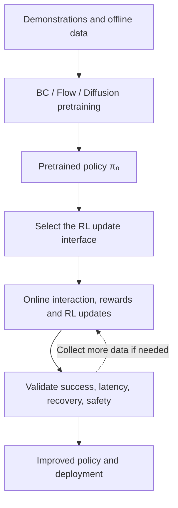
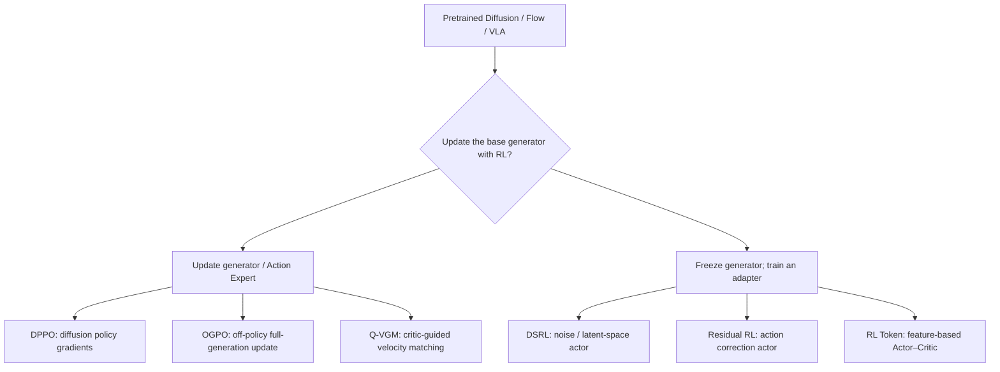
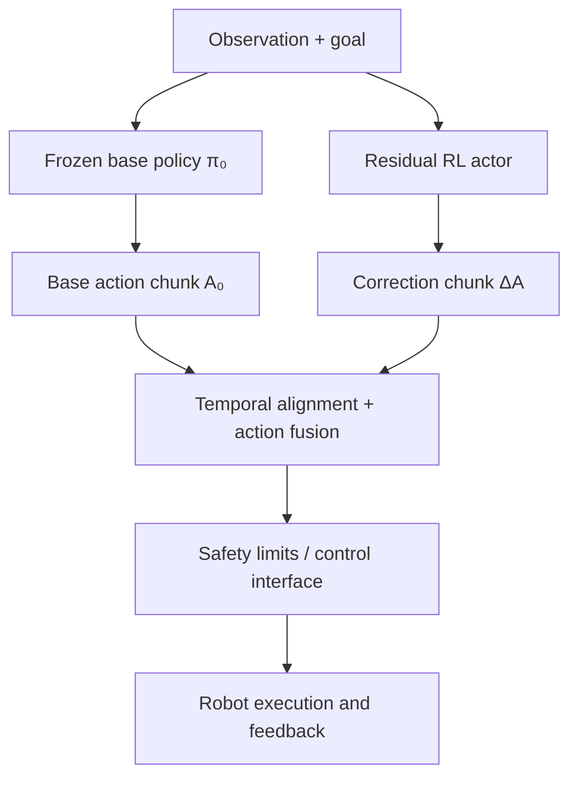
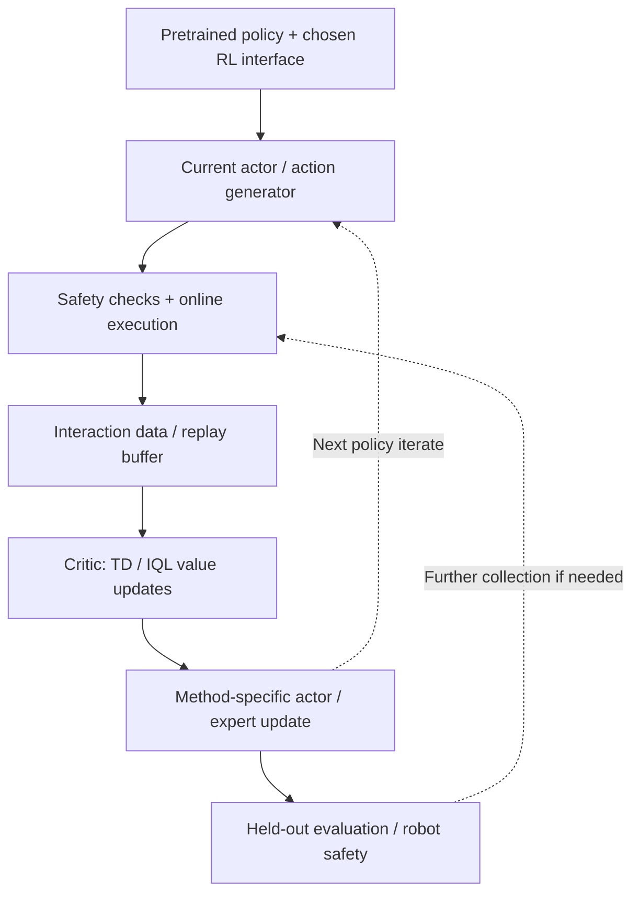

# Reinforcement Learning Post-Training for Embodied Foundation Models

**Focused, restructured edition · October 2026**

[Course repository](https://github.com/zengxiong111/Foundation_of_Embodied_AI) · [中文 Markdown](https://github.com/zengxiong111/Foundation_of_Embodied_AI/blob/main/md/RL_Post_Training_ZH.md) · [English PDF](https://zengxiong111.github.io/zengxiong.github.io/files/RL_Post_Training_EN.pdf)

> **Scope.** This course focuses exclusively on improving **pretrained** Diffusion Policies, Flow Matching policies, and vision-language-action models (VLAs) through reinforcement learning. PPO, SAC, and Actor–Critic appear only as background necessary to understand post-training. The course does not classify methods by robot task or discuss training controllers from scratch, and it contains no coding exercises.
>
> **Revision and validation boundary.** Restructured from the earlier Reinforcement Learning for Embodied AI notes, with a corrected method taxonomy and new flowcharts. The explanations are based on the cited papers; they do not claim an independently reproduced benchmark or robot deployment.
>
> **Attribution.** Adapted from the [Foundation of Embodied AI](https://github.com/zengxiong111/Foundation_of_Embodied_AI) material by Xiong Zeng and contributors ([CC BY 4.0](https://creativecommons.org/licenses/by/4.0/)). Third-party papers retain their respective licenses.

## Contents

- [1. Scope: a generative robot policy already exists](#rl-post-section-01)
- [2. Taxonomy by the trainable interface](#rl-post-section-02)
- [3. Three independent axes of classification](#rl-post-section-03)
- [4. Updating the pretrained generator](#rl-post-section-04)
- [5. Freezing the generator and training extra modules](#rl-post-section-05)
- [6. Actor–Critic and the online off-policy training loop](#rl-post-section-06)
- [7. Method selection at a glance](#rl-post-section-07)
- [8. Evaluation, deployment, and common misconceptions](#rl-post-section-08)
- [9. Primary papers and further reading](#rl-post-section-09)

## 1. Scope: a generative robot policy already exists

Imitation pretraining provides a useful starting behavior. RL post-training then uses rewards and interaction to improve success, precision, recovery, and execution efficiency. Rather than training a controller from scratch, we start with a pretrained generative policy:

*Figure 1. The tutorial begins with a pretrained policy; policy improvement and environment evaluation form a feedback loop.*

$$
\pi_{\theta_0}(A_t\mid o_t,g_t),\qquad A_t=(a_t,\ldots,a_{t+H-1}).
$$

Here `o_t` is an observation, `g_t` is a goal or language instruction, `A_t` is an action chunk of horizon `H`, and `θ₀` denotes pretrained parameters. Diffusion and flow generators commonly sample actions through iterative refinement. A VLA may combine a vision-language backbone, an action expert, and additional output heads.

The basic RL objective is:

$$
J(\pi)=\mathbb{E}_{\tau\sim\pi}\left[\sum_{t=0}^{T}\gamma^t r_t\right].
$$

In post-training, it is often important to preserve the pretrained skills and avoid catastrophic forgetting. Common strategies include demonstration replay, behavioral regularization, and conservative updates. Crucially, **do not assume that an implicit generative policy admits a tractable exact action log-likelihood or KL divergence**. This difficulty motivates specialized update algorithms.

## 2. Taxonomy by the trainable interface

For a pretrained base policy, the clearest first division is **updating the pretrained generator** versus **freezing it and learning an external module**. These are useful teaching pathways, not a mathematically exhaustive partition: parameter-efficient tuning, LoRA, and combined residual approaches may cross the boundary.

*Figure 2. Six representative approaches by trainable interface. The arrows denote categories, **not a sequence from DPPO to OGPO to Q-VGM**.*

**Full fine-tuning** describes the scope of parameter updates; **velocity matching** describes what function is trained and by which target. These are not mutually exclusive. Freezing the base generator also does not imply a weight-free system: auxiliary actors, critics, or interface adapters still need training.

## 3. Three independent axes of classification

A single mutually exclusive taxonomy cannot capture all design choices. Always ask three different questions.

| Axis | Question | Examples |
|---|---|---|
| **Model architecture** | Which pretrained generator is being adapted? | Diffusion, Flow Matching, VLA with an Action Expert |
| **Trainable interface** | What receives RL gradients? | Generator, latent/noise actor, action residual, token/feature actor |
| **Data and optimization** | Where does experience come from and how is it reused? | Online / Offline; On-policy / Off-policy; replay / current rollouts |

**Online versus offline** concerns whether new environment interaction is collected during training. **On-policy versus off-policy** concerns whether an update relies on current-policy trajectories or can reuse experience from older behavior policies. Thus **online off-policy RL** is entirely valid: robots keep generating new data while training also reuses older trajectories from a replay buffer.

PPO is a representative on-policy algorithm and SAC a representative off-policy Actor–Critic algorithm. However, **DPPO is not simply PPO with a swapped action head, and OGPO is not vanilla SAC**. Iterative generation introduces difficulties with action likelihoods, critic gradients, policy update cost, and real-time inference.

## 4. Updating the pretrained generator

### 4.1 DPPO: policy gradients for Diffusion Policy

[DPPO](https://arxiv.org/abs/2409.00588) optimizes diffusion-based policies with reinforcement-learning policy gradients. Its contribution is not treating an implicit diffusion generator as an ordinary Gaussian actor with trivially available action probabilities; it structures policy optimization around the multi-step denoising process.

The representative PPO clipping mechanism (**for intuition only, not the full DPPO loss**) is:

$$
L_{\mathrm{clip}}=\mathbb{E}\left[\min\left(\rho\hat A,\operatorname{clip}(\rho,1-\epsilon,1+\epsilon)\hat A\right)\right].
$$

DPPO fits settings where on-policy rollout cost and multi-step generative optimization are acceptable and the Diffusion Policy parameters may be updated. Denoising-step count, update stability, and preservation of pretrained skills are central concerns.

### 4.2 OGPO: off-policy replay with full generative-policy optimization

[OGPO](https://arxiv.org/abs/2605.03065) uses **off-policy critics** to reuse interaction data while propagating policy-improvement signals through the full generative process. Its modified objective has PPO-inspired components, but **OGPO must not be reclassified as on-policy PPO because of that resemblance**.

Its essential information path is `Replay Buffer → Critic / Advantage → Generative-policy update`. The promise is better reuse of expensive online experience while retaining the capacity to change the generative policy itself. Major challenges include critic estimation errors, distribution shift, and the cost of differentiating through generation. The paper analyzes conservative advantages, success-data regularization, and critic stabilization.

### 4.3 Q-VGM: critic gradients become local velocity targets

[Q-VGM](https://arxiv.org/abs/2606.08015) targets the **Flow Matching Action Expert** in a VLA. It converts critic information into **local velocity-correction targets** and trains the expert's velocity predictor. The method avoids backpropagation through the complete denoising trajectory, while still **updating the pretrained Action Expert**; it is not a frozen-generator adapter.

The paper combines an offline IQL stage and online TD critic updates with local Q-guided Velocity Matching. This is relevant when the Flow Action Expert is trainable, replay is valuable, and full denoising-chain backpropagation would be expensive or unstable.

> **Distinction within this group:** DPPO emphasizes diffusion-process policy gradients; OGPO combines an off-policy critic with full generative-policy improvement; Q-VGM constructs local critic-guided velocity targets for flow models. They are alternative routes, not consecutive training stages.

## 5. Freezing the generator and training extra modules

### 5.1 DSRL: RL in the noise or latent space

[DSRL](https://arxiv.org/abs/2506.15799) treats a pretrained Diffusion Policy as a fixed generator and performs reinforcement learning over its initial noise or latent variables. Conceptually:

$$
z\sim q_{\phi}(z\mid o,g),\qquad A=G_{\theta_0}(o,g,z),\qquad \theta_0\ \mathrm{fixed}.
$$

RL updates `φ`, not `θ₀`. This can work with black-box access to the pretrained policy and reduces the need to train the large generator. The attainable improvement is still constrained by the pretrained generator and its noise interface. A diffusion-specific steering mechanism should not be assumed to transfer unchanged to arbitrary Flow or VLA implementations.

### 5.2 Residual RL: constrained action-level correction

The base model proposes `A₀`, while a learned residual actor supplies `ΔA`. Execute only after alignment and safety processing:

$$
A_{\mathrm{cmd}}=\operatorname{Safe}\left(A_0+\lambda\,\Delta A_{\phi}\right).
$$

*Figure 3. The base and residual actions are **parallel inputs**. For action chunks, frequency, scale, coordinate frames, and execution timing must align.*

Residual RL is simple and can keep the base model frozen, but corrections are often local to the behaviors the base policy already proposes; incorrect residuals can degrade contact stability. Residual learning is an **architectural pattern**, not a single prescribed on-policy or off-policy optimizer.

### 5.3 RL Token: a lightweight RL interface to VLA features

[RL Token](https://arxiv.org/abs/2604.23073) first adapts a VLA to expose a compact, task-relevant `RL token` representation. A small Actor–Critic then uses this feature interface to improve online behavior, instead of updating every step of the original generative action process.

The stages matter: establishing the token readout can require modifying or adapting the pretrained VLA; **during subsequent online RL, the main VLA can remain frozen while the small Actor–Critic is trained**. This is not the same as assuming no interface preparation at all, nor is it merely an action-space residual.

## 6. Actor–Critic and the online off-policy training loop

In off-policy methods, experience can be stored as `D={(o_t,A_t,r_t,o_{t+1},d_t)}`. A critic estimates future return, while the chosen policy-improvement algorithm updates an actor or Action Expert. A schematic Bellman target is:

$$
y_t=r_t+\gamma(1-d_t)\,\mathbb{E}_{A'\sim\pi}\left[Q_{\bar\psi}(o_{t+1},A')\right].
$$

This is only an **illustrative one-step target**. For temporally extended action chunks, rewards, decision times, and discounting must be aligned. SAC entropy terms, twin critics, IQL, and other stabilizers are method-specific: the expression above is **not** the complete OGPO or Q-VGM loss.

*Figure 4. A representative online off-policy information flow. On-policy methods such as DPPO use current-policy rollouts instead of simply copying this replay-driven loop.*

Four engineering interfaces must remain distinct: reward optimization versus execution-time safety; simulated versus real data; actor/expert updates versus critic updates; and policy inference rate versus low-level controller rate. A higher offline score alone does not establish reliable closed-loop hardware performance.

## 7. Method selection at a glance

| Method | What RL updates | Data regime | Prerequisite | Main limitation |
|---|---|---|---|---|
| **DPPO** | Diffusion policy parameters | Primarily on-policy PG | Diffusion Policy can be trained | Rollout and generative update cost |
| **OGPO** | Generative-policy parameters | Online + off-policy critic/replay | Trainable generator and critic | Critic bias and full-generation optimization cost |
| **Q-VGM** | Flow Action Expert velocity predictor | Offline-to-online, value-guided | Trainable Flow Expert and action critic | Reliability of local value targets |
| **DSRL** | Noise / latent-space actor | Can use online off-policy adaptation | Controllable diffusion noise interface | Reachability under the frozen generator |
| **Residual RL** | Action-correction actor | Depends on the RL algorithm | Safe action composition is feasible | Timing, scaling, action limits |
| **RL Token** | Lightweight actor–critic on token features | Online RL | Available / adaptable VLA feature readout | Feature quality and integration latency |

A useful decision order is: **Can the base generator be updated? Which interfaces does the Diffusion / Flow / VLA actually expose? How much replay, critic reliability, and inference latency can the system afford?** For any claim of “frozen-base online off-policy RL,” check generator weights, fresh data collection, and reuse of behavior-policy-mismatched experience separately.

## 8. Evaluation, deployment, and common misconceptions

At minimum, report **success rate, online interactions, compute and memory cost, inference latency, action-chunk execution timing, recovery rate, safety stops, and retention of pretrained skills**. For off-policy training, also report replay composition, the offline/online mixture, and critic quality over training.

Five misconceptions summarize the main hazards: **(1) online is not the same as on-policy; (2) freezing a generator does not mean training no weights; (3) velocity matching and full fine-tuning are not mutually exclusive labels; (4) DPPO, OGPO, and Q-VGM are not sequential stages; (5) improved success does not by itself demonstrate real-time control, robustness, or hardware safety.**

## 9. Primary papers and further reading

| Topic | Papers / original sources |
|---|---|
| Background | [PPO](https://arxiv.org/abs/1707.06347) · [SAC](https://arxiv.org/abs/1801.01290) |
| Update the generator | [DPPO — Diffusion Policy Policy Optimization](https://arxiv.org/abs/2409.00588) · [OGPO — Sample Efficient Full-Finetuning of Generative Control Policies](https://arxiv.org/abs/2605.03065) · [Q-VGM — Q-Guided Value-Gradient Matching](https://arxiv.org/abs/2606.08015) |
| Frozen generator or external interfaces | [DSRL — Steering Your Diffusion Policy with Latent Space RL](https://arxiv.org/abs/2506.15799) · [RL Token — Bootstrapping Online RL with VLA](https://arxiv.org/abs/2604.23073) |

**Takeaway: RL post-training for embodied foundation models is best organized by the pretrained policy, the actual trainable interface, the experience-reuse mechanism, and the deployment constraints—not by the name of a robot task.**
