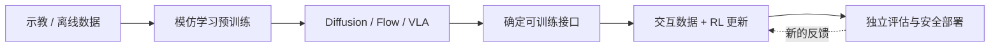
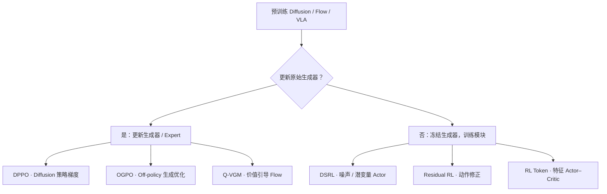
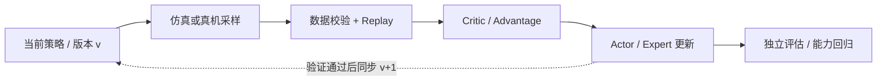
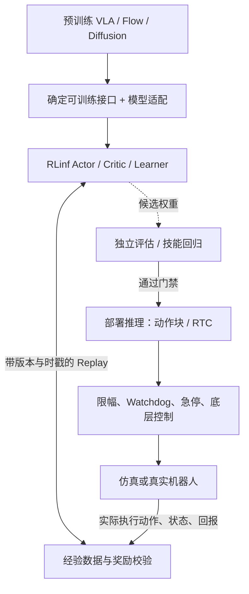

# 具身基础模型的强化学习后训练

**Reinforcement Learning Post-Training for Embodied Foundation Models**  
**算法、RLinf 训练基础设施与真机部署的能力边界 · 2026 年 10 月**

[课程仓库](https://github.com/zengxiong111/Foundation_of_Embodied_AI) · [English Markdown](RL_Post_Training_EN.md) · [RLinf 官方文档](https://rlinf.readthedocs.io/en/latest/)

> **课程定位**：介绍如何利用强化学习改进**已经预训练的** Diffusion Policy、Flow Matching Policy 与 VLA；按照“模型更新接口 → 数据与学习算法 → 训练系统 → 真机部署”组织内容。只保留必需的 PPO、SAC 与 Actor–Critic 概念，不讨论从零训练运控策略，也不包含实验代码。
>
> **证据边界（截至 2026-10-19）**：本文把官方文档中已有的运行案例、由案例推断的集成需求、尚未普遍解决的研究问题严格区分。某系统分别支持模型 A、算法 B 和硬件 C，**不意味着 A × B × C 已经得到验证**。本文不声称自行复现或进行真机验证。
>
> **署名**：基于 Xiong Zeng and contributors 的 [Foundation of Embodied AI](https://github.com/zengxiong111/Foundation_of_Embodied_AI) 课程资料增补（[CC BY 4.0](https://creativecommons.org/licenses/by/4.0/)）。论文与第三方代码各自遵循原有许可。

## 1. 研究对象：从预训练生成式机器人策略开始

模仿学习使策略获得初始操作能力；RL 后训练利用与环境的交互，进一步改善成功率、精度、抗扰动能力、失败恢复与执行效率。研究对象是已有模型，而非随机初始化的控制器。

*图 1：从预训练模型出发的 RL 后训练闭环。评估和安全部署不能由训练奖励替代。*

令 $o_t$ 为观测，$g_t$ 为语言指令或任务目标，$A_t$ 为预测动作块：

$$
\pi_{\theta_0}(A_t\mid o_t,g_t),\qquad A_t=(a_t,\ldots,a_{t+H-1}),
$$

其中 $\theta_0$ 是预训练参数，$H$ 是策略生成的动作长度。Diffusion / Flow 往往通过多步采样生成连续动作；VLA 还可能包含视觉语言骨干、Action Expert 与其他输出头。后训练通常最大化

$$
J(\pi)=\mathbb{E}_{\tau\sim\pi}\left[\sum_{t=0}^{T}\gamma^t r_t\right],
$$

但必须同时考虑原有技能的保持。尤其对隐式生成策略，**不能默认直接得到准确的 $\log\pi(A\mid o,g)$ 或 KL 散度**，因此不能把普通 PPO/SAC 无修改地套到任意生成式动作头上。

## 2. 首先明确：RL 更新了模型的哪一部分？

针对预训练生成器，有两条清晰的教学主线：**更新生成器 / Action Expert**，或**冻结生成器、训练辅助模块**。LoRA、部分参数微调与混合残差方案可能跨越这两条主线。

*图 2：按模型更新接口而非算法名称分类。这些是并列路线，不是连续训练步骤。*

这里的“全参 / LoRA”是**参数更新范围**，“Velocity Matching / Policy Gradient”是**优化目标**，“On-policy / Off-policy”是**数据复用关系**；它们不能混为一条互斥的分类树。

## 3. 三个独立的选型维度

| 维度 | 核心问题 | 代表性选择 |
|:---|:---|:---|
| 预训练模型 | 对什么策略后训练？ | Diffusion、Flow Matching、带 Action Expert 的 VLA |
| 更新接口 | 哪些参数接收 RL 信号？ | Expert、LoRA、噪声 Actor、动作残差、特征 Actor |
| 数据与优化 | 新交互怎样进入训练、旧数据能否重用？ | Online / Offline；On-policy / Off-policy；Replay Buffer |

**Online 不等于 On-policy。** Online 表示训练期间持续获取新的环境交互；Off-policy 表示可以使用历史行为策略采集的数据。因此，真机不断收集轨迹、Learner 从 Replay Buffer 中混合采样历史数据，属于 **Online Off-policy RL**。PPO 通常 On-policy，SAC 通常 Off-policy，但 DPPO 和 OGPO 均需处理生成模型的特殊结构。

## 4. 路线一：直接更新预训练生成器

### 4.1 DPPO：扩散策略梯度

[DPPO](https://arxiv.org/abs/2409.00588) 将 Diffusion Policy 的逐步去噪过程纳入策略优化，而非把它当作一个天然具有可计算动作似然的 Gaussian Actor。PPO 的直观裁剪目标为

$$
L_{\mathrm{clip}}=\mathbb{E}\!\left[\min\big(\rho\hat A,\;\operatorname{clip}(\rho,1-\epsilon,1+\epsilon)\hat A\big)\right].
$$

上式**不是 DPPO 的完整目标**。实践瓶颈包括 On-policy 采样成本、去噪计算与梯度成本、策略更新波动以及对预训练技能的干扰。

### 4.2 OGPO：Off-policy 复用经验并优化生成过程

[OGPO](https://arxiv.org/abs/2605.03065) 利用历史与在线轨迹训练 Off-policy Critic，再把价值信号传递给生成式策略，其信息流是 **Replay → Critic / Advantage → 生成器更新**。不能因为目标中有 PPO 风格项就将 OGPO 归为 On-policy PPO。风险集中在旧策略与新策略的分布偏移、Critic 误差和完整生成链上的更新成本。

### 4.3 Q-VGM：价值引导的 Flow Matching

[Q-VGM](https://arxiv.org/abs/2606.08015) 把 Q 值梯度转换为局部的速度场匹配目标，直接更新 Flow Action Expert，而不需要沿整条多步生成链进行反向传播。其论文使用离线 IQL 与在线 TD 价值估计相结合的思路。**Q-VGM 属于更新生成器路线，不是冻结原始 Flow Policy。**

三者的关键区别不是性能排名，而是梯度进入生成策略的方式：逐步扩散策略梯度、完整生成过程优化、局部价值引导速度场更新。

## 5. 路线二：冻结生成器，只更新轻量模块

### 5.1 DSRL：噪声 / 潜变量空间强化学习

[DSRL](https://arxiv.org/abs/2506.15799) 保持生成器固定，用小型 Actor 调整输入噪声或潜变量：

$$
z\sim q_{\phi}(z\mid o,g),\qquad A=G_{\theta_0}(o,g,z),\qquad \theta_0\ \mathrm{fixed}.
$$

优势是训练参数少、基础生成器保持不变；局限是行为提升被**冻结生成器可到达的动作分布**所限制。RLinf 的 [DSRL 实例](https://rlinf.readthedocs.io/en/latest/rst_source/examples/embodied/dsrl.html) 针对冻结的 $\pi_0$，并不自动证明它可不修改地适配任何 $\pi_{0.5}$、Flow 或新机器人。

### 5.2 Residual RL：在动作输出上进行受限修正

基础策略输出 $A_0$，残差 Actor 输出 $\Delta A_\phi$，执行时先做动作尺度、坐标系和 Chunk 时序一致化，再通过限幅与安全层：

$$
A_{\mathrm{cmd}}=\operatorname{Safe}\!\left(A_0+\lambda\Delta A_{\phi}\right).
$$

Residual RL 是**控制架构**，不是一种固定的 On-policy / Off-policy 优化器。它更易集成，但修正范围通常局限于基础动作邻域；对灵巧接触，残差还可能引发夹持失稳。

### 5.3 RL Token：在 VLA 特征之上学习 Actor–Critic

[RL Token](https://arxiv.org/abs/2604.23073) 首先建立可读出的 VLA 紧凑特征接口，然后冻结主特征网络并用轻量 Off-policy Actor–Critic 改进控制。RLinf 的 [RLT 文档](https://rlinf.readthedocs.io/en/latest/rst_source/examples/embodied/rlt.html) 明确区分示教阶段建立特征接口与随后在线 RL 的两个阶段。RL Token 不是动作残差方法；创建特征接口本身可能需要先行适配模型。

## 6. Actor–Critic 与 Online Off-policy 训练闭环

典型 Off-policy Learner 存储 $\mathcal D=\{(o_t,A_t,r_t,o_{t+1},d_t)\}$ 并训练价值网络。简化的一步 Bellman 目标是

$$
y_t=r_t+\gamma(1-d_t)\;\mathbb E_{A'\sim\pi}\big[Q_{\bar\psi}(o_{t+1},A')\big].
$$

实际执行包含 $K$ 个底层控制步的 Action Chunk 时，应按决策时刻构造

$$
y_t^{(K)}=\sum_{j=0}^{K-1}\gamma^j r_{t+j}
+\gamma^K(1-d_{t+K})\mathbb E_{A'\sim\pi}\big[Q_{\bar\psi}(o_{t+K},A')\big].
$$

因此，“模型输出了 $H$ 步动作”和“机器人实际执行了 $K$ 步动作”**不一定相同**。Replay、奖励折扣、时间戳、动作块覆盖与 Critic 的目标必须使用真实执行的 $K$。上述式子仅为教学抽象，不是 SAC、OGPO、Q-VGM 的完整损失。

*图 3：Online Off-policy 的 Actor–Learner 循环。旧经验可以复用，但策略版本和实际执行动作必须可追溯。*

训练奖励与安全约束、仿真与真机样本、Critic 与 Actor 的更新、模型推理频率与底层控制频率，应清晰分离。

## 7. 用一张表选择后训练方法

| 方法 | 更新对象 | 典型数据范式 | 主要条件与风险 |
|:---|:---|:---|:---|
| **DPPO** | Diffusion 生成器 | 主要为 On-policy | 可改模型；去噪与 Rollout 成本高 |
| **OGPO** | 生成式策略 | Online Off-policy | Replay 复用；警惕 Critic 偏差与分布漂移 |
| **Q-VGM** | Flow Action Expert | Offline-to-Online | 可训练速度网络；局部 Q 梯度必须可靠 |
| **DSRL** | 噪声 / 潜变量 Actor | 可以 Off-policy | 生成器冻结；受可达动作分布制约 |
| **Residual RL** | 动作修正 Actor | 依具体算法而定 | 时序与动作尺度对齐；接触安全 |
| **RL Token** | 特征 Actor–Critic | Online Off-policy | 可读出特征；先行接口适配与推理开销 |

应先选 **模型更新接口**，再选 **优化算法与数据机制**；“仓库中有 SAC 和 Flow Model”不等于“给任意 Flow/VLA 用 SAC 只需修改配置”。

## 8. 评估标准：离线性能不是可部署能力

除训练奖励和成功率，应报告**真实机器人小时数、复位与人工干预成本、GPU 时间与显存、推理延迟（均值与尾延迟）、Chunk 边界不连续、安全触发率、扰动恢复能力、任务外泛化与旧技能保持**。对于 Off-policy RL，还要记录 Replay 的离线/在线比例、数据与模型版本、Critic 校准、行为策略漂移。

特别注意五个错误等式：**Online = On-policy；冻结生成器 = 不需训练；Velocity Matching = Full Fine-tuning；PPO/GRPO 训练案例 = Online Off-policy 案例；仿真成功 = 真机安全**。这些等式均不成立。

## 9. RLinf：从可复用训练基础设施到真实机器人

前面六种方法解释**怎么优化策略**。要让方法持续运行，还需要一个基础设施来连接模型、并行环境、数据、更新、硬件控制和评估。[RLinf](https://github.com/RLinf/RLinf) 正好是说明这种系统分工的代表：它同时涵盖规模化 VLA RL 和部分真机在线学习工作流，但不是所有后训练问题的通用“即插即用”解法。

### 9.1 它已经做到了什么：按可核验案例理解能力

| 对应能力 | 官方公开案例 | 必须保留的限定 |
|:---|:---|:---|
| **预训练 VLA 的 On-policy RL** | [$\pi_0 / \pi_{0.5}$ + PPO/GRPO](https://rlinf.readthedocs.io/en/latest/rst_source/examples/embodied/pi0.html)，LIBERO 等 | 证明特定训练配方，不代表通用 Off-policy Flow 微调 |
| **冻结基础策略的 Off-policy RL** | [DSRL + 冻结 $\pi_0$](https://rlinf.readthedocs.io/en/latest/rst_source/examples/embodied/dsrl.html)，轻量噪声 Actor + SAC | 噪声接口与 $\pi_0$ 绑定；迁移到新模型需重新验证 |
| **Flow 与 SAC** | [SAC-Flow](https://rlinf.readthedocs.io/en/latest/rst_source/examples/embodied/sac_flow.html)，ManiSkill 仿真与 Franka 插销 | 更新专用 Flow Actor；不能据此宣称冻结 $\pi_{0.5}$ 的 SAC 已验证 |
| **特征 Actor–Critic** | [RLT / RL Token](https://rlinf.readthedocs.io/en/latest/rst_source/examples/embodied/rlt.html)，Franka 与 ManiSkill 案例 | 需要表示预训练和特征/动作语义一致性 |
| **真机接入与在线训练** | [RLinf-USER](https://arxiv.org/abs/2602.07837)、[多机器人训练](https://rlinf.readthedocs.io/en/latest/rst_source/guides/realworld_robot.html) | 有异步采样、硬件调度等组件，但新机器人仍要适配 |
| **推理与动作执行重叠** | [RTC](https://rlinf.readthedocs.io/en/latest/rst_source/guides/rtc.html)：$\pi_{0.5}$，LIBERO / Franka 评估 | 降低推理等待，不等于保证硬实时底层控制 |
| **扩展新硬件与任务** | [Adding a Robot](https://rlinf.readthedocs.io/en/latest/rst_source/extending/new_robot.html)、[New Task](https://rlinf.readthedocs.io/en/latest/rst_source/extending/new_task.html) | 已提供统一接口和测试路径，但驱动、控制与安全仍需工程实现 |

RLinf 也提供 SFT、评测、仿真环境和不同训练后端。[真实机器人文档](https://rlinf.readthedocs.io/en/latest/rst_source/examples/real_world_index.html) 已涵盖 Franka、Turtle2、GimArm、DOS-W1 等不同成熟度案例。**不能简单说“RLinf 不支持真机 / Off-policy / RTC”**；关键是区分已验证的具体组合和需要自行打通的交叉组合。

### 9.2 训练侧仍有哪些不足？

| 缺口 | 为什么不能只靠现有框架自动解决 | 接入新模型时要核验什么 |
|:---|:---|:---|
| **模型 × 算法兼容性** | $\pi_{0.5}$ + PPO/GRPO、$\pi_0$ + DSRL、专用 Flow + SAC 是不同的已验证配方 | 检查策略头、动作分布 / 采样噪声、可计算 log-prob、冻结参数范围及梯度路径 |
| **通用 Online Off-policy Flow/VLA** | 历史数据复用要求价值学习和生成器更新目标兼容；并非任意预训练 Action Expert 都有现成接口 | 是否真正训练目标模型；Actor/Critic 更新频率、Replay 采样、行为策略和动作可达性 |
| **Critic 在高维视觉 / 接触任务上的稳定性** | 稀疏奖励、视觉遮挡与离策略偏差会造成 Q 误差累积 | OOD Q 校准、双/集成 Critic、成功数据约束与真实失败轨迹 |
| **Action Chunk 的正确训练语义** | 采样块 $H$ 与实际执行步 $K$ 不同；RTC / 异步采样又引入延迟 | $K$ 步奖励、终止标志、时戳、动作覆盖、版本一致性与折扣 $\gamma^K$ |
| **大规模计算成本和复现** | 大 VLA 的分布式 Actor–Rollout–Learner 仍受模型推理、网络交换、显存与仿真吞吐限制 | GPU 小时/成功增益、Worker 背压、FSDP 配置、checkpoint 转换、数据归一化和可复现性 |
| **多任务能力保持** | 针对少量任务的 Online RL 可能损害预训练模型广泛能力 | 跨任务保留集、跨场景回归、行为约束、SFT 与 Replay 混合比例 |

其中前两项是**现成组合覆盖范围的不足**，后四项主要是**尚需针对任务解决的研究与系统可靠性问题**。不能把它们笼统表述为“代码没有实现”。

### 9.3 部署侧仍有哪些不足？

训练模型在仿真里成功，并不意味着能够直接闭环驱动现实机器人。RLinf 的 [Robot Interface](https://rlinf.readthedocs.io/en/latest/rst_source/extending/new_robot.html) 降低了接入新机器人和新任务的工作量，但还需处理以下边界。

| 缺口 | 典型风险 | 部署前的验收指标 |
|:---|:---|:---|
| **非预设机器人硬件的适配** | 厂商 SDK、CAN/RS485、ROS 接口、机械臂/灵巧手动作语义与已支持平台不同 | 状态/动作单位、关节/末端坐标系、频率、重置与故障恢复接口一致 |
| **实时性与网络抖动** | VLA 计算可能慢于机器人控制；RTC 只能隐藏部分等待 | 端到端延迟分布、P95/P99 抖动、超时策略、控制环连续性 |
| **Chunk 拼接和接触执行** | 新旧 Action Chunk 打架；旧观测导致精密装配、滑移抓取失败 | Chunk 切换误差、接触力/电流安全阈值、扰动恢复时间 |
| **独立的运行时安全** | 训练奖励不能代替限位、急停、碰撞监测、失联保护与人工接管 | 硬件 Watchdog、动作投影/限幅、安全接管与可回滚策略 |
| **感知、标定和奖励可靠性** | 相机时间不同步、外参漂移、目标/接触判定误报 | 多传感器同步、独立成功判定、奖励误判率、置信度和 OOD 检测 |
| **真机数据闭环成本** | 人工复位、失败处理、机器人占用和物理磨损限制吞吐 | Robot-hours、Reset-hours、干预次数、失败后可恢复率 |
| **模型版本与灰度发布** | 异步 Learner 的新权重不一定安全；Replay 可能混入旧数据语义 | 版本化数据与归一化、离线门禁、独立真机评估、失败回滚 |

要特别区分：**RTC 是延迟优化，不是实时安全控制器**；RLinf 真机 Demo 是可行性证据，不是其他型号机械臂或灵巧手的普适部署承诺。[RTC 文档](https://rlinf.readthedocs.io/en/latest/rst_source/guides/rtc.html) 本身报告了异步通信的额外残余开销。

### 9.4 把训练与部署接成一条真正的闭环

*图 4：RLinf 在训练系统层提供关键组件；机器人驱动、安全执行、可靠奖励与真实数据回流依然必须端到端验证。*

对于自定义的“机械臂 + 灵巧手 + 头/腕相机”平台，建议按**四层验收**推进：首先验证传感器、坐标系、归一化和 Action Chunk；然后验证策略推理与底层控制的时延和安全；再验证数据回传、Critic 与异步版本管理；最后才允许 Online RL 自动更新可部署权重。若无法通过前两层，增加更多 GPU 或更复杂算法通常不能解决根因。

**由此进入下一章：**RLinf 已部分解决“如何组织训练和真机流程”，但仍没有通用方案确保“真实数据足够、价值估计可靠、生成策略可控更新、部署长期安全”。这些才是后训练的核心开放问题。

## 10. 从 RLinf 的边界看尚未解决的研究问题

| 研究问题 | 科学难点 | 应该报告的证据 |
|:---|:---|:---|
| **用更少真实数据稳定改进策略** | 稀疏奖励、环境非平稳、复位昂贵；离策略 Replay 导致偏差 | 每提升成功率所需 Robot-hours、样本复用率及不同场景统计 |
| **冻结大模型的 Online Off-policy 后训练** | 轻量 Actor 能否在不破坏预训练先验的情况下突破动作支持集约束？ | 与全参/LoRA、DSRL、RL Token、Residual RL 的对照；原技能保持 |
| **接触任务中可信的 Critic / Reward** | 视觉不能总是反映真实接触状态，Q 估计可能放大错误奖励 | 真实失败数据、Q 误差、错误成功判定、接触扰动恢复 |
| **兼顾反馈、流畅性和高控制频率** | Chunk、异步网络、低频 VLA 与高频机器人控制之间存在时序冲突 | P95/P99 延迟、动作边界误差、安全事件、扰动后恢复时间 |
| **从仿真和世界模型泛化到真实环境** | 接触摩擦/柔顺及长时程世界模型误差会形成虚假成功 | 未见物体、位置与光照变化、真机装配/滑移和恢复测试 |
| **长期持续学习与可比较评测** | 新技能学习与灾难性遗忘并存，软硬件和预算难统一 | 跨任务回归、机器人/计算资源账本、失败及人工接管记录 |

未来的高价值研究不仅是发明一个新的策略梯度损失，而是设计**可复用 Replay、可信价值估计、可控模型更新、可监测真实交互与安全部署**共同组成的长期闭环。可结合 [RLinf-USER](https://arxiv.org/abs/2602.07837)、[RECAP](https://arxiv.org/abs/2511.14759) 与 [WoVR](https://arxiv.org/abs/2602.13977) 理解这些问题的不同切面。

## 11. 原始论文与官方资料

| 类别 | 首选阅读 |
|:---|:---|
| **RL 基础** | [PPO](https://arxiv.org/abs/1707.06347) · [SAC](https://arxiv.org/abs/1801.01290) |
| **更新生成器** | [DPPO](https://arxiv.org/abs/2409.00588) · [OGPO](https://arxiv.org/abs/2605.03065) · [Q-VGM](https://arxiv.org/abs/2606.08015) |
| **冻结 / 辅助接口** | [DSRL](https://arxiv.org/abs/2506.15799) · [RL Token](https://arxiv.org/abs/2604.23073) |
| **RLinf 系统** | [Repository](https://github.com/RLinf/RLinf) · [Docs](https://rlinf.readthedocs.io/en/latest/) · [RLinf-USER](https://arxiv.org/abs/2602.07837) |
| **已验证配方** | [$\pi_0 / \pi_{0.5}$ RL](https://rlinf.readthedocs.io/en/latest/rst_source/examples/embodied/pi0.html) · [DSRL](https://rlinf.readthedocs.io/en/latest/rst_source/examples/embodied/dsrl.html) · [SAC-Flow](https://rlinf.readthedocs.io/en/latest/rst_source/examples/embodied/sac_flow.html) · [RLT](https://rlinf.readthedocs.io/en/latest/rst_source/examples/embodied/rlt.html) |
| **真机与部署** | [Real-World Robots](https://rlinf.readthedocs.io/en/latest/rst_source/examples/real_world_index.html) · [Add a Robot](https://rlinf.readthedocs.io/en/latest/rst_source/extending/new_robot.html) · [RTC](https://rlinf.readthedocs.io/en/latest/rst_source/guides/rtc.html) |
| **仿真与世界模型** | [Isaac Lab](https://developer.nvidia.com/isaac/lab) · [ManiSkill](https://github.com/haosulab/ManiSkill) · [WoVR](https://arxiv.org/abs/2602.13977) |

**课程主旨：先明确定义预训练模型与 RL 可训练接口，再检查采样、优化、控制与部署是否形成真正可靠的闭环。RLinf 能显著减少系统重复建设，但不会自动替代科学验证和机器人安全工程。**
