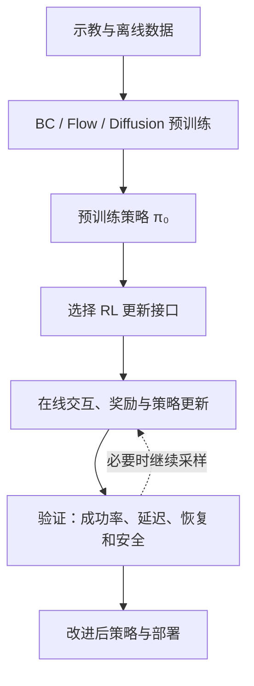
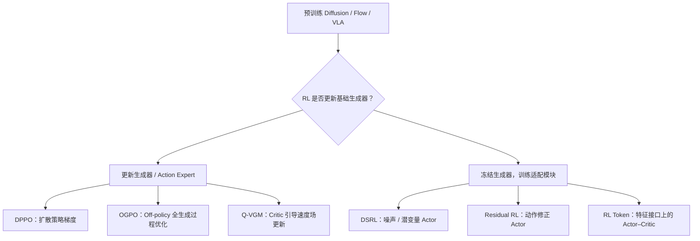
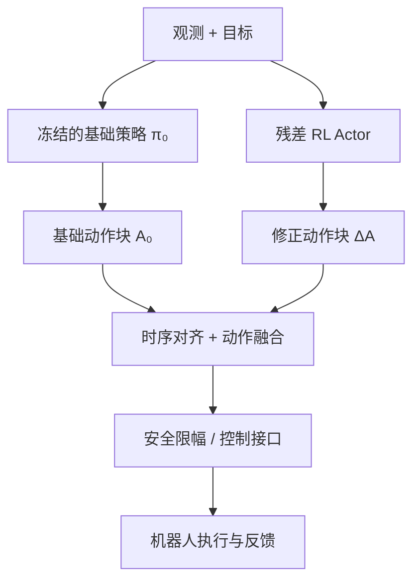
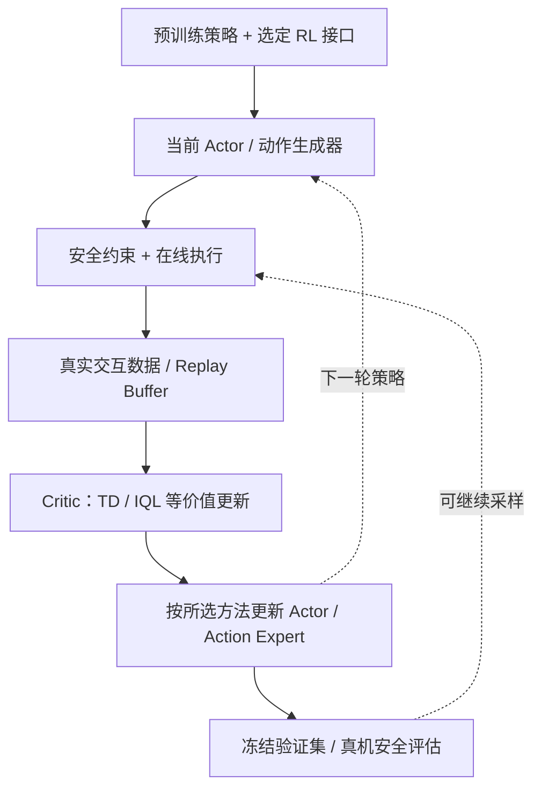

# 具身基础模型的强化学习后训练

**Reinforcement Learning Post-Training for Embodied Foundation Models · 精简重构版（2026-10）**

[课程仓库](https://github.com/zengxiong111/Foundation_of_Embodied_AI) · [English Markdown](https://github.com/zengxiong111/Foundation_of_Embodied_AI/blob/main/md/RL_Post_Training_EN.md) · [中文 PDF](https://zengxiong111.github.io/zengxiong.github.io/files/RL_Post_Training_ZH.pdf)

> **课程定位**：专门讨论如何通过强化学习改进**已经预训练的** Diffusion Policy、Flow Matching Policy 与 VLA。只保留理解后训练所需的 PPO、SAC、Actor–Critic 基础；不再按机器人任务划分章节，也不讨论从零训练控制器。本文不包含实验代码。
>
> **版本与核验边界**：根据此前《具身智能中的强化学习》教程重构，校正算法分类和全部流程图；文中的方法概述依据所引论文，不代表进行了复现实验或真机验证。
>
> **署名**：改编自 Xiong Zeng and contributors 的 [Foundation of Embodied AI](https://github.com/zengxiong111/Foundation_of_Embodied_AI) 教学资料（[CC BY 4.0](https://creativecommons.org/licenses/by/4.0/)）。第三方论文保持其原有许可。

## 目录

- [1. 研究对象：已经预训练的生成式机器人策略](#rl-post-section-01)
- [2. 按“更新哪里”组织后训练方法](#rl-post-section-02)
- [3. 三个必须分开的分类维度](#rl-post-section-03)
- [4. 直接更新基础生成器](#rl-post-section-04)
- [5. 冻结基础生成器、训练额外模块](#rl-post-section-05)
- [6. Actor–Critic 与 Online Off-policy 后训练闭环](#rl-post-section-06)
- [7. 一张表选方法](#rl-post-section-07)
- [8. 评估、部署与常见误区](#rl-post-section-08)
- [9. 原论文与扩展阅读](#rl-post-section-09)

## 1. 研究对象：已经预训练的生成式机器人策略

模仿学习先给策略提供基础能力，RL 后训练再利用环境奖励与交互数据，改进任务成功率、精度、恢复能力与执行效率。这里的研究对象不是从零训练的控制器，而是预训练策略：

*图 1：本教程只讨论从预训练策略开始的 RL 后训练；策略改进与环境评估构成闭环。*

$$
\pi_{\theta_0}(A_t\mid o_t,g_t),\qquad A_t=(a_t,\ldots,a_{t+H-1}).
$$

其中 `o_t` 是观测，`g_t` 是目标或语言指令，`A_t` 是长度为 `H` 的动作块，`θ₀` 是预训练参数。Diffusion / Flow 生成器通常经过多步迭代产生动作；VLA 还可能包含视觉语言骨干、动作专家与其他输出头。

RL 的基础目标可写为：

$$
J(\pi)=\mathbb{E}_{\tau\sim\pi}\left[\sum_{t=0}^{T}\gamma^t r_t\right].
$$

实际后训练通常还要抑制灾难性遗忘、保留原始任务能力，常见手段包括示教数据混训、行为约束或保守的策略更新。对隐式生成策略，**不能默认可以精确计算动作的 `log π(A|o,g)` 或 KL 散度**；正是这一限制促生了不同的后训练方法。

## 2. 按“更新哪里”组织后训练方法

对于已有基础策略，最清楚的一级划分是：**更新预训练生成器**，或**冻结预训练生成器、训练外部模块**。这两种是教学主线，并非绝对互斥——部分参数微调、LoRA 和混合残差方案可以跨越边界。

*图 2：六种代表性路线的归属。箭头表达方法类别，**不表示 DPPO → OGPO → Q-VGM 的训练顺序**。*

请注意：**Full Fine-tuning** 说的是更新参数的范围；**Velocity Matching** 说的是速度场的学习目标，二者可以同时发生。冻结“基础生成器”也不等于完全不修改系统：额外 Actor、Critic、接口适配器仍然需要训练。

## 3. 三个必须分开的分类维度

后训练算法不能仅用一棵互斥分类树概括。建议始终分别回答三个问题。

| 维度 | 应回答的问题 | 例子 |
|---|---|---|
| **模型结构** | 改进的是何种预训练生成器？ | Diffusion、Flow Matching、带 Action Expert 的 VLA |
| **参数更新接口** | 哪部分在 RL 中接收梯度？ | 生成器本身；噪声/潜变量 Actor；动作残差；Token/特征 Actor |
| **数据与优化范式** | 新数据从哪里来，历史数据怎样复用？ | Online / Offline；On-policy / Off-policy；Replay Buffer / 当前 Rollout |

**Online / Offline** 描述训练数据是否来自持续的新环境交互；**On-policy / Off-policy** 描述更新时是否主要使用当前策略分布或可复用历史行为策略的数据。因此 **Online Off-policy RL 完全成立**：真机不断产生新轨迹，但训练依然复用 Replay Buffer 中的旧轨迹。

PPO 是典型 On-policy 方法，SAC 是典型 Off-policy Actor–Critic 方法，但**DPPO 不等于把 PPO 直接换个动作头，OGPO 也不等于标准 SAC**。生成式策略需要专门处理多步采样、动作似然、Critic 梯度和在线推理成本。

## 4. 直接更新基础生成器

### 4.1 DPPO：用策略梯度优化 Diffusion Policy

[DPPO](https://arxiv.org/abs/2409.00588) 将 Diffusion Policy 的生成过程纳入策略优化，利用策略梯度进行强化学习微调。其关键不是简单地把扩散生成器视为可计算显式概率的普通 Gaussian Actor，而是针对逐步去噪过程构建可优化的策略形式。

PPO 的代表性裁剪思想（**仅用于理解，不是 DPPO 完整实现公式**）为：

$$
L_{\mathrm{clip}}=\mathbb{E}\left[\min\left(\rho\hat A,\operatorname{clip}(\rho,1-\epsilon,1+\epsilon)\hat A\right)\right].
$$

DPPO 更适合能够承受相对昂贵的 On-policy 采样与多步生成优化、并允许更新 Diffusion Policy 参数的情形。必须检查去噪步数、策略更新稳定性和原有技能保持情况。

### 4.2 OGPO：Off-policy 复用经验，更新完整生成过程

[OGPO](https://arxiv.org/abs/2605.03065) 使用 **Off-policy Critic** 提高样本复用效率，通过适配生成过程的策略优化目标，将价值学习信号传播到生成式控制策略。它采用包含 PPO 风格成分的修改目标，但**不能因此把 OGPO 分类成 On-policy PPO**。

其关键组合是：`Replay Buffer → Critic / Advantage → 生成过程的策略更新`。优势是能用已收集的在线经验更充分地改进生成策略；主要难点是 Critic 误差、策略偏移和经过多步生成链的梯度计算。论文还讨论了保守优势、成功数据约束和 Critic 稳定化技术。

### 4.3 Q-VGM：把价值梯度转化为局部速度场目标

[Q-VGM](https://arxiv.org/abs/2606.08015) 面向 **Flow Matching VLA 的 Action Expert**。它借助动作价值梯度构造**局部速度修正目标**，再更新速度预测网络；训练时不需要对完整去噪轨迹做反向传播。这与“冻结原始 Flow 策略、只训练外部模块”的路线不同。

Q-VGM 将 Critic 学习与策略更新拆开：论文使用离线 IQL 学习及在线 TD 更新来训练价值估计，再使用价值引导的局部 Velocity Matching 改进 Action Expert。它适用于具备 Flow 专家参数访问权限、希望 Off-policy 利用数据且需要规避完整生成链 BPTT 成本的场景。

> **本组三种方法的关系**：DPPO 强调扩散生成过程上的策略梯度；OGPO 强调 Off-policy Critic + 完整生成策略更新；Q-VGM 强调 Flow 速度场的局部价值引导目标。三者不是从弱到强的连续训练阶段。

## 5. 冻结基础生成器、训练额外模块

### 5.1 DSRL：在噪声 / 潜变量空间学习策略

[DSRL](https://arxiv.org/abs/2506.15799) 将已有 Diffusion Policy 当作固定生成器，在其初始噪声或潜变量空间运行 RL，避免修改预训练策略权重。其抽象接口为：

$$
z\sim q_{\phi}(z\mid o,g),\qquad A=G_{\theta_0}(o,g,z),\qquad \theta_0\ \mathrm{fixed}.
$$

在线更新的是 `φ`，而非 `θ₀`。优势是生成器可作为黑盒使用、训练参数较少、能复用初始策略能力；但提升受预训练生成器可达动作分布和噪声接口约束。不能把对 Diffusion 的黑盒适配直接宣称为对任意 Flow/VLA 的即插即用迁移。

### 5.2 Residual RL：在动作输出上学习受限修正

基础策略给出动作 `A₀`，残差 Actor 输出 `ΔA`，经过时序对齐与约束后执行：

$$
A_{\mathrm{cmd}}=\operatorname{Safe}\left(A_0+\lambda\,\Delta A_{\phi}\right).
$$

*图 3：残差与基础动作是**并行的两个输入**；对于 Action Chunk，必须解决频率、尺度、坐标系和执行时序的一致性。*

Residual RL 的优点是结构简单、可保持基础模型冻结；缺点是修正通常受限于基础动作附近，且错误残差可能破坏接触稳定性。它是一种**架构模式**，并非唯一指定的 On-policy 或 Off-policy 算法。

### 5.3 RL Token：把 VLA 表示变成轻量 RL 接口

[RL Token](https://arxiv.org/abs/2604.23073) 首先使 VLA 暴露一个与任务相关的紧凑 `RL token` 表示，再在其上训练轻量 Actor–Critic 模块。其重点是**通过特征接口进行在线策略改进**，而不是修改每一步 Diffusion/Flow 生成过程。

需要准确区分阶段：建立 RL-token 读出接口可能需要适配预训练 VLA；**随后在线 RL 可冻结 VLA 主体，只训练小型 Actor–Critic**。因此它不意味着从头到尾“原 VLA 连接口都不用动”，也不应归类为动作空间残差的特例。

## 6. Actor–Critic 与 Online Off-policy 后训练闭环

对 Off-policy 方法，经验可以储存在 `D={(o_t,A_t,r_t,o_{t+1},d_t)}` 中，Critic 拟合未来回报，Actor 再借助不同算法的策略改进目标更新。最简单的 Bellman 关系为：

$$
y_t=r_t+\gamma(1-d_t)\,\mathbb{E}_{A'\sim\pi}\left[Q_{\bar\psi}(o_{t+1},A')\right].
$$

这是**示意性一步目标**；如果实际执行的是多个低层动作构成的 Action Chunk，奖励累积、下一决策时刻和折扣因子都必须相应调整。SAC 式熵项、双 Critic、IQL 或其他稳定化机制要按照具体算法定义，不能直接把上式认作 OGPO / Q-VGM 的完整损失。

*图 4：Online Off-policy 的典型信息流；DPPO 等 On-policy 方法应改为当前策略 Rollout 驱动的更新，不能直接照搬 Replay Buffer 流程。*

**从控制工程角度，必须保留四种分离**：训练时的奖励与执行时的安全约束分离；仿真与真实交互数据分离；Actor/Action Expert 更新与 Critic 更新分离；模型推理频率与机器人底层控制频率分离。否则即使离线分数升高，也不能推出闭环真机性能可靠。

## 7. 一张表选方法

| 方法 | 主要 RL 更新对象 | 数据特点 | 适用前提 | 主要风险 |
|---|---|---|---|---|
| **DPPO** | Diffusion 生成策略参数 | 以 On-policy 策略梯度为主 | 可更新 Diffusion Policy | Rollout 与生成优化开销 |
| **OGPO** | 生成式策略参数 | Online + Off-policy Critic / Replay | 可更新生成器；能够训练 Critic | Critic 偏差与全生成过程优化成本 |
| **Q-VGM** | Flow Action Expert 速度网络 | Offline-to-Online、价值引导 | 可修改 Flow Expert、训练动作 Critic | 局部价值目标的可靠性 |
| **DSRL** | 噪声/潜变量 Actor | 可在线 Off-policy 适配 | 具备可控噪声/潜空间生成接口 | 冻结生成器的可达性限制 |
| **Residual RL** | 动作修正 Actor | 由所选 RL 算法决定 | 动作输出可安全融合 | 时序、尺度与动作限幅 |
| **RL Token** | Token 表示上的轻量 Actor–Critic | Online RL | 能获得/构建 VLA 特征接口 | 特征质量与系统集成延迟 |

选型顺序建议为：**先检查生成器是否允许更新，再确认 Diffusion / Flow / VLA 的可用接口，然后考虑历史数据复用、Critic 可靠性与推理时延。** 对任何声称“冻结基础模型、Online Off-policy”的方法，都应分别核对是否真的冻结生成器、是否真的在线收集新数据，以及是否复用行为策略不同的历史样本。

## 8. 评估、部署与常见误区

建议至少同时报告 **成功率、在线交互样本量、训练算力与显存、推理延迟、动作块执行时间、失败恢复率、安全终止次数、原有任务能力保持情况**。对于 Off-policy 方法，还应报告 Replay Buffer 构成、离线/在线数据比例、Critic 估计质量及随训练的变化。

常见误解可以压缩为五条：**（1）Online 不等于 On-policy；（2）冻结生成器不等于无需新模块；（3）Q-VGM 的 Velocity Matching 不是与 Full Fine-tuning 互斥的分类；（4）DPPO、OGPO、Q-VGM 并非串行流程；（5）成功率上升不自动证明实时性、鲁棒性与真机安全。**

## 9. 原论文与扩展阅读

| 方向 | 论文 / 官方来源 |
|---|---|
| 背景 | [PPO](https://arxiv.org/abs/1707.06347) · [SAC](https://arxiv.org/abs/1801.01290) |
| 更新生成器 | [DPPO — Diffusion Policy Policy Optimization](https://arxiv.org/abs/2409.00588) · [OGPO — Sample Efficient Full-Finetuning of Generative Control Policies](https://arxiv.org/abs/2605.03065) · [Q-VGM — Q-Guided Value-Gradient Matching](https://arxiv.org/abs/2606.08015) |
| 冻结生成器或外部接口 | [DSRL — Steering Your Diffusion Policy with Latent Space RL](https://arxiv.org/abs/2506.15799) · [RL Token — Bootstrapping Online RL with VLA](https://arxiv.org/abs/2604.23073) |

**一句话总结：具身基础模型 RL 后训练的核心，不是按机器人任务命名算法，而是明确“预训练了什么、RL 更新哪里、经验如何复用、如何安全部署”。**
