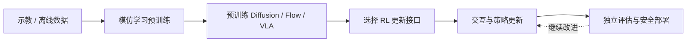
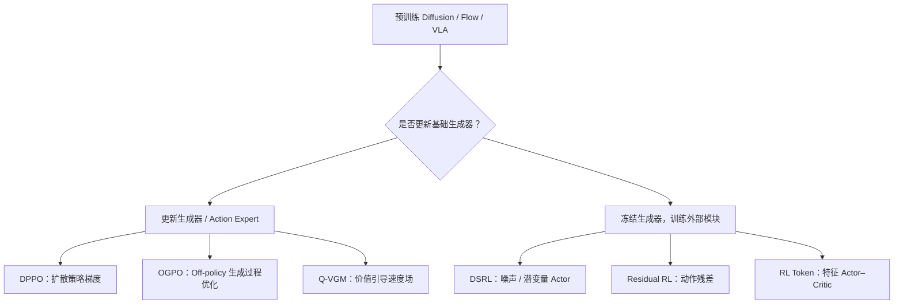
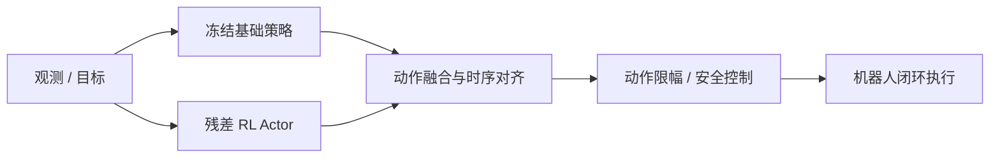
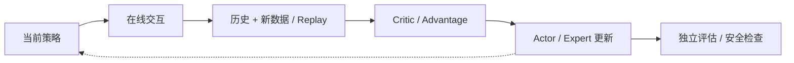
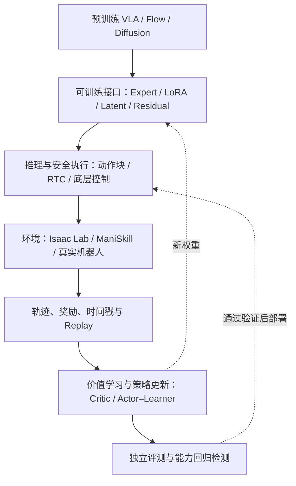

# 具身基础模型的强化学习后训练

**Reinforcement Learning Post-Training for Embodied Foundation Models · 基础设施与开放问题增补版（2026-10）**

[课程首页](https://github.com/zengxiong111/Foundation_of_Embodied_AI/blob/main/README.zh-CN.md) · [English](https://github.com/zengxiong111/Foundation_of_Embodied_AI/blob/main/md/RL_Post_Training_EN.md) · [中文 PDF](https://zengxiong111.github.io/zengxiong.github.io/files/RL_Post_Training_ZH.pdf)

> **课程定位**：解释如何利用强化学习改进**已经预训练的** Diffusion Policy、Flow Matching Policy 与 VLA，包括算法接口、训练系统、真机闭环与尚未解决的问题。PPO / SAC 只保留必要概念；不讨论从零训练控制器，也不包含实验代码。本文按截至 2026 年 10 月 19 日可公开核验的资料整理；列出系统支持不等于保证任意“模型 × 算法 × 机器人”组合都可直接运行。
>
> **署名与依据**：基于 Xiong Zeng and contributors 的 [Foundation of Embodied AI](https://github.com/zengxiong111/Foundation_of_Embodied_AI) 教学资料增补（[CC BY 4.0](https://creativecommons.org/licenses/by/4.0/)）。具体系统能力依据官方文档，研究结论依据原论文；本文不声称独立复现或真机验证。

## 目录

1. [研究对象：已经预训练的生成式机器人策略](#rl-post-section-01)
2. [按“更新哪里”组织后训练方法](#rl-post-section-02)
3. [三个必须分开的分类维度](#rl-post-section-03)
4. [直接更新基础生成器](#rl-post-section-04)
5. [冻结基础生成器、训练额外模块](#rl-post-section-05)
6. [Actor–Critic 与 Online Off-policy 闭环](#rl-post-section-06)
7. [一张表选方法](#rl-post-section-07)
8. [评估、部署与常见误区](#rl-post-section-08)
9. [目前的具身 RL 后训练基础设施](#rl-post-section-09)
10. [尚未解决的关键问题](#rl-post-section-10)
11. [原论文、项目和扩展阅读](#rl-post-section-11)

## 1. 研究对象：已经预训练的生成式机器人策略

模仿学习为机器人提供基本动作能力；RL 后训练进一步利用奖励和交互数据改善成功率、操作精度、失败恢复以及执行效率。这里讨论的是**从一个已有预训练策略开始**，而非从头训练策略。

*图 1：预训练策略是 RL 后训练的起点，独立评估与安全约束不应被训练目标替代。*

令 $o_t$ 表示观测，$g_t$ 表示目标或语言指令，$A_t$ 表示长度为 $H$ 的动作块：

$$
\pi_{\theta_0}(A_t\mid o_t,g_t),\qquad A_t=(a_t,\ldots,a_{t+H-1}).
$$

其中 $\theta_0$ 是预训练参数。Diffusion / Flow 生成器一般通过迭代式采样产生连续动作；VLA 还可能包含视觉语言骨干和独立的 Action Expert。经典 RL 目标为

$$
J(\pi)=\mathbb{E}_{\tau\sim\pi}\!\left[\sum_{t=0}^{T}\gamma^t r_t\right].
$$

后训练的特殊要求是：在优化奖励时，尽可能保留原先的泛化能力。对隐式生成策略，**不能默认可精确计算 $\log\pi(A\mid o,g)$ 或两个策略的 KL 散度**；这正是许多新方法必须修改策略更新接口的根本原因。

## 2. 按“更新哪里”组织后训练方法

最清晰的教学主线是两类：**直接更新预训练生成器**，以及**冻结生成器、训练外部适配模块**。二者并非严格互斥：例如 LoRA 只更新部分生成器参数，另一些系统同时训练残差模块与少量 Action Expert 参数。

*图 2：六类代表性更新接口。它们是不同方法，不是依次执行的训练步骤。*

注意，“全参数 / 部分参数微调”描述**参数更新范围**；“Velocity Matching / Policy Gradient”描述**优化目标**；“On-policy / Off-policy”描述**数据与更新关系**。这三个概念不能混为一个互斥的分类树。

## 3. 三个必须分开的分类维度

| 维度 | 关键问题 | 典型选择 |
|---|---|---|
| 预训练模型 | 要后训练哪种策略？ | Diffusion、Flow Matching、带 Action Expert 的 VLA |
| 可训练接口 | 哪些参数接受 RL 信号？ | 生成器本体、LoRA、噪声 Actor、动作残差、特征 Actor |
| 数据与优化 | 数据是否持续新增、是否复用旧轨迹？ | Online / Offline；On-policy / Off-policy；Replay Buffer |

**Online 不等于 On-policy**。Online 描述训练过程中持续收集新交互；Off-policy 允许借助 Replay Buffer 复用来自旧策略的数据。因此，真机持续采样 + SAC 类算法重用历史数据就是 Online Off-policy RL。PPO 通常属于 On-policy；SAC 通常属于 Off-policy，但 DPPO 和 OGPO 不等于把普通 PPO / SAC 直接接到生成式动作头。

## 4. 直接更新基础生成器

### 4.1 DPPO：扩散策略梯度

[DPPO](https://arxiv.org/abs/2409.00588) 将逐步去噪过程纳入策略优化，而不是假设整个 Diffusion Policy 的动作概率天然易算。作为直观背景，PPO 的裁剪目标为

$$
L_{\mathrm{clip}}=\mathbb{E}\left[\min\!\left(\rho\hat A,\operatorname{clip}(\rho,1-\epsilon,1+\epsilon)\hat A\right)\right].
$$

这**不是 DPPO 的完整损失**。DPPO 的实用瓶颈包括 On-policy 采样成本、去噪链的计算开销、更新稳定性以及对原有技能的破坏风险。

### 4.2 OGPO：Off-policy 复用经验并更新生成过程

[OGPO](https://arxiv.org/abs/2605.03065) 利用 Replay Buffer 和 Off-policy Critic 传播价值信号，再更新生成式策略。其核心链路是 **历史与新轨迹 → 价值估计 → 生成器策略改进**。虽然目标中可能包含 PPO 风格的设计，不能据此把 OGPO 认定为 On-policy PPO；重要限制是 Critic 偏差、旧数据分布偏移以及多步生成过程的反向传播成本。

### 4.3 Q-VGM：Critic 引导 Flow Matching

[Q-VGM](https://arxiv.org/abs/2606.08015) 利用价值梯度构造局部 Velocity Matching 目标，更新 Flow Action Expert 的速度场网络，而无需对完整生成轨迹做反向传播。论文将离线 IQL 与在线 TD 价值估计结合；这种方法**仍然更新生成器**，不能归到冻结基础策略的分支。

三者分别强调：DPPO 的扩散策略梯度、OGPO 的 Off-policy 数据复用与全生成过程改进、Q-VGM 的局部价值引导 Flow 目标。不存在天然的训练先后顺序。

## 5. 冻结基础生成器、训练额外模块

### 5.1 DSRL：在噪声 / 潜变量空间学习

[DSRL](https://arxiv.org/abs/2506.15799) 冻结预训练生成器，让小型 RL Actor 选择可注入的噪声或潜变量：

$$
z\sim q_{\phi}(z\mid o,g),\quad A=G_{\theta_0}(o,g,z),\quad \theta_0\ \mathrm{fixed}.
$$

其优势是减少需要更新的权重，同时保留原模型；但可改善的动作受预训练生成器的可达分布限制。**Diffusion 上可行的噪声接口不能未经验证直接移植到任意 Flow/VLA**。

### 5.2 Residual RL：在动作空间进行受限修正

冻结的基础策略产生 $A_0$；小型 Actor 产生 $\Delta A_{\phi}$，执行前进行时序、坐标系、尺度和安全约束处理：

$$
A_{\mathrm{cmd}}=\operatorname{Safe}\!\left(A_0+\lambda\Delta A_{\phi}\right).
$$

*图 3：基础动作与残差动作并行产生，再融合执行。Residual RL 是架构模式，不指定唯一的 RL 算法。*

### 5.3 RL Token：基于 VLA 特征的轻量 RL

[RL Token](https://arxiv.org/abs/2604.23073) 先为 VLA 建立可读出的紧凑特征接口，再在其上学习轻量 Actor–Critic。建立 token 接口可能需要模型适配，而随后的在线 RL 可以冻结 VLA 主体。它也不是动作残差方法的同义词。

## 6. Actor–Critic 与 Online Off-policy 后训练闭环

Off-policy 方法通常储存 $\mathcal D=\{(o_t,A_t,r_t,o_{t+1},d_t)\}$，训练 Critic 再更新所选择的 Actor / Action Expert。一个简化的一步 Bellman 目标为

$$
y_t=r_t+\gamma(1-d_t)\,\mathbb E_{A'\sim\pi}\!\left[Q_{\bar\psi}(o_{t+1},A')\right].
$$

注意：若一个策略决策执行 $K$ 个底层动作，则应按**实际累计奖励、$K$ 步折扣 $\gamma^K$ 与决策时刻转移**构造目标；上式不能不加修改地用于 Action Chunk，也不等于 SAC / OGPO / Q-VGM 的全部损失。

*图 4：Online Off-policy 的典型闭环。对 On-policy 更新，应主要使用当前策略采样而非不加区分地重用 Replay Buffer。*

训练时奖励与执行时安全约束、仿真与真实数据、Actor 更新与 Critic 更新、VLA 推理频率与机器人底层控制频率，应保持清晰分离。

## 7. 一张表选方法

| 方法 | RL 更新对象 | 经验特点 | 适用条件 / 风险 |
|---|---|---|---|
| DPPO | Diffusion 生成器 | 以 On-policy 为主 | 有权更新模型；采样与多步生成成本高 |
| OGPO | 生成式策略参数 | Online + Off-policy Critic | 可利用 Replay；警惕 Critic 偏差与策略漂移 |
| Q-VGM | Flow Action Expert | Offline-to-Online；价值引导 | 可修改速度场；依赖价值梯度可靠性 |
| DSRL | 噪声 / 潜变量 Actor | 可用 Off-policy | 可控噪声接口；受冻结生成器可达性约束 |
| Residual RL | 动作修正 Actor | 由具体算法决定 | 动作可安全融合；注意接触稳定性 |
| RL Token | 特征层 Actor–Critic | Online RL | 有可读 VLA 特征；注意接口与延迟 |

选型顺序：先明确能否更新基础生成器，再明确噪声、速度场、动作块与特征接口，然后综合考虑 Replay 利用率、Critic 可靠性与部署实时性。

## 8. 评估、部署与常见误区

评价不应只报告训练奖励和成功率，还需报告**真实交互小时数、复位成本、算力 / 显存、推理延迟、动作块边界抖动、安全干预、失败恢复、分布外场景、原有技能保持情况**。Off-policy 系统需额外记录 Replay Buffer 的离线 / 在线比例、数据版本以及 Critic 的偏差与漂移。

五类常见误解是：Online = On-policy；冻结生成器 = 不需训练参数；Velocity Matching 与 Full Fine-tuning 互斥；DPPO、OGPO、Q-VGM 是串行流程；仿真成功率提升意味着真机安全可靠。这五个等号都不成立。

## 9. 目前的具身 RL 后训练基础设施（2026 年 10 月）

### 9.1 不要把“RL 系统、仿真器、模型代码和评测集”混为一类

真正的后训练基础设施至少要连接五层：**预训练策略及可训练接口；交互环境（仿真或真机）；带时间戳的经验与奖励；Actor–Learner / Critic 更新；安全部署和独立评估**。模型仓库负责加载与微调基础模型，不自动提供 Online RL；仿真器负责生成交互，不自动解决生成式策略优化。

| 层次 | 代表性开源项目 / 资源 | 当前角色与应知边界 |
|---|---|---|
| **VLA RL 训练系统** | [RLinf](https://github.com/RLinf/RLinf)、[RLinf-VLA](https://rlinf-vla.github.io/) | 提供 VLA 接口、Rollout / Actor / Env Worker、分布式训练与 PPO 等实例；算法与模型组合须逐项核验 |
| **真机在线学习系统** | [RLinf-USER](https://arxiv.org/abs/2602.07837)、[HIL-SERL](https://github.com/rail-berkeley/hil-serl) | Actor–Learner 异步训练、真实机器人接入、经验复用、人类干预；HIL-SERL 主要是通用机器人 RL 工作流，不是任意 VLA 的直接微调器 |
| **机器人学习与数据工具链** | [LeRobot](https://github.com/huggingface/lerobot) | 统一数据、硬件、策略训练与评估，并提供 HIL-SERL；其 VLA 支持和其 RL 算法支持不意味着所有交叉组合已打通 |
| **预训练模型和微调接口** | [OpenPI](https://github.com/Physical-Intelligence/openpi)、[Isaac-GR00T](https://github.com/NVIDIA/Isaac-GR00T) | 模型权重、Action Expert、数据转换、SFT / 推理服务；并非单独完整的 RL 后训练闭环 |
| **交互环境 / 并行采样** | [Isaac Lab](https://developer.nvidia.com/isaac/lab)、[ManiSkill](https://github.com/mani-skill/ManiSkill)、MuJoCo | 任务、物理仿真、传感器、奖励与重置；Sim-to-Real 和接触真实性另需验证 |
| **任务与评测基准** | [LIBERO](https://github.com/Lifelong-Robot-Learning/LIBERO)、[RoboTwin 2.0](https://robotwin-platform.github.io/doc/)、[RoboCasa365](https://robocasa.ai/)、[BEHAVIOR-1K](https://behavior.stanford.edu/) | 测量操作、泛化和长时程能力；Benchmark 不是训练算法，也不能替代真机统计 |
| **学习型交互环境（研究方向）** | [WoVR](https://arxiv.org/abs/2602.13977)、[VLA-MBPO](https://proceedings.mlr.press/v306/zhang26ez.html) | 利用世界模型补充 Rollout，降低真实交互成本；目前不能默认接触动力学和失败轨迹均准确 |

### 9.2 两个最值得重点讲的系统

**RLinf / RLinf-VLA：重点在规模化仿真后训练。** 官方框架具有按模型、环境与算法组合的训练示例；具备分离式 Worker、FSDP / 并行训练、Rollout 和评估机制，且已与 [Isaac Lab 的 VLA RL 接口](https://isaac-sim.github.io/IsaacLab/release/3.0.0/source/experimental-features/rlinf_vla_posttraining.html) 集成。RLinf 也给出了 [GR00T 上的 PPO](https://rlinf.readthedocs.io/en/latest/rst_source/examples/embodied/gr00t.html)、[π₀ 的 DSRL](https://rlinf.readthedocs.io/en/latest/rst_source/examples/embodied/dsrl.html) 和 [SAC-Flow](https://rlinf.readthedocs.io/en/latest/rst_source/examples/embodied/sac_flow.html) 等不同示例。不能因为系统支持 π₀.₅ 权重、Replay Buffer 和 SAC，就推断“任意 π₀.₅ Flow Expert 已验证 Online Off-policy RL”。

**RLinf-USER / HIL-SERL：重点在真机闭环和交互效率。** RLinf-USER 将机器人视为与 GPU 类似的可调度资源，引入异步采样、权重同步、持久 Replay 与多机器人管理；论文同时展示了 Flow + SAC 及 π₀ + HG-DAgger 等路线，**但 HG-DAgger 属于在线交互式模仿学习，不应被改写为 π₀ 的 SAC 后训练证据**。HIL-SERL 则提供“少量示教 + 奖励分类器 + SAC + 人类安全接管”的经典真机 RL 配方；[LeRobot 文档](https://github.com/huggingface/lerobot/blob/main/docs/source/hilserl.mdx) 已收录相应工作流。

### 9.3 一套系统真正需要哪些接口？

*图 5：Infrastructure 不是单个 RL 算法，而是模型、交互、数据、更新、安全与评估组成的系统。*

对生成式策略，还必须记录**采样种子 / 噪声、预处理与归一化、模型版本、动作块长度、决策频率和实际执行步数**，否则 Replay 中的动作与 Critic 的学习目标可能不一致。异步推理可以通过 [RTC](https://rlinf.readthedocs.io/en/latest/rst_source/guides/rtc.html) 与动作执行重叠，但需要专门处理旧动作块和新动作块的衔接。

## 10. 尚未解决的关键问题

下面的“未解决”指尚缺**跨机器人、跨任务、跨训练规模的可靠通用解法**，并非没有任何论文提出局部方案。

| 开放问题 | 为什么仍然困难 | 当前方向 / 必须核验的结果 |
|---|---|---|
| **真实交互与复位昂贵** | 真机不能像仿真一样加速、复制或无成本重置，且失败可能损坏设备 | 异步多机器人采样、HIL、Sim–Real 共训；报告每提升一点成功率所需的真实机器人小时数 |
| **奖励和成功判定不可靠** | 稀疏成功信号难学；VLM / 奖励分类器受视角、遮挡和分布变化影响 | 人类纠正、可审核奖励、独立终态验证；测误判率而不仅是奖励均值 |
| **Off-policy Critic 偏差与策略漂移** | Replay 内含不同策略、不同版本和非平稳数据；生成动作的价值梯度可能被过估 | Conservative / ensemble Critic、成功数据约束、策略锚定；验证 Q 误差、OOD 误差与新旧任务性能 |
| **生成式策略难以稳定更新** | Diffusion / Flow 常有多步采样、非显式动作密度和高训练开销 | 局部 Velocity 目标、潜空间 RL、参数高效微调；报告每次更新的梯度 / 显存 / 推理开销 |
| **动作块与实时闭环冲突** | 观测滞后、Chunk 切换不连续、策略频率低于底层控制频率 | RTC、重叠推理、边界平滑与安全控制器；测端到端延迟和扰动恢复 |
| **接触与灵巧操作的 Sim-to-Real 差距** | 摩擦、柔顺、物体几何、手指接触与视觉遮挡难以忠实模拟 | 接触随机化、触觉 / 本体反馈、在线系统辨识；必须含真机装配、滑移与失败恢复 |
| **后训练后遗忘与泛化下降** | 针对单个任务优化可能损害基础策略的其他技能和跨场景性能 | SFT 混训、行为约束、跨任务 Replay；前后比较保留集与新环境表现 |
| **世界模型中的虚假成功** | 长时程视频误差累积，多视角与小尺度接触细节缺失，策略可能利用模型偏差 | 短时域分支 Rollout、真实失败数据校准；以真机转移收益而非仅合成回报评价 |
| **缺乏可比的系统级基准** | 论文使用不同机器人、相机、复位、数据预算与安全条件 | 统一报告真实采样小时数、GPU 小时、失败恢复、安全接管、奖励误差和训练可复现性 |

这些困难可从 [RLinf-USER](https://arxiv.org/abs/2602.07837)（真实采样与系统调度）、[π*₀.₆ / RECAP](https://arxiv.org/abs/2511.14759)（示教、纠正、在线经验整合）、[VLA-MBPO](https://proceedings.mlr.press/v306/zhang26ez.html) 与 [VLAW](https://proceedings.mlr.press/v306/guo26i.html)（世界模型误差与物理保真度）等工作中找到直接证据。

### 10.1 最值得优先研究的三个交叉问题

**（一）Online Off-policy + 冻结大模型。** 能否固定已有 Flow/VLA，只训练轻量 Adapter 或噪声 / 特征 Actor，通过可靠 Critic 复用真实失败数据，同时保留预训练泛化？关键是区分“能做样本高效的局部改进”和“可以突破冻结生成器的动作支持集”。

**（二）带奖励可信度和安全约束的真机学习。** 价值学习的估计误差、奖励误判和安全动作修正应协同建模。把简单的奖励最大化改造成**成功率、恢复能力与风险约束**的联合优化，而不是让危险行为先出现再靠奖励惩罚。

**（三）Sim / World Model / Real 数据闭环。** 仿真提供吞吐量，世界模型提供低成本候选经验，真机提供物理真实性；核心问题是如何估计并限制合成轨迹偏差，让更多合成数据确实减少所需真实采样，而非造成误导。

## 11. 原论文、项目和扩展阅读

| 主题 | 官方项目 / 原始论文 |
|---|---|
| 基础算法 | [PPO](https://arxiv.org/abs/1707.06347) · [SAC](https://arxiv.org/abs/1801.01290) |
| 直接更新生成器 | [DPPO](https://arxiv.org/abs/2409.00588) · [OGPO](https://arxiv.org/abs/2605.03065) · [Q-VGM](https://arxiv.org/abs/2606.08015) · [SAC-Flow](https://rlinf.readthedocs.io/en/latest/rst_source/examples/embodied/sac_flow.html) |
| 冻结或附加接口 | [DSRL](https://arxiv.org/abs/2506.15799) · [RL Token](https://arxiv.org/abs/2604.23073) |
| RL 后训练系统 | [RLinf](https://github.com/RLinf/RLinf) · [RLinf-VLA](https://rlinf-vla.github.io/) · [RLinf-USER](https://arxiv.org/abs/2602.07837) · [HIL-SERL](https://github.com/rail-berkeley/hil-serl) · [LeRobot](https://github.com/huggingface/lerobot) |
| 预训练模型 / 仿真 | [OpenPI](https://github.com/Physical-Intelligence/openpi) · [Isaac Lab](https://developer.nvidia.com/isaac/lab) · [ManiSkill](https://github.com/mani-skill/ManiSkill) |
| 任务 / 泛化评测 | [LIBERO](https://github.com/Lifelong-Robot-Learning/LIBERO) · [RoboTwin 2.0](https://robotwin-platform.github.io/doc/) · [RoboCasa365](https://robocasa.ai/) · [BEHAVIOR-1K](https://behavior.stanford.edu/) |
| 真实数据与世界模型 | [π*₀.₆ / RECAP](https://arxiv.org/abs/2511.14759) · [VLA-MBPO](https://proceedings.mlr.press/v306/zhang26ez.html) · [VLAW](https://proceedings.mlr.press/v306/guo26i.html) · [WoVR](https://arxiv.org/abs/2602.13977) |

**总结：** 具身基础模型 RL 后训练应同时回答四类问题：**预训练了什么、RL 更新哪里、系统如何高效且安全地收集和复用经验、真实世界里哪些能力真正变好了。** 目前的最大瓶颈正在从单一策略梯度算法，逐渐扩展为奖励、Critic、真机采样、时序控制、仿真可信度和系统级评估的联合问题。
