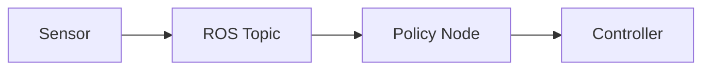

# ROS 2 for Robot Learning: A Complete Practical Tutorial

<!-- course-meta:start -->
[Course home](https://github.com/zengxiong111/Foundation_of_Embodied_AI) · [简体中文](https://github.com/zengxiong111/Foundation_of_Embodied_AI/blob/main/md/ROS2_Robot_Learning_Tutorial_ZH.md) · [PDF](https://zengxiong111.github.io/zengxiong.github.io/files/ROS2_Robot_Learning_Tutorial_EN.pdf)

| Item | Details |
|---|---|
| Applicability | Ubuntu 24.04; ROS 2 Jazzy; Python examples |
| Documentation review date | 2026-10-18 |
| License | CC BY 4.0 · Xiong Zeng and contributors |

**Verification scope:** Documentation organization and upstream reference snapshot; no tutorial runtime, training or hardware validation. See [version notes](https://github.com/zengxiong111/Foundation_of_Embodied_AI/blob/main/VERSIONS.md) for pinned source references. Original teaching content uses [CC BY 4.0](https://creativecommons.org/licenses/by/4.0/); third-party quotations, figures and code retain their original licenses. Citation alone does not grant relicensing rights.
<!-- course-meta:end -->

<!-- course-toc:start -->
## Contents

- [1. What Is ROS, and Why Use It in Robot Learning?](#course-section-01)
  - [1.1 Definition of ROS](#course-section-02)
  - [1.2 A typical robot learning system](#course-section-03)
  - [1.3 Is ROS always required for robot learning?](#course-section-04)
- [2. ROS 1 vs. ROS 2 and Choosing a Distribution](#course-section-05)
  - [2.1 Main architectural differences](#course-section-06)
  - [2.2 Which ROS distribution should you use in 2026?](#course-section-07)
- [3. Core ROS 2 Concepts](#course-section-08)
  - [3.1 Node](#course-section-09)
  - [3.2 Topic: publish / subscribe](#course-section-10)
  - [3.3 Message: data schema](#course-section-11)
  - [3.4 Service: request / response](#course-section-12)
  - [3.5 Action: longer operations with progress feedback](#course-section-13)
  - [3.6 Parameter: node configuration](#course-section-14)
  - [3.7 TF2: coordinate-frame management](#course-section-15)
  - [3.8 QoS: Quality of Service](#course-section-16)
- [4. Installing ROS 2 Jazzy on Ubuntu 24.04](#course-section-17)
  - [4.1 Check your system and configure repositories](#course-section-18)
  - [4.2 Install ROS 2 and developer tools](#course-section-19)
  - [4.3 Source the environment and verify](#course-section-20)
  - [4.4 First communication test](#course-section-21)
  - [4.5 Essential command-line tools](#course-section-22)
- [5. Hands-on: Writing a Robot Learning Policy Node in Python](#course-section-23)
  - [5.1 Create a workspace](#course-section-24)
  - [5.2 Create a Python package](#course-section-25)
  - [5.3 Implement the policy node](#course-section-26)
  - [5.4 Declare dependencies and entry point](#course-section-27)
  - [5.5 Build and run](#course-section-28)
  - [5.6 Publish simulated state and inspect output](#course-section-29)
  - [5.7 Replace the toy mapping with a PPO / SAC policy](#course-section-30)
- [6. Recording Robot Learning Data with ROS 2](#course-section-31)
  - [6.1 Teleoperation data collection architecture](#course-section-32)
  - [6.2 What is rosbag2?](#course-section-33)
  - [6.3 Record and replay a session](#course-section-34)
  - [6.4 What should a robot learning dataset contain?](#course-section-35)
  - [6.5 Time alignment and dataset conversion](#course-section-36)
- [7. URDF, TF2, RViz, and ros2_control](#course-section-37)
  - [7.1 URDF: robot model description](#course-section-38)
  - [7.2 Relationship between URDF and TF2](#course-section-39)
  - [7.3 RViz 2: visualization](#course-section-40)
  - [7.4 ros2_control: connecting commands to hardware](#course-section-41)
- [8. Connecting ROS to Isaac Lab / MuJoCo RL](#course-section-42)
  - [8.1 Simulated training usually needs no ROS](#course-section-43)
  - [8.2 Real-world deployment needs integration](#course-section-44)
  - [8.3 Consistent semantics matter more than transport](#course-section-45)
  - [8.4 Frequency and latency](#course-section-46)
- [9. A Tron2 + Revo3 Dexterous Manipulation Architecture](#course-section-47)
  - [9.1 Suggested ROS node architecture](#course-section-48)
  - [9.2 Suggested workspace layout](#course-section-49)
  - [9.3 Splitting arm and hand actions](#course-section-50)
  - [9.4 Integrating FoundationPose](#course-section-51)
- [10. Common ROS Issues in Robot Learning](#course-section-52)
  - [10.1 ROS 2 and Conda environments](#course-section-53)
  - [10.2 Safety boundary for real hardware](#course-section-54)
- [11. A Recommended Learning Path](#course-section-55)
- [12. Summary and Practical Recommendations](#course-section-56)
- [13. Official Documentation and References](#course-section-57)
<!-- course-toc:end -->

**Chapter concept map**




<a id="course-section-01"></a>

## 1. What Is ROS, and Why Use It in Robot Learning?

<a id="course-section-02"></a>

### 1.1 Definition of ROS

Despite its name, the Robot Operating System (ROS) is not an operating system in the sense of Ubuntu or Windows. It is a robotics software framework and ecosystem. Its central role is to allow separate robot software components to communicate, share information, and work together.

A robot may have cameras, a manipulator, a dexterous hand, an object pose estimator, a neural policy, and low-level controllers. The components can be written in different languages, run in different processes, or even live on different computers. ROS supplies a common messaging, communication, and tooling layer.

<a id="course-section-03"></a>

### 1.2 A typical robot learning system

Consider a Tron2 arm with a Revo3 hand performing a screwdriver pick-up and rotation task:

```text
                 Real Robot
                     |
          +----------+----------+
          |                     |
          v                     v
     RGB-D / RGB Cameras     Arm + Hand
          |                     |
          v                     v
        Images               Joint States
          +----------+----------+
                     v
                   ROS 2
                     v
           Observation Builder
                     v
                 RL Policy
                (PPO / SAC)
                     v
                   Action
                     v
                   ROS 2
                     v
           Low-level Control / SDK
                     v
                Arm + Hand
                     +----> Next Observation
```

The surrounding software systems have different responsibilities:

| Component | Primary role in robot learning |
|---|---|
| **ROS 2** | Inter-module communication, system integration, transforms, recording, debugging |
| **PyTorch** | Neural-network training, loading, and inference |
| **PPO / SAC** | Reinforcement learning algorithms |
| **Isaac Lab / MuJoCo** | Physics simulation and RL training environments |
| **ros2_control** | Hardware abstraction, controller management, and command interfaces |
| **MoveIt 2** | Motion planning, kinematics, and collision checking |
| **RViz 2** | Visualization of robot state, sensors, and transforms |
| **rosbag2** | Recording and replaying ROS messages |

**The essential distinction is that ROS handles integration and communication, learning frameworks handle training and inference, and controllers execute the resulting commands.** They complement rather than replace one another.

<a id="course-section-04"></a>

### 1.3 Is ROS always required for robot learning?

No. If a task only involves Python and a physics simulator, ROS may be unnecessary.

| Scenario | ROS required? | Reason |
|---|---|---|
| Parallel PPO training in Isaac Lab | No | Direct simulator APIs reduce overhead |
| SAC training in MuJoCo | No | Python environment and algorithm can interact directly |
| Offline Diffusion Policy / VLA training | No | Dataset loader plus PyTorch is sufficient |
| Controlling a single arm through its SDK | Not necessarily | Direct vendor SDK calls may be sufficient |
| Multi-camera + arm + hand integration | Recommended | Simplifies modularity, monitoring, and synchronization |
| Teleoperation data collection | Recommended | Simplifies multimodal recording and replay |
| Real-robot deployment of RL policies | Recommended, not mandatory | Standardizes observation/action and device boundaries |
| Distributed or multi-robot systems | Recommended | Facilitates inter-process and inter-machine communication |

> **Practical rule:** Keep the high-throughput simulated training loop outside ROS when possible. ROS is particularly useful around real-robot sensing, state estimation, data collection, device control, and deployment.

---

<a id="course-section-05"></a>

## 2. ROS 1 vs. ROS 2 and Choosing a Distribution

<a id="course-section-06"></a>

### 2.1 Main architectural differences

ROS 1 is the earlier ecosystem. ROS 2 was redesigned for contemporary robotics and offers better foundations for distributed discovery, QoS, lifecycle management, cross-platform support, and integration with real-time control systems.

| Feature | ROS 1 | ROS 2 |
|---|---|---|
| Discovery | Typically depends on a ROS Master | Common DDS implementations support distributed discovery |
| Python API | `rospy` | `rclpy` |
| C++ API | `roscpp` | `rclcpp` |
| Bag recording | `rosbag` | `rosbag2` |
| Parameters | ROS Parameter Server | Parameters managed by individual nodes |
| QoS | More limited | Reliability, history, depth, deadlines, and more |
| Control framework | `ros_control` | `ros2_control` |
| Recommended for new projects | Generally no | Yes |

Importantly, ROS 2 does **not** automatically make an application hard real-time. Determinism still depends on the OS, scheduling, hardware drivers, and system design.

<a id="course-section-07"></a>

### 2.2 Which ROS distribution should you use in 2026?

As of **October 2026**, ROS 2 **Lyrical Luth** has been released (May 22, 2026). The correct distribution nevertheless depends on the installed Ubuntu release and vendor-driver compatibility.

| Ubuntu version | Common matching ROS 2 release | Support note |
|---|---|---|
| Ubuntu 22.04 | Humble Hawksbill | LTS through May 2027 |
| Ubuntu 24.04 | **Jazzy Jalisco** | LTS through May 2029 |
| Ubuntu 26.04 | Lyrical Luth | LTS through May 2031 |

**This tutorial targets Ubuntu 24.04 + ROS 2 Jazzy.** If a hardware vendor only provides drivers for a specific ROS release, confirm driver compatibility before choosing a distribution.

---

<a id="course-section-08"></a>

## 3. Core ROS 2 Concepts

<a id="course-section-09"></a>

### 3.1 Node

A Node is a basic ROS computational unit: a software component with a clear responsibility. A node is not necessarily a separate OS process; multiple nodes can be composed into one process.

```text
ROS 2 System
|-- camera_node           # Acquire images
|-- robot_state_node      # Read joint states
|-- object_pose_node      # Estimate object 6D pose
|-- rl_policy_node        # Run policy inference
`-- controller_node       # Execute commands
```

The separation allows a perception component such as FoundationPose to be updated without rewriting the arm driver.

<a id="course-section-10"></a>

### 3.2 Topic: publish / subscribe

Topics are used for continuous, asynchronous data streams:

```text
camera_node --Publish--> /camera/image_raw --Subscribe--> perception_node
```

The publisher does not need to know its subscribers, and multiple subscribers may receive the same stream. Common robot learning topics include:

| Example topic | Data |
|---|---|
| `/camera/color/image_raw` | RGB image |
| `/camera/depth/image_rect_raw` | Depth image |
| `/joint_states` | Robot joint state |
| `/object_pose` | Object pose |
| `/policy/action` | Action generated by the policy |
| `/tf`, `/tf_static` | Dynamic and static transforms |

**The main role of topics in robot learning is to carry data among perception, observation construction, the policy, and the controller.** Actual topic names depend on the driver and namespace.

<a id="course-section-11"></a>

### 3.3 Message: data schema

A Message specifies the fields and types transmitted by a topic. Common messages include:

| Message type | Purpose |
|---|---|
| `sensor_msgs/msg/Image` | Image |
| `sensor_msgs/msg/CameraInfo` | Camera calibration information and intrinsics |
| `sensor_msgs/msg/JointState` | Joint names, positions, velocities, and effort |
| `sensor_msgs/msg/Imu` | IMU measurements |
| `geometry_msgs/msg/Pose` | Position and orientation |
| `geometry_msgs/msg/PoseStamped` | Timestamped pose in a named frame |
| `geometry_msgs/msg/Twist` | Linear and angular velocity |
| `trajectory_msgs/msg/JointTrajectory` | Joint trajectory |
| `std_msgs/msg/Float64MultiArray` | A basic float array |

For example, `sensor_msgs/msg/JointState` includes:

```python
header       # Timestamp and metadata
name         # Joint names, e.g. ['joint_1', 'joint_2']
position     # Joint positions
velocity     # Joint velocities
effort       # Joint torques or forces
```

Whether Revo3 exposes this standard message and the correct joint ordering depends on the actual driver or adapter. **Never assume that array indices have the same joint meaning across devices.**

<a id="course-section-12"></a>

### 3.4 Service: request / response

A Service is useful for one-off operations that should return a response:

```text
policy_node --Reset Request--> reset_server
policy_node <--Reset Result----- reset_server
```

Typical uses include resetting a robot, querying device information, switching modes, or starting calibration. A service resembles a remote function call, but can still fail or time out.

<a id="course-section-13"></a>

### 3.5 Action: longer operations with progress feedback

An Action supports the workflow "submit goal -> receive progress -> get result". Examples include executing a manipulator trajectory, navigating to a goal, and running a multi-second grasp skill. Goals can be canceled.

| Communication method | Best fit | Robot learning example |
|---|---|---|
| Topic | Continuous, asynchronous streaming | Images, joint state, policy actions |
| Service | One-off request and reply | Reset, query, mode switch |
| Action | Long operation with feedback and result | Execute a grasp or trajectory |

For periodic closed-loop commands at, say, 50 Hz, one normally uses a topic or a direct in-process interface rather than creating a new Action every control tick.

<a id="course-section-14"></a>

### 3.6 Parameter: node configuration

Parameters configure nodes without changing their main code:

```yaml
policy_node:
  ros__parameters:
    control_frequency: 50.0
    use_camera: true
    observation_dim: 32
    policy_path: "/home/robot/policy.pt"
```

Common settings include control frequency, camera names, model paths, reference frames, action scaling, and joint limits.

<a id="course-section-15"></a>

### 3.7 TF2: coordinate-frame management

A typical robot has many frames:

```text
world
 `-- base_link
      |-- arm_base
      |    `-- ee_link
      |         `-- hand_base
      `-- head_link
           `-- camera_link
                `-- camera_optical_frame
```

Suppose FoundationPose estimates the pose of an object in the camera frame, `T(C,O)`. The manipulation policy needs the pose in the robot base frame:

**Transform composition:** `T(B,O) = T(B,C) x T(C,O)`

Here `B` means robot base, `C` means camera, and `O` means object. TF2 stores and queries transforms between frames, including time-dependent transforms.

**TF2 does not calibrate a camera for you.** The extrinsic transform `T(B,C)` must first come from URDF geometry, hand-eye calibration, or another valid calibration procedure. This is especially relevant when working with Tron2 head/wrist cameras and the offsets among yaw/pitch joints.

<a id="course-section-16"></a>

### 3.8 QoS: Quality of Service

QoS controls message delivery behavior:

| Policy | Meaning |
|---|---|
| Reliability | `Reliable` vs. `Best Effort` |
| History / Depth | How messages are buffered |
| Durability | Whether retained data can be delivered to new subscribers |
| Deadline | Expected update interval and deadline monitoring |

Camera streams often use `Best Effort` to avoid retransmitting stale frames. Some important state or command streams may use `Reliable`, but queues of outdated commands must still be prevented. Incompatible publisher/subscriber QoS can make a topic visible while delivering no data.

---

<a id="course-section-17"></a>

## 4. Installing ROS 2 Jazzy on Ubuntu 24.04

The commands below follow the official **Jazzy Ubuntu Debian package instructions**. Installation requires network access and administrator privileges. First check that another ROS installation will not conflict.

<a id="course-section-18"></a>

### 4.1 Check your system and configure repositories

```bash
lsb_release -a                 # Verify Ubuntu 24.04
locale                         # Verify a UTF-8 locale

sudo apt update
sudo apt install software-properties-common curl -y
sudo add-apt-repository universe

export ROS_APT_SOURCE_VERSION=$(curl -s \
  https://api.github.com/repos/ros-infrastructure/ros-apt-source/releases/latest \
  | grep -F 'tag_name' | awk -F\" '{print $4}')

curl -L -o /tmp/ros2-apt-source.deb \
  "https://github.com/ros-infrastructure/ros-apt-source/releases/download/${ROS_APT_SOURCE_VERSION}/ros2-apt-source_${ROS_APT_SOURCE_VERSION}.$(. /etc/os-release && echo ${UBUNTU_CODENAME:-${VERSION_CODENAME}})_all.deb"

sudo dpkg -i /tmp/ros2-apt-source.deb
```

If the system does not have a UTF-8 locale, see the official locale setup procedure, for example:

```bash
sudo apt install locales
sudo locale-gen en_US en_US.UTF-8
sudo update-locale LC_ALL=en_US.UTF-8 LANG=en_US.UTF-8
```

<a id="course-section-19"></a>

### 4.2 Install ROS 2 and developer tools

```bash
sudo apt update
sudo apt install ros-jazzy-desktop ros-dev-tools
```

`ros-jazzy-desktop` includes RViz, demos, and common tools. For a non-GUI installation, `ros-jazzy-ros-base` is a smaller alternative.

<a id="course-section-20"></a>

### 4.3 Source the environment and verify

```bash
source /opt/ros/jazzy/setup.bash
echo $ROS_DISTRO               # Expected: jazzy
```

To source the environment automatically in new Bash sessions:

```bash
echo 'source /opt/ros/jazzy/setup.bash' >> ~/.bashrc
```

Avoid unintentionally sourcing multiple ROS distributions in the same shell.

<a id="course-section-21"></a>

### 4.4 First communication test

Terminal A:

```bash
source /opt/ros/jazzy/setup.bash
ros2 run demo_nodes_cpp talker
```

Terminal B:

```bash
source /opt/ros/jazzy/setup.bash
ros2 run demo_nodes_py listener
```

Expected output includes messages similar to `Publishing: Hello World` and `I heard: Hello World`, verifying Python/C++ interoperability.

<a id="course-section-22"></a>

### 4.5 Essential command-line tools

```bash
ros2 node list
ros2 node info /camera_node
ros2 topic list
ros2 topic echo /joint_states
ros2 topic type /joint_states
ros2 topic hz /joint_states
ros2 topic bw /camera/color/image_raw
ros2 topic info -v /joint_states
ros2 interface show sensor_msgs/msg/JointState
ros2 service list
ros2 action list
ros2 run tf2_ros tf2_echo base_link camera_link
```

The node/topic/frame names are examples. During real-robot debugging, `ros2 topic list`, `echo`, `hz`, and `info -v` are especially valuable for verifying message content, update rates, and QoS compatibility.

---

<a id="course-section-23"></a>

## 5. Hands-on: Writing a Robot Learning Policy Node in Python

We will build a minimal reproducible pipeline that **does not command any real motors**:

```text
/demo/joint_states
       | (JointState)
       v
    Policy Node
       | (Float64MultiArray)
       v
/demo/policy_target
```

<a id="course-section-24"></a>

### 5.1 Create a workspace

```bash
mkdir -p ~/ros2_ws/src
cd ~/ros2_ws
```

Typical structure:

```text
ros2_ws/
|-- src/      # Source code
|-- build/    # Build artifacts (generated)
|-- install/  # Installed packages (generated)
`-- log/      # Build logs (generated)
```

<a id="course-section-25"></a>

### 5.2 Create a Python package

```bash
cd ~/ros2_ws/src
ros2 pkg create \
    --build-type ament_python \
    --license Apache-2.0 \
    --node-name demo_policy \
    robot_learning_demo
```

The generated files resemble:

```text
robot_learning_demo/
|-- package.xml
|-- setup.py
|-- setup.cfg
|-- resource/
`-- robot_learning_demo/
    |-- __init__.py
    `-- demo_policy.py
```

`package.xml` declares dependencies; `setup.py` defines Python installation and executable entry points; `demo_policy.py` contains the policy node.

<a id="course-section-26"></a>

### 5.3 Implement the policy node

Edit `~/ros2_ws/src/robot_learning_demo/robot_learning_demo/demo_policy.py`:

```python
import rclpy
from rclpy.node import Node
from sensor_msgs.msg import JointState
from std_msgs.msg import Float64MultiArray


class PolicyNode(Node):
    def __init__(self):
        super().__init__("policy_node")

        # Subscribe: virtual robot observation
        self.subscription = self.create_subscription(
            JointState,
            "/demo/joint_states",
            self.state_callback,
            10,
        )

        # Publish: demonstration action (not for real hardware)
        self.publisher = self.create_publisher(
            Float64MultiArray,
            "/demo/policy_target",
            10,
        )

    def state_callback(self, msg):
        q = list(msg.position)
        if not q:
            return

        # An illustrative mapping, not a trained RL policy
        action = [0.5 * x for x in q]

        command = Float64MultiArray()
        command.data = action
        self.publisher.publish(command)


def main(args=None):
    rclpy.init(args=args)
    node = PolicyNode()
    try:
        rclpy.spin(node)
    finally:
        node.destroy_node()
        rclpy.shutdown()


if __name__ == "__main__":
    main()
```

The demonstration mapping is `a_t = 0.5 q_t`. It illustrates how observations become actions; it is **not** a trained or safe robot control policy. `Float64MultiArray` is chosen for simplicity; actual systems must define joint ordering, units, command semantics, limits, and timeout handling.

<a id="course-section-27"></a>

### 5.4 Declare dependencies and entry point

Add these dependencies to `package.xml` (do not duplicate existing entries):

```xml
<exec_depend>rclpy</exec_depend>
<exec_depend>sensor_msgs</exec_depend>
<exec_depend>std_msgs</exec_depend>
```

Check that `setup.py` includes the following `console_scripts` entry:

```python
'demo_policy = robot_learning_demo.demo_policy:main'
```

<a id="course-section-28"></a>

### 5.5 Build and run

```bash
cd ~/ros2_ws
colcon build --symlink-install
source install/setup.bash
ros2 run robot_learning_demo demo_policy
```

The node now waits for state messages. Ensure Jazzy is sourced before building with `colcon`.

<a id="course-section-29"></a>

### 5.6 Publish simulated state and inspect output

In a new terminal, source ROS:

```bash
source /opt/ros/jazzy/setup.bash
```

Publish a virtual two-joint state at 5 Hz:

```bash
ros2 topic pub -r 5 \
  /demo/joint_states \
  sensor_msgs/msg/JointState \
  "{name: ['j1', 'j2'], position: [0.4, -0.2]}"
```

In another terminal:

```bash
source /opt/ros/jazzy/setup.bash
ros2 topic echo /demo/policy_target
```

Expected output:

```text
data:
- 0.2
- -0.1
```

You have completed the minimal pipeline: publish state -> subscribe -> compute an action -> publish the action.

<a id="course-section-30"></a>

### 5.7 Replace the toy mapping with a PPO / SAC policy

Once a trained neural policy is available, replace:

```python
action = [0.5 * x for x in q]
```

with PyTorch inference (illustrative only):

```python
with torch.inference_mode():
    action_tensor = policy(observation_tensor)
    action = action_tensor.cpu().numpy().tolist()
```

A real deployment must load model weights, construct the correct observation, normalize inputs, map joint order, scale actions, manage devices/dtypes, enforce limits, and handle failures.

It is often better to separate sensor callbacks from the fixed-frequency inference loop:

```text
Sensor Callback -> Observation Buffer
                         |
                         v
                Policy Timer (e.g. 50 Hz)
                         |
                         v
                   Model Inference
                         |
                         v
                Safety Filter -> Publisher
```

50 Hz is illustrative. The proper rate depends on inference cost, driver capabilities, and the task. Running inference unconditionally inside every subscription callback can lead to irregular execution, queue buildup, and latency.

---

<a id="course-section-31"></a>

## 6. Recording Robot Learning Data with ROS 2

<a id="course-section-32"></a>

### 6.1 Teleoperation data collection architecture

For example, collecting demonstrations by teleoperating Tron2 + Revo3 with PICO:

```text
Human Operator / PICO / Glove
           |
           v
       Teleoperation
           |
           v
   Robot Controller / SDK
           |
           v
        Real Robot
           |
       +---+-------------+
       v                 v
   RGB-D / RGB       Joint States
       |                 |
       +--------+--------+
                v
              ROS 2
                v
             rosbag2
                v
          Offline Dataset
                v
    BC / Diffusion Policy / VLA
```

<a id="course-section-33"></a>

### 6.2 What is rosbag2?

rosbag2 is the ROS 2 tool for recording and replaying topic messages and related metadata. Common storage backends include SQLite3 and MCAP. It is useful for reproducing data collection sessions and diagnosing sensing or algorithm behavior.

<a id="course-section-34"></a>

### 6.3 Record and replay a session

Assume that these topics exist:

```text
/joint_states
/camera/color/image_raw
/camera/depth/image_rect_raw
/tf
/tf_static
```

Record a selected set of topics:

```bash
ros2 bag record -o demo_001 \
  /joint_states \
  /camera/color/image_raw \
  /camera/depth/image_rect_raw \
  /tf \
  /tf_static
```

Stop with `Ctrl+C`, then inspect or replay:

```bash
ros2 bag info demo_001
ros2 bag play demo_001
```

**Safety warning:** Replaying a bag can republish control topics if those topics were recorded. Isolate the real hardware control interface or disconnect actuation before replaying such commands.

<a id="course-section-35"></a>

### 6.4 What should a robot learning dataset contain?

An imitation learning dataset can be written as:

`D = { (o_t, a_t) }_(t=0,...,T)`

Recommended fields include:

| Category | Examples |
|---|---|
| Images | Head RGB, wrist RGB, head depth |
| Robot state | Arm/hand joint positions and velocities, end-effector pose |
| Action | Issued control commands and target joint positions/velocities |
| Time | Original timestamps from each data source |
| Calibration | Camera intrinsics/extrinsics, TF, URDF version |
| Episode metadata | Task, start/end time, success/failure |
| Optional | Tactile, torques, motor current, object pose |

A crucial distinction is:

- **Commanded action:** A target generated by teleoperation or a policy.
- **Executed state:** What onboard sensors indicate the robot actually did.

They may differ due to delays, saturation, controller limits, or contact and must not be treated as interchangeable.

<a id="course-section-36"></a>

### 6.5 Time alignment and dataset conversion

A typical pipeline:

```text
ROS Bag
   |
   v
Read Topics
   |
   v
Timestamp Alignment
   |
   v
Episode Segmentation
   |
   v
Observation / Action Pairing
   |
   v
HDF5 / Parquet / LeRobot-compatible Dataset
   |
   v
Policy Training
```

Example rates (not specifications for Tron2 or Revo3):

| Modality | Illustrative rate |
|---|---|
| RGB / depth cameras | 30 Hz |
| Robot joint state | 100 Hz |
| Tactile sensing | 100 Hz |
| Policy action | 50 Hz |

Choose a reference timeline, interpolate states, match image frames, or construct observation histories as appropriate. **Do not synchronize by the order in which ROS messages arrive; use meaningful timestamps and account for clock offsets.**

---

<a id="course-section-37"></a>

## 7. URDF, TF2, RViz, and ros2_control

<a id="course-section-38"></a>

### 7.1 URDF: robot model description

URDF (Unified Robot Description Format) describes links, joints, geometry, and inertial properties. For example:

```text
Tron2
 |-- Shoulder Joint
 |-- Elbow Joint
 |-- Wrist Joint
 `-- Revo3 Hand
      |-- Finger / Joint 1
      |-- Finger / Joint 2
      `-- ...
```

Common XML elements include:

```xml
<link>       <!-- Rigid-body link -->
<joint>      <!-- Joint and connectivity -->
<visual>     <!-- Display geometry -->
<collision>  <!-- Collision geometry -->
<inertial>   <!-- Mass and inertia -->
```

URDF provides structure for visualization, kinematics, and conversion into simulation models, although simulation imports may need extra parameters and format conversion.

<a id="course-section-39"></a>

### 7.2 Relationship between URDF and TF2

**URDF describes structure; TF2 manages coordinate transforms over time.**

```text
            URDF
              |
              v
robot_state_publisher <- /joint_states
              |
              v
           TF Tree
              |
              v
             RViz
```

For Tron2, this helps inspect the end effector, Revo3 hand base, head camera, and wrist camera. Incorrect URDF extrinsics will not be corrected by TF2 automatically.

<a id="course-section-40"></a>

### 7.3 RViz 2: visualization

Start RViz:

```bash
rviz2
```

RViz can display the robot model, TF tree, camera images, point clouds, joint state, pose markers, and trajectories. With FoundationPose, it is useful for checking where the estimated object pose lies relative to the robot base.

<a id="course-section-41"></a>

### 7.4 ros2_control: connecting commands to hardware

```text
High-Level Policy
        |
        v
Controller (ros2_control)
        |
        v
Hardware Interface
        |
        v
Vendor SDK / Driver
        |
        v
Motor / Robot
```

A Hardware Interface maps low-level device read/write operations to the control framework. A Controller implements trajectory, position, velocity, or other command semantics.

| Controller / concept | Purpose |
|---|---|
| Joint Trajectory Controller | Execute joint trajectories |
| Forward Command Controller | Forward command values to selected interfaces |
| Joint position/velocity command interfaces | Send commands as supported by configuration |
| Diff Drive Controller | Control a differential-drive mobile base |

Install the packages:

```bash
sudo apt install \
  ros-jazzy-ros2-control \
  ros-jazzy-ros2-controllers
```

Once a compatible `controller_manager` is running:

```bash
ros2 control list_controllers
```

**Installing ros2_control alone does not provide a Tron2/Revo3 driver.** You still need a compatible Hardware Interface or your own vendor-SDK adapter. A standalone ROS driver node without ros2_control is also possible.

---

<a id="course-section-42"></a>

## 8. Connecting ROS to Isaac Lab / MuJoCo RL

<a id="course-section-43"></a>

### 8.1 Simulated training usually needs no ROS

PPO/SAC training in Isaac Lab or MuJoCo often calls the environment API directly:

```python
observations = env.reset()
for step in range(num_steps):
    actions = policy(observations)
    observations, rewards, dones, info = env.step(actions)
```

This is conceptual pseudocode, not an exact API signature for every Gymnasium or Isaac Lab version. GPU-parallel environments require high throughput; using a ROS topic at every simulation step usually adds unnecessary serialization and scheduling costs.

<a id="course-section-44"></a>

### 8.2 Real-world deployment needs integration

```text
Isaac Lab / MuJoCo
        |
        v
  PPO / SAC Training
        |
        v
   Exported Policy
        |
        v
  ROS 2 Policy Node
        |
        v
  Safety / Controller
        |
        v
    Real Robot
```

Typical execution architecture:

```text
Camera --------+
Joint States --+--> Observation Builder --> RL Policy
Object Pose ---+                                |
                                                v
                                           Safety Filter
                                                |
                                                v
                                         Robot Controller
                                                |
                                                v
                                            Real Robot
```

<a id="course-section-45"></a>

### 8.3 Consistent semantics matter more than transport

| Item | Training | Real-robot requirement |
|---|---|---|
| Joint order | Simulator model order | Explicit mapping to driver order |
| Joint units | Often radians | Check radians, degrees, or vendor-specific units |
| Observation | Normalized state | Identical normalization and concatenation order |
| Action | Position, delta, velocity, etc. | Match the hardware control mode |
| Frequency | Simulation timestep / decimation | Define policy and control periods |
| Frames | Simulation world/base | Define corresponding real-world frames |

ROS standardizes communication but does not automatically fix joint ordering, camera calibration, normalization, dynamics mismatch, or latency.

<a id="course-section-46"></a>

### 8.4 Frequency and latency

Distinguish three clocks:

- `f_camera`: sensor acquisition rate.
- `f_policy`: neural-policy inference/update rate.
- `f_control`: low-level controller update rate.

They need not be equal. For example, a 30 Hz camera, 50 Hz policy, and faster servo loop is a conceivable design, not a hardware requirement.

Python ROS 2 nodes do not automatically provide hard real-time execution. For robust control, separate GPU inference from servo control, place timing-critical tasks in appropriate C++/real-time threads, avoid blocking in the control path, and implement command timeouts, safety limits, and an emergency stop.

---

<a id="course-section-47"></a>

## 9. A Tron2 + Revo3 Dexterous Manipulation Architecture

Target task: **pick a screwdriver up from a table, carry it to a specified location, and rotate it.** The proposed system contains Tron2, BrainCo Revo3, a head RGB-D camera, a wrist RGB camera, FoundationPose, and a PPO/SAC policy.

<a id="course-section-48"></a>

### 9.1 Suggested ROS node architecture

```text
                     ROS 2 System
                           |
       +-------------------+--------------------+
       v                   v                    v
   Head Camera         Wrist Camera         Robot Driver
       |                   |                    |
       v                   v                    v
    RGB / Depth           RGB               Joint States
       +---------+---------+                    |
                 v                              |
           Pose Estimator                       |
           (FoundationPose)                     |
                 |                              |
                 v                              |
             Object Pose                        |
                 +--------------+---------------+
                                v
                       Observation Builder
                                v
                            RL Policy
                                v
                         Safety Filter
                                v
                        Robot Driver / SDK
                                v
                          Tron2 + Revo3
```

<a id="course-section-49"></a>

### 9.2 Suggested workspace layout

```text
robot_learning_ws/
`-- src/
    |-- tron2_driver/
    |-- revo3_driver/
    |-- camera_driver/
    |-- robot_description/
    |-- pose_estimation/
    |-- observation_builder/
    |-- rl_policy/
    |-- safety_controller/
    |-- teleoperation/
    `-- data_recorder/
```

This is a proposed engineering layout, **not** a claim that the vendors distribute packages with these names. If a vendor only provides a Python/C++ SDK, wrap it in a ROS driver or adapter.

<a id="course-section-50"></a>

### 9.3 Splitting arm and hand actions

A joint policy may produce:

`a_t = [ a_t^arm, a_t^hand ]`

Here the arm action dimension is `n_a`, and the hand action dimension is `n_h`. Actions can then be routed as:

```text
          RL Policy
              |
              v
            Action
           +--+--+
           v     v
        Arm Cmd Hand Cmd
           v     v
       Tron2 SDK Revo3 SDK
```

The design could use separate topics for the two subsystems or a unified Robot Action message with a dispatcher. Either approach must specify time alignment, joint ordering, command semantics, and failure handling across the arm and hand.

<a id="course-section-51"></a>

### 9.4 Integrating FoundationPose

```text
Head RGB-D / Wrist RGB
          |
          v
     FoundationPose
          |
          v
      /object_pose
          |
          v
     TF Transform
          |
          v
Object Pose in Robot Base
          |
          v
       RL Policy
```

The pose estimation node can be developed independently of the controller, provided its `PoseStamped` timestamps and `frame_id` are accurate. Real implementations should also handle occlusion, tracking loss/reinitialization, and temporal filtering.

---

<a id="course-section-52"></a>

## 10. Common ROS Issues in Robot Learning

| Symptom | Possible cause | What to check |
|---|---|---|
| `ros2 topic list` cannot see hardware | Driver not running, discovery or domain issue | Nodes, DDS, `ROS_DOMAIN_ID` |
| Topic exists but no messages arrive | Incompatible QoS or message types | `ros2 topic info -v` |
| Camera and joint states are misaligned | Different rates or clock domains | Timestamps, hardware sync, buffering |
| Object pose is biased | Calibration, TF chain, or frame mismatch | Extrinsics, optical frame convention |
| RL commands behave incorrectly | Joint order, normalization, or command mode mismatch | Compare training/deployment observation and action |
| End-to-end latency is high | Sensor, model, transport, SDK, controller delay | Measure each segment and queue occupancy |
| ROS conflicts with Conda | System Python vs. Conda ABI/dependency mismatch | Compatible environment or separate processes |
| Bag recordings are huge | Multiple high-bandwidth RGB-D streams | Compression, MCAP/storage settings, splitting |
| RViz robot model is wrong | URDF, JointState, or TF inconsistency | Inspect Robot Model and TF step by step |

<a id="course-section-53"></a>

### 10.1 ROS 2 and Conda environments

Robot learning workflows commonly use Conda for PyTorch, CUDA, Isaac Lab, and RL libraries, while the apt-installed `rclpy` is tied to the system Python environment. Running `import rclpy` inside an arbitrary Conda environment may trigger ABI or shared-library problems.

A robust architecture is:

```text
  ROS 2 Driver Process
          |
      Observation
          v
PyTorch Inference Process
      (Conda / CUDA)
          |
         Action
          v
  ROS 2 Control Process
```

Processes can communicate through ROS topics, dedicated IPC, or shared memory, rather than requiring every dependency in the same Python environment.

<a id="course-section-54"></a>

### 10.2 Safety boundary for real hardware

A learned policy output is not a trusted low-level motor command. Real deployments need joint limits, velocity/acceleration bounds, command timeouts, stopping and emergency-stop mechanisms, disconnection fallback behavior, and initial testing at low speed without payload or contact. ROS is not a replacement for a hardware safety system.

---

<a id="course-section-55"></a>

## 11. A Recommended Learning Path

| Stage | Topics | Demonstrable milestone |
|---|---|---|
| 1 | Nodes, topics, messages | Inspect and explain the robot's topics |
| 2 | `rclpy`, publishers, subscribers | Run a custom Python policy node |
| 3 | rosbag2 | Record and replay a complete episode |
| 4 | URDF, TF2, RViz | Verify robot and camera coordinate frames |
| 5 | Robot SDK, ros2_control | Safely read state and send test targets |
| 6 | PyTorch + ROS | Deploy PPO/SAC inference on a robot |
| 7 | QoS, synchronization, latency | Quantify sensor-to-action end-to-end latency |

For researchers already comfortable with Python, control, and robot learning, the most efficient path is to learn what is needed for **data collection -> policy deployment -> reproducible experiments**, rather than covering every ROS subsystem in isolation.

---

<a id="course-section-56"></a>

## 12. Summary and Practical Recommendations

The value of ROS 2 in robot learning can be grouped into three areas:

| Area | ROS responsibilities | Typical application |
|---|---|---|
| **Data collection** | Gather and record camera, state, and teleoperation streams | BC, Diffusion Policy, VLA |
| **Policy deployment** | Connect observations, policy inference, and controllers | PPO, SAC, Sim2Real |
| **System integration** | Frame transforms, device communication, visualization, diagnostics | Dexterous manipulation, visual feedback, real-robot experiments |

For a **Tron2 + Revo3** research platform, prioritize five skills:

1. **Topics + rclpy:** Connect state and camera observations to the RL policy.
2. **rosbag2:** Record teleoperation demonstrations for offline datasets.
3. **TF2 + URDF:** Maintain the head-camera, wrist-camera, end-effector, and object frames.
4. **Robot SDK / Hardware Interface:** Control Tron2 and Revo3 reliably.
5. **Sim2Real deployment:** Transfer policies trained in Isaac Lab / MuJoCo to a physical closed-loop system.

**The goal is not to put more ROS into training. It is to build an observable, reproducible, maintainable sensor -> policy -> controller -> robot pipeline.**

---

<a id="course-section-57"></a>

## 13. Official Documentation and References

1. [ROS 2 Jazzy Tutorials](https://docs.ros.org/en/jazzy/Tutorials.html)
2. [ROS 2 Jazzy Ubuntu Debian Package Installation](https://docs.ros.org/en/jazzy/Installation/Ubuntu-Install-Debs.html)
3. [Python Publisher / Subscriber Tutorial](https://docs.ros.org/en/jazzy/Tutorials/Beginner-Client-Libraries/Writing-A-Simple-Py-Publisher-And-Subscriber.html)
4. [ROS 2 TF2 Tutorials](https://docs.ros.org/en/jazzy/Tutorials/Intermediate/Tf2/Tf2-Main.html)
5. [ros2_control Documentation](https://control.ros.org/jazzy/)
6. [MoveIt 2 Documentation](https://moveit.picknik.ai/)
7. [rosbag2 GitHub Repository](https://github.com/ros2/rosbag2)
8. [ROS 2 Distribution Support Information](https://github.com/ros2/ros2_documentation/blob/rolling/source/Releases.rst)
9. [ROS 2 Lyrical Release Records](https://github.com/ros2/ros2/releases)

**Document note:** This tutorial is educational and intended for system design. The sample action topic is for simulated testing only. All real-robot integrations must be checked against vendor documentation and safety requirements.
