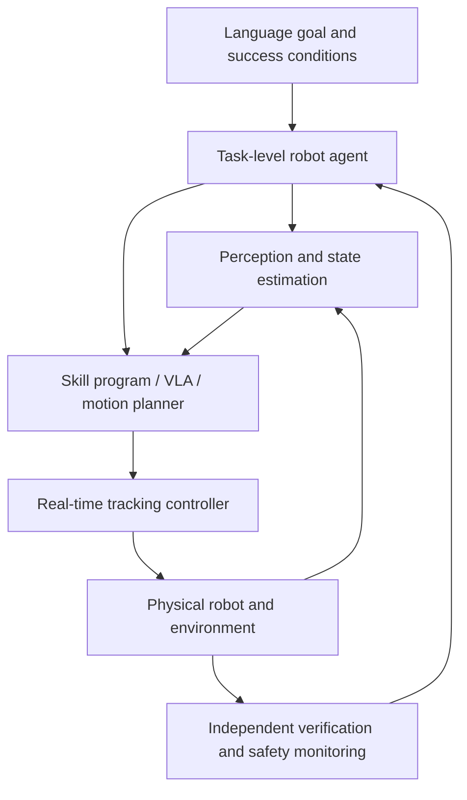
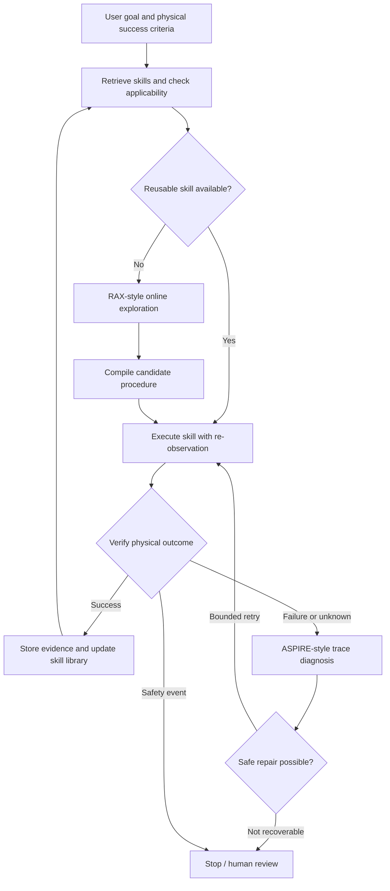

# Advanced Robot Agents: RAX, ASPIRE, and Continually Improving Workflows

[Course home](https://github.com/zengxiong111/Foundation_of_Embodied_AI) · [简体中文](https://github.com/zengxiong111/Foundation_of_Embodied_AI/blob/main/md/Robot_Agent_Workflow_ZH.md) · [PDF](https://zengxiong111.github.io/zengxiong.github.io/files/Robot_Agent_Workflow_EN.pdf)

**Foundation of Embodied AI · Expanded course notes**  
*From task planning to online exploration, verified execution, and skill accumulation*

> **Three practical questions:** How can a robot explore a task it has never solved? After discovering an effective procedure, how can it execute without expensive step-by-step language-model reasoning? When execution fails, how can it repair the right part and reuse the lesson later?

**Learning goals:** Distinguish a robot agent from a VLA, a skill program, and a real-time controller; explain RAX's Explore–Compile–Evaluate cycle; understand ASPIRE's multimodal traces, iterative debugging, Coordinator–Actor organization, and evolutionary search; and assemble these ideas into a safe, reusable system. **No code or laboratory exercises** are included.

## Contents

- [1. What Exactly Does a Robot Agent Do?](#agent-section-01)
- [2. RAX: Compiling Online Exploration into Independent Programs](#agent-section-02)
- [3. ASPIRE: From Trace-Guided Debugging to Accumulated Skills](#agent-section-03)
- [4. A Unified RAX + ASPIRE Workflow—with the Research Boundaries Intact](#agent-section-04)
- [5. Worked Example: A Dexterous Hand Manipulating a Screwdriver](#agent-section-05)

## 1. What Exactly Does a Robot Agent Do?

### 1.1 From predicting actions to managing task completion

Consider: “Pick up the screwdriver, move it to the target area, and rotate it.” An action policy or VLA mainly asks, **“Given the current observation and instruction, what action comes next?”** A robot agent addresses another time scale: **“Which skill should be used, what should we observe, how will success be checked, and what should change after a failure?”** The agent can orchestrate an existing VLA without replacing it.

| Layer | Responsibility | Typical time scale and output |
|:--|:--|:--|
| **Task-level agent** | Decompose tasks, retrieve skills, write and repair programs, replan. | Event driven; tool calls or program changes. |
| **Perception and skills** | Localize targets, select grasp and manipulation strategies, branch on feedback. | Observation/skill steps; poses and action goals. |
| **Control and safety** | Track motion, enforce constraints, handle abnormal hardware behavior. | High-rate feedback; commands and stop states. |

**The guiding principle:** A task-level agent may reason slowly, but the robot cannot wait for it at every servo cycle. Let the controller close the physical loop while the agent manages exploration, composition, and improvement. [1–3]

### 1.2 Agents, VLAs, and classical planners are complementary

- **VLA or end-to-end policy:** Predicts actions or action chunks from observations and instructions. Long-term memory, tool use, and explicit failure attribution are not guaranteed by the model interface alone.
- **Classical task and motion planning:** Provides explicit reasoning about reachability, geometry, and collision constraints, but may need additional components for new semantic goals or unexpected failures.
- **Coding robot agent:** Composes sensing, planning, and control APIs into executable programs and debugs them from physical feedback. Its language-based reasoning does not replace reliable interfaces or low-level stability guarantees.

For a screwdriver rotation, the agent may decide to secure the grasp before turning; perception estimates the object-to-hand transform; the skill defines grasp selection and when to re-localize; the controller tracks joint motion; and a verifier confirms that **the screwdriver itself** rotated by the required amount.

### 1.3 Three different meanings of “success”

| What is observed | What it actually means | Required follow-up |
|:--|:--|:--|
| A motion API returns `FINISHED`. | The command sequence ended. | Check physical postconditions. |
| Fingers close while the object is occluded. | The object may be grasped or missed. | Re-observe; preserve uncertainty. |
| The object is lifted, transported, and visibly rotated. | Evidence supports the task goal. | Store conditions, evidence, and version. |

A useful **three-valued task verifier** is

$$
V(o_{0:T}) \in \{\mathrm{SUCCESS},\ \mathrm{FAILURE},\ \mathrm{UNKNOWN}\}.
$$

`UNKNOWN` is not the same as failure. It means that available sensor evidence cannot establish the physical outcome. The correct response may be another viewpoint, a safer inspection action, or escalation—not an invented success claim.

### 1.4 Who has final authority to execute?

The agent can only use **approved robot tools**. Workspace limits, joint constraints, force/velocity bounds, collision handling, and emergency stops must remain under independently enforced control and safety mechanisms. On physical hardware, **executable generated code is not automatically authorized code**. This boundary applies throughout the tutorial.

## 2. RAX: Compiling Online Exploration into Independent Programs

RAX (Robot Agent eXploration) lets a general-purpose coding agent observe and control a robot through APIs, preserve online discoveries in a workspace, and compile effective behavior into a repeatable program. It does **not** require new task-specific action demonstrations or updates to the underlying language-model weights. It still depends on robot APIs, sensors, controllers, and task feedback. [1,2]

### 2.1 Explore: what is being learned, exactly?

RAX does not relearn motor physics from scratch. The agent searches for useful decision sequences **within the perception and control tools already available** to that robot.

| Question during exploration | Available feedback | Reusable lesson |
|:--|:--|:--|
| Where is the object; should the robot change viewpoint? | Images and estimated object pose. | Observation conditions and re-localization. |
| Is a candidate approach reachable? | IK, planning, and collision status. | Feasible approach direction and failure causes. |
| Did the contact action work? | Proprioception, object motion, task checks. | Success conditions and recovery choices. |
| Does the procedure work from another starting pose? | Repeated executions after scene changes. | Parameterized logic, not one fixed pose. |

The loop is **observe → propose a testable action → call robot tools → inspect physical feedback → revise the next attempt**. The agent can change the camera viewpoint, target pose, operation order, or grasp configuration. Its “learned model” resides primarily in **notes, code, and verified skills**, rather than gradient-updated neural parameters.

### 2.2 Why must an exploration record explain causes?

A log that says only “grasp failed” is not very useful; the next session may repeat the same command. A log that states “the candidate approach fell within the table's collision buffer; changing approach angle led to a successful plan” supports a decision in a new scene.

A good record preserves **what was observed, what was attempted, what each tool returned, what was changed, and what physically happened**. Unrelated background details need not enter long-term skill memory. [1,2]

### 2.3 Compile: from a successful interaction to a standalone procedure

RAX's key step is not to store a successful trajectory. The agent turns useful decisions into a program with **fresh perception, parameter computation, execution, conditional branching, and explicit failure exits**. At runtime, the program can itself invoke sensing and control APIs instead of asking the coding agent to decide every motion.

| Simple trajectory replay | Compiled closed-loop procedure |
|:--|:--|
| Reuses a fixed object coordinate. | Re-localizes the object in the current scene. |
| Executes a predetermined motion sequence. | Checks reachability/contact feedback and branches. |
| Stops after a failed step. | Includes bounded, authorized recovery branches. |
| Has evidence from the original situation only. | Declares preconditions and is tested independently. |

Here, **“compile” means synthesizing executable robot logic from exploration experience**. It is not just translating an English command to compiler bytecode. [1]

### 2.4 Evaluate: why temporarily remove the agent?

While debugging, an agent has access to the full interaction history and might silently compensate for gaps in the written program. A stronger evaluation **freezes the program** and runs it independently from new initial states or layouts, checking the physical result. The RAX project separates exploration from evaluation: held-out simulated layouts are used in simulation, and on hardware the scene is reset before an unattended end-to-end run. [1]

Do not confuse three levels of evidence:

1. **One successful run:** The particular sequence was feasible under one condition.
2. **Repeatability in the same setup:** Some support for stability, but not broad generalization.
3. **Unattended success after scene variation:** Stronger evidence of a useful scope of applicability.

The official RAX materials illustrate the runtime distinction using an air-fryer task: roughly 72 minutes of agent-led exploration versus an 18-second compiled execution. These are **task-specific figures**, not a universal latency or real-time-control guarantee. [1,2]

**Takeaway:** RAX turns *methods discovered through online interaction* into *programs that run without continuous coding-agent supervision while remaining observation-dependent*.

## 3. ASPIRE: From Trace-Guided Debugging to Accumulated Skills

ASPIRE (Agentic Skill Programming through Iterative Robot Exploration) also follows a **code-as-policy** approach: a coding agent writes robot-control programs and repairs them from execution feedback. Its distinctive components are a **fine-grained multimodal execution engine, a growing skill library, and evolutionary search over programs**, coordinated through a **Coordinator–Actor** organization. [3,4]

### 3.1 Multimodal traces: locating the failing primitive

A failed task can result from target detection, pose estimation, motion planning, grasping, contact mechanics, or a faulty success check. A final `FAILED` label does not locate the cause. ASPIRE logs evidence **per sensing, planning, or action-primitive call**, instead of returning only a rollout-level task score.

| Trace component | Evidence inspected | Question it helps answer |
|:--|:--|:--|
| Tool invocation and parameters | Goal pose, grasp candidates, motion constraints. | Was the request itself wrong? |
| API output and error status | Planning errors, contact/grasp results. | Did planning or contact fail? |
| Before/after keyframes | Actual motion of object and robot. | Physical slip or perception drift? |
| Estimated poses and overlays | Perception–motion consistency. | Frame mismatch, occlusion, or collisions? |

The point is to **inspect selected evidence near suspected failures**, rather than overwhelm the agent with full video streams. Per-primitive feedback supports more targeted repairs. [3]

### 3.2 Iterative debugging: a repair must produce new evidence

The loop is **inspect the failing trace → form a hypothesis → patch the relevant program decision → rerun → compare outcomes**. If the planner reports an unreachable goal, first examine coordinate frames, collision margins, and approach direction; blindly increasing grip force would change the wrong subsystem. Smaller, causally motivated patches make the effect easier to assess.

The central rule is to **repair an evidence-supported bottleneck, not simply silence the last error message**.

### 3.3 Published example: the object is found, so why can't the robot reach it?

The ASPIRE paper includes a radio pick-up example. Perception successfully identifies the radio, yet repeated navigation attempts return `PLANNING_ERROR`. From the traces, the agent discovers that candidate navigation targets violate a collision-avoidance buffer around the table. It then samples alternative approach directions, re-observes from a reachable side, and completes the grasp. The reusable result is **multi-angle approach near obstacle boundaries**, not a rigid script for that particular radio. [3]

| Initial symptom | Root cause seen in trace | Targeted change | Transferrable idea |
|:--|:--|:--|:--|
| Object found, approach repeatedly fails. | Candidate goals conflict with collision buffers. | Change approach side and replan. | Try safe alternative approach directions. |

### 3.4 Skill library: store when and why a fix works

ASPIRE's library is not limited to full task programs. It stores **reusable repair patterns**, including object disambiguation, re-perception, navigation recovery, manipulation ordering, and debugging procedures. A useful item identifies a failure signature, applicability conditions, a repair strategy, and validation evidence. Future coding agents retrieve the item as **in-context guidance**, not as unconditionally reusable control gains or coordinates. [3]

### 3.5 Coordinator–Actor and evolutionary search

A **Coordinator** assigns different tasks to actor coding agents, reviews whether their repairs succeeded and respected permitted APIs, and curates a shared skill library. Each actor focuses on the current task, program, and traces; complete chat histories need not be pooled.

When repeatedly patching one strategy stops helping, **evolutionary search** proposes several distinct candidate task sequences or programs. Each candidate executes and yields a score and trace. Later rounds use high-performing candidates and unresolved failure evidence to propose better variations. The objects of search are **robot programs and procedural decisions**; this is not, by itself, gradient fine-tuning of a VLA. [3,4]

**Takeaway:** ASPIRE turns *precise execution evidence* into *verified fixes*, then consolidates transferable repairs as knowledge for future tasks.

## 4. A Unified RAX + ASPIRE Workflow—with the Research Boundaries Intact

This diagram is a **teaching-oriented reference design**: RAX-style exploration and compilation fill skill gaps; ASPIRE-style diagnosis and curation support continual improvement. **The two papers do not report joint experimental validation of this combined architecture.**

### 4.1 Four loops with distinct ownership

| Loop | What it owns | Failure mode to avoid |
|:--|:--|:--|
| **Control loop** | High-rate tracking, contact stabilization, hardware limits. | Asking a slow agent for motor torques. |
| **Skill execution loop** | Re-observation, conditional branches, local recovery. | Reducing a compiled skill to trajectory playback. |
| **Task-agent loop** | Retrieval, exploration, diagnosis, replanning. | Reinventing each action from scratch. |
| **Continual-improvement loop** | Validation, versioning, reuse, retirement. | Treating incidental success as permanent fact. |

These loops do not require four separate foundation models. Often **one agent can write or repair code at task boundaries, while validated programs operate during routine execution**, improving latency predictability and interpretability.

### 4.2 RAX and ASPIRE: overlapping capabilities, different emphasis

| Question | RAX emphasizes | ASPIRE emphasizes |
|:--|:--|:--|
| What is explored? | Effective decisions from online robot interaction. | Program improvements from trace debugging and diverse search. |
| What is preserved? | Modular executable programs and run evidence. | Searchable failure signatures and repair knowledge. |
| What reduces future effort? | Compilation reduces live coding-agent involvement. | Reusing fixes avoids rediscovering failure causes. |
| What is verified? | Standalone program execution in new settings. | Individual repairs, candidates, and skill admission. |

**Important:** RAX also handles errors and saves skills, and ASPIRE also explores and writes complete programs. The table contrasts **research priorities**, not exclusive capabilities. [1–4]

### 4.3 A minimal contract for any reusable skill

Whatever the file format, a skill should expose five categories of information:

1. **Preconditions:** Embodiment, hand/arm API, calibration, object range, and allowed workspace.
2. **Execution:** Parameters, permitted tool calls, time budget, and handoff to the local controller.
3. **Verification:** Sensor-based criteria for `SUCCESS`, `FAILURE`, and `UNKNOWN`.
4. **Recovery:** Recoverable errors, bounded retries, and mandatory stop conditions.
5. **Evidence and version:** Unattended evaluations, known limitations, version provenance, and revocation.

This is an **engineering teaching checklist**, not an exact schema mandated by either paper. As a concrete precedent, RAX's official skills library distinguishes `draft`, `verified`, and `deprecated` states with run evidence; ASPIRE emphasizes admitting generalizable repairs into a shared knowledge base. [2–4]

### 4.4 Route different failures to different layers

- **Insufficient observation:** Re-observe; if the outcome is still unobservable, report `UNKNOWN`.
- **Planning infeasibility:** Check transforms, collision constraints, approach directions, and goal selection.
- **Grasp slip or unsafe contact:** Let the control and safety layers stop hazardous motion first; only then consider regrasping.
- **Changed task state:** If an object leaves the workspace, replan at the task layer or escalate.
- **Hardware or safety alarm:** Stop. Do not bypass limits or attempt indefinite retries as a “repair.”

## 5. Worked Example: A Dexterous Hand Manipulating a Screwdriver

**Task:** Pick up a screwdriver from any permitted table location, transfer it to a target region, and achieve a specified rotation. If it drops, recover only when safe; otherwise terminate clearly. This is a **hypothetical teaching scenario**, not a published RAX or ASPIRE screwdriver experiment.

### 5.1 Turn a language task into observable physical conditions

| Subgoal | Evidence needed | Typical false success |
|:--|:--|:--|
| Identify the tool | Detection, object pose, tracking confidence. | The wrong tool is detected. |
| Grasp and lift | Object leaves table and remains stable relative to hand. | Fingers close around empty space. |
| Transport | Object reaches target tolerance region, still held. | End effector arrives but object has slipped. |
| Rotate | Object turns around the intended reference axis. | Wrist turns while the object stays still. |

To distinguish “rotated the wrist” from “rotated the object,” use **independent comparisons** of object pose and hand/end-effector state. With only head- and wrist-mounted cameras, occlusion and poor viewpoints matter. Visual relative motion and proprioception can compensate for missing tactile sensors, but uncertainty must remain explicit.

### 5.2 Seven steps across the full agent life cycle

1. **Define boundaries:** Establish allowed workspace, forces, actions, target rotation, and success/failure/unknown criteria.
2. **Retrieve:** Search for locate–grasp–transport–rotate skills, then check compatibility with the current hand, camera extrinsics, and tool geometry.
3. **Explore if needed:** A RAX-style agent tests allowed approach poses and grasp configurations through robot tools, documenting physical outcomes.
4. **Compile closed-loop logic:** Convert effective trials into re-localize → choose grasp → check lift → transport → check rotation, with explicit branches.
5. **A slip occurs:** The control layer first halts dangerous motion; the verifier observes abnormal object-to-hand motion and an unmet goal.
6. **Diagnose the trace:** An ASPIRE-style agent compares keyframes, proprioception, and execution stages. Was the failure a slip, tracking drift, or conflicting motion? Repair only evidence-supported causes.
7. **Recover and preserve:** When safe, re-localize and regrasp with bounded retries, then re-verify. Store the procedure, constraints, and evidence; otherwise stop.

### 5.3 One failure, three levels of response

| Scenario | First responder | Appropriate response |
|:--|:--|:--|
| Small tracking deviation | Real-time controller | Correct within limits, without invoking an LLM. |
| Slow object slip | Skill monitor and local recovery | Stop unsafe motion; reassess grasp and observation. |
| Screwdriver lands elsewhere | Task agent | Update state, replan, or declare unrecoverable. |
| Object remains occluded | Perception and verifier | Report `UNKNOWN`; acquire a new view or stop. |

### 5.4 Four unresolved challenges between demo and reliable deployment

**State is only partially observable.** Occlusion, tracking failures, and unmeasured contact forces complicate fault attribution. The system needs cross-sensor evidence, explicit uncertainty, and active observation; an LLM explanation is not itself ground truth.

**A compiled skill has a limited validity range.** Object dimensions, friction, joint limits, camera calibration, and dynamics can invalidate a learned procedure. Transfer **recovery ideas**, not unverified physical coordinates, gains, or forces.

**Reasoning and servo control run on different clocks.** Program search or trace analysis may take substantial time, while fast tracking must remain local. During slow deliberation, a robot should be safely held or supervised in a paused state.

**More memory does not automatically mean better knowledge.** Every skill needs provenance, versions, preconditions, and physical evidence. A stale skill must be withdrawable when the robot configuration changes, and generated programs need restrictive permissions and independent safety checks. [2,4]

### 5.5 Which component should you choose?

| Immediate need | Preferred mechanism | Rationale |
|:--|:--|:--|
| Known, repeated task requiring low-latency operation. | **Compiled RAX-style skill** or an existing controller program. | Routine execution need not call the coding agent. |
| New task with no available demonstration. | **Bounded RAX-style exploration.** | Search task decisions using tool and physical feedback. |
| Recurrent program failure with an unclear cause. | **ASPIRE-style multimodal trace debugging.** | Identify the failing primitive before editing the program. |
| Similar failures appear in several tasks. | **Shared repair library and diverse search.** | Accumulate validated fixes instead of rediscovering them. |
| High-rate contact manipulation or continuous control. | **VLA/RL policy, MPC, or local controller.** | Fast feedback should not depend on slow language inference. |

**Decision order:** First ask whether a trustworthy skill already applies; next ask whether the failure is diagnosable from evidence; only then choose reuse, exploration, or repair. Every route still needs independent verification and safety constraints.

### Final takeaway

**The agent's role is not to replace policies or controllers at every timescale. It gives the overall system the ability to explore, compile, verify, diagnose, and accumulate task knowledge.** RAX demonstrates a route from online experience to standalone executable programs. ASPIRE demonstrates the benefits of detailed traces, shared repair knowledge, and diverse program search. Integrating them is a useful **systems-design proposal**, not an already established joint experimental result.

---

### Papers and Official Resources (clickable)

1. **RAX paper:** Huang et al., *Scaling Online Exploration for Robot Agents* (2026). [PDF](https://assets.robot-agent-exploration.com/paper/rax.pdf) · [Project](https://robot-agent-exploration.com/) · [Framework](https://github.com/robot-agent-exploration/rax).
2. **RAX skill library:** [robot-agent-exploration/skills-lib](https://github.com/robot-agent-exploration/skills-lib), including preconditions, standalone run evidence, and skill states.
3. **ASPIRE paper:** Lu et al., *ASPIRE: Agentic /Skills Discovery for Robotics* (2026). [arXiv](https://arxiv.org/abs/2607.00272) · [Paper PDF](https://arxiv.org/pdf/2607.00272) · [Project](https://research.nvidia.com/labs/gear/aspire/).
4. **ASPIRE official repository:** [NVlabs/ASPIRE](https://github.com/NVlabs/ASPIRE), with debugging, evolutionary search, and skill reuse materials.
5. **Source course notes:** [Robot Agent Workflow (Chinese PDF)](https://zengxiong111.github.io/zengxiong.github.io/files/Robot_Agent_Workflow_ZH.pdf).

*Scope note: This tutorial synthesizes published papers and official project documentation. The combined architecture and screwdriver example are explanatory constructs; there are no reproduction experiments, executable code, or original performance claims. Third-party materials retain their respective licenses.*
