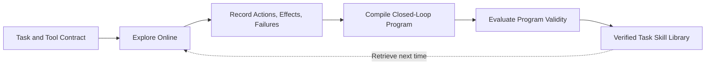
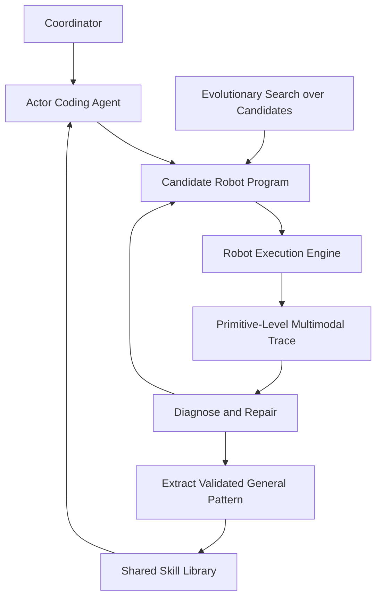
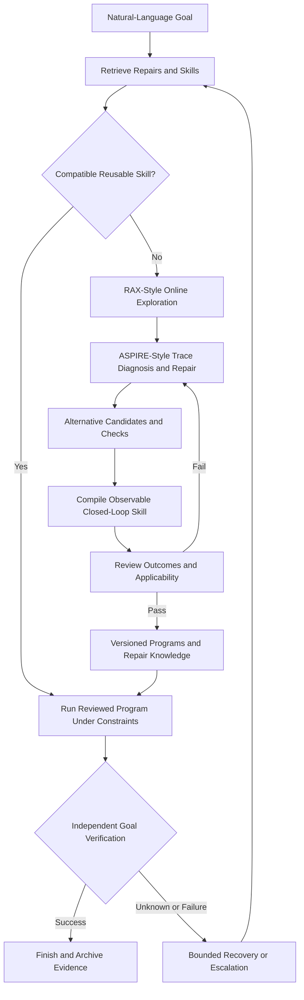

# Advanced Robot Agents: The ASPIRE and RAX Workflows

<!-- course-meta:start -->
[Course home](https://github.com/zengxiong111/Foundation_of_Embodied_AI) · [简体中文](https://github.com/zengxiong111/Foundation_of_Embodied_AI/blob/main/md/Robot_Agent_Workflow_ZH.md) · [PDF](https://zengxiong111.github.io/zengxiong.github.io/files/Robot_Agent_Workflow_EN.pdf)

| Item | Details |
|---|---|
| Applicability | ASPIRE and RAX: online exploration, trace-guided repair, program compilation, skill memory and verification concepts |
| Documentation review date | 2026-10-18 |
| License | CC BY 4.0 · Xiong Zeng and contributors |

**Verification scope:** Document integration and rendering checks only; no reproduced success rates, transfer results or robot deployment. No experimental chapter is included. See the [materials manifest](https://github.com/zengxiong111/Foundation_of_Embodied_AI/blob/main/materials.json) for pinned source references. Original teaching content uses [CC BY 4.0](https://creativecommons.org/licenses/by/4.0/); third-party quotations, figures and code retain their original licenses. Citation alone does not grant relicensing rights.
<!-- course-meta:end -->

<!-- course-toc:start -->
## Contents

- [Introduction: From Completing One Task to Accumulating Reusable Capabilities](#course-section-01)
- [1. Where a Robot Agent Fits: Programs, Policies, and the Physical World](#course-section-02)
  - [1.1 A robot agent is neither a VLA nor a motor controller](#course-section-03)
  - [1.2 Why accumulate programs and skills?](#course-section-04)
  - [1.3 Three distinctions that prevent major design mistakes](#course-section-05)
- [2. RAX: Explore → Compile → Evaluate](#course-section-06)
  - [2.1 What RAX assumes and what it learns](#course-section-07)
  - [2.2 Explore: convert trial and error into causal knowledge](#course-section-08)
  - [2.3 Compile: conditional closed-loop control, not trajectory replay](#course-section-09)
  - [2.4 Evaluate: independently confirm the compiled artifact](#course-section-10)
  - [2.5 Retain capability across sessions](#course-section-11)
- [3. ASPIRE: Trace-Guided Self-Repair and Cumulative Skills](#course-section-12)
  - [3.1 Three components and a coordinator–actor design](#course-section-13)
  - [3.2 Why primitive-level traces matter more than a pass/fail result](#course-section-14)
  - [3.3 Iterative debugging: inspect, hypothesize, patch, verify](#course-section-15)
  - [3.4 The ASPIRE skill library stores transferable repair knowledge](#course-section-16)
  - [3.5 Evolutionary search avoids local patching traps](#course-section-17)
- [4. RAX and ASPIRE: One Paradigm, Different Emphases](#course-section-18)
  - [4.1 Side-by-side comparison](#course-section-19)
  - [4.2 Repair knowledge versus executable skill artifacts](#course-section-20)
  - [4.3 A proposed integrated lifecycle](#course-section-21)
- [5. From Language Goals to Constrained Execution: Interfaces and Verification](#course-section-22)
  - [5.1 Specify goals using physical postconditions](#course-section-23)
  - [5.2 A robot skill must be an inspectable contract](#course-section-24)
  - [5.3 Selecting skills under hard safety constraints](#course-section-25)
  - [5.4 Local repair, renewed exploration, or safe exit?](#course-section-26)
  - [5.5 Multiple asynchronous loops](#course-section-27)
- [6. Skill Memory: Making the Hundredth Task Better Than the First](#course-section-28)
  - [6.1 Minimal content of a trustworthy skill entry](#course-section-29)
  - [6.2 Retrieval is not copying the entire history into context](#course-section-30)
  - [6.3 Updating and revoking skills](#course-section-31)
  - [6.4 What transfers from simulation to real robots?](#course-section-32)
- [7. Three Explanatory Cases: From the Papers to a Complete Decision Chain](#course-section-33)
  - [7.1 ASPIRE: the radio is visible but cannot be reached](#course-section-34)
  - [7.2 RAX: infer an articulated structure and compile control logic](#course-section-35)
  - [7.3 Combined teaching scenario: a screwdriver slips from a dexterous hand](#course-section-36)
- [8. Safety, Reliability, and Remaining Research Challenges](#course-section-37)
  - [8.1 Four independent boundaries for generated programs](#course-section-38)
  - [8.2 Three different meanings of “unknown”](#course-section-39)
  - [8.3 Open problems](#course-section-40)
  - [8.4 Boundary with the other Foundation of Embodied AI courses](#course-section-41)
- [Conclusion: From Online Trial and Error to Auditable Continual Improvement](#course-section-42)
- [References and Official Sources](#course-section-43)
<!-- course-toc:end -->

## Introduction: From Completing One Task to Accumulating Reusable Capabilities

A conventional robot-learning pipeline trains a policy on demonstrations or interaction data and deploys it to map observations to actions. A complementary paradigm is the **embodied coding agent**: a general-purpose reasoning agent connects to perception, geometric planning, control, and robot APIs; explores the environment; writes a robot program; inspects failures; repairs the program; and stores what it learns. Improvement may therefore happen in **programs, skills, and procedural knowledge**, without necessarily changing the weights of the underlying model.

This tutorial is organized around two influential frameworks. **RAX (Robot Agent eXploration)** emphasizes *Explore → Compile → Evaluate*: the agent learns through online tool use and compiles discoveries into a program that can run independently of the coding agent. **ASPIRE (Agentic Skill Programming through Iterative Robot Exploration)** emphasizes primitive-level multimodal execution traces, iterative debugging, a shared skill library, and evolutionary search for continual skill improvement. [R1–R5]

A useful distinction is: **RAX asks how exploration becomes a deployable program; ASPIRE asks how failures become diagnosable, repairable, and transferable knowledge.** Their contributions can inspire a combined system, but the integrated architecture proposed later is a **pedagogical design**, not a jointly validated system reported by the two projects.

**Learning objectives.** After reading, students should be able to explain the flow from a natural-language task to authorized robot tools; describe RAX and ASPIRE precisely; distinguish executable skills from reusable repair patterns; separate action completion from physical success; and identify the boundaries between exploration, runtime deployment, and robot safety. **There are no laboratory exercises, benchmark or ablation sections, reproduction instructions, or runnable code.** Illustrative examples explain workflows only.

> **Notation for provenance.** **[Original mechanism]** denotes functionality documented in the papers or official repositories. **[Teaching abstraction]** is an explanatory mathematical model introduced here. **[Proposed architecture]** is a suggested combination that should not be attributed to either original paper.

## 1. Where a Robot Agent Fits: Programs, Policies, and the Physical World

### 1.1 A robot agent is neither a VLA nor a motor controller

| Layer | Typical input | Typical output | Main responsibility |
|---|---|---|---|
| Task-level coding agent | Goal, tool specification, traces, skill memory | Tool calls, program, diagnosis, repair | Discover and retain ways to achieve tasks |
| Perception and estimation | RGB/depth, robot state, histories | Object identities, poses, timestamps, uncertainty | Provide evidence about the current world |
| Skill execution | Program/subgoal, observations, policy context | Motion, grasp, contact manipulation | Turn a subgoal into physical behavior |
| Low-level control and safety | References, joint/force feedback, limits | Constrained servo commands and stop events | Enforce independent real-time constraints |

A coding agent can generate programs that call a motion planner, pose estimator, grasp service, or pretrained policy. **No demonstrations does not mean no robot APIs, calibration, perception, or controllers.** It certainly does not mean unrestricted language-model control of joint torques. RAX explicitly separates a general-purpose agent harness from the robot-specific backend exposed through a tool interface. [R3]

A compact **[teaching abstraction]** is

$$
\tau=(g,\mathcal O,\mathcal A,\mathcal C),\qquad
P:(o_{0:t},m_t,g)\mapsto u_t,
$$

where $g$ is the goal, $\mathcal O$ the available observations, $\mathcal A$ the authorized robot tools, and $\mathcal C$ the constraints. The agent constructs or repairs an executable program $P$, $m_t$ is task memory, and $u_t$ is a **constrained tool request** rather than a raw torque command. This is not an equation claimed as a contribution of either paper.

### 1.2 Why accumulate programs and skills?

Calling a large agent after every manipulation step offers flexibility but introduces reasoning latency, cost, and variability. A fixed script is fast yet can fail when the scene changes. RAX seeks to turn expensive exploration into a **modular, observable, condition-dependent program**; ASPIRE seeks to turn execution failures into **transferable repair knowledge**. This naturally separates two operating regimes:

- **Learning and improvement:** authorized exploration, inspection of traces, program repair, candidate generation, and skill review.
- **Runtime execution:** constrained invocation of reviewed programs or skills; unexpected events cause bounded recovery, diagnostic escalation, or operator intervention rather than unbounded physical trial and error.

### 1.3 Three distinctions that prevent major design mistakes

1. **Generated code is not automatically executable.** Tool permissions, argument types, reference frames, timing, and safety limits remain binding.
2. **A finished robot command is not a verified physical outcome.** Moving to a pose does not prove that the object was grasped or placed correctly.
3. **Success in one scene is not unrestricted skill generalization.** Every reuse requires checking the embodiment, object, tool version, observation quality, and physical preconditions.

## 2. RAX: Explore → Compile → Evaluate

### 2.1 What RAX assumes and what it learns

**[Original mechanism]** RAX uses a general-purpose coding agent, such as Codex CLI or Claude Code, with a frozen base model. The agent explores through robot perception and control tools. Experience accumulates in its workspace as notes, programs, and skills; the framework does not require a task-specific teleoperation corpus followed by policy training. A common harness interfaces with different simulation or robot backends. [R2, R3]

### 2.2 Explore: convert trial and error into causal knowledge

The agent first determines **what can be observed and what is safe and authorized to invoke**. It then performs individual tool-mediated actions, recording the state before the call, arguments, returned result, observed change, progress toward the goal, and uncertainty or failures. The goal is not simply to remember a successful sequence. It is to infer **which preconditions made it work, and which primitive actually failed when it did not work**.

Consider a task involving an articulated object. Replaying a single end-effector pose from an earlier scene would be brittle. A more portable solution may re-detect the articulated part, infer an approximate relative geometry, choose an approach based on the current state, and check the object's new configuration after the action. The RAX project describes an agent that inferred an approximate articulated model from its own observations and used it to check subsequent motions. [R2]

### 2.3 Compile: conditional closed-loop control, not trajectory replay

**[Original mechanism]** RAX condenses a useful exploration procedure into modular code, with step functions, fresh observations, and branches. The repository describes an entry point of the form `controller.py:main(ctx)`; the compiled program can later execute without the coding agent continuously involved. [R3]

A reusable program should preserve these semantics:

| Component | What it must express | What can go wrong if omitted |
|---|---|---|
| Preconditions | Robot/tool version, object visibility, workspace and goal limits | Invalid launch conditions |
| Fresh observations | Re-localize objects before or during relevant steps | Stale exploration coordinates |
| Conditional branches | Change an approach when unreachable; skip achieved subgoals | Inability to adapt |
| Execution constraints | Authorized tools, bounds, deadlines | Safety and interface violations |
| Outcome checks | Physical postconditions and error handling | False declarations of success |
| Failure exits | Bounded retry, recovery, pause, escalation | Infinite loops or repeated hazards |

**Compilation is not a formal proof of correctness.** Source code makes control flow more inspectable, but the program still depends on noisy sensors, inaccurate models, and contact dynamics.

### 2.4 Evaluate: independently confirm the compiled artifact

**[Original mechanism]** RAX distinguishes the online exploration process from subsequent execution of the frozen program and examines whether the program works in layouts not used for exploration. In this workflow, **Evaluate** means verifying a discovered program and its intended scope; it is not an experimental assignment in this tutorial. Relevant questions include whether fresh sensing was used, whether preconditions held, whether execution was unattended, and whether the physical goal was independently verified. [R2, R3]

The public real-robot skill library distinguishes `draft`, `verified`, and `deprecated`. Its repository-specific convention for `verified` requires at least **two unattended successful executions of the committed code**. This is an evidence rule, **not a statistical safety guarantee** or a claim that the program works in every new scene. [R4]

### 2.5 Retain capability across sessions

RAX workspaces can persist task instructions, procedural notes, and compiled programs. Its real-robot skill library stores runnable entries together with preconditions, checks, failure modes, and execution evidence. A later session can retrieve a compatible skill, compose existing skills, or explore further. Executable entries remain embodiment- and tool-dependent; a skill written for one robot is not automatically safe or executable on another. [R3, R4]

## 3. ASPIRE: Trace-Guided Self-Repair and Cumulative Skills

### 3.1 Three components and a coordinator–actor design

**[Original mechanism]** ASPIRE has a central coordinator that dispatches task-specific actor coding agents and maintains shared skill knowledge. Each actor generates robot programs, executes them, inspects traces, localizes problems, and repairs code. Actors need not share their entire conversations or raw trajectories; transferable findings are distilled into a common library. [R1, R5]

Its three supporting components are:

1. **Robot Execution Engine:** executes robot programs and exposes multimodal evidence for individual perception, planning, grasping, and control calls.
2. **Skill Library:** retains repair patterns that have been validated and judged reusable.
3. **Evolutionary Search:** explores diverse program candidates rather than repeatedly making minor revisions to one failed strategy.

### 3.2 Why primitive-level traces matter more than a pass/fail result

The statement “the robot failed” does not explain **why**. A navigation or manipulation failure might come from a missed detection, wrong object frame, invalid planning target, contact dynamics, a collision checker, or a timeout. ASPIRE logs the tools invoked, their inputs and outputs, return status, nearby keyframes and overlays, grasp candidates, and motion-planning feedback. This lets an agent inspect evidence around the **specific primitive** implicated in a failure. [R1]

A **[teaching abstraction]** of such a trace is

$$
Z=\{z_i\}_{i=1}^{n},\qquad
z_i=(\text{tool}_i,\text{args}_i,o_i^{\rm pre},y_i,\text{status}_i,o_i^{\rm post},t_i).
$$

Here $y_i$ is the tool output, the two observations contain evidence around the call, and $t_i$ captures timing. Actual traces may also include masks, point clouds, and visualized plans. A trace is diagnostic evidence, **not an infallible label of the hidden physical state**.

### 3.3 Iterative debugging: inspect, hypothesize, patch, verify

ASPIRE's execution loop asks which primitive **first deviated from expectation**, what the tool actually returned, and which failure hypothesis can be checked next. A useful conceptual breakdown is:

| Step | Diagnostic question | Intended output |
|---|---|---|
| Observe | Where did progress stop? | Failure event and relevant trace |
| Localize | Which primitive is the first credible failure? | Perception/geometry/planning/contact/interface |
| Hypothesize | What mechanism caused it? | Explanation that can be tested against evidence |
| Repair | Which minimal logic or condition should change? | Targeted patch or alternative strategy |
| Verify | Is the failure resolved without creating a new one? | Independent postcondition and execution result |
| Distill | What is useful beyond this task? | Repair pattern with applicability conditions |

**A concrete example from the paper:** the robot had localized a radio but could not navigate toward it; the planner repeatedly returned `PLANNING_ERROR`. Inspection showed that proposed approach poses were inside a table's collision-avoidance buffer. Rather than changing the perception model, the agent introduced alternative approach angles, re-perceived the object from a reachable side, and completed the grasp. The transferable lesson was recorded as **Multi-Angle Approach**. [R1]

### 3.4 The ASPIRE skill library stores transferable repair knowledge

ASPIRE particularly emphasizes **failure signatures, when-to-apply conditions, repair strategies, and sometimes short code sketches** that a later agent can use in context. Examples include disambiguating multiple visual detections by spatial relations or changing navigation approach directions when planning near an obstacle fails. A context-level repair pattern is not automatically a robot-independent executable binary. [R1]

Only a validated and reusable repair should enter the shared library; the coordinator reviews findings and the tool policy. **Persistent memory is an admission decision, not an automatic append operation after every claim of success.**

### 3.5 Evolutionary search avoids local patching traps

**[Original mechanism]** When successive minor patches fail, ASPIRE can propose several candidate programs using successful previous candidates, failure traces, and the skill library. Each candidate is executed and receives outcome feedback and new traces. The next generation is conditioned on the more promising programs, with independent validity checking before reusable repairs are admitted. [R1]

One can summarize the approach with this **[teaching abstraction]**:

$$
\mathcal P_{j+1}=\operatorname{Propose}\!\left(\operatorname{Select}(\mathcal P_j,Z_j),\mathcal L\right),
$$

where $\mathcal P_j$ is a population of robot programs, $Z_j$ is trace feedback, and $\mathcal L$ is accumulated skill guidance. The search evolves **programs and behavioral logic**; it does **not require gradient updates to VLA weights**.

## 4. RAX and ASPIRE: One Paradigm, Different Emphases

### 4.1 Side-by-side comparison

| Dimension | RAX | ASPIRE |
|---|---|---|
| Central question | How does online exploration yield an independently executable program? | How does execution evidence yield repairs and transferable knowledge? |
| Main loop | Explore → Compile → Evaluate | Execute → Inspect Trace → Repair → Validate → Consolidate |
| Agent organization | General coding agent exploring through a harness | Coordinator dispatching actor coding agents |
| Failure evidence | Robot tool responses, state/vision, session history | Primitive-level multimodal traces for localization |
| Primary knowledge asset | Executable programs and evidence-backed task skills | Failure patterns, repair guidance, transferable skills |
| Search mechanism | Increased online exploration and cross-session skill reuse | Iterative debugging plus evolutionary program search |
| Runtime focus | Compiled program can run with fewer agent calls | Future agents benefit from accumulated repairs |
| Main risks | Applicability of compiled logic across new scenes | Failure attribution, over-patching, memory contamination, search cost |

Both systems are important examples of code-as-policy and agentic robot programming. RAX also performs error recovery; ASPIRE also writes executable programs. The table summarizes **the contributions emphasized by the projects**, not exclusive abilities. [R1–R5]

### 4.2 Repair knowledge versus executable skill artifacts

A practical long-term memory design distinguishes two layers:

- **Repair pattern:** failure signature, applicability condition, root-cause hypothesis, and modification strategy. This can often be adapted across robots. ASPIRE strongly emphasizes this kind of reusable knowledge.
- **Executable skill:** a runnable entry point with conditional flow, robot-specific tool calls, postconditions, and verification evidence. This is central to RAX's compiled-program lifecycle.

“Approach an obstructed target from another side” is a useful repair principle; “observe the target with this robot, sample admissible poses, call this motion planner, and verify the result” is an executable skill. Connecting them requires **retrieval → embodiment-specific adaptation → constrained execution → physical verification**.

### 4.3 A proposed integrated lifecycle

**[Proposed architecture]** The two ideas can be combined as follows. This architecture is not a result already demonstrated by the original teams.

Three conditions are essential: (i) reusing a known skill should not force fresh open-ended agent exploration; (ii) low-level safety and stop behavior must remain independent of the language model; and (iii) an accidental success during exploration does not license unsupervised deployment of an unreviewed program.

## 5. From Language Goals to Constrained Execution: Interfaces and Verification

### 5.1 Specify goals using physical postconditions

“Open the drawer” requires evidence that the drawer has reached an appropriate configuration relative to the cabinet, not merely that the robot performed a pull. “Grasp the screwdriver” requires evidence of stable grasp, not just finger closure.

Let the task goal be a predicate $G(s)$ of physical state, and the initiation condition of a skill $\omega$ be $I_\omega(s)$. Under partial observability, the agent may maintain an approximate task belief

$$
b_t(s)=P(s_t=s\mid o_{0:t},a_{0:t-1}).
$$

An implementation need not solve a full POMDP. Timestamped objects, pose uncertainty, tool status, and recent events often provide a useful structured approximation. [Teaching abstraction]

### 5.2 A robot skill must be an inspectable contract

| Field | Example meaning | Why it matters |
|---|---|---|
| `name / version` | `grasp_tool / v2` | Trace behavior after updates |
| `arguments / frame` | Object ID, target pose, robot base frame | Prevent coordinate and identity errors |
| `preconditions` | Object visible, motion reachable | Reject invalid invocations |
| `allowed_actions` | Tool permissions and bounds | Contain generated programs |
| `timeout / cancel` | Deadline and cancellation semantics | Prevent duplicate or hanging actions |
| `execution_status` | `ACCEPTED / RUNNING / FINISHED / FAILED` | Track asynchronous execution |
| `success_predicate` | Independent physical condition | Avoid model self-certification |
| `recovery_policy` | Bounded retry or escalation | Prevent uncontrolled repeated failures |
| `evidence_provenance` | Logs, images, component versions | Enable diagnosis and knowledge review |

**`FINISHED` denotes execution termination, not necessarily physical `SUCCESS`.** An independent outcome monitor can use `SUCCESS / FAILURE / UNKNOWN`, where occlusion or inconsistent sensors must not be silently converted into success.

### 5.3 Selecting skills under hard safety constraints

Given a goal and task belief, an agent may retrieve a skill, compose skills, or request further exploration. One **teaching objective**, not an original loss from either paper, is

$$
\omega_t^*=\arg\max_{\omega\in\Omega_{\mathrm{allowed}}(b_t)}
\bigl[\mathbb E[R_g\mid b_t,\omega]-\lambda C(\omega)-\mu\mathrm{Risk}(b_t,\omega)\bigr].
$$

The admissible set $\Omega_{\mathrm{allowed}}$ is filtered by authorization, collision, workspace, velocity, and skill preconditions **before** optimization. High expected progress can never justify violating a non-negotiable safety constraint.

### 5.4 Local repair, renewed exploration, or safe exit?

| Situation | Preferred response | Avoid |
|---|---|---|
| Stale pose or temporary occlusion | Re-observe and update frames/timestamps | Contact motions using obsolete positions |
| Planner reports unreachable target | Change approach or target geometry | Repeating the identical invalid call |
| Known grasp sometimes fails | Bounded retry plus outcome check | Equating gripper closure with grasp success |
| Repeated unfamiliar structural failure | Inspect traces; consider distinct program candidates | Rephrasing the same high-level instruction forever |
| Hardware fault or emergency stop | Independent stop and authorized recovery | Allowing the agent to override the stop |

### 5.5 Multiple asynchronous loops

The task agent, program/skill controller, estimator, and hardware servo do not share one control frequency. Agent reasoning may be triggered by task transitions or failures; a compiled controller can re-observe after key steps; low-level controllers run at hardware-specific rates. Each layer must handle stale data, tool deadlines, the true state after a cancellation, and safe handoff between commands. **Reducing large-model calls through compilation does not mean abandoning real-time sensing.**

## 6. Skill Memory: Making the Hundredth Task Better Than the First

### 6.1 Minimal content of a trustworthy skill entry

A useful skill artifact should answer **when it applies, what it achieves, how it acts, how success is evidenced, and when it must be invalidated**. The following fields are a **suggested schema**, not a mandatory exact schema from either project.

| Information | Contents |
|---|---|
| Scope | Robot embodiment, hand/gripper, cameras, controller versions |
| Initiation conditions | Object type, contact/reachability state, workspace |
| Failure signature | Error code, anomalous observation, relevant time interval |
| Repair strategy | Why sensing, approach direction, or sequence changes |
| Executable entry | Reviewed code version and tool dependencies |
| Outcome evidence | Physical postcondition, run records, sensor traces |
| Invalidation | New failure, calibration change, replacement, rollback version |

### 6.2 Retrieval is not copying the entire history into context

An ASPIRE actor can retrieve **compact repair guidance** relevant to the current failure signature. A RAX session can prefer **executable skills compatible with the present embodiment**. Selective retrieval keeps context focused. Full session traces should remain auditable without being injected into every agent prompt. **Compatibility checks after retrieval matter more than semantic similarity alone.**

### 6.3 Updating and revoking skills

Skill libraries are not monotonic collections of infallible solutions. Repeated false success reports, new robot hands, recalibrated cameras, firmware updates, and altered contact conditions can invalidate an artifact. A useful **pedagogical state machine** is `draft → validated → active → deprecated/revoked`; this should not be confused with RAX's official `draft / verified / deprecated` labels. All promotions and changes should preserve version history, evidence, and rollback paths.

### 6.4 What transfers from simulation to real robots?

ASPIRE reports using simulation-discovered skills as **in-context guidance** for writing and debugging programs on different real embodiments, not merely executing unchanged simulation control code on new hardware. [R1] RAX's common harness makes different robot platforms accessible through tool APIs, but executable skills still depend on calibration, kinematics, controllers, and safety constraints. [R3, R4] Transferring the **repair principle** is generally more plausible than copying every joint target or contact parameter. Dexterous manipulation makes this distinction particularly important.

## 7. Three Explanatory Cases: From the Papers to a Complete Decision Chain

> These are **conceptual walkthroughs, not experimental instructions or reports of new hardware validation**. The first two are based on publicly described project cases; the third is an original teaching scenario.

### 7.1 ASPIRE: the radio is visible but cannot be reached

The robot has already localized its target, but repeated calls to its navigation planner return `PLANNING_ERROR`. The correct diagnosis does not attribute the final task failure to the grasp model. Trace inspection identifies a geometric reason: proposed navigation poses lie within a table's collision-avoidance buffer. The agent introduces a multi-angle approach, finds a reachable side, re-perceives, and completes the remaining grasp. The transferable artifact is a **repair pattern for approach planning near obstacle buffers**. [R1]

The causal chain is:

**Failure outcome → primitive trace → root-cause hypothesis → targeted code repair → re-execution and verification → reusable knowledge.**

### 7.2 RAX: infer an articulated structure and compile control logic

The RAX project describes an agent using its own observations to infer enough about an articulated device to plan how to manipulate it, rather than being supplied with a complete device model. Exploration establishes useful geometric relations and decision steps; the compiled controller must **re-localize the device in a new scene**, inspect the current configuration, choose actions, and verify the result. The reusable artifact is not a hard-coded sequence of global coordinates. It is an **observe–estimate–act–check program**. [R2]

The process is:

**Online observation → tool-mediated discovery → conditional procedure → compilation → independent execution and verification → skill retention.**

### 7.3 Combined teaching scenario: a screwdriver slips from a dexterous hand

Suppose the requested task is “pick up a screwdriver, move it to the designated position, and rotate it.” The system first retrieves appropriate grasp, transport, and manipulation skills. If no compatible skill exists, it updates observations and considers authorized exploration. During rotation, the system detects a sudden change in object-to-hand pose and a failure of the task postcondition:

1. The **independent execution/safety layer** brings the unreliable contact motion to a safe state; the agent cannot bypass its limits.
2. **ASPIRE-style diagnosis** examines vision, proprioception, grasp events, and rotation primitives before the slip, distinguishing an actual grasp loss from a tracking failure.
3. **Repair and alternatives** select a new grasp approach, safe regrasp, or exit. The system should not simply increase gripping force indefinitely.
4. **RAX-style compilation** retains conditional logic to relocate, regrasp, verify, and either resume or stop the task.
5. **Skill admission** is considered only after applicability, failure evidence, and physical outcome are clear.

Minor tracking errors may be handled inside the low-level controller. **Once the object falls and the task state changes, task-level program logic must be updated.** This scenario is not a reported screwdriver experiment from either paper.

## 8. Safety, Reliability, and Remaining Research Challenges

### 8.1 Four independent boundaries for generated programs

**Tool authorization.** Robot backends should expose only approved observation and action APIs; generated code must not gain unrestricted motor access.

**Execution isolation.** General-purpose generated Python may access operating-system resources. The official ASPIRE repository explicitly warns that trial processes and watchdogs **do not constitute a security sandbox**: isolate credentials, sensitive mounts, network access, and simulation workloads from physical hardware permissions. [R5]

**Physical execution safety.** Independent controls must enforce collision, speed, torque, workspace, contact, and emergency-stop limits.

**Outcome verification.** The program's claimed completion must be checked against actual sensor evidence and task postconditions.

### 8.2 Three different meanings of “unknown”

- **Unknown perception:** occlusion, stale transforms, uncertain object pose. The normal response is additional sensing.
- **Unknown skill:** the scene is understood but no reliable action procedure is known. The response may be authorized exploration or escalation.
- **Unknown safety state:** uncertain contacts, human proximity, or hardware status. The default is a safe stop or operator intervention—not further trial and error.

### 8.3 Open problems

**Root-cause attribution:** rich traces narrow a problem but correlation does not prove causality. **Generalization:** a few successes do not provide strong reliability guarantees. **Exploration efficiency:** generating and executing programs consumes time, compute, and physical resources. **Memory quality:** incorrect repairs can mislead future agents. **Cross-embodiment transfer:** hands, robot arms, sensing layouts, calibration, and control bandwidth change applicability conditions. **Asynchronous consistency:** tools and sensors operate on different clocks, so stale-state commands can be dangerous.

The design goal is therefore not to let a model direct every aspect of the robot. It is to let an agent **learn and repair under bounded permissions**, while verified programs and independent controllers carry out dependable execution.

### 8.4 Boundary with the other Foundation of Embodied AI courses

This chapter addresses **task-level programming, exploration, trace-based diagnosis, compilation, skill memory, and safe orchestration**. Image masks, camera geometry, 6D pose estimation, and state uncertainty belong in [Visual Perception and State Estimation](https://github.com/zengxiong111/Foundation_of_Embodied_AI/blob/main/md/Visual_State_Estimation_EN.md). Action chunks, BC, DAgger, ACT, and RTC belong in [Data Collection and Imitation Learning](https://github.com/zengxiong111/Foundation_of_Embodied_AI/blob/main/md/Data_Imitation_Learning_EN.md). VLA/Flow Matching training and GR00T/SONIC System 1/System 0 integration have their own chapters. **The present tutorial does not duplicate those derivations.**

## Conclusion: From Online Trial and Error to Auditable Continual Improvement

**RAX compresses exploration into independently executable closed-loop programs. ASPIRE converts failure traces into reusable diagnostic and repair knowledge.** A carefully designed combination could progressively build a more reliable, reviewable, revocable, and updatable portfolio of robot skills. Three cautions remain central: **exploration success is not authorization for deployment; program termination is not task success; and remembered skills are not universal performance guarantees.**

## References and Official Sources

- **[R1]** Lu et al., *ASPIRE: Agentic /Skills Discovery for Robotics* (2026). [Paper](https://arxiv.org/abs/2607.00272) · [Project](https://research.nvidia.com/labs/gear/aspire/). Source for the coordinator–actor design, primitive-level traces, iterative debugging, skill library, and evolutionary search.
- **[R2]** Huang et al., *Scaling Online Exploration for Robot Agents* (2026). [Project and paper](https://robot-agent-exploration.com/) · [Paper PDF](https://assets.robot-agent-exploration.com/paper/rax.pdf). Source for online exploration, compilation, independent evaluation, and real-robot cases.
- **[R3]** Official RAX harness: [robot-agent-exploration/rax](https://github.com/robot-agent-exploration/rax). Tool/backend architecture and Explore–Compile–Evaluate workflow.
- **[R4]** Official RAX library: [robot-agent-exploration/skills-lib](https://github.com/robot-agent-exploration/skills-lib). Preconditions, code, evidence, and status rules.
- **[R5]** Official ASPIRE implementation: [NVlabs/ASPIRE](https://github.com/NVlabs/ASPIRE). Iterative debugging, evolutionary search, and warnings for generated-code execution. Updates in the repository need not match the original arXiv version exactly.
- **Further reading:** [SayCan](https://say-can.github.io/) · [Code as Policies](https://code-as-policies.github.io/) · [Foundation of Embodied AI](https://github.com/zengxiong111/Foundation_of_Embodied_AI).

*Source note: Prepared from public papers and official project sources available by 2026-10-18. We have not independently reproduced claimed robot success rates or transfer results. Proposed components are explicitly distinguished from original implementations.*
