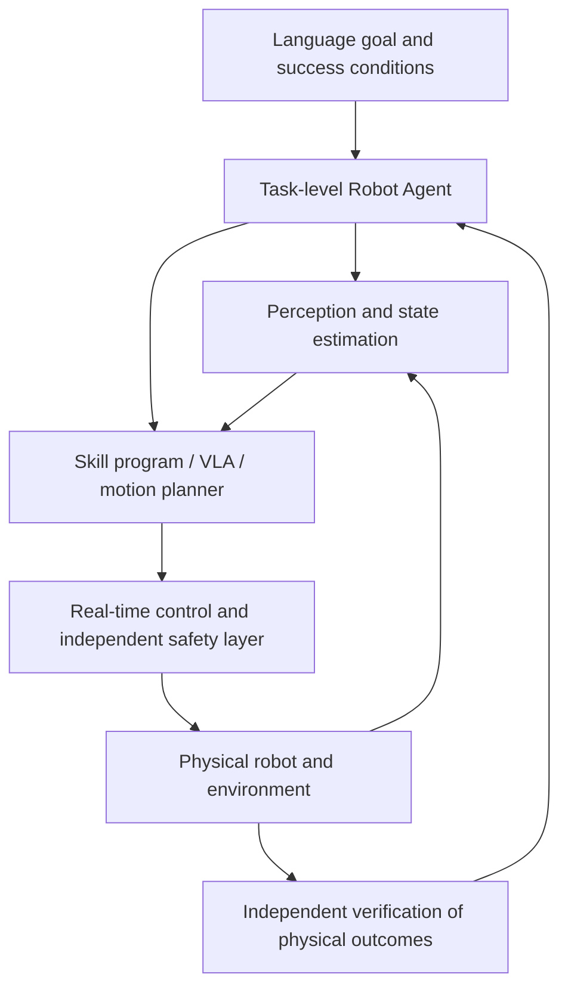
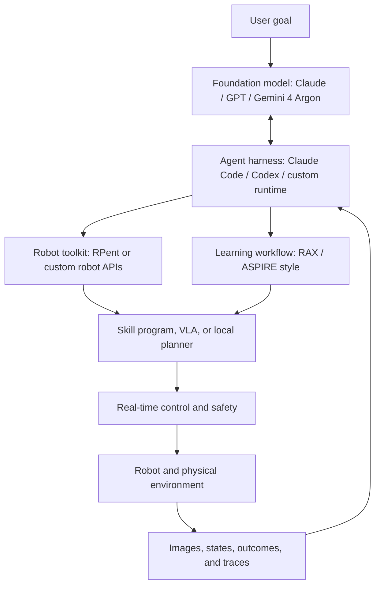
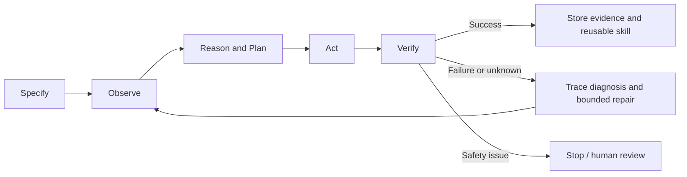
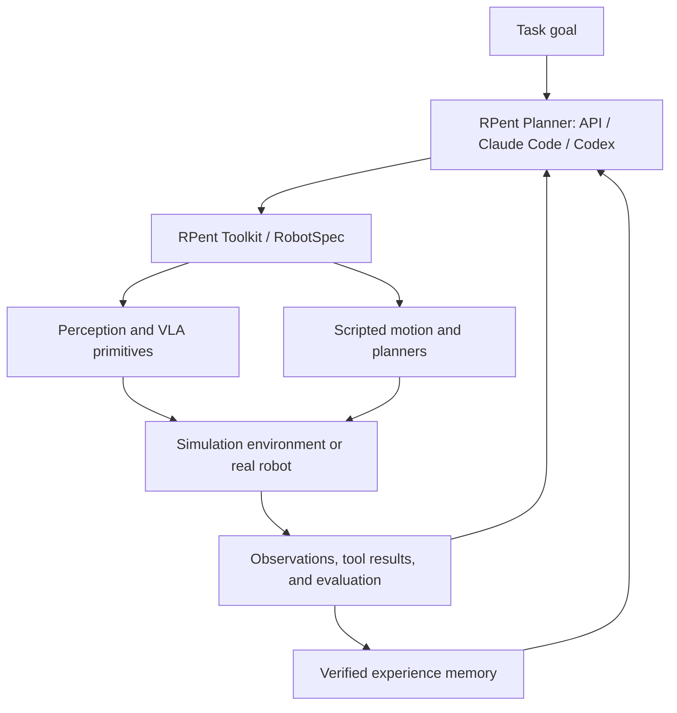
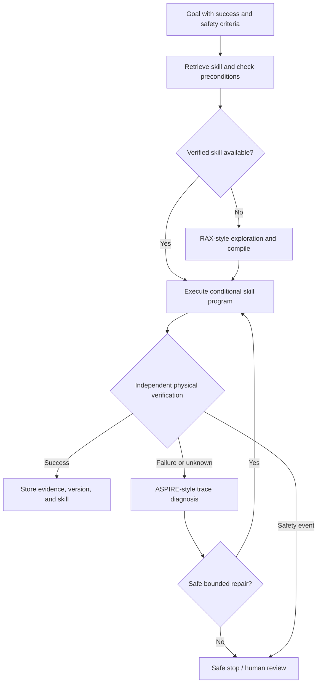

# Advanced Robot Agents: Foundation Models, RAX, ASPIRE, RPent, and Continual Improvement

[Course home](https://github.com/zengxiong111/Foundation_of_Embodied_AI) · [中文 Markdown](Robot_Agent_Workflow_RPent_ZH.md) · [English PDF](https://zengxiong111.github.io/zengxiong.github.io/files/Robot_Agent_Workflow_RPent_EN.pdf)

**Foundation of Embodied AI · Revised course notes**  
*From foundation models and online exploration to composable agent systems and reliable execution*  
**Revision: October 19, 2026**

> **Central questions:** How can Claude, Codex, and Gemini 4 Argon participate in robotics without being real-time robot controllers? What are the distinct contributions of RAX and ASPIRE, and how does RPent connect planners, perception, actions, memory, and physical robots? How can the resulting loop be made reusable and independently verifiable?

**Learning outcomes:** Distinguish foundation models, coding agents, agent harnesses, robot agents, VLAs, and low-level controllers; understand how a general model processes observations, selects tools, writes programs, and incorporates execution feedback; explain RAX's Explore–Compile–Evaluate cycle, ASPIRE's trace-guided refinement, RPent's toolkit/memory/Flash/data-flywheel architecture, and the publicly demonstrated robotic applications of Gemini 4 Argon; and understand the responsibility and safety boundaries of a unified system. **No code listings or laboratory exercises are included.**

## Contents

1. [Robot agents: definition and responsibility boundaries](#agent-section-01)
2. [How Claude, Codex, and Gemini 4 Argon participate](#agent-section-02)
3. [A general foundation-model-driven robot-agent workflow](#agent-section-03)
4. [RAX: from exploration to stand-alone programs](#agent-section-04)
5. [ASPIRE: trace-guided repair and accumulating skills](#agent-section-05)
6. [RPent: from research workflows to composable agent infrastructure](#agent-section-06)
7. [Gemini 4 Argon: control, Real2Sim, and self-improvement](#agent-section-07)
8. [A unified system and a dexterous screwdriver example](#agent-section-08)
9. [Papers and official resources](#agent-references)

---

## 1. Robot Agents: Definition and Responsibility Boundaries

### 1.1 From action prediction to task-level closed-loop reasoning

Suppose the robot is instructed to “locate the screwdriver, pick it up, move it to the target area, and rotate it by 90 degrees.” A VLA or action policy mainly decides **what action to execute next**. A robot agent makes decisions at another level: **what should happen first, which tool should be called, how to check whether it worked, and what to change after a failure**. These are complementary components, not mutually exclusive alternatives.

$$
a_t = \pi_{\theta}(o_t,g), \qquad
\mathcal P_{k+1}=\operatorname{Agent}_{M}(g,\mathcal H_k,\mathcal T,\mathcal E_k).
$$

Here $o_t$ denotes sensory observations, $g$ the task goal, and $a_t$ an action-policy output. $M$ is the foundation model, $\mathcal H_k$ the interaction history, $\mathcal T$ the available tools, $\mathcal E_k$ physical feedback, and $\mathcal P_{k+1}$ an updated plan or program. These expressions are **conceptual teaching abstractions**; they do not assert that RAX, ASPIRE, and Argon share an optimization objective.

**Figure 1.** A robot agent manages task-level decisions, while physical feedback and safety must remain closed-loop. The arrows show functional relationships; they do not imply that each component is a separately trained large model.

| Layer | Main responsibility | Typical timing and output |
|:--|:--|:--|
| **Task-level agent** | Goal decomposition, tool choice, skill retrieval and generation, failure diagnosis, replanning | Event-driven; plans, programs, tool calls |
| **Perception and skill execution** | Object localization, state estimation, conditional branching, grasp/manipulation policy | Observation or skill steps; poses, action chunks |
| **Motion control and safety** | Joint/end-effector tracking, contact stabilization, constraints, emergency stop | High-rate feedback; position, velocity, or torque commands |

**Key principle:** A foundation model may reason slowly; a robot cannot wait for it at every servo update. The safety and low-level feedback loops must not depend on a cloud model's latency or correctness.

### 1.2 A robot agent is neither a VLA nor a classical planner

- **VLA / action policy:** Maps observations and language to motions or action chunks and is well suited to continuous manipulation. Long-term memory, explicit tool use, and failure attribution depend on additional system design rather than being universal VLA properties.
- **Classical task and motion planning:** Reasons explicitly about geometry, collision, reachability, and temporal constraints. An agent can complement it when the goal is semantically novel or the failure is not covered by the modeled problem.
- **Coding robot agent:** Composes perception, simulation, planning, and robot APIs into programs and repairs those programs from physical feedback. Language reasoning alone supplies neither contact stability nor safety guarantees.

### 1.3 What does task success mean?

A motion API returning `FINISHED` only reports command completion. A closed gripper does not establish a grasp, and a wrist rotation does not prove that a screwdriver rotated. A stronger design independently checks physical postconditions:

$$
V(o_{0:T})\in\{\mathrm{SUCCESS},\mathrm{FAILURE},\mathrm{UNKNOWN}\}.
$$

`UNKNOWN` represents insufficient evidence: occlusion, pose-tracking drift, or an unobservable contact state. The proper next step may be active re-observation or a safe pause, not silently treating “no reported failure” as a success.

---

## 2. How Claude, Codex, and Gemini 4 Argon Participate

### 2.1 Distinguish the model from the agent system

**Claude denotes a foundation-model family, and Gemini 4 Argon is a general-purpose multimodal reasoning model. Claude Code and Codex, by contrast, are agentic coding products and harnesses through which models can inspect files, execute commands, use tools, and handle feedback.** Calling all three “foundation models” is imprecise. The name Codex can also occur in model-related contexts; throughout this chapter, **Codex means the coding-agent product and harness**. [5–7]

| Name | Technical layer | Typical role in robotics | Common misconception |
|:--|:--|:--|:--|
| **Claude** | General-purpose foundation model | Reasoning over text/images, planning, program generation, failure interpretation | A model API call does not automatically control a robot |
| **Claude Code** | Coding agent and harness | Workspace access, MCP/command and robot-tool calls, iterative edits and verification | It is not the Claude model weights themselves |
| **Codex** | Model-powered coding agent and harness | Tool use, program generation and repair, sandboxing and approval | The product is not interchangeable with one specific base model |
| **Gemini 4 Argon** | General-purpose multimodal reasoning model | Physical/video reasoning, robotic planning, code generation, Real2Sim | It is not inherently a fixed-rate joint-action VLA |
| **Google Antigravity / custom harness** | Agent execution environment | Connects Argon to context, tools, and execution feedback | Argon can be deployed through different environments |
| **RAX / ASPIRE** | Exploration and repair research workflows | Organize compilation, trace-based debugging, and skill learning | Neither is a robot driver or trainer |
| **RPent** | Open robot-agent runtime infrastructure | Connect planners, toolkits, perception/VLA services, memory, and robot environments | Not a foundation model or low-level controller |

### 2.2 Six activities a foundation model can support

Within a robotic task, the model can help **(1) interpret the language goal, (2) reason about images, video, and structured state, (3) select a tool call, (4) synthesize a conditional skill program, (5) diagnose a failed trace, and (6) summarize reusable experience.** Each activity still requires an agent runtime and robot interfaces. A model's ability to *write* a program is not equivalent to a system's permission or ability to *safely execute* that program on hardware.

**Figure 2.** The foundation model provides reasoning; the agent harness manages tool use; infrastructure such as RPent can connect robot services; and RAX/ASPIRE offer distinct exploration and refinement methods. This is a **teaching architecture**, not a claim of jointly validated RAX–ASPIRE–RPent integration.

### 2.3 Why the harness matters as much as the model

A harness is more than a prompt template. It manages **context, workspace state, tools and permissions, the interaction loop, execution traces, timeouts, failures, approvals, and termination conditions**. OpenAI documents Codex as an execution system between models and tools; Anthropic documents Claude Code's MCP, Skills, Hooks, and Agent SDK extension points. [5,6]

Calling the same base model once for an answer and embedding it in an iterative loop of **observe → invoke tool → inspect output → choose next action** are substantially different capabilities. Still, harnesses do not eliminate model errors: robot state, hard constraints, and success verification should come from externally checkable mechanisms.

### 2.4 Three practical technology paths

**Claude path.** A Claude model accesses restricted robot services through Claude Code or a custom agent runtime. RAX-style exploration can be compiled into a stand-alone procedure, while ASPIRE-style traces support targeted repairs and reusable lessons. [2–5]

**Codex path.** Codex already offers a coding-agent loop for reading workspaces, calling tools, generating programs, and iterating on feedback. The RAX implementation explicitly supports Codex CLI or Claude Code, while ASPIRE distributes agent skills compatible with Codex. [2,4,6]

**Argon path.** Gemini 4 Argon can reason about robots and simulation through external tools and runtimes. Google has demonstrated robotics workflows involving control, Real2Sim, video analysis, and program improvement. Those demonstrations **do not establish that Argon is integrated into the official RAX/ASPIRE implementations or can replace servo controllers**. [7,8]

**Engineering implementation.** RPent supports `api`, `claude_code`, and `codex` planner backends and uses a standardized toolkit to connect perception, VLA, and environment services. This offers a concrete runtime layer for several of the preceding components, but interface compatibility is not evidence of an official Argon or RAX/ASPIRE integration. [10,11,16]

**General lesson:** Selecting the model is only one design decision. What matters just as much is **which robot capabilities are exposed, how feedback is represented, how dangerous calls are prevented, and where verified experience is stored**.

---

## 3. A General Foundation-Model-Driven Robot-Agent Workflow

### 3.1 From a goal to a bounded execution

A useful lifecycle is:

1. **Specify:** Convert natural-language goals into observable postconditions; define the workspace, budget, and safe-stop rules.
2. **Observe:** Read RGB/RGB-D, joint state, known geometry, and planner feedback; preserve confidence and uncertainty.
3. **Reason & Plan:** Use a foundation model through the harness to choose an existing skill, tool call, or procedure to explore.
4. **Act:** Call approved robot services, IK/planning, or action policies; let the local controller track continuous motion.
5. **Verify:** Check the actual physical goal rather than the completion flag of a command.
6. **Repair & Remember:** Inspect failure traces, apply bounded patches, independently retest, and retain lessons backed by evidence.

**Figure 3.** The observe–decide–act–verify loop may repeat, but retries need explicit budgets, an independently enforced safety boundary, and an intelligible stopping condition.

### 3.2 Tool calling connects reasoning to physics; it is not a controller

| Tool group | What an agent may request or receive | Required interface behavior |
|:--|:--|:--|
| Sensing and state estimation | Images, detections, object poses, confidence | Timestamps, reference frames, uncertainty and failure flags |
| Geometry and planning | IK solutions, collision checking, candidate approaches | Reachability, kinematic constraints, collision enforcement |
| Skill or policy execution | Grasp, transport, rotation, VLA/RL action chunks | Preconditions, bounds, timeout and local recovery |
| Simulation and evaluation | Replay, physical simulation, comparisons, task scores | Explicit sim-to-real limits; no conflation of sim and hardware success |
| Logging and memory | Multimodal traces, program versions, applicability | Provenance, rollback, auditable records |

### 3.3 Four loops should not be collapsed into one “super-model”

The **control loop** handles rapid feedback and stability; the **skill loop** handles observation updates, action sequencing, and limited local recovery; the **task-agent loop** handles slower replanning, coding, and diagnosis; and the **long-term-learning loop** validates, versions, reuses, and retires skills. These are functional loops, not requirements for four distinct foundation models. For a previously validated task, it may be preferable to execute the compiled skill without invoking the large model again.

### 3.4 What is learned? Program memory is not weight fine-tuning

RAX and ASPIRE primarily improve the system by accumulating **programs, failure explanations, skill-library entries, and execution evidence**; they do not require online gradient updates to foundation-model weights. A different route uses simulation-generated demonstrations to train or post-train a VLA. In that case, the **action model's weights** change in a separate training stage. Robot interaction, self-improvement, online RL, and foundation-model fine-tuning are therefore **not synonyms**. For example, RPent can export verified execution data for separate Pi0.5 supervised fine-tuning with RLinf; simply updating task memory is not a parameter update. [14]

---

## 4. RAX: From Exploration to Stand-Alone Programs

RAX (Robot Agent eXploration) lets a general-purpose coding agent with **frozen model weights** (the reference harness supports **Codex CLI or Claude Code**) explore through perception and control tools, keep what it learns in a workspace, and compile effective behavior into modular robot code that runs without continuous coding-agent intervention. Its organizing cycle is **Explore → Compile → Evaluate**. RAX does not retrain the language model for every newly encountered task. [1,2]

### 4.1 Explore: learn conditional decisions, not motor physics again

The agent can investigate which camera viewpoint to use, how to approach an object, whether a grasp direction is reachable, and when to confirm that the object is still held. Each attempt should preserve **the observation, invoked tool and parameters, error/output, physical outcome, and reason for a change**. A log that says only “grasp failed” transfers little. A log that says “the approach fell inside the table collision margin; a lateral approach then planned successfully” contains a reusable causal clue.

### 4.2 Compile: a successful trajectory is not yet a reusable program

| One successful motion replay | RAX-style compiled procedure |
|:--|:--|
| Reuses object coordinates from exploration | Re-observes and recomputes goals in the current scene |
| Executes a fixed action list | Branches on IK, contact, and visual feedback |
| Stops or asks the agent to rescue every failure | Includes bounded recovery and explicit abort conditions |
| Establishes feasibility for one setup | Declares preconditions and is validated on changed layouts |

In RAX, **compilation means synthesizing independent, conditional robot logic from exploration experience**, not translating a language prompt into processor instructions. The reference project uses `controller.py:main(ctx)` as an example program entry point; its name is cited to clarify the software boundary, not to introduce a coding assignment. [2]

### 4.3 Evaluate: validation separate from the exploratory agent

An agent that remains active during debugging might silently compensate for missing code. RAX therefore freezes the generated program and evaluates it independently on held-out simulated arrangements or reset hardware runs. Distinguish **one success**, **repeatability under identical conditions**, and **unattended success after initial-state variation**: they provide increasingly strong but still bounded evidence. The RAX project's air-fryer example reports roughly **72 minutes of exploration** and **18 seconds of compiled execution**. These are task-specific figures, not universal real-time-performance guarantees. [1,2]

The official skill library additionally records preconditions, code, known failure modes, independent run records, and camera evidence. A working script should become a *verified skill* only under explicit review and repeat-test rules. [2,3]

**Chapter takeaway:** RAX shows how methods discovered online can become **reusable, observation-dependent programs that no longer require step-by-step language-model control**.

---

## 5. ASPIRE: Trace-Guided Repair and Accumulating Skills

ASPIRE also follows **code-as-policy**: a coding agent writes a robot program and revises it from physical or simulated execution feedback. Its distinctive elements are **multimodal execution traces, iterative debugging, growing skill libraries, Coordinator–Actor organization, and evolutionary program search**. The original studies used Claude Opus 4.6, while the maintained implementation includes agent skills for environments such as Claude Code and Codex. The workflow should not be equated with a single underlying model. [4,9]

### 5.1 Traces: from an error label to a causal bottleneck

| Trace evidence | Question it answers | Likely diagnostic direction |
|:--|:--|:--|
| Tool call and parameters | Was the pose, grasp direction, or constraint wrong? | Check parameters and coordinate transforms |
| Planner return and error | Did IK, reachability, or collision checking fail? | Choose another approach or replan |
| Keyframes and estimated poses | Did the object physically move, or was the grasp empty? | Re-observe and adjust contact timing |
| Contact/proprioceptive timeline | Was there slip, or only estimator drift? | Prioritize the best-supported failure cause |
| Verification outcome and confidence | Did the physical goal actually occur? | Seek another viewpoint or return `UNKNOWN` |

A useful agent selectively inspects **evidence around the failing primitive** instead of filling its context window with every raw video frame. When the planner reports `PLANNING_ERROR`, inspecting the target, collision margin, and route is more relevant than blindly increasing grip force.

### 5.2 Iterative debugging: each patch must be testable

One repair iteration follows **select trace → formulate a local hypothesis → patch the program → rerun → compare evidence**. The ASPIRE paper's radio-retrieval example illustrates the logic: perception found the object, but navigation candidates conflicted with collision margins near a table. Changing the approach direction enabled the task to proceed. The generalizable lesson is not to add one fixed displacement everywhere, but to **search for a safe alternative viewpoint or approach when the intended route is obstructed**. [9]

### 5.3 Skill library, Coordinator–Actor, and evolutionary search

- **Skill library:** Retain verified programs, reusable repair patterns, applicability conditions, and supporting evidence. One accidental success is not a universal rule.
- **Coordinator–Actor:** Organize multiple coding agents across tasks; check whether candidate solutions respect interfaces and actually work before sharing them.
- **Evolutionary search:** Try alternative candidate programs or decision sequences, score their executions, and use traces to choose further improvements. The evolved objects are **programs and task logic**, not necessarily neural-network weights.

**Chapter takeaway:** ASPIRE turns failures into diagnosable evidence, makes repairs independently testable, and helps transferable skills accumulate across tasks.

---

## 6. RPent: From Research Workflows to Composable Agent Infrastructure

RAX and ASPIRE emphasize complementary methodological questions: **how can a new skill be explored and compiled**, and **how can failures be diagnosed, repaired, and consolidated**? To use these ideas in a physical system, we also need an operational substrate connecting model decisions to cameras, action policies, robot tools, state feedback, and persistent experience. **RPent (Recursive Physical Agent)** operates at this infrastructure layer. It is an open framework for physical agents based on **service-oriented, standardized, and composable** components, not a newly trained foundation model, a VLA checkpoint, or a reinforcement-learning algorithm. [10,11]

### 6.1 Where RPent fits in the agent stack

RPent lets multiple planners operate against robot-specific tools. Its `api` backend uses an API-based tool-calling loop, while the `claude_code` and `codex` backends reuse their respective agent SDKs. A toolkit routes calls to perception, scripted motion, VLA primitives, or environment services. The foundation model selects operations and interprets the resulting feedback; **the environment and controllers remain responsible for physical motion and state**. A shared tool boundary means that changing the planner does not require rewriting every robot primitive. [11,16]

| Component | Role in RPent | Why the separation matters |
|:--|:--|:--|
| **Planner** | Maintains task context and selects subsequent tool calls | Keeps slow reasoning out of servo updates |
| **Toolkit / RobotSpec** | Defines robot integration, tool schemas, and run configuration | Provides explicit, inspectable contracts |
| **Perception / VLA services** | Localization, segmentation, and action prediction | Decouples heavy GPU models from the agent process |
| **Memory / Session** | Retrieval, exploration drafts, and run records | Enables reuse, review, and versioned experience |
| **Environment / controller** | Executes motion and supplies actual state or task criteria | Avoids conflating an LLM's `finish` with real success |

**Figure 4.** RPent connects and schedules existing intelligent components. The loop is architectural; it does not imply that every supported platform has identical safety enforcement, success detection, or online-training capabilities. [11]

### 6.2 Exploration and memory are not gradient-based learning

RPent's exploration mode allows repeated resets and attempts while recording local experience drafts. Its evaluation mode **reads existing memory without writing new memory**, thereby limiting evaluation leakage. In the documented LIBERO workflow, successful audits and action sequences become reusable only when the **environment itself marks the attempt successful**. Memories may contain task-specific procedures and broader failure/recovery guidance; recorded pixels or coordinates must be re-anchored to **current observations** at execution time. [12]

An attempted action, an LLM's claimed success, and validated reusable experience are distinct artifacts. Reproducible evaluation requires a fixed memory revision; for hardware, success still needs independent sensing or operator judgment. Calling `finish` only ends the planning loop. [11,12]

### 6.3 Flash Mode versus RAX Compile: related objectives, different artifacts

Both mechanisms attempt to reduce repeated LLM deliberation for known tasks, but **RPent Flash Mode is not the RAX compiler**. The currently documented RPent LIBERO Flash workflow reads a stored **action plan and visual anchors**, uses SAM3 or Molmo to locate anchors in a new scene, and adjusts relative action offsets before replay. The planner does not call an LLM to construct a new sequence during Flash evaluation, yet perception and VLA services may still be needed. [13]

| Dimension | **RAX Compile** | **RPent Flash Mode** |
|:--|:--|:--|
| Reused artifact | Executable program with observations, branches, and recovery | Saved action plan with visual anchors |
| New layout | Conditional program decisions from current state | Re-detection of anchors and updated relative coordinates |
| Runtime reasoning | Can run without continuing to invoke the coding agent | No online LLM replanning; still uses perception/VLA |
| Documented setting | RAX research tasks and program evaluation | RPent's LIBERO Flash evaluation |

Flash effectiveness depends on plan coverage, anchor detection, scene changes, and the underlying policy. **No online LLM planning** does not mean zero latency, no vision inference, or universal recovery. [13]

### 6.4 The data flywheel: connecting RPent to RLinf

RPent also provides an optional **LIBERO data-flywheel** workflow. It retains immutable raw execution trajectories, verifies them, and exports successful episodes to the LeRobot format. A separate RLinf environment can then perform **Pi0.5 supervised fine-tuning (SFT)**. This creates a plausible sequence of **agent execution → curated data → action-policy training**, while **RPent's recording and export do not themselves update weights or implement online off-policy RL**. Failed episodes remain available for audit but are not included in the described successful-demonstration SFT export. [14]

Three improvement assets should be kept conceptually distinct: **external memory** (notes and plans), **executable skills** (procedures with conditional logic), and **model parameters** (weights changed by SFT or RL). RPent organizes and runs the first two while exposing a data interface for the third; these should not be presented as the same learning process.

### 6.5 Physical deployment: what still needs engineering

RPent documentation covers LIBERO, RoboCasa365, RoboTwin, RoboDojo, and examples involving single- and dual-arm Franka robots. Such support **does not make every arm, dexterous hand, or contact-rich task plug-and-play**. [10,15] A new platform needs a matching `RobotSpec` and toolkit, plus calibrated camera frames, coordinate transforms, IK/collision checks, motion timing, reliable error propagation, explicit operator permissions, and hardware-enforced emergency stops.

For dexterous manipulation, important gaps remain: partially observed contact and slip, primitive precondition drift across embodiments, the mismatch between slow agent reasoning and high-frequency action stabilization, unverified memory transfer, and reliability under changed scenes or objects. **RPent provides a framework in which these questions can be studied; it does not establish that they are solved.**

**Chapter takeaway:** RAX and ASPIRE explain *what a task agent should explore, validate, and improve*. RPent shows *how a planner, tool interface, memory system, and robot service can be assembled and operated*. These are complementary levels, but integrating particular implementations still requires dedicated adapters, tests, and physical verification.

---

## 7. Gemini 4 Argon: Control, Real2Sim, and Self-Improvement

On **October 13, 2026**, Google published a collection of robotic demonstrations using Gemini 4 Argon. Argon is a **general-purpose reasoning foundation model** that can process visual and video inputs and use tools. Once integrated with robot APIs, simulation tools, and repeated observations, the resulting system can act as a **robot agent**. The model itself is not a servo-rate action policy. [7,8]

### 7.1 Four categories demonstrated by Google

| Application | Published demonstration | What the model contributes |
|:--|:--|:--|
| **Robot control** | Spot manipulation with MuJoCo practice; uprighting a mug and inserting a napkin | Decomposed tool actions, visual checking, recovery from feedback |
| **Real2Sim** | Building MuJoCo scenes from robot video, egocentric human video, or sketches | Scene/asset synthesis and iterative visual-contact consistency checks |
| **Physical understanding** | Video hindsight labeling, contact-level events, task-progress estimation | Structured process labels and evidence useful for evaluation |
| **Research and improvement** | Simulation-generated action datasets; SO-101 hardware improvement | Better programs, environments, and data-generation pipelines |

### 7.2 How to interpret the case studies

**Case A: Visual closed-loop manipulation.** In the mug-and-napkin task, Argon uses a calibrated wrist-camera representation and a set of existing action primitives. It selects the next operation and checks feedback after tool calls. This is **model reasoning + harness + robot tools**, not direct neural control of motor current. [8]

**Case B: Real2Sim.** Google shows robot-teleoperation footage being used to construct a MuJoCo scene, tune object geometry, mass, friction, and other contact-related properties, and compare rendered views and force/tactile feedback. This is a **scene reconstruction and physics-consistency workflow**. Visual similarity does not, by itself, prove exact contact identification or general sim-to-real transfer. [8]

**Case C: Data generation and post-training.** Argon can help build simulation tasks and generate trajectories subsequently used to improve a VLA. In that pipeline, **Argon constructs simulation/data, while any VLA parameter update is a separate learning process**. It would be incorrect to conclude that Argon's own weights were updated by online reinforcement learning. [8]

**Case D: Hardware self-improvement.** In an SO-101 visual pick-and-place task, Google reports three execution iterations taking **58.9, 22.9, and 17.4 seconds**, respectively. This documents one showcased agentic optimization sequence, not a general statistical guarantee for robot success or reliability. [8]

### 7.3 Complementarity with RAX, ASPIRE, and RPent

| System | What it is | Primary research emphasis | What it does not establish |
|:--|:--|:--|:--|
| **Gemini 4 Argon** | General multimodal foundation model | Physical reasoning, code generation, video understanding | Native high-rate servo control |
| **RAX** | Online exploration and program-compilation framework | Stand-alone execution after skill discovery | Requirement for a newly trained foundation model |
| **ASPIRE** | Trace-based debugging and continual skill-refinement framework | Failure diagnosis and transferable repair | VLA parameter post-training by definition |
| **RPent** | Modular robot-agent runtime infrastructure | Planner/toolkit integration, memory, deployment | Validated joint integration with RAX/ASPIRE |

Conceptually, Argon could serve as a reasoning model in a RAX-like or ASPIRE-like architecture, but **a plausible combination is not an experimental result published by those projects**. Useful comparisons must separate the model's capability, the harness, the robot API exposed by infrastructure such as RPent, and the independently verified physical outcome. Existing RPent planner configurations do not by themselves establish official Argon support; each model provider needs an actual API adapter and testing.

---

## 8. A Unified System and a Dexterous Screwdriver Example

### 8.1 One reusable workflow without overstating the papers

**Figure 5.** RAX motivates exploration and executable skill discovery; ASPIRE motivates evidence-based repair; infrastructure such as RPent can connect planners, tools, services, and memory. This is a **teaching reference architecture**, not an experimentally validated joint integration.

### 8.2 The minimum contract for a reusable skill

1. **Preconditions:** Robot body, dexterous hand, sensing/calibration assumptions, object class, and permitted workspace.
2. **Execution:** Parameter interface, approved tool calls, duration/budget, and delegated low-level control.
3. **Verification:** Object-state postconditions, tolerance, and `SUCCESS / FAILURE / UNKNOWN` criteria.
4. **Recovery:** Recoverable failures, retry limits, and safe exit for unrecoverable cases.
5. **Evidence & Version:** Independent run records, failure-distribution limits, version history, and rollback path.

This is an **engineering recommendation**, not a universal data structure prescribed by one paper. A script should not be promoted to a deployable skill without constrained independent tests and the required approvals.

### 8.3 Worked example: grasp, transport, and rotate a screwdriver

**Illustrative teaching scenario, not an experiment reported in the cited papers.** A screwdriver starts at an arbitrary permitted location on a table. A robot observes it through head and wrist cameras, uses a dexterous hand to grasp it, transports it to a fixed region, and rotates it through a desired angle. If it slips, dangerous motion must stop before the agent decides whether re-localization and recovery are safe.

| Stage | Physical evidence required | Common false success and response |
|:--|:--|:--|
| **Locate** | Correct screwdriver identity, usable pose, and confidence | Misidentified tool or wrong camera frame: reconfirm |
| **Grasp** | Object leaves the table and its hand-relative pose is plausible | Fingers close on empty space: compare vision and proprioception |
| **Transport** | Object reaches the goal zone and remains held | End-effector arrives without object: stop and re-localize |
| **Rotate** | **Object itself**, not just wrist, attains the target orientation | Independent object-pose tracking is necessary |
| **Recover** | New location is authorized and the goal is re-established | Unobservable or unreachable: return `UNKNOWN` or stop |

**What does the task-level agent do?** It specifies observable success, searches for existing skills, explores missing grasp/approach decisions using RAX-like tools, compiles conditional procedures, diagnoses failures from ASPIRE-like traces, and allows bounded repairs. With RPent, the robot-specific `RobotSpec`, perception tools, and motion/action primitives would first need to be implemented for this platform. Claude, Codex, or Argon may provide reasoning and programming capabilities, **but this example does not assert that any of these particular models has been experimentally validated on this hand/arm platform**.

**What does the lower stack do?** Perception estimates hand/object relative poses; IK and motion planning enforce reachability and collision conditions; VLA/RL skills or local controllers perform grasping and rotation; independent hardware safety enforces limits and emergency stops. With only head/wrist cameras and no tactile sensor, occlusion and unobservable contact must be represented explicitly in verification outcomes.

### 8.4 Which component should solve which problem?

| Practical issue | First component to consider | Main evaluation criterion |
|:--|:--|:--|
| Complex semantic goal, video interpretation, program synthesis | **Claude / Gemini 4 Argon or another foundation model** | Suitability of physical reasoning and program generation |
| Persistent tool use, workspace handling, approval and logging | **Claude Code / Codex / custom harness** | Permissions, state management, auditability, failure recovery |
| Novel task without an existing executable skill | **RAX-style exploration and compilation** | Conditional procedure with independent validation |
| Recurrent failures whose causes are unclear | **ASPIRE-style traces and skill library** | Evidence-supported diagnosis, localized repair, transferable knowledge |
| Integration of planners, VLAs, tools, and memory with sim or hardware | **RPent / custom robot-agent infrastructure** | Adapters, service isolation, verification, and safety boundaries |
| Continuous contact or high-rate trajectory tracking | **VLA / RL / MPC / real-time controller** | Latency, stability, constraints, physical safety |

### Final takeaway

**A robot agent is not simply a larger VLA or a model that can write robot code.** It is a task-level closed-loop system combining **foundation-model reasoning, an agent harness, robot tools, execution feedback, verifiable skill memory, and independently enforced safety**. Claude and Gemini 4 Argon may supply general reasoning, Claude Code and Codex provide agent execution environments, RAX emphasizes compiling exploration into independently runnable programs, ASPIRE emphasizes trace-based repair and skill accumulation, and RPent provides a concrete route for connecting planners, tools, memory, VLAs, and robot services. Whether a real robot works reliably ultimately depends on **observability, tool quality, physical verification, and low-level control**, not on the model's name alone.

---

## Papers and Official Resources (Clickable)

1. **RAX paper:** Huang et al., *Scaling Online Exploration for Robot Agents* (2026). [Paper PDF](https://assets.robot-agent-exploration.com/paper/rax.pdf) · [Project](https://robot-agent-exploration.com/).
2. **RAX reference harness:** [robot-agent-exploration/rax](https://github.com/robot-agent-exploration/rax), documenting Codex CLI/Claude Code, exploration, compilation, and independent evaluation.
3. **RAX skill library:** [robot-agent-exploration/skills-lib](https://github.com/robot-agent-exploration/skills-lib), with procedures, preconditions, and execution evidence.
4. **ASPIRE reference implementation:** [NVlabs/ASPIRE](https://github.com/NVlabs/ASPIRE), including iterative debugging, agent skills, and evolutionary search.
5. **Claude Code documentation:** [Anthropic, Claude Code Overview](https://code.claude.com/docs/en/overview), covering the agent runtime, MCP, and tool integrations.
6. **Codex harness:** [OpenAI, *Codex as a platform: build on the open agent harness*](https://developers.openai.com/blog/codex-as-a-platform) (2026).
7. **Gemini 4 Argon model:** [Google AI for Developers](https://ai.google.dev/gemini-api/docs/models/gemini-4-argon).
8. **Gemini 4 Argon for Robotics:** [Google Developers Blog](https://developers.googleblog.com/gemini-4-argon-for-robotics/) (Oct. 13, 2026); source for the Argon robotic demonstrations discussed here.
9. **ASPIRE paper:** Lu et al., *ASPIRE: Agentic /Skills Discovery for Robotics* (2026). [arXiv](https://arxiv.org/abs/2607.00272) · [Project page](https://research.nvidia.com/labs/gear/aspire/).
10. **RPent overview and repository:** [Introduction](https://rpent.readthedocs.io/en/latest/rst_source/get_started/overview.html) · [RLinf/RPent](https://github.com/RLinf/RPent).
11. **RPent system architecture:** [Architecture and Execution](https://rpent.readthedocs.io/en/latest/rst_source/development/architecture.html).
12. **RPent exploration and memory:** [Memory and Exploration](https://rpent.readthedocs.io/en/latest/rst_source/guides/memory.html).
13. **RPent Flash:** [Flash Mode](https://rpent.readthedocs.io/en/latest/rst_source/guides/flash.html).
14. **RPent data flywheel and RLinf:** [Collecting Trajectories and Data Flywheel](https://rpent.readthedocs.io/en/latest/rst_source/guides/flywheel.html).
15. **RPent robot integration:** [Add a Robot or Simulator](https://rpent.readthedocs.io/en/latest/rst_source/development/add_robot.html).
16. **RPent planners:** [Configuring the Planner](https://rpent.readthedocs.io/en/latest/rst_source/guides/configure_planner.html).

*Attribution and scope: Revised from the Foundation of Embodied AI original course notes (CC BY 4.0; Xiong Zeng and contributors) and organized with the public resources above. Paper-supported mechanisms are distinguished from teaching reference architectures and the illustrative screwdriver case. No hardware performance guarantee is implied.*
