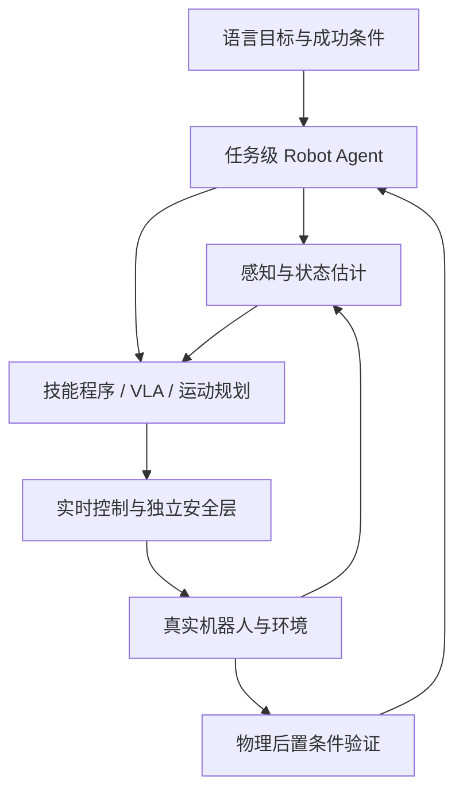
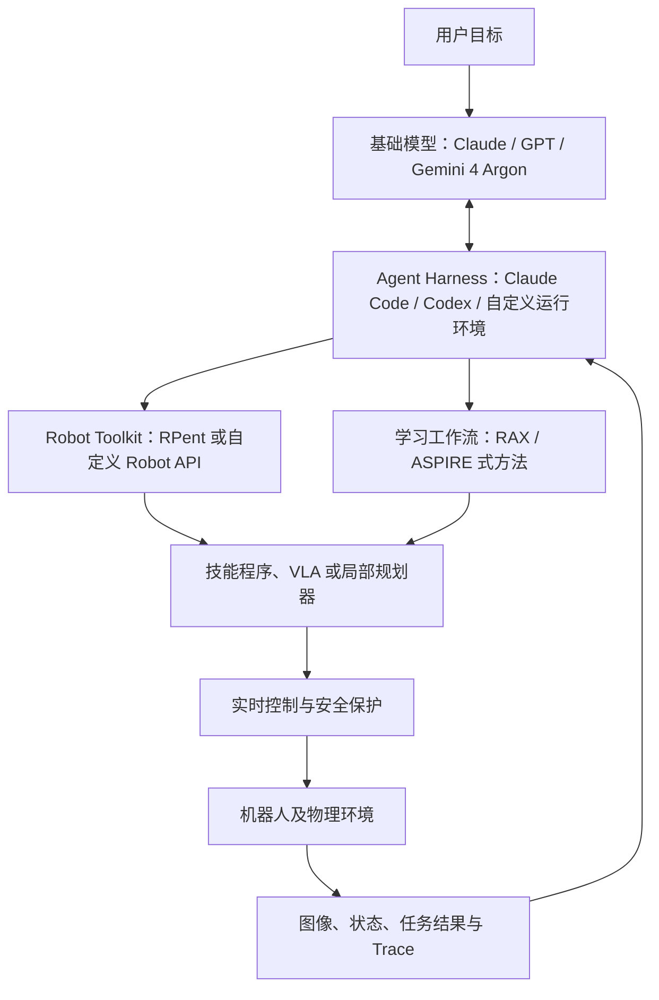
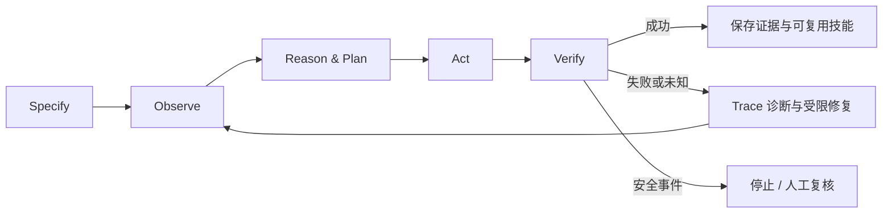
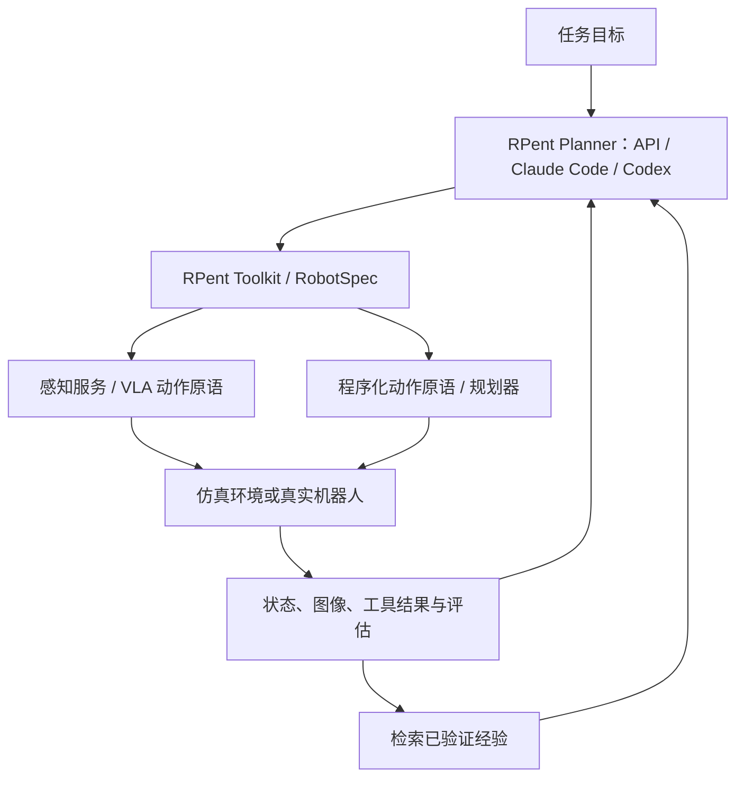
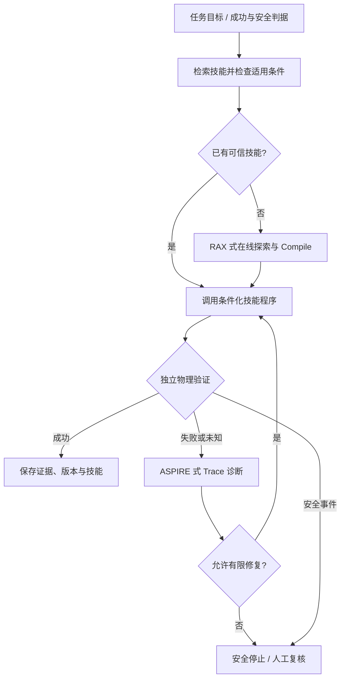

# 先进 Robot Agent：基础模型、RAX、ASPIRE、RPent 与可持续改进工作流

[课程首页](https://github.com/zengxiong111/Foundation_of_Embodied_AI/blob/main/README.zh-CN.md) · [English Markdown](Robot_Agent_Workflow_RPent_EN.md) · [中文版 PDF](https://zengxiong111.github.io/zengxiong.github.io/files/Robot_Agent_Workflow_RPent_ZH.pdf)

**Foundation of Embodied AI · 课程讲义（修订教学版）**  
*从基础模型、在线探索到可组合的 Robot Agent 系统与可靠部署*  
**修订日期：2026 年 10 月 19 日**

> **核心问题：** Claude、Codex、Gemini 4 Argon 为什么能参与机器人操作，却又不等于机器人实时控制器？RAX 和 ASPIRE 各自解决什么问题，RPent 又如何把规划器、感知、动作、记忆和机器人连接起来？怎样实现可验证、可复用的物理闭环？

**学习目标：** 区分基础模型、Coding Agent、Agent Harness、Robot Agent、VLA 与控制器；理解基础模型怎样读取机器人观测、调用工具、生成程序并从反馈中改进；掌握 RAX 的 Explore–Compile–Evaluate、ASPIRE 的 Trace 调试与技能库，理解 RPent 的 Toolkit、Memory、Flash Mode 与数据飞轮，以及 Gemini 4 Argon 的公开机器人应用；能理解统一系统中各回路的职责与安全边界。**本讲义不含代码或实验章节。**

## 目录

1. [Robot Agent：定义与职责边界](#agent-section-01)
2. [Claude、Codex 与 Gemini 4 Argon 如何参与](#agent-section-02)
3. [基础模型驱动的通用 Robot Agent 工作流](#agent-section-03)
4. [RAX：从探索到独立执行的程序](#agent-section-04)
5. [ASPIRE：Trace 驱动的程序改进与技能积累](#agent-section-05)
6. [RPent：从研究工作流到可组合的 Agent 基础设施](#agent-section-06)
7. [Gemini 4 Argon：机器人控制、Real2Sim 与自我改进](#agent-section-07)
8. [统一系统](#agent-section-08)
9. [论文与官方资料](#agent-references)

---

## 1. Robot Agent：定义与职责边界

### 1.1 从动作预测到任务闭环

给机器人下达“找到螺丝刀，抓起并移动到指定位置，然后旋转 90°”的指令时，VLA 或动作策略主要决定**下一段动作是什么**；Robot Agent 则决定**先做什么、调用哪个工具、如何检查结果、遇到失败怎样改变做法**。二者可以共存，不必相互替代。

$$
a_t = \pi_{\theta}(o_t,g), \qquad
\mathcal P_{k+1}=\operatorname{Agent}_{M}(g,\mathcal H_k,\mathcal T,\mathcal E_k).
$$

其中，$o_t$ 是传感观测、$g$ 是任务目标、$a_t$ 是策略输出；$M$ 是基础模型、$\mathcal H_k$ 是交互历史、$\mathcal T$ 是可用工具、$\mathcal E_k$ 是物理反馈，$\mathcal P_{k+1}$ 是下一步计划或程序。上式是**教学性抽象**，不意味着 RAX、ASPIRE 或 Argon 采用同一个数学优化目标。

**图 1.** Robot Agent 负责任务级编排，物理反馈和安全控制必须闭环。箭头表示功能关系，不表示各模块需要分别训练一个大模型。

| 层级 | 核心职责 | 典型输出与时间尺度 |
|:--|:--|:--|
| **任务级 Agent** | 分解目标、调用工具、检索或编写技能、失败归因和重新规划 | 事件驱动；计划、程序、工具调用 |
| **感知与技能执行** | 目标定位、状态估计、条件分支、抓取或操作策略 | 传感帧或技能步骤；位姿、动作块 |
| **运动控制与安全** | 关节/末端跟踪、接触稳定、约束执行、急停 | 高频闭环；速度、位置或力矩指令 |

**关键原则：** 大模型可以慢速推理，但不应为每一次伺服更新提供即时决策。低层闭环与安全边界必须不依赖云端模型的延迟或正确性。

### 1.2 Robot Agent 不等于 VLA，也不等于传统规划器

- **VLA / 动作策略**侧重观测到动作的映射，适合连续操控和动作块执行；记忆、重规划和工具调用是可选的系统机制，而非所有 VLA 的内在性质。
- **传统任务与运动规划**处理几何、碰撞、可达性与时序约束，在定义清楚的模型中可靠；遇到新语义目标和未建模故障时可由 Agent 补充。
- **Coding Robot Agent**调用视觉、规划、仿真和机器人 API，生成或修改程序，再依据物理反馈调试；它不能仅凭语言推理保证接触稳定或控制安全。

### 1.3 何谓“任务成功”？

控制 API 返回 `FINISHED` 只表示命令结束；夹爪闭合不一定代表抓取成功；手腕转过 90° 也不一定意味着螺丝刀本体正确旋转。更合理的是独立检查任务后置条件：

$$
V(o_{0:T})\in\{\mathrm{SUCCESS},\mathrm{FAILURE},\mathrm{UNKNOWN}\}.
$$

`UNKNOWN` 表示证据不足，例如目标被遮挡、物体姿态跟踪漂移或接触状态无法判断。此时应请求新视角或进入安全暂停，不能把“未检测到失败”当作成功。

---

## 2. Claude、Codex 与 Gemini 4 Argon 如何参与

### 2.1 先分清“模型”和“Agent 系统”

**Claude 是基础模型家族，Gemini 4 Argon 是 Google 的通用多模态推理模型；Claude Code 与 Codex 则是让基础模型能够读写文件、执行命令、调用工具并处理反馈的 Agent 产品或运行环境。** 因此，“Claude、Codex、Argon 三种基础模型”的并列说法不严格；应当将模型与运行环境分层。Codex 的名称在不同产品及模型语境下使用，本教程特指 **Codex Coding Agent / Harness**。[5–7]

| 名称 | 技术层次 | 在机器人系统中的典型参与方式 | 容易误解之处 |
|:--|:--|:--|:--|
| **Claude** | 通用基础模型 | 视觉/文本推理、任务规划、代码生成与失败解释 | 仅调用模型 API 不会自动连接机器人 |
| **Claude Code** | Coding Agent / Harness | 读取工作区、调用 MCP/命令和机器人 API、修改及复核程序 | 不等于 Claude 模型权重本身 |
| **Codex** | Coding Agent / Harness（由模型驱动） | 在隔离环境中编写程序、使用工具、迭代修复与请求授权 | 不应把 Codex 产品直接等同单个基础模型 |
| **Gemini 4 Argon** | 通用多模态推理模型 | 图像/视频物理推理、机器人任务规划、代码生成、Real2Sim | 本身不是固定频率输出关节指令的 VLA |
| **Google Antigravity / 自定义 Harness** | Agent 运行环境 | 让 Argon 获取工具、工作区与执行反馈 | Argon 可用于不同运行环境，不局限于一种产品 |
| **RAX / ASPIRE** | 在线探索与自修复研究工作流 | 规定程序编译、执行诊断与技能积累方法 | 不是机器人驱动或训练器 |
| **RPent** | 开源 Robot Agent 运行框架 | 连接 Planner、Toolkit、感知/VLA 服务、记忆及机器人环境 | 不是基础模型，也不自动替代底层控制 |

### 2.2 基础模型具体做的六件事

在完成机器人任务时，基础模型可以参与：**（1）理解语言目标；（2）解释图像、视频与结构化状态；（3）选择下一项工具调用；（4）生成条件化技能程序；（5）根据 Trace 诊断失败；（6）总结可复用知识。** 实际执行这些操作还需要外部运行环境与工具连接。模型“有能力生成程序”与系统“能在真机安全运行程序”之间存在清晰工程鸿沟。

**图 2.** 基础模型提供推理能力，Harness 管理 Agent 循环，RPent 一类框架可负责机器人服务与工具连接；RAX/ASPIRE 提供可借鉴的探索和改进方法。这是**教学架构**，不意味着 RAX、ASPIRE 与 RPent 已在同一系统中完成联合验证。

### 2.3 Harness 为什么与模型同等重要？

Harness 并不只是一个提示词模板。它管理**上下文与工作区、工具权限、任务循环、执行日志、异常与超时、人类批准、恢复和终止条件**。例如，Codex 官方将 Harness 描述为模型与实际工具之间可复用的执行系统；Claude Code 也公开了 MCP、Skills、Hooks 和 Agent SDK 等扩展机制。[5,6]

将相同模型直接调用为一次文本生成，与让它在 Harness 中执行“观察 → 调用工具 → 读取结果 → 决定下一步”的多轮过程，得到的能力并不等价。另一方面，Harness 也不能消除模型幻觉；**机器人状态、权限约束和结果验证应由工具与独立机制提供**。

### 2.4 三个技术栈怎样落地？

**Claude 路线：** Claude 模型通过 Claude Code 或定制 Agent Runtime 访问受限的机器人接口。RAX 可把探索中形成的有效决策编译为程序；ASPIRE 可基于 Trace 修复并总结通用技能。[2–5]

**Codex 路线：** Codex 作为已有的 Coding Agent，处理工作区文件、机器人 API 调用和程序迭代。RAX 官方明确支持 Codex CLI/Claude Code，ASPIRE 官方也提供适配 Codex 的 Agent Skills。[2,4,6]

**Argon 路线：** Gemini 4 Argon 借助外部工具和运行环境参与机器人操作、Real2Sim、视频标注和程序改进。Google 已发布对应机器人演示，但这**不等于** Argon 已被 RAX/ASPIRE 官方接入，或能直接替代低层控制器。[7,8]

**工程实现：** RPent 提供 `api`、`claude_code` 和 `codex` 等规划器后端，利用标准化 Toolkit 对接感知、VLA 与机器人环境；它可以作为上述模型与 Agent 运行时的实际连接层，但不能把这种接口兼容误写为 Argon 或 RAX/ASPIRE 已获得官方集成验证。[10,11,16]

**可迁移的结论：** 研究重点不应只是“选哪个大模型”，而应同时问：**开放哪些机器人能力、怎样暴露反馈、怎样限制危险调用，以及有效经验保存在哪里。**

---

## 3. 基础模型驱动的通用 Robot Agent 工作流

### 3.1 从一个用户目标到一次安全执行

一个可理解的生命周期可以写成：

1. **Specify（定义）**：将语言目标改写成可观测的任务后置条件，确定工作区、预算与停止规则。
2. **Observe（观察）**：采集 RGB/RGB-D、关节状态、已知物体几何与规划器返回，并标注不确定性。
3. **Reason & Plan（推理与规划）**：基础模型借助 Harness 选择现成技能、工具调用或需要探索的候选程序。
4. **Act（执行）**：经授权的机器人服务调用感知、IK、规划或策略；本地控制器负责连续运动。
5. **Verify（独立验证）**：检查真实物理后置条件，而不是只看命令是否执行完毕。
6. **Repair & Remember（修复与积累）**：读取失败 Trace，限定修改范围，重新验证；仅将有证据支持的知识写入技能库。

**图 3.** “观察—决策—执行—验证”的内部环可以重复，而每次重试必须有预算、独立安全检查与可解释的退出条件。

### 3.2 Tool Calling 是通向物理世界的接口，不是控制算法

| 工具类别 | Agent 可获得或请求的内容 | 接口必须承担的责任 |
|:--|:--|:--|
| 观察与状态估计 | 图像、目标识别、物体位姿、置信度 | 时间戳、坐标系、可观测性和失效标记 |
| 规划与几何检查 | IK、避障轨迹、候选接近方向 | 可达性、碰撞与运动学约束 |
| 技能或策略执行 | 抓取、搬运、旋转、VLA/RL 动作块 | 条件、动作限幅、超时、局部恢复 |
| 仿真与验证 | 重放、物理仿真、状态对比与任务分数 | Sim2Real 偏差提示，杜绝仿真成功冒充真机成功 |
| 日志与记忆 | 多模态 Trace、程序版本、适用条件 | 可追溯、可撤销、证据来源可信 |

### 3.3 四个回路不能合并成一个“超级模型”

**控制回路**负责毫秒级或更高频率的跟踪和稳定；**技能回路**负责观测更新、动作段切换与小范围恢复；**任务 Agent 回路**负责低频重规划、编程和诊断；**长期学习回路**负责技能的测试、版本化与淘汰。层级是功能划分，不要求配备四个独立模型。对于已验证任务，可以暂时不再调用大模型，只运行封装好的技能程序。

### 3.4 学到的是什么：程序记忆不等于权重后训练

RAX/ASPIRE 主要通过**程序、失败解释、技能库和验证证据**积累能力，而不要求在线更新基础模型参数。另一条路线是将仿真生成的数据用于 VLA 行为克隆或后训练：这时改变的是动作模型权重，属于不同学习机制。**机器人在线交互、自我改进、Online RL 和基础模型参数更新，不应被当作同义词。** 例如，RPent 可以记录执行轨迹并导出成功演示供 RLinf 做监督微调，但训练过程发生在独立系统中；仅积累任务记忆时没有梯度更新。[14]

---

## 4. RAX：从探索到独立执行的程序

RAX（Robot Agent eXploration）让冻结权重的通用 Coding Agent（官方实现支持 **Codex CLI 或 Claude Code**）通过感知与控制工具进行在线探索，将经验写入工作区，并把有效逻辑编译为无需持续调用 Coding Agent 的模块化程序。其核心是 **Explore → Compile → Evaluate**，不要求为每个新任务再训练语言模型。[1,2]

### 4.1 Explore：探索的是条件化决策，而非重学电机物理

Agent 可以试探“换哪个观察视角、从哪里接近、哪一个抓取方向可行、何时检查物体仍在手中”。每次尝试应保存**观测、工具参数、返回错误、实际物理结果及修改原因**。只记录“抓取失败”不足以迁移；若记录“目标位姿落入桌边碰撞缓冲区，改用侧向接近后规划成功”，下次就有可复用的因果线索。

### 4.2 Compile：从成功轨迹变为条件程序

| 单次成功动作回放 | RAX 式编译程序 |
|:--|:--|
| 使用探索时的固定目标坐标 | 对新场景重新感知并计算目标 |
| 按固定顺序执行 | 根据 IK、接触和视觉反馈条件分支 |
| 失败后直接结束或依赖 Agent 补救 | 内置有限恢复、异常返回和中止条件 |
| 仅证明原场景可行 | 明确前置条件，并在不同布局验证 |

RAX 中的“编译”是**把探索经验整理成可独立执行的机器人程序**，不是把语言提示转换为处理器指令。官方给出的编译程序入口示例为 `controller.py:main(ctx)`；这一标识用于说明程序接口，不是本讲义的代码练习。[2]

### 4.3 Evaluate：与开发过程隔离的验证

探索者可能通过未写入代码的临时判断弥补程序不足，所以编译后必须冻结程序，在未见布局或重置后的真机任务中独立运行。证据可以分为“仅一次成功”“同一配置重复成功”“变化初始状态后独立成功”，三者的泛化含义不同。RAX 官网公开的气炸锅案例中，探索约 **72 分钟**、编译后执行约 **18 秒**；这只是该任务的示例，不代表所有机器人任务均达到该延迟。[1,2]

RAX 官方技能库还存储前置条件、程序、失败模式、执行记录与相机证据。只有在明确的审核与复验规则下，“可以运行”才应提升为“已验证、可复用”。[2,3]

**本章结论：** RAX 回答的是——怎样让机器人将线上试出来的办法**固化为可复用、观察驱动、无需持续大模型干预的程序**。

---

## 5. ASPIRE：Trace 驱动的程序改进与技能积累

ASPIRE 同样采取 **code-as-policy**：Coding Agent 编写机器人程序，再根据实际执行反馈修复。它尤其强调**多模态执行 Trace、迭代调试、可增长的技能库、Coordinator–Actor 与 Evolutionary Search**。早期论文实验使用 Claude Opus 4.6；官方实现还提供 Claude Code 和 Codex 等 Agent 环境适配，不能把框架能力归因于某一个模型名称。[4,9]

### 5.1 Trace：从报错标签定位因果瓶颈

| Trace 证据 | 能回答什么问题 | 典型修复方向 |
|:--|:--|:--|
| 工具调用和参数 | 目标坐标、抓取方向或约束是不是错了？ | 修正调用参数或坐标变换 |
| 规划器错误与返回状态 | 失败在 IK、可达性还是避障？ | 换接近方向或重新规划 |
| 关键图像帧与位姿 | 物体移动了吗？手指是否空抓？ | 重新感知、调整接触时序 |
| 接触/本体状态与时间线 | 是物理滑落，还是估计漂移？ | 优先处理可信的失效原因 |
| 验证器结论和置信度 | 目标真的完成了吗？ | 补充视角或转为 `UNKNOWN` |

Agent 应当有选择地检索**故障附近**的证据，而不是把海量原始视频全部塞进上下文窗口。若工具返回 `PLANNING_ERROR`，首先检查目标、碰撞余量与路径，不应该盲目提高抓取力。

### 5.2 Iterative Debugging：修复必须可验证

一轮调试依次执行：**选择 Trace → 提出局部故障假设 → 修改程序 → 重新运行 → 比较结果**。论文中的收音机拾取例子表明：物体已经被视觉识别，但导航目标落入桌边的碰撞缓冲区域；改变接近方向后能够继续任务。值得沉淀的技能不是“每次都往某处挪固定距离”，而是“碰撞缓冲引发不可达时，尝试满足约束的其他观察或接近方向”。[9]

### 5.3 Skill Library、Coordinator–Actor 与进化搜索

- **Skill Library：** 持久保存程序、可迁移的修复模式、适用条件与独立验证证据；不应把每次偶然成功直接写成通用规律。
- **Coordinator–Actor：** 协调多个 Coding Agent 在不同任务上尝试，筛选经过复核的技能并管理共享知识。
- **Evolutionary Search：** 并行生成多种候选程序或步骤，根据执行分数和 Trace 选择并迭代；这里搜索的是**程序与任务逻辑**，不等价于梯度更新大模型或 VLA。

**本章结论：** ASPIRE 回答的是——怎样让失败有可诊断的证据、让修复可重复验证，并将经验沉淀为长期可迁移的技能。

---

## 6. RPent：从研究工作流到可组合的 Agent 基础设施

前两章的 RAX 和 ASPIRE 分别回答**“新技能怎样探索并固化”**与**“执行错误怎样诊断、修复并积累”**。要让这些思想作用于真实机器人，还需要一个可运行的系统：把基础模型的决策连接到相机、动作策略、工具执行、状态反馈和可追溯记忆。**RPent（Recursive Physical Agent）正处在这一工程层。** 它是面向物理世界的开源 Agent 基础设施，采用**服务化、标准化、可组合**的设计原则，而不是一种新的 VLA 权重、固定的基础模型或专门的 RL 训练算法。[10,11]

### 6.1 它在 Robot Agent 技术栈中的位置

RPent 以不同 Planner 驱动同一组 Robot Tools：`api` 后端使用模型 API 工具调用循环，`claude_code` 和 `codex` 后端分别借助相应的 Agent SDK；底层由 Toolkit 将工具调用路由到感知、程序化动作、VLA 或环境服务。模型负责选择动作与解释反馈，**控制器和环境服务才负责物理运动与状态维护**。这使得更换规划器不必重写全部机器人原语。[11,16]

| 模块 | RPent 中的职责 | 为什么重要 |
|:--|:--|:--|
| **Planner** | 接收任务、工具定义和历史结果；决定下一次工具调用 | 不把大模型推理硬塞进伺服周期 |
| **Toolkit / RobotSpec** | 声明工具参数、机器人接入、运行时和任务配置 | 让不同平台使用可检查的接口 |
| **感知与 VLA 服务** | 执行分割、定位、动作预测；可与环境分进程运行 | 将重型视觉/动作模型与 Agent 进程解耦 |
| **Memory 与 Session** | 读取已验证经验、管理探索草稿和执行记录 | 支持跨任务复用及审计 |
| **Environment / Controller** | 执行动作、报告状态与任务结束条件 | 物理安全与任务成功不由语言结论决定 |

**图 4.** RPent 的主要价值是连接并调度现有智能模块；图中反馈是系统结构，不表示所有平台均具有同样的安全保护、成功判定或可在线训练能力。[11]

### 6.2 探索与记忆：积累经验，不等于更新模型权重

RPent 的探索模式允许多次复位和重试，把有用的观察、操作记录及经验草稿留在本地；评测模式则**只读已有记忆**，避免评测时悄悄学习而污染结果。以 LIBERO 为例，项目在环境**确实判定成功**后才将成功记录和动作序列纳入可复用记忆。Memory 可以包含任务特定的执行经验以及跨任务的修复思路，历史坐标只应作为参考，下一次执行仍需根据**当前图像重新定位**。[12]

因此，“探索成功”“模型认为成功”“有可复用记忆”并不等价。评测需要固定记忆版本，真机还必须由独立传感或操作员检查目标是否真的完成；仅仅执行 `finish` 不代表成功。[11,12]

### 6.3 Flash Mode 与 RAX Compile：相似目标，不同实现

二者都希望减少已知任务中反复调用大模型的成本，但**不要把 RPent Flash Mode 称作 RAX 的程序编译**。在 RPent 的 LIBERO Flash Mode 中，系统读取先前成功运行产生的 **plan 与视觉锚点（anchor）**，借助 SAM3 或 Molmo 在新图像中重新定位目标，再结合相对偏移执行已保存的动作。它不需要 LLM 在线重新规划，但仍可能依赖视觉及 VLA 服务。[13]

| 对比 | **RAX Compile** | **RPent Flash Mode** |
|:--|:--|:--|
| 复用对象 | 包含感知、分支、恢复逻辑的可执行程序 | 已保存的动作计划及其视觉锚点 |
| 新场景处理 | 程序根据当前状态执行条件判断 | 对锚点重定位，并更新依赖锚点的坐标 |
| 运行时推理 | 已编译程序原则上无需持续 Coding Agent | 不再用 LLM 规划，但仍使用感知/VLA |
| 已公开范围 | RAX 研究中的探索/程序验证任务 | RPent 文档描述的 LIBERO Flash 评测 |

Flash 的性能与泛化依赖于源计划、锚点检测、场景变化和底层策略；**不应将“零在线 LLM 规划”误解成零延迟、无视觉模型或具有通用恢复能力**。[13]

### 6.4 数据飞轮：RPent 与 RLinf 如何衔接

RPent 还提供可选的 **LIBERO 数据飞轮**：保存不可变的原始执行轨迹，再校验并将成功轨迹导出为 LeRobot 数据集，供独立的 RLinf 环境对 Pi0.5 进行监督微调（SFT）。这使“Agent 探索/执行 → 生成可用数据 → 训练动作策略”成为可衔接的管线，但**RPent 的采集与导出本身不执行参数更新，更不自动构成在线 off-policy RL**。失败轨迹可留作审计，默认不会被导入这条成功演示的 SFT 数据集。[14]

从研究角度看，真正的闭环改进至少要区分三种资产：**外部记忆**（操作提示与执行计划）、**技能程序**（带条件和恢复的可执行逻辑）、**模型参数**（由 SFT/RL 改变的 VLA 权重）。RPent 主要解决前两类资产的组织与运行，并为第三类提供数据接口，而不是把三类学习机制混成一个概念。

### 6.5 真机接入与仍需解决的边界

RPent 文档覆盖 LIBERO、RoboCasa365、RoboTwin、RoboDojo 等环境，并给出 Franka 单/双臂等真机接入实例；这些支持**不等于任意机器人或接触任务可以即插即用**。[10,15] 对于新的手臂平台，必须实现相应 `RobotSpec` 和 Toolkit，接好相机标定、坐标变换、IK/碰撞检查、动作时序、失败回报和可靠的急停接口。

**本章结论：** RAX 和 ASPIRE 帮助理解“Agent 应当怎样探索与改进”，RPent 展示了“怎样把规划器、工具、记忆和机器人服务组装起来并反复运行”。二者属于互补层次；具体集成仍须针对接口、任务与真机验证。

---

## 7. Gemini 4 Argon：机器人控制、Real2Sim 与自我改进

Google 于 **2026 年 10 月 13 日**发布了 Gemini 4 Argon 的机器人应用演示。Argon 是具有图像、视频与工具调用能力的**通用推理基础模型**；当它接入机器人 API、仿真和状态反馈，并在多轮执行中自主选择操作时，整个系统可被称为 **Robot Agent**。这不代表模型本体就是一个实时动作策略。[7,8]

### 7.1 官方公开的四类能力

| 应用方向 | Google 公布的示例 | 真正体现的 Agent 作用 |
|:--|:--|:--|
| **Robot Control** | Spot 机械操作与 MuJoCo 练习；机械臂扶正杯子并放入纸巾 | 分步骤调用动作原语、视觉复核、失败后调整 |
| **Real2Sim** | 从机器人视角、第一视角视频或草图构建 MuJoCo 场景 | 生成/调整仿真资产，检验视觉与接触一致性 |
| **Physical Understanding** | 视频事后分段标注、接触事件和任务进度估计 | 把物理过程变成结构化标签及验证线索 |
| **Research & Improvement** | 仿真生成动作训练数据；SO-101 真机迭代改进 | 基于回放、执行与评价优化程序或数据流程 |

### 7.2 典型案例的正确解读

**案例 A：视觉闭环操作。** 在杯子与纸巾任务中，Argon 通过校准的腕相机和动作原语选择下一步，并在工具反馈后重新观察。它展示了*模型推理 + Harness + 已实现动作工具*的能力，而不是大模型直接控制电机电流。[8]

**案例 B：Real2Sim。** Google 展示了根据真机遥操作视频重建 MuJoCo 场景，调节物体几何、质量、摩擦与接触等属性，并对比多相机画面及触觉/力反馈的过程。它提供的是**仿真构建与物理一致性优化工作流**；“生成了视觉相似的数字孪生”不等于已经解决精确接触辨识、所有分布下的 Sim2Real。[8]

**案例 C：数据与后训练。** Argon 演示了构建仿真并生成大量动作数据以改进 VLA 的流程。此时 **Argon 在生成环境和数据，VLA 的参数更新属于另一个训练阶段**；不能因此说 Argon 自身通过在线 RL 更新了权重。[8]

**案例 D：真机自我改进。** 在 SO-101 视觉抓取放置任务中，Google 报告三次程序/执行迭代的时间分别为 **58.9 秒、22.9 秒、17.4 秒**。这是官方展示的一个具体流程，不应解读为各类机器人任务的普遍成功率或可靠性结论。[8]

### 7.3 与 RAX、ASPIRE、RPent：互补而不是同义词

| 对比对象 | 是什么 | 核心关注 | 不能直接推导的结论 |
|:--|:--|:--|:--|
| **Gemini 4 Argon** | 通用多模态基础模型 | 推理、代码生成、物理理解 | 不是原生高频伺服控制器 |
| **RAX** | 在线探索与程序编译框架 | 学会新任务后独立执行 | 不要求训练全新基础模型 |
| **ASPIRE** | Trace 调试和技能持续改进框架 | 失败归因与可复用修复 | 不等于 VLA 权重后训练 |
| **RPent** | 模块化 Robot Agent 运行基础设施 | Planner、Toolkit、Memory、环境接入与复用 | 不等于上述两种论文框架已正式集成 |

Argon 可以在概念上承担类似 RAX 或 ASPIRE 系统中的“推理模型”角色，但**不能把这种可行的工程组合误写为两篇论文已经完成的官方实验**。比较重点应是模型能力、Harness 能力、RPent 一类系统的 Robot API，以及验证机制如何共同决定最终表现。RPent 的现有规划器选项不能直接证明其官方支持 Argon，兼容第三方模型也需要查看具体 API 适配和实测结果。

---

## 8. 统一系统

### 8.1 一条可复用、但不混淆论文边界的工作流

**图 5.** RAX 提供探索与程序固化的设计思想，ASPIRE 提供可诊断的修复方式，RPent 一类基础设施可连接 Planner、Toolkit、执行服务与记忆。此图是**教学性的系统参考设计**，不代表上述项目已经联合完成部署与实验。

### 8.2 一个技能需要哪些契约？

1. **Preconditions：** 机器人型号、相机标定、物体类型、任务工作区。
2. **Execution：** 参数、允许调用的 API、执行预算及负责闭环的底层策略。
3. **Verification：** 物体状态、成功容差及 `SUCCESS / FAILURE / UNKNOWN` 判据。
4. **Recovery：** 可恢复故障、尝试次数、不可恢复时的安全退出。
5. **Evidence & Version：** 独立复现记录、已知失效分布、版本与回退机制。

这是通用**工程接口建议**，并非某一论文规定的统一数据格式。程序只有在受限、独立复核后才应提升为可部署技能。

### 8.4 如何选择：模型、工作流、技能还是控制器？

| 遇到的问题 | 优先考虑 | 判断标准 |
|:--|:--|:--|
| 语义目标复杂、需要解释视频或编写工具流程 | **Claude / Gemini 4 Argon 等基础模型** | 物理推理与程序能力是否符合任务 |
| 需要持续调用工具、读写工作区、设置批准和日志 | **Claude Code / Codex / 自定义 Harness** | 权限、状态管理、审计与恢复是否完整 |
| 新任务、没有可用程序 | **RAX 式探索与 Compile** | 能否积累条件化行为并独立通过验证 |
| 同类错误反复发生 | **ASPIRE 式 Trace 调试与技能库** | 能否提出可检查的根因、局部修复及证据 |
| 需要把规划器、VLA、工具、记忆接入仿真或真机 | **RPent / 自定义机器人 Agent 基础设施** | 接口适配、服务隔离、验证、审计与部署边界 |
| 连续接触、高速轨迹跟踪 | **VLA / RL / MPC / 实时控制器** | 延迟、稳定性和物理安全是否满足要求 |

### 课程结论

**Robot Agent 不是“一个更大的 VLA”，也不等于“一个会写机器人代码的模型”。** 它是由**基础模型 + Agent Harness + 机器人工具 + 执行反馈 + 可验证技能与安全机制**构成的任务级闭环系统。Claude 与 Gemini 4 Argon 可提供通用推理，Claude Code 与 Codex 可提供成熟的 Agent 执行环境；RAX 强调把探索编译成可独立运行的程序，ASPIRE 强调从多模态 Trace 中持续修复和积累技能，RPent 展示了将 Planner、工具、记忆、VLA 与机器人服务系统化连接的工程路径。最终能否可靠操作真实机器人，取决于**可观测性、工具质量、独立验证和底层安全控制**，而不是模型名称本身。

---

## 论文与官方资料（可点击）

1. **RAX 论文**：Huang et al., *Scaling Online Exploration for Robot Agents* (2026). [PDF](https://assets.robot-agent-exploration.com/paper/rax.pdf) · [项目主页](https://robot-agent-exploration.com/)。
2. **RAX 代码与 Harness**：[robot-agent-exploration/rax](https://github.com/robot-agent-exploration/rax)。
3. **RAX 技能库**：[robot-agent-exploration/skills-lib](https://github.com/robot-agent-exploration/skills-lib)。
4. **ASPIRE 官方实现**：[NVlabs/ASPIRE](https://github.com/NVlabs/ASPIRE)。
5. **Claude Code 文档**：[Anthropic Claude Code Overview](https://code.claude.com/docs/en/overview)。
6. **Codex Harness**：[OpenAI, *Codex as a platform*](https://developers.openai.com/blog/codex-as-a-platform) (2026)。
7. **Gemini 4 Argon 模型文档**：[Google AI for Developers](https://ai.google.dev/gemini-api/docs/models/gemini-4-argon)。
8. **Argon 机器人应用**：[Google, *Gemini 4 Argon for Robotics*](https://developers.googleblog.com/gemini-4-argon-for-robotics/) (2026-10-13)。
9. **ASPIRE 论文**：Lu et al., *ASPIRE: Agentic /Skills Discovery for Robotics* (2026). [arXiv](https://arxiv.org/abs/2607.00272) · [项目](https://research.nvidia.com/labs/gear/aspire/)。
10. **RPent 概览与代码**：[中文介绍](https://rpent.readthedocs.io/zh-cn/latest/rst_source/get_started/overview.html) · [RLinf/RPent](https://github.com/RLinf/RPent)。
11. **RPent 架构与执行**：[系统架构](https://rpent.readthedocs.io/zh-cn/latest/rst_source/development/architecture.html)。
12. **RPent 探索和记忆**：[使用记忆与探索模式](https://rpent.readthedocs.io/zh-cn/latest/rst_source/guides/memory.html)。
13. **RPent Flash**：[使用 Flash Mode](https://rpent.readthedocs.io/zh-cn/latest/rst_source/guides/flash.html)。
14. **RPent 数据飞轮与 RLinf**：[采集轨迹与数据飞轮](https://rpent.readthedocs.io/zh-cn/latest/rst_source/guides/flywheel.html)。
15. **RPent 机器人接口**：[添加机器人或仿真环境](https://rpent.readthedocs.io/zh-cn/latest/rst_source/development/add_robot.html)。
16. **RPent Planner**：[规划器配置](https://rpent.readthedocs.io/zh-cn/latest/rst_source/guides/configure_planner.html)。

*来源与许可：改编自 Xiong Zeng 等人的 Foundation of Embodied AI 课程材料（CC BY 4.0）；统一架构与螺丝刀案例仅供教学。*
