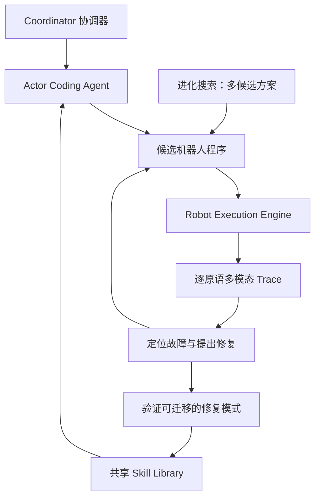
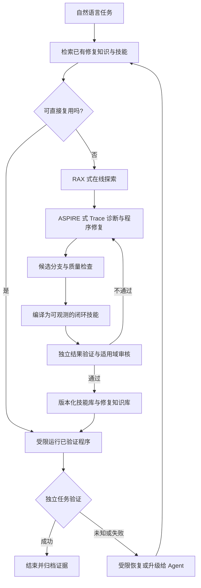

# 先进 Robot Agent：ASPIRE 与 RAX 工作流

<!-- course-meta:start -->
[课程首页](https://github.com/zengxiong111/Foundation_of_Embodied_AI/blob/main/README.zh-CN.md) · [English](https://github.com/zengxiong111/Foundation_of_Embodied_AI/blob/main/md/Robot_Agent_Workflow_EN.md) · [PDF](https://zengxiong111.github.io/zengxiong.github.io/files/Robot_Agent_Workflow_ZH.pdf)

| 项目 | 说明 |
|---|---|
| 适用范围 | ASPIRE 与 RAX：在线探索、执行轨迹诊断、程序修复与编译、技能记忆及验证概念 |
| 文档核验日期 | 2026-10-18 |
| 许可 | CC BY 4.0 · Xiong Zeng and contributors |

**核验边界：** 仅进行文档整合与排版检查；未复现成功率、迁移结果或真机部署。不包含实验章节。 固定源码引用见[资料清单](https://github.com/zengxiong111/Foundation_of_Embodied_AI/blob/main/materials.json)。原创教材采用 [CC BY 4.0](https://creativecommons.org/licenses/by/4.0/)，第三方引用、图片及代码遵循其原有许可；注明来源不等于拥有再许可权。
<!-- course-meta:end -->

<!-- course-toc:start -->
## 目录

- [导读：从执行一次任务到积累可复用能力](#course-section-01)
- [1. Robot Agent 的定位：程序、策略与物理世界](#course-section-02)
  - [1.1 Robot Agent 不等于 VLA，也不等于电机控制器](#course-section-03)
  - [1.2 为什么要把经验写成程序与技能？](#course-section-04)
  - [1.3 三个最重要的区分](#course-section-05)
- [2. RAX：Explore → Compile → Evaluate](#course-section-06)
  - [2.1 RAX 的核心设定](#course-section-07)
  - [2.2 Explore：把试错变成可解释的因果知识](#course-section-08)
  - [2.3 Compile：编译的是条件行为，不是视频回放](#course-section-09)
  - [2.4 Evaluate：对已编译程序进行独立确认](#course-section-10)
  - [2.5 从一次探索到跨任务复用](#course-section-11)
- [3. ASPIRE：执行轨迹驱动的自我修复与技能积累](#course-section-12)
  - [3.1 三个组件和 Coordinator–Actor 架构](#course-section-13)
  - [3.2 逐原语 Trace 为什么比任务成功/失败更重要？](#course-section-14)
  - [3.3 Iterative Debugging：诊断 → 修改 → 再执行 → 确认](#course-section-15)
  - [3.4 Skill Library：存放的是可迁移修复模式](#course-section-16)
  - [3.5 Evolutionary Search：避免困在局部补丁中](#course-section-17)
- [4. ASPIRE 与 RAX：相同范式、不同强项](#course-section-18)
  - [4.1 原始框架的逐项比较](#course-section-19)
  - [4.2 两类技能不应混淆](#course-section-20)
  - [4.3 一条建议的统一生命周期](#course-section-21)
- [5. 从语言目标到受控执行：接口、规划与验证](#course-section-22)
  - [5.1 用后置条件表达目标](#course-section-23)
  - [5.2 技能接口：从自由文本到可检查的契约](#course-section-24)
  - [5.3 有风险约束的技能选择](#course-section-25)
  - [5.4 何时局部修复，何时重新探索？](#course-section-26)
  - [5.5 多频率异步闭环](#course-section-27)
- [6. 技能记忆：如何让第 100 次任务受益于前 99 次？](#course-section-28)
  - [6.1 一条技能至少需要什么元数据](#course-section-29)
  - [6.2 检索不是把整个历史放进 Prompt](#course-section-30)
  - [6.3 技能修复、升级与撤销](#course-section-31)
  - [6.4 Sim-to-Real 的真实边界](#course-section-32)
- [7. 三个案例：从论文机制到完整决策链](#course-section-33)
  - [7.1 ASPIRE 案例：找到了收音机，却无法接近](#course-section-34)
  - [7.2 RAX 案例：从观察活动结构到编译控制程序](#course-section-35)
  - [7.3 教学组合案例：灵巧手操作螺丝刀时发生滑落](#course-section-36)
- [8. 安全、可靠性与尚未解决的问题](#course-section-37)
  - [8.1 生成程序的四道边界](#course-section-38)
  - [8.2 三种未知不能混为一谈](#course-section-39)
  - [8.3 仍然开放的技术问题](#course-section-40)
  - [8.4 与《Foundation of Embodied AI》其他课程的边界](#course-section-41)
- [结语：从“在线试错”走向“可审计的持续改进”](#course-section-42)
- [参考论文与官方资料](#course-section-43)
<!-- course-toc:end -->

## 导读：从执行一次任务到积累可复用能力

传统的机器人学习通常从数据训练策略：输入视觉与本体状态，输出动作。另一条正在发展的路线是**具身编程 Agent（Embodied Coding Agent）**：使用已有感知、几何规划、运动控制与机器人 API，在环境中探索、编写控制程序、查看失败证据、修改程序并积累经验。重点不再只是改变神经网络的参数，也包括改变机器人可执行的**程序、技能和任务知识**。

本教程以两个工作为主线：**RAX（Robot Agent eXploration）**提出 *Explore → Compile → Evaluate*，通过在线探索找到有效控制逻辑，再编译为不必持续调用 Coding Agent 的程序；**ASPIRE（Agentic Skill Programming through Iterative Robot Exploration）**以逐原语的多模态执行轨迹、迭代调试、共享技能库和进化搜索构造持续改进系统。[R1–R5]

两者可概括为：**RAX 解决“如何把探索所得变成可部署的程序”；ASPIRE 解决“如何定位失败、系统性修复，并让改进跨任务复用”。** 它们并非互斥的替代品，但下文提出的整合系统是**教学性的设计建议**，不是原作者已经联合验证的系统。

**读者应掌握：** 从任务目标到可调用机器人 API 的信息流；RAX 和 ASPIRE 的原始机制及区别；程序与技能知识的两类记忆；“动作结束”和“物理任务完成”的独立验证；以及探索、部署和安全权限的分离。**全文不设实验、Benchmark、消融或硬件复现章节，也不提供需要运行的代码。** 案例只用于说明机制。

> **阅读约定**：标记 **[论文机制]** 的内容来自公开论文或官方仓库；**[教学抽象]** 是为理解原理引入的符号；**[建议架构]** 表示可以借鉴两者构建、但尚未作为单一系统得到验证的设计。

## 1. Robot Agent 的定位：程序、策略与物理世界

### 1.1 Robot Agent 不等于 VLA，也不等于电机控制器

| 系统层 | 输入 | 输出 | 核心职责 |
|---|---|---|---|
| 任务级 Coding Agent | 语言目标、工具接口、执行轨迹、技能库 | 控制程序、工具调用、错误修复 | 发现“怎么完成任务”并积累可重用知识 |
| 感知与状态估计 | 图像、深度、机器人状态 | 物体身份、位姿、时间戳、不确定性 | 提供当前物理状态的证据 |
| 技能执行层 | 子目标、程序、观测或策略条件 | 末端运动、抓取、接触操作 | 将子目标变成可执行动作 |
| 低层控制与安全层 | 关节/力反馈、参考指令和限制 | 受限的伺服命令、停止事件 | 实时跟踪并执行独立安全约束 |

在 RAX、ASPIRE 一类路线中，Coding Agent 可以生成调用运动规划器、抓取接口、视觉查询或现有学习策略的程序。**“无需示教数据”不意味着无需机器人 API、标定、感知模块或受限控制器；更不意味着大模型直接安全地产生电机扭矩。** RAX 特别强调通用 Agent 与机器人 backend 通过工具契约隔离。[R3]

用一个统一的任务模型说明这些接口：

$$
\tau=(g,\mathcal O,\mathcal A,\mathcal C),\qquad
P: (o_{0:t},m_t,g)\mapsto u_t,
$$

其中 $g$ 是任务目标，$\mathcal O$ 是可访问观测，$\mathcal A$ 是授权工具集，$\mathcal C$ 是约束；$P$ 是 Agent 编写或修复的可执行程序，$m_t$ 是任务记忆，$u_t$ 是**经过接口检查的工具调用**。这是教学抽象，而不是 ASPIRE 或 RAX 的原始数学定义。

### 1.2 为什么要把经验写成程序与技能？

逐步调用大型 Agent 有灵活性，但存在推理延迟、成本和执行一致性问题；固定程序执行快，却容易因场景变化失败。RAX 的关键思想是让慢速探索产生**可观测、可检查、可重定位的程序**；ASPIRE 的关键思想是让失败轨迹产生**可迁移的修复知识**。因此需要两个不同的时间尺度：

- **任务学习与改进期：** Agent 可以探索、诊断、修复、生成候选程序并审核技能。
- **部署执行期：** 在限定权限内运行已检查的程序或技能；发生无法处理的事件时，暂停、升级诊断或请求授权，不在危险物理状态中无限试错。

### 1.3 三个最重要的区分

1. **Agent 生成代码 ≠ 代码可以执行。** 代码还必须满足允许调用的工具、参数类型、坐标系、时序和安全约束。
2. **工具返回完成 ≠ 任务物理成功。** 机器人移动到目标位置，不代表物体已经稳定抓住或放置正确。
3. **某场景成功 ≠ 技能具有广泛适用性。** 复用前必须重新检查对象、机器人形态、工具权限、观测质量与物理条件。

## 2. RAX：Explore → Compile → Evaluate

### 2.1 RAX 的核心设定

**[论文机制]** RAX 让通用 Coding Agent（官方框架支持 Codex CLI 或 Claude Code）使用机器人感知和控制工具进行在线探索。Agent 的基础模型保持冻结，工作空间中的笔记、程序与技能持续更新；系统不是依赖为每个新任务采集遥操作示教再训练一个策略。机器人与仿真环境通过 backend 接口接入通用 harness。[R2, R3]

### 2.2 Explore：把试错变成可解释的因果知识

Agent 先弄清楚**能观察什么、能安全调用什么**，然后在目标允许的范围内逐次操作。每次调用至少应保留：调用之前的可见状态、工具及参数、实际返回、动作后观察、是否满足子目标、失败原因或不确定项。重要的不是只保存“这次成功”，而是回答“**成功依赖哪些前置条件，失败发生在感知、规划、执行还是验证？**”

例如操作带活动关节的物体时，固定重放一次成功的抓手位姿可能在下一种布局中失败。真正可复用的信息可能是：从图像更新活动结构的相对位置、按当前几何求接近方向、操作后再估计关节开合程度。RAX 官网展示过 Agent 为未知设备从观测构建简化的活动结构模型，并以该模型进行运动检查的案例。[R2]

### 2.3 Compile：编译的是条件行为，不是视频回放

**[论文机制]** 在找到有效方法后，RAX 将探索期间的决策压缩为具有步骤函数、实时观测和条件分支的模块化程序。官方接口示例是 `controller.py` 中的 `main(ctx)`；部署时该程序可以脱离 Coding Agent 独立运行。[R3]

有效的编译应保留以下语义：

| 程序组成 | 应表达的内容 | 缺失后的风险 |
|---|---|---|
| 前置条件 | 机器人版本、物体是否可见、工作区和目标约束 | 在错误场景直接启动 |
| 重新观测 | 执行前/关键动作后重新获取对象状态 | 使用探索时的旧坐标 |
| 条件分支 | 不可达时更换路径；目标已完成则跳过 | 对环境变化失去适应性 |
| 执行约束 | 工具白名单、速度/空间限制、超时 | 程序绕过底层安全约束 |
| 结果检查 | 物理后置条件与错误码 | 把动作结束误判成成功 |
| 失败出口 | 有界重试、恢复、暂停或上报 | 无限循环或重复危险动作 |

**编译不是自动形式化证明。** 代码具备明确控制流，方便检查与复现；但代码仍然依赖传感器、模型误差和实际接触状态。

### 2.4 Evaluate：对已编译程序进行独立确认

**[论文机制]** RAX 将自主探索与后续独立执行分开，检验编译程序在未直接参与探索的布局中能否完成任务。这里的 Evaluate 指该工作流中的**程序有效性验证阶段**，不是本教程的实验教学章节。验证重点是观测是否重新采集、关键前置条件是否成立、是否存在人工干预，以及任务结果有没有独立物理证据。[R2, R3]

RAX 的公开技能库以机器人形态组织，并将条目标记为 `draft`、`verified`、`deprecated`。其中 `verified` 在该仓库的**具体约定**是：已提交代码至少有两次无人干预的成功执行；它不是概率意义的安全认证，也不保证对任意场景泛化。[R4]

### 2.5 从一次探索到跨任务复用

工作空间可以保存任务说明、经验笔记和编译程序；真实机器人技能库则保存可执行入口、前置条件、检查逻辑、失败模式和运行证据。下一次任务优先**检索相容的既有能力**，再决定直接复用、组合，或重新探索。注意：RAX 的技能通常与实际机器人接口及形态绑定；不同机器人之间复用时仍需审核和适配。[R3, R4]

## 3. ASPIRE：执行轨迹驱动的自我修复与技能积累

### 3.1 三个组件和 Coordinator–Actor 架构

**[论文机制]** ASPIRE 采用 Coordinator–Actor 结构：协调器分配任务、维护共享技能库；各 Actor 是面向单个任务的 Coding Agent，负责生成程序、执行、查看轨迹、定位故障和修复。Actor 之间不必共享完整聊天历史，而是把可迁移的经验沉淀成结构化技能，降低后续任务的上下文负担。[R1, R5]

三个相互支撑的组件是：

1. **Robot Execution Engine：** 运行程序并为各个感知、规划、抓取或控制调用提供多模态轨迹。
2. **Skill Library：** 将经验证的修复模式整理成下一任务可以检索的知识。
3. **Evolutionary Search：** 产生多种控制方案，避免只沿着一个失败程序不断打补丁。

### 3.2 逐原语 Trace 为什么比任务成功/失败更重要？

“任务失败”只是一个结果，而不是原因。例如导航失败，可能源于目标未识别、位姿错误、路径被障碍物阻断，也可能是执行接口超时。ASPIRE 的 Execution Engine 记录**每个工具调用**的输入、输出、状态、图像关键帧、感知叠加结果、抓取候选和规划反馈，并把线索关联到发生问题的原语。[R1]

可把一段诊断轨迹抽象为

$$
Z=\{z_i\}_{i=1}^{n},\quad
z_i=(\text{tool}_i,\text{args}_i,o_i^{\rm pre},y_i,\text{status}_i,o_i^{\rm post},t_i).
$$

这是**[教学抽象]**：$y_i$ 记录工具输出，$o_i^{\rm pre/post}$ 是动作前后的证据，$t_i$ 是时间信息；实际日志还可能包含掩码、点云和规划可视化。Trace 是用于因果诊断的证据，不是对真实世界状态的无误标注。

### 3.3 Iterative Debugging：诊断 → 修改 → 再执行 → 确认

ASPIRE 的核心闭环不是让模型一次性“想出更好计划”，而是通过轨迹回答：**哪一个原语最先偏离预期、返回了什么错误、哪些替代解释已被排除？**

| 步骤 | 需要回答的问题 | 典型输出 |
|---|---|---|
| 观察 | 任务在何处停止？ | 失败事件及相关 Trace |
| 定位 | 首个可信异常原语是什么？ | 感知/几何/规划/接触/接口分类 |
| 假设 | 为什么会失败？ | 可由后续观察证伪的原因 |
| 修复 | 只改变什么条件或逻辑？ | 局部程序修改或替代策略 |
| 确认 | 是否真正解决原问题且未引入新问题？ | 独立的运行结果与后置条件 |
| 提炼 | 哪部分经验可迁移到其他任务？ | 有适用条件的修复条目 |

**论文中的具体案例：** 在一个“导航并拿起收音机”的场景里，感知已找到目标，但导航规划器反复返回 `PLANNING_ERROR`；原因是候选导航目标落入桌边的避障缓冲区。Agent 没有盲目修改感知模型，而是改成从多个方向接近物体，待路径可行后重新感知并完成抓取。ASPIRE 将这个模式提炼为 **Multi-Angle Approach**。该案例说明“**错误码 + 几何上下文 → 有针对性的修复**”。[R1]

### 3.4 Skill Library：存放的是可迁移修复模式

ASPIRE 的技能库与 RAX 的可执行任务程序有所不同。前者尤其重视**适用情境、失败特征、修复策略和必要的代码示意**，作为后续 Coding Agent 的上下文指导；例如“物体有多个候选实例时先按空间关系消歧”“导航目标处于障碍边缘时更换接近方向”。这些条目不应未经判断地当成任何机器人上可执行的二进制技能。[R1]

只有经过修复验证、具有跨任务价值并符合 API 许可的经验，才应由协调器纳入共享库。**“写入记忆”是一项知识审核决策，而不是每次 Agent 声称成功就自动追加。**

### 3.5 Evolutionary Search：避免困在局部补丁中

**[论文机制]** 当一种程序修复多次仍失败时，ASPIRE 不局限于同一条局部修复路径。它根据已有好方案、历史失败轨迹和技能库，生成 $K$ 个候选程序；让 Execution Engine 反馈每个候选的结果；保留较优者并形成下一轮。最终仍需要独立的有效性确认，才能提炼可迁移技能。[R1]

可将这一思想写成**[教学抽象]**：

$$
\mathcal P_{j+1}=\operatorname{Propose}\!\left(\operatorname{Select}(\mathcal P_j,Z_j),\mathcal L\right),
$$

其中 $\mathcal P_j$ 是第 $j$ 轮候选程序集合，$Z_j$ 是执行证据，$\mathcal L$ 是已积累的技能知识。**进化的是程序与策略逻辑，不是必须对 VLA 权重进行梯度下降。**

## 4. ASPIRE 与 RAX：相同范式、不同强项

### 4.1 原始框架的逐项比较

| 维度 | RAX | ASPIRE |
|---|---|---|
| 核心问题 | 在线探索如何沉淀为可独立执行的控制程序？ | 如何通过执行证据诊断修复并积累可迁移知识？ |
| 主要循环 | Explore → Compile → Evaluate | Execute → Inspect Trace → Repair → Validate → Consolidate |
| Agent 角色 | 探索时使用通用 Coding Agent | Coordinator 调度多个 Actor Coding Agent |
| 反馈组织 | 机器人工具返回与状态/图像、会话经验 | 逐原语多模态 Trace，便于定位失效模块 |
| 知识资产 | 可执行任务程序、已验证技能及其运行证据 | 失效模式、修复策略、可迁移技能指导 |
| 扩展探索 | 增大交互探索预算、跨会话复用 | 迭代调试 + 程序候选的进化搜索 |
| 部署重点 | 编译程序独立执行，减少持续 Agent 调用 | 让后续 Agent 更快找到可行方案 |
| 关键风险 | 程序的适用条件与跨布局可靠性 | 错误归因、过度修复、记忆污染与搜索成本 |

两篇工作均属于 Code-as-Policy / Agentic Robot Programming 的重要发展，但**不是相同系统的不同名称**。RAX 也会遇到失败并处理错误；ASPIRE 也会编写和执行程序。表格强调的是论文叙述和系统设计中不同的主要贡献，不是排他式能力划分。[R1–R5]

### 4.2 两类技能不应混淆

可以将机器人长期知识划为两层：

- **修复知识（Repair Pattern）**：错误签名、适用条件、诊断与修改策略；跨平台迁移时往往需要重新实现。ASPIRE 尤其强调这一层。
- **可执行技能（Executable Skill）**：有入口、完整条件分支、控制 API、退出规则和验证证据的程序；通常绑定特定机器人形态及工具版本。RAX 尤其强调这一层。

例如“从其他方向接近被遮挡目标”是可迁移的修复思想；“在某台机器人上如何观测障碍、选取姿态、调用导航器”才是具体可执行技能。两者通过**知识检索 → 代码适配 → 受限执行 → 物理验证**关联。

### 4.3 一条建议的统一生命周期

**[建议架构]** 可以设计下列双层持续改进工作流，作为课程的系统主线：

这一架构有三个关键边界。第一，**技能复用不要求每次都重新执行探索式 Agent**；第二，**运行时的安全停止与基础控制必须独立于 LLM**；第三，**程序未通过审核不能因为在探索阶段碰巧成功就自动推广到生产执行**。

## 5. 从语言目标到受控执行：接口、规划与验证

### 5.1 用后置条件表达目标

“打开抽屉”应最终验证抽屉相对柜体的开合程度，而不是仅验证末端是否执行过一次拉动；“抓住螺丝刀”应验证稳定抓持，而不是仅验证手指执行过闭合。

令任务目标为物理谓词 $G(s)$，技能 $\omega$ 的前置条件为 $I_\omega(s)$。对于部分可观测环境，可以维护近似信念状态：

$$
b_t(s)=P(s_t=s\mid o_{0:t},a_{0:t-1}).
$$

不要求每个实现求解完整 POMDP；对象时间戳、位姿不确定性、工具状态和事件历史可构成实用的结构化任务摘要。[教学抽象]

### 5.2 技能接口：从自由文本到可检查的契约

一个完整的 Skill Contract 至少包含以下字段：

| 字段 | 示例含义 | 为什么需要 |
|---|---|---|
| `name / version` | `grasp_tool / v2` | 技能更新后追溯结果 |
| `arguments / frame` | 对象 ID、目标姿态、基座坐标系 | 避免对象和坐标错误 |
| `preconditions` | 对象可见、抓取位置可达 | 拒绝无效启动 |
| `allowed_actions` | 授权工具与动作范围 | 防止生成程序越权 |
| `timeout / cancel` | 最大时长、取消后的状态确认 | 防重复调用或悬挂动作 |
| `execution_status` | `ACCEPTED / RUNNING / FINISHED / FAILED` | 区分执行器事件 |
| `success_predicate` | 独立物理后置条件 | 不依赖模型自我宣称 |
| `recovery_policy` | 有界重试或上报人工 | 控制故障扩大 |
| `evidence_provenance` | 图像、工具日志、版本信息 | 支持诊断与知识审核 |

**执行状态 `FINISHED` 只代表动作阶段结束，不等于验证状态 `SUCCESS`。** 推荐独立验证器使用 `SUCCESS / FAILURE / UNKNOWN` 三值，而不要把遮挡和传感器冲突自动归为成功。

### 5.3 有风险约束的技能选择

对于给定目标和任务信念，Agent 可以检索复用旧技能、组合技能或启动探索。用一个**非论文原始损失函数**的教学目标表示其取舍：

$$
\omega_t^*=\arg\max_{\omega\in\Omega_{\mathrm{allowed}}(b_t)}
\bigl[\mathbb E[R_g\mid b_t,\omega]-\lambda C(\omega)-\mu\mathrm{Risk}(b_t,\omega)\bigr].
$$

$\Omega_{\mathrm{allowed}}$ 先经过权限、碰撞、空间、速度及前置条件检查。这里的成本可以包含时间与计算开销，但**不能用一个高任务奖励抵消硬性安全违规**；安全约束应该先于目标优化。

### 5.4 何时局部修复，何时重新探索？

| 情况 | 优先级最高的处理 | 不应做什么 |
|---|---|---|
| 位姿估计过期 / 目标暂时被遮挡 | 重新观测、更新坐标与时间戳 | 沿用历史位置继续接触 |
| 运动规划器不可达 | 修改目标姿态、接近方向或技能 | 无限重复完全相同的调用 |
| 已知抓取技能偶尔失手 | 有界重试并验证抓取后置条件 | 把手指闭合等同于成功 |
| 重复出现未知结构性失败 | 交给 Coding Agent 检查 Trace，必要时多方案探索 | 只用文本反复改写同一计划 |
| 安全急停或硬件异常 | 独立安全层停机，等待授权恢复 | 由 Agent 自动解除急停 |

### 5.5 多频率异步闭环

任务级 Agent、程序/技能控制器、视觉估计器与硬件伺服并不处于同一运行频率。Agent 通常由任务事件、异常或未知状态触发；程序可以在执行各步骤后实时检查；底层控制持续以设备规定的频率工作。各层必须处理数据过期、工具超时、取消后的执行器实际状态，以及在新旧指令交接时的安全降级。**程序编译降低大模型调用频率，不代表取消实时视觉反馈。**

## 6. 技能记忆：如何让第 100 次任务受益于前 99 次？

### 6.1 一条技能至少需要什么元数据

可靠的知识资产应回答五个问题：**何时适用、做什么、怎样做、如何证明有效、何时失效**。推荐把知识分为 `discovery / repair / executable / evidence` 四类，并用版本管理连接。下表是建议的数据模型，不是任何仓库必须使用的精确 Schema。

| 数据 | 内容 |
|---|---|
| 作用域 | 机器人形态、末端执行器、相机与控制器版本 |
| 启动条件 | 物体类别、接触/可达条件、空间限制 |
| 失败特征 | 对应错误码、异常观测、时间窗口 |
| 修复策略 | 为什么改变观察、接近方向或操作顺序 |
| 可执行入口 | 已检查的程序版本及依赖的工具契约 |
| 成功证据 | 独立后置条件、运行记录、传感器证据 |
| 撤销信息 | 新故障、过期校准、替代实现及回滚版本 |

### 6.2 检索不是把整个历史放进 Prompt

ASPIRE 的 Actor 可在当前失败特征下检索**短小、带条件的修复指南**；RAX 的后续会话可优先检索**当前机器人形态下的可执行技能**。有选择的检索减小上下文噪声。历史完整轨迹应保持可追溯，但不必每次都塞进 Agent 上下文。重要的是**检索命中后的适用条件核对**，而不是文本语义相似度本身。

### 6.3 技能修复、升级与撤销

技能库不只是单向增长。重复出现误判、换用新的灵巧手、修改相机外参、固件升级或接触条件变化，都可能使原技能失效。建议使用 `draft → validated → active → deprecated/revoked` 这样的**教学状态机**；它不等同于 RAX 官方 `draft / verified / deprecated` 命名。变更应保留可回滚版本，且所有知识入库必须附带最小可审计证据。

### 6.4 Sim-to-Real 的真实边界

ASPIRE 报告过将仿真发现的技能用作现实机器人的**上下文指导**，而不是无需调整地把一段仿真控制代码复制到不同硬件上。[R1] RAX 的统一 harness 使新形态机器人可以通过 API 接入，但执行技能依然受到工具、标定、运动学和安全设置的影响。[R3, R4] 因此“迁移修复思想”通常比“直接迁移所有动作数值”更合理。接触操作特别需要重新检查夹持力、几何公差与低层控制响应。

## 7. 三个案例：从论文机制到完整决策链

> **本章全部是概念说明，不是实验指导，也不宣称完成了新的真机验证。** 前两个案例来自论文/项目的公开描述；第三个是根据上述机制构造的教学情境。

### 7.1 ASPIRE 案例：找到了收音机，却无法接近

场景中视觉已返回目标位置，规划器却持续给出 `PLANNING_ERROR`。正确的因果诊断不应因为最后的“抓取未完成”就认定抓取模型不够好。Agent 检查导航请求与障碍几何，发现候选目标落在桌边禁入缓冲区，继而生成多方向接近逻辑。程序再次调用规划器并在新的可达位置重新感知目标，成功后提炼“障碍边缘导航失败时改变接近方向”的**修复模式**。[R1]

这一案例展示 ASPIRE 的完整链路：

**失败结果 → 逐原语 Trace → 识别真正瓶颈 → 局部程序修复 → 再次执行与验证 → 可迁移知识。**

### 7.2 RAX 案例：从观察活动结构到编译控制程序

RAX 官方展示了 Agent 通过自身观测理解一个带活动部分的设备，而不是要求操作者预先提供完整机构模型。探索期间，Agent 根据观测建立可用于规划检查的简化几何/关节关系，并找出达到目标状态的操作顺序；编译后的程序需要**在新场景里重新定位设备**、判断当前结构状态、规划运动并检查结果。真正被复用的不是一组绝对空间坐标，而是“观察—估计—动作—检查”的程序结构。[R2]

这一案例展示 RAX 的完整链路：

**在线观察 → 调用工具与学习任务结构 → 形成条件行为 → 编译程序 → 独立执行与验证 → 技能留存。**

### 7.3 教学组合案例：灵巧手操作螺丝刀时发生滑落

假设机器人目标是“从桌面拿起螺丝刀，移动到指定位置并完成旋转”。系统先检索现有抓取/移动/旋转技能；若目标几何或条件不满足，就重新观测，并在授权范围内探索合适的抓持方式。动作执行时，监控模块发现物体相对手掌发生明显位姿突变，且任务后置条件未达成：

1. **安全控制层**优先停止不再可靠的接触动作；绝不由 Agent 绕过安全限制。
2. **ASPIRE 式诊断**查看滑落前的视觉、本体反馈、抓取与旋转原语，确认是抓持失稳还是视觉误跟踪。
3. **修复与分支**选择重新抓取、改变预抓姿态或安全退出；必要时考虑不同策略，而不只是无限加大夹持力。
4. **RAX 式编译**在有效程序中保留“重新定位—重新抓取—验证—继续或中止”的条件逻辑。
5. **知识审核**仅当修复适用条件、故障证据和结果验证明确时，才考虑纳入长期技能库。

这个组合展示了不同恢复层级：短时运动偏差可由低层控制器处理；**工具落地使任务状态改变**，必须由任务级执行逻辑更新目标。它不是 ASPIRE 或 RAX 已发表的螺丝刀实验结果。

## 8. 安全、可靠性与尚未解决的问题

### 8.1 生成程序的四道边界

**第一道：工具权限。** 机器人 backend 只暴露经授权的动作与观察接口；生成代码不能直接取得不受限的驱动指令。**第二道：运行隔离。** 通用 Coding Agent 生成的程序可能调用系统接口，必须隔离凭据、网络和敏感挂载。ASPIRE 官方仓库明确警示：试运行进程和 watchdog 并非安全沙箱，不能把仿真 Agent 直接赋予物理硬件权限。[R5]

**第三道：执行安全。** 碰撞、速度、力矩、工作空间、接触力和急停应在独立执行/安全层强制生效。**第四道：任务验证。** 最终物理状态必须通过合适的传感器与后置条件确认，不能仅凭模型回答“完成了”。

### 8.2 三种未知不能混为一谈

- **感知未知：** 目标被遮挡、坐标时间戳过期、6D 位姿不确定；应补充观察。
- **技能未知：** 已知对象但无可靠操作方法；应在受限环境中探索或请求更高权限。
- **安全未知：** 接触力、人员距离或执行器状态无法确认；应进入安全停机或人工接管，而非继续试错。

### 8.3 仍然开放的技术问题

**故障归因：** 一段多模态 Trace 能缩小问题范围，但相关性不等于因果证明。**技能泛化：** 一次或少量成功不能给出强概率保证。**探索效率：** 生成与执行大量程序有时间和物理磨损成本。**记忆质量：** 错误修复会污染以后任务的上下文。**跨形态迁移：** 不同灵巧手、机械臂、相机和控制带宽可能改变所有前置条件。**异步一致性：** Agent、执行器和视觉处于不同时钟时，必须避免基于旧状态发出危险动作。

由此可见，真正值得追求的系统不是“让模型直接指挥一切”，而是让模型**在有限权限内学习与修复**，并让被验证的程序承担稳定执行任务。

### 8.4 与《Foundation of Embodied AI》其他课程的边界

本章**只讨论任务级编程、探索、诊断、程序编译、技能记忆与安全编排**。目标分割、姿态估计和不确定性建模见[视觉状态估计](https://github.com/zengxiong111/Foundation_of_Embodied_AI/blob/main/md/Visual_State_Estimation_ZH.md)；动作块、BC、DAgger、ACT 和 RTC 见[数据与模仿学习](https://github.com/zengxiong111/Foundation_of_Embodied_AI/blob/main/md/Data_Imitation_Learning_ZH.md)；Flow Matching/VLA 的训练见相应课程；GR00T/SONIC 的 System 1/System 0 分工见[人形机器人专题](https://github.com/zengxiong111/Foundation_of_Embodied_AI/blob/main/md/System1_System0_GR00T_SONIC_CN.md)。**本教程不重复这些模型的完整训练推导。**

## 结语：从“在线试错”走向“可审计的持续改进”

用一句话概括两条主线：**RAX 将探索经验压缩为可独立执行的闭环程序；ASPIRE 将执行失败转化为可复用的诊断与修复知识。** 如果将二者合理连接，Robot Agent 的目标便不只是完成当前任务，而是逐步形成更可靠、易验证、可以撤销与更新的技能资产。需要始终记住：**探索成功不等于安全部署；程序运行完毕不等于任务完成；技能记忆不等于普遍有效的能力证明。**

## 参考论文与官方资料

- **[R1]** Lu et al. *ASPIRE: Agentic /Skills Discovery for Robotics* (2026). [论文与 PDF](https://arxiv.org/abs/2607.00272) · [项目](https://research.nvidia.com/labs/gear/aspire/)。核心依据：Coordinator–Actor、逐原语 Trace、迭代调试、共享技能库和 Evolutionary Search。
- **[R2]** Huang et al. *Scaling Online Exploration for Robot Agents* (2026). [RAX 项目与论文](https://robot-agent-exploration.com/) · [论文 PDF](https://assets.robot-agent-exploration.com/paper/rax.pdf)。核心依据：在线探索、程序编译、跨场景验证与机器人案例。
- **[R3]** RAX 官方开源框架：[robot-agent-exploration/rax](https://github.com/robot-agent-exploration/rax)。包含通用 harness、后端接口、探索/编译/验证流程。
- **[R4]** RAX 官方技能库：[robot-agent-exploration/skills-lib](https://github.com/robot-agent-exploration/skills-lib)。包含技能条件、代码、运行证据与状态规则。
- **[R5]** ASPIRE 官方代码：[NVlabs/ASPIRE](https://github.com/NVlabs/ASPIRE)。包括迭代调试、进化搜索和生成代码执行的安全警告。仓库后续更新可能与原始 arXiv 版本不完全一致。
- **拓展阅读**：[SayCan](https://say-can.github.io/)；[Code as Policies](https://code-as-policies.github.io/)；[Foundation of Embodied AI 课程首页](https://github.com/zengxiong111/Foundation_of_Embodied_AI)。

*版本说明：本文依据截至 2026-10-18 可获得的公开论文与官方项目资料整理，未独立验证论文声称的机器人成功率或跨平台性能；建议性架构与论文原始实现已明确区分。*
