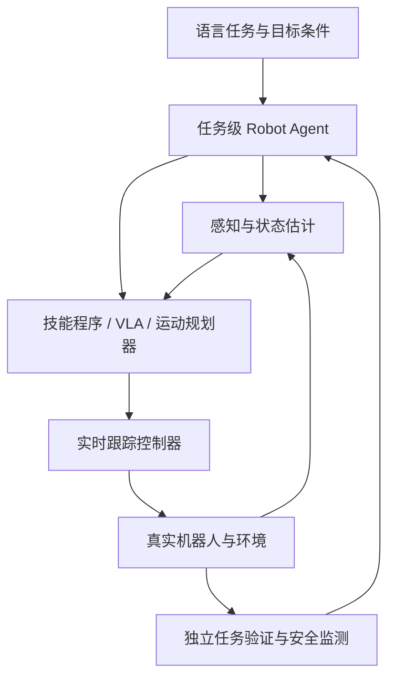
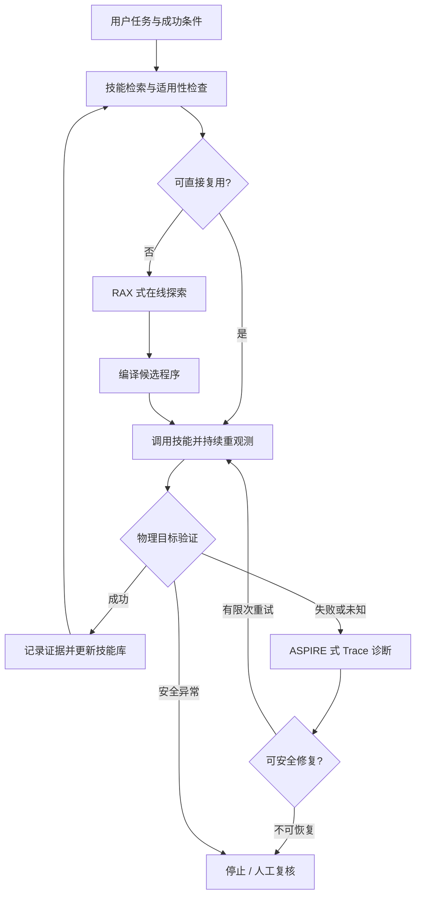

# 先进 Robot Agent：RAX、ASPIRE 与可持续改进的机器人工作流

[课程首页](https://github.com/zengxiong111/Foundation_of_Embodied_AI/blob/main/README.zh-CN.md) · [English](https://github.com/zengxiong111/Foundation_of_Embodied_AI/blob/main/md/Robot_Agent_Workflow_EN.md) · [PDF](https://zengxiong111.github.io/zengxiong.github.io/files/Robot_Agent_Workflow_ZH.pdf)

**Foundation of Embodied AI · 课程讲义（扩展教学版）**  
*从任务规划到在线探索、可验证执行与技能积累*

> **核心问题：** 机器人第一次遇到任务时怎样探索？找到方法后怎样摆脱昂贵的大模型逐步推理？执行失败时怎样依据证据修复，并让下一次做得更好？

**学习目标**：读完能区分 Robot Agent、VLA、技能程序和实时控制器；解释 RAX 的 Explore–Compile–Evaluate；理解 ASPIRE 的多模态 Trace、迭代调试、Coordinator–Actor 与进化搜索；知道怎样把这些机制组织成安全、可复用的系统。全文**不含代码或实验章节**。

## 目录

- [1. Robot Agent：到底负责什么？](#agent-section-01)
- [2. RAX：将在线探索“编译”为可独立执行的程序](#agent-section-02)
- [3. ASPIRE：从 Trace 调试到持续积累技能](#agent-section-03)
- [4. RAX + ASPIRE：一条完整但不混淆论文边界的工作流](#agent-section-04)
- [5. 贯穿案例：灵巧手抓取并旋转螺丝刀](#agent-section-05)

## 1. Robot Agent：到底负责什么？

### 1.1 从“直接输出动作”到“管理完成任务的过程”

任务是“拿起桌上的螺丝刀，移动到指定区域并旋转”。普通的动作策略或 VLA 着重回答：**在当前观测与指令下，下一段动作是什么？** Robot Agent 则解决另一个尺度上的问题：**应该调用哪个技能、要不要主动观察、如何判断成功、失败时要修复什么？** 它不需要替代原有的动作模型。

| 模块 | 主要职责 | 典型时间尺度与输出 |
|:--|:--|:--|
| **Agent（任务层）** | 拆解任务、检索技能、编写或修复程序、更新计划 | 事件触发；工具调用或程序变更 |
| **感知与技能层** | 目标定位、抓取与操作策略、条件分支、局部重规划 | 感知帧或技能步；目标位姿与动作 |
| **控制与安全层** | 轨迹跟踪、约束执行、异常停止 | 高频闭环；关节/末端指令与安全状态 |

**一条原则：** 任务层可以慢速推理，机器人不能等待它来执行每一个控制周期。先让现有控制器保证物理闭环，再让 Agent 管理探索、编排和改进。[1–3]

### 1.2 Robot Agent、VLA 与传统规划并不是三选一

- **VLA / 端到端策略**：擅长在观测条件下直接预测动作或动作块；是否具备长期记忆、工具使用或失败归因，取决于额外系统设计。
- **传统任务与运动规划**：擅长显式的可达性、碰撞与几何约束；对未建模语义、意外失败和新技能合成可能需要其他模块。
- **Coding Robot Agent**：将传感、规划与控制 API 编排成程序，通过物理反馈调试；但它依赖可靠工具接口，不能凭语言推理提供底层稳定性保证。

例如“旋转螺丝刀”，Agent 决定先抓稳再旋转；视觉模块估计物体与手的相对姿态；技能选择抓持模式、决定何时重定位；控制器执行关节动作；验证器确认**螺丝刀本身**发生了所需旋转，而不是仅看到手指运动。

### 1.3 三种经常混淆的“成功”

| 观察到的结果 | 实际含义 | 下一步 |
|:--|:--|:--|
| 控制 API 返回 `FINISHED` | 指令执行流程结束 | 仍需检查物理后置条件 |
| 夹爪已闭合，目标被遮挡 | 可能抓住，也可能空抓 | 重新观察；证据不足时记为未知 |
| 物体离桌且在目标位置稳定旋转 | 满足该任务的可观测目标 | 记录证据、适用条件与版本 |

在系统设计中，可以用**三值任务验证**避免自欺：

$$
V(o_{0:T}) \in \{\mathrm{SUCCESS},\ \mathrm{FAILURE},\ \mathrm{UNKNOWN}\}.
$$

`UNKNOWN` 并不等于失败：它表示当前传感证据不足以确认真值，应该补充观察或进入安全处理流程。

### 1.4 谁拥有最后的执行权？

Agent 只能使用**已授权的工具接口**；工作空间、关节限位、速度/力阈值、碰撞约束与急停由独立控制和安全机制约束。尤其在真机上，**生成了可运行程序 ≠ 允许无限制执行该程序**。这一职责边界贯穿后续所有章节。

## 2. RAX：将在线探索“编译”为可独立执行的程序

RAX（Robot Agent eXploration）由通用 Coding Agent 通过机器人 API 观察和操作环境，把在线探索获得的知识保存在工作空间，再编译为可重复执行的程序。其核心特点是**不依赖针对新任务的动作示教和模型权重更新**；但传感器、机器人接口、运动控制与任务奖励/反馈依然不可缺少。[1,2]

### 2.1 Explore：机器人实际上在探索什么？

RAX 的探索不是从零学习电机物理学，而是在**已经开放的感知与控制工具集合**中发现有效的任务决策序列。

| 探索时要回答的问题 | 可用反馈 | 应写入工作空间的经验 |
|:--|:--|:--|
| 物体在哪里？需不需要换视角？ | 相机图像、识别/位姿结果 | 观测条件、重定位策略 |
| 手臂能否到达？ | 规划器的可达性、碰撞或 IK 状态 | 不可达原因、可行接近方向 |
| 接触动作是否奏效？ | 手部状态、物体运动、任务信号 | 成功/失败条件与恢复思路 |
| 方法可否复用？ | 位置与初始状态变化后的执行 | 参数化条件，而非一次性坐标 |

**探索循环：** 观察场景 → 提出一个可检查的候选操作 → 调用机器人工具 → 读取物理反馈 → 更新下一次尝试。成功之前，Agent 可以反复调整视角、目标位姿、动作顺序、抓持条件。其主要“学习成果”是**笔记、程序和经过验证的技能**，而不是新训练出的神经网络参数。

### 2.2 为什么经验记录必须包含“原因”？

假设某次抓取失败，日志只写“抓取失败”，下一次 Agent 仍可能重复同样的命令；如果记录“视觉候选在桌面边缘，目标位姿触发碰撞检查失败，换一个接近角度后成功”，就有了可迁移的决策依据。

一个好的探索记录至少说明：**观测到了什么、尝试了什么、工具返回了什么、修改了哪一点、真实结果怎样**。对动作无关的偶然背景不必全部写入长期记忆。[1,2]

### 2.3 Compile：如何从交互过程得到“能自己跑”的程序？

RAX 的关键不是保存一条成功轨迹，而是把有效决策抽取成包含**重新感知、参数计算、动作执行、条件分支与失败出口**的程序。原本一次需要大模型反复发命令的任务，运行时可以由已编译的程序自行调用感知与控制 API，而不必每一个动作都等待 Agent。

**从单次演示到可复用程序的差异：**

| 仅回放成功动作 | 编译后的闭环程序 |
|:--|:--|
| 使用固定目标坐标 | 根据当前图像/状态重新定位目标 |
| 机械执行预定步骤 | 根据规划与接触反馈选择分支 |
| 失败后只返回结束状态 | 对可恢复故障调用有限恢复逻辑 |
| 只保证原始场景可能奏效 | 声明前置条件并在新场景验证 |

所谓“编译”在这里是**由 Agent 将经验整理为可执行的机器人程序**，不是将自然语言输入机械翻译为某种编译器字节码。[1]

### 2.4 Evaluate：为什么必须把 Agent 暂时拿走？

编写程序的 Agent 在调试过程中知道过去发生的事，可能暗中弥补代码缺陷。因此需要将程序固定，在新初始状态或新布局中**独立运行并观察物理结果**。RAX 的官方工作流区分探索与评估：仿真中使用未在探索中见过的场景布局，真机中由操作员复位后让程序端到端运行。[1]

三个证据级别不能混为一谈：

1. **一次成功**：说明这条操作路径在当前条件下可行。
2. **同配置重复成功**：开始支持程序的稳定性，但不意味着跨环境泛化。
3. **新初始状态独立成功**：才为技能的适用范围提供更强证据。

RAX 项目还展示了“探索慢、编译执行快”的例子：其官方资料中的气炸锅任务，Agent 探索阶段约 72 分钟，编译后的执行约 18 秒；这是一个具体任务的对比，不是对所有机器人任务的实时性保证。[1,2]

**本章结论：** RAX 解决的是“怎样把在线试出来的方法，变成不依赖持续 Agent 推理、仍能依据观测分支执行的程序”。

## 3. ASPIRE：从 Trace 调试到持续积累技能

ASPIRE（Agentic Skill Programming through Iterative Robot Exploration）同样采用 **code-as-policy**：Coding Agent 编写机器人控制程序，然后依据执行结果修复。相比只反馈最终任务成败，它突出三部分：**细粒度多模态执行引擎、可增长的技能库、进化式程序搜索**；并用 **Coordinator–Actor** 组织不同任务的学习。[3,4]

### 3.1 多模态 Trace：从“失败了”走向“哪一步出错”

一次任务失败可能同时涉及目标检测、抓取点估计、运动规划、真实接触或验证逻辑。只返回 `FAILED` 几乎无法定位根因。ASPIRE 的执行引擎按**每个感知/规划/动作原语调用**记录信息，而不是只给出整个 rollout 的结束分数。

| 轨迹字段（概念） | 看什么 | 能区分的问题 |
|:--|:--|:--|
| 调用的工具及参数 | 输入目标、抓取候选、运动约束 | 是目标给错了，还是工具执行失败？ |
| API 返回及错误信息 | `PLANNING_ERROR`、抓持状态等 | 失败出现在规划还是接触？ |
| 调用前后关键帧 | 物体/机器人是否真实移动 | 感知错误还是物理滑落？ |
| 位姿、轨迹与叠加图 | 估计结果和运动是否一致 | 坐标系错、遮挡或约束冲突？ |

它强调**选择性检查与故障有关的证据**，而不是把所有视频帧扔给语言模型。这样 Agent 才能提出针对性的修改建议。[3]

### 3.2 Iterative Debugging：每次修改都必须能验证

典型循环是 **读取失败 Trace → 提出故障假设 → 修改局部程序 → 重新执行 → 对照证据**。例如，工具报告规划不可达，应该先检查目标位姿、碰撞缓冲区与接近方向，而不是盲目加大抓取力。一次修复改变的决策越明确，就越容易知道效果究竟来自哪里。

最关键的一条是：**修复的是经过证据定位的瓶颈，而不只是最后一个报错符号。**

### 3.3 论文中的实例：物体找到后，为什么仍然走不过去？

ASPIRE 论文的收音机取物案例提供了一个清楚的因果链：视觉已经找到收音机，连续导航仍报告 `PLANNING_ERROR`；Agent 检查 Trace 后发现若干接近目标落在桌子周围的碰撞缓冲范围内，于是尝试不同接近方向，从可达的一侧重新观测并完成抓取。最终抽象出的不是“取这个收音机”的固定脚本，而是**遇到障碍边缘规划失败时进行多角度接近**的通用修复思路。[3]

| 原始症状 | Trace 揭示的根因 | 局部修复 | 可复用知识 |
|:--|:--|:--|:--|
| 物体已检测到，却无法到达 | 候选导航目标触发碰撞缓冲约束 | 改变接近角度后重新规划 | 障碍附近应尝试多个安全方向 |

### 3.4 Skill Library：存的是“何时用什么修复办法”

ASPIRE 的技能库并不只收完整任务程序，更重要的是**诊断与修复模式**：如多物体消歧、重新感知、可达性修复、接触动作顺序调整。一个有用条目包含失败特征、适用条件、修复建议及支持该修复的验证结果；未来 Agent 将它们作为**上下文指导**，而不是在新机器人上直接复制所有控制数值。[3]

### 3.5 Coordinator–Actor 与 Evolutionary Search

**Coordinator** 将不同任务交给多个 Actor Coding Agent，审查它们提出的修复是否有效、是否符合 API 限制，再更新共享技能库。Actor 只需关注自己的任务、程序与 Trace，不必共享整段聊天记录。

当沿着同一条程序路径反复微调仍无法进步时，**Evolutionary Search** 同时生成多种候选任务步骤或控制程序；每个候选执行并产生新的分数与 Trace，下一轮参考较优候选及其未解决的问题继续搜索。这里“进化”的对象是**机器人程序和策略逻辑**，通常不是用梯度更新 VLA 权重。[3,4]

**本章结论：** ASPIRE 的优势是将故障证据转成可验证的修复，再将可迁移的修复沉淀为跨任务经验。

## 4. RAX + ASPIRE：一条完整但不混淆论文边界的工作流

下图是**教学性系统参考设计**：用 RAX 式探索编译填补技能缺口，用 ASPIRE 式诊断与技能管理推动长期改进。它**不是**宣称原论文已经联合训练或验证了这一整套系统。

### 4.1 四种不同的回路，别让大模型包办一切

| 回路 | 应负责的事情 | 避免的问题 |
|:--|:--|:--|
| **控制回路** | 实时跟踪、接触稳定、硬件约束 | 让慢速 Agent 直接输出高速力矩 |
| **技能执行回路** | 重新感知、条件分支、局部失败恢复 | 把编译技能退化成轨迹回放 |
| **任务 Agent 回路** | 检索、探索、诊断、重规划 | 每个动作都从零推理 |
| **长期学习回路** | 验证、版本管理、复用与淘汰 | 把偶然成功写成永久事实 |

这四层不要求四个独立大模型。许多任务中，**同一个 Agent 负责离线或事件触发编程，日常运行仅执行已验证程序**，反而更易保证延迟与可解释性。

### 4.2 RAX 和 ASPIRE：重叠但侧重点不同

| 问题 | RAX 更强调 | ASPIRE 更强调 |
|:--|:--|:--|
| 探索什么？ | 通过在线交互找到有效决策序列 | 通过 Trace 调试与多候选搜索改进程序 |
| 核心持久资产 | 可独立运行的模块化程序及运行证据 | 可检索的失败模式、修复经验与技能库 |
| 如何降低后续成本？ | Compile 后减少在线 Coding Agent 干预 | 复用调试知识，减少重新发现相同错误 |
| 验证重点 | 固定程序的独立执行与新场景表现 | 局部修复验证、候选选择与技能入库 |

**注意**：RAX 也能纠错与积累技能，ASPIRE 也会探索和编写完整程序；表中只比较研究重心，不能把功能机械地分割给某一篇论文。[1–4]

### 4.3 技能接口：不必复杂，但要定义清楚

无论存储格式如何，复用一个技能之前，系统至少需要下面五类信息：

1. **Preconditions（前置条件）**：机器人型号、手部接口、工具能力、相机标定、物体范围与允许工作区。
2. **Execution（执行入口）**：技能参数、可使用的 API、调用次数/时间预算与实时控制委托关系。
3. **Verification（后置条件）**：如何根据物理传感证据判定 `SUCCESS / FAILURE / UNKNOWN`。
4. **Recovery（恢复方式）**：哪些错误可局部恢复、最多重试几次、什么时候必须停止。
5. **Evidence & Version（证据与版本）**：在哪些场景独立成功过，已知失败模式、代码版本和撤回方式。

这一五项清单是**教学性工程建议**，不是 ASPIRE 或 RAX 规定的通用数据结构。值得借鉴的是 RAX 官方技能库区分 `draft`、`verified`、`deprecated`，并保存未由 Agent 接管的运行证据；而 ASPIRE 更强调对通用修复经验的审查与收录。[2–4]

### 4.4 失败时怎么分流？

- **观测不足**：主动重观测；若仍无法判定，输出 `UNKNOWN`，而不是伪造成功。
- **规划不可达**：检查坐标变换、碰撞约束和接近方向，修复目标或重新规划。
- **抓取滑落或接触异常**：先由底层安全/技能回路停止或卸载危险动作，再决定是否可以重新抓取。
- **任务状态已改变**：例如物体已掉出工作区，则提升到 Agent 层重规划或请求人工干预。
- **硬件/安全异常**：直接停止；不得通过调高力矩、关闭限制或无限重试“修复”。

## 5. 贯穿案例：灵巧手抓取并旋转螺丝刀

**任务**：桌面上任意允许位置有一把螺丝刀。机器人需要将其抓起、移动到目标区域并完成指定旋转；如果掉落，则在安全允许时重新定位并恢复，否则清楚报告中止。下面是为解释框架而构造的**教学场景**，不是论文中已验证的螺丝刀实验。

### 5.1 先把一句话任务变成可观测条件

| 子目标 | 需要观察的证据 | 常见伪成功 |
|:--|:--|:--|
| 发现目标 | 物体检测、位姿及跟踪置信信息 | 检测到桌上的另一件工具 |
| 抓取并抬起 | 物体随手离桌且相对位姿稳定 | 手指闭合但物体仍留在桌面 |
| 运输到位 | 物体位于目标容差区且仍被持有 | 末端到位但物体途中滑落 |
| 目标旋转 | 物体相对参考轴完成指定角度 | 仅手腕转动或估计器漂移 |

为了区别“旋转了手”和“旋转了物体”，至少需要物体姿态与手部/末端状态的**独立比较**；如果只有头/腕相机，还要面对遮挡和视角不足的问题。没有可靠接触传感器时，可以组合视觉相对运动与手部本体信息，但需保留验证不确定性。

### 5.2 七步走完 Agent 的整个生命周期

1. **定义边界**：确认工作区、抓持力与允许动作，设定旋转目标以及成功、失败和未知的判据。
2. **检索旧技能**：先搜索“定位—抓取—搬运—旋转”模块；检查它是否匹配当前灵巧手、相机外参与工具几何。
3. **缺少技能则探索**：RAX 式 Agent 借助视觉与规划 API 尝试不同接近姿态和抓持位置，记录每次物理反馈。
4. **编译为闭环程序**：将有效操作改写成“重定位 → 选择抓持 → 抬起检查 → 搬运 → 旋转检查”的条件化程序。
5. **运行中滑落**：控制层先将危险运动安全停止；任务验证器发现物体相对手掌异常移动，目标尚未达成。
6. **按 Trace 诊断并修复**：ASPIRE 式 Agent 比较滑落前后的关键帧、手部状态和操作阶段，判断是夹持失稳、视觉漂移还是轨迹冲突；只对证据支持的原因提出修复。
7. **有界恢复并入库**：在允许时重新定位、重新抓取、复验；成功后保存程序、适用条件和证据，无法安全恢复则退出。

### 5.3 同一个故障，三种层级应有不同反应

| 故障场景 | 首先响应的层级 | 合理行为 |
|:--|:--|:--|
| 轨迹小幅偏离目标 | 实时控制器 | 在约束内闭环修正，不调用大模型 |
| 抓持中物体缓慢滑动 | 技能监测与局部恢复 | 停止不安全操作；必要时调整抓持或重观测 |
| 螺丝刀掉到桌面另一侧 | 任务 Agent | 更新世界状态，重新规划或声明不可恢复 |
| 目标被长时间遮挡 | 验证/感知层 | 输出 `UNKNOWN`，追加视角或安全停止 |

### 5.4 从漂亮演示到可靠系统：仍有四个难点

**真实世界状态不完备。** 视觉跟踪失效、接触力不可见和遮挡会让 Agent 的故障归因出错。因此需要多传感证据、置信/未知状态以及主动重观测，而不是把模型解释当成事实。

**程序的泛化范围有限。** 物体尺寸、摩擦、手部自由度、相机外参和机械臂动态改变后，旧技能可能失效。迁移的是“重新接近、重定位、再验证”的原则，不应直接迁移未经检查的角度、速度或控制增益。

**计算与机器人时钟不同。** Agent 进行程序搜索和诊断可能需要较长时间；高频控制应由本地闭环实现。较长的思考期间，机器人应保持安全姿态或进入受监控的暂停状态。

**长时记忆不等于可信知识。** 每项技能应绑定来源、版本、适用条件与证据；需要防止旧技能与当前硬件配置不匹配，也要允许新验证结果废弃旧做法。自动生成程序必须经过权限隔离与安全检查。[2,4]

### 5.5 一张选型表：什么时候用哪一种技术？

| 当前需求 | 优先考虑 | 核心理由 |
|:--|:--|:--|
| 已知任务，需要快速、重复执行 | RAX 式**编译技能**或既有程序 | 运行阶段不必持续调用 Coding Agent |
| 新任务且没有可用示教 | RAX 式**受限在线探索** | 用工具反馈搜索有效的决策顺序 |
| 程序反复失败，错误原因不清 | ASPIRE 式**多模态 Trace 调试** | 从原语证据定位瓶颈，再针对性修复 |
| 多个任务出现相似失败 | ASPIRE 式**技能库与多候选搜索** | 让修复知识跨任务积累并扩展搜索 |
| 高速接触操作、连续动作控制 | **VLA / RL 策略、MPC 或实时控制器** | 高速闭环不应依赖慢速语言推理 |

**选择规则**：先问“是否有可信技能”，再问“失败是否有可诊断证据”，最后才决定是复用、探索还是修复。无论选择哪条路线，都需要独立验证与安全边界。

### 课程结论

**Robot Agent 的价值不是在所有时间尺度上取代策略与控制器，而是让机器人具备“会探索、会编译、会验证、会诊断、会积累”的任务级能力。** RAX 说明探索知识可以固化为独立执行的程序；ASPIRE 说明 Trace、共享技能与多候选搜索可以持续提高编程和修复效率。二者的结合是有启发性的**系统设计路线**，不是一项已经得到联合论文验证的结论。

---

### 论文与官方资源（点击直达）

1. **RAX 论文**：Huang et al., *Scaling Online Exploration for Robot Agents* (2026). [PDF](https://assets.robot-agent-exploration.com/paper/rax.pdf) · [项目主页](https://robot-agent-exploration.com/) · [开源框架](https://github.com/robot-agent-exploration/rax)。
2. **RAX 技能库**：[robot-agent-exploration/skills-lib](https://github.com/robot-agent-exploration/skills-lib)，展示前置条件、独立运行证据、技能版本状态等。
3. **ASPIRE 论文**：Lu et al., *ASPIRE: Agentic /Skills Discovery for Robotics* (2026). [arXiv](https://arxiv.org/abs/2607.00272) · [论文 PDF](https://arxiv.org/pdf/2607.00272) · [项目主页](https://research.nvidia.com/labs/gear/aspire/)。
4. **ASPIRE 官方实现**：[NVlabs/ASPIRE](https://github.com/NVlabs/ASPIRE)，包含迭代调试、进化搜索与技能复用的资料。
5. **课程原始讲义**：[Robot Agent Workflow（中文版）](https://zengxiong111.github.io/zengxiong.github.io/files/Robot_Agent_Workflow_ZH.pdf)。

*说明：内容基于以上公开论文与官方项目，融合架构及螺丝刀任务是教学性说明；不包含复现实验、可执行代码或原创性能声称。第三方资料遵循各自许可。*
