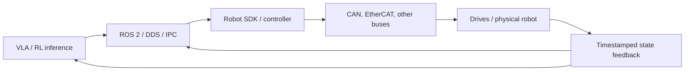

# Robot Communication and Real-Time Systems: From ROS 2 to Motor Drives

<!-- course-meta:start -->
[Course home](https://github.com/zengxiong111/Foundation_of_Embodied_AI) · [简体中文](Robot_Communication_Real_Time_Systems_ZH.md) · [PDF](../pdf/Robot_Communication_Real_Time_Systems_EN.pdf) · [ROS 2 basics](ROS2_Robot_Learning_Tutorial_EN.md)

| Item | Details |
|---|---|
| Role in the course | Advanced hardware communication and real-time systems after ROS 2 fundamentals; does not repeat Node/Topic/Service or installation instructions |
| Scope | Inference processes, robot SDKs, servo threads, drives, and multisensor data pipelines |
| Prerequisites | ROS 2 basics, control periods, joint and sensor state concepts |
| Documentation review date | 2026-10-29 |
| License | CC BY-NC-SA 4.0 · Xiong Zeng and contributors |

<!-- course-meta:end -->

<!-- course-toc:start -->
**Chapter concept map**

<!-- course-visual:end -->

## Contents

- [1. Why robot communication deserves its own chapter](#course-section-01)
- [2. The stack: ROS, SDKs, and physical buses](#course-section-02)
- [3. CAN / CAN-FD and EtherCAT](#course-section-03)
- [4. ROS 2, DDS, QoS, and ros2_control](#course-section-04)
- [5. Clock synchronization, freshness, and alignment](#course-section-05)
- [6. Real-time scheduling: frequency is not determinism](#course-section-06)
- [7. Multirate control and asynchronous inference](#course-section-07)
- [8. Communication faults and independent safety](#course-section-08)
- [9. Case study: TRON2, a dexterous hand, and two cameras](#course-section-09)
- [10. Reproducible exercises and self-check](#course-section-10)
- [References](#course-section-11)

## 1. Why robot communication deserves its own chapter

A robot can run an excellent policy and still fail because of transport delay, stale state buffers, incorrect timestamps, drive-mode changes, or intermittent blocking in a servo thread. **Being able to transmit a control command is not equivalent to maintaining a reliable real-time feedback loop.**

This chapter separates three questions: **How does a message travel?** (protocol and topology); **When does it arrive?** (period, latency, jitter, synchronization); and **What happens when it fails?** (watchdog, safety limits, fault states, and hardware protection). The intended learner is an embodied-AI researcher integrating existing hardware, not someone implementing an EtherCAT master or CAN firmware from scratch.

## 2. The stack: ROS, SDKs, and physical buses

| Layer | Example technologies | Responsibilities | Not guaranteed |
|---|---|---|---|
| Application | VLA, WAM, RL policy | Task decisions, action generation | Stable actuator behavior |
| Inter-process communication | ROS 2, DDS, shared-memory IPC | State/action messages, discovery, modularity | Hard real-time execution |
| Robot interface | Vendor SDK, ROS driver, `ros2_control` Hardware Interface | Command mapping, state acquisition, error handling | Access to every control mode |
| Fieldbus/network | EtherCAT, CAN/CAN-FD, RS-485, proprietary links | Device communication and synchronization | Semantic validation of a policy action |
| Firmware | Motor drive, MCU, robot controller | Servo loops, current limiting, protection | Understanding a VLA task instruction |

Common deployments use either **ROS 2 → vendor SDK → robot controller** or **application → SDK / real-time driver → controller**. ROS 2 is optional when its integration benefits do not justify the cost. DDS at the software layer does not imply the motors use DDS; EtherCAT inside a machine does not make a user-space API call deterministic.

A **command-interface contract** should specify units, joint order, mode, validity timestamp, sequence number, nominal period, limits, state feedback, and error codes. Distinguish the meanings of “message received,” “command accepted,” and “motion executed.” They are not interchangeable.

## 3. CAN / CAN-FD and EtherCAT

### 3.1 Comparing major communication paths

| Technology | Characteristic | Why roboticists should care |
|---|---|---|
| CAN | Message-identifier arbitration; short frames | Motor commands and status, arbitration priority and bus utilization |
| CAN-FD | Longer data fields and faster data phase than classic CAN | Higher-capacity status and diagnostics |
| EtherCAT | Industrial Ethernet fieldbus; supports Distributed Clocks | Synchronized multiaxis, periodic motion control |
| RS-485 | Serial physical layer; higher-layer protocol varies | Some actuators and sensors |
| TCP / UDP | General-purpose IP transport | Networks connecting controllers, cameras, and GPU computers |

**A fast protocol does not, by itself, ensure low end-to-end latency.** Sampling, host scheduling, queueing, serialization, transport, device parsing, and motor response contribute to the total. EtherCAT Distributed Clocks synchronize device clocks; they do not eliminate scheduling jitter inside a ROS node or GPU inference process.[2]

### 3.2 First-order bandwidth budget

For $n$ periodic messages,

$$
B_{\mathrm{payload+overhead}}\approx \sum_{i=1}^{n}L_i f_i,
\qquad u\approx \frac{B_{\mathrm{payload+overhead}}}{R_{\mathrm{bus}}},
$$

where $L_i$ is the **total transmitted bit count**, including estimated protocol overhead, $f_i$ is message rate, and $R_{\mathrm{bus}}$ is the effective bitrate for the relevant protocol phase. Real CAN/CAN-FD requires accounting for stuffing, arbitration, retransmissions, interframe space, and priority. The equation is a planning approximation, not a worst-case latency guarantee.

### 3.3 How far to study protocol details

With a vendor SDK, first examine its allowed update rate, batched joint commands, state-publishing period, disconnection behavior, and required topology. Go deeper into arbitration IDs, PDO/SDO, drive state machines, and physical wiring only if you are directly driving actuators or diagnosing bus congestion.

## 4. ROS 2, DDS, QoS, and ros2_control

ROS 2 integrates modules, but “a Topic publishes successfully” is not enough for robust deployment. Important QoS concepts include:

- **Reliability:** `Best Effort` versus `Reliable` depends on message type. For real-time video, retransmitting stale frames can be worse than dropping them; configuration messages can warrant a different choice.
- **History/depth:** a large queue may cause a controller to execute old actions; define a policy for discarding expired commands.
- **Deadline/liveliness:** can reveal missing publication or publisher failure but must be coordinated with an independent watchdog and stop mechanism.
- **Time/TF:** `header.stamp` should identify a well-defined event time, and coordinate frames should be declared. Arrival time is not always capture time.

`ros2_control` uses a Controller Manager, controllers, and Hardware Interfaces to connect ROS control commands to real devices. **Installing `ros2_control` does not create a hardware adapter for a particular robot SDK.** A compatible driver or custom adapter is necessary; a vendor SDK can also be used directly.[1]

Keep potentially blocking GPU inference, network waits, disk writes, and uncontrolled allocation out of critical low-level servo threads. A practical design lets ROS 2 handle integration and puts periodic execution in a separate, bounded control loop.

## 5. Clock synchronization, freshness, and alignment

Distinguish four timestamps:

- $t_{\mathrm{capture}}$: when the sensor acquired the sample.
- $t_{\mathrm{arrival}}$: when a processing component received it.
- $t_{\mathrm{policy}}$: when policy inference began.
- $t_{\mathrm{execute}}$: when corresponding robot execution actually began.

A basic definition of age of information is

$$
\mathrm{AoI}(t)=t-t_{\mathrm{capture,last\ used}}.
$$

Head and wrist cameras may observe the same object at different times. If the wrong time axis is used, even perfect extrinsic calibration will not prevent systematic errors during motion. Prefer trustworthy device timestamps and clock synchronization. If hardware clocks cannot be shared, estimate offsets and preserve correction metadata in logs.

**Do not align training data by message arrival order alone.** A transition must specify the time window for its observation, commanded action, realized state, and object estimate. Interpolate joint feedback when justified and select recent camera frames, but never pair an action with future measurements as though they were available when the action was selected.

## 6. Real-time scheduling: frequency is not determinism

Given target control frequency $f_c$, the nominal period is

$$
T_c=\frac{1}{f_c},\qquad e_k=(t_k-t_{k-1})-T_c.
$$

Here $e_k$ measures cycle-period deviation, one definition of scheduling jitter. A 500 Hz target corresponds to 2 ms cycles; an “average 500 Hz” says nothing about rare 20 ms stalls. Such a stall can be consequential for fast contact dynamics.

**Useful diagnostics** include cycle-period histograms, p50/p95/p99 latency, maximum observed lateness, deadline misses, queue depth, dropped samples, and command age. p99 is a statistical percentile, **not** a certified worst-case response-time guarantee.

Important mechanisms include real-time kernels such as PREEMPT_RT, appropriate priority policy, CPU affinity, nonblocking buffers, preallocation, isolating logging from servo execution, and hardware watchdogs.[3] Timing claims require measurements on the target computer, robot controller, and representative workload.

## 7. Multirate control and asynchronous inference

Use an **illustrative example only**: camera at 30 Hz, VLA inference at 10 Hz, motion policy at 50 Hz, and local servo at 500 Hz. Under ideal synchronization, each 50 Hz action covers ten 500 Hz cycles; the camera and motion policy are not necessarily integer-synchronized, so timestamps and buffering are required.

For an action chunk of length $H$ with policy-action interval $\Delta t_\pi$,

$$
T_{\mathrm{chunk}}=H\Delta t_\pi.
$$

Also track the **number $K$ of actions actually executed**, arrival of the next chunk, interpolation, and expiration rules. Keep inference separate from low-level control. If a new chunk is late, the local controller should use an approved hold/deceleration/controlled-stop policy rather than repeat an energetic last command indefinitely.

## 8. Communication faults and independent safety

A deployed system must detect disconnection, command expiration, stale joint state, timestamp discontinuities, mode mismatches, tracking-error excursions, overcurrent/overtemperature, and visual-estimation loss.

A minimal fault-handling state machine may use **Disabled → Ready → Enabled → Executing → Controlled Stop / Fault**. Transitions need explicit authorization, feedback, and recovery rules, not merely the learned policy's own prediction of safety.

- **Watchdog:** checks continued updates of commands and measured state.
- **Software safety layer:** checks units, joint/travel limits, velocity, acceleration, jerk, current/effort, and stale commands.
- **Hardware protection / e-stop:** independently reduces hazards if the user application or inference process fails.

`Reliable` QoS is not a functional-safety certification. Neither CAN nor EtherCAT alone establishes a system-level safety integrity claim. Follow robot vendor documentation and an actual laboratory risk assessment.

## 9. Case study: TRON2, a dexterous hand, and two cameras

Partition the design into four services: **perception** (head/wrist camera and object pose); **policy inference** (GPU); **control** (trajectory buffer, IK, and action bounds); and **hardware interface** (vendor SDK, measured state, and fault reporting). The arm and hand need not share a bus protocol or update period.

| Suggested log field | Purpose |
|---|---|
| `capture_time`, `receive_time`, `execute_time` | Clock alignment, transport delay, and AoI |
| `joint_name`, `q`, `dq`, `command` | Joint mapping, target-versus-execution comparison |
| `control_mode`, `command_seq`, `ack_status` | Mode mismatches, stale commands, acknowledgment semantics |
| `camera_frame`, `object_pose`, `confidence` | TF, perception confidence, visual recovery |
| `fault_code`, `watchdog_state` | Fault reproduction and controlled fallback |

**No specific bus, maximum control frequency, or proprietary message format is assumed for TRON2, Revo3, or Wuji Hand2.** These must be established from the particular installed firmware, SDK, and test results. The table defines a logical application-side recording convention only.

## 10. Reproducible exercises and self-check

**Three safe simulation exercises:** (1) use two mock nodes with different publication and arrival delays to compare FIFO versus latest-only queues; (2) record servo-period histograms, p99, and deadline misses; (3) interrupt a simulated state stream and verify that the watchdog enters controlled stop instead of continuing to issue obsolete commands.

**Self-check:**

1. Why are ROS 2, the robot SDK, and EtherCAT different architectural layers?
2. Does an average 500 Hz control rate prove that every command executes within 2 ms?
3. Why can `Reliable` messaging still produce unsafe, expired control commands?
4. What distinguishes device timestamps from message arrival times?
5. When only a Python SDK is exposed, which safety and time-critical functions should be isolated from GPU inference?

**Takeaway:** a physical robot pipeline requires **correct interface semantics, consistent time, measured timing behavior, and independent safeguards**. Model accuracy alone cannot validate transport and scheduling.

## References

1. [ros2_control — Documentation](https://control.ros.org/jazzy/); [Architecture / Getting Started](https://control.ros.org/jazzy/doc/getting_started/getting_started.html).
2. [EtherCAT Technology Group — Technology](https://www.ethercat.org/en/technology.html); [EtherCAT Compendium](https://www.ethercat.org/en/compendium.htm).
3. [Linux Kernel — Real-Time Preemption](https://docs.kernel.org/next/core-api/real-time/) (PREEMPT_RT concepts).
4. [ROS 2 Jazzy — QoS Policies](https://docs.ros.org/en/jazzy/Concepts/Intermediate/About-Quality-of-Service-Settings.html).
5. [ROS 2 Jazzy Tutorials](https://docs.ros.org/en/jazzy/Tutorials.html) (communication, TF2, and rosbag2 background).
6. Companion lessons: [ROS 2 basics](ROS2_Robot_Learning_Tutorial_EN.md), [Efficient training and inference](Efficient_Training_Real_Time_Inference_EN.md), and [Low-level control](Robot_Low_Level_Control_EN.md).

*Scope note: this chapter explains communication architectures and validation, not electrical wiring, device network configuration, or safety certification. New original content is CC BY-NC-SA 4.0; existing course material and third-party works retain their rights.*
