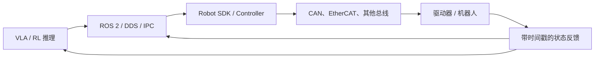

# 机器人通信与实时系统：从 ROS 2 到电机驱动

<!-- course-meta:start -->
[课程首页](https://github.com/zengxiong111/Foundation_of_Embodied_AI/blob/main/README.zh-CN.md) · [English](Robot_Communication_Real_Time_Systems_EN.md) · [PDF](../pdf/Robot_Communication_Real_Time_Systems_ZH.pdf) · [ROS 2 基础](ROS2_Robot_Learning_Tutorial_ZH.md)

| 项目 | 说明 |
|---|---|
| 课程定位 | ROS 2 的硬件通信与实时系统进阶；不重复 Node/Topic/Service 基础和安装操作 |
| 适用范围 | 策略推理进程、机器人 SDK、控制线程、驱动器与多传感器数据链 |
| 先修知识 | ROS 2 基础、控制周期、关节与传感器状态 |
| 文档核验日期 | 2026-10-29 |
| 许可 | CC BY-NC-SA 4.0 · Xiong Zeng and contributors |

<!-- course-meta:end -->

<!-- course-toc:start -->
**本章知识地图**

<!-- course-visual:end -->

## 目录

- [1. 为什么需要单独学习机器人通信](#course-section-01)
- [2. 通信栈：ROS、SDK 与物理总线](#course-section-02)
- [3. CAN / CAN-FD 与 EtherCAT](#course-section-03)
- [4. ROS 2、DDS、QoS 与 ros2_control](#course-section-04)
- [5. 时间同步、观测新鲜度与数据对齐](#course-section-05)
- [6. 实时调度：频率不等于确定性](#course-section-06)
- [7. 多频率闭环与异步策略推理](#course-section-07)
- [8. 通信故障与独立安全机制](#course-section-08)
- [9. 可复现的验证任务与自测](#course-section-10)
- [参考资料](#course-section-11)

## 1. 为什么需要单独学习机器人通信

机器人可能拥有训练优秀的 Policy，却因为命令传输延迟、反馈缓存、数据时间戳错误、驱动器模式切换或控制线程偶发阻塞而失败。**能发送控制命令不等于建立了实时可靠的机器人闭环。**

本讲区分三个问题：**消息如何到达**（协议与拓扑）、**何时到达**（周期、延迟、抖动和同步）、**异常时怎么办**（看门狗、限幅、状态机和硬件保护）。课程重点是具身智能研究者应理解的系统边界，而不是要求自行编写 EtherCAT 主站或 CAN 驱动固件。

## 2. 通信栈：ROS、SDK 与物理总线

| 层次 | 代表技术 | 负责的事情 | 不负责的事情 |
|---|---|---|---|
| 应用层 | VLA、WAM、RL Policy | 任务决策与动作生成 | 不直接保证电机稳定 |
| 模块通信 | ROS 2、DDS、进程间共享内存 | 状态/动作消息、发现、解耦 | 不自动提供硬实时控制 |
| 机器人接口 | Vendor SDK、ROS Driver、`ros2_control` Hardware Interface | 指令映射、状态读取、错误管理 | 不必然开放所有控制模式 |
| 实时网络/总线 | EtherCAT、CAN/CAN-FD、RS-485、专有链路 | 设备级数据传输与同步 | 不替代高层语义校验 |
| 设备固件 | Motor Driver、MCU、机器人控制柜 | 伺服、限流、保护 | 不会理解 VLA 的任务意图 |

有两种常见架构：**ROS 2 → 厂商 SDK → 控制器**，或 **应用程序 → SDK / 实时驱动 → 控制器**。是否使用 ROS 2 取决于集成需求；不能因为系统使用 ROS 2 就假定电机总线也是 DDS，也不能因使用 EtherCAT 就假定所有上位机调用都实时。

命令的**控制接口合同**至少包含：目标单位、关节顺序、模式、有效时间戳、序列号、控制周期、关节限幅、状态反馈及错误码。发送层应明确设备是否返回“收到”“接受”“已执行”三种不同语义；它们不能混为一谈。

## 3. CAN / CAN-FD 与 EtherCAT

### 3.1 核心比较

| 技术 | 典型特征 | 与机器人学习的关系 |
|---|---|---|
| CAN | 基于消息标识符仲裁的总线；帧较短 | 电机状态与命令，需预算带宽和仲裁优先级 |
| CAN-FD | 相比经典 CAN，支持更长数据字段及数据阶段更高速率 | 更丰富的设备状态与诊断消息 |
| EtherCAT | 基于工业以太网的实时现场总线；支持 Distributed Clocks | 多轴同步、高频周期性控制 |
| RS-485 | 串行物理层，通常需在上层定义协议 | 部分执行器与传感器 |
| TCP / UDP | 通用 IP 传输层 | 机器人控制器、相机与 GPU 计算机间的网络链路 |

**“协议速度快”并不自动意味着低控制延迟。** 从采样到执行的完整链路还包括应用程序排队、报文序列化、主机调度、设备解析和电机环路响应。EtherCAT 的 Distributed Clocks 用于设备时钟同步，不会自动消除用户态推理和 ROS 节点的调度抖动。[2]

### 3.2 粗略带宽预算

对 $n$ 条周期消息，可先做一阶估算：

$$
B_{\mathrm{payload+overhead}}\approx \sum_{i=1}^{n}L_i f_i,
\qquad u\approx \frac{B_{\mathrm{payload+overhead}}}{R_{\mathrm{bus}}},
$$

其中 $L_i$ 是包括协议开销的**总传输比特数**，$f_i$ 是消息频率，$R_{\mathrm{bus}}$ 是匹配通信阶段的有效比特率。实际 CAN/CAN-FD 还要考虑填充位、仲裁、重传、帧间隔与优先级；该公式只是设计前的估算，不能作为最坏延迟保证。

### 3.3 什么时候研究协议细节

若使用厂家 SDK，重点检查厂商允许的调用频率、批量关节命令、状态回报周期、失联行为和网络拓扑。只有当需要直接驱动电机或诊断总线拥塞时，才进一步深入仲裁 ID、PDO/SDO、驱动器状态机和物理层接线。

## 4. ROS 2、DDS、QoS 与 ros2_control

ROS 2 负责模块连接，但“能发布 Topic”不足以支持可靠部署。QoS 中需要理解的概念包括：

- **Reliability**：`Best Effort` 与 `Reliable` 各有合适场景。对实时图像，追传旧帧可能比丢弃一帧更差；对离散配置消息则需相反权衡。
- **History/Depth**：缓存过深可能让控制器处理已过时的动作；应设计明确的过期丢弃策略。
- **Deadline / Liveliness**：用于感知数据到达和发布者生存性的监测，但必须与独立的安全看门狗协调。
- **Time / TF**：`header.stamp` 需要代表明确的事件时间，并声明坐标系；收到时间不总是采集时间。

`ros2_control` 使用 Controller Manager、控制器和 Hardware Interface 将 ROS 控制命令映射到实际设备。**仅安装 `ros2_control` 并不意味着已经实现某个机器人 SDK 的硬件适配**；需要已有兼容驱动或自行实现适配层，也可以直接使用厂家 SDK。[1]

对低层实时闭环，要避免在关键线程中执行可能阻塞的 GPU 推理、网络等待、磁盘写入或不受控的动态内存分配。常见架构是让 ROS 2 负责系统集成，而专用控制线程负责高频周期执行。

## 5. 时间同步、观测新鲜度与数据对齐

系统必须区分：

- $t_{\mathrm{capture}}$：传感器获取样本的时间。
- $t_{\mathrm{arrival}}$：样本进入处理进程的时间。
- $t_{\mathrm{policy}}$：策略实际开始计算的时间。
- $t_{\mathrm{execute}}$：机器人实际开始执行对应命令的时间。

观测新鲜度（Age of Information）的一个简单定义是

$$
\mathrm{AoI}(t)=t-t_{\mathrm{capture,last\ used}}.
$$

同一物体在头部相机和腕部相机中的位置可能来自不同采集时刻。使用错误的时间轴时，即使 TF 外参完全正确，融合位姿也可能出现系统性偏差。建议优先采用可靠的设备时间戳与时间同步机制；不同设备无法共用硬件时钟时，至少应估计时钟偏移并在日志中保存校正信息。

**不要只按消息到达先后排列训练数据。** 对每一条 transition，应明确 Observation、下发的 Command、实际执行后的 State 以及物体状态分别对应哪个时间区间。可对关节状态插值、为图像挑选最近且未过时的观测，但不能把未来观测错误地对齐到过去动作上。

## 6. 实时调度：频率不等于确定性

如果目标控制频率为 $f_c$，周期为

$$
T_c=\frac{1}{f_c},\qquad e_k=(t_k-t_{k-1})-T_c.
$$

其中 $e_k$ 是第 $k$ 次实际周期相对目标周期的偏差（jitter 的一种定义）。例如 500 Hz 的目标周期是 2 ms；“平均 500 Hz”无法排除偶尔出现 20 ms 的卡顿，而一次卡顿就可能影响高速接触稳定性。

**需要监控的指标**：周期误差分布、p50/p95/p99 延迟、最大观察到的迟到、deadline miss 数量、队列深度、丢帧数与命令年龄。p99 是统计指标，并不等于硬实时的最坏情况保证。

关键工程机制包括：实时内核（如 PREEMPT_RT）、合理的线程调度策略、CPU 亲和性、非阻塞消息缓存、预分配内存、日志与控制线程隔离，以及设备控制器自身的 watchdog。[3] 是否真的满足截止时间，必须在目标负载、目标主机和设备上测量。

## 7. 多频率闭环与异步策略推理

以**纯教学示例**说明：相机 30 Hz、VLA 10 Hz、运动策略 50 Hz、底层控制器 500 Hz。每个 50 Hz 动作在理想同步情况下覆盖 10 个底层周期，但相机与策略不一定具有整数同步关系，必须使用时间戳和缓存，而非假设每个控制周期都有新图像。

对于长度 $H$、策略动作周期 $\Delta t_\pi$ 的动作块，名义覆盖时间为

$$
T_{\mathrm{chunk}}=H\Delta t_\pi.
$$

真实系统还需记录**实际执行的前 $K$ 个动作**、下一块到达的时刻、插值方法及过期块的处置。推理和低层控制应解耦：若下一块迟到，低层控制只能执行经过审查的保持/减速/安全停止策略，而不能无限重复最后一个高能量命令。

## 8. 通信故障与独立安全机制

一个部署系统至少应识别以下故障：通信失联、指令过期、关节状态停止更新、传感器时间戳跳变、控制模式不匹配、跟踪误差异常、过流/过温以及视觉估计失效。

可用简单状态机表达安全策略：**Disabled → Ready → Enabled → Executing → Controlled Stop / Fault**。状态转移需要显式的权限、反馈和复位条件，不能仅依赖 RL Policy 自行检测与恢复。

- **Watchdog** 监测命令与状态是否持续更新。
- **Software safety layer** 检查单位、关节限位、速度、加速度、jerk、力矩/电流及过期指令。
- **Hardware protection / E-stop** 提供独立于上位机与学习策略的风险降低机制。

ROS 2 的 `Reliable` QoS 不等于功能安全认证；EtherCAT 或 CAN 本身也不等于系统已满足特定安全完整性要求。真实机器人应遵守厂家文档及实验室风险评估。

## 9. 可复现的验证任务与自测

**无硬件风险的三个验证练习**：第一，使用两个模拟节点构造不同的发布时间与到达延迟，验证 FIFO/Latest-only 缓存的区别；第二，记录控制循环周期直方图、p99 和 deadline miss；第三，故意中断模拟状态流，确认 Watchdog 能转入安全停止状态，而不是继续执行旧命令。

**自测题**：

1. 为什么 ROS 2、机器人 SDK 与 EtherCAT 不应视为同一层？
2. 500 Hz 的平均频率能否证明每一步控制都在 2 ms 内执行？
3. 为什么可靠传输（Reliable）仍可能产生不安全的过期控制指令？
4. 设备时间戳与消息到达时间有何区别？
5. 厂商只提供 Python SDK 时，哪些功能必须留在独立的安全/控制线程？

**一句话总结**：真实机器人系统需要同时满足**正确的接口语义、时间一致性、可测量的实时性和独立安全边界**；高层算法性能不能代替通信与调度验证。

## 参考资料

1. [ros2_control — Documentation](https://control.ros.org/jazzy/)；[Getting Started / Architecture](https://control.ros.org/jazzy/doc/getting_started/getting_started.html)。
2. [EtherCAT Technology Group — Technology](https://www.ethercat.org/en/technology.html)；[EtherCAT Compendium](https://www.ethercat.org/en/compendium.htm)。
3. [Linux Kernel — Real-Time Preemption](https://docs.kernel.org/next/core-api/real-time/)（PREEMPT_RT 原理）。
4. [ROS 2 Jazzy — QoS Policies](https://docs.ros.org/en/jazzy/Concepts/Intermediate/About-Quality-of-Service-Settings.html)。
5. [ROS 2 Jazzy Tutorials](https://docs.ros.org/en/jazzy/Tutorials.html)（通信、TF2 与 rosbag2 基础）。
6. 课程配套：[ROS 2 基础](ROS2_Robot_Learning_Tutorial_ZH.md)、[高效训练与实时推理](Efficient_Training_Real_Time_Inference_ZH.md)、[底层控制](Robot_Low_Level_Control_ZH.md)。

*说明：本讲介绍通信架构和验证方法，不代替设备网络配置、安全认证或电气接线规范。新增原创内容使用 CC BY-NC-SA 4.0；第三方资料及原课程内容版权保持不变。*
