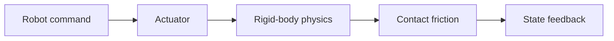

# Robot Dynamics for Embodied Intelligence

<!-- course-meta:start -->
[Course home](https://github.com/zengxiong111/Foundation_of_Embodied_AI) · [简体中文](https://github.com/zengxiong111/Foundation_of_Embodied_AI/blob/main/md/Robot_Dynamics_Embodied_CN.md) · [PDF](https://zengxiong111.github.io/zengxiong.github.io/files/Robot_Dynamics_Embodied_EN.pdf)

| Item | Details |
|---|---|
| Applicability | Rigid-body theory; MuJoCo and Isaac examples are conceptual, not a tested cross-engine pair |
| Documentation review date | 2026-10-28 |
| License | CC BY-NC-SA 4.0 · Xiong Zeng and contributors |

<!-- course-meta:end -->

<!-- course-toc:start -->
**Chapter concept map**

<!-- course-visual:end -->

## Contents

- [Reading guide: follow the physical chain, not a collection of formulas](#supplement-course-section-01)
- [Chapter 1. Dynamics through an embodied manipulation task](#course-section-02)
- [Chapter 2. Only the kinematics needed for dynamics](#course-section-06)
- [Chapter 3. Mass, inertia, and gravity from one rigid link](#course-section-10)
- [Chapter 4. From one link to the manipulator equation](#course-section-15)
- [Chapter 5. A complete two-link planar manipulator example](#course-section-20)
- [Chapter 6. How dynamics scales to complex robots](#course-section-25)
- [Chapter 7. Actuators: how policy actions reach the real robot](#course-section-28)
- [Chapter 8. Contact dynamics: grasping, pushing, sliding, and dropping](#course-section-32)
- [Chapter 10. Humanoids: from fixed-base to floating-base dynamics](#course-section-42)
- [Chapter 11. Dynamics-based control that matters for embodied intelligence](#course-section-46)
- [Chapter 12. MuJoCo versus Isaac Sim / Isaac Lab: appropriate roles](#course-section-51)
- [Chapter 15. From simulation to real robots: a concise checklist](#course-section-68)
- [Appendix A. What was kept from the original course](#course-section-73)
- [Appendix B. Notation, reading route, and references](#course-section-74)
- [New Supplement: Differentiable Dynamics, Contact Gradients, and Learned Surrogates](#supplement-course-section-16)

## Reading guide: follow the physical chain, not a collection of formulas

Robot dynamics answers an immediate question in embodied intelligence: **after a policy issues an action, why do the robot and its environment move as they do?** A humanoid that stands and reaches for the same object follows the same physical laws, except that its base is floating and its feet establish additional contacts.

The tutorial draws on the structure of Wei Zhang's [MEE5114 Advanced Control for Robotics][r1], especially the lectures on rigid-body motion, dynamics, and control. It is **not a reproduction or translation of those lecture notes**. We also use *Modern Robotics*, Featherstone's rigid-body dynamics work, and official MuJoCo / Isaac Lab documentation, focusing only on material with a clear role in robot learning.[1–8]

**The central chain** is: policy action $a$ $\rightarrow$ actuator torque $\tau$ $\rightarrow$ acceleration $\ddot q$ and contact force $\lambda$ $\rightarrow$ next physical state $\rightarrow$ camera and proprioceptive observation $o$ $\rightarrow$ next policy action.

$$
\boxed{a_t\ \longrightarrow\ \tau_t\ \longrightarrow\ (\ddot q_t,\lambda_t)\ \longrightarrow\ s_{t+1}\ \longrightarrow\ o_{t+1}.}
$$

**Included**: the minimum coordinate and Jacobian concepts; mass, inertia, and gravity; manipulator equations; forward and inverse dynamics; contact and friction; actuation; floating-base dynamics; control; simulation; and sim-to-real transfer.

**Deliberately omitted**: Lie-group proofs, full screw theory and product-of-exponentials derivations, detailed spatial cross-product operators, low-level implementations of RNEA/ABA, general-purpose SDP and optimal-control theory, software installation commands, and all programming code. Readers who need those topics can proceed to the references.

**How to read**: Chapters 1–6 build the physics foundation. Chapters 7–11 explain actuation, contact, and control. Chapter 12 compares MuJoCo with Isaac Sim / Isaac Lab. Chapter 15 consolidates sim-to-real considerations.

## Chapter 1. Dynamics through an embodied manipulation task

### 1.1 Kinematics says where; dynamics explains motion

Let $q\in\mathbb R^n$ denote the joint configuration and $\dot q$ the joint velocity. Kinematics asks: where is the palm given $q$, and how fast does it move given $\dot q$? It requires no mass, inertia, or motor-torque information.

Dynamics asks: what acceleration follows from an applied torque? How does the table's support force alter the finger motion? What happens after the object leaves contact? Dynamics thus concerns the **state, input forces, and environmental interaction**, rather than geometry alone.

| Question in the task | Main concept | Why it matters |
|:--|:--|:--|
| Where should a fingertip go? | Forward/inverse kinematics | Convert object pose into target joint motion |
| What actually drives the finger? | Actuators + dynamics | Explain torque, acceleration, and delay |
| Why does the screwdriver stay in the hand? | Contacts + friction | Check whether forces lie inside the friction cone |
| Why do humanoid feet need ground forces? | Floating base + centroidal dynamics | Internal motors cannot suspend the whole body |

### 1.2 State, action, and observation are different quantities

A physical state may include robot joint positions and velocities, object pose and velocity, and contact mode: $s=(q,\dot q,x_o,v_o,\text{contacts},\ldots)$. A learned policy receives observations $o$, such as RGB-D frames, joint encoders, and estimated finger currents. A camera does not directly measure the mass matrix or the true friction coefficient.

The meaning of an action $a$ depends on the control interface. It may specify desired joint position, velocity, torque, or an end-effector pose. **The same numerical action can yield different physical motions under different low-level servos.** This is the first question to ask when comparing robot-learning action spaces.

### 1.3 One equation organizes the entire tutorial

For a fixed-base, fully actuated rigid manipulator with independent joint coordinates,

$$
\boxed{M(q)\ddot q+C(q,\dot q)\dot q+g(q)=\tau+J_c(q)^T\lambda.}
$$

Here $M$ is configuration-dependent inertia, $C\dot q$ captures velocity-dependent coupling, $g$ is the generalized gravity term, $\tau$ is actuator torque, $\lambda$ is the force of the environment on the robot, and $J_c^T\lambda$ maps that contact force into generalized coordinates.

Define $h(q,\dot q)=C(q,\dot q)\dot q+g(q)$. The compact form is

$$M(q)\ddot q+h(q,\dot q)=\tau+J_c^T\lambda.$$

Real systems may also contain friction, compliant transmissions, saturation, and delay. Those effects must be restored when interpreting experimental discrepancies.

## Chapter 2. Only the kinematics needed for dynamics

### 2.1 Joint coordinates versus end-effector coordinates

For $n$ joints, $q=(q_1,\ldots,q_n)$ describes the configuration. End-effector position is $p=f(q)$. To represent a full six-degree-of-freedom pose, use

$$T=\begin{bmatrix}R&p\\0&1\end{bmatrix},\qquad R^TR=I,\ \det R=1.$$

$R$ is orientation; $p$ is translation. Frame labels matter: $T_{AB}$ maps coordinates expressed in frame $B$ into frame $A$. For embodied learning, **consistent camera, robot, object, and table frames** are more important than proving every property of $SO(3)$ or $SE(3)$.

### 2.2 The Jacobian connects velocity and force

For end-effector position $p(q)$,

$$\boxed{\dot p=J_p(q)\dot q,\qquad \ddot p=J_p(q)\ddot q+\dot J_p(q,\dot q)\dot q.}$$

The Jacobian first maps joint velocity to end-effector velocity. More importantly, an external Cartesian force $f$ generates joint-space generalized force

$$\boxed{\tau_{\mathrm{ext}}=J_p(q)^Tf.}$$

The reason is **virtual work**: $f^T\delta p=f^TJ_p\delta q=\tau_{\mathrm{ext}}^T\delta q$. Thus, the table's force on a fingertip affects every joint through this mapping.

For full hand orientation and translation, one may use a six-dimensional rigid-body velocity (twist) and a six-dimensional Jacobian. The essential caution is to keep the **reference point, velocity representation, and wrench representation consistent**; a complete derivation of adjoint transformations is unnecessary here.

### 2.3 Why inverse kinematics cannot replace dynamics

Inverse kinematics converts a target end-effector pose into joint targets. It does not account automatically for object weight, rotational inertia, or contact forces. A geometrically feasible path may still be unrealizable within motor limits and time constraints. Picking up a heavy object changes the torques needed to hold the same pose.

## Chapter 3. Mass, inertia, and gravity from one rigid link

### 3.1 Translation: mass resists acceleration

The center of mass of a rigid body satisfies Newton's second law:

$$\boxed{f=ma_C.}$$

For the same applied force, a larger mass generally produces a smaller center-of-mass acceleration. In grasping, identical policies can accelerate or drop objects differently when object mass changes.

### 3.2 Rotation: inertia depends on mass distribution

For rotation about a fixed axis, $\tau=I_O\ddot q$ when other torques are ignored. The rotational inertia $I_O$ depends on **where the mass lies relative to the axis**, not just on total mass. If the center of mass is at distance $r$ from the joint axis, the parallel-axis theorem gives

$$\boxed{I_O=I_C+mr^2.}$$

Replacing an end-effector can therefore alter the dynamic behavior of the entire arm.

### 3.3 A one-joint pendulum already contains the main ideas

Consider a rigid link rotating in a vertical plane, with positive angle $q$ measured upward from the horizontal. Its center of mass is distance $r$ from the axis; its moment of inertia about that axis is $I_O$. Ignoring friction,

$$\boxed{I_O\ddot q+mgr\cos q=\tau.}$$

This includes the inertia term $I_O\ddot q$, gravity term $mgr\cos q$, and drive torque $\tau$. A horizontal stationary link requires holding torque $mgr$; a vertically oriented link requires zero *static gravity* torque.

**Key distinction**: gravity compensation is configuration-dependent, not a fixed offset added to every joint. Being stationary does not imply zero motor torque.

### 3.4 Velocity-dependent coupling in three-dimensional rotation

For a rigid body expressed in a body-fixed frame, rotational motion satisfies

$$\tau_C=I_C\dot\omega+\omega\times(I_C\omega).$$

The second term reflects changes in angular momentum direction. It is enough to understand why the term exists: in embodied-learning practice, a multibody solver usually handles this coupling without requiring manual expansion of every link's three-dimensional equations.

## Chapter 4. From one link to the manipulator equation

### 4.1 Why a mass matrix appears

Motion of one joint may carry many downstream links. Effective inertia therefore depends on the robot's entire configuration. Summing translational and rotational kinetic energies yields the quadratic form

$$\boxed{K(q,\dot q)=\tfrac12\dot q^TM(q)\dot q.}$$

The generalized mass matrix $M(q)$ is generally **not diagonal**. Its off-diagonal entries express inertial coupling between joints. For independent generalized coordinates of a nondegenerate rigid mechanical system, $M(q)$ is symmetric positive definite.

### 4.2 Deriving the standard equation from energy

Let $U(q)$ be gravitational potential energy, and define the Lagrangian $L=K-U$. The Euler–Lagrange equations are

$$\frac{d}{dt}\frac{\partial L}{\partial\dot q_i}-\frac{\partial L}{\partial q_i}=\tau_i.$$

Substituting quadratic kinetic energy and collecting terms gives

$$\boxed{M(q)\ddot q+C(q,\dot q)\dot q+g(q)=\tau,\qquad g(q)=\nabla_qU(q).}$$

The velocity term $C\dot q$ contains squared velocities and products of different joint velocities. It is not an arbitrary damper or an external contact force; it comes from rigid-body motion itself. In practice, the bias vector $h=C\dot q+g$ is often used directly; the matrix representation of $C$ is not unique.

### 4.3 Forward dynamics versus inverse dynamics

**Forward dynamics** predicts acceleration from state and applied torque:

$$\boxed{\ddot q=M(q)^{-1}[\tau-h(q,\dot q)]\quad(\text{without contacts}).}$$

**Inverse dynamics** finds the torque required for a desired acceleration:

$$\boxed{\tau=M(q)\ddot q+h(q,\dot q).}$$

Physics simulation primarily uses the forward problem; gravity compensation, feedforward tracking, and certain whole-body controllers use the inverse problem. The inverse matrix above is conceptual notation; numerical implementations typically solve the associated linear system rather than explicitly computing $M^{-1}$.

### 4.4 Energy provides a useful consistency check

Without friction or external contact, total mechanical energy $E=K+U$ satisfies

$$\boxed{\dot E=\tau^T\dot q.}$$

Motor mechanical power changes stored mechanical energy. Dissipative friction removes energy; moving external contacts can add or remove energy through contact work. This identity helps explain simulation energy drift, controller behavior, and compliance, without requiring a full stability-theory treatment.

## Chapter 5. A complete two-link planar manipulator example

### 5.1 Geometry and sign conventions

Consider a two-revolute-joint arm moving in a vertical plane. $q_1$ is measured upward from the horizontal; $q_2$ is relative to link 1. Link 1 has length $l_1$, mass $m_1$, center-of-mass distance $r_1$ from joint 1, and center-of-mass inertia $I_1$. Link 2 has corresponding parameters $m_2,r_2,I_2$. Its absolute orientation is $q_1+q_2$.

The center-of-mass positions are

$$
\begin{aligned}
p_1&=(r_1\cos q_1,\ r_1\sin q_1)^T,\\
p_2&=(l_1\cos q_1+r_2\cos(q_1+q_2),\\
&\hspace{1.6em}l_1\sin q_1+r_2\sin(q_1+q_2))^T.
\end{aligned}
$$

$I_1$ and $I_2$ are the link inertias about their centers of mass and normal to the plane of motion.

### 5.2 Kinetic energy reveals joint coupling

Total kinetic energy is

$$
K=\frac12m_1\|\dot p_1\|^2+\frac12I_1\dot q_1^2+
\frac12m_2\|\dot p_2\|^2+\frac12I_2(\dot q_1+\dot q_2)^2.
$$

Collecting it as $K=\frac12\dot q^TM(q)\dot q$ gives

$$
\begin{aligned}
M_{11}&=I_1+I_2+m_1r_1^2+m_2(l_1^2+r_2^2+2l_1r_2\cos q_2),\\
M_{12}&=M_{21}=I_2+m_2(r_2^2+l_1r_2\cos q_2),\\
M_{22}&=I_2+m_2r_2^2.
\end{aligned}
$$

**Read the physics in the matrix**: $M_{11}$ varies with $q_2$, and $M_{12}$ is usually nonzero. These are configuration-dependent inertia and cross-joint inertial coupling, respectively.

### 5.3 Velocity coupling and gravity

Let $b=m_2l_1r_2$. Then

$$
C(q,\dot q)\dot q=
\begin{bmatrix}
-b\sin q_2(2\dot q_1\dot q_2+\dot q_2^2)\\
b\sin q_2\dot q_1^2
\end{bmatrix}.
$$

Gravitational potential energy is

$$U=m_1gr_1\sin q_1+m_2g[l_1\sin q_1+r_2\sin(q_1+q_2)],$$

so

$$
 g(q)=\begin{bmatrix}
(m_1r_1+m_2l_1)g\cos q_1+m_2r_2g\cos(q_1+q_2)\\
m_2r_2g\cos(q_1+q_2)
\end{bmatrix}.
$$

The final result is $\tau=M(q)\ddot q+C(q,\dot q)\dot q+g(q)$. We have followed the complete chain of center-of-mass positions $\rightarrow$ velocities $\rightarrow$ kinetic and potential energy $\rightarrow$ mass matrix and gravity vector. More elaborate symbolic three-dimensional calculations are unnecessary for understanding this structure.

### 5.4 Four representative dynamics cases

1. **Stationary, no contact**: $\dot q=\ddot q=0$ requires $\tau=g(q)$.
2. **Slow motion**: velocity-dependent terms are small relative to the most important inertial and gravity effects.
3. **Fast motion**: quadratic velocity terms become significant; neglecting $C\dot q$ introduces prediction error.
4. **A heavier second link**: both $M$ and $g$ change, so the same position-controller gains may need retuning.

## Chapter 6. How dynamics scales to complex robots

### 6.1 Why we do not expand every rigid-body equation

A robot with dozens of joints is cumbersome to analyze through full symbolic expansion. Modern dynamics software exploits the kinematic tree and uses recursive algorithms. For embodied intelligence, the most important thing is to know **what each algorithm computes**, rather than memorizing its spatial-vector implementation.

| Algorithm | Inputs | Output | Use in robot learning |
|:--|:--|:--|:--|
| RNEA: recursive Newton–Euler | $q,\dot q,\ddot q$ | Inverse dynamics force | Gravity compensation and torque feedforward |
| CRBA: composite rigid-body algorithm | $q$ | $M(q)$ | Inertial coupling and model-based control |
| ABA: articulated-body algorithm | $q,\dot q,\tau$ | $\ddot q$ | Forward dynamics and physics simulation |

RNEA propagates velocity and acceleration from base to tip, then accumulates forces back toward the base. ABA uses articulated-body inertia to solve accelerations efficiently. CRBA assembles the composite inertia of downstream links. With matching models and conventions in free space, forward and inverse results should agree.

### 6.2 Gravity compensation is a special inverse-dynamics case

Setting desired joint velocity and acceleration to zero gives, for an ideal rigid manipulator,

$$\boxed{g(q)=\operatorname{RNEA}(q,0,0).}$$

This is physically more appropriate than setting a constant torque at every joint. If the robot carries a payload, its mass, center of mass, and inertia must be included in the model; an algorithm can be numerically correct yet predict the wrong physics when its parameters are wrong.

## Chapter 7. Actuators: how policy actions reach the real robot

### 7.1 A position target is not an instantaneous position jump

A robot-learning policy often outputs $q_{\mathrm{target}}$. The motor does not instantly transport the robot to that configuration. A representative joint PD actuator uses

$$\boxed{\tau_{\mathrm{servo}}=K_p(q_{\mathrm{target}}-q)+K_d(\dot q_{\mathrm{target}}-\dot q).}$$

The physical dynamics then determine $\ddot q$. The actual chain is target position $\rightarrow$ servo torque $\rightarrow$ acceleration $\rightarrow$ velocity $\rightarrow$ position. Some real robots hide this servo within a drive, exposing only a position interface to the learning system.

### 7.2 Nonideal effects that materially change behavior

| Effect | Physical consequence | Training/deployment failure |
|:--|:--|:--|
| Torque or current saturation | Acceleration cannot grow indefinitely | Requested actions are not realized |
| Velocity limit | Very fast motion is clipped | Tracking lag and contact timing shifts |
| Friction and backlash | Small commands may produce no motion | Poor precision at low speed |
| Delay and filtering | Commands act later than expected | Overshoot and oscillation |
| Motor and payload inertia | Dynamic response changes with the tool | Same gains, different results |
| Compliant transmission | Joints and fingers deform elastically | Different contact-force response |

For an ideal gear ratio $N$, motor rotor inertia $I_m$ reflects approximately as $N^2I_m$ at the joint. Link inertia alone thus cannot characterize actuator dynamics. Real drives may also include current, velocity, and position loops plus thermal protection.

### 7.3 Map policy action spaces to physical interfaces

| Policy action | Advantage | Physical caveat |
|:--|:--|:--|
| Target joint position | Stable and common in imitation learning | Depends on servo gains and command period |
| Joint-position increment | Convenient for residual tracking | Drift and joint-limit handling |
| Target joint velocity | Directly expresses motion direction | Integration and low-level-drive differences |
| Joint torque | Direct interaction with dynamics | Harder training, saturation and safety |
| End-effector pose increment | Task-relevant representation | Needs inverse kinematics and contact handling |

**Conclusion**: when comparing robot-learning algorithms, report the low-level actuator model as well as the nominal action space; otherwise the same action symbol may represent different physical control systems.

## Chapter 8. Contact dynamics: grasping, pushing, sliding, and dropping

### 8.1 Where does contact force come from?

If a fingertip remains in fixed contact with a table, the contact point has zero velocity relative to the table:

$$J_c(q)\dot q=0,\qquad J_c(q)\ddot q+\dot J_c(q,\dot q)\dot q=0.$$

Dynamics must also include the generalized contact force:

$$\boxed{M(q)\ddot q+h(q,\dot q)=\tau+J_c(q)^T\lambda.}$$

Acceleration and contact force are therefore **coupled**. If the robot tries to move into the table, the table supplies a normal force that prevents penetration and changes the resulting motion and joint torques. The zero-relative-velocity constraint applies only to a sustained sticking contact, not to every contact mode.

### 8.2 Why contact is unilateral

Let the normal gap between surfaces be $\phi(q)\ge0$ and the compressive normal force be $\lambda_n\ge0$. Ideal rigid unilateral contact satisfies

$$\boxed{\phi(q)\lambda_n=0.}$$

This says: **either the surfaces are separated and the force is zero, or they touch and can sustain compression**. A normal table cannot keep pulling a screwdriver downward after it has lifted away. Adhesion, suction, and magnetism require separate models.

### 8.3 The friction cone determines whether an object stays grasped

For Coulomb friction, tangential contact force $\lambda_t$ and normal force $\lambda_n$ satisfy

$$\boxed{\|\lambda_t\|\le\mu\lambda_n.}$$

$\mu$ is the friction coefficient. Increasing normal grip force generally increases the maximum available static friction, subject to motor limits, geometry, deformation, and safety. An object can slip because of low normal force, low friction, changing gravity direction, or increased inertial load during rapid manipulation.

### 8.4 An impact produces a rapid velocity change

When a finger collides with an object, large forces may act over a short interval. An impulse $P$ approximates the change in generalized velocity across impact:

$$\boxed{M(q)(v^+-v^-)=J_c(q)^TP.}$$

Contact solvers handle not only sustained support forces but also velocity changes during collisions. Different simulators may employ different contact compliance, time discretization, friction approximations, and constraint solvers. Equal masses and friction coefficients do not guarantee identical collision histories.

### 8.5 Distinguish four modes during a grasp

| Mode | Observable behavior | Implication for the policy |
|:--|:--|:--|
| No contact | A gap exists between finger and object | Approach before exerting grasp force |
| Sticking contact | Contact points have near-zero relative velocity | A stable manipulation constraint can form |
| Sliding contact | Contact points move tangentially | Adjust grip, trajectory, or planning |
| Separation/drop | Contact forces disappear; object moves independently | Relocalize, approach, and regrasp |

This explains why **drop recovery is not ordinary trajectory tracking**: the contact mode has changed, and the controller must establish new contacts rather than continue an obsolete motion reference.

## Chapter 10. Humanoids: from fixed-base to floating-base dynamics

### 10.1 Why the torso cannot be driven like an ordinary joint

A table-mounted robot arm has a fixed base. A humanoid torso can translate and rotate freely in space, yet it generally has no motors that directly actuate these six world-space base degrees of freedom. For $n$ joints, floating-base generalized velocity has dimension $n+6$. If orientation is represented by a quaternion, configuration variables typically have dimension $n+7$; configuration and velocity vectors are not interchangeable.

The dynamics become

$$\boxed{M(q)\dot v+h(q,v)=S^T\tau+J_c(q)^T\lambda,}$$

where $S$ inserts actuated joint torques into the full generalized force vector. Base motion depends on the coupled effects of joints and external contacts.

### 10.2 Balance requires external support forces

For the whole-robot center of mass $c$,

$$\boxed{m\ddot c=m\mathbf g+\sum_i f_i.}$$

During quiet standing, $\ddot c\approx0$, so ground contact forces approximately balance gravity. Without foot contact, internal joint torques cannot prevent the entire robot's center of mass from falling. Reaching, walking all involve **the relationship between external force and available actuation**.

### 10.3 Only the essential centroidal dynamics and WBC concepts

The change in angular momentum about the center of mass follows external moments:

$$\dot L_c=\sum_i(r_i-c)\times f_i+\sum_i m_i^{\mathrm{ext}}.$$

Whole-body control (WBC) considers end-effector tracking, torso balance, fixed foot contacts, actuator limits, friction cones, and joint limits together. Model-based WBC can explicitly optimize accelerations and contact forces; an RL locomotion policy can instead learn behavior through simulation and reward. **Both rely on the same underlying physics**, but a learned policy need not solve inverse dynamics or a quadratic program during deployment.

## Chapter 11. Dynamics-based control that matters for embodied intelligence

### 11.1 PD with and without gravity compensation

Given desired joint position $q_d$ and velocity $\dot q_d$, a standard torque law is

$$\tau=K_p(q_d-q)+K_d(\dot q_d-\dot q).$$

Adding model-based gravity compensation gives

$$\boxed{\tau=K_p(q_d-q)+K_d(\dot q_d-\dot q)+g(q).}$$

This is the simplest way to understand a position-action interface's low-level feedback loop. It also explains why changing payloads often requires model or gain updates. Gravity compensation alone does not guarantee stable contact behavior.

### 11.2 Computed-torque control

In free space, with accurate dynamics and accessible torque control, let $e=q_d-q$ and define

$$\ddot q^*=\ddot q_d+K_d\dot e+K_pe.$$

Choose

$$\boxed{\tau=M(q)\ddot q^*+h(q,\dot q).}$$

Under ideal assumptions the resulting error dynamics are $\ddot e+K_d\dot e+K_pe=0$. The derivation shows how a model can compensate nonlinear mechanical coupling to yield simple tracking-error dynamics. Real robots remain subject to saturation, friction, inaccurate parameters, and contact disturbances.

### 11.3 Impedance control supports compliant contact

A simplified desired Cartesian impedance force is

$$F_d=K_x(x_d-x)+D_x(\dot x_d-\dot x),$$

which is mapped to joint torque through the Jacobian and combined with gravity or other dynamic terms as necessary. Compared with rigid tracking, impedance control deliberately permits some displacement in response to contact force, supporting safer and more compliant interaction.

### 11.4 Where MPC and WBC fit

Model predictive control (MPC) predicts several future steps using dynamics and optimizes control inputs; WBC concentrates on satisfying full-body motion tasks and contact constraints at once. A detailed optimization-solver derivation is beyond this tutorial. The important principle is that **physical constraints determine which desired accelerations, torques, and contact forces can coexist**. High-level VLA action targets are not automatically dynamically feasible.

## Chapter 12. MuJoCo versus Isaac Sim / Isaac Lab: appropriate roles

### 12.1 What each platform contributes

**MuJoCo** is well suited to building mechanical intuition, measuring sensitivity to physical parameters, investigating contact behavior, and running comparatively lightweight arm experiments. Its efficient simulation does not eliminate the need to understand contact models and solver settings.

**Isaac Sim** provides robot and scene simulation capabilities. **Isaac Lab** organizes robot-learning environments, parallel experiments, action/observation/reward pipelines, and domain randomization on top of simulation capabilities. Isaac Sim and Isaac Lab are not two independent physics engines. The active physics backend, version, and actuator semantics must be taken from the documentation matching the local installation.[4–7]

| Research question | MuJoCo emphasis | Isaac Sim / Isaac Lab emphasis |
|:--|:--|:--|
| Why does a link fall? | Minimal model with interpretable torque terms | Verify body properties and joint drives |
| Why does a grasp slip? | Geometry, friction, and numerical contact settings | Multi-contact scenes, batched environments, randomization |
| Why does real-robot performance degrade? | Small, diagnostic parameter sweeps | Large-scale training and sim-to-real variation |
| How should a controller be evaluated? | Transparent single-environment baseline | Scaling to full robots and tasks |

### 12.2 Matching model filenames is not enough

A fair cross-platform comparison must align body mass and center of mass, inertia tensor and inertial frame, joint axes and limits, base fixation, collision geometry, gravity, actuator gains and limits, physics time step, control rate, initial conditions, and contact/friction settings.

Even after careful matching, contact compliance, discretization, and constraint solvers may differ. **Compare contact-free motion first, then gradually add contact.** Neither simulator should be treated as ground truth for the other.

### 12.3 Three time scales must be identified separately

The physics integration step $\Delta t_{\mathrm{phys}}$, servo/controller update period $\Delta t_{\mathrm{ctrl}}$, and policy action period $\Delta t_{\pi}$ may be different. A low-frequency policy may send position targets while the low-level PD loop runs multiple times between actions and the solver performs even smaller physics steps.

A fair policy comparison must report all three frequencies and how actions are held or interpolated; otherwise nominally identical policies can experience different contact transients and delays.

## Chapter 15. From simulation to real robots: a concise checklist

### 15.1 Physical parameters must remain self-consistent

Do not randomize every inertial parameter independently without constraints. Mass, center of mass, and rotational inertia are physically related. Moving a payload's mass distribution generally changes inertia as well. Inertia tensors should be symmetric and physically realizable. Collision geometry, inertial frames, and visual meshes should have clearly distinguished roles.

### 15.2 Prioritize sim-to-real variation by plausible error sources

For manipulation, a practical order is: payload mass and center of mass, joint friction, actuator gains and saturation, command delay, fingertip–object friction, contact-geometry error, and initial object pose. Domain randomization should cover a **plausible real-world distribution**, not simply maximize parameter ranges.

With RGB-D observations, also assess visual noise, calibration error, and occlusion separately. Perception error changes the policy's estimate of the state; dynamics error changes how the real state evolves after an action. Both matter, but they should not be conflated.

### 15.3 Four misconceptions to avoid

- **“The URDF is correct, so the dynamics must be correct.”** No. Collision, actuator, friction, and solver properties also matter.
- **“A position-output policy does not need dynamics.”** No. Position targets still act through motor forces.
- **“Gravity compensation guarantees a stable grasp.”** No. Friction, payload changes, and dynamic disturbances remain.
- **“Different simulator results mean one simulator is wrong.”** Not necessarily. Contact models and time-stepping methods can produce different effective behavior.

### 15.4 One-page equation reference

| Scenario | Core relation | Interpretation |
|:--|:--|:--|
| End-effector motion | $\dot p=J_p\dot q$ | Joint velocity determines Cartesian velocity |
| End-effector force | $\tau_{\mathrm{ext}}=J_p^Tf$ | Map Cartesian force to joint generalized force |
| Free-space manipulator | $M\ddot q+h=\tau$ | Actuation determines joint acceleration |
| Manipulator with contact | $M\ddot q+h=\tau+J_c^T\lambda$ | Contact force changes the motion |
| Static gravity compensation | $\tau=g(q)$ (without contact) | Holding torque depends on configuration |
| Friction cone | $\|\lambda_t\|\le\mu\lambda_n$ | Limits sticking-contact force |
| Floating base | $M\dot v+h=S^T\tau+J_c^T\lambda$ | The base is underactuated and needs external forces |
| Center-of-mass translation | $m\ddot c=m\mathbf g+\sum f_i$ | Support forces govern standing and lifting |

## Appendix A. What was kept from the original course

| MEE5114 material | Location here | Editorial treatment |
|:--|:--|:--|
| Lectures 2–7: poses, twists, POE, Jacobians | Chapter 2 | Keep frames and Jacobians; omit detailed POE derivation |
| Lecture 8: rigid-body dynamics | Chapters 3–4 | Retain inertia and physical intuition; omit spatial-operator details |
| Lecture 9: dynamics of open chains | Chapters 4–6 | Retain manipulator equation and roles of RNEA / CRBA / ABA |
| Lecture 14: robot motion control | Chapters 7 and 11 | Retain servos, gravity compensation, computed torque, impedance |
| Added: contact and manipulation | Chapters 8–9 | Essential to embodied tasks |
| Added: floating-base dynamics | Chapter 10 | For humanoids and legged robots |
| Added: simulation platforms and sim-to-real | Chapters 12 and 15 | Platform differences and model consistency |

## Appendix B. Notation, reading route, and references

**Notation:** $q,\dot q,\ddot q$: joint position, velocity, acceleration; $M$: joint-space mass matrix; $C\dot q$: Coriolis/centrifugal term; $g(q)$: generalized gravity force; $h=C\dot q+g$: nonlinear bias; $\tau$: actuated generalized force; $J$: Jacobian; $\lambda$: environmental contact force; $\mu$: friction coefficient; $v$: floating-base generalized velocity; $S$: actuation-selection matrix.

**Shortest learning path:** study Chapters 1–5, then Chapters 7–9. If you work on humanoids or quadrupeds, add Chapter 10. Chapters 12 and 15 discuss platform differences and sim-to-real model consistency.

1. [MEE5114 — Advanced Control for Robotics, Wei Zhang][r1]: course structure, especially Lectures 8, 9, and 14.
2. [Modern Robotics — Chapter 8: Dynamics of Open Chains][r2]: Lagrangian mechanics, forward/inverse dynamics, constraints, and actuation.
3. [Modern Robotics — Chapter 11: Robot Control][r3]: joint-space and task-space control.
4. [Featherstone — Rigid Body Dynamics Algorithms / Spatial Vector Resources][r4]: deeper analysis of RNEA, CRBA, and ABA.
5. [MuJoCo — Computation][r5]: multibody dynamics, actuators, contacts, and constraint solving.
6. [Isaac Lab — Articulations][r6]: multibody structures, fixed and floating bases, action interfaces.
7. [Isaac Lab — Actuators][r7]: explicit/implicit actuator semantics; match the installed version.
8. [MIT — Underactuated Robotics: Multibody Dynamics][r8]: further reading on multibody and underactuated systems.

[r1]: https://www.wzhanglab.site/teaching/mee-5114-advanced-control-for-robotics/
[r2]: https://modernrobotics.northwestern.edu/chapters/chapter8/
[r3]: https://modernrobotics.northwestern.edu/chapters/chapter11/
[r4]: https://royfeatherstone.org/spatial/index.html
[r5]: https://mujoco.readthedocs.io/en/stable/computation/
[r6]: https://isaac-sim.github.io/IsaacLab/main/source/api/lab/isaaclab.assets.html
[r7]: https://isaac-sim.github.io/IsaacLab/develop/source/concepts/actuators.html
[r8]: https://underactuated.mit.edu/multibody.html

---

## New Supplement: Differentiable Dynamics, Contact Gradients, and Learned Surrogates

> Added 2026-10-28, without changing preceding derivations. This supplement connects rigid-body simulation to the learned differentiable dynamics used by SuperMimic.

### 1. Three layers: physics, simulation, learned transition

Robot dynamics satisfy

$$
M(q)\ddot q+C(q,\dot q)\dot q+g(q)=\tau+J_c(q)^\top\lambda.
$$

MuJoCo or Isaac implements a discrete transition $s_{t+1}=F_{\mathrm{sim}}(s_t,a_t,\xi)$ given integration, solver, contact and actuator settings. SuperMimic fits a **differentiable surrogate** to transitions:

$$
\hat s_{t+1}=f_\omega(\hat s_t,a_t,\xi),\quad
\omega^*=\arg\min_\omega\mathbb E_{\mathcal B}\|f_\omega(s_t,a_t,\xi)-s_{t+1}\|^2.
$$

The surrogate can be an MLP trained autoregressively across several steps. It neither replaces the laws of mechanics nor requires differentiation through the rigid-body solver.

### 2. Why contact makes gradients difficult

Manipulation and locomotion switch between **separation, impact, sticking, and sliding**. Contact inequalities $\phi(q)\ge0$, $\lambda_n\ge0$ and complementarity $\lambda_n\phi(q)=0$ make this a unilateral, often nonsmooth, system. At mode transitions the classical Jacobian of $F_{\mathrm{sim}}$ may be discontinuous or undefined.

Where local derivatives exist, distinguish **state error** from **sensitivity error**:

$$
E_s=\|f_\omega(s,a)-F_{\mathrm{sim}}(s,a)\|,
\qquad
E_J=\left\|\frac{\partial f_\omega}{\partial a}-\frac{\partial F_{\mathrm{sim}}}{\partial a}\right\|.
$$

The second quantity is not globally meaningful across impacts. At such points, use one-sided perturbations, directional finite differences or consistency of realized rewards. **Low state MSE does not guarantee a useful action gradient.**

### 3. Do not omit actuator and object dynamics

For dexterous hands, the surrogate should represent joint position/velocity, object pose/twist, action saturation and delay. Randomized context may capture joint damping, inertia, friction and low-level PD gains. Under a position-setpoint interface,

$$
\tau_t=\mathrm{clip}\left[K_p(a_t-q_t)-K_d\dot q_t,\tau_{\min},\tau_{\max}\right].
$$

**The command is not the next realized joint angle.** Training and deployment must match the control contract and time scales.

### 4. Why short imagined rollouts need periodic corrections

Prediction error compounds through temporal Jacobians and contact switches. SuperMimic refreshes its replay buffer with rigid-body simulation, retrains the surrogate, then differentiates short imagined rollouts to update the actor. This reduces but does not eliminate model bias; a policy can exploit an inaccurate learned model.

**Validation:** stratify one-, eight-, and 32-step prediction error by free motion, contact onset, sliding, impact and contact loss; additionally test whether the model-gradient update improves return in the original simulator.

**Further reading:** [SuperMimic](https://arxiv.org/abs/2610.28480), [SHAC](https://arxiv.org/abs/2204.07137), and the new *Model-Based Reinforcement Learning* tutorial.

*New original text: CC BY-NC-SA 4.0. Existing sections and third-party rights are unchanged.*
