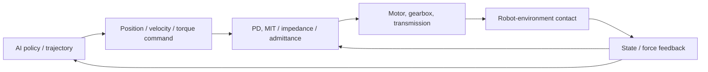

# Robot Low-Level Control: From Motor Servo Loops to Compliant Contact

<!-- course-meta:start -->
[Course home](https://github.com/zengxiong111/Foundation_of_Embodied_AI) · [简体中文](Robot_Low_Level_Control_ZH.md) · [PDF](../pdf/Robot_Low_Level_Control_EN.pdf) · [Robot dynamics](Robot_Dynamics_Embodied_EN.md)

| Item | Details |
|---|---|
| Role in the course | Connects robot dynamics and motion-control RL to actual actuator interfaces; does not repeat full rigid-body derivations |
| Scope | Manipulators, legged robots, and dexterous hands; verify device-specific modes and values against the installed firmware and SDK |
| Prerequisites | Joint position/velocity, Jacobians, rigid-body dynamics, basic feedback control |
| Documentation review date | 2026-10-29 |
| License | CC BY-NC-SA 4.0 · Xiong Zeng and contributors |

<!-- course-meta:end -->

<!-- course-toc:start -->
**Chapter concept map**

<!-- course-visual:end -->

## Contents

- [1. Why an embodied policy needs a low-level controller](#course-section-01)
- [2. Motors, transmissions, and servo loops](#course-section-02)
- [3. Position, velocity, torque, and MIT Mode](#course-section-03)
- [4. Impedance, admittance, and compliant control](#course-section-04)
- [5. Hybrid force/position control in contact tasks](#course-section-05)
- [6. What should an AI policy output?](#course-section-06)
- [7. Matching simulated actuators to real hardware](#course-section-07)
- [8. Case study: TRON2 and a dexterous hand](#course-section-08)
- [9. Tuning and safety validation sequence](#course-section-09)
- [10. Self-check and takeaways](#course-section-10)
- [References](#course-section-11)

## 1. Why an embodied policy needs a low-level controller

A VLA, WAM, imitation-learning policy, or RL controller may output an end-effector pose, joint position, joint velocity, or torque. Yet **a policy command is not the motion the motor actually executes**. Identical joint targets may produce different overshoot, contact forces, and slips under different gains, current limits, or delays.

A useful architecture has three levels: a **task model** decides what to do; a **motion/skill policy** produces continuous targets; and an **actuator controller** realizes those targets within hardware limits on speed, effort, and temperature. Low-level control is not a competing alternative to RL; it is often part of the physical feedback loop on which RL relies.

This chapter teaches readers to select and interpret existing actuator interfaces rather than develop motor firmware. By the end, readers should be able to interpret SDK control modes; explain MIT Mode versus impedance control; compare simulated PD with hardware servo dynamics; and propose a verifiable contact-control architecture.

## 2. Motors, transmissions, and servo loops

### 2.1 From current to joint torque

A simplified permanent-magnet motor model gives

$$
\tau_m=K_t i_q,\qquad \tau_j\approx \eta N\tau_m,
$$

where $K_t$ is the motor torque constant, $i_q$ is torque-producing current, $N$ is gear ratio, and $\eta$ is transmission efficiency. **Maximum current alone does not determine accurate maximum joint torque.** The motor constant, transmission ratio, efficiency, peak versus continuous limits, temperature derating, and possibly configuration-dependent tendon/linkage mappings are also required.

Reflected rotor inertia under an ideal, rigid transmission is approximately

$$
J_{\mathrm{ref}}\approx N^2J_m.
$$

Thus, even equal link inertia does not imply identical acceleration or backdrivability. Friction, backlash, compliance, and speed-dependent torque clipping also matter, especially in dexterous hands.

### 2.2 Typical nested servo loops

| Loop | Reference and input | Main concerns |
|---|---|---|
| Current loop | Track motor phase-current command | Drive firmware, bandwidth, current protection |
| Velocity loop | Convert velocity error to current/torque request | Damping, friction compensation, stability |
| Position loop | Convert position error to velocity or torque request | Tracking, overshoot, disturbance rejection |
| Task/policy loop | Produce pose, trajectory, or action chunks | Observation latency, data freshness, task success |

Many systems use cascaded loops, but not every device exposes every stage. Verify **where an SDK command enters the stack, where feedback is measured, and which internal controllers and limits remain active**.

## 3. Position, velocity, torque, and MIT Mode

### 3.1 Three standard command interfaces

- **Position control:** send $q_d$, leaving the device to track the target. Common in imitation learning and position-action RL; it does not instantaneously set the next state.
- **Velocity control:** send $\dot q_d$ for continuous servo motion; limit integrated drift and travel.
- **Torque/effort control:** send $\tau_d$ or an equivalent drive request to influence contact dynamics more directly; requires tighter sensing and independent safety mechanisms.

A common explicit PD controller has the form

$$
\tau_{\mathrm{cmd}}=K_p(q_d-q)+K_d(\dot q_d-\dot q)+\tau_{\mathrm{ff}},
\qquad \tau_{\mathrm{applied}}=\mathrm{sat}(\tau_{\mathrm{cmd}}).
$$

With a position-only SDK, $K_p$ and $K_d$ may be hidden firmware parameters and not user-adjustable.

### 3.2 What MIT Mode actually means

**MIT Mode usually refers to a family of actuator command interfaces or modes, not a universal control theory separate from impedance control.** Many compatible drives accept $(q_d,\dot q_d,K_p,K_d,\tau_{\mathrm{ff}})$ and internally implement PD plus feedforward effort. Packet fields, units, gain ranges, saturation, mode switching, and supported options are vendor-specific.

| Command choice | Approximate behavior | Important qualification |
|---|---|---|
| $K_p>0$, $K_d>0$, $\tau_{\mathrm{ff}}=0$ | Joint spring-damper tracking | Does not guarantee contact safety |
| $K_p=0$, $K_d>0$ | Viscous damping / velocity response | Depends on firmware and current limits |
| $K_p=K_d=0$, $\tau_{\mathrm{ff}}\neq0$ | Feedforward torque dominates | Closer to direct effort control; greater risk |

Its tunable joint PD can approximate **a joint-space spring-damper behavior**, but it does not automatically establish accurate Cartesian impedance. Effective stiffness depends on servo bandwidth, gearing, friction, coupling, and saturation.

## 4. Impedance, admittance, and compliant control

### 4.1 Compliance is the umbrella concept

**Compliant control** covers methods that deliberately allow or shape motion under interaction forces. **Impedance control** specifies a dynamical relationship between motion error and force; **admittance control** commonly turns measured external force into a moving reference. These terms should not be treated as synonyms.

A simplified joint-impedance command is

$$
\tau=K_q(q_d-q)+D_q(\dot q_d-\dot q)+g(q),
$$

where $g(q)$ compensates gravity. This formulation naturally assumes a usable joint-torque interface. A device offering only setpoint position control cannot be said to support full torque-level impedance merely because the user sends $q_d$.

### 4.2 Cartesian impedance

A simplified desired end-effector wrench is

$$
F_d=K_x(x_d-x)+D_x(\dot x_d-\dot x),\qquad
\tau\approx J(q)^\top F_d+g(q).
$$

For a six-dimensional task, orientation error, twist, and wrench must use consistent frames. Full operational-space control may add inertia compensation, Coriolis terms, null-space objectives, and constraints. Setting identical numerical joint gains **does not** yield identical Cartesian stiffness across configurations.

### 4.3 Admittance control

An idealized admittance model is

$$
M_a\ddot x_r+D_a\dot x_r+K_a(x_r-x_0)=F_{\mathrm{ext}}.
$$

Here a measured external wrench $F_{\mathrm{ext}}$ changes a reference trajectory $x_r$, which a stable inner position/velocity controller then tracks. It is often attractive when a robot has reliable force feedback and position servos but no accessible torque interface. Force-estimation noise, filtering, and inner-loop delay still affect stability.

| Attribute | Impedance | Admittance |
|---|---|---|
| Typical input | Position / velocity error | Measured external force / wrench |
| Typical output | Joint torque or desired wrench | Updated motion reference |
| Natural hardware condition | Accessible low-latency torque interface | Stable position loop plus credible force sensing |
| Main failure modes | Model error, clipping, contact instability | Force bias, filtering and inner-loop delay |

Low apparent stiffness does not, by itself, imply safety. Always impose independent constraints on speed, effort, collision energy, and stop conditions.

## 5. Hybrid force/position control in contact tasks

Insertion, turning, polishing, or table sliding may require trajectory tracking in some directions and contact-force regulation in others. **Hybrid force/position control** splits the task coordinates into complementary subspaces. Schematically,

$$
F_{\mathrm{cmd}}=S F_{\mathrm{motion}}+(I-S)F_{\mathrm{force}},
$$

where the selection matrix $S$ must be consistent with the task constraints, chosen coordinates, and actual degrees of freedom. A practical design must also address friction, contact transitions, force-sensor availability, Jacobian singularities, and hardware limits.

For a dexterous hand, measured motor current is **not** fingertip normal force. Contact location, transmission mechanics, friction, and coupling across fingers all influence the mapping. An estimate based only on current must not be reported as measured force without calibration.

## 6. What should an AI policy output?

| Policy action | Typical execution path | Key mismatch risk |
|---|---|---|
| Joint setpoint $q_d$ | Position servo or configurable PD | Gains, clipping, delay, zero offsets, joint order |
| Joint increment $\Delta q$ | Setpoint update with bounds/filter | Integration drift, step size, control rate |
| End-effector increment $\Delta x$ | IK or operational-space controller | Frames, singularities, joint feasibility |
| Force/torque request | Torque interface or separate force-control layer | State uncertainty, contact modes, safety |
| Action chunk | Timestamped trajectory buffer and inner servo | Handoffs, stale commands, asynchronous inference |

For **motion-tracking RL**, joint targets and a documented PD/actuator model are a practical baseline. For **VLA/WAM**, a frame-defined end-effector or joint target executed by an independent safety-constrained controller is often a sensible starting point. Direct torque policies require confirmed hardware support and safeguards. Neither route should bypass the hardware safety layer.

## 7. Matching simulated actuators to real hardware

Isaac Lab's `ImplicitActuator` delegates PD to the physics solver; `IdealPDActuator` explicitly computes and clips effort per simulation step. Identical $K_p,K_d$ **need not produce identical numerical responses under contact, saturation, or large step sizes**. Other models include `DCMotor`, `DelayedPDActuator`, and neural actuators. MuJoCo similarly distinguishes actuator controls, transmissions, activation dynamics, and force limits.[1–2]

Maintain an **actuation contract** covering joint names/order, units, zero offsets, control mode, gain availability, effort/speed/current limits, command/update rates, transport delay, feedback rates, and timestamps.

Under approved safeguards, compare low-amplitude single-joint responses: rise time, overshoot, steady-state error, command-to-response delay, friction behavior at different speeds, and clipping. Contact validation requires an independent limit on force, effort, speed, and stop conditions. Domain randomization cannot repair a basic mismatch in the meaning of an action.

## 8. Case study: TRON2 and a dexterous hand

Consider moving an arm to a screwdriver on a table, grasping it with a dexterous hand, and turning it by a specified angle. The course can compare two **conceptual** execution routes:

1. **Position-based route:** the policy outputs a palm target and finger $q_d$; arm IK/trajectory tracking and finger position servos execute; vision and proprioception provide corrective feedback.
2. **Compliant-contact route:** if the installed hardware demonstrably exposes an appropriate torque/impedance interface, use joint or Cartesian impedance during contact. If only setpoint control is exposed, study an outer admittance layer and carefully state its limitations.

**Hardware boundary:** this example does not assert that TRON2, Revo3, or Wuji Hand2 implements any particular mode, servo frequency, joint-torque ceiling, gain range, or CAN/EtherCAT interface. Check the actual SDK, firmware, and measured behavior before any hardware exercise.

Compare outcomes under the same task, policy, initial object poses, action semantics, and safety bounds. Report task success, peak interaction estimate, slip, realized joint tracking error, and protective stops; success rate alone is insufficient to explain contact behavior.

## 9. Tuning and safety validation sequence

1. **Static checks:** joint order, units, coordinate frames, hardware e-stop, hard limits, and command timeouts. Protection must not rely solely on the learned policy.
2. **Unloaded, low-amplitude testing:** verify sign conventions, speed, overshoot, and measured feedback one axis at a time; log a baseline before changing gains.
3. **Free-space trajectory tests:** measure tracking error, heating, latency, and clipping over the intended speed/acceleration range.
4. **Guarded low-force contact:** only if supported by the device and approved by the risk assessment; bound contact effort and energy and keep an immediately accessible stop mechanism.
5. **Full task:** gradually introduce objects, occlusion, contact variation, and visual delays; log both commanded and executed states.

**Do not copy demonstration gains into real hardware.** Select stiffness, damping, velocity, and torque thresholds based on the device, payload, update period, and formal safety evaluation. Finger joints may differ substantially in gearing and dynamics.

## 10. Self-check and takeaways

1. Why is maximum current insufficient to derive a dexterous hand's accurate maximum joint torque?
2. How do the five common MIT command fields relate to a joint-impedance model?
3. Why does a position-only robot not automatically support torque-level impedance?
4. Which feedback signals do impedance and admittance controllers require, and how does delay affect them?
5. Why must a paper report the actuator model, not only the action dimension of its policy?

**Takeaway:** an embodied policy specifies *desired behavior*; low-level control determines the *physical response*. Sim-to-real transfer demands consistent action semantics, actuation dynamics, timing, and safety limits.

## References

1. [NVIDIA Isaac Lab — Actuators](https://docs.nvidia.com/isaaclab/concepts/actuators) (implicit/explicit actuation, limits, and delay).
2. [MuJoCo — Computation / Actuation Model](https://mujoco.readthedocs.io/en/stable/computation.html) (commands, transmission, effort).
3. [CubeMars — Actuator Guide / MIT Mode](https://www.cubemars.com/how-to-use-cubemars-actuators.html) (one vendor's example, not a specification for other devices).
4. [Modern Robotics — Northwestern University](https://modernrobotics.northwestern.edu/) (robot dynamics and feedback control).
5. [ros2_control Documentation](https://control.ros.org/jazzy/) (controller and hardware abstraction).
6. Companion lessons: [Robot dynamics](Robot_Dynamics_Embodied_EN.md), [Motion-control RL](Embodied_Motion_Control_RL_Tutorial_EN.md), and [Isaac / MuJoCo](Isaac_MuJoCo_RL_Complete_Guide_EN.md).

*Scope note: this chapter is an educational account of control architectures, not safety instructions or claims about the features of specific robots. New original content is CC BY-NC-SA 4.0; referenced works and existing course material retain their own rights.*
