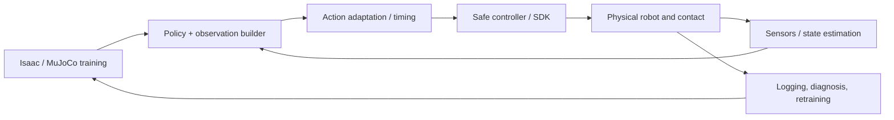

# Robot Policy Deployment and Sim-to-Real Engineering

<!-- course-meta:start -->
[Course home](https://github.com/zengxiong111/Foundation_of_Embodied_AI) · [简体中文](Robot_Policy_Deployment_Sim2Real_ZH.md) · [PDF](../pdf/Robot_Policy_Deployment_Sim2Real_EN.pdf) · [Motion-control RL](Embodied_Motion_Control_RL_Tutorial_EN.md)

| Item | Details |
|---|---|
| Role in the course | Connects simulation training, embodied foundation models, physical controllers, and reliable deployment; does not repeat PPO/SAC derivations or ROS 2 basics |
| Scope | Motion policies trained in Isaac Lab / MuJoCo, action-chunk VLA/WAM systems, contact-rich dexterous manipulation |
| Prerequisites | Dynamics, low-level control, basic ROS/SDK usage, and sim-to-real concepts |
| Documentation review date | 2026-10-29 |
| License | CC BY-NC-SA 4.0 · Xiong Zeng and contributors |

<!-- course-meta:end -->

<!-- course-toc:start -->
**Chapter concept map**


<!-- course-visual:end -->

## Contents

- [1. Deployment is more than loading weights](#course-section-01)
- [2. The policy-to-hardware interface contract](#course-section-02)
- [3. Closed-loop architecture: sensor to motor](#course-section-03)
- [4. Observation builders and real-state estimation](#course-section-04)
- [5. Action adapters and action-chunk scheduling](#course-section-05)
- [6. Multirate execution, latency, and continuity](#course-section-06)
- [7. Sim-to-real alignment: identify, then randomize](#course-section-07)
- [8. Online RL, real data, and recovery](#course-section-08)
- [9. Staged deployment with safety gates](#course-section-09)
- [10. Evaluation matrix, self-check, and conclusions](#course-section-11)
- [References](#course-section-12)

<a id="course-section-01"></a>

## 1. Deployment is more than loading weights

A PPO policy trained in Isaac Lab or MuJoCo, or an Action Expert from a pretrained VLA/WAM, **is not guaranteed to work on a robot merely because the PyTorch weights were exported**. The policy/robot boundary must agree on semantics, physical limits, and time. A simulator may implement `q_target` or Cartesian increments, while the actual device exposes only a certain position, velocity, or trajectory API; camera-based pose estimation adds latency and missing observations.

Deployment should pass four separate criteria: **executable** (read state and issue correct commands), **stable** (tracking and contact remain controlled), **safe** (fault-handling safeguards remain independent), and **reproducible** (logs explain outcomes). Final task success is necessary but does not replace the first three kinds of validation.

<a id="course-section-02"></a>

## 2. The policy-to-hardware interface contract

Before training, establish an **Observation/Action/Controller Contract** and version it alongside the model weights.

| Field | Document explicitly | Typical failure |
|---|---|---|
| Observation | Feature order, units, normalization statistics, history | Real actor receives fewer features than during training |
| Action | Position/velocity/torque/pose; absolute or delta; frame | Delta pose interpreted as an absolute pose |
| Joint map | Names, ordering, sign, home offsets, limits | Adjacent fingers mapped to wrong joints |
| Timing | $\Delta t$, policy/servo/camera rates, timestamps | 50 Hz training action interpreted at 100 Hz |
| Controller | Actual PD / MIT / impedance / vendor API semantics | Ideal simulator torque versus position-only device |
| Object state | Observable or estimable robot/object state, confidence | Privileged simulator state passed into the deployed actor |
| Safety | Bounds, rate limits, stop conditions | Training reward treated as a safety constraint |

A common joint-position policy uses

$$
q_t^d=q_{\mathrm{default}}+s_a\,\pi_\theta(o_t).
$$

The reference $q_{\mathrm{default}}$, scale $s_a$, joint order, and action period must match deployment. If the actor outputs an end-effector increment $\Delta x$, its frame, rotation representation, IK feasibility, and TCP definition must also agree. **Identical action arrays do not necessarily represent identical physical motions.**

<a id="course-section-03"></a>

## 3. Closed-loop architecture: sensor to motor

Separate inference from execution:

```text
Head/Wrist Camera ----> Perception / Pose Estimator ----+
Joint / Motor State -------------------------------------+--> Observation Builder
                                                               |
                                                               v
                                                      RL / VLA / WAM Policy
                                                               |
                                                               v
                                                   Action Adapter / Buffer
                                                               |
                                                               v
                                              IK / Trajectory / Impedance
                                                               |
                                                               v
                                               Safety Layer -> Robot SDK
                                                               |
                                                               v
                                                         Real Robot
                                                               |
                                                    timestamped feedback
```

The foundation model may run in a non-real-time GPU process. The low-level controller should run in a bounded, predictable loop on a robot controller or dedicated servo thread. ROS 2 is useful for sensor integration but is not a mandatory dependency for simulation training or every high-frequency servo path. **Calling a network inference service synchronously inside the servo thread puts network jitter directly into the control loop.**

<a id="course-section-04"></a>

## 4. Observation builders and real-state estimation

Deployment observations typically combine **proprioception** ($q,\dot q$, IMU, current or other device telemetry), **external state** (images, object pose, estimated contact/force), and **task context** (goal, previous action, history). For every field, document units, timestamp, coordinate frame, validity, and failure indicators.

For objects with known geometry, FoundationPose-type 6D estimation may provide pose input, together with temporal filtering, occlusion confidence, loss detection, and reinitialization. **Simulator ground-truth object poses are not real camera observations.** Evaluate position/orientation accuracy and estimator dropout separately under static motion, active motion, occlusion, and contact.

Use acquisition timestamps to align state and images, interpolate joint feedback only when justified, and select a recent, valid visual estimate. “Most recently received message” does not necessarily mean “most recent physical state.” Never leak future frames into online observations. Declare the direction and TCP of each transform in the `world/base/camera/tool/object` chain.

<a id="course-section-05"></a>

## 5. Action adapters and action-chunk scheduling

An action adapter converts policy actions into executable commands while preserving physical and temporal meaning.

| Policy output | Adapter responsibility | Hardware validation |
|---|---|---|
| Joint target $q_d$ | Joint mapping, bounds, velocity/acceleration shaping | Commanded versus measured state |
| Joint increment $\Delta q$ | Reference update with clipping | Drift and cumulative error |
| End-effector target $x_d$ | TF, TCP, IK/OSC, joint limits | Singularities, reachability, collision |
| Torque / impedance parameters | Verify actual mode, bound gains/effort | Availability and correct semantics |
| Action chunk $A_t$ | Timestamp scheduling, interpolation, stale-chunk discard | Continuity at chunk boundaries |

For a VLA/WAM, denote one action chunk by

$$
A_t=(a_t,a_{t+1},\ldots,a_{t+H-1}).
$$

The generated length $H$ does not imply that all $H$ actions must execute before replanning. An asynchronous system may execute only $K\leq H$ actions before observing and replanning again. Chunk transitions require position/velocity continuity, saturation handling, and observation-age awareness; safe interpolation and retiming may be necessary.

**The safety layer belongs after action adaptation and before the robot SDK**, with a stop mechanism that still works when the policy stops producing updates.

<a id="course-section-06"></a>

## 6. Multirate execution, latency, and continuity

Consider an educational example: a 25 Hz motion policy and a 500 Hz local servo. The nominal number of inner steps per policy update is

$$
N=\frac{f_c}{f_\pi}=\frac{500}{25}=20.
$$

This does not make a 30 Hz camera naturally synchronous with either loop. Real deployment handles asynchronous acquisition, inference-time variation, action buffering, and tracking errors. These frequencies are **illustrative, not official specifications for any robot or hand**.

Treat total latency as a measured system property rather than a synonym for model inference time:

$$
T_{\mathrm{total}}\approx T_{\mathrm{sense}}+T_{\mathrm{transfer}}+T_{\mathrm{estimate}}+T_{\mathrm{infer}}+T_{\mathrm{dispatch}}+T_{\mathrm{actuate}}.
$$

Some stages overlap; this expression is a useful diagnostic budget, not a strict formula for the critical path. Measure p50/p95/p99, observation age, servo-period jitter, stale-action count, and buffer underruns. **Fast inference is not automatically fast feedback, and fast feedback is not automatically safe contact.**

<a id="course-section-07"></a>

## 7. Sim-to-real alignment: identify, then randomize

### 7.1 First repair deterministic interface errors

Before randomizing mass, friction, or latency, inspect joint order, home offsets, angle units, axis signs, hand-eye calibration, TCP, collision geometry, actuator mode, action scaling, and control period. These are engineering errors to correct, **not** stochastic disturbances that broad domain randomization should hide.

### 7.2 Measure the actuator and dynamics

Where supported by vendor safeguards, measure low-amplitude joint responses, startup friction, velocity saturation, command-to-motion delay, and grasp slip. Separate measured parameters, unknown parameters, and justified randomization ranges. For dexterous hands, examine per-joint transmission, armature, PD gains, current-to-effort mappings, and object/contact friction.

In Isaac Lab, implicit/explicit PD, delayed actuators, and DCMotor models should be compared to MuJoCo actuator configurations using **response equivalence**, not similar config labels alone.[1–2] Different solver implementations and actuation modes may diverge during contact.

### 7.3 Randomization should reflect observed uncertainty

Organize variation by category: **actuator** (gains, delays, limits), **contact** (friction, mass, collision geometry), **perception** (pose error, dropout, occlusion), and **task** (table pose, initial object configuration). Ablate each category and relate training robustness to measured deployment error, rather than changing many parameters simultaneously without interpretable evidence.

<a id="course-section-08"></a>

## 8. Online RL, real data, and recovery

A real-robot online/off-policy replay transition should preserve at least

$$
(o_t,a_t^{\mathrm{cmd}},a_t^{\mathrm{exec}},r_t,o_{t+1},d_t,\Delta t).
$$

Here $a_t^{\mathrm{cmd}}$ is the issued policy command, whereas $a_t^{\mathrm{exec}}$ summarizes realized execution, perhaps as a joint trajectory or post-limit action and **not necessarily in the same space** as the policy action. **Do not assume an issued command is the action physically executed.** Preserve SDK feedback, controller clipping, mode transitions, resets, and fault reasons.

In contact tasks, rewards may be delayed or inferred. Therefore specify the time interval, termination condition, and clock basis for each reward. Bind deployment/learner versions and normalization statistics to each dataset. When perception fails, an object drops, contact becomes hazardous, or communication is lost, transition to an independent recovery/stop state machine instead of letting the RL policy continue unconstrained exploration.

<a id="course-section-09"></a>

## 9. Staged deployment with safety gates

| Stage | Acceptance goal | Reason for gating |
|---|---|---|
| 0. Offline replay | Bounded, consistent actions on recorded logs | Catch normalization, unit, and joint-map errors |
| 1. Simulation / sim-to-sim | Reproducibility under matched action semantics | Isolate simulator and interface differences |
| 2. Hardware-in-the-loop / mock driver | Test transport, timeout, state machine, buffering | Catch queue and scheduling faults before motion |
| 3. Low-speed free-space test | Correct direction, limits, continuity, feedback | Avoid unintended motion before contact |
| 4. Guarded contact | Bounded contact effort/speed and reliable stops | Reduce contact hazards |
| 5. Full task | Success, recovery, fault-distribution reporting | Separate capability from safety evidence |

Include network loss, occluded cameras, slow inference, joint tracking excursions, frozen state messages, and stop requests. Start fault-injection tests in a simulator/mock driver and apply the robot manufacturer's physical-testing safety process. **An unvalidated policy must not directly drive full-amplitude, high-speed, or high-effort actions.**

<a id="course-section-11"></a>

## 10. Evaluation matrix, self-check, and conclusions

Report **task, physical, system, and statistical** results together: success/drop/recovery; tracking error, action peaks, and abnormal contacts; end-to-end latency, p99, jitter, timeouts, and fault counts; independent runs, initial object distributions, trial counts, and hardware versions. Avoid reporting only a demonstration video and success rate.

**Five self-check questions:**

1. Which deployment contracts can still be wrong after policy weights are exported?
2. Why separately record $a^{\mathrm{cmd}}$ and realized state?
3. Why might only $K<H$ actions execute from a chunk of length $H$?
4. Why can broader domain randomization not correct swapped joints or wrong units?
5. Which experiments distinguish policy failure from perception failure or transport/controller failure?

**Takeaway:** robot deployment is not a single “model → motor” link, but an end-to-end closed loop: **state estimation → policy → action adaptation → real-time control → safe actuation → measured feedback → reproducible evaluation**.

<a id="course-section-12"></a>

## References

1. [NVIDIA Isaac Lab — Actuators](https://docs.nvidia.com/isaaclab/concepts/actuators) (actuation and latency models).
2. [MuJoCo — Modeling](https://mujoco.readthedocs.io/en/stable/modeling.html) (actuators and force/control limits).
3. [ros2_control](https://control.ros.org/jazzy/) (hardware interfaces and Controller Manager).
4. [ROS 2 Jazzy — QoS](https://docs.ros.org/en/jazzy/Concepts/Intermediate/About-Quality-of-Service-Settings.html) (freshness, queues, liveliness).
5. [FoundationPose](https://github.com/NVlabs/FoundationPose) (known-geometry object pose estimation).
6. Companion lessons: [Low-level control](Robot_Low_Level_Control_EN.md), [Communication and real-time systems](Robot_Communication_Real_Time_Systems_EN.md), [Motion-control RL](Embodied_Motion_Control_RL_Tutorial_EN.md), and [Efficient training/inference](Efficient_Training_Real_Time_Inference_EN.md).

*Scope note: example frequencies, architectures, and tests are educational, not measured specifications or safety procedures for TRON2, Revo3, or Wuji Hand2. New original content is CC BY-NC-SA 4.0; existing course materials and third-party rights remain unchanged.*
