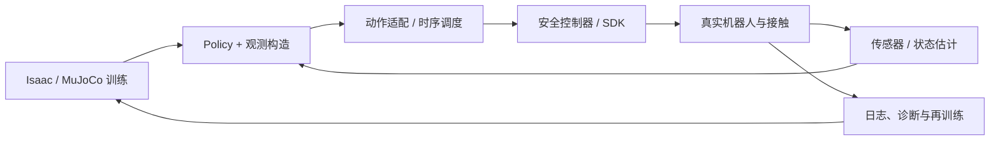

# 机器人策略部署与 Sim-to-Real 工程

<!-- course-meta:start -->
[课程首页](https://github.com/zengxiong111/Foundation_of_Embodied_AI/blob/main/README.zh-CN.md) · [English](Robot_Policy_Deployment_Sim2Real_EN.md) · [PDF](../pdf/Robot_Policy_Deployment_Sim2Real_ZH.pdf) · [运动控制强化学习](Embodied_Motion_Control_RL_Tutorial_ZH.md)

| 项目 | 说明 |
|---|---|
| 课程定位 | 连接仿真训练、具身基础模型、真实控制器和可靠部署；不重复 PPO/SAC 或 ROS 2 基础 |
| 适用范围 | Isaac Lab / MuJoCo 训练的运动策略；基于 Action Chunk 的 VLA/WAM；接触丰富的灵巧操作 |
| 先修知识 | 机器人动力学、底层控制、基础 ROS/SDK、Sim2Real 概念 |
| 文档核验日期 | 2026-10-29 |
| 许可 | CC BY-NC-SA 4.0 · Xiong Zeng and contributors |

<!-- course-meta:end -->

<!-- course-toc:start -->
**本章知识地图**


<!-- course-visual:end -->

## 目录

- [1. 部署不是加载模型权重](#course-section-01)
- [2. 策略与硬件之间的接口合同](#course-section-02)
- [3. 闭环架构：从传感器到电机](#course-section-03)
- [4. Observation Builder 与真实状态估计](#course-section-04)
- [5. Action Adapter 与 Action Chunk 调度](#course-section-05)
- [6. 多频率、延迟与连续动作](#course-section-06)
- [7. Sim-to-Real 对齐：先辨识再随机化](#course-section-07)
- [8. Online RL、真实数据与恢复机制](#course-section-08)
- [9. 分阶段部署与安全门禁](#course-section-09)
- [10. 评估矩阵、自测题与结论](#course-section-11)
- [参考资料](#course-section-12)

<a id="course-section-01"></a>

## 1. 部署不是加载模型权重

从 Isaac Lab / MuJoCo 中训练好的 PPO Policy，或从预训练 VLA/WAM 中获得的 Action Expert，**不能仅通过导出 PyTorch 权重就保证真机可用**。策略与真实机器人的接口必须在语义、物理约束和时间三方面一致。某些仿真训练通过 `q_target` 或末端增量控制；设备可能只开放特定的位置、速度或厂家轨迹 API；相机的姿态估计又会带来延迟和缺失值。

部署关注四个不同的成功标准：**可执行**（能正确读状态、发指令）、**可稳定**（跟踪和接触不发散）、**可安全**（故障时保护独立生效）、**可复现**（实验日志能解释成功或失败）。最终任务成功率是必要指标，但不能取代前三项测试。

<a id="course-section-02"></a>

## 2. 策略与硬件之间的接口合同

建议在训练开始前固定一份 **Observation/Action/Controller Contract**，并随模型权重一起版本化。

| 字段 | 必须写清什么 | 常见错误 |
|---|---|---|
| Observation | 特征顺序、单位、归一化均值方差、历史窗口 | 真机使用的特征比训练时少 |
| Action | 位置/速度/力矩/末端位姿；绝对或增量；坐标系 | 把相对位移当绝对位置 |
| Joint map | 关节名字、顺序、方向、零位、限位 | 相邻手指关节交换导致异常 |
| Timing | $\Delta t$, Policy/Servo/Camera 频率、时间戳 | 训练 50 Hz，部署按 100 Hz 解读增量 |
| Controller | PD / MIT / 阻抗 / 厂家轨迹 API 的真实语义 | 仿真使用理想力矩，真机只有位置接口 |
| Object state | 真实视觉估计或编码器；估计置信度 | 把 privileged simulator state 输入 Actor |
| Safety | 命令限幅、动作变化率、停止条件 | 以训练 reward 代替安全限制 |

例如位置动作策略常用

$$
q_t^d=q_{\mathrm{default}}+s_a\,\pi_\theta(o_t).
$$

部署时，$q_{\mathrm{default}}$、缩放系数 $s_a$、关节顺序、动作执行周期必须与训练一致。对策略输出末端增量 $\Delta x$ 的情况，则需要坐标系、旋转参数化、IK 可达性与 TCP 定义共同匹配。**同一动作数组不表示同一物理动作。**

<a id="course-section-03"></a>

## 3. 闭环架构：从传感器到电机

推荐将计算与执行分开：

```text
Head/Wrist Camera ----> Perception / Pose Estimator ----+
Joint / Motor State -------------------------------------+--> Observation Builder
                                                               |
                                                               v
                                                      RL / VLA / WAM Policy
                                                               |
                                                               v
                                                   Action Adapter / Buffer
                                                               |
                                                               v
                                              IK / Trajectory / Impedance
                                                               |
                                                               v
                                               Safety Layer -> Robot SDK
                                                               |
                                                               v
                                                         Real Robot
                                                               |
                                                    timestamped feedback
```

高层模型可能运行在 GPU 的非实时进程中；底层控制器应运行在可预测时序的设备控制器或独立线程里。ROS 2 可连接相机与策略，但并非训练系统或所有高速伺服的强制依赖。**把网络推理请求直接放进高频控制线程，会让网络抖动直接进入控制闭环。**

<a id="course-section-04"></a>

## 4. Observation Builder 与真实状态估计

部署观察量一般由三部分组成：**本体状态**（$q,\dot q$、IMU、电流或其他设备回报）、**外部状态**（相机、物体位姿、接触/力估计）、**任务状态**（目标姿态、上一动作、历史窗口）。要为每个字段明确单位、时间戳、坐标系、可用条件和失败标志。

针对已知几何的物体，可以使用 FoundationPose 类 6D 位姿估计方法，再配合滤波、遮挡置信度、丢失检测及重初始化。**训练使用的物体真值位姿不能直接假设为真机观测。** 实际评估应统计位置/姿态误差与估计失效率，分别测量静态、运动、遮挡和接触情况下的表现。

时间对齐时，先确定机器人状态和图像的采集时间，再对关节状态适当插值，选择未过时的视觉估计。不能把“收到最新消息”当作“拥有最新物理状态”，也不能使用未来帧重建当时的在线 Observation。TF 链应明确 `world/base/camera/tool/object` 的方向和 TCP 定义。

<a id="course-section-05"></a>

## 5. Action Adapter 与 Action Chunk 调度

动作适配层将策略输出转换为设备可执行命令，并保证时间与空间语义：

| 策略输出 | 适配层工作 | 真机检查 |
|---|---|---|
| 关节目标 $q_d$ | 关节映射、限位、速度/加速度约束 | 实际反馈与目标是否一致 |
| 关节增量 $\Delta q$ | 根据上一目标/当前状态更新、截断 | 是否出现积分漂移 |
| 末端目标 $x_d$ | TF、TCP、IK/OSC、关节限幅 | 奇异位形、不可达与碰撞 |
| 力矩/阻抗参数 | 硬件模式确认、增益/力矩约束 | 是否真正开放并正确实现接口 |
| Action Chunk $A_t$ | 按时间戳调度、插值、丢弃过期块 | 新旧块拼接处是否连续 |

对高层 VLA/WAM，设一个动作块为

$$
A_t=(a_t,a_{t+1},\ldots,a_{t+H-1}),
$$

其中 $H$ 是模型产生的动作数，不意味着一次推理后必须全部执行。系统可能只执行前 $K\leq H$ 步并重新观测、重规划。块拼接须考虑位置/速度连续性、控制饱和和观察年龄，必要时采用安全的插值与再定时（retiming）。

**安全层应在 Action Adapter 之后、机器人 SDK 之前独立执行**，并具有在策略停止更新时仍可执行的停止流程。

<a id="course-section-06"></a>

## 6. 多频率、延迟与连续动作

以教学示例说明：运动 Policy 为 25 Hz，本地控制器为 500 Hz，则理想情况下每个策略更新间隔对应

$$
N=\frac{f_c}{f_\pi}=\frac{500}{25}=20
$$

个底层控制周期；但这不表示 Camera 30 Hz 的观测能与每个策略步骤自然对齐。真正的部署必须处理异步采集、推理时间波动、数据缓存和控制器追踪误差。上述数字**不是任何具体机器人或灵巧手的官方频率**。

把端到端延迟写成测量问题，而不是简单的模型推理耗时：

$$
T_{\mathrm{total}}\approx T_{\mathrm{sense}}+T_{\mathrm{transfer}}+T_{\mathrm{estimate}}+T_{\mathrm{infer}}+T_{\mathrm{dispatch}}+T_{\mathrm{actuate}}.
$$

部分阶段可以重叠，所以这个求和是用于分项排查的近似预算，而非实际关键路径的严格公式。建议记录 p50/p95/p99、观测 AoI、控制周期 jitter、动作过期数量和 Action Chunk 饥饿（buffer underrun）。**推理快不等于闭环快，闭环快也不等于接触安全。**

<a id="course-section-07"></a>

## 7. Sim-to-Real 对齐：先辨识再随机化

### 7.1 优先排查确定性错误

在随机化质量、摩擦和延迟之前，先查：关节顺序、零位、角度单位、坐标轴、手眼标定、TCP、物体几何、Actuator Mode、动作缩放和控制周期。这些错误是应当直接修复的工程问题，而不是要用更宽的 Domain Randomization 掩盖的随机扰动。

### 7.2 实测动力学与执行器

可在设备允许且采取保护措施的前提下，测量单关节响应、起动摩擦、速度饱和、命令到响应延迟以及抓持下的滑移。需要区分真实参数、未知参数和可随机化范围。对灵巧手应特别检查每个关节的不同传动、armature、PD 增益、电流/力矩映射及物体摩擦。

Isaac Lab 中的 Implicit/Explicit PD、延迟模型、DCMotor 与 MuJoCo 的 actuator 对应关系必须以**响应等效**来验证，而不是仅比较配置名称。[1–2] 不同控制模式/求解器可能在接触时产生不同轨迹。

### 7.3 随机化应匹配测量误差

建议将随机化分层：**执行器**（增益、延迟、限幅）、**接触**（摩擦、质量、碰撞形状）、**感知**（位姿误差、失帧、遮挡）、**外部条件**（桌高、物体初始位姿）。分别做消融，报告训练鲁棒性与真机误差的关系，避免一次性引入过多扰动而无法解释原因。

<a id="course-section-08"></a>

## 8. Online RL、真实数据与恢复机制

真机 Online RL 和 Off-policy Replay 的 transition 至少应包含

$$
(o_t,a_t^{\mathrm{cmd}},a_t^{\mathrm{exec}},r_t,o_{t+1},d_t,\Delta t),
$$

这里 $a_t^{\mathrm{cmd}}$ 是策略下发的命令，而 $a_t^{\mathrm{exec}}$ 表示实际执行情况，可能是关节状态轨迹或由日志计算的执行描述，并不总是与策略动作同维度。**不要把命令动作未经核验就当作物理上已执行的动作**。需要分别保存 SDK 反馈、控制器限幅、模式切换、Reset 与故障原因。

对于接触任务，奖励可能是延迟或估计的，因此必须说明每个 reward 对应的时段、终止条件与传感器时钟。训练/部署版本号和观测归一化统计应和数据集绑定。真实机器人发生感知丢失、掉落、碰撞风险或通信失联时，应进入独立的恢复/停止状态机，而不是让 RL 自行继续探索。

<a id="course-section-09"></a>

## 9. 分阶段部署与安全门禁

| 阶段 | 验收目标 | 未通过时不得进入下一阶段的原因 |
|---|---|---|
| 0. 离线回放 | 对历史日志生成一致且有界的动作 | 先发现归一化、单位、关节顺序错误 |
| 1. 仿真与 Sim-to-Sim | 同任务、同动作语义下可复现 | 排除框架/物理接口差异 |
| 2. Hardware-in-the-Loop / Mock Driver | 测通信、超时、状态机与动作缓存 | 先发现队列与线程故障 |
| 3. 无接触低速测试 | 方向、限位、轨迹连续性、反馈正确 | 避免自由空间就出现异常动作 |
| 4. 受保护接触测试 | 可限制接触力与速度，异常能停 | 控制接触风险 |
| 5. 完整任务 | 报告成功率、恢复率、故障分布 | 任务性能与安全证据分开 |

验证应包括断网、相机遮挡、长推理延迟、单关节超差、状态冻结和主动停止。每个故障注入试验都应先在模拟器/Mock Driver 中执行，真机验证遵守厂商及实验室安全流程。**未验证的策略不应直接执行满幅度、高速、高力矩动作。**

<a id="course-section-11"></a>

## 10. 评估矩阵、自测题与结论

建议按**任务指标、物理指标、系统指标、统计口径**同时报告：成功率/掉落率/恢复率；跟踪误差/动作峰值/接触异常；全链路延迟、p99、Jitter、超时和故障次数；独立种子/物体初始分布/实验次数/硬件版本。避免“只有视频和最终成功率”的结果展示。

**五个自测题**：

1. 导出 Policy 权重以后，哪些部署合同仍可能与训练时不一致？
2. 为什么要分别保存 $a^{\mathrm{cmd}}$ 与实际执行状态？
3. Action Chunk 长度为 $H$，为什么不一定执行满 $H$ 步？
4. 为什么更宽的 Domain Randomization 不能修复错误关节顺序或错误单位？
5. 什么实验能区分策略失败、感知失败和通信/控制器失败？

**一句话总结**：具身部署不是“模型 → 电机”一条线，而是**状态估计 → 策略 → 动作适配 → 实时控制 → 安全执行 → 真实反馈 → 可复现实验**的完整闭环。

<a id="course-section-12"></a>

## 参考资料

1. [NVIDIA Isaac Lab — Actuators](https://docs.nvidia.com/isaaclab/concepts/actuators)（执行器建模与延迟）。
2. [MuJoCo — Modeling](https://mujoco.readthedocs.io/en/stable/modeling.html)（actuator 与力/控制限幅）。
3. [ros2_control](https://control.ros.org/jazzy/)（硬件接口与 Controller Manager）。
4. [ROS 2 Jazzy — QoS](https://docs.ros.org/en/jazzy/Concepts/Intermediate/About-Quality-of-Service-Settings.html)（消息时效、队列和监测）。
5. [FoundationPose](https://github.com/NVlabs/FoundationPose)（已知几何物体位姿估计）。
6. 配套课程：[底层控制](Robot_Low_Level_Control_ZH.md)、[机器人通信与实时系统](Robot_Communication_Real_Time_Systems_ZH.md)、[运动控制强化学习](Embodied_Motion_Control_RL_Tutorial_ZH.md)、[高效训练与实时推理](Efficient_Training_Real_Time_Inference_ZH.md)。

*声明：示例的控制频率、系统架构和测试流程用于教学，不是 TRON2、Revo3 或 Wuji Hand2 的实测规格或安全操作规程。新增原创内容使用 CC BY-NC-SA 4.0；原课程及第三方资料权利不变。*
