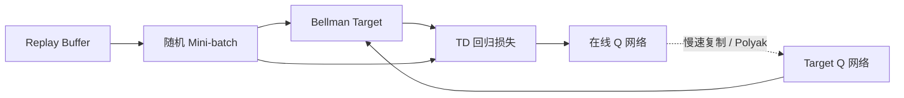
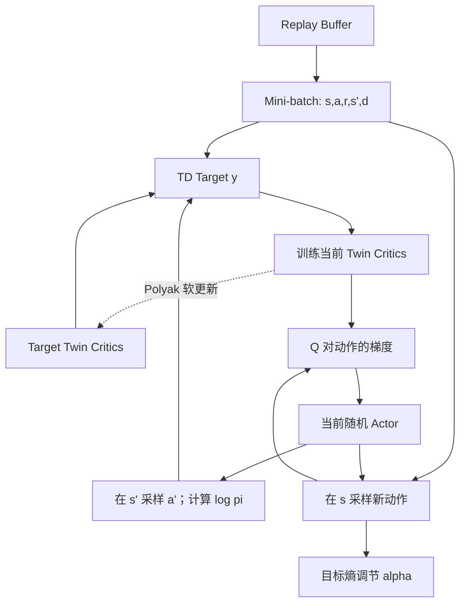
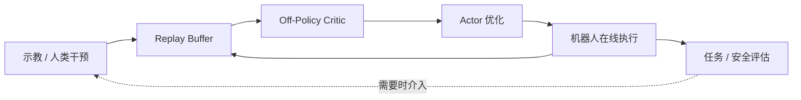

# 从 Q-learning 到 Soft Actor-Critic

[课程首页](https://github.com/zengxiong111/Foundation_of_Embodied_AI) · [English](SAC_Complete_Derivation_EN.md) · [PDF](https://zengxiong111.github.io/zengxiong.github.io/files/SAC_Complete_Derivation_CN.pdf)

| 项目 | 说明 |
|---|---|
| 主题 | 价值学习、现代 SAC 与机器人后训练 |
| 修订日期 | 2026-10-22 |
| 许可 | CC BY 4.0 · Xiong Zeng and contributors |

>
> **先修知识。** 条件期望、概率分布、梯度下降、神经网络反向传播；建议先阅读本课程 PPO/Actor–Critic 讲义中关于 Policy Gradient 与 Advantage 的部分。
>
> **参考范围。** 本讲义为独立改写的原创教学表述，吸收 [Berkeley CS185/285](https://rail.eecs.berkeley.edu/deeprlcourse/) 的价值学习组织方式与 [Stanford CS224R](https://cs224r.stanford.edu/) 的机器人应用视角；不是两门课的翻译或逐页整理。关键研究论文在文末列出。

<!-- md-toc:start -->
## 目录

1. [价值函数与 Bellman 方程](#sac-section-01)
2. [TD Learning 与 Q-learning](#sac-section-02)
3. [从 Fitted Q-Iteration 到 DQN](#sac-section-03)
4. [从离散 Q-learning 到连续动作 Actor–Critic](#sac-section-04)
5. [Soft Actor-Critic：最大熵、三类损失与算法闭环](#sac-section-05)
6. [PPO、DQN 与 SAC：如何正确选择](#sac-section-06)
7. [机器人应用：示教、在线学习和 VLA/WAM 后训练](#sac-section-07)
8. [附录 A：关键数学推导](#sac-section-08)
9. [附录 B：实现约定与常见误区](#sac-section-09)
10. [参考文献与课程资源](#sac-section-10)
<!-- md-toc:end -->

记状态 $s\in\mathcal S$、动作 $a\in\mathcal A$、奖励 $r_t$、状态转移 $P(s'\mid s,a)$、策略 $\pi(a\mid s)$、折扣 $\gamma\in[0,1)$。$d_t=1$ 只表示**真实 MDP 终止**；时间截断另作处理。$\mathcal D$ 表示交互数据集/经验池；参数 $\theta$ 常用于 Actor，$\phi$ 用于 Critic，带横线的参数表示目标网络。除特别指出外，公式采用折扣无限时域 MDP 和固定环境转移模型。

*图 1：课程的因果主线。每一步都是为了克服前一方法的某项限制；这不是“所有算法都必须按顺序训练”的流程。*

***

## 1. 价值函数与 Bellman 方程

### 1.1 为什么需要 $Q(s,a)$？

强化学习的目标是在与环境交互时最大化长期回报

$$
G_t=\sum_{k=0}^{\infty}\gamma^k r_{t+k},
\qquad J(\pi)=\mathbb E_{s_0\sim\rho_0,\,\tau\sim\pi}[G_0].
$$

即时奖励无法单独反映行动价值：例如机器人调整手指姿态的这一步可能没有奖励，却能显著提高后续旋转螺丝刀的成功概率。因而定义给定策略 $\pi$ 下的状态价值与动作价值：

$$
\boxed{
V^\pi(s)=\mathbb E_\pi[G_t\mid s_t=s],\qquad
Q^\pi(s,a)=\mathbb E_\pi[G_t\mid s_t=s,a_t=a].}
$$

两者的区别是：$V^\pi(s)$ 先按照策略选择动作；$Q^\pi(s,a)$ 固定第一步动作 $a$，此后才按照策略。于是

$$
V^\pi(s)=\mathbb E_{a\sim\pi(\cdot\mid s)}[Q^\pi(s,a)],
\qquad A^\pi(s,a)=Q^\pi(s,a)-V^\pi(s).
$$

$A^\pi$ 是当前动作相对于策略平均表现的改进幅度。它将在本课程 PPO 讲义中发挥核心作用，而本讲义更关注 $Q$ 的学习。

### 1.2 Bellman Expectation：把长期问题化为一步

利用 $G_t=r_t+\gamma G_{t+1}$，对固定策略有

$$
\boxed{Q^\pi(s,a)=r(s,a)+\gamma\,\mathbb E_{s'\sim P(\cdot\mid s,a),\,a'\sim\pi(\cdot\mid s')}Q^\pi(s',a').}
$$

这里的 $r(s,a)=\mathbb E[r_t\mid s,a]$，下一动作遵循**给定策略** $\pi$。这叫 **Policy Evaluation**：评价当前策略有多好，而不是直接求最佳策略。

### 1.3 Bellman Optimality：从评估变成改进

若每次都选择最有价值的动作，则 $V^*(s)=\max_a Q^*(s,a)$（对有限动作集或最大值存在的情形）。代入得

$$
\boxed{Q^*(s,a)=r(s,a)+\gamma\mathbb E_{s'}\Big[\max_{a'}Q^*(s',a')\Big].}
$$

**最重要的区别：** Expectation Equation 在未来动作上取 $\mathbb E_{a'\sim\pi}$，Optimality Equation 则取 $\max_{a'}$。后者连接了 Policy Evaluation 与 Greedy Policy Improvement。

若已准确知道 $Q^\pi$，可构造 $\pi_{\mathrm{new}}(s)\in\arg\max_aQ^\pi(s,a)$。在精确、适当条件下，新策略不会比旧策略差。这是 Policy Iteration 的基本思想，也是后面 SAC“Critic 评价、Actor 改进”结构的来源。

### 1.4 一个两动作例子

设当前状态有左右两种抓取方式，两者当前奖励都是零，下一状态的最优价值分别为 8、10，取 $\gamma=0.9$：

$$
Q^*(s,a_L)=0.9\times8=7.2,
\qquad Q^*(s,a_R)=0.9\times10=9.
$$

即使当前奖励相同，动作的长期价值仍不同。因此学习 Critic 的本质不是拟合一步奖励，而是传播长期回报。

***

## 2. TD Learning 与 Q-learning

### 2.1 Monte Carlo 与 Temporal-Difference

Monte Carlo（MC）以完整实际回报 $G_t$ 为学习目标；TD 方法利用已有价值估计提前构造目标。对 $V$ 的一步 TD(0)：

$$
\delta_t^V=r_t+\gamma(1-d_t)V(s_{t+1})-V(s_t),
\qquad V(s_t)\leftarrow V(s_t)+\eta_t\delta_t^V.
$$

TD 的优点是无需等待轨迹结束；代价是目标依赖于当前估计，即 **Bootstrapping**。因此训练误差既有采样误差，也可能包含价值估计误差的传播。

### 2.2 SARSA 与 Q-learning：下一动作来自哪里？

SARSA 根据当前执行策略实际采样的下一动作进行评估：

$$
y_t^{\mathrm{SARSA}}=r_t+\gamma(1-d_t)Q(s_{t+1},a_{t+1}).
$$

经典 Q-learning 则使用最优性备份：

$$
\boxed{y_t^Q=r_t+\gamma(1-d_t)\max_{a'}Q_t(s_{t+1},a'),}
$$

$$
\boxed{Q_{t+1}(s_t,a_t)=Q_t(s_t,a_t)
+\eta_t\big[y_t^Q-Q_t(s_t,a_t)\big].}
$$

行为策略 $\beta$ 可以是 $\varepsilon$-greedy，甚至与目标贪心策略不同；Target 仍取未来动作的最大 Q。这种**行为策略与学习目标分离**，使 Q-learning 成为 Off-Policy 方法。它不依赖是否使用 Replay Buffer。

| 方法 | 下一动作的 Target | 典型属性 | 回答的问题 |
|:--|:--|:--|:--|
| SARSA | $Q(s',a')$, $a'\sim\pi$ | On-Policy | 执行中的策略值多少？ |
| Expected SARSA | $\mathbb E_{a'\sim\pi}Q(s',a')$ | On-Policy 或 Off-Policy | 指定策略的期望价值？ |
| Q-learning | $\max_{a'}Q(s',a')$ | Off-Policy | 最优后续动作值多少？ |

**数值检查。** 设 $Q_t(s,a)=4$、$r=1$、$\max_{a'}Q(s',a')=6$、$\gamma=0.9$、$\eta=0.2$。则 $y=6.4$，新值为 $4+0.2(6.4-4)=4.48$。这正是“沿 TD Error 调整 Q”的含义。

### 2.3 N-step Returns：终点奖励怎样传回早期动作？

对中间没有真实终止的轨迹，一步 Target 可推广为

$$
\boxed{
y_t^{(n)}=\sum_{k=0}^{n-1}\gamma^k r_{t+k}
+\gamma^n\max_{a'}Q_{\bar\phi}(s_{t+n},a').}
$$

$n=1$ 为一步 Q-learning；较大的 $n$ 使用更多真实采集的奖励，减少对远端 Bootstrap 的依赖，但回报方差可能增加。对于稀疏成功奖励，N-step 有助于把后期成功信号更快传播到先前的接触与抓取动作。

**必须区分两种目标。** 若连续 $n$ 步来自 Off-Policy 行为策略，未经校正的多步 Target 含有行为策略产生的中间奖励，其期望一般不等于当前贪心目标策略的 $n$ 步 Bellman Backup。实际算法可能使用 Importance Sampling、Retrace、Tree Backup 等修正，或者有意识地接受这种偏差。**不能把任意历史轨迹的 N-step 返回称为无偏最优性备份。**

遇到真实终止应停止累计并删除之后的 Bootstrap；若只是 Time-Limit Truncation，则应根据任务时间模型决定是否继续 Bootstrap。对于人为固定时长的有限时域任务，还应显式处理剩余时间的信息。

### 2.4 Q-learning 的收敛条件与限制

在有限状态/动作、固定 MDP、有界奖励、充分访问每个状态动作对、以及适当递减学习率等经典假设下，表格 Q-learning 可以收敛到 $Q^*$。**这一结论不能直接推广到使用非线性网络的 DQN 或 SAC。** 后者同时存在 Off-Policy、函数逼近和 Bootstrapping 时，可能出现所谓 Deadly Triad。

***

## 3. 从 Fitted Q-Iteration 到 DQN

### 3.1 缺失的桥梁：Fitted Q-Iteration

在连续状态或视觉输入下，无法存储覆盖全部状态的 Q 表。于是用网络 $Q_\phi(s,a)$ 近似 Q；固定一轮目标网络 $Q_{\bar\phi}$，对样本 $\mathcal D=\{(s_i,a_i,r_i,s_i',d_i)\}_{i=1}^N$ 构造

$$
y_i=r_i+\gamma(1-d_i)\max_{a'}Q_{\bar\phi}(s_i',a'),
$$

再进行监督回归

$$
\boxed{\phi_{k+1}\in\arg\min_\phi
\frac1N\sum_{i=1}^N\big(Q_\phi(s_i,a_i)-\operatorname{stopgrad}(y_i)\big)^2.}
$$

这叫 **Fitted Q-Iteration（FQI）**：以 Bellman Backup 生成标签，用监督学习拟合价值函数，然后用新网络重新生成标签。它揭示了深度 Q-learning 的一个核心事实：**Critic 的训练从形式上是回归，但标签不是固定真值，而是网络自身的 Bootstrap 估计。**

严格地说，FQI 通常指以固定数据集、按迭代轮次生成目标并拟合的批处理方法；DQN 则是在线收集数据、从 Replay Buffer 采样、持续进行随机梯度 TD 更新的深度 RL 算法。两者共享 Fitted Bellman 回归思想，但不是同一个训练过程。

### 3.2 DQN：经验回放与目标网络

DQN 的平方 TD Loss 为

$$
\boxed{J_Q(\phi)=\frac12\mathbb E_{\mathcal D}
\left[\left(Q_\phi(s,a)-y\right)^2\right],\quad
y=r+\gamma(1-d)\max_{a'}Q_{\bar\phi}(s',a').}
$$

其中 $y$ 在 Critic 更新时视作常量（Semi-Gradient）。经验回放缓解相邻数据的时间相关性，并使旧数据得到多次学习；目标网络使 TD Target 不随当前 $\phi$ 每一步剧烈变化。两者都有助于稳定训练，但不能保证消除分布偏移或函数逼近误差。

目标网络既可定期复制 $\bar\phi\leftarrow\phi$，也可用软更新

$$
\bar\phi\leftarrow (1-\tau)\bar\phi+\tau\phi,\qquad 0<\tau\ll1.
$$

### 3.3 为什么会高估？Double DQN 与 SAC 的双 Q 有何不同？

若 $\widehat Q_a=Q_a+\epsilon_a$，即使对每个 $a$ 都有 $\mathbb E[\epsilon_a]=0$，通常也有

$$
\mathbb E\big[\max_a\widehat Q_a\big]
\ge\max_a\mathbb E[\widehat Q_a]=\max_a Q_a.
$$

原因是“先取最大值”容易挑中正噪声偏差。Double DQN 将动作选择与评价分开：

$$
\boxed{a^*=\arg\max_{a'}Q_\phi(s',a'),\qquad
y_{\mathrm{DDQN}}=r+\gamma(1-d)Q_{\bar\phi}(s',a^*).}
$$

SAC 中的 Clipped Double-Q 则使用 $\min(Q_{\bar\phi_1},Q_{\bar\phi_2})$ 评价**给定的连续动作**。它与 Double DQN 有相同的抑制过乐观估计动机，但公式和机制不同；取最小还可能带来低估。

### 3.4 Update-to-Data Ratio：数据效率不等于训练速度

定义

$$
\boxed{\mathrm{UTD}=\frac{\text{梯度更新次数}}{\text{新环境 Transition 数量}}.}
$$

例如每收集 100 个新 Transition，执行 400 次网络更新，UTD 为 4。Off-Policy 方法允许 UTD 大于 1，因为 Replay Buffer 中的旧数据可重复利用。但 **UTD 增大不等于结果必然改善**：随着重复训练，Critic 可能过拟合数据覆盖较少的状态动作区域，Bootstrap 误差累积，Actor 又会利用错误的高 Q 值。

评估训练效率必须至少区分：环境样本数、梯度更新数、训练墙钟时间和真实机器人交互时间。对于并行仿真，PPO 可能具有更高吞吐；对于稀缺真机交互，SAC 的数据复用优势更有意义，但需要计算资源和价值学习稳定性共同支持。

### 3.5 理解 Deadly Triad

**Off-Policy 数据 + Bootstrapping + 函数逼近** 同时存在时，训练存在不稳定甚至发散的风险。Replay 和目标网络分别作用于采样相关性与目标变化速度，Double Q 则作用于高估；它们解决的是不同方面，不能互相替代。

*图 2：DQN/FQI 的监督回归视角。Target 生成与当前网络回归应清楚地区分。*

***

## 4. 从离散 Q-learning 到连续动作 Actor–Critic

### 4.1 连续控制为何不直接使用 $\max_a Q(s,a)$？

对离散动作，枚举 $\max_a Q(s,a)$ 可行；对 $d$ 维机械臂关节、末端位姿增量或力矩动作，$a\in\mathbb R^d$，每次计算 TD Target 都求解高维非凸优化往往代价过高。**连续动作并不在数学上要求必须有 Actor**，但显式策略网络提供了计算上实用的近似：将昂贵的动作搜索“摊销”为一次前向传播。

引入确定性 Actor $a=\mu_\theta(s)$ 与 Critic $Q_\phi(s,a)$。若 Critic 可对动作求导，可以最大化 $Q_\phi(s,\mu_\theta(s))$，即最小化

$$
J_\mu(\theta)=-\mathbb E_{s\sim\mathcal D}Q_\phi(s,\mu_\theta(s)),
$$

其路径梯度为

$$
\nabla_\theta J_\mu
=-\mathbb E_s\left[\left.\nabla_aQ_\phi(s,a)\right|_{a=\mu_\theta(s)}
\nabla_\theta\mu_\theta(s)\right].
$$

这解释了 DDPG 一类 Off-Policy 连续控制方法的关键机制：Critic 用历史数据学习，Actor 接受 Critic 给出的动作改进方向。

### 4.2 DDPG、TD3 到 SAC 的设计动机

确定性 Actor 的探索通常需要单独加入动作噪声；若 Critic 在某些动作区域高估，Actor 可能持续朝这些方向优化。TD3 通过 **Clipped Double-Q、延迟 Actor 更新、Target Policy Smoothing** 缓解函数逼近误差。SAC 则进一步引入随机 Actor 与最大熵目标，使探索成为优化目标的一部分，而不是仅在输出上额外叠加噪声。

| 算法 | Actor | Critic Target 的设计思想 | 探索方式 |
|:--|:--|:--|:--|
| DDPG | 确定性 $\mu_\theta(s)$ | 一套 Q + 目标网络 | 外加动作噪声 |
| TD3 | 确定性 $\mu_\theta(s)$ | 双 Q 取较小值、平滑目标动作 | 外加动作噪声 |
| SAC | 随机 $\pi_\theta(a\mid s)$ | Soft Bellman + 双 Q | 最大熵策略优化 |

这三类方法的核心不是“谁永远更强”，而是它们面对探索、Q 误差与动作优化的不同折中。

***

## 5. Soft Actor-Critic：最大熵、三类损失与算法闭环

### 5.1 为什么不是只最大化奖励？

最大熵 RL 在回报中加入策略熵。采用现代 SAC 的常见约定：

$$
\boxed{J_{\mathrm{ME}}(\pi)
=\mathbb E_{\tau\sim\pi}\left[
\sum_{t=0}^{\infty}\gamma^t
\big(r_t-\alpha\log\pi(a_t\mid s_t)\big)
\right],\qquad\alpha\ge0.}
$$

$\mathcal H(\pi(\cdot\mid s))=\mathbb E[-\log\pi(a\mid s)]$，温度 $\alpha$ 在高价值动作与较高熵之间调节权重。$\alpha\to0$ 逐渐回到普通奖励目标。对于连续动作，使用的是**微分熵**，它可以为负，且受动作坐标缩放影响，因此不能把目标熵数值当作与单位无关的常数。

### 5.2 Soft Bellman：价值中究竟包含哪一步的熵？

为了使公式无歧义，定义 Soft $V^\pi$ 从当前时刻起包含所有熵项；Soft $Q^\pi$ 固定当前动作，不包含当前动作的 $-\alpha\log\pi(a\mid s)$，而从下一时刻起计入熵：

$$
\begin{aligned}
V_{\mathrm{soft}}^\pi(s)
&=\mathbb E_\pi\left[\sum_{t=0}^\infty
\gamma^t(r_t-\alpha\log\pi(a_t\mid s_t))\mid s_0=s\right],\\
Q_{\mathrm{soft}}^\pi(s,a)
&=\mathbb E_\pi\left[r_0+
\sum_{t=1}^\infty\gamma^t(r_t-\alpha\log\pi(a_t\mid s_t))
\mid s_0=s,a_0=a\right].
\end{aligned}
$$

因此

$$
V_{\mathrm{soft}}^\pi(s)=
\mathbb E_{a\sim\pi}\left[Q_{\mathrm{soft}}^\pi(s,a)-\alpha\log\pi(a\mid s)\right],
$$

$$
\boxed{Q_{\mathrm{soft}}^\pi(s,a)
=r(s,a)+\gamma\mathbb E_{s',a'\sim P,\pi}
\left[Q_{\mathrm{soft}}^\pi(s',a')-\alpha\log\pi(a'\mid s')\right].}
$$

这是 **Soft Policy Evaluation**：Critic 学习的是**当前随机 Actor** 的 Soft Q。它与经典 Q-learning 的 $\max_{a'}Q(s',a')$ 所描述的最优性备份不同。

### 5.3 从最优 Soft Policy 到 Actor Loss

固定状态 $s$ 和一组候选 Q，考虑在概率分布 $p(a)$ 上最大化

$$
\mathbb E_{a\sim p}Q(s,a)+\alpha\mathcal H(p).
$$

对有限离散动作，拉格朗日乘子法给出最优策略

$$
p^*(a\mid s)=\frac{\exp(Q(s,a)/\alpha)}{\sum_b\exp(Q(s,b)/\alpha)}.
$$

将其代回得到 $V^*_{\mathrm{soft}}(s)=\alpha\log\sum_a\exp(Q^*_{\mathrm{soft}}(s,a)/\alpha)$；当 $\alpha\to0$ 时，它趋向 $\max_a Q(s,a)$。连续动作可将求和换为积分，但须要求相应归一化常数有限，且要指定动作的基准测度。

高维连续动作中直接计算该 Boltzmann 分布的归一化常数不可行，因此使用参数化 Actor $\pi_\theta$，最小化它到 Boltzmann 分布的 Reverse KL：

$$
D_{\mathrm{KL}}\left(\pi_\theta(\cdot\mid s)\;\|\;p^*(\cdot\mid s)\right)
=\mathbb E_{a\sim\pi_\theta}
\left[\log\pi_\theta(a\mid s)-\frac{Q(s,a)}{\alpha}\right]+\log Z(s).
$$

由于 $\log Z(s)$ 与 $\theta$ 无关，得到了现代 SAC 的 Actor 目标：

$$
\boxed{J_\pi(\theta)
=\mathbb E_{s\sim\mathcal D,\,a\sim\pi_\theta(\cdot\mid s)}
\left[\alpha\log\pi_\theta(a\mid s)
-\min_{i=1,2}Q_{\phi_i}(s,a)\right].}
$$

请注意：$\min_i Q_{\phi_i}$ 是实际算法中的保守估计选择，不是理想 Boltzmann 推导本身的必要条件。该 Actor Loss 的两项分别鼓励适度探索和高价值动作。

### 5.4 Critic：用历史数据做 Soft TD Regression

现代连续动作 SAC 通常使用两个 Critic $Q_{\phi_1},Q_{\phi_2}$ 及各自的 Target Critic $Q_{\bar\phi_1},Q_{\bar\phi_2}$。对 $\mathcal D$ 中的 $(s,a,r,s',d)$，在**下一状态**由当前 Actor 采样 $a'\sim\pi_\theta(\cdot\mid s')$，定义

$$
\boxed{y=r+\gamma(1-d)
\left[\min_{j=1,2}Q_{\bar\phi_j}(s',a')
-\alpha\log\pi_\theta(a'\mid s')\right].}
$$

然后分别最小化

$$
\boxed{J_{Q_i}(\phi_i)=\frac12\mathbb E_{\mathcal D}
\left[\big(Q_{\phi_i}(s,a)-\operatorname{stopgrad}(y)\big)^2\right],\quad i=1,2.}
$$

这里有两个要点：第一，Buffer 提供 $(s,a,r,s',d)$，而**下一动作 $a'$ 要由当前 Actor 重新生成**；第二，构建 TD Target 时停止梯度，不能同时让当前 Critic 通过 Target 分支改变其训练标签。

固定环境下，不同策略产生的同一 $(s,a)$ 的条件转移分布相同，这支持 Off-Policy Bellman 回归的基本机制。但如果历史数据没有覆盖新策略选择的动作，Critic 仍可能在这些区域外推错误；Off-Policy 并不代表任意 Replay 都可靠。

### 5.5 Actor：重参数化与 Tanh Gaussian

SAC 通常使用网络输出均值 $\mu_\theta(s)$ 和标准差 $\sigma_\theta(s)$，再由独立噪声生成动作：

$$
\boxed{\epsilon\sim\mathcal N(0,I),\qquad
u=\mu_\theta(s)+\sigma_\theta(s)\odot\epsilon,
\qquad a=\tanh\nu.}
$$

这叫 Reparameterization Trick：随机性集中在与 $\theta$ 无关的 $\epsilon$ 中，因而 $Q_\phi(s,a)$ 可通过动作路径对 Actor 参数反向传播。Actor 的梯度包含 $-\nabla_a Q(s,a)\,\partial a/\partial\theta$，还包含熵项 $\alpha\log\pi_\theta(a\mid s)$ 的**全导数**。训练 Actor 时一般冻结 Critic 参数，但不能切断 $Q$ 对动作的梯度。

Tanh 变换改变概率密度，必须使用 Jacobian 修正：

$$
\boxed{\log\pi_\theta(a\mid s)
=\log\mathcal N(\nu;\mu_\theta(s),\operatorname{diag}\sigma_\theta^2(s))
-\sum_{j=1}^d\log(1-\tanh^2\nu_j).}
$$

数值实现应采用稳定的等价表达，避免动作接近 $\pm1$ 时直接计算 $\log(0)$。若归一化动作经可逆仿射变换映射至实际关节、末端增量或力矩空间，还要注意该变换对物理动作密度的常数 Jacobian 贡献。若实际执行存在硬截断、限幅或安全过滤，执行动作分布通常不再等于网络的 Tanh Gaussian 分布。

### 5.6 Temperature：自动熵调节从哪里来？

仅固定 $\alpha$，奖励尺度或动作维数变化便会改变探索水平。常用方法施加平均目标熵约束

$$
\max_\pi J_R(\pi),\qquad
\text{s.t.}\quad \mathbb E[-\log\pi(a\mid s)]\ge\mathcal H_{\mathrm{target}}.
$$

用 $\alpha\ge0$ 构造 Lagrangian 后，在固定 Actor 时可最小化

$$
\boxed{J_\alpha(\alpha)=
\mathbb E_{s\sim\mathcal D,a\sim\pi_\theta}
\left[\alpha(-\log\pi_\theta(a\mid s)-\mathcal H_{\mathrm{target}})\right].}
$$

若当前熵低于目标，最小化使 $\alpha$ 上升；若当前熵高于目标，则使 $\alpha$ 下降。令 $\eta=\log\alpha$ 保证 $\alpha=e^\eta>0$；实现中有使用精确指数形式的损失，也有使用 $\eta$ 乘以停止梯度的熵误差作为 Surrogate，二者对 $\eta$ 的梯度尺度不同，不能混作完全相同的数学目标（见附录 A）。

### 5.7 一次 SAC 更新的完整信息流

*图 3：SAC 的三条学习路径：Critic 的 TD 回归、Actor 的 Soft Policy Improvement、Temperature 的熵约束更新。*

| 顺序 | 具体操作 | 必须避免的误解 |
|:--|:--|:--|
| 1 | 当前策略与环境交互，存入 $\mathcal D$ | 环境动作必须满足物理安全限制 |
| 2 | 从 $\mathcal D$ 抽样，在 $s'$ 采样新动作构造 $y$ | 旧 Buffer 的下一动作不能无条件当作当前策略动作 |
| 3 | 最小化两个 Critic 的 TD Loss | Target 必须 Stop-Gradient |
| 4 | 在 $s$ 采样当前 Actor 动作，以 Q 与熵更新 Actor | 冻结 Q 参数不等于切断对动作的梯度 |
| 5 | 根据目标熵更新 $\alpha$ | 温度调整不是直接优化环境奖励 |
| 6 | 软更新 Target Critics，再重复 | UTD 和 Actor/Critic 更新频率可单独调整 |

现代常见 SAC 只有 Actor、两个当前 Critic、两个 Target Critic 和温度参数；早期 SAC v1 还训练显式的 $V_\psi(s)$ 网络。**数学上的 Soft $V$ 并未消失，改变的是其是否由单独网络估计。**

### 5.8 三个损失分别在学习什么？

**Critic：** 学会预测执行某动作后的长期 Soft Return；其监督信号来自奖励、目标 Critic 和当前 Actor。**Actor：** 在保留适度随机性的同时朝 Critic 评分高的动作移动；其训练不要求环境模型可微。**Temperature：** 动态调节偏好“高 Q”还是“高熵”的相对强度，使平均熵接近目标。

三者之间的失败模式也不同：Critic 可能由于覆盖不足或 Bootstrap 错误高估；Actor 可能利用错误的高值区域；过大的 $\alpha$ 可能牺牲任务回报，过小的 $\alpha$ 可能削弱探索。因此判断训练质量不能只观察 Critic Loss 降低或 Q 数值上升，还应检查实际任务成功率、约束违规和价值校准。

***

## 6. PPO、DQN 与 SAC：如何正确选择

### 6.1 数据范式比“有没有 Actor”更重要

| 维度 | DQN / Double DQN | PPO（标准实现） | SAC（现代连续动作） |
|:--|:--|:--|:--|
| 主要策略类型 | 离散贪心选择 | 参数化随机策略 | 参数化随机策略 |
| 价值学习 | 最优性 TD Backup | 常以 $V$ 拟合回报/GAE | 当前策略 Soft TD Backup |
| 数据范式 | Off-Policy | 主要 On-Policy | Off-Policy |
| 旧数据重复利用 | 通常较方便 | 通常仅复用近期 Rollout 若干 Epoch | Replay Buffer 长期复用 |
| 动作空间 | 典型为离散 | 离散或连续 | 典型为连续 |
| 核心局限 | 连续动作 $\max$ 昂贵 | 样本需求可能较高 | Critic 外推与 Actor 追逐 Q 误差 |

**Online/Offline** 指训练过程中是否新采集环境数据；**On-Policy/Off-Policy** 指学习目标是否能利用其他行为策略的数据。Online SAC 虽持续采集数据，却是 Off-Policy；固定演示数据上训练并不自动构成可靠的 Offline SAC。

### 6.2 为什么 SAC 可能比 PPO 更省样本，却不一定更快？

PPO 通常用近期 Rollout 和 Advantage 进行策略优化，易于在大型并行仿真中使用；SAC 对 Replay Buffer 中的历史转移反复执行 Critic 回归和 Actor 更新，可能减少所需环境样本，但每条环境样本的计算量也可能更高。要同时报告环境步骤数、成功率、墙钟时间、GPU 成本、部署频率和安全约束，不能仅凭“Off-Policy”推断算法全面占优。

PPO 的常见策略梯度依赖 $\nabla_\theta\log\pi_\theta(a\mid s)\widehat A(s,a)$ 并用概率比 Clipping 控制更新；SAC 的标准连续动作 Actor 通过 Reparameterization 使用 $\nabla_a Q\,\partial a/\partial\theta$。**二者都可以采用随机策略，其关键区别不是“随机与确定性”，而是目标函数、梯度估计和数据复用机制。**

### 6.3 一张选择逻辑图

研究离散动作与基本价值学习时，DQN 是很好的教学起点；大规模高速并行仿真中的运动控制常使用 PPO；连续动作、真机数据昂贵且奖励与观测接口相对稳定时，SAC 值得优先评估。若任务的动作来自复杂的 Flow/Diffusion 生成器，或训练只允许使用固定离线数据，应先检查概率密度、数据支持集和策略优化接口，而不是直接照搬标准 SAC。

***

## 7. 机器人应用：示教、在线学习和 VLA/WAM 后训练

### 7.1 为什么 SAC 适合研究真实机器人数据利用？

真实机器人每次交互都可能消耗时间、磨损硬件，并承担接触或碰撞风险。若仅将已采集轨迹使用一次，成本较高。SAC 的 Replay Buffer + Off-Policy Critic 为**多次复用有效数据**提供了算法接口；但它并不自动解决探索安全、传感器延迟、状态估计误差或动作约束。

一个典型操作任务可使用头/腕相机和关节状态作为观测，以末端位姿增量或关节目标作为动作，奖励则体现任务进展、稳定抓取与安全约束。训练前必须决定动作的物理语义、执行时长、低层控制器和观测同步方式。网络输出的 $[-1,1]^d$ 本身不是“可直接驱动机器人的力矩”。

### 7.2 HIL-SERL：从人类示教到在线 RL

[HIL-SERL](https://arxiv.org/abs/2410.19113) 将人类参与、示教和在线 RL 结合到真实机器人精密操作。这里不复现论文系统细节，而借它解释一个具有代表性的训练逻辑：

*图 4：概念性的真机数据闭环。示教、干预和自主交互都可成为数据来源，但每类数据的采样分布与安全意义不同。*

**为什么有 BC 还需要 RL？** BC 学习“示教者在数据里做了什么”；RL 根据真实反馈改进长时程回报，并可能在示教分布之外学到恢复动作。**为什么还需要人类介入？** 真实交互有风险、稀疏成功奖励难以探索，干预可以提高安全性与有效数据密度。**为什么不能只把数据堆进 Replay？** Critic 必须在相关状态动作上有足够覆盖，奖励与终止标记必须一致，示教与在线数据比例也会影响训练。

可进一步阅读 [RLPD](https://arxiv.org/abs/2302.02948) 中“将离线数据与在线交互相结合”的思想。这里不将 HIL-SERL、RLPD 与原始 SAC 视为同一个算法，也不将论文的特定成功率解释为对所有机器人任务的普适保证。

### 7.3 机器人在线 RL 最容易忽略的五个接口

1. **动作语义：** $a_t$ 是关节位置、速度、力矩，还是末端增量？不同低层控制器造成不同闭环动力学。
2. **时间尺度：** 策略频率、实际执行时长、传感器延迟，以及动作块长短决定 Transition 的时间意义。
3. **状态估计：** RGB-D 遮挡、接触突变与姿态估计误差可能造成部分可观测性；堆叠历史或引入隐状态时要重新检查 Markov 假设。
4. **奖励与安全：** 接触任务仅使用稀疏成功奖励可能导致探索困难，加入密集塑形需防止奖励投机；限位、速度与碰撞规则不能只依靠价值函数学习。
5. **数据分布：** Replay 中应包含初始化差异、失败与恢复轨迹，而非只有理想成功示教；真机的安全过滤动作会改变实际行为分布。

### 7.4 从单步 SAC 到动作块价值学习

具身基础模型常输出长度为 $H$ 的动作块 $A_t=(a_t,\ldots,a_{t+H-1})$，实际每次可能只执行 $K\le H$ 个底层动作后再次观测。若把执行 $K$ 步视为一个宏观决策，并假定宏观观测足以描述 Markov 状态，则自然的 $K$ 步 Target 是

$$
\boxed{y_t^{(K)}=
\sum_{j=0}^{K-1}\gamma^j r_{t+j}
+\gamma^K(1-d_{t:t+K})V(o_{t+K}),}
$$

其中 $d_{t:t+K}=1$ 表示区间内真实终止；若提早终止，则奖励求和长度也需缩短。对于随机持续时间，进一步应使用 Semi-Markov Decision Process（SMDP）的持续时间折扣形式。

**为什么这里不能直接套用单步 SAC？** 一方面，宏观动作与实际执行动作不一定相同；另一方面，Transformer/Flow/Diffusion 动作生成器通常不提供标准 Tanh Gaussian 的易计算边缘 $\log\pi(A\mid o)$ 或可直接使用的重参数化路径。即使可以学 $Q(o,A)$，Actor 的优化还需要单独选择可计算且稳定的接口。可行思路包括训练可显式求密度的动作头、学习残差 Actor、优化潜变量、构造适配生成器的价值引导目标，或使用另外的策略梯度估计方法。

这些内容属于后续[具身基础模型后训练](Embodied_Post_Training_ZH.md)课程。**本讲义只建立价值学习与数据复用的共同理论基础，不将 SAC 误称为所有 VLA/WAM 的通用后训练器。**

### 7.5 本节应掌握的最短知识闭环

$$
\begin{gathered}
\text{Bellman Evaluation / Optimality}
\longrightarrow\text{TD / Q-learning}
\longrightarrow\text{FQI / DQN},\\
\text{连续动作 }\arg\max\text{ 昂贵}
\longrightarrow\text{Actor--Critic}
\longrightarrow\text{Soft Policy Iteration / SAC},\\
\text{Replay + Value Learning}
\longrightarrow\text{真机数据复用}
\longrightarrow\text{具身基础模型后训练接口}.
\end{gathered}
$$

***

## 附录 A：关键数学推导

本附录保留原讲义的数学严谨性；第一次阅读可先跳过，不影响第 1–7 章的主线。

### A.1 Bellman 算子的压缩性（精确表格情形）

定义 $\mathcal T^*Q=r+\gamma\mathbb E_{s'}\max_{a'}Q(s',a')$。利用

$$
\left|\max_a x_a-\max_a y_a\right|\le\max_a|x_a-y_a|,
$$

得到

$$
\|\mathcal T^*Q_1-\mathcal T^*Q_2\|_\infty
\le\gamma\|Q_1-Q_2\|_\infty.
$$

当 $0\le\gamma<1$、奖励与函数空间适当有界时，$\mathcal T^*$ 为压缩映射，存在唯一固定点 $Q^*$，精确 Value Iteration 收敛。**压缩映射的结论并不保证 DQN 的随机非线性参数更新收敛。**

### A.2 从 Lagrangian 推导 Softmax、LogSumExp 和 Soft Bellman

固定状态 $s$，动作集合有限，$\alpha>0$。在概率向量 $p=(p_a)$ 上最大化

$$
F(p)=\sum_a p_aQ_a-\alpha\sum_a p_a\log p_a,
\qquad \sum_a p_a=1.
$$

Lagrangian 为 $F(p)+\lambda(\sum_a p_a-1)$。令导数为零：

$$
Q_a-\alpha(\log p_a+1)+\lambda=0.
$$

从归一化约束得到

$$
p_a^*=\frac{e^{Q_a/\alpha}}{\sum_b e^{Q_b/\alpha}},
\qquad
\max_pF(p)=\alpha\log\sum_a e^{Q_a/\alpha}.
$$

设 $M=\max_aQ_a$，则

$$
\alpha\log\sum_ae^{Q_a/\alpha}
=M+\alpha\log\sum_a e^{(Q_a-M)/\alpha},
$$

并有 $M\le\alpha\log\sum_ae^{Q_a/\alpha}\le M+\alpha\log|\mathcal A|$，故 $\alpha\to0^+$ 时恢复 Hard Max。将此最优 Soft Value 代入一步转移，得到**最优** Soft Bellman 算子：

$$
(\mathcal T^*_{\mathrm{soft}}Q)(s,a)
=r(s,a)+\gamma\mathbb E_{s'}
\left[\alpha\log\sum_{a'}e^{Q(s',a')/\alpha}\right].
$$

这和正文 SAC **给定策略** 的 Soft Bellman Evaluation 是两个不同算子；不能仅将上式的 $\log\sum\exp$ 机械替换为一个 Actor 样本并声称两者完全相同。

### A.3 Soft Policy Improvement 与 Reverse KL

固定旧策略对应的 Soft Q，定义

$$
\pi_B(a\mid s)=\frac{e^{Q^{\pi_{\mathrm{old}}}_{\mathrm{soft}}(s,a)/\alpha}}{Z(s)},
\qquad Z(s)=\int_{\mathcal A} e^{Q^{\pi_{\mathrm{old}}}_{\mathrm{soft}}(s,a')/\alpha}\,da'.
$$

在 $Z(s)<\infty$、分布绝对连续及有关积分存在的条件下，

$$
\alpha D_{\mathrm{KL}}(\pi_\theta\|\pi_B)
=\mathbb E_{a\sim\pi_\theta}
\left[\alpha\log\pi_\theta(a\mid s)
-Q_{\mathrm{soft}}^{\pi_{\mathrm{old}}}(s,a)\right]
+\alpha\log Z(s).
$$

最后一项与 $\theta$ 无关，于是 Reverse KL 给出正文 Actor Loss。精确 Soft Policy Iteration 在假设满足、评价和改进步骤精确时具有改进性质；**参数化 Actor 的有限数据 SGD 与不精确 Critic 并不自动继承单调改进保证**。

### A.4 重参数化与动作密度的完整约定

令 $\nu=\mu_\theta(s)+\sigma_\theta(s)\odot\epsilon$，$\epsilon\sim\mathcal N(0,I)$，$a=\tanh\nu$。对双射 $f:\nu\mapsto a$，变换公式为

$$
\log\pi(a\mid s)=\log p_\nu(\nu\mid s)
-\log\left|\det \frac{\partial a}{\partial\nu}\right|.
$$

逐维 Tanh 的 Jacobian 为 $1-\tanh^2\nu_j$，因此正文中的 $\sum_j\log(1-\tanh^2\nu_j)$ 必须扣除。若实际控制量为 $u=c+Sa$，$S$ 为可逆的对角缩放矩阵，则对物理动作密度还要减去 $\log|\det S|$。常数变换在某些 Actor 梯度中相消，但会影响熵的数值解释及目标熵选择。

### A.5 温度对偶变量：严格目标与常用 Surrogate

用约束 $\overline{\mathcal H}\ge \mathcal H_{\mathrm{target}}$ 写 Lagrangian

$$
\mathcal L(\pi,\alpha)
=J_R(\pi)+\alpha(\overline{\mathcal H}(\pi)-\mathcal H_{\mathrm{target}}),
\qquad \max_\pi\min_{\alpha\ge0}\mathcal L.
$$

固定策略后，温度最小化目标等价于 $J_\alpha=\mathbb E[\alpha(-\log\pi-\mathcal H_{\mathrm{target}})]$。若优化 $\eta=\log\alpha$，严格的重参数化为

$$
J_\eta^{\mathrm{exact}}(\eta)
=-\mathbb E\left[e^\eta(\log\pi+\mathcal H_{\mathrm{target}})\right],
$$

而一些实现使用

$$
J_\eta^{\mathrm{sur}}(\eta)
=-\mathbb E\left[\eta\,\operatorname{stopgrad}
(\log\pi+\mathcal H_{\mathrm{target}})\right].
$$

两者的梯度方向相同（$\alpha>0$），但梯度尺度不同；不能将 $J_\eta^{\mathrm{sur}}$ 误写成严格对偶目标的代数等价式。

### A.6 SAC v1 与现代 SAC

早期 SAC v1 还学习独立的 $V_\psi(s)$：

$$
J_V(\psi)=\frac12\mathbb E_s\left[
\left(V_\psi(s)-\operatorname{stopgrad}
\mathbb E_{a\sim\pi_\theta}[\min_iQ_{\phi_i}(s,a)-\alpha\log\pi_\theta(a\mid s)]\right)^2\right].
$$

于是 Q Target 可写成 $r+\gamma(1-d)V_{\bar\psi}(s')$。现代常用 SAC 去掉显式 V 网络，直接在 Target Critic 上对下一动作取样并计算 Soft Value 的 Monte Carlo 近似。因此主讲义使用的是现代版本，而非早期 v1 的网络结构。

***

## 附录 B：实现约定与常见误区

### B.1 训练接口检查表

| 检查项 | 正确解释 | 错误做法 |
|:--|:--|:--|
| Termination | 真正终止时不 Bootstrap | 把所有 Time Limit 都当终止 |
| Replay | 保存实际执行的 $(s,a,r,s',d)$ | 把目标动作误记为真实执行动作 |
| Critic Target | 在 $s'$ 用当前 Actor 采样 $a'$ | 无区分地沿用旧 Buffer 的 $a'$ |
| Gradients | Target 断梯度；Actor 更新保留 $\nabla_aQ$ | Actor 更新时把 Q 对动作的梯度也关掉 |
| Twin Q | 对给定动作取两个 Critic 的较小值 | 将 $\min_iQ_i$ 误认为动作最小化 |
| Squashing | 用 Tanh Jacobian 修正 $\log\pi$ | 直接使用未压缩高斯的密度 |
| Action scaling | 区分归一化与物理单位 | 把 $[-1,1]$ 当成实际力矩 |
| Diagnostics | 同时查看回报、成功率、安全和 Q 校准 | 只根据 Q 平均值上升判断成功 |

### B.2 五个容易混淆的判断

1. **“用了 Replay 才是 Off-Policy。”** 错。Off-Policy 是行为策略与学习目标之间的关系，表格 Q-learning 无 Replay 也能 Off-Policy。
2. **“SAC Critic 学的就是最优 $Q^*$。”** 不精确。现代 SAC 通过 Soft Policy Evaluation 逼近当前 Actor 的 Soft Q，并交替改进 Actor。
3. **“更多 UTD 一定提高样本效率。”** 错。过多重复更新可能放大 Q 外推和函数逼近误差。
4. **“SAC 取两个 Q 的最小值就解决了 Offline RL。”** 错。固定离线数据中的支持集外动作仍可能被 Actor 偏好，通常需要其他保守化或策略约束机制。
5. **“VLA/WAM 输出连续动作，所以可以直接使用 SAC。”** 错。必须检查动作分布密度、生成器梯度接口、动作块时间语义和真实执行分布。

### B.3 自测问题（无编程实验）

- 为什么 FQI 的回归标签不是普通监督学习中的固定真值？
- N-step Returns 在行为策略与目标策略不一致时，为什么可能引入偏差？
- 为什么 Double DQN 与 SAC 的 Clipped Double-Q 不是同一个公式？
- 为什么提高 UTD 能减少环境交互需求，却可能增加计算开销或不稳定性？
- 为什么更新 SAC Actor 时要冻结 Critic 参数，却不能切断 $\nabla_aQ$？
- 为什么动作块长度 $H$ 与每次实际执行步数 $K$ 不同，必须在 Bellman 目标中明确处理？

***

## 参考文献与课程资源

**课程资源**

1. UC Berkeley, **CS185/285: Deep Reinforcement Learning** (2026). [主页](https://rail.eecs.berkeley.edu/deeprlcourse/) · [Lecture 7: Value-Based RL](https://rail.eecs.berkeley.edu/deeprlcourse/static/slides/lec-7.pdf) · [Lecture 8: Q-learning in Practice](https://rail.eecs.berkeley.edu/deeprlcourse/static/slides/lec-8.pdf) · [Section 4: DQN and SAC](https://rail.eecs.berkeley.edu/deeprlcourse/static/sections/section-4.pdf).
2. Stanford, **CS224R: Deep Reinforcement Learning** (2026). [主页](https://cs224r.stanford.edu/) · [Lecture 5: Off-Policy Actor Critic](https://cs224r.stanford.edu/slides/05_cs224r_offpolicy_actor_critic_2026.pdf) · [Lecture 6: Q-Learning](https://cs224r.stanford.edu/slides/06_cs224r_qlearning_2026.pdf).

**经典算法与扩展**

3. Sutton & Barto (2018). *Reinforcement Learning: An Introduction*, 2nd ed. [公开教材](http://incompleteideas.net/book/the-book-2nd.html).
4. Watkins & Dayan (1992). **Q-learning.** *Machine Learning*. [DOI](https://doi.org/10.1007/BF00992698).
5. Riedmiller (2005). **Neural Fitted Q Iteration.** [论文](https://link.springer.com/chapter/10.1007/11564096_32).
6. Mnih et al. (2015). **Human-level control through deep reinforcement learning.** *Nature*. [DOI](https://doi.org/10.1038/nature14236).
7. van Hasselt, Guez & Silver (2016). **Deep Reinforcement Learning with Double Q-learning.** [arXiv:1509.06461](https://arxiv.org/abs/1509.06461).
8. Lillicrap et al. (2015). **Continuous Control with Deep Reinforcement Learning.** [arXiv:1509.02971](https://arxiv.org/abs/1509.02971).
9. Fujimoto, van Hoof & Meger (2018). **Addressing Function Approximation Error in Actor-Critic Methods (TD3).** [arXiv:1802.09477](https://arxiv.org/abs/1802.09477).
10. Haarnoja et al. (2018). **Soft Actor-Critic: Off-Policy Maximum Entropy Deep RL with a Stochastic Actor.** [arXiv:1801.01290](https://arxiv.org/abs/1801.01290).
11. Haarnoja et al. (2018). **Soft Actor-Critic Algorithms and Applications.** [arXiv:1812.05905](https://arxiv.org/abs/1812.05905).
12. Ball et al. (2023). **Efficient Online Reinforcement Learning with Offline Data (RLPD).** [arXiv:2302.02948](https://arxiv.org/abs/2302.02948).
13. Luo et al. (2024). **HIL-SERL: Precise and Dexterous Robotic Manipulation via Human-in-the-Loop Reinforcement Learning.** [arXiv:2410.19113](https://arxiv.org/abs/2410.19113).
14. OpenAI Spinning Up. **Soft Actor-Critic.** [算法说明](https://spinningup.openai.com/en/latest/algorithms/sac.html).

***

*教学使用与许可：原创表述按课程仓库的 [CC BY 4.0](https://creativecommons.org/licenses/by/4.0/) 许可使用；课程讲义及论文的第三方材料继续受其各自许可约束。本文仅作教学概述，不提供训练性能保证，也不包含实验或可执行代码。*
