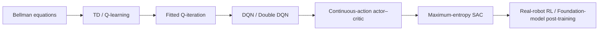
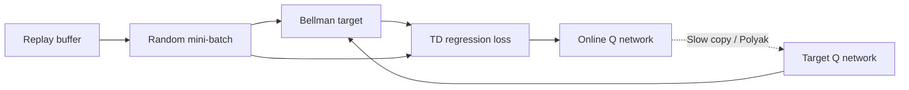
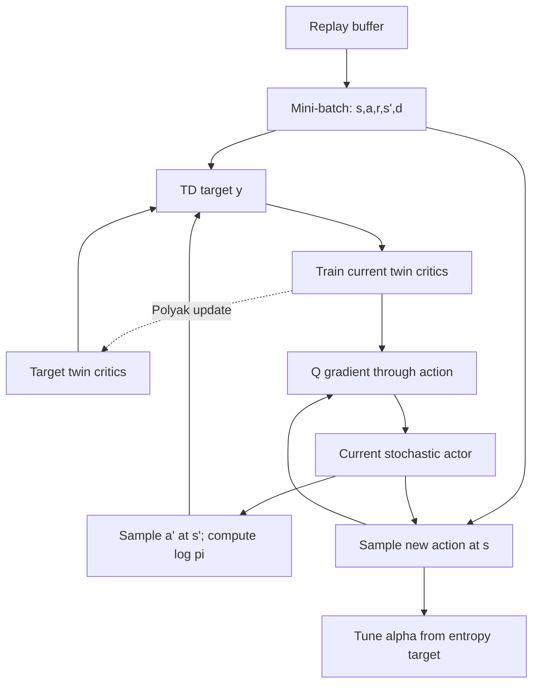
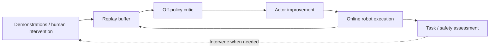

# From Q-Learning to Soft Actor-Critic

[Course repository](https://github.com/zengxiong111/Foundation_of_Embodied_AI) · [中文版](SAC_Complete_Derivation_CN.md) · [PDF](https://zengxiong111.github.io/zengxiong.github.io/files/SAC_Complete_Derivation_EN.pdf)

| Item | Details |
|---|---|
| Topic | Value learning, modern SAC and robot post-training |
| Revision | 2026-10-22 |
| License | CC BY 4.0 · Xiong Zeng and contributors |

>
> **Prerequisites.** Conditional expectation, probability distributions, gradient descent, and neural-network backpropagation. The PPO/actor–critic notes in this course provide complementary background on policy gradients and advantages.
>
> **Sources and originality.** This is an independent set of course notes informed by the value-learning progression in [Berkeley CS185/285](https://rail.eecs.berkeley.edu/deeprlcourse/) and the robotics-oriented perspective of [Stanford CS224R](https://cs224r.stanford.edu/). It is not a translation of either course. Primary papers and teaching resources are cited at the end.

<!-- md-toc:start -->
## Contents

1. [Value Functions and Bellman Equations](#sac-section-01)
2. [Temporal-Difference Learning and Q-Learning](#sac-section-02)
3. [From Fitted Q-Iteration to DQN](#sac-section-03)
4. [From Discrete Q-Learning to Continuous-Action Actor–Critic](#sac-section-04)
5. [Soft Actor-Critic: Maximum Entropy, Three Losses, and the Learning Loop](#sac-section-05)
6. [PPO, DQN, and SAC: Making the Right Choice](#sac-section-06)
7. [Robotics Applications: Demonstrations, Online Learning, and VLA/WAM Post-Training](#sac-section-07)
8. [Appendix A: Mathematical Derivations](#sac-section-08)
9. [Appendix B: Implementation Conventions and Misconceptions](#sac-section-09)
10. [References and Course Resources](#sac-section-10)
<!-- md-toc:end -->

Use states $s\in\mathcal S$, actions $a\in\mathcal A$, reward $r_t$, transition kernel $P(s'\mid s,a)$, policy $\pi(a\mid s)$, and discount $\gamma\in[0,1)$. The indicator $d_t=1$ denotes **true MDP termination**, not an arbitrary time-limit truncation. $\mathcal D$ is the dataset/replay buffer; $\theta$ parameterizes the actor and $\phi$ a critic; bars designate target-network parameters. Unless otherwise stated, we use a stationary, discounted infinite-horizon MDP.

*Figure 1. The conceptual progression. Each transition addresses a limitation of the preceding approach; this is not a mandatory sequence in which every algorithm must be trained.*

***

## 1. Value Functions and Bellman Equations

### 1.1 Why do we need an action-value function?

Reinforcement learning aims to maximize long-term returns during interaction:

$$
G_t=\sum_{k=0}^{\infty}\gamma^k r_{t+k},
\qquad J(\pi)=\mathbb E_{s_0\sim\rho_0,\,\tau\sim\pi}[G_0].
$$

Immediate rewards alone may be insufficient: changing a robot finger posture may produce no immediate reward but improve the probability of a successful screwdriver rotation later. For a given policy $\pi$, define state and action values:

$$
\boxed{
V^\pi(s)=\mathbb E_\pi[G_t\mid s_t=s],\qquad
Q^\pi(s,a)=\mathbb E_\pi[G_t\mid s_t=s,a_t=a].}
$$

$V^\pi(s)$ lets the policy choose the first action, whereas $Q^\pi(s,a)$ fixes that first action and follows the policy thereafter. Thus

$$
V^\pi(s)=\mathbb E_{a\sim\pi(\cdot\mid s)}[Q^\pi(s,a)],
\qquad A^\pi(s,a)=Q^\pi(s,a)-V^\pi(s).
$$

The advantage $A^\pi$ quantifies an action's improvement relative to the policy's average. It is central to the companion PPO notes; here our main objective is learning $Q$.

### 1.2 Bellman expectation: a long-term problem becomes one step

Since $G_t=r_t+\gamma G_{t+1}$, a fixed policy obeys

$$
\boxed{Q^\pi(s,a)=r(s,a)+\gamma\,\mathbb E_{s'\sim P(\cdot\mid s,a),\,a'\sim\pi(\cdot\mid s')}Q^\pi(s',a').}
$$

Here $r(s,a)=\mathbb E[r_t\mid s,a]$ and the next action follows the **specified policy** $\pi$. This is a **policy evaluation** equation: it evaluates an existing policy rather than directly finding the best one.

### 1.3 Bellman optimality: from evaluation to improvement

If an optimal action can be selected, $V^*(s)=\max_aQ^*(s,a)$ (for finite action sets, or whenever the maximum exists). Substitution yields

$$
\boxed{Q^*(s,a)=r(s,a)+\gamma\mathbb E_{s'}\Big[\max_{a'}Q^*(s',a')\Big].}
$$

**The essential distinction:** policy evaluation averages the next action according to $\pi$; optimality takes its maximum. When $Q^\pi$ is known accurately, the greedy policy $\pi_{\mathrm{new}}(s)\in\arg\max_aQ^\pi(s,a)$ is no worse than $\pi$ under the standard exact-improvement conditions. This is the foundation of policy iteration and, later, SAC's critic-evaluation/actor-improvement loop.

### 1.4 A two-action example

Suppose left and right grasps both have zero immediate reward, but the optimal next-state values are 8 and 10, respectively, with $\gamma=0.9$:

$$
Q^*(s,a_L)=0.9\times8=7.2,
\qquad Q^*(s,a_R)=0.9\times10=9.
$$

The actions differ in long-term value even though their immediate rewards are identical. A critic is therefore not merely a regressor for immediate reward: it propagates consequences into the present.

***

## 2. Temporal-Difference Learning and Q-Learning

### 2.1 Monte Carlo versus temporal-difference learning

Monte Carlo (MC) methods use the realized full return $G_t$ as a target. Temporal-difference (TD) methods can update before a trajectory ends by using a current value estimate. For TD(0) policy evaluation,

$$
\delta_t^V=r_t+\gamma(1-d_t)V(s_{t+1})-V(s_t),
\qquad V(s_t)\leftarrow V(s_t)+\eta_t\delta_t^V.
$$

The benefit is prompt learning; the trade-off is **bootstrapping** from an imperfect estimate. TD error therefore contains sampling noise and may propagate the estimator's own errors.

### 2.2 SARSA versus Q-learning: whose next action?

SARSA uses the next action sampled from the policy being executed:

$$
y_t^{\mathrm{SARSA}}=r_t+\gamma(1-d_t)Q(s_{t+1},a_{t+1}).
$$

Classical Q-learning instead applies an optimality backup:

$$
\boxed{y_t^Q=r_t+\gamma(1-d_t)\max_{a'}Q_t(s_{t+1},a'),}
$$

$$
\boxed{Q_{t+1}(s_t,a_t)=Q_t(s_t,a_t)
+\eta_t\big[y_t^Q-Q_t(s_t,a_t)\big].}
$$

The behavior policy $\beta$ may be $\varepsilon$-greedy or differ from the target greedy policy. **Separating data-collection behavior from the learning target** makes Q-learning off-policy. This property does not depend on having a replay buffer.

| Method | Next-action target | Typical setting | Question answered |
|:--|:--|:--|:--|
| SARSA | $Q(s',a')$, $a'\sim\pi$ | On-policy | How good is the behavior being executed? |
| Expected SARSA | $\mathbb E_{a'\sim\pi}Q(s',a')$ | On- or off-policy | What is a specified policy's expected value? |
| Q-learning | $\max_{a'}Q(s',a')$ | Off-policy | What is the best possible next action's value? |

**Numerical sanity check.** With $Q_t(s,a)=4$, $r=1$, $\max_{a'}Q(s',a')=6$, $\gamma=0.9$, and $\eta=0.2$, we obtain $y=6.4$ and $Q_{\mathrm{new}}=4+0.2(6.4-4)=4.48$. The current estimate moves in the direction of its TD error.

### 2.3 N-step returns: propagating delayed success rewards

For a trajectory with no true termination in the intervening $n$ steps, an n-step target is

$$
\boxed{
y_t^{(n)}=\sum_{k=0}^{n-1}\gamma^k r_{t+k}
+\gamma^n\max_{a'}Q_{\bar\phi}(s_{t+n},a').}
$$

With $n=1$ we recover one-step Q-learning. Larger $n$ incorporates more observed rewards and relies less on a distant bootstrap estimate, but generally increases return variance. In sparse-reward robot manipulation, it may help convey later success rewards to earlier contact and grasp actions.

**An important qualification.** If the intervening actions were generated by an off-policy behavior policy, the raw n-step target also reflects that policy's actions. Without a correction it is generally *not* an unbiased n-step optimality backup for the target greedy policy. Algorithms may use importance sampling, Retrace, Tree Backup, or accept the resulting bias deliberately. One should not call arbitrary replayed n-step trajectories unbiased optimal backups.

At a true terminal state, stop reward accumulation and remove subsequent bootstrapping. A time-limit truncation must be handled according to the task's temporal model. For a genuinely finite-horizon MDP, remaining time should be represented consistently as part of the decision state.

### 2.4 Convergence and its limits

Classical tabular Q-learning converges under familiar assumptions, including a stationary finite MDP, bounded rewards, sufficient visits to every state-action pair, and suitable diminishing learning rates. **This guarantee does not transfer directly to DQN or SAC with nonlinear function approximation.** Off-policy learning, bootstrapping, and function approximation can form the *deadly triad*.

***

## 3. From Fitted Q-Iteration to DQN

### 3.1 The missing bridge: fitted Q-iteration

For continuous states or visual observations, a full Q table is impossible to store. Approximate the action-value function by $Q_\phi(s,a)$, freeze a target estimator $Q_{\bar\phi}$, and use data $\mathcal D=\{(s_i,a_i,r_i,s_i',d_i)\}_{i=1}^N$ to construct

$$
y_i=r_i+\gamma(1-d_i)\max_{a'}Q_{\bar\phi}(s_i',a'),
$$

followed by supervised regression

$$
\boxed{\phi_{k+1}\in\arg\min_\phi
\frac1N\sum_{i=1}^N\big(Q_\phi(s_i,a_i)-\operatorname{stopgrad}(y_i)\big)^2.}
$$

This is **fitted Q-iteration (FQI)**: apply Bellman backups to form labels, fit a value function, and repeat with the updated estimate. FQI makes the central difficulty of deep Q-learning clear: **critic fitting looks like supervised regression, but its targets are not fixed ground truth; they bootstrap from estimates produced by the learner.**

Strictly, FQI usually refers to successive fitted backups on a fixed dataset, often with batch-level target refreshes. DQN continuously gathers interaction data and performs stochastic TD regression on replay samples. They share the fitted-Bellman idea but are not identical algorithms.

### 3.2 DQN: replay and target networks

The DQN squared TD loss is

$$
\boxed{J_Q(\phi)=\frac12\mathbb E_{\mathcal D}
\left[\left(Q_\phi(s,a)-y\right)^2\right],\quad
y=r+\gamma(1-d)\max_{a'}Q_{\bar\phi}(s',a').}
$$

The target $y$ is treated as constant for a critic update, yielding a semi-gradient method. Experience replay reduces short-range temporal correlation and permits repeated learning from prior interactions. Target networks reduce rapid target drift. Neither mechanism eliminates distribution shift, value extrapolation errors, or instability in general.

Targets may be copied periodically, $\bar\phi\leftarrow\phi$, or slowly tracked using

$$
\bar\phi\leftarrow(1-\tau)\bar\phi+\tau\phi,\qquad 0<\tau\ll1.
$$

### 3.3 Overestimation, Double DQN, and clipped double Q

Let $\widehat Q_a=Q_a+\epsilon_a$. Even when $\mathbb E[\epsilon_a]=0$ for each action,

$$
\mathbb E\big[\max_a\widehat Q_a\big]
\ge\max_a\mathbb E[\widehat Q_a]=\max_aQ_a.
$$

Maximization tends to select positive errors. Double DQN partially decouples selection from evaluation:

$$
\boxed{a^*=\arg\max_{a'}Q_\phi(s',a'),\qquad
y_{\mathrm{DDQN}}=r+\gamma(1-d)Q_{\bar\phi}(s',a^*).}
$$

SAC's clipped double-Q method instead evaluates a **given continuous action** using $\min(Q_{\bar\phi_1},Q_{\bar\phi_2})$. Both methods address excessive optimism, but their formulas and mechanisms differ; taking a minimum can introduce underestimation.

### 3.4 Update-to-data ratio: sample efficiency is not runtime

Define the **update-to-data ratio (UTD)** by

$$
\boxed{\mathrm{UTD}=\frac{\text{number of gradient updates}}{\text{new environment transitions}}.}
$$

For example, 400 gradient updates per 100 newly collected transitions gives UTD = 4. Off-policy replay permits ratios above one. However, **larger UTD is not automatically better**: repeated fitting may overfit a narrow state-action distribution, propagate bootstrap errors, and encourage an actor to seek falsely high Q-values.

Training efficiency has several distinct metrics: environment transitions, gradient updates, wall-clock training time, real-robot interaction time, and computational cost. PPO can have high throughput in massive parallel simulation; SAC may be more attractive when real-robot interaction is scarce. Neither advantage follows from its algorithm label alone.

### 3.5 The deadly triad

**Off-policy data + bootstrapping + function approximation** may cause instability or divergence. Replay primarily changes the sampling distribution and correlation, target networks slow target movement, and double Q mitigates overestimation. They address different failure mechanisms and are not interchangeable.

*Figure 2. DQN/FQI as fitted Bellman regression. Generating targets and regressing the current critic are distinct operations.*

***

## 4. From Discrete Q-Learning to Continuous-Action Actor–Critic

### 4.1 Why not directly maximize $Q(s,a)$ in continuous control?

For discrete actions, $\max_aQ(s,a)$ can be evaluated by enumeration. Robot joint commands, end-effector pose increments, and torques instead belong to a high-dimensional continuous space $a\in\mathbb R^d$; solving a potentially nonconvex maximization problem inside every TD backup is expensive. **Continuous actions do not mathematically require an actor**, but an explicit policy network offers a practical computational approximation: the expensive action search is *amortized* into a forward pass.

Introduce a deterministic actor $a=\mu_\theta(s)$ and critic $Q_\phi(s,a)$. If the critic is differentiable with respect to its action input, improve the actor by minimizing

$$
J_\mu(\theta)=-\mathbb E_{s\sim\mathcal D}Q_\phi(s,\mu_\theta(s)),
$$

whose pathwise gradient is

$$
\nabla_\theta J_\mu
=-\mathbb E_s\left[\left.\nabla_aQ_\phi(s,a)\right|_{a=\mu_\theta(s)}
\nabla_\theta\mu_\theta(s)\right].
$$

This is the central mechanism behind DDPG-style off-policy continuous control: the critic learns from replay, and its action gradient tells the actor which direction to improve.

### 4.2 DDPG, TD3, and the motivation for SAC

Deterministic actors typically require external action noise for exploration. If a critic overestimates certain actions, the actor can continually optimize toward those errors. TD3 reduces this problem with **clipped double Q-learning, delayed policy updates, and target policy smoothing**. SAC adds a stochastic actor and a maximum-entropy objective, incorporating exploration into the objective rather than merely perturbing deterministic actions.

| Algorithm | Actor | Critic-target principle | Exploration |
|:--|:--|:--|:--|
| DDPG | Deterministic $\mu_\theta(s)$ | Single Q with target networks | Added action noise |
| TD3 | Deterministic $\mu_\theta(s)$ | Min of two Q estimates; smoothed target actions | Added action noise |
| SAC | Stochastic $\pi_\theta(a\mid s)$ | Soft Bellman backup with twin Q | Maximum-entropy optimization |

These algorithms represent different trade-offs in exploration, critic errors, and action optimization; no one method is uniformly superior.

***

## 5. Soft Actor-Critic: Maximum Entropy, Three Losses, and the Learning Loop

### 5.1 Why not maximize reward alone?

Maximum-entropy RL adds policy entropy to discounted return. Under a common modern SAC convention,

$$
\boxed{J_{\mathrm{ME}}(\pi)
=\mathbb E_{\tau\sim\pi}\left[
\sum_{t=0}^{\infty}\gamma^t
\big(r_t-\alpha\log\pi(a_t\mid s_t)\big)
\right],\qquad\alpha\ge0.}
$$

The policy entropy is $\mathcal H(\pi(\cdot\mid s))=\mathbb E[-\log\pi(a\mid s)]$. The temperature $\alpha$ regulates the trade-off between high-value actions and higher-entropy behavior; $\alpha\to0$ approaches ordinary reward maximization. For continuous actions, the quantity is **differential entropy**, which can be negative and depends on action coordinates. A target entropy must therefore not be interpreted as a unit-free universal constant.

### 5.2 Soft Bellman evaluation: which entropy terms enter which value?

We fix a precise convention. The soft state value includes current and future entropy terms. The soft action value fixes the present action and starts counting entropy from the *next* time step:

$$
\begin{aligned}
V_{\mathrm{soft}}^\pi(s)
&=\mathbb E_\pi\left[\sum_{t=0}^\infty
\gamma^t(r_t-\alpha\log\pi(a_t\mid s_t))\mid s_0=s\right],\\
Q_{\mathrm{soft}}^\pi(s,a)
&=\mathbb E_\pi\left[r_0+
\sum_{t=1}^\infty\gamma^t(r_t-\alpha\log\pi(a_t\mid s_t))
\mid s_0=s,a_0=a\right].
\end{aligned}
$$

Consequently,

$$
V_{\mathrm{soft}}^\pi(s)=
\mathbb E_{a\sim\pi}\left[Q_{\mathrm{soft}}^\pi(s,a)-\alpha\log\pi(a\mid s)\right],
$$

and

$$
\boxed{Q_{\mathrm{soft}}^\pi(s,a)
=r(s,a)+\gamma\mathbb E_{s',a'\sim P,\pi}
\left[Q_{\mathrm{soft}}^\pi(s',a')-\alpha\log\pi(a'\mid s')\right].}
$$

This is **soft policy evaluation**. The critic evaluates the **current stochastic actor** rather than directly applying classical Q-learning's optimality backup $\max_{a'}Q(s',a')$.

### 5.3 From the optimal soft policy to the actor loss

At a fixed state $s$ and a fixed candidate function $Q$, optimize a distribution $p(a)$ via

$$
\mathbb E_{a\sim p}Q(s,a)+\alpha\mathcal H(p).
$$

For finite actions, Lagrange multipliers give the Boltzmann policy

$$
p^*(a\mid s)=\frac{\exp(Q(s,a)/\alpha)}{\sum_b\exp(Q(s,b)/\alpha)}.
$$

Substitution yields $V^*_{\mathrm{soft}}(s)=\alpha\log\sum_a\exp(Q^*_{\mathrm{soft}}(s,a)/\alpha)$, which approaches $\max_aQ(s,a)$ as $\alpha\to0$. For continuous actions, the sum becomes an integral under suitable integrability and reference-measure assumptions.

Directly normalizing this Boltzmann density is intractable in high-dimensional continuous spaces. Instead, use a parameterized actor $\pi_\theta$ and minimize the reverse KL from that actor to the Boltzmann density:

$$
D_{\mathrm{KL}}\left(\pi_\theta(\cdot\mid s)\;\|\;p^*(\cdot\mid s)\right)
=\mathbb E_{a\sim\pi_\theta}
\left[\log\pi_\theta(a\mid s)-\frac{Q(s,a)}{\alpha}\right]+\log Z(s).
$$

As $\log Z(s)$ does not depend on actor parameters, we obtain the modern SAC objective

$$
\boxed{J_\pi(\theta)
=\mathbb E_{s\sim\mathcal D,\,a\sim\pi_\theta(\cdot\mid s)}
\left[\alpha\log\pi_\theta(a\mid s)
-\min_{i=1,2}Q_{\phi_i}(s,a)\right].}
$$

The practical clipped minimum of two critics is an estimator design choice, not a prerequisite for the ideal Boltzmann argument. The two terms encourage suitable exploration and high-value actions, respectively.

### 5.4 Critic learning: off-policy soft TD regression

Modern continuous-action SAC generally employs critics $Q_{\phi_1},Q_{\phi_2}$ and target critics $Q_{\bar\phi_1},Q_{\bar\phi_2}$. For replay data $(s,a,r,s',d)$, sample a **new next action** $a'\sim\pi_\theta(\cdot\mid s')$ from the *current* actor and set

$$
\boxed{y=r+\gamma(1-d)
\left[\min_{j=1,2}Q_{\bar\phi_j}(s',a')
-\alpha\log\pi_\theta(a'\mid s')\right].}
$$

Then independently minimize

$$
\boxed{J_{Q_i}(\phi_i)=\frac12\mathbb E_{\mathcal D}
\left[\big(Q_{\phi_i}(s,a)-\operatorname{stopgrad}(y)\big)^2\right],\quad i=1,2.}
$$

Two details are decisive. First, replay supplies $(s,a,r,s',d)$, while the **next action $a'$ must be resampled from the current policy**. Second, the TD target is detached during critic fitting; the current critic must not change its labels through the target branch.

In a stationary MDP, the conditional environment transition distribution at a given $(s,a)$ does not depend on the policy that collected it. This supports off-policy Bellman regression. Still, insufficient coverage and function approximation can produce serious errors at actions preferred by the new actor; off-policy does not mean that arbitrary replay is reliable.

### 5.5 The actor: reparameterization and the tanh-Gaussian distribution

A common policy network outputs mean $\mu_\theta(s)$ and standard deviation $\sigma_\theta(s)$, then constructs a bounded action using parameter-independent noise:

$$
\boxed{\epsilon\sim\mathcal N(0,I),\qquad
\nu=\mu_\theta(s)+\sigma_\theta(s)\odot\epsilon,
\qquad a=\tanh\nu.}
$$

This **reparameterization trick** transfers stochasticity to $\epsilon$, enabling gradients through $Q_\phi(s,a)$ and the action path. The actor gradient contains $-\nabla_aQ(s,a)\,\partial a/\partial\theta$ as well as the **total derivative** of the entropy term $\alpha\log\pi_\theta(a\mid s)$. Freeze critic *parameters* during the actor step, but retain the critic's gradient with respect to actions.

The tanh transformation changes the probability density. Its Jacobian correction is mandatory:

$$
\boxed{\log\pi_\theta(a\mid s)
=\log\mathcal N(\nu;\mu_\theta(s),\operatorname{diag}\sigma_\theta^2(s))
-\sum_{j=1}^d\log(1-\tanh^2\nu_j).}
$$

Stable implementations avoid naively taking $\log(0)$ near saturated actions. Mapping normalized actions to physical joint, Cartesian, or torque commands via an invertible affine transformation contributes another constant Jacobian term to *physical-action density*. If a separate controller clips actions or applies a safety filter, the *executed-action distribution* need not equal the actor's tanh-Gaussian distribution.

### 5.6 Temperature tuning: where does the entropy constraint come from?

A fixed temperature can behave very differently as reward scaling or action dimensionality changes. A common formulation introduces a desired average entropy:

$$
\max_\pi J_R(\pi),\qquad
\text{s.t.}\quad \mathbb E[-\log\pi(a\mid s)]\ge\mathcal H_{\mathrm{target}}.
$$

The corresponding Lagrangian leads, for a fixed actor, to temperature minimization of

$$
\boxed{J_\alpha(\alpha)=
\mathbb E_{s\sim\mathcal D,a\sim\pi_\theta}
\left[\alpha(-\log\pi_\theta(a\mid s)-\mathcal H_{\mathrm{target}})\right].}
$$

If current entropy falls below the target, minimizing this loss raises $\alpha$; if entropy is above the target, $\alpha$ decreases. Parameterizing $\eta=\log\alpha$ enforces $\alpha=e^\eta>0$. Some implementations optimize the exact exponential objective in $\eta$, whereas others use a surrogate loss linear in $\eta$ and detached entropy errors. These objectives have the same gradient direction but different gradient scaling, and should not be called algebraically identical (Appendix A).

### 5.7 One complete SAC update

*Figure 3. SAC has three learning paths: TD regression for the critics, soft policy improvement for the actor, and entropy-constraint tuning for temperature.*

| Step | Operation | Common mistake to avoid |
|:--|:--|:--|
| 1 | Interact with the environment and store transitions | Executed commands must obey physical safety limits |
| 2 | Sample replay and resample $a'$ at $s'$ for the target | Reusing an old buffer action as if it came from the current policy |
| 3 | Minimize both critic TD losses | Forgetting stop-gradient on the target |
| 4 | Sample fresh actor actions at $s$, and optimize Q plus entropy | Detaching the critic's gradient with respect to actor actions |
| 5 | Tune $\alpha$ using the entropy target | Treating temperature optimization as direct reward optimization |
| 6 | Polyak-update target critics and repeat | Assuming UTD and actor/critic update rates must coincide |

A common modern SAC network set consists of an actor, two current critics, two target critics, and a temperature parameter. Early SAC v1 additionally trained a distinct $V_\psi(s)$ network. **The concept of a soft state value remains even when there is no separate V network.**

### 5.8 What exactly do the three losses learn?

**Critic:** predicts long-horizon soft return after a chosen action, using rewards, a target critic, and the current actor. **Actor:** moves toward actions the critic scores highly while retaining a controlled amount of randomness; backpropagation through environment dynamics is not required. **Temperature:** adjusts how strongly the objective weighs Q versus entropy to approach a target level of policy entropy.

They also have different failure modes. Critics may overestimate poorly covered actions or amplify bootstrap errors. Actors may seek spurious high-value regions. A large $\alpha$ may sacrifice task reward, while a small one can suppress exploration. A declining critic loss or increasing mean Q does not establish task success; report actual return, success rate, constraint violations, and value calibration.

***

## 6. PPO, DQN, and SAC: Making the Right Choice

### 6.1 Data regimes matter more than whether there is an actor

| Dimension | DQN / Double DQN | PPO (standard) | SAC (modern continuous-action) |
|:--|:--|:--|:--|
| Typical policy | Discrete greedy action | Parameterized stochastic | Parameterized stochastic |
| Value objective | Optimality TD backup | Often $V$ fitted to returns/GAE | Current-policy soft TD backup |
| Data regime | Off-policy | Mainly on-policy | Off-policy |
| Reusing old data | Often convenient | Typically a few epochs over recent rollouts | Longer-term replay-buffer reuse |
| Actions | Typically discrete | Discrete or continuous | Typically continuous |
| Main limitation | Continuous $\max$ is costly | Can require more environment samples | Critic extrapolation and actor exploitation of Q error |

**Online versus offline** asks whether the learner collects new environment data during training. **On-policy versus off-policy** asks which behavior-policy distributions a learning objective can use. Online SAC is off-policy despite collecting data continuously; running vanilla SAC on a fixed demonstration dataset does not automatically yield sound offline RL.

### 6.2 Why SAC may use fewer samples but run more slowly

PPO generally updates from recent rollouts with advantage estimates, which fits massive parallel simulation. SAC repeatedly regresses critics and optimizes the actor using replayed transitions, potentially reducing environment-sample requirements but increasing computation per transition. Comparisons should report environment steps, task success, wall-clock time, GPU cost, control frequency, and safety violations. The word “off-policy” alone implies no universal performance advantage.

PPO's common policy-gradient form includes $\nabla_\theta\log\pi_\theta(a\mid s)\widehat A(s,a)$ together with probability-ratio clipping. Standard continuous-action SAC instead exploits reparameterized paths and $\nabla_aQ\,\partial a/\partial\theta$. **Both may use stochastic policies; the key differences are the objective, gradient estimator, and data-reuse mechanism, not “stochastic versus deterministic.”**

### 6.3 A practical selection rule

For conceptual value learning with discrete actions, start with DQN. For high-throughput parallel simulation, PPO is a strong baseline for many motion-control tasks. For continuous actions with expensive real-world data and stable observation/reward interfaces, SAC deserves serious consideration. For complex flow/diffusion action generators or purely fixed offline datasets, first inspect tractable action densities, data support, and available optimization interfaces rather than applying standard SAC unchanged.

***

## 7. Robotics Applications: Demonstrations, Online Learning, and VLA/WAM Post-Training

### 7.1 Why SAC is useful for studying data reuse on real robots

Every real-robot rollout consumes wall-clock time, potentially wears hardware, and can incur contact or collision risks. Discarding interaction data after a single update may be costly. SAC's replay buffer and off-policy critic provide a mechanism for **learning repeatedly from valuable experience**. They do not, by themselves, solve safe exploration, sensor delays, state-estimation errors, or actuator constraints.

A representative manipulation task might combine head/wrist cameras and joint states as observations. Actions could be end-effector pose increments or joint targets, while rewards reflect task progress, stable grasping, and constraints. The physical meaning of an action, its duration, the low-level controller, and observation synchronization must be specified before training. A network output in $[-1,1]^d$ is not automatically an executable torque command.

### 7.2 HIL-SERL: from demonstrations to online RL

[HIL-SERL](https://arxiv.org/abs/2410.19113) combines human participation, demonstrations, and online reinforcement learning for precise real-world robot manipulation. Without reproducing the entire system, it illustrates a useful conceptual training loop:

*Figure 4. A conceptual robot-data feedback loop. Demonstrations, intervention, and autonomous interaction all supply data, although their distributions and safety roles differ.*

**Why RL if behavior cloning is available?** Behavior cloning (BC) learns what demonstrators did, while RL improves realized long-term reward and may learn recovery actions outside the demonstration distribution. **Why maintain human intervention?** Real-world exploration is risky and sparse success rewards make useful experience difficult to obtain; intervention can improve safety and data quality. **Why not simply fill replay with more data?** The critic still needs adequate action coverage, consistent rewards and termination semantics, and a suitable balance between demonstration and online transitions.

[RLPD](https://arxiv.org/abs/2302.02948) provides complementary background on combining offline and online data efficiently. HIL-SERL, RLPD, and original SAC are related but distinct methods. Results on particular robot tasks should not be treated as universal guarantees.

### 7.3 Five interfaces that are easy to overlook in real-robot RL

1. **Action semantics.** Does $a_t$ mean joint position, velocity, torque, or end-effector increment? Different low-level controllers induce different closed-loop dynamics.
2. **Temporal scales.** Policy frequency, execution duration, sensor latency, and action-chunk length determine the meaning of one transition.
3. **State estimation.** RGB-D occlusion, contact discontinuities, and pose-estimation errors can produce partial observability. History windows or hidden states require reconsideration of the Markov assumption.
4. **Reward and safety.** Sparse success signals may prevent exploration; shaped rewards may be exploited. Joint limits, speed constraints, and collision safeguards should not depend solely on a learned value function.
5. **Data distribution.** Replay should ideally cover diverse initializations, failures, and recovery, not only ideal successful demonstrations. Safety filtering changes the distribution of executed behavior.

### 7.4 From single-step SAC to action-chunk value learning

Embodied foundation models often predict an action chunk of horizon $H$, $A_t=(a_t,\ldots,a_{t+H-1})$, but execute only $K\le H$ low-level actions before obtaining a new observation. If those $K$ steps form a macro-decision and macro observations are sufficient for the Markov property, the appropriate discounted backup is

$$
\boxed{y_t^{(K)}=
\sum_{j=0}^{K-1}\gamma^j r_{t+j}
+\gamma^K(1-d_{t:t+K})V(o_{t+K}),}
$$

where $d_{t:t+K}=1$ means true termination occurs in the interval; if termination occurs early, the reward sum is shortened accordingly. Random-duration macro-actions generally require the duration-dependent discounting of a semi-Markov decision process (SMDP).

**Why is standard one-step SAC not a drop-in solution?** First, a generated chunk and the action actually executed may differ in duration or content. Second, Transformer/flow/diffusion action generators may lack tractable marginal $\log\pi(A\mid o)$ or the particular differentiable reparameterization assumed for tanh-Gaussian SAC. Even if one can learn $Q(o,A)$, optimizing the generator requires a valid, stable actor-update interface. Possibilities include explicit-density action heads, residual actors, latent-action optimization, generator-specific value guidance, and alternative policy-gradient estimators.

These methods belong in the subsequent [post-training course](Embodied_Post_Training_EN.md). **The role of the present notes is to establish common value-learning and replay foundations, not to present SAC as a universal post-trainer for all VLA/WAM architectures.**

### 7.5 The shortest conceptual summary

$$
\begin{gathered}
\text{Bellman evaluation / optimality}
\longrightarrow\text{TD / Q-learning}
\longrightarrow\text{FQI / DQN},\\
\text{Continuous-action }\arg\max\text{ is expensive}
\longrightarrow\text{Actor--critic}
\longrightarrow\text{Soft policy iteration / SAC},\\
\text{Replay + value learning}
\longrightarrow\text{Real-robot data reuse}
\longrightarrow\text{Foundation-model post-training interfaces}.
\end{gathered}
$$

***

## Appendix A: Mathematical Derivations

This appendix preserves the detailed derivations of the previous notes. First-time readers can skip it without losing the conceptual flow of Chapters 1–7.

### A.1 Bellman contraction in the exact tabular setting

Define $\mathcal T^*Q=r+\gamma\mathbb E_{s'}\max_{a'}Q(s',a')$. Because

$$
\left|\max_a x_a-\max_a y_a\right|\le\max_a|x_a-y_a|,
$$

we obtain

$$
\|\mathcal T^*Q_1-\mathcal T^*Q_2\|_\infty
\le\gamma\|Q_1-Q_2\|_\infty.
$$

With $0\le\gamma<1$ and the usual boundedness conditions, $\mathcal T^*$ is a contraction; a unique fixed point $Q^*$ exists and exact value iteration converges. **This does not establish convergence of stochastic nonlinear DQN parameter updates.**

### A.2 Deriving softmax, log-sum-exp, and the soft Bellman operator

Fix a state $s$, a finite action set, and $\alpha>0$. Optimize the probability vector $p=(p_a)$:

$$
F(p)=\sum_a p_aQ_a-\alpha\sum_a p_a\log p_a,
\qquad\sum_a p_a=1.
$$

The Lagrangian is $F(p)+\lambda(\sum_a p_a-1)$. Stationarity gives

$$
Q_a-\alpha(\log p_a+1)+\lambda=0.
$$

Normalization yields

$$
p_a^*=\frac{e^{Q_a/\alpha}}{\sum_b e^{Q_b/\alpha}},
\qquad
\max_pF(p)=\alpha\log\sum_a e^{Q_a/\alpha}.
$$

Set $M=\max_aQ_a$. Then

$$
\alpha\log\sum_ae^{Q_a/\alpha}
=M+\alpha\log\sum_a e^{(Q_a-M)/\alpha},
$$

which satisfies $M\le\alpha\log\sum_ae^{Q_a/\alpha}\le M+\alpha\log|\mathcal A|$. The expression therefore approaches the hard maximum as $\alpha\to0^+$. Inserting the optimal soft value into a one-step backup gives the **optimal** soft Bellman operator:

$$
(\mathcal T^*_{\mathrm{soft}}Q)(s,a)
=r(s,a)+\gamma\mathbb E_{s'}
\left[\alpha\log\sum_{a'}e^{Q(s',a')/\alpha}\right].
$$

This operator is different from the **fixed-policy** soft Bellman evaluation used by SAC's critic. One must not simply replace its log-sum-exp by a single actor sample and declare the operators identical.

### A.3 Soft policy improvement and reverse KL

Freeze the old policy's soft Q and define

$$
\pi_B(a\mid s)=\frac{e^{Q^{\pi_{\mathrm{old}}}_{\mathrm{soft}}(s,a)/\alpha}}{Z(s)},
\qquad Z(s)=\int_{\mathcal A} e^{Q^{\pi_{\mathrm{old}}}_{\mathrm{soft}}(s,a')/\alpha}\,da'.
$$

Under integrability, absolute-continuity, and finite-normalizer conditions,

$$
\alpha D_{\mathrm{KL}}(\pi_\theta\|\pi_B)
=\mathbb E_{a\sim\pi_\theta}
\left[\alpha\log\pi_\theta(a\mid s)
-Q_{\mathrm{soft}}^{\pi_{\mathrm{old}}}(s,a)\right]
+\alpha\log Z(s).
$$

The last term does not depend on $\theta$, giving the actor objective. Exact soft policy iteration enjoys improvement guarantees when its evaluation and improvement steps are exact under appropriate conditions; **a finite-data parametric actor and imperfect critic optimized by SGD do not automatically inherit monotonic improvement**.

### A.4 Reparameterization and action-density conventions

Take $\nu=\mu_\theta(s)+\sigma_\theta(s)\odot\epsilon$ with $\epsilon\sim\mathcal N(0,I)$ and $a=\tanh\nu$. For a differentiable invertible transformation $f:\nu\mapsto a$,

$$
\log\pi(a\mid s)=\log p_\nu(\nu\mid s)
-\log\left|\det\frac{\partial a}{\partial\nu}\right|.
$$

The diagonal tanh Jacobian has entries $1-\tanh^2\nu_j$, giving the subtraction of $\sum_j\log(1-\tanh^2\nu_j)$ in the main text. For physical control $u=c+Sa$ with invertible diagonal scale matrix $S$, physical-action log density includes an additional $-\log|\det S|$. Constant scale terms may cancel from some actor gradients, but affect entropy interpretation and target-entropy design.

### A.5 Temperature dual variable: exact and surrogate objectives

For the constraint $\overline{\mathcal H}\ge\mathcal H_{\mathrm{target}}$, the Lagrangian is

$$
\mathcal L(\pi,\alpha)
=J_R(\pi)+\alpha(\overline{\mathcal H}(\pi)-\mathcal H_{\mathrm{target}}),
\qquad\max_\pi\min_{\alpha\ge0}\mathcal L.
$$

For a fixed actor, minimize $J_\alpha=\mathbb E[\alpha(-\log\pi-\mathcal H_{\mathrm{target}})]$. With $\eta=\log\alpha$, the strictly reparameterized objective is

$$
J_\eta^{\mathrm{exact}}(\eta)
=-\mathbb E\left[e^\eta(\log\pi+\mathcal H_{\mathrm{target}})\right],
$$

whereas a common practical surrogate is

$$
J_\eta^{\mathrm{sur}}(\eta)
=-\mathbb E\left[\eta\,\operatorname{stopgrad}
(\log\pi+\mathcal H_{\mathrm{target}})\right].
$$

Their gradient directions agree for $\alpha>0$, but they differ in magnitude and are not algebraically identical objectives.

### A.6 SAC v1 versus modern SAC

Early SAC v1 used an additional explicit state-value model $V_\psi(s)$:

$$
J_V(\psi)=\frac12\mathbb E_s\left[
\left(V_\psi(s)-\operatorname{stopgrad}
\mathbb E_{a\sim\pi_\theta}[\min_iQ_{\phi_i}(s,a)-\alpha\log\pi_\theta(a\mid s)]\right)^2\right].
$$

The Q target could then be $r+\gamma(1-d)V_{\bar\psi}(s')$. Modern implementations commonly omit the separate V network and approximate the next-state soft value directly from target critics and a sampled next action. Accordingly, these notes emphasize the modern SAC architecture.

***

## Appendix B: Implementation Conventions and Misconceptions

### B.1 Interface checklist

| Item | Correct interpretation | Frequent error |
|:--|:--|:--|
| Termination | Do not bootstrap past a true terminal state | Treat all time limits as terminal |
| Replay | Record the action actually executed | Store an intended action that the actuator did not execute |
| Critic target | Resample $a'$ at $s'$ from the current actor | Reuse stale replay actions indiscriminately |
| Gradients | Detach the target; retain $\nabla_aQ$ in the actor step | Detach the actor's Q-to-action gradient |
| Twin Q | Take a minimum across critic estimates *at a fixed action* | Mistake $\min_iQ_i$ for action minimization |
| Squashing | Correct log density by the tanh Jacobian | Use unsquashed Gaussian log probability |
| Action scaling | Distinguish normalized values from physical units | Interpret $[-1,1]$ directly as torques |
| Diagnostics | Inspect success, return, safety, and calibration | Judge success by increasing Q estimates alone |

### B.2 Five common misconceptions

1. **“Q-learning is off-policy because it uses replay.”** False. Off-policy is about behavior versus learning targets; tabular Q-learning is off-policy even without replay.
2. **“The SAC critic simply learns optimal $Q^*$.”** Inaccurate. It evaluates the current stochastic actor's soft Q, with actor improvement alternating with evaluation.
3. **“Increasing UTD always increases sample efficiency.”** False. Excess updates may magnify extrapolation and bootstrap errors.
4. **“Taking the minimum of two critics solves offline RL.”** False. Unseen actions remain problematic with fixed data; conservative value learning or policy constraints may be needed.
5. **“Any continuous-action VLA/WAM can be trained with standard SAC.”** False. One must inspect action density, generator gradients, macro-action time semantics, and executed-action distributions.

### B.3 Conceptual self-check (no programming exercises)

- Why are FQI regression targets unlike fixed labels in ordinary supervised learning?
- How can n-step returns become biased when behavior and target policies differ?
- Why is Double DQN not the same formula as SAC's clipped double Q?
- Why can increased UTD reduce environment sampling while increasing computation or instability?
- Why should critic parameters be frozen during actor updates without disabling $\nabla_aQ$?
- Why must the distinction between chunk horizon $H$ and actually executed length $K$ appear in the Bellman backup?

***

## References and Course Resources

**Course materials**

1. UC Berkeley, **CS185/285: Deep Reinforcement Learning** (2026). [Course home](https://rail.eecs.berkeley.edu/deeprlcourse/) · [Lecture 7: Value-Based RL](https://rail.eecs.berkeley.edu/deeprlcourse/static/slides/lec-7.pdf) · [Lecture 8: Q-learning in Practice](https://rail.eecs.berkeley.edu/deeprlcourse/static/slides/lec-8.pdf) · [Section 4: DQN and SAC](https://rail.eecs.berkeley.edu/deeprlcourse/static/sections/section-4.pdf).
2. Stanford, **CS224R: Deep Reinforcement Learning** (2026). [Course home](https://cs224r.stanford.edu/) · [Lecture 5: Off-Policy Actor Critic](https://cs224r.stanford.edu/slides/05_cs224r_offpolicy_actor_critic_2026.pdf) · [Lecture 6: Q-Learning](https://cs224r.stanford.edu/slides/06_cs224r_qlearning_2026.pdf).

**Foundational and related publications**

3. Sutton & Barto (2018). *Reinforcement Learning: An Introduction*, 2nd ed. [Online text](http://incompleteideas.net/book/the-book-2nd.html).
4. Watkins & Dayan (1992). **Q-learning.** *Machine Learning*. [DOI](https://doi.org/10.1007/BF00992698).
5. Riedmiller (2005). **Neural Fitted Q Iteration.** [Paper](https://link.springer.com/chapter/10.1007/11564096_32).
6. Mnih et al. (2015). **Human-level control through deep reinforcement learning.** *Nature*. [DOI](https://doi.org/10.1038/nature14236).
7. van Hasselt, Guez & Silver (2016). **Deep Reinforcement Learning with Double Q-learning.** [arXiv:1509.06461](https://arxiv.org/abs/1509.06461).
8. Lillicrap et al. (2015). **Continuous Control with Deep Reinforcement Learning.** [arXiv:1509.02971](https://arxiv.org/abs/1509.02971).
9. Fujimoto, van Hoof & Meger (2018). **Addressing Function Approximation Error in Actor-Critic Methods (TD3).** [arXiv:1802.09477](https://arxiv.org/abs/1802.09477).
10. Haarnoja et al. (2018). **Soft Actor-Critic: Off-Policy Maximum Entropy Deep RL with a Stochastic Actor.** [arXiv:1801.01290](https://arxiv.org/abs/1801.01290).
11. Haarnoja et al. (2018). **Soft Actor-Critic Algorithms and Applications.** [arXiv:1812.05905](https://arxiv.org/abs/1812.05905).
12. Ball et al. (2023). **Efficient Online Reinforcement Learning with Offline Data (RLPD).** [arXiv:2302.02948](https://arxiv.org/abs/2302.02948).
13. Luo et al. (2024). **HIL-SERL: Precise and Dexterous Robotic Manipulation via Human-in-the-Loop Reinforcement Learning.** [arXiv:2410.19113](https://arxiv.org/abs/2410.19113).
14. OpenAI Spinning Up. **Soft Actor-Critic.** [Algorithm documentation](https://spinningup.openai.com/en/latest/algorithms/sac.html).

***

*Use and license: original exposition follows the course repository's [CC BY 4.0](https://creativecommons.org/licenses/by/4.0/) license. Third-party course materials and papers retain their own respective licenses. These notes provide teaching explanations, not training-performance guarantees, runnable code, or laboratory exercises.*
