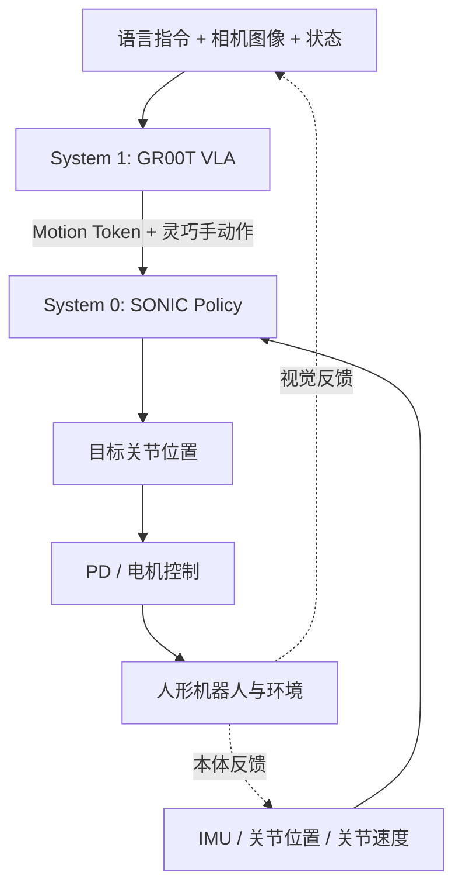
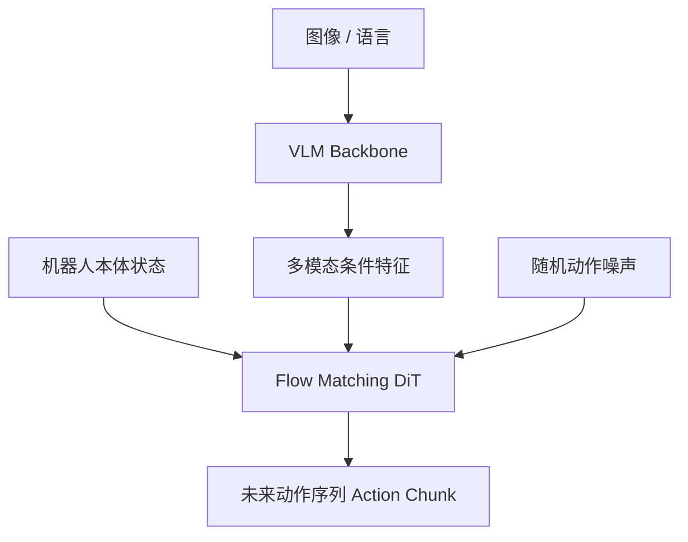
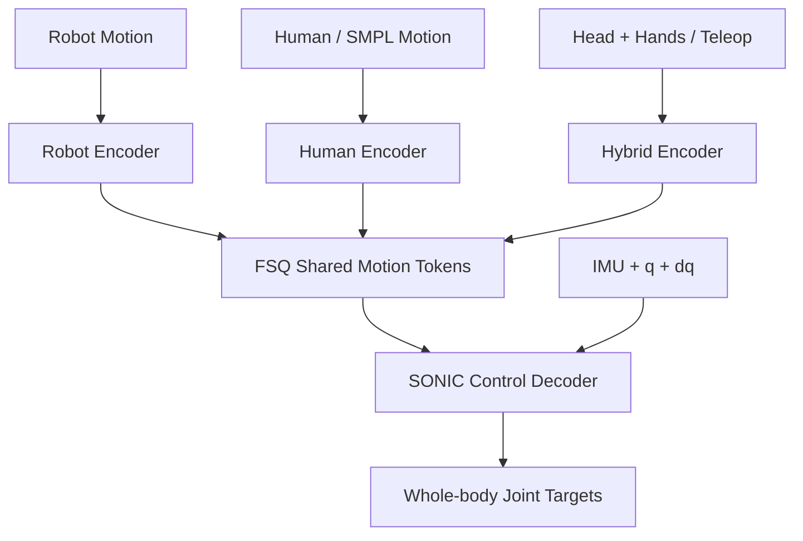
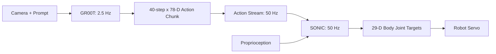

# 人形机器人 System 1（VLA）与 System 0（全身运动控制）

<!-- course-meta:start -->
[课程首页](https://github.com/zengxiong111/Foundation_of_Embodied_AI/blob/main/README.zh-CN.md) · [English](https://github.com/zengxiong111/Foundation_of_Embodied_AI/blob/main/md/System1_System0_GR00T_SONIC_EN.md) · [PDF](https://zengxiong111.github.io/zengxiong.github.io/files/System1_System0_GR00T_SONIC_CN.pdf)

| 项目 | 说明 |
|---|---|
| 适用范围 | SONIC 论文集成：GR00T N1.5；文档 G1 工作流：N1.7、78 维动作、2.5 Hz 推理 / 50 Hz 动作流。Checkpoint 与观测配置须匹配 |
| 文档核验日期 | 2026-10-18 |
| 许可 | CC BY 4.0 · Xiong Zeng and contributors |

**核验边界：** 文档整理与上游引用快照核对；未进行教程环境、训练或硬件验证。 版本与固定源码引用见[版本说明](https://github.com/zengxiong111/Foundation_of_Embodied_AI/blob/main/VERSIONS.zh-CN.md)。原创教材采用 [CC BY 4.0](https://creativecommons.org/licenses/by/4.0/)，第三方引用、图片及代码遵循其原有许可；注明来源不等于拥有再许可权。
<!-- course-meta:end -->

<!-- course-toc:start -->
## 目录

- [1. 整体架构：两个系统分别解决什么问题](#course-section-01)
  - [1.1 为什么不能只靠一个模型？](#course-section-02)
  - [1.2 核心区别](#course-section-03)
  - [1.3 两个闭环，而不是一个开环](#course-section-04)
- [2. System 1：GR00T 如何理解任务并生成动作](#course-section-05)
  - [2.1 VLA 是什么？](#course-section-06)
  - [2.2 GR00T 的两部分结构](#course-section-07)
  - [2.3 为什么一次预测多个动作？](#course-section-08)
  - [2.4 Flow Matching 的直觉解释](#course-section-09)
  - [2.5 VLA 输出可以如何表示？](#course-section-10)
  - [2.6 GR00T 的训练分为哪几步？](#course-section-11)
- [3. System 0：SONIC 如何学习全身运动控制](#course-section-12)
  - [3.1 什么是全身运动控制（WBC）？](#course-section-13)
  - [3.2 先认识一条常见替代路线：下半身 RL + 上半身 IK](#course-section-14)
  - [3.3 SONIC 的核心任务：Motion Tracking](#course-section-15)
  - [3.4 SONIC 的网络：编码器 + Motion Token + 控制解码器](#course-section-16)
  - [3.5 SONIC 如何从 token 得到关节控制？](#course-section-17)
  - [3.6 SONIC 的强化学习训练：PPO + 跟踪奖励](#course-section-18)
  - [3.7 SONIC 学到的是什么，又没有学到什么？](#course-section-19)
- [4. 两个系统如何通过 Motion Token 连接](#course-section-20)
  - [4.1 最关键的接口公式](#course-section-21)
  - [4.2 官方实例中的准确维度](#course-section-22)
  - [4.3 两种控制频率如何配合？](#course-section-23)
  - [4.4 为什么这种分层结构更容易泛化？](#course-section-24)
  - [4.5 分层接口必须处理的工程细节](#course-section-25)
- [5. 完整例子：走路、抓取、踩踏板、投放](#course-section-26)
  - [5.1 示例任务](#course-section-27)
  - [5.2 各模块分别做什么？](#course-section-28)
  - [5.3 一个容易混淆的边界](#course-section-29)
- [6. 从零训练、采集数据与真机部署](#course-section-30)
  - [6.1 Step 1：获得可用的 System 0](#course-section-31)
  - [6.2 Step 2：通过 SONIC 进行 VR 遥操作示教](#course-section-32)
  - [6.3 Step 3：微调 GR00T，让它输出 SONIC 动作](#course-section-33)
  - [6.4 Step 4：通过 PolicyServer + SONIC 部署](#course-section-34)
  - [6.5 Step 5：如何评价整体系统？](#course-section-35)
- [7. 研究方向、实验设计与常见误区](#course-section-36)
  - [7.1 应该分别改进什么？](#course-section-37)
  - [7.2 建议的最小消融实验](#course-section-38)
  - [7.3 五个常见误区](#course-section-39)
- [8. 总结与参考资料](#course-section-40)
  - [8.1 最值得记住的三条结论](#course-section-41)
  - [8.2 参考论文与官方资源](#course-section-42)
<!-- course-toc:end -->

**章节知识地图**


<a id="course-section-01"></a>

## 1. 整体架构：两个系统分别解决什么问题

<a id="course-section-02"></a>

### 1.1 为什么不能只靠一个模型？

人形机器人同时面临两类难题：一类是**语义与任务问题**，例如识别水杯、理解“把杯子放进箱子”，并选择合理的动作；另一类是**动力学与接触问题**，例如双腿站稳、重心移动、落脚和弯腰时不跌倒。

在实际系统中，一种有效的工程思路是将它们分成两个层次：

- **System 1 / VLA（高层）：** 处理相机图像、语言指令和机器人状态，预测未来动作或运动潜变量。
- **System 0 / WBC（低层）：** 处理运动参考、关节角、关节速度、IMU 等，实时生成全身关节控制目标。



**重点：** GR00T 不只是传统任务规划器，它可直接生成短时动作序列；SONIC 也不只是被动执行预设轨迹，它会结合实时机器人状态不断调整关节目标。

<a id="course-section-03"></a>

### 1.2 核心区别

| 对比维度 | System 1：GR00T | System 0：SONIC |
|:---|:---|:---|
| 核心目标 | 理解任务，生成合适动作 | 跟踪动作，维持动态稳定 |
| 主要输入 | 图像、语言、机器人状态 | 运动目标、关节状态、IMU |
| 主要输出 | 未来 Action Chunk | 全身关节目标位置 |
| 典型模型 | VLM + Flow Matching DiT | Motion Encoder + RL Controller |
| 典型训练 | 大规模预训练、模仿微调 | Motion Tracking + PPO |
| 主要挑战 | 泛化、感知误差、长时任务 | 接触、平衡、运动耦合、抗扰 |
| 典型反馈 | 相机与任务状态，较低频 | 本体感觉，高频 |

<a id="course-section-04"></a>

### 1.3 两个闭环，而不是一个开环

VLA 可以根据新相机图像周期性地重规划；SONIC 则在每个控制周期利用新的关节和 IMU 状态调整动作。分层设计的目的，不是让高层忽略物理，而是使高层不必在每一次视觉推理中重新解决复杂的全身动态控制。

---

<a id="course-section-05"></a>

## 2. System 1：GR00T 如何理解任务并生成动作

<a id="course-section-06"></a>

### 2.1 VLA 是什么？

**VLA = Vision-Language-Action Model（视觉-语言-动作模型）。** 它比普通 VLM 多了一项能力：将感知和语言理解转换为机器人动作。

普通 VLM 往往输出文字：

$$
(\text{Image},\text{Language})\longrightarrow \text{Text}.
$$

VLA 则输出动作：

$$
(\text{Image},\text{Language},\text{Robot State})\longrightarrow \text{Action}.
$$

例如指令“拿起桌子上的水杯”，VLA 需要判断杯子在哪里、机器人处于什么姿态，并预测伸手、接近、抓取等动作。

<a id="course-section-07"></a>

### 2.2 GR00T 的两部分结构

以 **GR00T N1.7** 为例，其主要由两个部分构成。[R3]

**1. Vision-Language Backbone（VLM）**

接收视觉和语言信息，提供多模态条件特征。N1.7 公开代码使用基于 Qwen3-VL 架构的 **Cosmos-Reason2-2B** 作为视觉语言骨干；它与早期 N1.5 / N1.6 的配置不同。

**2. Flow Matching Action Head**

以 VLM 特征和机器人本体状态为条件，用基于 **Diffusion Transformer（DiT）** 的动作头生成动作序列。这里的 Flow Matching 用来学习动作分布，而不是替代底层的物理控制器。



<a id="course-section-08"></a>

### 2.3 为什么一次预测多个动作？

GR00T 不是只能输出单个瞬时动作。动作头通常预测长度为 $H$ 的短时序列：

$$
A_t=[a_t,a_{t+1},\ldots,a_{t+H-1}].
$$

这里 $a_t$ 表示一个动作时间步，$H$ 表示 **Action Horizon**。N1.7 的默认长度为 **40 步**。[R3]

**Action Chunk 的好处：** 一次推理产生连续动作，减少每个电机控制周期都调用大型 VLA 的开销。**但不能理解为必须把 40 步全部执行完才再次观察环境。** 实际系统可以使用滚动时域控制（Receding Horizon）提前更新下一段动作。

<a id="course-section-09"></a>

### 2.4 Flow Matching 的直觉解释

GR00T 的生成式动作头可以在条件观测下构造一段动作块。这里最需要掌握的是：生成式**速度场不是机器人的关节速度**，动作块需要经接口映射给 System 0，并处理推理频率与执行频率。**条件 Flow Matching、连续性方程、ODE 和目标函数的数学推导统一见 [Flow Matching 专章](Flow_Matching_详细推导_精简版.md)**。

<a id="course-section-10"></a>

### 2.5 VLA 输出可以如何表示？

| 动作空间 | 含义 | 适用情况 / 限制 |
|:---|:---|:---|
| Joint Action | 直接预测关节角或增量 | 接口直接；依赖具体机器人机构 |
| End-Effector Pose | 预测手部目标位姿 | 方便操作；需 IK / WBC 接口 |
| Whole-Body Pose | 预测全身姿态 | 表达力强；物理可执行性难保证 |
| Latent Action | 预测学得的运动潜变量 | 与预训练运控衔接；必须匹配解码器 |

**GR00T + SONIC 的关键选择是 Latent Action。** VLA 不必直接回归每个全身关节，而是学习 SONIC 所定义的 **Motion Token 接口**，再由 SONIC 生成全身运动。

<a id="course-section-11"></a>

### 2.6 GR00T 的训练分为哪几步？

1. **预训练：** 用多机器人示教和人类视频学习视觉、语言及动作先验。N1.7 的公开介绍强调人类视频预训练和跨本体的相对末端动作表示；这些是通用 GR00T 能力，并不意味着所有本体都使用 SONIC latent action。[R3]
2. **任务微调：** 采集带有图像、语言、状态和动作标签的目标任务示教数据，使用监督式动作生成损失训练。
3. **部署评估：** 将新图像送入策略，不断生成与更新动作序列，记录任务成功率及失败原因。

训练数据可以抽象为：

$$
\mathcal D=\{(I_t,l,s_t,a_t)\}_{t=1}^{N}.
$$

在 SONIC 场景中，$a_t$ 可以是 Motion Token 与双手动作的组合，而不是原始的全身关节角。

**注意：** 模仿学习是这一官方工作流的主要 VLA 微调方式；VLA 后训练也可以研究在线强化学习，但它不是部署 SONIC 的必要前提。

---

<a id="course-section-12"></a>

## 3. System 0：SONIC 如何学习全身运动控制

<a id="course-section-13"></a>

### 3.1 什么是全身运动控制（WBC）？

对固定机械臂而言，控制器主要保证末端执行器达到目标。对人形机器人而言，伸手时还要协调双腿、腰部、脚底接触以及全身重心；走路、爬行、弯腰、用脚踩踏板都要求身体各部分协同。

因此，**Whole-Body Control 不等于把所有关节 PID 放在一起**。它关心全身耦合动力学以及与环境的接触。

<a id="course-section-14"></a>

### 3.2 先认识一条常见替代路线：下半身 RL + 上半身 IK

NVIDIA 在 GR00T N1.5/N1.6 中提供过 **Decoupled WBC**：下半身强化学习用于行走和平衡，上半身逆运动学（IK）用于双臂跟踪。[R4]

其优点是模块清楚、容易调试；局限是上肢动作与步态可能需要额外协调，尤其在大幅弯腰、单腿支撑抓取和脚部操作时。

SONIC 则把多样全身运动映射到**统一的强化学习跟踪策略**。严格地说，SONIC 是学习式的通用全身运动跟踪控制器，并不是传统基于 QP 的 WBC 求解器。

<a id="course-section-15"></a>

### 3.3 SONIC 的核心任务：Motion Tracking

SONIC 的研究假设是：与其逐个设计“跑步策略”“蹲下策略”“爬行策略”，不如让同一个策略跟踪足够广泛的人体运动参考，逐渐学会通用的全身协调方式。[R1]

基本训练过程：

1. 收集人体动捕（Motion Capture）轨迹。
2. 对人体动作进行 **Retargeting**，转换为机器人的运动参考。
3. 在物理仿真中随机初始化机器人，要求策略跟踪参考运动。
4. 用 PPO 更新策略，使跟踪更准确、姿态更稳定、动作更平滑。
5. 加入动力学参数扰动和外力等 Domain Randomization，提高 Sim-to-Real 鲁棒性。

论文报告的规模约为 **700 小时动捕、超过一亿帧训练数据、最大约 4200 万参数、约 2.1 万 GPU 小时**。这些是论文的研究规模，不是复现一个可用控制器的最低门槛。[R1]

<a id="course-section-16"></a>

### 3.4 SONIC 的网络：编码器 + Motion Token + 控制解码器

SONIC 将不同来源的动作命令转换为共同的运动潜空间：

- **Robot Encoder：** 接收机器人关节运动参考。
- **Human Encoder：** 接收人体姿态 / SMPL 运动参考。
- **Hybrid / Teleop Encoder：** 接收头部、双手等关键点及其他运动约束。

这些编码器的输出由 **FSQ（Finite Scalar Quantization，有限标量量化）** 转换成共享的 **Universal Motion Token**。随后控制解码器根据 token 和机器人本体状态生成关节目标。[R1–R2]



**最重要的直觉：** 运动输入可以来自真人、VR、运动规划器或 VLA；只要它被编码为兼容的 Motion Token，就能调用同一个低层控制器。

<a id="course-section-17"></a>

### 3.5 SONIC 如何从 token 得到关节控制？

可以把 SONIC 写成：

$$
\boxed{q_t^{\mathrm{target}}=\pi_{\mathrm{SONIC}}(s_t,z_t)}.
$$

- $s_t$：当前本体感觉状态（关节位置、关节速度、IMU 等）。
- $z_t$：期望运动对应的 Motion Token。
- $q_t^{\mathrm{target}}$：全身目标关节位置。

SONIC 在官方 Unitree G1 配置中控制 **29 个身体关节**。[R2]

随后底层伺服系统可以使用 PD 控制跟踪关节目标。若目标关节速度设为 0，一种简化表达为：

$$
\tau_t=K_p(q_t^{\mathrm{target}}-q_t)-K_d\dot q_t.
$$

这只是**关节控制的示意公式**，不是 SONIC 网络本身的训练目标；实际电机控制还有安全限幅、硬件增益、通信延迟等因素。

<a id="course-section-18"></a>

### 3.6 SONIC 的强化学习训练：PPO + 跟踪奖励

SONIC 类全身运控策略采用运动跟踪奖励和强化学习优化，将高层运动指令转成可执行的低层动作。本节的重点是 tracking reference、奖励与控制接口；**PPO 数学推导见 [PPO 专章](PPO_完整推导与设计动机_中文.md)**，运控训练方案与 Sim-to-Real 问题见[运动控制 RL](Embodied_Motion_Control_RL_Tutorial_ZH.md)。

<a id="course-section-19"></a>

### 3.7 SONIC 学到的是什么，又没有学到什么？

SONIC 学到的是：在特定机器人动力学约束下，对丰富运动参考进行全身协调跟踪。

SONIC **不会单凭语言自行完成目标识别、任务规划和物体检测**。这些任务仍需高层 VLA、运动生成器、规划器或遥操作人员提供目标。

---

<a id="course-section-20"></a>

## 4. 两个系统如何通过 Motion Token 连接

<a id="course-section-21"></a>

### 4.1 最关键的接口公式

GR00T 生成运动 token 与手部控制量；SONIC 接收 token 并输出身体关节目标：

$$
\begin{aligned}
(z_t,h_t)&=\pi_{\mathrm{GR00T}}(I_t,l,s_t),\\
q_t^{\mathrm{target}}&=\pi_{\mathrm{SONIC}}(s_t,z_t).
\end{aligned}
$$

其中 $h_t$ 是由动作接口单独提供给双手的指令，**不要把 14 维手部动作误当成 SONIC 的 29 维身体关节输出**。

<a id="course-section-22"></a>

### 4.2 官方实例中的准确维度

针对公开的 **Unitree G1 + SONIC + GR00T N1.7** 示例：[R4–R5]

$$
\underbrace{a_t^{\mathrm{VLA}}}_{78}
=\big[\underbrace{z_t}_{64},
\underbrace{h_t^{L}}_{7},
\underbrace{h_t^{R}}_{7}\big].
$$

| 项目 | 配置 / 含义 |
|:---|:---|
| Motion Token | 64 维全身运动潜表示 |
| 左手动作 | 7 维 |
| 右手动作 | 7 维 |
| 合计 VLA 输出 | 每步 78 维 |
| Action Horizon | 40 个动作步 |
| SONIC 身体关节 | 29 个关节目标 |

这里的 **64 维**是共享运动表示的向量维度，不是 64 个“走路、转身、蹲下”这样的固定技能标签；其潜变量由 SONIC 的量化编码器学习得到。

<a id="course-section-23"></a>

### 4.3 两种控制频率如何配合？

官方 N1.7 工作流提供以下示例配置：[R4–R5]

| 模块 | 示例频率 | 对应时间 |
|:---|---:|:---|
| GR00T VLA 推理 | 2.5 Hz | 约每 400 ms 更新一次 Action Chunk |
| 动作发布 / SONIC | 50 Hz | 约每 20 ms 更新一次运动目标与关节动作 |
| Action Horizon | 40 步 | 按 50 Hz 计，预测窗口 0.8 s |
| 电机伺服 | 依硬件实现 | 可能比策略更高频，不应混同 |

注意 **0.8 s 是单次预测窗口，不是必须无反馈地执行 0.8 s**。例如每 0.4 s 更新一批新动作，上一批动作可被部分使用并由新动作接替。



<a id="course-section-24"></a>

### 4.4 为什么这种分层结构更容易泛化？

如果 VLA 直接预测全身关节角，那么它需要同时学会视觉条件动作、身体协调和动态平衡。Latent Action 接口将后两项中的许多能力交给已经预训练的 SONIC。

对于某些突然的外力或落脚误差，即使高层 token 没有变化，SONIC 仍可因 $s_t$ 改变而生成不同的关节目标。**但如果 VLA 给出了不可执行的目标，SONIC 不能保证一定挽救任务。**

<a id="course-section-25"></a>

### 4.5 分层接口必须处理的工程细节

- **时间同步：** 图像、动作 chunk 和本体状态应有一致的时间戳。
- **关节顺序与单位：** 明确 rad / deg，左右手和 29 维关节映射。
- **模型版本匹配：** VLA 微调权重、SONIC checkpoint、编码器和观测配置必须相互兼容。
- **延迟与切换：** 新旧动作 chunk 切换时避免不连续；推理延迟过大时进入安全策略。
- **安全边界：** 实现急停、关节限位、失联保护、落地保护以及仿真先行测试。

---

<a id="course-section-26"></a>

## 5. 完整例子：走路、抓取、踩踏板、投放

<a id="course-section-27"></a>

### 5.1 示例任务

**语言指令：** “走到桌边拿起易拉罐，走向垃圾桶，用脚踩开踏板，把易拉罐投进去。”

这是一项典型的 **Loco-Manipulation（移动操作）**：机器人既需要双手操作，也要移动、保持平衡并进行脚部接触。

<a id="course-section-28"></a>

### 5.2 各模块分别做什么？

| 阶段 | GR00T / System 1 | SONIC / System 0 |
|:---|:---|:---|
| 找到易拉罐 | 根据视觉确定目标与接近方向 | 不负责识别物体 |
| 走向桌子 | 生成短时全身动作序列 | 跟踪步态、协调支撑 |
| 伸手抓取 | 预测手臂动作与手指控制 | 协调躯干、双臂、双腿 |
| 走向垃圾桶 | 根据视觉持续更新动作 | 行走和平衡反馈 |
| 用脚踩踏板 | 给出相关脚部和身体动作意图 | 单腿支撑、姿态与接触协调 |
| 投入易拉罐 | 生成投放动作 | 稳定全身动作执行 |

SONIC 论文报告，该复杂的“易拉罐到垃圾桶”任务在 **10 次试验中成功 60%**；多类 VLA 移动操作任务的平均成功率约为 **75%**。这些结果展示了方案可行性，同时也表明其可靠性尚未达到不受约束的真实环境部署要求。[R1]

<a id="course-section-29"></a>

### 5.3 一个容易混淆的边界

SONIC 可以稳定执行“把脚移动到某个动作参考所对应的位置”，却不会仅凭一句“踩踏板”就自行完成视觉定位并推断落脚目标。高层提供什么动作意图，依然十分重要。

---

<a id="course-section-30"></a>

## 6. 从零训练、采集数据与真机部署

<a id="course-section-31"></a>

### 6.1 Step 1：获得可用的 System 0

**推荐优先复用官方 SONIC checkpoint**，在仿真与受控真机环境中验证，再决定是否从头训练。

若从头训练，核心路径是：

```text
人体动捕 / 机器人运动
       ↓ Retargeting + 数据筛选
机器人参考运动库
       ↓ Isaac Lab 并行仿真
PPO Motion Tracking + Auxiliary Loss
       ↓ 验证 / Sim2Sim / Sim2Real
SONIC Actor + Motion Encoder
```

官方公开了 SONIC 的训练指南、配置以及 BONES-SEED 相关数据处理流程。[R2] **注意：** BONES-SEED 等公开资源和论文所述 700 小时完整动捕数据不应视为完全相同的数据集。

建议先检查：直立稳定、行走/转身、弯腰和单腿支撑、外力恢复、动作切换是否连续，再进入 VLA 数据采集。

<a id="course-section-32"></a>

### 6.2 Step 2：通过 SONIC 进行 VR 遥操作示教

人类操作员通过 VR / 动捕提供人体动作，SONIC Encoder 将其转换为 Motion Token；SONIC Controller 执行这些 token 驱动机器人。同步记录：

- 机器人相机图像（最好覆盖目标和手部接触区域）；
- 任务语言标签、时间戳、机器人状态；
- SONIC Motion Token（64 维）及双手动作（7+7 维）；
- 每一条示教的成败、复位与中断状态。

官方工作流支持导出 **LeRobot** 格式示教数据，并建议先采集足量成功轨迹，再进行清洗与任务微调。[R4]

<a id="course-section-33"></a>

### 6.3 Step 3：微调 GR00T，让它输出 SONIC 动作

目标从原始关节角监督变为：

$$
(I_t,l,s_t)\longmapsto (z_t,h_t).
$$

以官方 N1.7 的任务流程为例，需要使用匹配的 embodiment tag：

```bash
# 官方仓库中的示例参数，需先安装 Isaac-GR00T 并准备数据
uv run python gr00t/experiment/launch_finetune.py \
  --base-model-path nvidia/GR00T-N1.7-3B \
  --dataset-path /path/to/lerobot_dataset \
  --embodiment-tag UNITREE_G1_SONIC \
  --modality-config-path gr00t/configs/data/embodiment_configs.py \
  --num-gpus 4 \
  --output-dir /path/to/output
```

命令仅展示关键接口，具体其余训练参数、软件依赖和脚本路径，以当前官方文档和代码版本为准。[R4]

<a id="course-section-34"></a>

### 6.4 Step 4：通过 PolicyServer + SONIC 部署

可以使用 GPU 计算机运行 GR00T PolicyServer；机器人侧读取相机、本体反馈，接收动作块并通过 SONIC 控制器执行。[R5]

```text
GPU 计算机：GR00T PolicyServer
     ↕ 视觉 / 状态 / Action Chunk
机器人计算单元：VLA Client + SONIC C++ 推理
     ↕ 高频本体感知、关节目标
电机伺服 + 人形机器人
```

真实部署时先做 **Sim2Sim**，再做低速、受限空间的真机验证。官方提供了 MuJoCo 仿真流程和 C++ 推理栈，不建议将首次运行直接放到无保护的真实环境。[R2, R5]

<a id="course-section-35"></a>

### 6.5 Step 5：如何评价整体系统？

| 层次 | 建议评价指标 | 主要帮助定位的问题 |
|:---|:---|:---|
| VLA | Task Success Rate、泛化、动作生成延迟 | 是否理解并选择正确动作 |
| Motion Token | 重建误差、接口适配、动作平滑性 | 潜表示是否表达目标运动 |
| SONIC | Motion Tracking Success、关键点误差、跌倒率 | 动作是否被稳定执行 |
| 系统 | 端到端成功率、延迟、恢复能力、安全事件 | 模块交互与真实部署可靠性 |

**排查失败要分层：** 先看 VLA 是否生成正确运动，再看 token 是否能表达该运动，最后看 SONIC 是否稳健地执行。不能把所有任务失败都归咎于 VLA。

---

<a id="course-section-36"></a>

## 7. 研究方向、实验设计与常见误区

<a id="course-section-37"></a>

### 7.1 应该分别改进什么？

| 研究目标 | 优先改进模块 | 常用思路 |
|:---|:---|:---|
| 少示教、跨物体泛化 | System 1 | 数据增强、预训练、模仿微调 |
| 长时任务与视觉纠错 | System 1 | 反馈重规划、任务级后训练 |
| 更自然的全身动作 | System 0 | 大规模 Motion Tracking |
| 更好的抗扰 / Sim-to-Real | System 0 | PPO、Domain Randomization、系统辨识 |
| 脚手协同的复杂接触 | 两层与接口 | 接触丰富的数据、联合评价 |
| 更稳定的高低层衔接 | 接口与部署 | Token 设计、时序对齐、安全过滤 |

<a id="course-section-38"></a>

### 7.2 建议的最小消融实验

**消融 A：动作表示**

保持数据量、VLA 骨干和底层控制预算尽量一致，比较：1. 直接关节动作；2. 明确全身姿态；3. SONIC Motion Token。关注成功率、动作平滑、对不可执行指令的敏感性。注意不同表示可能改变可学习性和控制空间，结论不能简单归因于“压缩维度更小”。

**消融 B：闭环频率**

保持底层 SONIC 不变，比较不同 VLA 更新频率、动作 chunk 执行长度以及推理延迟。关注动态目标变化、接触切换和失败恢复。

**消融 C：低层鲁棒性**

固定高层 token，改变仿真质量/摩擦、IMU 噪声和外部扰动，比较成功率、姿态误差及跌倒率。

<a id="course-section-39"></a>

### 7.3 五个常见误区

1. **“System 1 是语言规划器，System 0 才生成动作。”** 不完全正确。VLA 本身可以直接生成短时动作序列。
2. **“SONIC 能理解任务和识别物体。”** 不正确。SONIC 是运动控制模型，通常不负责高层视觉语义。
3. **“Motion Token 就是预定义的技能编号。”** 不正确。这里是学习得到的量化运动潜空间。
4. **“一个 40 步 Action Chunk 就是 0.8 秒开环控制。”** 不正确。窗口长度与实际执行长度可不同。
5. **“换一个 SONIC checkpoint，VLA 输出可以直接通用。”** 不能保证。编码器、潜空间和观测配置改变会造成接口不匹配。

---

<a id="course-section-40"></a>

## 8. 总结与参考资料

<a id="course-section-41"></a>

### 8.1 最值得记住的三条结论

**第一，分工：** GR00T 将视觉和语言条件转换为机器人未来动作，SONIC 根据实时状态稳定地执行全身运动。

**第二，接口：** Motion Token 是连接高层智能和低层运动技能的桥梁。在已公开的 G1 + SONIC 配置中，它是 64 维；加上双手动作后，VLA 每步输出 78 维。

**第三，训练：** SONIC 主要依靠大规模 Motion Tracking + PPO 学习全身运动能力；GR00T 主要通过多模态预训练和任务示教微调学习高层动作生成。

可将整个系统概括为：

$$
\boxed{
(I_t,l,s_t)\xrightarrow{\;\mathrm{GR00T}\;}(z_t,h_t)
\xrightarrow[\,s_t\,]{\;\mathrm{SONIC}\;}q_t^{\mathrm{target}}
\xrightarrow{\;\mathrm{Servo}\;}\text{Robot}
}.
$$

<a id="course-section-42"></a>

### 8.2 参考论文与官方资源

- **[R1] SONIC 论文与项目主页：** Luo et al., *SONIC: Supersizing Motion Tracking for Natural Humanoid Whole-Body Control*, *Science Robotics* 11(117), 2026. [项目主页](https://nvlabs.github.io/GEAR-SONIC/) · [arXiv](https://arxiv.org/abs/2511.07820) · [DOI](https://doi.org/10.1126/scirobotics.aed4592)
- **[R2] SONIC 官方文档与训练指南：** [GR00T-WholeBodyControl 文档](https://nvlabs.github.io/GR00T-WholeBodyControl/) · [Training Guide](https://nvlabs.github.io/GR00T-WholeBodyControl/user_guide/training.html)
- **[R3] GR00T N1.7 官方仓库：** [NVIDIA/Isaac-GR00T](https://github.com/NVIDIA/Isaac-GR00T)
- **[R4] GR00T + SONIC 官方 VLA 工作流：** [VLA Workflow: Collect, Fine-tune, Deploy](https://nvlabs.github.io/GR00T-WholeBodyControl/tutorials/vla_workflow.html)
- **[R5] SONIC VLA 推理与部署：** [VLA Inference Guide](https://nvlabs.github.io/GR00T-WholeBodyControl/tutorials/vla_inference.html)
- **[R6] WBC 代码库：** [NVlabs/GR00T-WholeBodyControl](https://github.com/NVlabs/GR00T-WholeBodyControl)

*整理日期：2026 年 10 月 16 日。本文的尺寸、频率与模型版本针对上述公开实现，不代表所有人形机器人系统的统一标准。*
