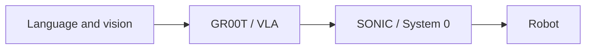
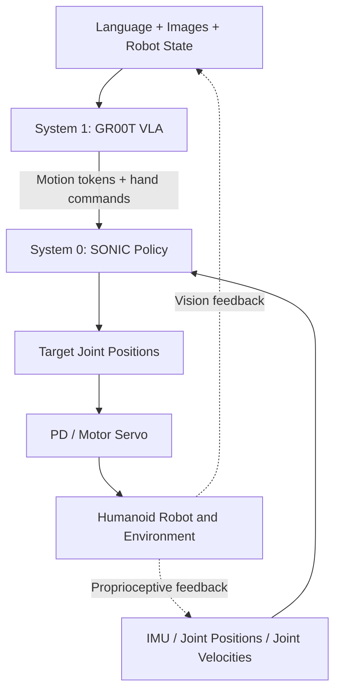
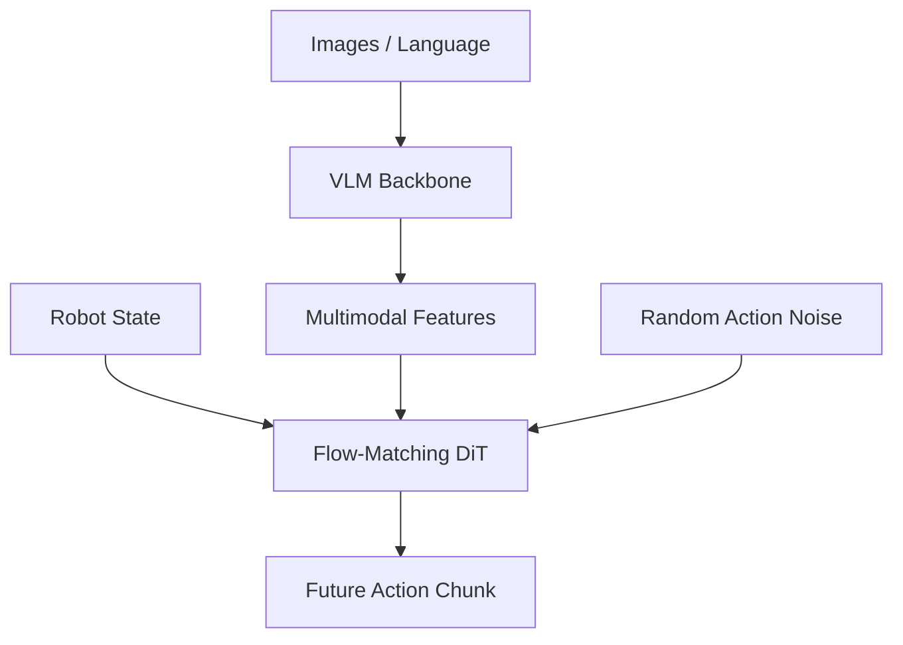
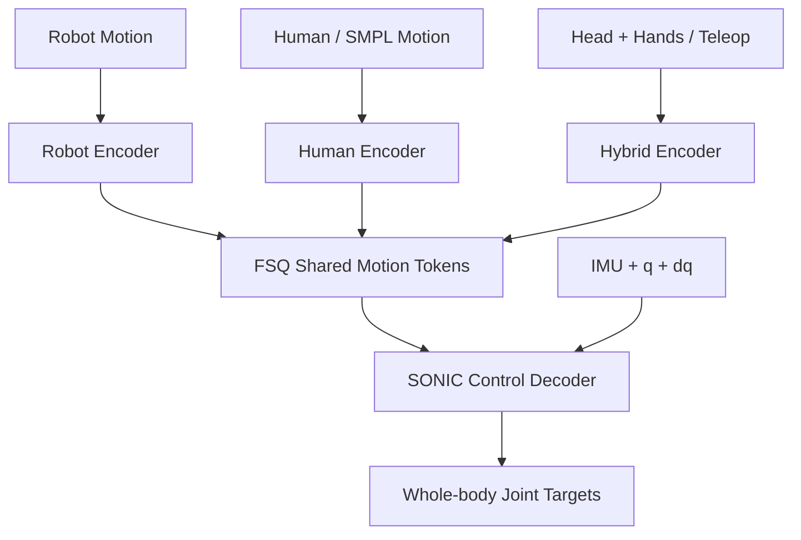
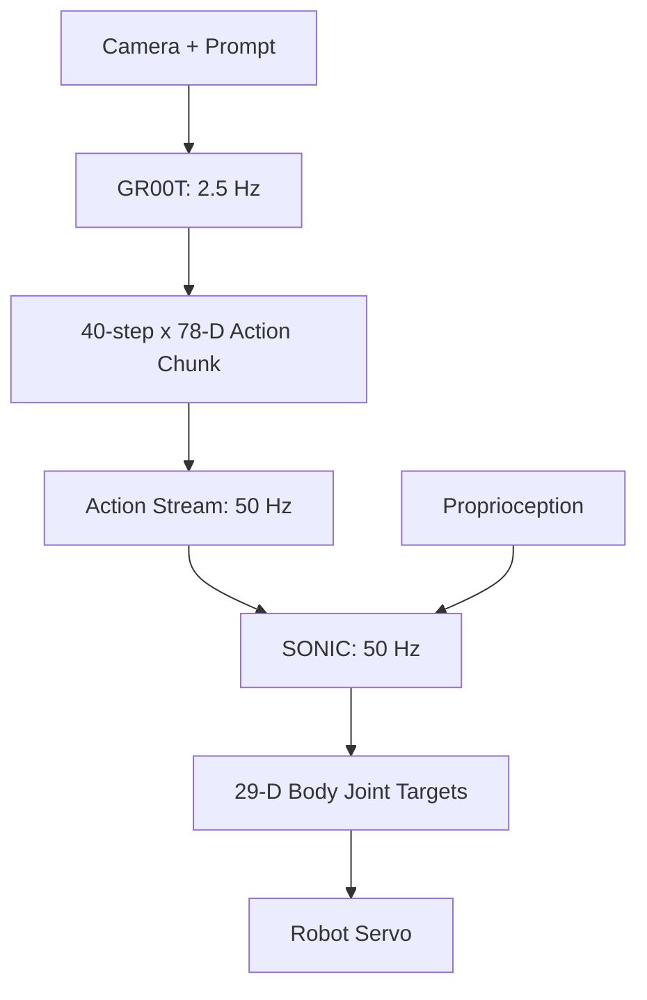

# Humanoid Robotics: System 1 (VLA) and System 0 (Whole-Body Control)

<!-- course-meta:start -->
[Course home](https://github.com/zengxiong111/Foundation_of_Embodied_AI) · [简体中文](https://github.com/zengxiong111/Foundation_of_Embodied_AI/blob/main/md/System1_System0_GR00T_SONIC_CN.md) · [PDF](https://zengxiong111.github.io/zengxiong.github.io/files/System1_System0_GR00T_SONIC_EN.pdf)

| Item | Details |
|---|---|
| Applicability | SONIC paper integration: GR00T N1.5; documented G1 workflow: N1.7, 78-dim actions, 2.5 Hz inference / 50 Hz stream. Checkpoint and observation config must match |
| Documentation review date | 2026-10-18 |
| License | CC BY 4.0 · Xiong Zeng and contributors |

**Verification scope:** Documentation organization and upstream reference snapshot; no tutorial runtime, training or hardware validation. See the [materials manifest](https://github.com/zengxiong111/Foundation_of_Embodied_AI/blob/main/materials.json) for pinned source references. Original teaching content uses [CC BY 4.0](https://creativecommons.org/licenses/by/4.0/); third-party quotations, figures and code retain their original licenses. Citation alone does not grant relicensing rights.
<!-- course-meta:end -->

<!-- course-toc:start -->
## Contents

- [1. Overall architecture: the two distinct problems](#course-section-01)
  - [1.1 Why not use a single model for everything?](#course-section-02)
  - [1.2 Key differences](#course-section-03)
  - [1.3 Two feedback loops, not an open-loop chain](#course-section-04)
- [2. System 1: how GR00T understands tasks and generates actions](#course-section-05)
  - [2.1 What is a VLA?](#course-section-06)
  - [2.2 Two components of GR00T](#course-section-07)
  - [2.3 Why predict more than one action at once?](#course-section-08)
  - [2.4 Flow matching, intuitively](#course-section-09)
  - [2.5 What action representation can a VLA predict?](#course-section-10)
  - [2.6 How is GR00T trained?](#course-section-11)
- [3. System 0: how SONIC learns whole-body motion control](#course-section-12)
  - [3.1 What is whole-body control (WBC)?](#course-section-13)
  - [3.2 A useful baseline: lower-body RL + upper-body IK](#course-section-14)
  - [3.3 SONIC's training task: motion tracking](#course-section-15)
  - [3.4 SONIC architecture: encoders, motion tokens, decoder](#course-section-16)
  - [3.5 How does SONIC turn a token into joint commands?](#course-section-17)
  - [3.6 PPO, tracking rewards, and robustness](#course-section-18)
  - [3.7 What SONIC knows—and what it does not](#course-section-19)
- [4. Connecting the two systems through motion tokens](#course-section-20)
  - [4.1 The central interface](#course-section-21)
  - [4.2 Verified action-space dimensions](#course-section-22)
  - [4.3 How are the rates coordinated?](#course-section-23)
  - [4.4 Why can this decomposition improve generalization?](#course-section-24)
  - [4.5 Practical integration checks](#course-section-25)
- [5. Worked example: walking, grasping, pedal pressing, disposal](#course-section-26)
  - [5.1 Task description](#course-section-27)
  - [5.2 Division of responsibility](#course-section-28)
  - [5.3 An important capability boundary](#course-section-29)
- [6. Training, demonstration collection, and real-robot deployment](#course-section-30)
  - [6.1 Step 1: obtain a working System 0 controller](#course-section-31)
  - [6.2 Step 2: collect teleoperated demonstrations](#course-section-32)
  - [6.3 Step 3: fine-tune GR00T to predict SONIC actions](#course-section-33)
  - [6.4 Step 4: deploy with PolicyServer and SONIC](#course-section-34)
  - [6.5 Step 5: evaluate the complete system](#course-section-35)
- [7. Research directions, ablations, and common misconceptions](#course-section-36)
  - [7.1 Where should improvements be targeted?](#course-section-37)
  - [7.2 Three minimal ablation studies](#course-section-38)
  - [7.3 Five common misconceptions](#course-section-39)
- [8. Summary and references](#course-section-40)
  - [8.1 Three takeaways](#course-section-41)
  - [8.2 Papers and official resources](#course-section-42)
<!-- course-toc:end -->

**Chapter concept map**




<a id="course-section-01"></a>

## 1. Overall architecture: the two distinct problems

<a id="course-section-02"></a>

### 1.1 Why not use a single model for everything?

A humanoid faces two fundamentally different challenges. The first is **semantic task reasoning**: locating a cup, understanding “put the cup in the bin,” and choosing suitable motions. The second is **dynamics and contact**: controlling foot placement, shifting the center of mass, maintaining support, and avoiding falls while reaching and bending.

A practical engineering design separates these responsibilities:

- **System 1 / VLA (high level):** Processes camera images, language instructions, and robot state to predict future actions or motion latents.
- **System 0 / WBC (low level):** Processes motion references, joint positions and velocities, and IMU observations to generate full-body joint targets in real time.



**Important:** GR00T is not merely a classical symbolic task planner: it can generate short-horizon actions. SONIC is not a passive trajectory player, either: its outputs depend on the robot's measured state at each control step.

<a id="course-section-03"></a>

### 1.2 Key differences

| Dimension | System 1: GR00T | System 0: SONIC |
|:---|:---|:---|
| Main objective | Choose task-appropriate actions | Track motion while maintaining stability |
| Main inputs | Images, language, robot state | Motion reference, joints, IMU |
| Main outputs | Future action chunks | Full-body joint position targets |
| Typical architecture | VLM + flow-matching DiT | Motion encoder + RL controller |
| Typical training | Pretraining, imitation fine-tuning | Motion tracking + PPO |
| Central challenges | Generalization, perception, long tasks | Contact, balance, coupling, disturbances |
| Feedback | Vision and task state, lower rate | Proprioception, high rate |

<a id="course-section-04"></a>

### 1.3 Two feedback loops, not an open-loop chain

The VLA replans from updated camera observations. Meanwhile SONIC updates joint targets from fresh proprioceptive observations. The point of the hierarchy is not that the VLA can ignore physics; rather, it should not need to solve fast full-body dynamics from scratch at every expensive vision-model inference call.

---

<a id="course-section-05"></a>

## 2. System 1: how GR00T understands tasks and generates actions

<a id="course-section-06"></a>

### 2.1 What is a VLA?

A **VLA (Vision-Language-Action Model)** turns visual and linguistic context into robot actions, rather than only producing text as a conventional vision-language model (VLM) would.

A VLM commonly maps observations to a text response:

$$
(\text{Image},\text{Language})\longrightarrow \text{Text}.
$$

A VLA predicts actions instead:

$$
(\text{Image},\text{Language},\text{Robot State})\longrightarrow \text{Action}.
$$

For “pick up the cup on the table,” it must reason about the cup's location, the current robot configuration, and the sequence of motions needed to approach and grasp the object.

<a id="course-section-07"></a>

### 2.2 Two components of GR00T

Using **GR00T N1.7** as the example, the main components are: [R3]

**1. Vision-language backbone (VLM)**

It extracts multimodal conditioning features from visual and linguistic observations. The public N1.7 code uses **Cosmos-Reason2-2B**, built on the Qwen3-VL architecture, as its backbone. This differs from the earlier N1.5/N1.6 configurations.

**2. Flow-matching action head**

A **Diffusion Transformer (DiT)** action head conditions on multimodal features and robot state to produce a sequence of actions via flow matching. Flow matching here is an action-generative learning method, not a replacement for the robot's physical control loop.



<a id="course-section-08"></a>

### 2.3 Why predict more than one action at once?

Instead of outputting a single instantaneous command, GR00T can predict a short sequence of length $H$:

$$
A_t=[a_t,a_{t+1},\ldots,a_{t+H-1}].
$$

Here $a_t$ is one action step, and $H$ is the **action horizon**. N1.7 defaults to **40 steps**. [R3]

Action chunking reduces how often a large VLA must be invoked and promotes temporally coherent actions. **It does not mean that all 40 steps must be executed before a new observation is processed.** A receding-horizon controller can refresh the plan before the current chunk ends.

<a id="course-section-09"></a>

### 2.4 Flow matching, intuitively

GR00T's action expert produces an observation-conditioned action chunk from a noise prior. The **generative velocity field is not joint velocity**; chunk commands reach the System 0 controller through a specified interface and timing scheme. The complete CFM, continuity equation and ODE derivation belongs in [Flow Matching](Flow_Matching_Step_by_Step_Derivation_EN.md).

<a id="course-section-10"></a>

### 2.5 What action representation can a VLA predict?

| Action representation | Meaning | Advantage / limitation |
|:---|:---|:---|
| Joint actions | Direct joint targets or increments | Simple interface; embodiment-specific |
| End-effector poses | Desired hand poses | Useful for manipulation; needs IK/WBC |
| Whole-body poses | Desired full-body postures | Expressive; physical feasibility is difficult |
| Latent actions | Learned motion representations | Leverages pretrained control; decoder compatibility is essential |

The distinctive **GR00T + SONIC** choice is to use a **latent motion interface**. The VLA learns to predict the motion-token representation defined by SONIC; SONIC then translates that representation into full-body joint targets.

<a id="course-section-11"></a>

### 2.6 How is GR00T trained?

1. **Pretraining:** Learn multimodal and action priors from diverse robot demonstrations and human videos. N1.7 emphasizes human-video pretraining and cross-embodiment relative end-effector representations; not every embodiment uses SONIC latents. [R3]
2. **Task fine-tuning:** Collect task-specific demonstrations containing synchronized images, instructions, robot state, and target actions. Optimize a supervised action-generation objective.
3. **Closed-loop evaluation:** Repeatedly process new images, generate chunks, execute a portion of each chunk, and examine failures.

A dataset can be represented as:

$$
\mathcal D=\{(I_t,l,s_t,a_t)\}_{t=1}^{N}.
$$

In the SONIC integration, $a_t$ may encode motion tokens and hand commands rather than raw full-body joint positions.

**Note:** Imitation fine-tuning is central to the official workflow. Online reinforcement-learning post-training is an interesting research option, but it is not required to use SONIC.

---

<a id="course-section-12"></a>

## 3. System 0: how SONIC learns whole-body motion control

<a id="course-section-13"></a>

### 3.1 What is whole-body control (WBC)?

A stationary robot arm mostly needs to move its end effector to a desired pose. A humanoid must simultaneously manage both legs, the torso, foot-ground contact, and its overall center of mass. Reaching, crouching, crawling, and pressing a pedal with one foot are strongly coupled activities.

**Whole-body control is not simply many independent joint PID loops.** It must account for whole-body dynamics and contact interactions.

<a id="course-section-14"></a>

### 3.2 A useful baseline: lower-body RL + upper-body IK

NVIDIA's **Decoupled WBC**, used with GR00T N1.5/N1.6, employs reinforcement learning for lower-body locomotion and balance, with inverse kinematics (IK) for upper-body reaching. [R4]

This design is modular and relatively easy to debug. However, the upper body and legs may require additional coordination for deep bending, one-leg-supported manipulation, or actions involving the feet.

SONIC instead uses a **unified RL motion-tracking policy** over diverse whole-body movements. More precisely, SONIC is a learned general-purpose whole-body motion tracker, not a conventional quadratic-programming WBC solver.

<a id="course-section-15"></a>

### 3.3 SONIC's training task: motion tracking

SONIC's central hypothesis is that one should train a single controller to track a broad distribution of human motion rather than build a separate reward-engineered policy for running, squatting, crawling, and so on. [R1]

The training procedure is conceptually simple:

1. Collect diverse **human motion-capture (mocap)** trajectories.
2. **Retarget** those trajectories into feasible robot reference motions.
3. Run physics simulations with randomized robot states and ask a policy to track the references.
4. Train with **PPO**, rewarding accurate tracking, stability, and smooth execution.
5. Apply **domain randomization** over relevant physical parameters and disturbances to improve sim-to-real robustness.

The paper reports roughly **700 hours of mocap, more than 100 million motion frames, a maximum policy size of about 42 million parameters, and around 21,000 GPU-hours**. These describe the published research scale, not the minimum resources needed to reuse a released controller. [R1]

<a id="course-section-16"></a>

### 3.4 SONIC architecture: encoders, motion tokens, decoder

SONIC maps different kinds of motion commands into a shared latent space:

- **Robot encoder:** Receives robot joint-motion references.
- **Human encoder:** Receives human / SMPL motion references.
- **Hybrid or teleoperation encoder:** Receives head-and-hand tracking targets and other kinematic constraints.

Their outputs are mapped into shared **universal motion tokens** using **finite scalar quantization (FSQ)**. A control decoder then combines a token with robot proprioception to output joint targets. [R1–R2]



**Key intuition:** A command can originate from a human operator, VR, a motion planner, a video-to-motion system, or a VLA. If it is encoded as a compatible motion token, the same controller can execute it.

<a id="course-section-17"></a>

### 3.5 How does SONIC turn a token into joint commands?

The interface can be summarized as:

$$
\boxed{q_t^{\mathrm{target}}=\pi_{\mathrm{SONIC}}(s_t,z_t)}.
$$

- $s_t$: Current proprioceptive observations, including joint positions/velocities and IMU measurements.
- $z_t$: Motion token describing the requested movement.
- $q_t^{\mathrm{target}}$: Target full-body joint positions.

SONIC controls **29 body joints** in the official Unitree G1 configuration. [R2]

A lower-level servo may track those targets with a PD controller. With zero target joint velocity, a simplified expression is:

$$
\tau_t=K_p(q_t^{\mathrm{target}}-q_t)-K_d\dot q_t.
$$

This equation illustrates a motor-level control law; it is **not** SONIC's learned objective. Real motor interfaces also include gain tuning, saturation, safety limits, and transport latency.

<a id="course-section-18"></a>

### 3.6 PPO, tracking rewards, and robustness

SONIC uses **PPO** with dense motion-tracking feedback. A simplified reward description is:

$$
r_t\approx r_{\mathrm{tracking}}-r_{\mathrm{penalty}}.
$$

Tracking terms encourage reference-consistent root motion, poses, keypoint positions, and velocities. Penalties discourage joint-limit violations, discontinuous commands, and undesirable contacts. The real objective comprises multiple weighted terms; the equation only communicates the idea.

An **asymmetric actor–critic** setup can give the critic accurate simulator-only information while restricting the actor to deployable observations. Only the actor / control decoder is required for real-time control.

**Domain randomization** may vary mass, friction, actuation, pushes, and initial conditions. It helps policies tolerate modeling errors, but does not guarantee recovery from arbitrarily severe disturbances.

<a id="course-section-19"></a>

### 3.7 What SONIC knows—and what it does not

SONIC learns coordinated full-body motion tracking under the dynamics of its robot embodiment. It does **not** independently recognize objects, interpret arbitrary language instructions, or solve high-level task planning. A VLA, human operator, or motion planner must still provide appropriate movement intent.

---

<a id="course-section-20"></a>

## 4. Connecting the two systems through motion tokens

<a id="course-section-21"></a>

### 4.1 The central interface

GR00T predicts the motion token plus hand commands; SONIC uses the token to compute body joint targets:

$$
\begin{aligned}
(z_t,h_t)&=\pi_{\mathrm{GR00T}}(I_t,l,s_t),\\
q_t^{\mathrm{target}}&=\pi_{\mathrm{SONIC}}(s_t,z_t).
\end{aligned}
$$

The separate hand command $h_t$ should **not be confused with SONIC's 29-dimensional body joint targets**.

<a id="course-section-22"></a>

### 4.2 Verified action-space dimensions

For NVIDIA's published **Unitree G1 + SONIC + GR00T N1.7** example: [R4–R5]

$$
\underbrace{a_t^{\mathrm{VLA}}}_{78}
=\big[\underbrace{z_t}_{64},
\underbrace{h_t^{L}}_{7},
\underbrace{h_t^{R}}_{7}\big].
$$

| Item | Specification |
|:---|:---|
| Motion token | 64-dimensional learned whole-body latent |
| Left-hand actions | 7 dimensions |
| Right-hand actions | 7 dimensions |
| Total VLA action | 78 dimensions per step |
| Action horizon | 40 time steps |
| SONIC body joints | 29 target joint positions |

The **64 dimensions** describe a learned quantized motion representation, not 64 predefined verbal commands such as “walk,” “turn,” or “squat.”

<a id="course-section-23"></a>

### 4.3 How are the rates coordinated?

The official N1.7 workflow specifies the following example rates: [R4–R5]

| Component | Example rate | Interpretation |
|:---|---:|:---|
| GR00T VLA inference | 2.5 Hz | Refresh action chunk around every 400 ms |
| Action stream / SONIC | 50 Hz | Update motion/joint targets every 20 ms |
| Action horizon | 40 steps | 0.8 s of future actions at 50 Hz |
| Low-level motor servo | Hardware-dependent | May run faster than the RL policy |

Crucially, the **0.8 s prediction horizon is not necessarily an 0.8 s open-loop execution period**. The system can replace an in-progress chunk with new predictions after the next camera update.

**Cross-chapter note:** [Real-Time Chunking (RTC)](Data_Imitation_Learning_EN.md) is a candidate technique for latency-tolerant asynchronous chunk handoff, but it needs integration and validation; this is not a claim that the referenced GR00T/SONIC implementation already runs RTC by default.



<a id="course-section-24"></a>

### 4.4 Why can this decomposition improve generalization?

If the VLA predicts every body joint directly, it must learn task-conditioned actions, body coordination, and balance simultaneously. Motion tokens expose the movement capabilities already learned by SONIC, reducing the burden on the high-level model.

If a disturbance changes the state $s_t$, SONIC can respond by producing different joint targets even when $z_t$ remains unchanged. **However, a physically impossible token or a severe unexpected contact can still cause failure.**

<a id="course-section-25"></a>

### 4.5 Practical integration checks

- **Timestamp synchronization:** Align image acquisition, action chunks, and joint/IMU observations.
- **Joint order and units:** Verify radians/degrees and the mapping of 29 body and 14 hand dimensions.
- **Checkpoint compatibility:** Match the VLA fine-tune, SONIC encoder/decoder checkpoint, and observation configuration.
- **Latency and chunk switching:** Avoid discontinuities; define a safe fallback when VLA inference stalls.
- **Safety:** Validate joint limits, emergency stop, communication loss behavior, and protected sim-to-real testing.

---

<a id="course-section-26"></a>

## 5. Worked example: walking, grasping, pedal pressing, disposal

<a id="course-section-27"></a>

### 5.1 Task description

**Instruction:** “Walk to the table, pick up the soda can, approach the bin, press the lid pedal with your foot, and drop the can inside.”

This is a typical **loco-manipulation** task: the robot must locomote, grasp with its hands, use its foot to interact with the environment, and balance throughout.

<a id="course-section-28"></a>

### 5.2 Division of responsibility

| Stage | GR00T / System 1 | SONIC / System 0 |
|:---|:---|:---|
| Find the can | Perceive and select the target | Does not recognize the object |
| Approach table | Generate short-horizon approach actions | Execute gait and maintain support |
| Reach and grasp | Produce arm motion and finger commands | Coordinate torso, arms, and legs |
| Approach bin | Update motion based on visual feedback | Balance during locomotion |
| Press foot pedal | Specify intended foot/body movement | Coordinate single-leg support and contact |
| Dispose of can | Generate the placement / throwing action | Execute coordinated body motion |

The original SONIC paper reports **60% success over 10 trials** on the soda-can-to-bin sequence, with approximately **75% mean success** across its grouped VLA loco-manipulation tasks. This supports feasibility while underscoring that reliability in unconstrained settings remains an open challenge. [R1]

<a id="course-section-29"></a>

### 5.3 An important capability boundary

SONIC can track a motion that places the foot near a pedal, but it does not infer the pedal's location from a language-only instruction. The high-level policy must provide sufficiently appropriate movement intent.

---

<a id="course-section-30"></a>

## 6. Training, demonstration collection, and real-robot deployment

<a id="course-section-31"></a>

### 6.1 Step 1: obtain a working System 0 controller

**Start by validating an official SONIC checkpoint** in simulation and a protected setting whenever possible. Training from scratch is a larger research undertaking.

The training pipeline is:

```text
Human mocap / robot motion
       ↓ Retargeting + filtering
Robot motion-reference library
       ↓ Massively parallel Isaac Lab simulation
PPO motion tracking + auxiliary losses
       ↓ Validation / sim-to-sim / sim-to-real
SONIC actor + motion encoders
```

NVIDIA publishes SONIC training scripts, configuration guidance, and BONES-SEED processing instructions. [R2] **The public BONES-SEED subset should not automatically be equated with the entire 700-hour mocap corpus reported in the paper.**

Check standing stability, stepping and turning, squatting and single-leg support, disturbance response, and motion-transition continuity before collecting high-level VLA demonstrations.

<a id="course-section-32"></a>

### 6.2 Step 2: collect teleoperated demonstrations

With a VR headset or mocap system, a human provides motion references. A SONIC encoder converts those references into motion tokens, and the SONIC controller executes the commanded motions. Record synchronized:

- Robot camera images, covering the target and relevant contact regions;
- Language labels, timestamps, and robot state;
- **64-dimensional motion tokens** and **7+7 hand action dimensions**;
- Episode success, resets, interruptions, and discarded segments.

The official workflow exports demonstrations in **LeRobot** format and recommends collecting sufficient successful trajectories before cleaning and fine-tuning. [R4]

<a id="course-section-33"></a>

### 6.3 Step 3: fine-tune GR00T to predict SONIC actions

The supervision target becomes:

$$
(I_t,l,s_t)\longmapsto(z_t,h_t).
$$

The official N1.7 workflow uses the specific `UNITREE_G1_SONIC` embodiment tag:

```bash
# Example key flags from the official repository.
# Install Isaac-GR00T and prepare a LeRobot dataset first.
uv run python gr00t/experiment/launch_finetune.py \
  --base-model-path nvidia/GR00T-N1.7-3B \
  --dataset-path /path/to/lerobot_dataset \
  --embodiment-tag UNITREE_G1_SONIC \
  --modality-config-path gr00t/configs/data/embodiment_configs.py \
  --num-gpus 4 \
  --output-dir /path/to/output
```

This is an illustrative command showing essential integration flags, not a complete environment setup. Consult the version-matched official guide for all required options and dependencies. [R4]

<a id="course-section-34"></a>

### 6.4 Step 4: deploy with PolicyServer and SONIC

A GPU machine can run the GR00T PolicyServer, while the robot-side client receives camera and proprioceptive data, streams action chunks, and executes them with SONIC's C++ inference stack. [R5]

```text
GPU workstation: GR00T PolicyServer
     ↕ images / states / action chunks
Robot compute: VLA client + SONIC C++ inference
     ↕ high-rate proprioception and joint targets
Motor servos + humanoid robot
```

Perform **sim-to-sim tests** before moving to protected, low-speed robot trials. NVIDIA provides MuJoCo testing and deployment tooling; direct unprotected first deployment is not advisable. [R2, R5]

<a id="course-section-35"></a>

### 6.5 Step 5: evaluate the complete system

| Layer | Useful metrics | What they reveal |
|:---|:---|:---|
| VLA | Task success, generalization, inference latency | Whether task-conditioned actions are appropriate |
| Motion tokens | Reconstruction error, compatibility, smoothness | Whether movement intent is faithfully represented |
| SONIC | Tracking success, keypoint error, fall rate | Whether motions are executed robustly |
| End-to-end | Overall success, delay, recovery, safety events | Interaction and integration reliability |

**Debug failures by layer:** First inspect whether the VLA selected an appropriate motion, then whether the token carries that intent, then whether SONIC could track it. Not every task failure is a high-level VLA failure.

---

<a id="course-section-36"></a>

## 7. Research directions, ablations, and common misconceptions

<a id="course-section-37"></a>

### 7.1 Where should improvements be targeted?

| Objective | Primary focus | Potential approaches |
|:---|:---|:---|
| Few-shot and object generalization | System 1 | Data augmentation, pretraining, imitation fine-tuning |
| Long-horizon tasks and corrections | System 1 | Feedback replanning, task-level post-training |
| Natural full-body motion | System 0 | Large-scale motion tracking |
| Disturbance and sim-to-real robustness | System 0 | PPO, domain randomization, system identification |
| Complex hand-foot contact | Both layers and interface | Contact-rich demonstrations and evaluations |
| Reliable hierarchy | Interface / deployment | Token design, timing, safety filtering |

<a id="course-section-38"></a>

### 7.2 Three minimal ablation studies

**Ablation A: action representation**

With as much else as possible held constant, compare (i) raw joint actions, (ii) explicit whole-body poses, and (iii) SONIC motion tokens. Measure success, smoothness, and sensitivity to infeasible commands. Such a comparison changes more than dimensionality; do not attribute all performance differences to compression alone.

**Ablation B: feedback rate**

Freeze SONIC while varying VLA refresh rate, the number of actions executed from each chunk, and imposed inference delay. Test moving targets, contact changes, and disturbance recovery.

**Ablation C: low-level robustness**

Freeze the high-level tokens and perturb simulator mass/friction, IMU measurements, and external pushes. Compare tracking success, posture error, and fall rate.

<a id="course-section-39"></a>

### 7.3 Five common misconceptions

1. **“System 1 only writes a plan; System 0 generates all motions.”** Not exactly. A VLA can generate short-horizon actions directly.
2. **“SONIC understands language and recognizes objects.”** No. It is primarily a full-body motion controller.
3. **“Motion tokens are fixed skill IDs.”** No. Here they belong to a learned quantized motion latent space.
4. **“A 40-step action chunk requires 0.8 s of open-loop execution.”** No. Prediction and execution horizons can differ.
5. **“A new SONIC checkpoint is always drop-in compatible with the VLA.”** No. The latent space, encoders, and observation schemas must match.

---

<a id="course-section-40"></a>

## 8. Summary and references

<a id="course-section-41"></a>

### 8.1 Three takeaways

**First, division of labor:** GR00T turns visual-linguistic context into future actions; SONIC executes full-body motions using real-time proprioceptive feedback.

**Second, the interface:** Motion tokens bridge high-level task intelligence and low-level physical skills. In the published G1 + SONIC configuration, the motion-token vector is 64-dimensional and the total VLA action is 78-dimensional after adding both hands.

**Third, training:** SONIC primarily acquires general motion skills via large-scale motion tracking and PPO. GR00T learns multimodal action generation using pretraining and task-specific demonstrations.

The combined system can be summarized as:

$$
\boxed{
(I_t,l,s_t)\xrightarrow{\;\mathrm{GR00T}\;}(z_t,h_t)
\xrightarrow[\,s_t\,]{\;\mathrm{SONIC}\;}q_t^{\mathrm{target}}
\xrightarrow{\;\mathrm{Servo}\;}\text{Robot}
}.
$$

<a id="course-section-42"></a>

### 8.2 Papers and official resources

- **[R1] SONIC paper and project:** Luo et al., *SONIC: Supersizing Motion Tracking for Natural Humanoid Whole-Body Control*, *Science Robotics* 11(117), 2026. [Project](https://nvlabs.github.io/GEAR-SONIC/) · [arXiv](https://arxiv.org/abs/2511.07820) · [DOI](https://doi.org/10.1126/scirobotics.aed4592)
- **[R2] Official SONIC docs and training:** [GR00T-WholeBodyControl Documentation](https://nvlabs.github.io/GR00T-WholeBodyControl/) · [Training Guide](https://nvlabs.github.io/GR00T-WholeBodyControl/user_guide/training.html)
- **[R3] GR00T N1.7 official code:** [NVIDIA/Isaac-GR00T](https://github.com/NVIDIA/Isaac-GR00T)
- **[R4] Official GR00T + SONIC workflow:** [VLA Workflow: Collect, Fine-tune, Deploy](https://nvlabs.github.io/GR00T-WholeBodyControl/tutorials/vla_workflow.html)
- **[R5] SONIC inference/deployment:** [VLA Inference Guide](https://nvlabs.github.io/GR00T-WholeBodyControl/tutorials/vla_inference.html)
- **[R6] Whole-body-control code:** [NVlabs/GR00T-WholeBodyControl](https://github.com/NVlabs/GR00T-WholeBodyControl)

*Prepared October 16, 2026. Model versions, dimensions, and frequencies refer to the cited public implementations, not to a universal humanoid robotics standard.*
