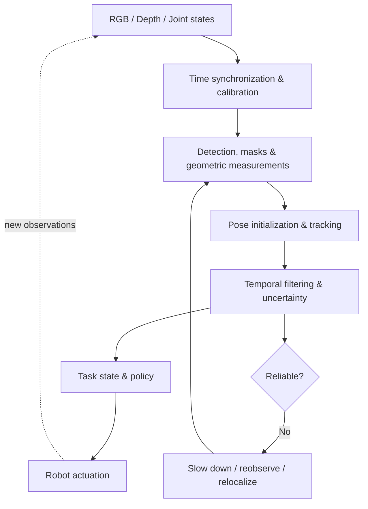
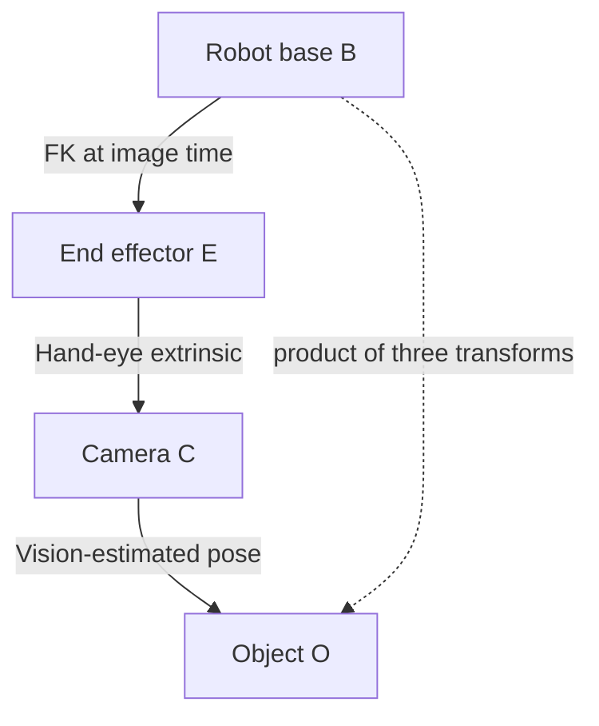
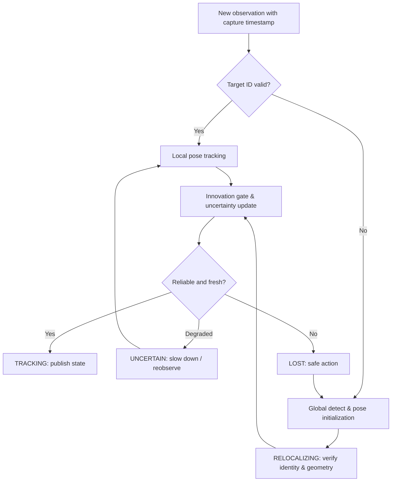

# Visual Perception and State Estimation

<!-- course-meta:start -->
[Course home](https://github.com/zengxiong111/Foundation_of_Embodied_AI) · [简体中文](https://github.com/zengxiong111/Foundation_of_Embodied_AI/blob/main/md/Visual_State_Estimation_ZH.md) · [PDF](https://zengxiong111.github.io/zengxiong.github.io/files/Visual_State_Estimation_EN.pdf)

| Item | Details |
|---|---|
| Applicability | Camera geometry, RGB-D/stereo, segmentation, FoundationPose, SE(3) filtering, uncertainty, asynchronous execution and recovery concepts |
| Documentation review date | 2026-10-18 |
| License | CC BY 4.0 · Xiong Zeng and contributors |

**Verification scope:** Document integration and rendering checks only; no robot, accuracy or runtime validation. No experimental chapter is included. See the [materials manifest](https://github.com/zengxiong111/Foundation_of_Embodied_AI/blob/main/materials.json) for pinned source references. Original teaching content uses [CC BY 4.0](https://creativecommons.org/licenses/by/4.0/); third-party quotations, figures and code retain their original licenses. Citation alone does not grant relicensing rights.
<!-- course-meta:end -->

<!-- course-toc:start -->
## Contents

- [1. From visual observations to task-relevant state](#course-section-01)
  - [1.1 Four quantities that must not be conflated](#course-section-02)
  - [1.2 When is a full 6-DoF pose necessary?](#course-section-03)
  - [1.3 A layered perception architecture](#course-section-04)
- [2. From pixels to metric 3D geometry](#course-section-05)
  - [2.1 Projection and back-projection](#course-section-06)
  - [2.2 RGB-D, stereo, and monocular depth are not interchangeable](#course-section-07)
  - [2.3 Constructing an object point cloud from a mask](#course-section-08)
  - [2.4 First-order propagation of pixel and depth errors](#course-section-09)
- [3. Robot frames and temporal consistency](#course-section-10)
  - [3.1 Establish a single transform convention](#course-section-11)
  - [3.2 Image time is different from publication time](#course-section-12)
  - [3.3 Multi-camera fusion is not an elementwise average](#course-section-13)
- [4. Detection, segmentation, and vision foundation models](#course-section-14)
  - [4.1 Select models by their output variables](#course-section-15)
  - [4.2 SAM 2: tracking a prompted instance across video](#course-section-16)
  - [4.3 SAM 3 / 3.1: locating targets by a semantic concept](#course-section-17)
  - [4.4 FoundationStereo and Fast-FoundationStereo: disparity estimators](#course-section-18)
  - [4.5 SAM 3D Objects: a candidate shape prior, not calibrated CAD](#course-section-19)
- [5. FoundationPose and rigid 6-DoF estimation](#course-section-20)
  - [5.1 Why object coordinate frames matter](#course-section-21)
  - [5.2 CAD-conditioned versus reference-view-conditioned use](#course-section-22)
  - [5.3 Where pose constraints come from](#course-section-23)
  - [5.4 Pose ambiguity under object symmetry](#course-section-24)
- [6. Temporal estimation and uncertainty on SE(3)](#course-section-25)
  - [6.1 Why ordinary matrix averaging is not enough](#course-section-26)
  - [6.2 Prediction and local measurement update](#course-section-27)
  - [6.3 Innovation gating and identity checking](#course-section-28)
  - [6.4 Combining transform and calibration uncertainty](#course-section-29)
  - [6.5 A score is not a calibrated physical error bound](#course-section-30)
- [7. Latency, asynchronous execution, and recovery](#course-section-31)
  - [7.1 Per-model FPS is not the closed-loop control rate](#course-section-32)
  - [7.2 Three useful computational time scales](#course-section-33)
  - [7.3 Recovery is part of the estimator, not an afterthought](#course-section-34)
- [8. Interfaces to control, imitation learning, and robot agents](#course-section-35)
  - [8.1 A minimum downstream state contract](#course-section-36)
  - [8.2 Explicit geometry versus direct visual action policies](#course-section-37)
  - [8.3 Why sensing errors matter for sim-to-real transfer](#course-section-38)
  - [8.4 Dexterous manipulation: pose is not contact](#course-section-39)
- [9. System selection and implementation pitfalls](#course-section-40)
  - [9.1 Start with the smallest adequate stack](#course-section-41)
  - [9.2 Six recurring failure modes](#course-section-42)
- [10. Four principles of reliable visual closed-loop control](#course-section-43)
- [Appendix A. Equation reference](#course-section-44)
- [Appendix B. Glossary and course connections](#course-section-45)
- [References and official resources](#course-section-46)
<!-- course-toc:end -->

**Foundation of Embodied AI · Revised lecture notes**  
**Revision date: 2026-10-18 · Theory and systems design (no laboratory or experiment chapter)**  
Reorganized and expanded from the [original Chinese lecture notes](https://github.com/zengxiong111/Foundation_of_Embodied_AI/blob/aeb4b8a500cba1543da944369918f6ca7dbbc059/pdf/Visual_State_Estimation_ZH.pdf), credited to Xiong Zeng and contributors under [CC BY 4.0](https://creativecommons.org/licenses/by/4.0/). Third-party papers, models, and media retain their respective licenses.

> **Central question:** How can a robot turn incomplete, delayed, noisy images into state estimates with well-defined coordinates, timestamps, and reliability information, and then act on them in a closed loop?
>
> **Scope:** Camera geometry, RGB-D and stereo measurements, segmentation and object poses, representative vision foundation models, estimation on $SE(3)$, uncertainty propagation, asynchronous inference, and interfaces to robot control. Camera-calibration solvers, data collection, policy optimization, and experimental protocols belong to other modules.

**Learning outcomes.** After this chapter, readers should be able to distinguish observations from physical, estimated, and task states; select masks, depth, or 6-DoF poses as the appropriate output; apply camera-to-robot transforms at the correct time; understand local Lie-group filtering; identify model requirements and failure modes; and design a perception loop with explicit recovery mechanisms.

## 1. From visual observations to task-relevant state

### 1.1 Four quantities that must not be conflated

- **Physical state** $s_t$: the true condition of the environment, generally not fully observable, including rigid-body poses, velocities, contacts, and frictional properties.
- **Visual observation** $o_t$: RGB frames, depth measurements, and image features collected around an exposure time. These are affected by occlusion, specularities, perspective, motion blur, and calibration error.
- **Estimated state** $\hat s_t$: an inference combining observations, prior estimates, robot proprioception, and physical or learned models.
- **Task state** $z_t=\phi(s_t)$: the subset needed to make a decision, such as tool-tip pose relative to a hole, a grasp region, or a contact event.

A generic recursive estimator may be expressed as

$$
\hat s_t,\,\Sigma_t=\mathcal E(o_{0:t},q_{0:t},u_{0:t-1};\theta),
$$

where $q_t$ denotes joint state, $u_t$ an action, and $\Sigma_t$ local uncertainty. **An estimate is not ground truth.** A model's confidence score is also not inherently a calibrated probability or a physical error bound.

### 1.2 When is a full 6-DoF pose necessary?

| Task requirement | Minimum useful visual output | When to add more state |
|---|---|---|
| Detect a target or monitor its visibility | Bounding box, mask, instance ID | Geometry, grasp targets, or tracking health are needed |
| Coarse grasping or planar pushing | Mask, depth, local keypoints | Grasp direction or tool orientation becomes important |
| Tool use, insertion, pose correction | Rigid-body $SE(3)$ pose | Add velocity, contact variables, and uncertainty |
| Deformable or dexterous contact | Local shape, features, contact hypotheses | A single rigid $SE(3)$ state is usually insufficient |
| Direct visuomotor or VLA policy | Images, language, proprioception | Explicit geometric state can still support safety checks |

**Observability comes before architecture.** A textureless cylindrical object may have an unobservable rotation about its symmetry axis. A larger model does not create measurements that are physically absent; additional viewpoints, task constraints, or sensing modalities may be required.

### 1.3 A layered perception architecture

Segmentation answers **which pixels belong to an instance**; depth answers **where those pixels lie in 3D**; pose estimation answers **where an object coordinate frame is and how it is oriented**; temporal estimation determines **the most defensible current state given a history of evidence**. These are related but distinct tasks.

## 2. From pixels to metric 3D geometry

### 2.1 Projection and back-projection

Consider a rectified or otherwise distortion-corrected image. A camera-frame point $p_C=[X,Y,Z]^\top$ projects under the pinhole model according to

$$
\begin{bmatrix}u\\v\\1\end{bmatrix}
\sim K\begin{bmatrix}X/Z\\Y/Z\\1\end{bmatrix},\qquad
K=\begin{bmatrix}f_x&0&c_x\\0&f_y&c_y\\0&0&1\end{bmatrix}.
$$

If a depth value $Z(u,v)$ is the **optical-axis depth**, or $z$-depth, back-projection gives

$$
p_C(u,v)=Z(u,v)K^{-1}[u,v,1]^\top.
$$

Some sensors and simulators instead provide the **Euclidean range** along a camera ray. Range and $z$-depth must not be interchanged. Without depth or another geometric prior, one pixel corresponds to a ray rather than a unique 3D point.

### 2.2 RGB-D, stereo, and monocular depth are not interchangeable

For synchronized, rectified cameras approximated as a parallel stereo pair, the horizontal disparity $d=u_L-u_R$ yields

$$
Z=\frac{f_x b}{d},\qquad
\frac{\partial Z}{\partial d}=-\frac{f_xb}{d^2},\qquad
\sigma_Z\approx\frac{f_xb}{d^2}\sigma_d,
$$

where $b$ is the calibrated baseline. Small disparity at long range amplifies depth uncertainty; occlusion boundaries, repetitive texture, and reflective surfaces can invalidate matching. A more complete error model also propagates uncertainty in baseline, intrinsics, and correspondence.

An RGB-D camera may offer usable native depth directly, but its **units, RGB-to-depth alignment, invalid-pixel policy, operating range, and timing** still need to be understood. A stereo foundation model expects geometrically compatible images. A head-mounted RGB camera and a moving wrist RGB camera do not automatically form a calibrated, synchronized, rectified stereo pair.

### 2.3 Constructing an object point cloud from a mask

Let $M(u,v)\in\{0,1\}$ be an instance mask and $D(u,v)$ a validated optical-axis depth image. Then

$$
\mathcal P_C=\left\{D(u,v)K^{-1}[u,v,1]^\top\;\middle|\;
M(u,v)=1,\ D(u,v)>0\right\}.
$$

This is a **partial point cloud in the camera frame**, not a complete geometric model or a well-defined object frame. Missing mask pixels discard surface observations; background leakage adds outliers; invalid depth creates holes. Recovering a full object pose requires CAD or reference views, local keypoints, surface correspondences, or additional geometric constraints.

### 2.4 First-order propagation of pixel and depth errors

Using $X=(u-c_x)Z/f_x$, $Y=(v-c_y)Z/f_y$, write $x=[u,v,Z]^\top$ and $p_C=g(x)$. The Jacobian is

$$
J_g=\frac{\partial p_C}{\partial x}
=\begin{bmatrix}
Z/f_x&0&(u-c_x)/f_x\\
0&Z/f_y&(v-c_y)/f_y\\
0&0&1
\end{bmatrix},\qquad
\Sigma_{p_C}\approx J_g\Sigma_xJ_g^\top.
$$

This shows why the same pixel localization error corresponds to a larger lateral position error as range increases. The displayed formula treats intrinsics as known; uncertain calibration parameters can be included in an augmented variable and Jacobian.

## 3. Robot frames and temporal consistency

### 3.1 Establish a single transform convention

Use $^AT_B\in SE(3)$ to denote the rigid transform **mapping coordinates expressed in frame $B$ into frame $A$**:

$$
{}^AT_B=\begin{bmatrix}{}^AR_B&{}^Ap_B\\0&1\end{bmatrix},
\qquad {}^Ap={}^AT_B\,{}^Bp.
$$

Let $B$ denote the robot base, $E$ an end effector, $C$ a camera, and $O$ an object. For an eye-in-hand camera,

$$
{}^BT_O(t)={}^{B}T_E(q(t))\;{}^{E}T_C\;{}^{C}T_O(t).
$$

For a fixed external camera, $^BT_O={}^BT_C\,^CT_O$. A pan–tilt head has a time-dependent $^BT_C(t)$ computed from the head joints; its extrinsic transform **must not be treated as fixed**.

**Course boundary.** The mathematical *solution* of camera intrinsics, hand–eye calibration, and camera extrinsics belongs to a companion Camera Calibration module. This chapter concerns the correct use and composition of those results, without repeating calibration derivations.

### 3.2 Image time is different from publication time

A state message should distinguish image exposure time $t_{\rm cap}$, reception time $t_{\rm recv}$, estimator completion time $t_{\rm est}$, and the time an action based on the estimate takes effect $t_{\rm act}$.

To interpret a wrist-camera image, use $^BT_E(q(t_{\rm cap}))$, **not** whatever joint state happens to be most recent when inference finishes. Timestamped robot state and TF history permit interpolation. Exposure duration, rolling shutter, and clock offsets can require additional treatment.

For approximately constant translational velocity $v$ and sensing delay $\Delta t$,

$$
\Delta p\simeq v\,\Delta t,\qquad
\|\Delta p\|\lesssim\|v\|\Delta t.
$$

This is a scale estimate only; actual error can also arise from rotation, camera motion, acceleration, and imperfect models.

### 3.3 Multi-camera fusion is not an elementwise average

Independent camera measurements first need a **common coordinate frame and time reference**. Rotation matrices should not be averaged elementwise; fusion should occur in suitable local coordinates on $SE(3)$ or earlier in the pixel/feature pipeline. Measurements that share calibration data, depth estimates, or a prior can have correlated errors; assuming independence would yield overconfident uncertainty estimates.

## 4. Detection, segmentation, and vision foundation models

### 4.1 Select models by their output variables

| Model family | Typical requirements | Main output | What it does not ensure |
|---|---|---|---|
| SAM 2 / 2.1 | Images/video plus point, box, or mask prompts | Instance masks, video propagation | Metric depth or 6-DoF pose |
| SAM 3 / 3.1 | Images/video plus text concepts or visual exemplars | Open-concept localization, masks, identities | Reliable contact states or 3D geometry |
| FoundationStereo | Calibrated, synchronized, rectified stereo images | Dense disparity and derived depth | Object category or object coordinate frame |
| Fast-FoundationStereo | Similar stereo inputs and supported runtime | More compute-efficient dense disparity | Real-time performance on every GPU |
| FoundationPose | Object CAD or reference views, masks, compatible RGB/depth | Rigid 6-DoF pose initialization and tracking | Unconditional localization of arbitrary objects |
| SAM 3D Objects | Object region in a single image | Candidate 3D shape and appearance | Metrology-grade CAD, inertia, or precise size |
| SAM 3D Body | Images containing humans | Human 3D body shape and pose | Robotic fingertip contact forces |

### 4.2 SAM 2: tracking a prompted instance across video

SAM 2 accepts points, boxes, or masks to initialize segmentation and propagates masks through video using memory mechanisms. It is well suited when the target identity has already been chosen. Occlusion, leaving the field of view, near-identical objects, and fast motion can cause track drift or identity switches.

A useful pipeline distinguishes whether the **initial prompt still identifies the correct instance**, whether the persistent track ID is trustworthy, and whether the mask is consistent with valid object depth. A smooth mask history does not prove pose accuracy or successful physical contact. See the [official SAM 2 repository](https://github.com/facebookresearch/sam2).

### 4.3 SAM 3 / 3.1: locating targets by a semantic concept

SAM 3 supports concept-oriented prompts—for example, “the screwdriver with a red handle on the table”—to discover, segment, and track instances matching the description. Ambiguous language and visually similar objects can make identity assignment uncertain. SAM 3.1 changes the computational organization of multi-object video processing; it still does not directly return metric object poses. See the [SAM 3 code](https://github.com/facebookresearch/sam3) and [official SAM 3.1 announcement](https://ai.meta.com/blog/segment-anything-model-3/).

A practical division of labor is to use lower-rate semantic discovery to establish object identity, then video tracking to maintain it, with renewed discovery when the identity becomes doubtful. The choice depends on long-term instance consistency and system latency, not merely a pleasing single-frame segmentation mask.

### 4.4 FoundationStereo and Fast-FoundationStereo: disparity estimators

[FoundationStereo (CVPR 2025)](https://github.com/NVlabs/FoundationStereo) targets strong zero-shot generalization in stereo matching. [Fast-FoundationStereo (CVPR 2026)](https://github.com/NVlabs/Fast-FoundationStereo) reduces computational burden with distillation, architecture search, and structured pruning. Their output is fundamentally **stereo disparity**, converted to metric depth under known camera geometry. Neither is a semantic segmenter or a rigid-pose estimator.

Frame rates reported in papers depend on particular image resolutions, GPUs, and runtime settings. They do **not** imply equivalent end-to-end robotic control rates. A robot with reliable native RGB-D observations often benefits from using those measurements first, adding a stereo model only when its depth quality and compute budget justify the additional module.

### 4.5 SAM 3D Objects: a candidate shape prior, not calibrated CAD

[SAM 3D Objects](https://github.com/facebookresearch/sam-3d-objects) reconstructs plausible object geometry, appearance, and scene layout from a single image. Hidden surfaces and metric scale are underconstrained, so generated geometry can be incorrect even if visually compelling. Before using such a shape as a prior for rigid pose estimation, verify scale, object origin, surface consistency, and which regions are supported by observations.

A plausible mesh does not come with trustworthy material density, mass, inertia, or friction coefficients. It should not be treated as a precision assembly model or a validated collision representation without additional information.

## 5. FoundationPose and rigid 6-DoF estimation

### 5.1 Why object coordinate frames matter

A rigid pose $T=\begin{bmatrix}R&t\\0&1\end{bmatrix}\in SE(3)$ combines a translation $t\in\mathbb R^3$ and an orientation $R\in SO(3)$. To make the pose physically meaningful, one must fix the **object-frame origin, axis directions, geometry, and metric scale**.

In screwdriver manipulation, the tool-tip position is often more important than an arbitrarily chosen CAD origin. For a tip point $p_{\rm tip}^O$,

$$
p_{\rm tip}^B=R_{BO}p_{\rm tip}^O+t_{BO}.
$$

Consequently, identical angular errors can create very different task-space errors depending on the distance from the object origin to the contact point.

### 5.2 CAD-conditioned versus reference-view-conditioned use

[FoundationPose (CVPR 2024)](https://github.com/NVlabs/FoundationPose) provides model-based use with supplied object CAD and model-free use based on object reference images. **Model-free does not mean that no object evidence, mask, or reference information is required.** Its operation can be understood at the following conceptual level:

1. Establish target identity and a valid object region in the image/depth observation.
2. Specify the object geometry or reference views, with consistent scale and axes.
3. Produce multiple candidate rigid poses and rank them.
4. Refine candidates using learned image and geometry evidence.
5. Use the previous pose as a prior for subsequent tracking.
6. Return to broader hypothesis generation and global relocalization when tracking quality deteriorates.

This is a **pedagogical functional decomposition**, not a claim that the implementation uses a particular textbook objective or network configuration. Consult the official paper and code for algorithm-specific details.

### 5.3 Where pose constraints come from

Given CAD points $P_i^O$ and image correspondences $u_i$, a generic geometric reprojection objective is

$$
\hat T=\mathop{\arg\min}_{R\in SO(3),\,t\in\mathbb R^3}
\sum_i\rho\!\left(\left\|u_i-\pi\!\left(K(RP_i^O+t)\right)\right\|_2^2\right),
$$

where $\pi$ is perspective projection and $\rho$ is a robust penalty. If surface points and normals are available, point-to-plane residuals such as $n_i^\top(RP_i^O+t-Q_i)$ can describe geometric fit. **These equations explain constraints in pose estimation; they are not asserted to be the exact internal loss of FoundationPose.**

Global initialization can cover larger pose uncertainty; local tracking is typically more efficient but can accumulate a bad prior. Fast motion, object symmetries, extensive occlusion, transparent or reflective surfaces, and inaccurate CAD can all defeat local refinement.

### 5.4 Pose ambiguity under object symmetry

For an object's geometric symmetry group $G\subset SO(3)$, rotations $R$ and $RS$, with $S\in G$, may generate equivalent visual appearances. A symmetry-aware orientation distance is

$$
d_{\rm sym}(R_1,R_2)=\min_{S\in G}
\arccos\!\left(\operatorname{clip}\!\left(
\frac{\operatorname{tr}(R_1^\top R_2S)-1}{2},-1,1\right)\right).
$$

When texture, a contact patch, or the task itself breaks the symmetry, the correct equivalence class should reflect **task-relevant orientation**, rather than ignoring all rotation about a geometric symmetry axis. A continuous symmetry often means that a whole degree of freedom is unobservable from the given viewpoint.

## 6. Temporal estimation and uncertainty on SE(3)

### 6.1 Why ordinary matrix averaging is not enough

A linear weighted average of two rotation matrices is generally not an element of $SO(3)$. Pose increments can instead be represented in the local Lie algebra $\mathfrak{se}(3)$:

$$
T^+=T^-\operatorname{Exp}(\widehat{\delta\xi}),\qquad
\delta\xi=\begin{bmatrix}\delta\rho\\\delta\phi\end{bmatrix}\in\mathbb R^6.
$$

The hat operator maps a six-vector to a Lie-algebra matrix; $\operatorname{Exp}$ and $\operatorname{Log}$ map locally between the Lie algebra and the rigid-transform group. Here we consistently use a **right perturbation** $T=\bar T\operatorname{Exp}(\widehat{\delta\xi})$. A left-perturbation implementation requires corresponding changes in Jacobians and covariance coordinates.

### 6.2 Prediction and local measurement update

Let $\hat T_t^-=f(\hat T_{t-1}^+,u_{t-1})$ be a motion prediction, with local covariance

$$
P_t^-=F_tP_{t-1}^+F_t^\top+Q_t.
$$

For a pose measurement $T_t^{\rm meas}$ referring to the **same object identity, timestamp, and reference frame**, define the right-local innovation

$$
r_t=\operatorname{Log}\!\left((\hat T_t^-)^{-1}T_t^{\rm meas}\right)^\vee\in\mathbb R^6.
$$

When all six local pose directions are observed, $H_t\approx I_6$ is a possible small-error approximation. An error-state EKF update is

$$
\begin{aligned}
S_t&=H_tP_t^-H_t^\top+R_t,\\
K_t&=P_t^-H_t^\top S_t^{-1},\\
\hat T_t^+&=\hat T_t^-\operatorname{Exp}\!\left(\widehat{K_tr_t}\right),\\
\widetilde P_t^+&=(I-K_tH_t)P_t^-(I-K_tH_t)^\top+K_tR_tK_t^\top.
\end{aligned}
$$

The displayed $\widetilde P_t^+$ uses the Joseph form in the local update coordinates. For non-negligible corrections, apply the appropriate error-reset or coordinate-transport Jacobian to express covariance at the new linearization center. Actual $F_t,H_t$ depend on the state and noise model; $H_t=I$ is not a universal assumption.

### 6.3 Innovation gating and identity checking

With innovation $r_t$ and covariance $S_t$, the normalized innovation squared is

$$
\operatorname{NIS}_t=r_t^\top S_t^{-1}r_t.
$$

It can be compared against a statistically selected gate with the appropriate measurement dimension. **Check identity before innovation consistency**: a track that has silently switched to a similar object can yield small innovations while being completely wrong about the intended target.

During occlusion, prediction may continue but uncertainty should grow. The prediction must not be presented as a newly observed pose. When the object reappears, verify identity, timestamp, residual consistency, and geometry before accepting a new measurement sequence.

### 6.4 Combining transform and calibration uncertainty

Consider $T={}^BT_C\,{}^CT_O=T_1T_2$. Under independent **right-local** perturbations,

$$
\delta\xi_T\simeq\operatorname{Ad}_{T_2^{-1}}\delta\xi_1+\delta\xi_2,
$$

hence

$$
P_T\approx\operatorname{Ad}_{T_2^{-1}}P_1\operatorname{Ad}_{T_2^{-1}}^\top+P_2.
$$

Here $\operatorname{Ad}_T$ is the adjoint action of $SE(3)$. If both estimates share camera calibration, training assumptions, or image data, the noises can be correlated and cross-covariance terms are necessary. Translation and orientation also have different units; task requirements should determine how to interpret a joint uncertainty budget.

### 6.5 A score is not a calibrated physical error bound

Segmentation quality scores, neural pose scores, filter covariances, and visibility flags capture different notions of reliability:

- **Network score:** commonly useful for internal ranking, not automatically a bound in millimeters or degrees.
- **Covariance:** a local second-order uncertainty under the assumed motion, sensing, and linearization model, excluding unmodeled systematic bias.
- **Validity flag:** a categorical determination that measurements are fresh and usable.
- **Task-specific confidence:** a decision-relevant quantity, for example reliable tip position but unresolved axial rotation.

A filter fed systematically biased measurements can become **confidently wrong**. A robust system therefore retains anomaly evidence, observation age, visible fraction, and estimator health alongside covariance.

## 7. Latency, asynchronous execution, and recovery

### 7.1 Per-model FPS is not the closed-loop control rate

For a serialized processing chain, end-to-end delay accumulates through acquisition, transmission, inference, policy computation, and action execution, with queueing often contributing as well. In a parallel pipeline, the critical path and throughput depend on scheduling, buffer policy, and resource contention.

A particularly important quantity is the **Age of Information (AoI)** of a measurement when the robot acts:

$$
\operatorname{AoI}(t)=t_{\rm act}-t_{\rm cap}.
$$

A vision service can publish many outputs per second while still supplying stale observations. An asynchronous controller should therefore use capture time, validity windows, and state prediction—not publication order alone.

### 7.2 Three useful computational time scales

- **Low-rate, event-triggered discovery:** language-conditioned target detection, global pose candidates, and target re-identification.
- **Mid-rate local tracking:** refinement using recent rigid pose, image regions, masks, and depth.
- **Higher-rate state prediction and safety control:** short-horizon propagation driven by proprioception and motion assumptions. Prediction is not a new observation and cannot be extrapolated indefinitely.

### 7.3 Recovery is part of the estimator, not an afterthought

A practical system has explicit `TRACKING`, `UNCERTAIN`, `LOST`, and `RELOCALIZING` modes. Transitions should depend jointly on identity consistency, timestamps, valid depth proportion, tracking score, pose innovation, and a maximum allowed prediction horizon.

In `UNCERTAIN`, reduce action magnitude or improve the viewpoint; in `LOST`, do not continue high-force contact actions that require a precise target pose; in `RELOCALIZING`, verify that the rediscovered instance is the intended object and its pose is consistent with available geometric and task constraints.

**Active perception**—moving a pan–tilt head or wrist camera—may improve observability. Such motion is still subject to joint limits, collision avoidance, and contact safety constraints.

## 8. Interfaces to control, imitation learning, and robot agents

### 8.1 A minimum downstream state contract

A structured output record is preferable to an undocumented six-vector:

| Field | Meaning and contract |
|---|---|
| `frame_id`, `object_frame_id` | Reference frame of the estimate and object-frame convention |
| `capture_timestamp`, `publish_timestamp` | Sampling and publication time, kept distinct |
| `track_id`, `object_class` | Persistent instance identity and recognition metadata |
| `pose_SE3`, optional `twist` | Estimated pose and motion, with units and frame convention |
| `covariance_6x6`, `quality` | Local covariance and clearly defined model score |
| `valid`, `tracking_status` | Usability and recovery state |
| `mask/depth_valid_ratio` | Health of geometric measurements, where applicable |
| `model_version`, `latency_ms` | Traceability of estimator implementation and timing |

A tool-use application can additionally expose a tool tip, grasp axis, candidate contact region, and corresponding uncertainty. An object mask must not be passed off as a measurement of contact force.

### 8.2 Explicit geometry versus direct visual action policies

In an **explicit-state architecture**, target selection feeds detection and segmentation, then geometry and 6D pose, temporal filtering, and an MPC, IK, or learned controller. It offers inspectable frames, uncertainty, and safety conditions, but relies on suitable geometry, calibration, and timing.

In a **direct visual-policy architecture**, images, language, and proprioception feed a VLA or other visuomotor policy. It need not expose a 6D state internally, yet a separate monitor can still use target visibility, task keypoints, and execution evidence to detect failure.

Hybrid approaches are often appropriate: a robot agent chooses a goal and replans after failure; a geometric estimator publishes states and reliability; a low-level policy executes short-horizon actions.

### 8.3 Why sensing errors matter for sim-to-real transfer

A simulated teacher can read privileged, exact object state. Real deployment instead receives estimates with delay, bias, temporal correlation, occasional missed detections, and relocalization jumps. A policy trained on perfect states can thus face a serious input-distribution shift.

Four important error classes are **persistent bias, range-dependent measurement noise, temporal delay/asynchronous updates, and identity loss or pose discontinuity after relocalization**. Independent Gaussian pose perturbations alone do not represent all these effects. Detailed collection of demonstrations and BC/ACT/Flow Policy training, as well as reinforcement-learning algorithms, belong to companion courses.

### 8.4 Dexterous manipulation: pose is not contact

A dexterous control system may need an estimated state such as

$$
\hat s_t=\big(\hat T_{BO},\,\hat T_{BE},\,\hat v_O,\,\hat c_t,\,q_t,\,\Sigma_t\big),
$$

where $\hat c_t$ represents contact onset, grasp stability, or possible slip. Vision can infer visible surface motion and candidate contact geometry, but hidden fingertip pressure, frictional force, and microscopic slip are not generally recoverable from a single RGB-D stream. Joint current, force/torque, tactile sensing, or model residuals may provide complementary information, provided that timestamps and physical semantics are aligned.

## 9. System selection and implementation pitfalls

### 9.1 Start with the smallest adequate stack

| Situation | Recommended starting point | Add only when justified |
|---|---|---|
| Fixed RGB-D camera, known rigid object | Native depth, mask, FoundationPose | More advanced tracking or semantic search |
| Target specified in language | SAM 3 target discovery and persistent video tracking | CAD/reference-conditioned 6-DoF pose |
| Calibrated synchronized stereo without native depth | FoundationStereo or Fast-FoundationStereo | Instance segmentation and pose modules |
| Head RGB-D plus wrist RGB | Global geometry from head depth, close-up observations from wrist | Time-consistent, calibrated multi-view fusion |
| Unknown object without CAD | Mask, depth, task-relevant keypoints | SAM 3D Objects shape prior with validation |
| Precision insertion or controlled rotation | Tool/object pose, proprioception, contact-related observations | Active views and touch for unresolved state |

### 9.2 Six recurring failure modes

1. **Units and coordinate conventions:** meters versus millimeters, optical-axis conventions, handedness, or an undefined object origin.
2. **Clock handling:** using arrival time as exposure time, pairing old images with current forward kinematics, or neglecting queueing delay.
3. **Invalid input geometry:** treating an arbitrary image pair as rectified stereo or interpolating missing depth into a falsely trusted surface.
4. **Identity consistency:** a switched track ID or similar-instance confusion, even when the estimated pose remains smooth.
5. **False certainty:** interpreting a network score as a physical bound, fusing correlated observations as independent, or not growing covariance during occlusion.
6. **Runtime and licensing:** disregarding memory use, resolution, model version, weights license, and constraints on third-party components.

These are general design principles, not performance guarantees for a particular camera, GPU, robot, or environment.

## 10. Four principles of reliable visual closed-loop control

**Observation is not state.** Masks, depth, rigid poses, and contact each expose different information; choose a minimal sufficient state instead of stacking models by default.

**Geometry needs frames and timestamps.** The direction of $^AT_B$, object metric scale, camera exposure time, and historical forward kinematics must be explicit. Otherwise attractive pose visualizations can mask systematic world-frame errors.

**Recursive estimation must handle both uncertainty and failure.** Update rotations consistently on $SE(3)$, preserve target identity, gate stale and anomalous observations, and relocalize when tracking is lost.

**Perception ultimately serves control.** Task-relevant positional and angular errors, observation age, recovery behavior, and safe actions matter more than a single model's segmentation score or nominal FPS.

## Appendix A. Equation reference

| Topic | Formula | Important condition |
|---|---|---|
| Pinhole projection | $u=f_xX/Z+c_x$; $v=f_yY/Z+c_y$ | Distortion already addressed |
| RGB-D back-projection | $p_C=ZK^{-1}[u,v,1]^\top$ | $Z$ is optical-axis depth |
| Stereo depth | $Z=f_xb/d$ | Rectified, synchronized, calibrated pair |
| Wrist camera transform | $^BT_O=\,^BT_E\,^ET_C\,^CT_O$ | Forward kinematics at image time |
| Pose innovation | $r=\operatorname{Log}((T^-)^{-1}T^{\rm meas})^\vee$ | Consistent right perturbations and frames |
| Pose update | $T^+=T^-\operatorname{Exp}(\widehat{Kr})$ | Transport covariance if necessary |
| Linear uncertainty propagation | $\Sigma_y\approx J\Sigma_xJ^\top$ | First-order local approximation |
| Age of information | $\operatorname{AoI}=t_{\rm act}-t_{\rm cap}$ | Freshness is not output frequency |

## Appendix B. Glossary and course connections

**Mask:** pixel set assigned to an instance. **6D pose:** rigid-body position and orientation. **Track ID:** identity used to maintain an instance over time. **Relocalization:** reacquisition in a larger search region after tracking failure. **$SE(3)$ / $\mathfrak{se}(3)$:** rigid-transform group and its local Lie algebra. **Covariance:** second-order uncertainty in a defined perturbation model. **AoI:** age of the visual evidence when an action uses it.

The **Camera Calibration** chapter derives camera parameters and extrinsics. **Data Collection and Imitation Learning** covers demonstrations and policy learning. **Embodied Reinforcement Learning** covers policy optimization and robust control. **Advanced Robot Agents** covers high-level goal decomposition, tool selection, execution verification, and recovery planning. This chapter specifically provides a **physically meaningful interface from vision to state**.

## References and official resources

1. [Original Chinese lecture notes](https://github.com/zengxiong111/Foundation_of_Embodied_AI/blob/aeb4b8a500cba1543da944369918f6ca7dbbc059/pdf/Visual_State_Estimation_ZH.pdf) — material reorganized in this revision.
2. [FoundationPose — NVlabs, CVPR 2024](https://github.com/NVlabs/FoundationPose); [paper](https://arxiv.org/abs/2312.08344).
3. [FoundationStereo — NVlabs, CVPR 2025](https://github.com/NVlabs/FoundationStereo).
4. [Fast-FoundationStereo — NVlabs, CVPR 2026](https://github.com/NVlabs/Fast-FoundationStereo); [CVF paper](https://openaccess.thecvf.com/content/CVPR2026/html/Wen_Fast-FoundationStereo_Real-Time_Zero-Shot_Stereo_Matching_CVPR_2026_paper.html).
5. [SAM 2 — facebookresearch](https://github.com/facebookresearch/sam2).
6. [SAM 3 / 3.1 — facebookresearch](https://github.com/facebookresearch/sam3); [official announcement](https://ai.meta.com/blog/segment-anything-model-3/).
7. [SAM 3D Objects — facebookresearch](https://github.com/facebookresearch/sam-3d-objects).
8. [ROS 2 tf2: coordinate transforms and time lookups](https://docs.ros.org/en/rolling/Concepts/Intermediate/About-Tf2.html).
9. [OpenCV: camera geometry and calibration reference](https://docs.opencv.org/4.x/d9/d0c/group__calib3d.html).
10. [BOP Challenge: object-pose estimation and symmetry-aware metrics](https://bop.felk.cvut.cz/).

> **Scope and verification boundary (2026-10-18):** These are teaching notes on concepts, mathematics, and system architecture. Model descriptions are based on the linked public resources; no unverified claim is made about real-time performance, accuracy, or safety on any particular GPU, sensor, robot, or task.
