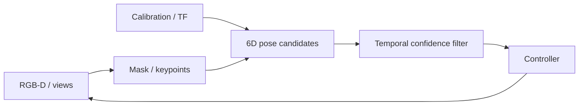
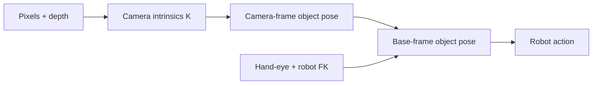

# Visual Perception and State Estimation

<!-- course-meta:start -->
[Course home](https://github.com/zengxiong111/Foundation_of_Embodied_AI) · [简体中文](https://github.com/zengxiong111/Foundation_of_Embodied_AI/blob/main/md/Visual_State_Estimation_ZH.md) · [PDF](https://zengxiong111.github.io/zengxiong.github.io/files/Visual_State_Estimation_EN.pdf)

| Item | Details |
|---|---|
| Applicability | RGB-D, camera pose, object 6D pose and closed-loop tracking concepts; no hardware or accuracy validation |
| Documentation review date | 2026-10-18 |
| License | CC BY 4.0 · Xiong Zeng and contributors |

**Verification scope:** Documentation and reference check only; no unified training run or real-robot validation. See [version notes](https://github.com/zengxiong111/Foundation_of_Embodied_AI/blob/main/VERSIONS.md). Original materials use [CC BY 4.0](https://creativecommons.org/licenses/by/4.0/); cited third-party work retains its own license.
<!-- course-meta:end -->

<!-- course-toc:start -->
## Contents

- [1. Why Robots Need State Estimation](#course-section-01)
  - [1.1 Observation, Estimate, and True State](#course-section-02)
  - [1.2 When 6D Pose Is Needed](#course-section-03)
- [2. From Pixels to Robot Base Frames](#course-section-04)
  - [2.1 Head and Wrist Cameras Have Different Extrinsics](#course-section-05)
  - [2.2 Timestamp Delay Becomes Spatial Error](#course-section-06)
- [3. A Modular Visual Estimation Pipeline](#course-section-07)
  - [3.1 Separate Initialization from Tracking](#course-section-08)
  - [3.2 Symmetry Can Make Pose Ambiguous](#course-section-09)
- [4. Temporal Filtering, Confidence and Recovery](#course-section-10)
  - [4.1 Confidence-Aware Control](#course-section-11)
  - [4.2 Lost-Track and Reacquisition Are Core Capabilities](#course-section-12)
- [5. Training with Estimator Error](#course-section-13)
  - [5.1 Evaluate Error Against the Control Objective](#course-section-14)
- [6. A Minimal Closed-Loop Panda Experiment](#course-section-15)
  - [6.1 Acceptance Checklist](#course-section-16)
- [7. Connections and References](#course-section-17)
<!-- course-toc:end -->

**Learning outcomes：** Understand pose chains; handle latency and tracking loss; connect estimates to closed-loop control.

## 1. Why Robots Need State Estimation

Visual measurements are partial, delayed, and noisy. Grasping policies need object pose, end-effector pose, and contact state; cameras provide pixels and depth. State estimation combines images, proprioception, calibrated geometry, and temporal history into control-ready state and uncertainty.

### 1.1 Observation, Estimate, and True State

The true environment state $s_t$ is generally not fully observable. Camera observation $o_t$ changes with occlusion, exposure, and viewpoint. An estimator supplies $\hat s_t$ and a confidence signal. In simulation, keep ground truth, rendered observations, and estimated state separate to prevent privileged-information leakage.

### 1.2 When 6D Pose Is Needed

Insertion, tool rotation, and grasping can depend on the object's 3D position and orientation, so an SE(3) pose may be useful. For symmetric, occluded, or textureless objects, task keypoints, relative pose, contours, or direct visual policies may be better. **Not every VLA requires an explicit 6D pose.**

## 2. From Pixels to Robot Base Frames

Calibrate intrinsics, distortion, depth scale, and extrinsics first. If the camera estimates $T_C^O$, then $T_B^O=T_B^C T_C^O$. For a wrist camera, $T_B^C(t)$ changes with robot configuration and requires timestamp-aligned forward kinematics and hand-eye calibration.

### 2.1 Head and Wrist Cameras Have Different Extrinsics

A fixed head camera may have constant extrinsics; a pan/tilt head still has time-varying $T_B^C(t)$. A wrist camera commonly uses $T_B^E(q_t)T_E^C$. The existence of a URDF does not eliminate real-world camera-to-axis errors: extrinsics must be validated.

### 2.2 Timestamp Delay Becomes Spatial Error

When the robot moves, transforming an old wrist-camera frame with the newest joint state creates systematic pose error. Log exposure/arrival, robot-state, inference-output and command-effective times; interpolate historical transforms. Measure end-to-end latency before tuning aggressive control.

## 3. A Modular Visual Estimation Pipeline

Common modules are detection/segmentation, correspondences and pose hypotheses, pose refinement, temporal tracking, failure detection, and uncertainty. A segmentation mask is not a 6D pose; PnP needs reliable 2D-3D correspondences. FoundationPose supports novel-object estimation/tracking under the input assumptions described in the paper, such as CAD or reference views.

### 3.1 Separate Initialization from Tracking

Initialization can propose multiple hypotheses from masks, depth, and geometry; tracking refines near the prior pose, often faster but prone to drift. Occlusion, out-of-view loss, or false detections should trigger global reinitialization rather than indefinite extrapolation.

### 3.2 Symmetry Can Make Pose Ambiguous

For symmetric cylinders or textureless tools, some rotations are not visually identifiable. Evaluate with symmetry-aware metrics or predict task-relevant contact keypoints. A bigger network cannot recover information absent from measurements.

## 4. Temporal Filtering, Confidence and Recovery

Maintain a predict → measurement update → validity check → recovery loop. The prediction uses previous state plus motion priors; the update uses new images. EKF, particle filtering, learned recurrent estimators, or simpler smoothing are possible. Evaluate error, latency, and reinitialization counts rather than only displaying smooth trajectories.

### 4.1 Confidence-Aware Control

Attach uncertainty or a validated quality score. At sustained low confidence, slow down, hold a safe pose, reacquire an observation, or request intervention; **do not continue high-force contact with an untrusted pose**. Calibrate confidence on held-out scenes: a raw network score is not a guaranteed error bound.

### 4.2 Lost-Track and Reacquisition Are Core Capabilities

Use an explicit state machine: TRACKING, UNCERTAIN, LOST, RELOCALIZING. Test transitions under occlusion, active camera movement, drops, and viewpoint jumps. Measure recovery success/time and maintain object identity to avoid silently switching to a similar object.

## 5. Training with Estimator Error

A simulator-privileged teacher is not a deployed visual policy. Visual distillation or pose-noise domain randomization may help, but include bias, temporal correlation, delays, missed detections, and outliers where justified. Compare oracle pose, synthetic noisy pose, and estimated pose to isolate perception versus control limitations.

### 5.1 Evaluate Error Against the Control Objective

Track translation/orientation error, track-loss rate, confidence calibration, inference latency, occlusion recovery time, and grasp success. Better numerical pose error does not always imply better manipulation performance, so include task outcomes.

## 6. A Minimal Closed-Loop Panda Experiment

In the shared Panda + cube + tabletop setup, first establish an oracle-state baseline, then a fixed RGB-D estimator, and finally a wrist-camera case with time-varying extrinsics. Hold the controller fixed while changing only the perception pipeline. Test nominal lighting, occlusion, and randomized start poses; active camera recovery is optional.

### 6.1 Acceptance Checklist

| Check | Acceptance criterion |
|---|---|
| Frame chain | Known object maps to the base frame |
| Timestamps | Images and FK use aligned sample times |
| Nominal error | Measured quantitatively on held-out scenes |
| Recovery | Reacquires after loss, no permanently stale pose |
| Safety | Can slow/stop when confidence is poor |
| Task metric | Logs success, latency, and recovery |

## 7. Connections and References

This chapter follows [camera calibration](Robot_Camera_Calibration_Tutorial_EN.md) and supplies an observation interface for [imitation learning](Data_Imitation_Learning_EN.md), [motion RL](Embodied_Motion_Control_RL_Tutorial_EN.md), and visual VLA deployment.

- [FoundationPose, CVPR 2024](https://arxiv.org/abs/2312.08344)
- [SAM 2](https://arxiv.org/abs/2408.00714)
- [OpenCV calib3d](https://docs.opencv.org/4.x/d9/d0c/group__calib3d.html)
- [ROS 2 tf2](https://docs.ros.org/en/jazzy/Concepts/Intermediate/About-Tf2.html)

**Verification boundary:** this is a conceptual methods and experiment-design chapter. Real-time performance on any particular camera, GPU, or robot has not been measured.
