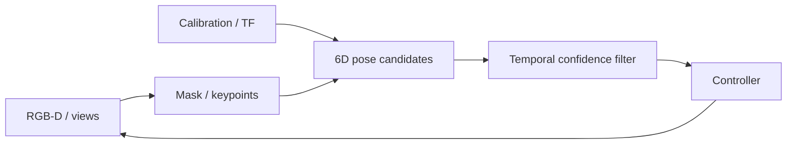
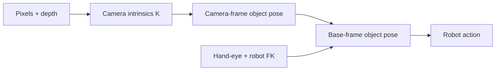

# Visual Perception and State Estimation

<!-- course-meta:start -->
[Course home](https://github.com/zengxiong111/Foundation_of_Embodied_AI) · [简体中文](https://github.com/zengxiong111/Foundation_of_Embodied_AI/blob/main/md/Visual_State_Estimation_ZH.md) · [PDF](https://zengxiong111.github.io/zengxiong.github.io/files/Visual_State_Estimation_EN.pdf)

| Item | Details |
|---|---|
| Applicability | RGB-D, 6D pose, temporal tracking and recovery concepts |
| Documentation review date | 2026-10-18 |
| License | CC BY 4.0 · Xiong Zeng and contributors |

**Verification scope:** Conceptual methods and experiment design; no robot or accuracy validation. See [version notes](https://github.com/zengxiong111/Foundation_of_Embodied_AI/blob/main/VERSIONS.md) for pinned source references. Original teaching content uses [CC BY 4.0](https://creativecommons.org/licenses/by/4.0/); third-party quotations, figures and code retain their original licenses. Citation alone does not grant relicensing rights.
<!-- course-meta:end -->

<!-- course-toc:start -->
## Contents

- [1. Why Robots Need State Estimation](#course-section-01)
  - [1.1 Observation, Estimate, and True State](#course-section-02)
  - [1.2 When 6D Pose Is Needed](#course-section-03)
- [2. From Pixels to Robot Base Frames](#course-section-04)
  - [2.1 Head and Wrist Cameras Have Different Extrinsics](#course-section-05)
  - [2.2 Timestamp Delay Becomes Spatial Error](#course-section-06)
- [3. A Modular Visual Estimation Pipeline](#course-section-07)
  - [3.1 Separate Initialization from Tracking](#course-section-08)
  - [3.2 Symmetry Can Make Pose Ambiguous](#course-section-09)
- [4. Temporal Filtering, Confidence and Recovery](#course-section-10)
  - [4.1 Confidence-Aware Control](#course-section-11)
  - [4.2 Lost-Track and Reacquisition Are Core Capabilities](#course-section-12)
- [5. Training with Estimator Error](#course-section-13)
  - [5.1 Evaluate Error Against the Control Objective](#course-section-14)
- [6. A Minimal Closed-Loop Panda Experiment](#course-section-15)
  - [6.1 Acceptance Checklist](#course-section-16)
- [7. From Pixels to 3D State With Uncertainty](#course-section-17)
  - [7.1 What Can One RGB Image Actually Measure?](#course-section-18)
  - [7.2 Stereo Depth and Error Propagation](#course-section-19)
  - [7.3 Object Point Clouds From Masks and Depth](#course-section-20)
- [8. Visual Foundation Models: Roles and Limitations](#course-section-21)
  - [8.1 Segmentation, Stereo, Pose, and Reconstruction Are Different Tasks](#course-section-22)
  - [8.2 SAM 2: Promptable Temporal Instance Masks](#course-section-23)
  - [8.3 SAM 3 and SAM 3.1: Open-Vocabulary Language Grounding](#course-section-24)
  - [8.4 FoundationPose: 6D Pose With CAD or Reference Views](#course-section-25)
  - [8.5 FoundationStereo and Fast-FoundationStereo as Depth Components](#course-section-26)
  - [8.6 SAM 3D Objects and Body: Shape Priors, Not Precision Calibration](#course-section-27)
- [9. Building a Modular Perception Pipeline](#course-section-28)
  - [9.1 Two Complementary Perception Routes](#course-section-29)
  - [9.2 Asynchronous Scheduling Rather Than Every Model Every Frame](#course-section-30)
  - [9.3 A Consistent State Interface](#course-section-31)
- [10. Temporal Estimation, Latency, and Error Propagation](#course-section-32)
  - [10.1 Prediction and EKF Measurement Update](#course-section-33)
  - [10.2 Delay Is Spatial Error, Not Just Slower FPS](#course-section-34)
  - [10.3 Occlusion, Observability, and Active Reacquisition](#course-section-35)
- [11. Selecting Models for Actual Robot Cameras](#course-section-36)
  - [11.1 Head RGB-D and Wrist RGB](#course-section-37)
  - [11.2 Model Selection by Task](#course-section-38)
  - [11.3 Isolate Perception Error From Control Error](#course-section-39)
- [12. A Minimal Reproduction and Acceptance Protocol](#course-section-40)
  - [12.1 Report Both Perception and Robot Metrics](#course-section-41)
  - [12.2 Shared Panda Tabletop Ablations](#course-section-42)
- [13. Connections and References](#course-section-43)
- [8. Measurement Models and State Estimation](#course-section-44)
  - [8.1 RGB-D and Stereo Depth](#course-section-45)
  - [8.2 Recursive Filtering and Confidence](#course-section-46)
- [9. General-Purpose Vision Models](#course-section-47)
  - [9.1 Capability Comparison](#course-section-48)
  - [9.2 Composable Perception Stack](#course-section-49)
  - [9.3 End-to-End Latency](#course-section-50)
- [10. Shared Experiments and References](#course-section-51)
<!-- course-toc:end -->

**Learning outcomes：** Understand pose chains; handle latency and tracking loss; connect estimates to closed-loop control.

## 1. Why Robots Need State Estimation

Visual measurements are partial, delayed, and noisy. Grasping policies need object pose, end-effector pose, and contact state; cameras provide pixels and depth. State estimation combines images, proprioception, calibrated geometry, and temporal history into control-ready state and uncertainty.

### 1.1 Observation, Estimate, and True State

The true environment state $s_t$ is generally not fully observable. Camera observation $o_t$ changes with occlusion, exposure, and viewpoint. An estimator supplies $\hat s_t$ and a confidence signal. In simulation, keep ground truth, rendered observations, and estimated state separate to prevent privileged-information leakage.

### 1.2 When 6D Pose Is Needed

Insertion, tool rotation, and grasping can depend on the object's 3D position and orientation, so an SE(3) pose may be useful. For symmetric, occluded, or textureless objects, task keypoints, relative pose, contours, or direct visual policies may be better. **Not every VLA requires an explicit 6D pose.**

## 2. From Pixels to Robot Base Frames

Calibrate intrinsics, distortion, depth scale, and extrinsics first. If the camera estimates $T_C^O$, then $T_B^O=T_B^C T_C^O$. For a wrist camera, $T_B^C(t)$ changes with robot configuration and requires timestamp-aligned forward kinematics and hand-eye calibration.

### 2.1 Head and Wrist Cameras Have Different Extrinsics

A fixed head camera may have constant extrinsics; a pan/tilt head still has time-varying $T_B^C(t)$. A wrist camera commonly uses $T_B^E(q_t)T_E^C$. The existence of a URDF does not eliminate real-world camera-to-axis errors: extrinsics must be validated.

### 2.2 Timestamp Delay Becomes Spatial Error

When the robot moves, transforming an old wrist-camera frame with the newest joint state creates systematic pose error. Log exposure/arrival, robot-state, inference-output and command-effective times; interpolate historical transforms. Measure end-to-end latency before tuning aggressive control.

## 3. A Modular Visual Estimation Pipeline

Common modules are detection/segmentation, correspondences and pose hypotheses, pose refinement, temporal tracking, failure detection, and uncertainty. A segmentation mask is not a 6D pose; PnP needs reliable 2D-3D correspondences. FoundationPose supports novel-object estimation/tracking under the input assumptions described in the paper, such as CAD or reference views.

### 3.1 Separate Initialization from Tracking

Initialization can propose multiple hypotheses from masks, depth, and geometry; tracking refines near the prior pose, often faster but prone to drift. Occlusion, out-of-view loss, or false detections should trigger global reinitialization rather than indefinite extrapolation.

### 3.2 Symmetry Can Make Pose Ambiguous

For symmetric cylinders or textureless tools, some rotations are not visually identifiable. Evaluate with symmetry-aware metrics or predict task-relevant contact keypoints. A bigger network cannot recover information absent from measurements.

## 4. Temporal Filtering, Confidence and Recovery

Maintain a predict → measurement update → validity check → recovery loop. The prediction uses previous state plus motion priors; the update uses new images. EKF, particle filtering, learned recurrent estimators, or simpler smoothing are possible. Evaluate error, latency, and reinitialization counts rather than only displaying smooth trajectories.

### 4.1 Confidence-Aware Control

Attach uncertainty or a validated quality score. At sustained low confidence, slow down, hold a safe pose, reacquire an observation, or request intervention; **do not continue high-force contact with an untrusted pose**. Calibrate confidence on held-out scenes: a raw network score is not a guaranteed error bound.

### 4.2 Lost-Track and Reacquisition Are Core Capabilities

Use an explicit state machine: TRACKING, UNCERTAIN, LOST, RELOCALIZING. Test transitions under occlusion, active camera movement, drops, and viewpoint jumps. Measure recovery success/time and maintain object identity to avoid silently switching to a similar object.

## 5. Training with Estimator Error

A simulator-privileged teacher is not a deployed visual policy. Visual distillation or pose-noise domain randomization may help, but include bias, temporal correlation, delays, missed detections, and outliers where justified. Compare oracle pose, synthetic noisy pose, and estimated pose to isolate perception versus control limitations.

### 5.1 Evaluate Error Against the Control Objective

Track translation/orientation error, track-loss rate, confidence calibration, inference latency, occlusion recovery time, and grasp success. Better numerical pose error does not always imply better manipulation performance, so include task outcomes.

## 6. A Minimal Closed-Loop Panda Experiment

In the shared Panda + cube + tabletop setup, first establish an oracle-state baseline, then a fixed RGB-D estimator, and finally a wrist-camera case with time-varying extrinsics. Hold the controller fixed while changing only the perception pipeline. Test nominal lighting, occlusion, and randomized start poses; active camera recovery is optional.

### 6.1 Acceptance Checklist

| Check | Acceptance criterion |
|---|---|
| Frame chain | Known object maps to the base frame |
| Timestamps | Images and FK use aligned sample times |
| Nominal error | Measured quantitatively on held-out scenes |
| Recovery | Reacquires after loss, no permanently stale pose |
| Safety | Can slow/stop when confidence is poor |
| Task metric | Logs success, latency, and recovery |

## 7. From Pixels to 3D State With Uncertainty

### 7.1 What Can One RGB Image Actually Measure?

For a camera-frame point $P_C=(X,Y,Z)$, the ideal pinhole camera maps it to $u=f_xX/Z+c_x,\ v=f_yY/Z+c_y$. A pixel $(u,v)$ alone does not uniquely specify a 3D point. Depth, calibrated stereo, geometric correspondences or other priors are required. For the derivation of intrinsics, extrinsics, hand-eye calibration and TF, consult [Camera Calibration](Robot_Camera_Calibration_Tutorial_EN.md); this chapter focuses on **estimating object state from calibrated observations** rather than repeating calibration theory.

### 7.2 Stereo Depth and Error Propagation

For synchronized, rectified stereo images, disparity $d=u_L-u_R$ yields the simplified metric depth and sensitivity

$
Z=\frac{f_xb}{d},\qquad
\sigma_Z\approx\frac{f_xb}{d^2}\sigma_d,
$

where $b$ is the measured baseline. Small disparity at large distances amplifies depth error, while incorrect matching and reflections create invalid depth. **FoundationStereo** performs zero-shot dense disparity estimation from calibrated stereo; **Fast-FoundationStereo** (CVPR 2026) improves speed using distillation, architecture search and pruning. Neither is a single-image 6D object pose estimator.

### 7.3 Object Point Clouds From Masks and Depth

Given mask $M(u,v)$ and valid depth $Z(u,v)$, back-project foreground pixels to

$
\mathcal P_O=\left\{Z(u,v)K^{-1}[u,v,1]^\top:
M(u,v)=1,\;Z(u,v)>0\right\}.
$

Evaluate mask boundaries and background leakage separately from invalid/reflective depth, self-occlusion and segmentation identity failures. A point cloud in the camera frame is not automatically an SE(3) object pose in the robot base frame; it still requires geometry and timestamp-aligned transforms.

## 8. Visual Foundation Models: Roles and Limitations

### 8.1 Segmentation, Stereo, Pose, and Reconstruction Are Different Tasks

| Model | Typical input | Output | Reasonable robot role | Does NOT guarantee |
|---|---|---|---|---|
| SAM 2 / 2.1 | Image/video and click/box/mask prompt | Instance masks propagated through video | Track an initialized target | Depth and 6D pose |
| SAM 3 / 3.1 | Image/video, text concepts or exemplars | Open-vocabulary detection, masks and tracking | Language grounding and target identity | Contact forces or grasp precision |
| FoundationStereo | Synchronized calibrated stereo | Disparity and derived depth | Stereo metric 3D measurements | Monocular depth or object orientation |
| Fast-FoundationStereo | Same | Lower-latency disparity family | Real-time stereo candidate | Realtime speed on all hardware |
| FoundationPose | RGB(-D), target mask, CAD or reference images | 6D pose and tracking | Rigid-object localization | Pose with zero object-reference assumptions |
| SAM 3D Objects | Single object image | Hypothesized 3D geometry, texture, layout | Candidate shape priors without CAD | Verified millimetre-scale collision geometry |
| SAM 3D Body | Human image | 3D human body shape and pose | Human demonstration understanding | Robot hand contact forces |

“Foundation” suggests generalization across categories and scenes; it does not remove the need for calibration, synchronization, device benchmarking or safety checks. Audit checkpoint license, memory footprint, camera requirements and operating domain before use.

### 8.2 SAM 2: Promptable Temporal Instance Masks

SAM 2 initializes targets from point, box or mask prompts, and propagates masks using video memory. It is a strong baseline for tracking a known screwdriver or gripper in video. Severe occlusion, out-of-view targets, reflections and similar-looking instances can break identity continuity. Log track IDs and allow re-prompting. Smooth video masks do not imply correct physical pose or grasp contact.

### 8.3 SAM 3 and SAM 3.1: Open-Vocabulary Language Grounding

SAM 3 accepts short text concepts, visual exemplars and prompts to find and track matching instances. “The red-handled screwdriver on the table” can yield masks for a downstream 3D estimator. SAM 3.1 further improves multi-object video throughput. Yet open-vocabulary localization returns **image regions**, not a control-ready grasp trajectory; assess identity switches, false matches, latency and occlusion recovery.

### 8.4 FoundationPose: 6D Pose With CAD or Reference Views

FoundationPose (CVPR 2024) supports model-based pose estimation (CAD provided) and its model-free setup (a few reference views are captured). It can handle novel test objects without task-specific fine-tuning under these assumptions. A practical pipeline is segmentation/depth input → pose hypotheses and scoring → pose refinement → temporal tracking, with reinitialization after loss. **Model-free does not mean no reference information.**

With 3D model points $P_i$ and trusted image correspondences $u_i$, the geometric idea of reprojection consistency can be written

$
(\hat R,\hat t)=\arg\min_{R,t}\sum_i
\rho\left(\left\|u_i-\pi(K(RP_i+t))\right\|_2^2\right).
$

This is a generic explanatory pose objective, **not a claim that FoundationPose exactly optimizes this loss**. Symmetry, texturelessness and occlusion can make rotations unobservable; evaluate using symmetry-aware pose errors or task-relevant keypoints.

### 8.5 FoundationStereo and Fast-FoundationStereo as Depth Components

FoundationStereo is zero-shot stereo matching: calibrated/synchronized $[I_L,I_R]$ → disparity → depth using $Z=f_xb/d$. Fast-FoundationStereo is an accelerated model family; runtime depends on checkpoint, iterations, input resolution and GPU. **High-quality depth is not equivalent to high-quality 6D pose.** Where a depth camera already provides reliable aligned RGB-D, its SDK should be the first baseline. Adding a stereo foundation model must justify extra cost by measured accuracy, latency or robustness gains.

### 8.6 SAM 3D Objects and Body: Shape Priors, Not Precision Calibration

SAM 3D Objects infers shape, texture and layout from a single object image; SAM 3D Body estimates human 3D form. A single image leaves hidden surfaces and metric scale ambiguous. Its 3D output can serve as a **candidate geometry prior** but must be scale-checked, aligned and validated before rigid registration, collision simulation, or high-precision insertion. A plausible 3D mesh does not guarantee measured mass, inertia, contact coefficients or millimetre accuracy.

## 9. Building a Modular Perception Pipeline

### 9.1 Two Complementary Perception Routes

~~~mermaid
flowchart TD
  A["Task text / target prompt"] --> B["SAM 3 localization"]
  B --> C["Target mask and identity"]
  D["Calibrated stereo / RGB-D"] --> E["Depth and point cloud"]
  C --> F["Object pose hypotheses"]
  E --> F
  G["CAD / reference views"] --> F
  F --> H["FoundationPose refinement"]
  H --> I["Temporal filter / uncertainty"]
  I --> J["Robot controller / policy"]
~~~

**Explicit geometry:** SAM 3 for target selection, stereo/RGB-D for metric depth, FoundationPose for 6D pose, and a temporal estimator to provide stable control feedback. **Implicit policy:** send images and task goals to a visual action model without necessarily estimating a 6D pose, while independently monitoring target visibility, progress and safety. Deformable, transparent, and deeply occluded objects may not have a unique estimable rigid pose.

### 9.2 Asynchronous Scheduling Rather Than Every Model Every Frame

At task start, run SAM 3 to identify the object. Track subsequent video with a lighter tracker or the SAM video mode; run more expensive pose refinement less often; rerun global detection when identity or confidence is lost. Invoke stereo models only when synchronized true binocular input and an accuracy or dataset need justify them. Every measurement must preserve its **image acquisition timestamp**, not only inference completion time.

### 9.3 A Consistent State Interface

A target tracking message should include frame_id, timestamp, track_id, mask/detection region, $\hat T_B^O$, translation/rotation uncertainty, estimator checkpoint and validity state: TRACKING / UNCERTAIN / LOST / RELOCALIZING. Record invalid-depth fraction and pose hypothesis ambiguity. Policy and high-level agents should only consume audited fields. A raw classifier confidence value is not a certified bound on physical error.

## 10. Temporal Estimation, Latency, and Error Propagation

### 10.1 Prediction and EKF Measurement Update

For a local Euclidean state, let $x_t=f(x_{t-1},u_t)+w_t$ and $z_t=h(x_t)+v_t$ with covariances $Q_t,R_t$. Linearization gives the extended Kalman gain/update

$
K_t=P_t^-H_t^\top(H_tP_t^-H_t^\top+R_t)^{-1},
\qquad
\hat x_t=\hat x_t^-+K_t(z_t-h(\hat x_t^-)).
$

SE(3) poses are not ordinary vectors under large rotation changes. An error-state update can use $\hat T_t=\hat T_t^-\operatorname{Exp}(\delta\xi_t^\wedge)$. EKF will not fix a mistaken instance identity; robust gating, lost-track detection and reacquisition are separate design requirements.

### 10.2 Delay Is Spatial Error, Not Just Slower FPS

At approximately constant object speed $\|v\|$ and lag $\delta$, stale observations can induce position error on the order of $\|v\|\delta$. A wrist-camera frame captured at $t-\delta$ must be transformed using robot FK/TF for the **same historical time**. Combining a stale image with the newest FK introduces systematic error. Log exposure, receipt, estimator finish, policy finish and command-effective times; evaluate end-to-end p95 latency.

### 10.3 Occlusion, Observability, and Active Reacquisition

Turn confidence into explicit controller modes. High confidence permits bounded feedback, low confidence slows or holds, and lost tracking triggers safe observation and relocalization. Moving the wrist or head for an informative view may help, provided collision and reachability are verified first. Symmetric objects can have fundamentally unobservable rotations; larger models alone do not resolve missing information.

## 11. Selecting Models for Actual Robot Cameras

### 11.1 Head RGB-D and Wrist RGB

A fixed head camera may provide a stable global view; a pan/tilt camera has time-varying extrinsics. A wrist RGB camera sees close interactions but moves with the end-effector and suffers occlusion. A head RGB-D plus a wrist RGB **does not automatically form a synchronized, rectified stereo pair** suitable for FoundationStereo. Build the SDK-depth + SAM 2/3 + FoundationPose baseline first.

### 11.2 Model Selection by Task

| Requirement | First baseline | Optional component to test |
|---|---|---|
| Track a prompted object mask | SAM 2 | SAM 3 for language selection |
| Ground an unknown linguistic target | SAM 3 | Stereo/depth and pose estimator |
| Calibrated stereo | Device SDK / FoundationStereo | Fast variant for low latency |
| Rigid object with CAD/reference views | FoundationPose | External SAM + temporal tracker |
| No CAD and incomplete shape | SAM 3D Objects candidate | Metric-scale verification |
| Precise insertion/contact | Pose + proprioception + contact signals | Mask never substitutes force feedback |

### 11.3 Isolate Perception Error From Control Error

Keep controller parameters fixed. Compare oracle pose, matched synthetic noisy pose, and estimated visual pose. Measure mask quality, track loss, relocalization, 6D error and downstream grasping success. Otherwise one cannot tell whether a failed pick resulted from an estimator failure or an inadequate controller.

## 12. A Minimal Reproduction and Acceptance Protocol

### 12.1 Report Both Perception and Robot Metrics

Measure mask IoU, identity switches, stereo depth MAE and invalid fraction, translation error, symmetry-aware rotation error, tracking dropout, reacquisition success, p50/p95 inference latency, robot success and unsafe contact rate. Ground truth must come from an independent measurement or an explicitly identified simulator source. Bind every result to GPU, model/checkpoint, image resolution, threshold and camera calibration.

### 12.2 Shared Panda Tabletop Ablations

Hold the Panda + cube + table task and controller fixed. Test A) oracle state, B) SDK RGB-D + simple mask, C) SAM 2 + FoundationPose, D) SAM 3 + FoundationPose, E) FoundationStereo or Fast on an actual calibrated stereo rig. Vary occlusion, camera motion, similar-looking objects, slips, and full track loss. Always evaluate safety-stop and reacquisition behavior.

**Chapter ownership:** Calibration mathematics are in [Camera Calibration](Robot_Camera_Calibration_Tutorial_EN.md); demonstrations and policy learning are in [Data and Imitation Learning](Data_Imitation_Learning_EN.md); high-level planning, tool use and success checking are in [Robot Agent Workflows](Robot_Agent_Workflow_EN.md).

## 13. Connections and References

This chapter follows [camera calibration](Robot_Camera_Calibration_Tutorial_EN.md) and supplies an observation interface for [imitation learning](Data_Imitation_Learning_EN.md), [motion RL](Embodied_Motion_Control_RL_Tutorial_EN.md), and visual VLA deployment.

- [FoundationPose, CVPR 2024](https://arxiv.org/abs/2312.08344)
- [FoundationStereo, CVPR 2025](https://github.com/NVlabs/FoundationStereo)
- [Fast-FoundationStereo, CVPR 2026](https://github.com/NVlabs/Fast-FoundationStereo)
- [SAM 3 and SAM 3.1](https://ai.meta.com/research/sam3)
- [SAM 3D Objects](https://github.com/facebookresearch/sam-3d-objects)
- [SAM 2](https://arxiv.org/abs/2408.00714)
- [OpenCV calib3d](https://docs.opencv.org/4.x/d9/d0c/group__calib3d.html)
- [ROS 2 tf2](https://docs.ros.org/en/jazzy/Concepts/Intermediate/About-Tf2.html)

**Verification boundary:** this is a conceptual methods and experiment-design chapter. Real-time performance on any particular camera, GPU, or robot has not been measured.

## 8. Measurement Models and State Estimation

### 8.1 RGB-D and Stereo Depth

Pinhole projection obeys $u=f_xX/Z+c_x$, $v=f_yY/Z+c_y$. With valid depth, $P_C=ZK^{-1}[u,v,1]^\top$. Rectified stereo gives $Z=fb/d$ with baseline $b$ and disparity $d$; approximate depth uncertainty is $\sigma_Z\approx(fb/d^2)\sigma_d$. Depth, segmentation and extrinsic calibration are all noisy. For intrinsic and hand–eye calibration methods, use the dedicated [Camera Calibration](Robot_Camera_Calibration_Tutorial_EN.md) chapter.

### 8.2 Recursive Filtering and Confidence

Use $x_t=f(x_{t-1},u_{t-1})+w_t$, $y_t=h(x_t)+v_t$. An EKF computes

$$
\hat x_t^-=f(\hat x_{t-1},u_{t-1}),\quad P_t^-=F_tP_{t-1}F_t^\top+Q_t,
$$

$$
K_t=P_t^-H_t^\top(H_tP_t^-H_t^\top+R_t)^{-1},\quad
\hat x_t=\hat x_t^-+K_t(y_t-h(\hat x_t^-)).
$$

SE(3) orientation updates should use a local tangent-space residual; evaluate symmetric objects with symmetry-aware metrics. During occlusion, uncertainty must grow, and lost tracks must reinitialize rather than silently reuse a stale pose.

## 9. General-Purpose Vision Models

### 9.1 Capability Comparison

| Model | Primary output | Required or typical input | Robotics application | Not a guarantee of |
|---|---|---|---|---|
| FoundationPose | object 6D pose estimation/tracking | target region, RGB(-D), CAD or reference views as applicable | manipulation pose feedback | universal unconditional object recognition |
| FoundationStereo | dense stereo disparity and depth | calibrated rectified stereo images | metric depth and point cloud | object semantics or 6D pose |
| SAM 2 | image masks and video mask tracking | images/video plus click, box or mask prompts | maintain target identity in video | metric depth or physical contact |
| SAM 3 | text/exemplar-prompted concept detection, masks and tracking | images/video and language or examples | referential object discovery | physical pose or task success |
| SAM 3D Objects | estimated single-image 3D geometry, texture and layout | image/object region | candidate shape prior | metrology-grade CAD or real-time tracking |

SAM 3 is not SAM 3D, and neither is FoundationPose. Monocular reconstruction is ambiguous in geometry and scale. Do not use unverified SAM 3D output as precision collision geometry. FoundationStereo is optional if RGB-D depth is already available.

### 9.2 Composable Perception Stack

SAM 3 locates a task referent from language; SAM 2/3 tracks object masks; RGB-D or FoundationStereo supplies depth; FoundationPose or another appropriate estimator generates camera-frame pose $T_C^O$; a temporal filter produces base-frame $\hat T_B^O$ and uncertainty for the policy. SAM 3D may generate a provisional object shape when CAD is missing, but scale and contact surfaces require validation. Some tasks need only segmentation and depth keypoints, not full object orientation.

### 9.3 End-to-End Latency

$$
T_{\rm total}=T_{\rm capture}+T_{\rm segmentation}+T_{\rm depth}+T_{\rm pose}+T_{\rm filter}+T_{\rm policy}+T_{\rm communication}.
$$

Measure initialization/tracking time separately, P95/P99 latency, lost-track recovery, pose error, uncertainty calibration, and task success. A slow detector can coexist with a faster control loop only if timestamped state prediction and stale-state handling are explicit.

## 10. Shared Experiments and References

Compare oracle object state against RGB-D+mask+FoundationPose, SAM 2/SAM 3 mask initialization, and optional stereo/shape priors while holding the Panda task and controller fixed. Test occlusion, symmetries, camera movement, and reacquisition. Structured pose perturbations can use $\tilde T_t=T_t\exp(\hat \xi_t)$, but should include bias, correlation, missed observations and latency rather than independent Gaussian noise alone.

**Division of responsibility:** visual measurements and uncertainty belong here; demonstration policy fitting lives in [Imitation Learning](Data_Imitation_Learning_EN.md), and tool orchestration/replanning in [Robot Agents](Robot_Agent_Workflow_EN.md).

- [FoundationPose](https://arxiv.org/abs/2312.08344)
- [FoundationStereo](https://github.com/NVlabs/FoundationStereo)
- [SAM 2](https://github.com/facebookresearch/sam2)
- [SAM 3](https://ai.meta.com/research/sam3/)
- [SAM 3D Objects](https://github.com/facebookresearch/sam-3d-objects)
