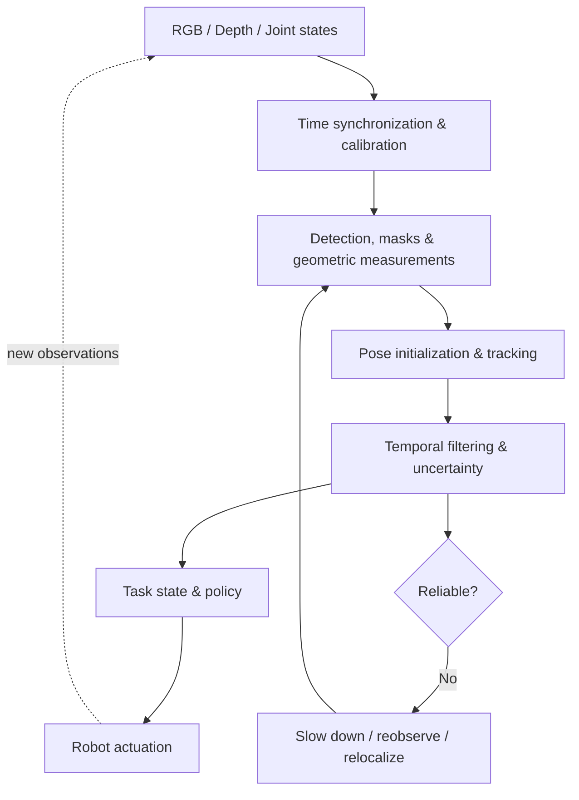
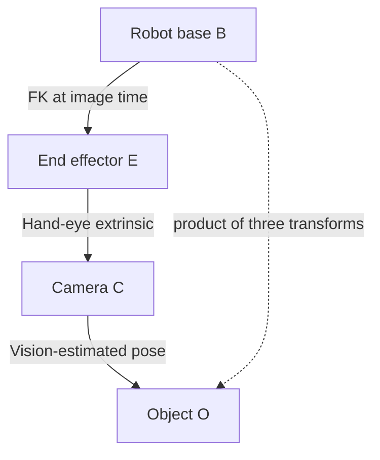
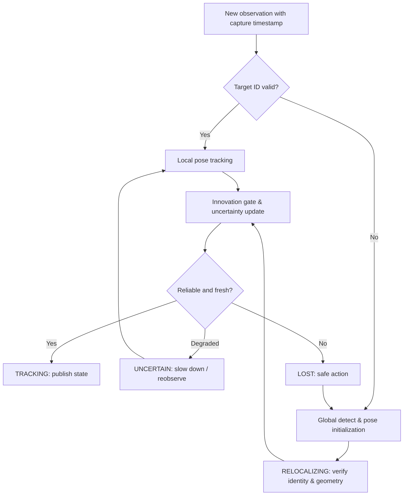

# 视觉感知与状态估计

<!-- course-meta:start -->
[课程首页](https://github.com/zengxiong111/Foundation_of_Embodied_AI/blob/main/README.zh-CN.md) · [English](https://github.com/zengxiong111/Foundation_of_Embodied_AI/blob/main/md/Visual_State_Estimation_EN.md) · [PDF](https://zengxiong111.github.io/zengxiong.github.io/files/Visual_State_Estimation_ZH.pdf)

| 项目 | 说明 |
|---|---|
| 适用范围 | 相机几何、RGB-D/双目、分割、FoundationPose、SE(3) 滤波、不确定性、异步执行与恢复概念 |
| 文档核验日期 | 2026-10-18 |
| 许可 | CC BY 4.0 · Xiong Zeng and contributors |

**核验边界：** 仅进行文档整合与排版检查；未进行真机、精度或运行验证。不包含实验章节。 固定源码引用见[资料清单](https://github.com/zengxiong111/Foundation_of_Embodied_AI/blob/main/materials.json)。原创教材采用 [CC BY 4.0](https://creativecommons.org/licenses/by/4.0/)，第三方引用、图片及代码遵循其原有许可；注明来源不等于拥有再许可权。
<!-- course-meta:end -->

<!-- course-toc:start -->
## 目录

- [1. 从视觉观测到机器人任务状态](#course-section-01)
  - [1.1 四个经常混淆的概念](#course-section-02)
  - [1.2 必须估计完整 6D 位姿吗？](#course-section-03)
  - [1.3 感知系统的分层职责](#course-section-04)
- [2. 从像素到三维几何](#course-section-05)
  - [2.1 相机成像与反投影](#course-section-06)
  - [2.2 RGB-D、双目和单目深度不等价](#course-section-07)
  - [2.3 从分割 Mask 构造局部点云](#course-section-08)
  - [2.4 像素—三维误差的一阶传播](#course-section-09)
- [3. 机器人坐标系与时间一致性](#course-section-10)
  - [3.1 坐标约定必须统一](#course-section-11)
  - [3.2 采样时间与发布时刻不同](#course-section-12)
  - [3.3 多相机融合不等于简单平均](#course-section-13)
- [4. 检测、分割与几何基础模型](#course-section-14)
  - [4.1 模型选型的第一原则：辨认输出变量](#course-section-15)
  - [4.2 SAM 2：已知实例的视频 Mask 跟踪](#course-section-16)
  - [4.3 SAM 3 / 3.1：从语言目标到可追踪实例](#course-section-17)
  - [4.4 FoundationStereo 与 Fast-FoundationStereo：深度模块](#course-section-18)
  - [4.5 SAM 3D Objects：补充形状先验，而不是替代标定 CAD](#course-section-19)
- [5. FoundationPose 与 6D 物体位姿](#course-section-20)
  - [5.1 什么是 $SE(3)$ 物体姿态](#course-section-21)
  - [5.2 模型条件：CAD 与参考图像不是同一回事](#course-section-22)
  - [5.3 几何一致性怎样约束位姿](#course-section-23)
  - [5.4 对称物体不是所有方向都可观测](#course-section-24)
- [6. SE(3) 时序状态估计与不确定性](#course-section-25)
  - [6.1 为什么不能逐元素平滑旋转矩阵](#course-section-26)
  - [6.2 从预测到测量更新](#course-section-27)
  - [6.3 异常观测门控与身份一致性](#course-section-28)
  - [6.4 外参和姿态协方差如何组合](#course-section-29)
  - [6.5 置信分数、协方差与真实误差](#course-section-30)
- [7. 延迟、异步调度与失败恢复](#course-section-31)
  - [7.1 不要把单模型 FPS 当成控制频率](#course-section-32)
  - [7.2 两个时间尺度的感知架构](#course-section-33)
  - [7.3 恢复机制是闭环设计的一部分](#course-section-34)
- [8. 从视觉状态到控制、模仿学习与 Robot Agent](#course-section-35)
  - [8.1 面向下游的最小状态接口](#course-section-36)
  - [8.2 显式状态控制与直接视觉策略](#course-section-37)
  - [8.3 感知误差为什么影响 sim-to-real](#course-section-38)
  - [8.4 灵巧手的视觉边界：位姿不等于接触](#course-section-39)
- [9. 体系结构选型与工程注意事项](#course-section-40)
  - [9.1 按传感器与目标选择最小系统](#course-section-41)
  - [9.2 六类容易忽略的工程问题](#course-section-42)
- [10. 总结：可靠视觉闭环的四条原则](#course-section-43)
- [附录 A. 核心公式速查](#course-section-44)
- [附录 B. 术语与课程衔接](#course-section-45)
- [参考资料与官方链接](#course-section-46)
<!-- course-toc:end -->

**Visual Perception and State Estimation · Foundation of Embodied AI**  
**修订版：2026-10-18 · 理论与系统设计讲义（不含实验章节）**  
基于 [原始中文讲义](https://github.com/zengxiong111/Foundation_of_Embodied_AI/blob/aeb4b8a500cba1543da944369918f6ca7dbbc059/pdf/Visual_State_Estimation_ZH.pdf) 重组与扩充。原始教材署名 Xiong Zeng and contributors，许可为 [CC BY 4.0](https://creativecommons.org/licenses/by/4.0/)；第三方论文、模型与图像仍适用各自的许可。

> **本章回答的核心问题：** 机器人如何把不完整、延迟且带噪声的图像，转化为具有明确坐标系、时间戳和可信度的状态，并据此完成可靠的闭环操作？
>
> **范围：** 针孔成像、RGB-D/双目、分割与几何估计、FoundationPose 与 SAM 等模型、SE(3) 状态滤波、误差传播、异步推理及控制接口。不重复推导相机标定算法，也不讨论数据采集、策略训练细节或实验设计。

**学习目标。** 读完后应能够：区分观测、真实状态、估计状态和任务状态；选择合适的 Mask、深度或 6D 位姿接口；构造时间一致的相机—机器人坐标变换；解释李群上的预测与观测更新；判断模型的输入前提及常见失效模式；设计有丢失恢复机制的视觉闭环系统。

## 1. 从视觉观测到机器人任务状态

### 1.1 四个经常混淆的概念

- **真实状态** $s_t$：环境在时刻 $t$ 的物理状态，通常不能完整测量，例如刚体位姿、速度、接触和摩擦状态。
- **视觉观测** $o_t$：相机在曝光时间附近获得的 RGB、深度及其像素信息；它会受遮挡、反光、视角、运动模糊和标定误差影响。
- **估计状态** $\hat s_t$：由当前观测、历史估计、机器人本体信息和先验模型联合推断的量。
- **任务状态** $z_t=\phi(s_t)$：策略真正需要的状态子集，例如工具尖端相对孔位的位姿、可抓取区域或“已经接触”的事件。

一般的递推估计器可写为

$$
\hat s_t,\,\Sigma_t=\mathcal E(o_{0:t},q_{0:t},u_{0:t-1};\theta),
$$

其中 $q_t$ 为机器人关节状态、$u_t$ 为动作，$\Sigma_t$ 表示估计的不确定性。**估计值不是真值**；模型置信分数也不天然等于可用于安全控制的概率或误差上界。

### 1.2 必须估计完整 6D 位姿吗？

| 任务目标 | 最小可用视觉接口 | 何时需要升级 |
|---|---|---|
| 判断目标是否存在、是否被遮挡 | 检测框、Mask、身份 ID | 需要几何定位、抓取点或追踪质量时 |
| 粗抓取与平面推物 | Mask + 深度 + 局部关键点 | 抓取方向或工具姿态敏感时 |
| 工具使用、插装、姿态复位 | 目标/工具的 $SE(3)$ 位姿 | 还需接触状态、相对速度和不确定性 |
| 柔性物体、灵巧手精密接触 | 局部形状、关键点、接触状态 | 单个刚体 $SE(3)$ 通常不足 |
| 直接视觉策略（VLA） | 图像、语言、机器人本体状态 | 可增加显式位姿用于安全监控和纠错 |

**可观测性先于模型选择。** 例如，无纹理圆柱绕自身轴线的旋转可能无法仅由图像唯一判断；改用更大的网络不能凭空产生传感器中缺失的信息。应通过视角变化、先验约束或其他传感器增加可观测性。

### 1.3 感知系统的分层职责

分割负责“**哪部分像素属于目标**”，深度负责“**像素在三维的哪里**”，位姿估计负责“**目标坐标系在哪里、朝向如何**”，时序估计负责“**综合历史后最可信的状态是什么**”。四者不是同义词。

## 2. 从像素到三维几何

### 2.1 相机成像与反投影

考虑已去畸变或已按相机模型校正的图像。相机坐标系 $C$ 中的点 $p_C=[X,Y,Z]^\top$ 与像素 $(u,v)$ 的针孔关系为

$$
\begin{bmatrix}u\\v\\1\end{bmatrix}
\sim K\begin{bmatrix}X/Z\\Y/Z\\1\end{bmatrix},\qquad
K=\begin{bmatrix}f_x&0&c_x\\0&f_y&c_y\\0&0&1\end{bmatrix}.
$$

如果深度 $Z(u,v)$ 指的是光轴方向的 **$z$-depth**，则

$$
p_C(u,v)=Z(u,v)K^{-1}[u,v,1]^\top.
$$

注意：部分传感器或模拟器给出的“depth”是沿射线的**欧氏距离**而不是 $Z$。二者不可直接混用。只知道 $(u,v)$ 时，三维点落在一条射线上，不能唯一恢复距离。

### 2.2 RGB-D、双目和单目深度不等价

对于同步、完成极线校正并近似使用共面平行双目模型的左右图，视差 $d=u_L-u_R$ 对应

$$
Z=\frac{f_x b}{d},\qquad
\frac{\partial Z}{\partial d}=-\frac{f_xb}{d^2},\qquad
\sigma_Z\approx\frac{f_xb}{d^2}\sigma_d.
$$

$b$ 是已标定基线。随着 $d$ 变小，深度误差会快速放大；遮挡边界、重复纹理和反光表面可能产生错误匹配。更一般的误差应由参数与观测的联合协方差通过雅可比传播，而不能只考虑 $\sigma_d$。

RGB-D 设备输出可以使用其原生深度，但仍需确认**深度单位、RGB—Depth 对齐、无效像素、工作距离和时间同步**。立体基础模型只在已校准的双目输入符合假设时提供视差；将一台头部相机与一台运动中的腕部相机的普通 RGB 图像直接拼成“左右目”，不满足标准立体深度的几何前提。

### 2.3 从分割 Mask 构造局部点云

设 $M(u,v)\in\{0,1\}$ 是物体分割，$D(u,v)$ 为校验有效后的 $z$-depth，则

$$
\mathcal P_C=\left\{D(u,v)K^{-1}[u,v,1]^\top \;\middle|\;
M(u,v)=1,\ D(u,v)>0\right\}.
$$

这是**相机系点云**，不是物体的完整三维形状，也不自动定义物体坐标系。Mask 漏分会删除几何；边缘多分会引入背景点；缺失深度会产生空洞。为了得到对象 6D 位姿，还需物体的 CAD/参考视图、局部关键点、表面对应关系或其他几何约束。

### 2.4 像素—三维误差的一阶传播

对于 $X=(u-c_x)Z/f_x$、$Y=(v-c_y)Z/f_y$，记 $x=[u,v,Z]^\top$、$p_C=g(x)$，则

$$
J_g=\frac{\partial p_C}{\partial x}
=\begin{bmatrix}
Z/f_x&0&(u-c_x)/f_x\\
0&Z/f_y&(v-c_y)/f_y\\
0&0&1
\end{bmatrix},\qquad
\Sigma_{p_C}\approx J_g\Sigma_xJ_g^\top.
$$

这解释了为什么同一像素误差在较远距离会对应更大的横向三维误差。式中暂将内参视为确定值；若内参也不确定，应把它纳入联合变量并增加相应雅可比项。

## 3. 机器人坐标系与时间一致性

### 3.1 坐标约定必须统一

使用 $^{A}T_B\in SE(3)$ 表示“**将 $B$ 坐标系中的齐次坐标变换到 $A$ 坐标系**”：

$$
{}^AT_B=\begin{bmatrix}{}^AR_B&{}^Ap_B\\0&1\end{bmatrix},
\qquad {}^Ap={}^AT_B\,{}^Bp.
$$

记基座为 $B$，机器人末端为 $E$，相机为 $C$，目标物体为 $O$。对于安装于末端的腕部相机，

$$
{}^BT_O(t)={}^{B}T_E(q(t))\;{}^{E}T_C\;{}^{C}T_O(t).
$$

对于固定外置相机：$^BT_O={}^BT_C\,{}^CT_O$；对于安装在可动云台上的头部相机，$^BT_C(t)$ 需要根据云台关节角计算，**不能当成常量**。

**教材边界：** 内参、手眼标定以及机器人—相机外参的**求解方法**属于《相机标定》课程。本章只解释如何使用、组合、核对这些外参，不重复标定算法推导。

### 3.2 采样时间与发布时刻不同

视觉输出建议至少保留：相机曝光代表时刻 $t_{\rm cap}$、接收时刻 $t_{\rm recv}$、估计器完成时刻 $t_{\rm est}$，及控制器最终使用此估计的时刻 $t_{\rm act}$。

处理腕相机图像时，使用的是 $^{B}T_E(q(t_{\rm cap}))$，而**不是**推理完成时机器人的最新关节角。可在有时间戳的机器人状态和 TF 缓存中插值；必要时对曝光窗口、滚动快门和时钟偏差进行专门补偿。

近似常速度平移下，观测滞后 $\Delta t$ 带来

$$
\Delta p\simeq v\,\Delta t,\qquad
\|\Delta p\|\lesssim \|v\|\Delta t.
$$

该式仅用于理解量级；真实误差还含旋转、相机运动、加速度和模型误差。

### 3.3 多相机融合不等于简单平均

不同相机必须先对齐到**共同坐标系和共同时间基准**。同一对象的两个姿态估计不能直接逐元素平均旋转矩阵；可在 $SE(3)$ 的局部切空间融合，也可以在像素/特征层融合。如果两个估计共享相同深度、外参或先验，误差可能相关，不能假定独立而过度缩小协方差。

## 4. 检测、分割与几何基础模型

### 4.1 模型选型的第一原则：辨认输出变量

| 模型家族 | 典型前提 | 核心输出 | 不能直接保证 |
|---|---|---|---|
| SAM 2 / 2.1 | 图像/视频、点/框/Mask 提示 | 单/多实例 Mask 和视频传播 | 公制深度、6D 位姿 |
| SAM 3 / 3.1 | 图像/视频、文本概念或视觉示例 | 开放概念定位、Mask、目标追踪 | 正确物体几何和接触状态 |
| FoundationStereo | 已标定、同步、整流的双目图像 | 稠密视差；经几何换算的深度 | 目标语义、物体坐标系 |
| Fast-FoundationStereo | 同类双目输入、适配的推理环境 | 低计算成本的稠密视差 | 任意 GPU 和分辨率下的实时性 |
| FoundationPose | 物体几何或参考视图、Mask 和相应图像/深度 | 刚体 6D 位姿初始化、细化、跟踪 | 无条件识别任意物体 |
| SAM 3D Objects | 单图目标区域 | 候选物体三维形状与外观 | 经校验的 CAD、精确尺寸与惯量 |
| SAM 3D Body | 人体图像 | 人体三维形状/姿态 | 机器人手指接触力或物体动力学 |

### 4.2 SAM 2：已知实例的视频 Mask 跟踪

SAM 2 用点、框或已有 Mask 初始化交互式分割，并利用视频记忆传播目标区域。它适合“**已经知道要跟谁**”的情况；在任务过程中可持续提供 Mask 和身份线索。遮挡、物体出画面、外观相似的多实例以及快速运动可能导致身份交换或漂移。

使用时应区分：**初始化提示是否仍有效、跟踪到的 ID 是否正确、Mask 是否与对象深度一致**。连续而平滑的 Mask 并不证明 6D 位姿准确，更不能证明抓取接触成功。官方仓库见 [SAM 2](https://github.com/facebookresearch/sam2)。

### 4.3 SAM 3 / 3.1：从语言目标到可追踪实例

SAM 3 引入概念提示，例如“桌面上有红柄的螺丝刀”，用于在图像/视频中发现、分割并跟踪符合概念的实例；其语义分配可能受描述歧义和相似目标影响。SAM 3.1 进一步优化多目标视频跟踪的计算组织方式，并不因此输出 6D 物体位姿。官方发布见 [SAM 3](https://github.com/facebookresearch/sam3) 与 [SAM 3.1 说明](https://ai.meta.com/blog/segment-anything-model-3/)。

两者可互补：低频概念检索确定目标、视频跟踪持续维护目标 ID；当身份不可靠时再触发重新检索。选择哪一个不应只依据单帧 Mask 的视觉效果，而应考虑多实例一致性与系统延迟。

### 4.4 FoundationStereo 与 Fast-FoundationStereo：深度模块

[FoundationStereo（CVPR 2025）](https://github.com/NVlabs/FoundationStereo) 为跨场景零样本立体匹配设计；[Fast-FoundationStereo（CVPR 2026）](https://github.com/NVlabs/Fast-FoundationStereo) 通过蒸馏、架构搜索与结构化剪枝降低计算成本。它们通常输出**视差**，应在几何标定之后换算为深度；不能替代语义分割或 6D 姿态估计。

论文中报告的帧率具有特定输入分辨率、GPU 和运行配置，**不等于部署到机器人上后的端到端闭环频率**。已有可靠原生 RGB-D 的系统应首先利用现有深度，只有在深度质量和计算预算确实需要时才增加双目基础模型。

### 4.5 SAM 3D Objects：补充形状先验，而不是替代标定 CAD

[SAM 3D Objects](https://github.com/facebookresearch/sam-3d-objects) 从单图估计物体三维形状、外观和布局；单视角的遮挡面和尺度不可完全观测，其生成结果可能存在几何幻觉。作为刚体位姿估计的候选形状先验，必须明确其尺度、对象原点、表面一致性和几何可信区域。

生成网格的可视化外形不自动包含真实材料密度、质量、惯量和接触参数。因此不能直接将其当作精密装配的计量级 CAD 或可靠碰撞模型。

## 5. FoundationPose 与 6D 物体位姿

### 5.1 什么是 $SE(3)$ 物体姿态

刚体位姿 $T=\begin{bmatrix}R&t\\0&1\end{bmatrix}\in SE(3)$ 由位置 $t\in\mathbb R^3$ 和旋转 $R\in SO(3)$ 共同决定。为了让姿态具备**明确的物理意义**，必须定义物体坐标原点、三轴方向、尺度和几何模型。

例如使用螺丝刀时，策略通常关心刀尖 $p_{\rm tip}^O$ 而不是任意设定的模型原点。刀尖在基座系的位置为

$$
p_{\rm tip}^B=R_{BO}p_{\rm tip}^O+t_{BO}.
$$

因此，同样大小的角度误差会因刀尖与物体原点的距离不同，造成不同的任务空间误差。

### 5.2 模型条件：CAD 与参考图像不是同一回事

[FoundationPose（CVPR 2024）](https://github.com/NVlabs/FoundationPose) 支持提供物体 CAD 的 model-based 使用方式，及借助参考图像建立对象表征的 model-free 使用方式；“model-free”**不等于不需要任何物体先验、Mask 或参考信息**。典型工作链路包括：

1. 建立目标身份与对象区域，确认输入图像/深度的有效性；
2. 指定物体模型或参考视图，统一尺度与对象坐标轴；
3. 初始化一组候选 6D 位姿并打分/排序；
4. 使用图像与几何线索细化估计；
5. 以历史位姿作为下一帧跟踪的先验；
6. 当跟踪不可靠时退回候选生成和全局重定位。

上述是**概念层次上的工作流程**；实现细节及具体网络组件以官方论文与代码为准，不能把教科书中的通用优化目标误写为该网络内部严格执行的损失函数。

### 5.3 几何一致性怎样约束位姿

如果 CAD 中三维点 $P_i^O$ 对应图像点 $u_i$，经典重投影误差可写作

$$
\hat T=\mathop{\arg\min}_{R\in SO(3),\,t\in\mathbb R^3}
\sum_i\rho\!\left(\left\|u_i-\pi\!\left(K(RP_i^O+t)\right)\right\|_2^2\right),
$$

其中 $\pi$ 为透视投影，$\rho$ 为鲁棒损失。若有点云与已知表面，也可用点到平面残差 $n_i^\top(RP_i^O+t-Q_i)$ 描述几何匹配。**这些公式用于解释位姿约束的来源，不声称 FoundationPose 必然逐式优化它们。**

初始化适合较大姿态不确定性，跟踪适合局部连续运动；跟踪通常更省计算，却可能将错误的上一帧姿态持续传播。快速运动、对称、强遮挡、透明/反光材质以及 CAD 不准都可能造成局部优化失败。

### 5.4 对称物体不是所有方向都可观测

对于物体几何对称群 $G\subset SO(3)$，姿态 $R$ 与 $RS$（$S\in G$）可能生成等价外观。可用对称性感知的旋转距离

$$
d_{\rm sym}(R_1,R_2)=\min_{S\in G}
\arccos\!\left(\operatorname{clip}\!\left(
\frac{\operatorname{tr}(R_1^\top R_2S)-1}{2},-1,1\right)\right).
$$

当接触面、纹理或任务要求打破对称时，应使用**任务相关的等价类或关键点**，而不是无条件忽略对称轴旋转。连续对称轴需要特别处理，不能把单个点估计强行解读为全部自由度都确定。

## 6. SE(3) 时序状态估计与不确定性

### 6.1 为什么不能逐元素平滑旋转矩阵

直接对两个旋转矩阵做普通线性加权，通常不会得到正交矩阵。更合适的方法是在李代数 $\mathfrak{se}(3)$ 的局部切空间更新位姿：

$$
T^+=T^-\operatorname{Exp}(\widehat{\delta\xi}),\qquad
\delta\xi=\begin{bmatrix}\delta\rho\\\delta\phi\end{bmatrix}\in\mathbb R^6.
$$

帽映射 $\widehat{\cdot}$ 将六维向量映射到 $\mathfrak{se}(3)$ 矩阵；$\operatorname{Exp}$ 与 $\operatorname{Log}$ 是李群与李代数间的映射，旋转部分不是普通的欧氏向量相加。以下采用**右扰动约定** $T=\bar T\operatorname{Exp}(\widehat{\delta\xi})$；使用左扰动的系统须一致修改雅可比和协方差表达。

### 6.2 从预测到测量更新

假设物体或末端的运动模型为 $\hat T_t^-=f(\hat T_{t-1}^+,u_{t-1})$，其局部协方差预测为

$$
P_t^-=F_tP_{t-1}^+F_t^\top+Q_t.
$$

对具有**同一对象 ID、同一时刻与同一坐标系**的姿态观测 $T_t^{\rm meas}$，定义右扰动残差

$$
r_t=\operatorname{Log}\!\left((\hat T_t^-)^{-1}T_t^{\rm meas}\right)^\vee\in\mathbb R^6.
$$

当观测对六维局部姿态均有约束时，线性化观测矩阵可在小误差近似下取 $H_t\approx I_6$。扩展 Kalman 更新为

$$
\begin{aligned}
S_t&=H_tP_t^-H_t^\top+R_t,\\
K_t&=P_t^-H_t^\top S_t^{-1},\\
\hat T_t^+&=\hat T_t^-\operatorname{Exp}\!\left(\widehat{K_tr_t}\right),\\
\widetilde P_t^+&=(I-K_tH_t)P_t^-(I-K_tH_t)^\top+K_tR_tK_t^\top.
\end{aligned}
$$

$\widetilde P_t^+$ 表示局部更新坐标中的 Joseph 形式协方差。若更新幅度不可忽略，还须使用误差状态重置/坐标传输的雅可比，把它映射到新的线性化中心。实际 $F_t,H_t$ 取决于状态定义与噪声模型，不能将这里的 $H_t=I$ 近似误认为通用定律。

### 6.3 异常观测门控与身份一致性

令 $r_t$ 为有效创新、$S_t$ 为其协方差，则马氏距离

$$
\operatorname{NIS}_t=r_t^\top S_t^{-1}r_t
$$

可用于与维数相应的统计门限比较。**先做身份核验，再做残差门控**：如果 Mask 已错配到相似的另一个物体，即便滤波残差很小，系统也可能稳定地跟错目标。

遮挡期间只能依赖运动模型预测，并随时间增加不确定性；不能把预测结果继续标为“刚观测到的姿态”。观测恢复时要先检查 ID、时间戳、残差与几何一致性，再重新收敛。

### 6.4 外参和姿态协方差如何组合

设 $T={}^BT_C\,{}^CT_O=T_1T_2$。若两者都以**右扰动**表示且误差独立，复合姿态的局部扰动近似为

$$
\delta\xi_T\simeq \operatorname{Ad}_{T_2^{-1}}\delta\xi_1+\delta\xi_2,
$$

因而

$$
P_T\approx\operatorname{Ad}_{T_2^{-1}}P_1\operatorname{Ad}_{T_2^{-1}}^\top+P_2.
$$

其中 $\operatorname{Ad}_T$ 为 $SE(3)$ 的伴随映射。共享标定数据、共享图像或多传感器共用先验时会出现交叉协方差，此时须增加交叉项，不应照搬独立假设。姿态和位置的量纲不同，联合评分还必须考虑任务容差。

### 6.5 置信分数、协方差与真实误差

分割得分、位姿网络的评分、滤波器协方差和“物体可见”标签代表不同意义：

- **模型分数**：通常是内部排序或分类可信度，不自然等于毫米级误差界。
- **协方差**：是在给定噪声/线性化模型下的局部不确定性，不包括未建模的系统偏差。
- **有效性标志**：对过期数据、明显遮挡或 ID 丢失的明确判定。
- **任务可信度**：针对动作需求的决策量，例如刀尖位置可信但轴向角不可观测。

滤波器若连续接收偏置观测，可能输出**很小的协方差却持续错误**的姿态。因此工程系统需要同时记录残差异常、信息年龄、可见比例与模型健康状态。

## 7. 延迟、异步调度与失败恢复

### 7.1 不要把单模型 FPS 当成控制频率

在串行链路上，端到端延迟是采集、传输、推理、策略计算与动作执行延迟之和（还可能含排队）；并行系统的关键路径不同，吞吐量还受资源争用和缓存策略影响。

相对控制更重要的量之一是**观测信息年龄（Age of Information, AoI）**：

$$
\operatorname{AoI}(t)=t_{\rm act}-t_{\rm cap}.
$$

感知系统即使每秒输出很多结果，只要其中图像已过时，控制仍可能出现滞后；异步线程不应只按“最新发布”选择观测，而要按采样时刻、有效期和状态预测处理。

### 7.2 两个时间尺度的感知架构

- **低频、事件触发的重检测：** 文本查询、开放概念定位、候选位姿搜索、物体重新识别。
- **中频的对象姿态跟踪：** 利用上一帧姿态与 RGB-D/Mask 进行位姿细化和更新。
- **较高频的状态预测与安全控制：** 利用机器人本体状态和短时运动模型预测到当前动作时刻。预测不是新观测，不能不受约束地长期外推。

### 7.3 恢复机制是闭环设计的一部分

建议显式使用 `TRACKING`、`UNCERTAIN`、`LOST`、`RELOCALIZING` 四种状态。状态转换的依据不应是单个阈值，而应结合：目标 ID、一致的时间戳、有效深度比例、跟踪质量、位姿创新残差以及最大允许外推时间。

在 `UNCERTAIN` 状态，可降低动作增量或主动改善视角；在 `LOST` 状态，不应继续进行需要精准目标位置的高力接触操作；`RELOCALIZING` 需要验证新发现的实例确实是原目标，且新姿态与几何/任务约束一致。

**主动感知**（例如改变头部朝向或腕相机视角）有可能恢复可观测性，但任何探索性运动都必须先满足关节、碰撞和接触安全约束。

## 8. 从视觉状态到控制、模仿学习与 Robot Agent

### 8.1 面向下游的最小状态接口

建议将输出定义为结构化记录，而不是裸六维数值：

| 字段 | 含义与设计要求 |
|---|---|
| `frame_id`、`object_frame_id` | 位姿所属坐标系与物体坐标约定 |
| `capture_timestamp`、`publish_timestamp` | 观测时间和结果发布日期，不能混用 |
| `track_id`、`object_class` | 跨帧身份、类别与重新识别线索 |
| `pose_SE3`、`twist`（可选） | 估计位姿和运动状态，带单位与坐标约定 |
| `covariance_6x6`、`quality` | 局部协方差、模型质量评分及其含义 |
| `valid`、`tracking_status` | 能否供控制使用、恢复状态机状态 |
| `mask/depth_valid_ratio` | 几何输入健康度（如适用） |
| `model_version`、`latency_ms` | 可追溯的算法版本和时延元数据 |

对于工具任务，可进一步输出刀尖、抓取轴、接触候选区域及其不确定性。不要把 Mask 当作接触力传感器。

### 8.2 显式状态控制与直接视觉策略

**显式路线**：语言/目标选择 $\to$ 检测与分割 $\to$ 深度/6D 位姿 $\to$ 滤波 $\to$ MPC、IK 或强化学习控制。优点是坐标、误差与安全规则可解释；成本是对模型、标定和实时性的依赖。

**直接视觉路线**：图像、语言与机器人本体状态 $\to$ VLA 或视觉策略 $\to$ 动作。它不必在内部输出显式的 6D 位姿，但外部系统仍可用物体可见性、任务关键点及执行结果进行监督和异常检测。

两条路线可以混合：高层 Agent 负责目标选择和失败后重新规划，视觉状态估计器负责几何与可信度，底层策略负责短时执行。

### 8.3 感知误差为什么影响 sim-to-real

仿真教师可能读取完美的物体状态，而真实系统获得的是延迟、偏置、偶发丢失且时间相关的估计。部署策略若依赖特权状态，训练与使用的输入分布便不一致。

因此设计视觉学生策略或鲁棒控制器时，应在概念上考虑四类误差：**持续偏置、随距离变化的测量噪声、时间延迟/异步更新、身份丢失/重定位跳变**。简单加入独立高斯位姿噪声不能模拟全部感知故障。具体的示教采集、BC/ACT/Flow Policy 训练与强化学习算法属于相邻课程，不在此重复。

### 8.4 灵巧手的视觉边界：位姿不等于接触

灵巧手操作往往需要状态

$$
\hat s_t=\big(\hat T_{BO},\,\hat T_{BE},\,\hat v_O,\,\hat c_t,\,q_t,\,\Sigma_t\big),
$$

其中 $\hat c_t$ 可包括接触发生、稳定抓持或滑动的估计。视觉能提供可见表面的运动与接触候选，但遮挡下的指尖压力、摩擦力和微滑动通常不能仅靠单路 RGB-D 可靠恢复。可融合关节电流、力/力矩、触觉或动力学残差；不同模态须时间对齐并明确物理意义。

## 9. 体系结构选型与工程注意事项

### 9.1 按传感器与目标选择最小系统

| 场景 | 建议起点 | 仅在确有必要时加入 |
|---|---|---|
| 固定 RGB-D + 已知刚体目标 | 原生深度 + Mask + FoundationPose | 更复杂的检测与滤波 |
| 任务由语言描述目标 | SAM 3 选目标 + 视频目标跟踪 | CAD/参考几何驱动的 6D 位姿 |
| 标定同步双目、无直接深度 | FoundationStereo 或 Fast-FoundationStereo | 分割、姿态估计与额外几何约束 |
| 头部 RGB-D + 腕部 RGB | 头部深度提供全局几何，腕部图像补局部视角 | 正确标定后做时序多视角融合 |
| 无 CAD 的陌生物体 | Mask + 深度 + 任务关键点 | SAM 3D Objects 候选几何及可信度筛选 |
| 精密插装或稳定旋转 | 物体/工具位姿 + 本体状态 + 接触相关观测 | 多视角、触觉与主动重定位 |

### 9.2 六类容易忽略的工程问题

1. **单位和坐标：** 毫米与米混用、左右手坐标系、相机光学坐标轴、对象原点定义不一致。
2. **时间同步：** 以到达时间冒充曝光时间；用当前 FK 解释过去图像；没有区分线程排队与模型推理。
3. **输入可用性：** 错把普通双目组合当成已校准整流双目；把无效深度插值成“可信表面”。
4. **目标身份：** 重检测之后 `track_id` 改变、类似物体交换，姿态虽然连续却属于错误实例。
5. **估计不确定性：** 把网络分数当作误差上界；独立融合共享信息；遮挡期间没有增大协方差。
6. **计算与许可：** 忽视显存、处理分辨率、批大小、权重许可和第三方模型的使用限制。

这些属于设计与部署原则，不是某一具体机器人、GPU 或相机已经达到的性能保证。

## 10. 总结：可靠视觉闭环的四条原则

**第一，观测不等于状态。** Mask、深度、6D 位姿与接触各有不同的信息边界；选最小充分表示，而非叠加全部模型。

**第二，几何必须带坐标与时间。** $^AT_B$ 的方向、模型尺度、相机曝光时刻和历史 FK 必须明确，否则看似漂亮的位姿会产生系统性的真实世界误差。

**第三，递推估计要管理不确定性和失败。** 在 $SE(3)$ 上正确处理旋转，核对目标身份，对过期或异常观测门控，在丢失后主动重新定位。

**第四，感知最终服务控制。** 系统关注的是任务相关位置/姿态误差、有效观测年龄、恢复能力及安全动作，而不是单个模型的分割分数或帧率。

## 附录 A. 核心公式速查

| 主题 | 公式 | 注意 |
|---|---|---|
| 针孔投影 | $u=f_xX/Z+c_x$，$v=f_yY/Z+c_y$ | 假设已处理畸变 |
| RGB-D 反投影 | $p_C=ZK^{-1}[u,v,1]^\top$ | $Z$ 必须是光轴深度 |
| 双目深度 | $Z=f_xb/d$ | 已校准、同步、整流 |
| 腕相机变换 | $^BT_O=\,^BT_E\,^ET_C\,^CT_O$ | 使用图像时刻的 FK |
| 位姿残差 | $r=\operatorname{Log}((T^-)^{-1}T^{\rm meas})^\vee$ | 右扰动、一致坐标系 |
| 位姿更新 | $T^+=T^-\operatorname{Exp}(\widehat{Kr})$ | 伴随协方差重置 |
| 一阶误差传播 | $\Sigma_y\approx J\Sigma_xJ^\top$ | 线性化局部近似 |
| 信息年龄 | $\operatorname{AoI}=t_{\rm act}-t_{\rm cap}$ | 区分输出频率与信息新鲜度 |

## 附录 B. 术语与课程衔接

**Mask**：实例在图像中的像素集合。**6D Pose**：刚体位置与姿态。**Track ID**：跟踪实例身份。**Relocalization**：跟踪失效后重新在较大搜索空间确定位置。**$SE(3)$ / $\mathfrak{se}(3)$**：刚体变换群/局部李代数。**Covariance**：在既定误差模型和扰动坐标下的二阶不确定性。**AoI**：控制实际使用的观测年龄。

《相机标定》负责求解内参与外参；《数据采集与模仿学习》负责视觉数据、示教与策略训练；《具身强化学习》负责策略优化和鲁棒控制；《先进 Robot Agent》负责目标分解、工具调用、执行验证与高层恢复。本讲义负责把视觉观测转换为**具有物理含义的状态接口**。

## 参考资料与官方链接

1. [原始《视觉感知与状态估计》讲义](https://github.com/zengxiong111/Foundation_of_Embodied_AI/blob/aeb4b8a500cba1543da944369918f6ca7dbbc059/pdf/Visual_State_Estimation_ZH.pdf) — 本次修订所依据的基础材料。
2. [FoundationPose — NVlabs, CVPR 2024](https://github.com/NVlabs/FoundationPose)；[论文](https://arxiv.org/abs/2312.08344)。
3. [FoundationStereo — NVlabs, CVPR 2025](https://github.com/NVlabs/FoundationStereo)。
4. [Fast-FoundationStereo — NVlabs, CVPR 2026](https://github.com/NVlabs/Fast-FoundationStereo)；[CVF 论文页](https://openaccess.thecvf.com/content/CVPR2026/html/Wen_Fast-FoundationStereo_Real-Time_Zero-Shot_Stereo_Matching_CVPR_2026_paper.html)。
5. [SAM 2 — facebookresearch](https://github.com/facebookresearch/sam2)。
6. [SAM 3 / 3.1 — facebookresearch](https://github.com/facebookresearch/sam3)；[官方介绍](https://ai.meta.com/blog/segment-anything-model-3/)。
7. [SAM 3D Objects — facebookresearch](https://github.com/facebookresearch/sam-3d-objects)。
8. [ROS 2 tf2：坐标变换与时间查询](https://docs.ros.org/en/rolling/Concepts/Intermediate/About-Tf2.html)。
9. [OpenCV：相机模型、投影与标定文档](https://docs.opencv.org/4.x/d9/d0c/group__calib3d.html)。
10. [BOP Challenge：物体位姿估计、几何对称性与通用误差指标](https://bop.felk.cvut.cz/)。

> **适用边界（2026-10-18）：** 本讲义是概念、数学和架构层面的教学材料。所述模型能力以所引公开资料为准；不对特定 GPU、镜头、分辨率、场景或机器人任务的实时性、精度及安全性作未经核实的承诺。
