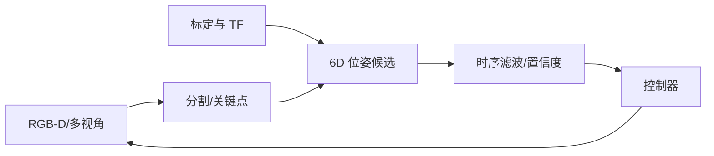
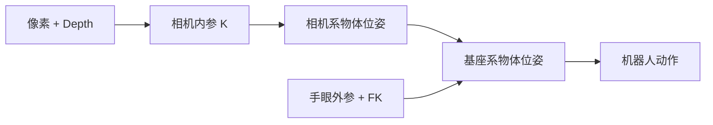

# 视觉感知与状态估计

<!-- course-meta:start -->
[课程首页](https://github.com/zengxiong111/Foundation_of_Embodied_AI/blob/main/README.zh-CN.md) · [English](https://github.com/zengxiong111/Foundation_of_Embodied_AI/blob/main/md/Visual_State_Estimation_EN.md) · [PDF](https://zengxiong111.github.io/zengxiong.github.io/files/Visual_State_Estimation_ZH.pdf)

| 项目 | 说明 |
|---|---|
| 适用范围 | RGB-D、六维位姿、时序跟踪与恢复方法 |
| 文档核验日期 | 2026-10-18 |
| 许可 | CC BY 4.0 · Xiong Zeng and contributors |

**核验边界：** 概念方法与实验设计；没有真机或精度验证。 版本与固定源码引用见[版本说明](https://github.com/zengxiong111/Foundation_of_Embodied_AI/blob/main/VERSIONS.zh-CN.md)。原创教材采用 [CC BY 4.0](https://creativecommons.org/licenses/by/4.0/)，第三方引用、图片及代码遵循其原有许可；注明来源不等于拥有再许可权。
<!-- course-meta:end -->

<!-- course-toc:start -->
## 目录

- [1. 为什么机器人需要状态估计](#course-section-01)
  - [1.1 先区分观测、估计状态与真实状态](#course-section-02)
  - [1.2 什么任务需要 6D 位姿](#course-section-03)
- [2. 从像素到机器人基座坐标系](#course-section-04)
  - [2.1 头部与腕部相机不能混用固定外参](#course-section-05)
  - [2.2 时间戳延迟会变成空间误差](#course-section-06)
- [3. 视觉估计器的模块化流水线](#course-section-07)
  - [3.1 估计与跟踪要区别设计](#course-section-08)
  - [3.2 对称物体可能没有唯一姿态](#course-section-09)
- [4. 时序滤波、置信度与失败恢复](#course-section-10)
  - [4.1 置信度驱动安全动作](#course-section-11)
  - [4.2 丢失与重新捕获是基本能力](#course-section-12)
- [5. 训练时如何处理估计误差](#course-section-13)
  - [5.1 评估误差应与控制目标关联](#course-section-14)
- [6. Panda 方块抓取的最小闭环实验](#course-section-15)
  - [6.1 验收清单](#course-section-16)
- [7. 课程衔接与参考资料](#course-section-17)
<!-- course-toc:end -->

**学习目标：** 理解位姿估计链路；处理延迟和丢失；对接视觉闭环机器人控制。

## 1. 为什么机器人需要状态估计

视觉观测是部分、延迟且有噪声的。抓取策略希望知道物体位姿、末端位姿以及是否保持接触，但相机直接测得的仅是像素或深度。状态估计负责把图像、关节状态、已知几何和时间历史整合为可用于闭环控制的状态与不确定性。

### 1.1 先区分观测、估计状态与真实状态

真实环境状态 $s_t$ 通常不可完全测得；相机观测 $o_t$ 随遮挡、曝光、视角变化而变化。估计器输出 $\hat s_t$ 与可信度，策略动作依赖这些估计。仿真中应区分 ground-truth state、rendered observation 和 estimated state，避免训练部署信息不一致。

### 1.2 什么任务需要 6D 位姿

精细插装、工具旋转与抓取对物体的三维位置和姿态可能敏感，适合显式估计 SE(3) 位姿。对目标对称、被遮挡或纹理匮乏的场景，可采用任务相关关键点、轮廓、相对位姿或直接视觉策略；**不是每个 VLA 都需要显式 6D 位姿**。

## 2. 从像素到机器人基座坐标系

先完成内参、畸变、深度尺度和外参标定。若相机估计 $T_C^O$，机器人位姿链是 $T_B^O=T_B^C T_C^O$。腕部相机的 $T_B^C(t)$ 随机器人关节角变化，必须使用同一时间戳下的正向运动学和手眼外参。

### 2.1 头部与腕部相机不能混用固定外参

固定头部相机一般有常量外参；若头部有云台，则 $T_B^C(t)$ 仍是时变的。腕部相机通常由 $T_B^E(q_t)T_E^C$ 构造。相机到关节轴的实际几何误差不会因 URDF 已存在而自动消失，需要独立标定或验证。

### 2.2 时间戳延迟会变成空间误差

机器人移动时，用当前关节角解释过去的腕部图像，会引入系统性物体位姿偏差。记录相机曝光/到达时间、机器人状态时间、推理输出时间和动作生效时间，并用历史 TF 插值。测得的端到端延迟应纳入控制器稳定性与动作幅度评估。

## 3. 视觉估计器的模块化流水线

典型模块包括目标检测或分割、物体对应关系与位姿候选、姿态细化、时间跟踪、异常检测、置信度估计。分割 mask 不是 6D 位姿；PnP 需要可靠的 2D-3D 对应；FoundationPose 可用于新物体的位姿估计与跟踪，但具有其规定的 CAD 或参考图像等输入条件。

### 3.1 估计与跟踪要区别设计

初始化可从分割、深度和几何模型产生多个候选；跟踪在上一帧姿态附近优化，因此通常更快，但也更容易漂移。遮挡、出画面或误检后，必须允许回到全局重初始化模式，不能无限制沿用旧位姿。

### 3.2 对称物体可能没有唯一姿态

圆柱或无纹理工具绕对称轴的旋转可能无法从视觉唯一确定。评估时采用对称性感知的姿态误差，或将任务必需的接触关键点纳入状态。如果反馈本身不可观测，调大模型不一定能解决问题。

## 4. 时序滤波、置信度与失败恢复

推荐维护“预测 → 测量更新 → 有效性检验 → 恢复”的闭环。预测来自上一帧估计及机器人/物体运动先验，观测更新来自当前图像。可用 EKF、粒子滤波、学习型递推网络或简单时序平滑，但不能只报告滤波后的漂亮轨迹：需要测量延迟、误差和重新初始化次数。

### 4.1 置信度驱动安全动作

给估计输出附带不确定性或质量分数。连续低置信度时可降低速度、保持安全姿态、重新观测或请求人工干预；**不要在未知物体位姿下继续高力接触操作**。置信度校准需要用留出的场景验证，不能只凭网络 softmax 作为误差界。

### 4.2 丢失与重新捕获是基本能力

设计显式状态机：TRACKING、UNCERTAIN、LOST、RELOCALIZING。通过遮挡、主动移动相机、物体掉落和视角突变测试转换规则，并测量重定位成功率与时间。应记录轨迹 ID 的持续性，避免误把另一个相似物体当作原目标。

## 5. 训练时如何处理估计误差

特权状态的仿真教师策略不等于视觉部署策略。可采用视觉蒸馏或在状态输入上注入统计匹配的位姿噪声，但应考虑有偏误差、时间相关噪声、估计延迟、漏检和突发错误。独立比较 oracle pose、noisy pose 和 estimated pose 三种输入，才能判断性能瓶颈来自感知还是控制。

### 5.1 评估误差应与控制目标关联

记录平移误差、旋转误差、轨迹丢失率、置信度可靠性、推理延迟、遮挡场景的恢复时间，以及使用估计器之后的抓取成功率。姿态数值误差更小，不一定意味着最终操作更稳；应同时报告任务指标。

## 6. Panda 方块抓取的最小闭环实验

在共同 Panda + 方块 + 桌面场景中，先用模拟 ground truth 定义基线，再开启固定相机的 RGB-D 位姿估计，最后增加腕部相机及其时变外参。控制器保持不变，只改变视觉反馈链路。设置三个场景：正常光照、遮挡、初始位姿随机；扩展可加入主动相机视角恢复。

### 6.1 验收清单

| 检查项 | 判断标准 |
|---|---|
| 坐标闭环 | 已知物体能正确投到 base frame |
| 时间对齐 | 图像和 FK 在相同采样时间对齐 |
| 无遮挡误差 | 在留出场景上定量测量 |
| 遮挡恢复 | 状态机可重定位，不输出长期过期姿态 |
| 控制安全 | 不确定度过高时可限速或停止 |
| 任务指标 | 记录抓取成功率、延迟与恢复率 |

## 7. 课程衔接与参考资料

本章接续[相机标定](Robot_Camera_Calibration_Tutorial_ZH.md)，并为[模仿学习](Data_Imitation_Learning_ZH.md)、[运动控制 RL](Embodied_Motion_Control_RL_Tutorial_ZH.md)与视觉 VLA 部署提供状态接口。

- [FoundationPose，CVPR 2024](https://arxiv.org/abs/2312.08344)
- [SAM 2](https://arxiv.org/abs/2408.00714)
- [OpenCV Camera Calibration and 3D Reconstruction](https://docs.opencv.org/4.x/d9/d0c/group__calib3d.html)
- [ROS 2 tf2](https://docs.ros.org/en/jazzy/Concepts/Intermediate/About-Tf2.html)

**核验边界：** 内容以概念、方法选择及实验设计为主，并未验证某特定相机、GPU 或模型在机器人上的实时性能。
