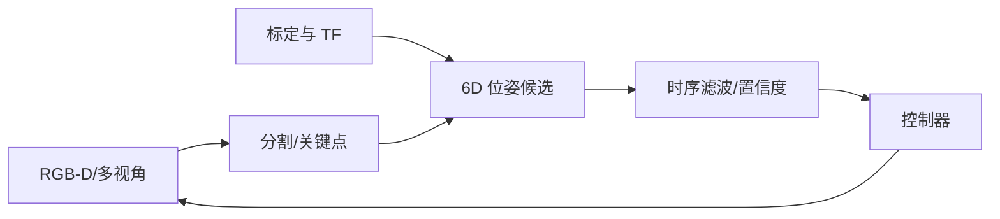
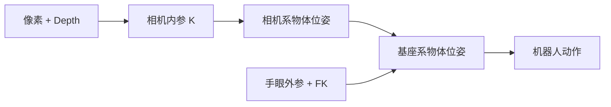

# 视觉感知与状态估计

<!-- course-meta:start -->
[课程首页](https://github.com/zengxiong111/Foundation_of_Embodied_AI/blob/main/README.zh-CN.md) · [English](https://github.com/zengxiong111/Foundation_of_Embodied_AI/blob/main/md/Visual_State_Estimation_EN.md) · [PDF](https://zengxiong111.github.io/zengxiong.github.io/files/Visual_State_Estimation_ZH.pdf)

| 项目 | 说明 |
|---|---|
| 适用范围 | RGB-D、六维位姿、时序跟踪与恢复方法 |
| 文档核验日期 | 2026-10-18 |
| 许可 | CC BY 4.0 · Xiong Zeng and contributors |

**核验边界：** 概念方法与实验设计；没有真机或精度验证。 版本与固定源码引用见[版本说明](https://github.com/zengxiong111/Foundation_of_Embodied_AI/blob/main/VERSIONS.zh-CN.md)。原创教材采用 [CC BY 4.0](https://creativecommons.org/licenses/by/4.0/)，第三方引用、图片及代码遵循其原有许可；注明来源不等于拥有再许可权。
<!-- course-meta:end -->

<!-- course-toc:start -->
## 目录

- [1. 为什么机器人需要状态估计](#course-section-01)
  - [1.1 先区分观测、估计状态与真实状态](#course-section-02)
  - [1.2 什么任务需要 6D 位姿](#course-section-03)
- [2. 从像素到机器人基座坐标系](#course-section-04)
  - [2.1 头部与腕部相机不能混用固定外参](#course-section-05)
  - [2.2 时间戳延迟会变成空间误差](#course-section-06)
- [3. 视觉估计器的模块化流水线](#course-section-07)
  - [3.1 估计与跟踪要区别设计](#course-section-08)
  - [3.2 对称物体可能没有唯一姿态](#course-section-09)
- [4. 时序滤波、置信度与失败恢复](#course-section-10)
  - [4.1 置信度驱动安全动作](#course-section-11)
  - [4.2 丢失与重新捕获是基本能力](#course-section-12)
- [5. 训练时如何处理估计误差](#course-section-13)
  - [5.1 评估误差应与控制目标关联](#course-section-14)
- [6. Panda 方块抓取的最小闭环实验](#course-section-15)
  - [6.1 验收清单](#course-section-16)
- [7. 从像素到带置信度的三维状态](#course-section-17)
  - [7.1 哪些物理量能从一张图像测得](#course-section-18)
  - [7.2 双目深度与误差传播](#course-section-19)
  - [7.3 从 Mask 和深度得到对象点云](#course-section-20)
- [8. 通用视觉基础模型：每一类负责什么](#course-section-21)
  - [8.1 定位、分割、立体深度、6D 姿态和三维生成不可混淆](#course-section-22)
  - [8.2 SAM 2：交互提示的时序实例跟踪](#course-section-23)
  - [8.3 SAM 3 / 3.1：语言描述驱动的开放词汇感知](#course-section-24)
  - [8.4 FoundationPose：已知 CAD / 参考图像条件下的六维位姿](#course-section-25)
  - [8.5 FoundationStereo 与 Fast-FoundationStereo：深度模块](#course-section-26)
  - [8.6 SAM 3D Objects 与 SAM 3D Body：形状生成而不是精密标定](#course-section-27)
- [9. 从 SAM 到 FoundationPose：模块化闭环流水线](#course-section-28)
  - [9.1 两条合理的感知路线](#course-section-29)
  - [9.2 异步调度避免每帧都运行全部大模型](#course-section-30)
  - [9.3 标准化状态消息](#course-section-31)
- [10. 时序滤波、延迟与误差传播](#course-section-32)
  - [10.1 状态预测与 EKF 观测更新](#course-section-33)
  - [10.2 延迟是空间偏差而不只是慢一帧](#course-section-34)
  - [10.3 遮挡、不确定性与主动重定位](#course-section-35)
- [11. 如何按相机和任务选择组合](#course-section-36)
  - [11.1 头部 RGB-D 与腕部 RGB 场景](#course-section-37)
  - [11.2 按需求选模型，而不是叠加所有模型](#course-section-38)
  - [11.3 分离感知与控制的实验误差](#course-section-39)
- [12. 课程实验与验收规范](#course-section-40)
  - [12.1 多模块评估](#course-section-41)
  - [12.2 Panda 桌面抓取的消融矩阵](#course-section-42)
- [13. 课程衔接与参考资料](#course-section-43)
- [8. 感知测量与状态估计公式](#course-section-44)
  - [8.1 RGB-D 与双目深度](#course-section-45)
  - [8.2 递推估计与不确定性](#course-section-46)
- [9. 通用视觉模型的职责与选型](#course-section-47)
  - [9.1 FoundationPose、FoundationStereo、SAM 家族](#course-section-48)
  - [9.2 视觉基础模型的组合逻辑](#course-section-49)
  - [9.3 实时闭环不是只测单模型 FPS](#course-section-50)
- [10. 统一视觉闭环实验与参考资源](#course-section-51)
<!-- course-toc:end -->

**学习目标：** 理解位姿估计链路；处理延迟和丢失；对接视觉闭环机器人控制。

## 1. 为什么机器人需要状态估计

视觉观测是部分、延迟且有噪声的。抓取策略希望知道物体位姿、末端位姿以及是否保持接触，但相机直接测得的仅是像素或深度。状态估计负责把图像、关节状态、已知几何和时间历史整合为可用于闭环控制的状态与不确定性。

### 1.1 先区分观测、估计状态与真实状态

真实环境状态 $s_t$ 通常不可完全测得；相机观测 $o_t$ 随遮挡、曝光、视角变化而变化。估计器输出 $\hat s_t$ 与可信度，策略动作依赖这些估计。仿真中应区分 ground-truth state、rendered observation 和 estimated state，避免训练部署信息不一致。

### 1.2 什么任务需要 6D 位姿

精细插装、工具旋转与抓取对物体的三维位置和姿态可能敏感，适合显式估计 SE(3) 位姿。对目标对称、被遮挡或纹理匮乏的场景，可采用任务相关关键点、轮廓、相对位姿或直接视觉策略；**不是每个 VLA 都需要显式 6D 位姿**。

## 2. 从像素到机器人基座坐标系

先完成内参、畸变、深度尺度和外参标定。若相机估计 $T_C^O$，机器人位姿链是 $T_B^O=T_B^C T_C^O$。腕部相机的 $T_B^C(t)$ 随机器人关节角变化，必须使用同一时间戳下的正向运动学和手眼外参。

### 2.1 头部与腕部相机不能混用固定外参

固定头部相机一般有常量外参；若头部有云台，则 $T_B^C(t)$ 仍是时变的。腕部相机通常由 $T_B^E(q_t)T_E^C$ 构造。相机到关节轴的实际几何误差不会因 URDF 已存在而自动消失，需要独立标定或验证。

### 2.2 时间戳延迟会变成空间误差

机器人移动时，用当前关节角解释过去的腕部图像，会引入系统性物体位姿偏差。记录相机曝光/到达时间、机器人状态时间、推理输出时间和动作生效时间，并用历史 TF 插值。测得的端到端延迟应纳入控制器稳定性与动作幅度评估。

## 3. 视觉估计器的模块化流水线

典型模块包括目标检测或分割、物体对应关系与位姿候选、姿态细化、时间跟踪、异常检测、置信度估计。分割 mask 不是 6D 位姿；PnP 需要可靠的 2D-3D 对应；FoundationPose 可用于新物体的位姿估计与跟踪，但具有其规定的 CAD 或参考图像等输入条件。

### 3.1 估计与跟踪要区别设计

初始化可从分割、深度和几何模型产生多个候选；跟踪在上一帧姿态附近优化，因此通常更快，但也更容易漂移。遮挡、出画面或误检后，必须允许回到全局重初始化模式，不能无限制沿用旧位姿。

### 3.2 对称物体可能没有唯一姿态

圆柱或无纹理工具绕对称轴的旋转可能无法从视觉唯一确定。评估时采用对称性感知的姿态误差，或将任务必需的接触关键点纳入状态。如果反馈本身不可观测，调大模型不一定能解决问题。

## 4. 时序滤波、置信度与失败恢复

推荐维护“预测 → 测量更新 → 有效性检验 → 恢复”的闭环。预测来自上一帧估计及机器人/物体运动先验，观测更新来自当前图像。可用 EKF、粒子滤波、学习型递推网络或简单时序平滑，但不能只报告滤波后的漂亮轨迹：需要测量延迟、误差和重新初始化次数。

### 4.1 置信度驱动安全动作

给估计输出附带不确定性或质量分数。连续低置信度时可降低速度、保持安全姿态、重新观测或请求人工干预；**不要在未知物体位姿下继续高力接触操作**。置信度校准需要用留出的场景验证，不能只凭网络 softmax 作为误差界。

### 4.2 丢失与重新捕获是基本能力

设计显式状态机：TRACKING、UNCERTAIN、LOST、RELOCALIZING。通过遮挡、主动移动相机、物体掉落和视角突变测试转换规则，并测量重定位成功率与时间。应记录轨迹 ID 的持续性，避免误把另一个相似物体当作原目标。

## 5. 训练时如何处理估计误差

特权状态的仿真教师策略不等于视觉部署策略。可采用视觉蒸馏或在状态输入上注入统计匹配的位姿噪声，但应考虑有偏误差、时间相关噪声、估计延迟、漏检和突发错误。独立比较 oracle pose、noisy pose 和 estimated pose 三种输入，才能判断性能瓶颈来自感知还是控制。

### 5.1 评估误差应与控制目标关联

记录平移误差、旋转误差、轨迹丢失率、置信度可靠性、推理延迟、遮挡场景的恢复时间，以及使用估计器之后的抓取成功率。姿态数值误差更小，不一定意味着最终操作更稳；应同时报告任务指标。

## 6. Panda 方块抓取的最小闭环实验

在共同 Panda + 方块 + 桌面场景中，先用模拟 ground truth 定义基线，再开启固定相机的 RGB-D 位姿估计，最后增加腕部相机及其时变外参。控制器保持不变，只改变视觉反馈链路。设置三个场景：正常光照、遮挡、初始位姿随机；扩展可加入主动相机视角恢复。

### 6.1 验收清单

| 检查项 | 判断标准 |
|---|---|
| 坐标闭环 | 已知物体能正确投到 base frame |
| 时间对齐 | 图像和 FK 在相同采样时间对齐 |
| 无遮挡误差 | 在留出场景上定量测量 |
| 遮挡恢复 | 状态机可重定位，不输出长期过期姿态 |
| 控制安全 | 不确定度过高时可限速或停止 |
| 任务指标 | 记录抓取成功率、延迟与恢复率 |

## 7. 从像素到带置信度的三维状态

### 7.1 哪些物理量能从一张图像测得

对于相机系中的点 $P_C=(X,Y,Z)$，忽略畸变时透视投影为 $u=f_xX/Z+c_x,\ v=f_yY/Z+c_y$。仅知道像素 $(u,v)$ 不能唯一恢复三维点，需要深度、双目匹配、已知物体几何或其他先验。内外参和手眼标定如何求解由[相机标定章节](Robot_Camera_Calibration_Tutorial_ZH.md)负责；本章讨论**如何利用已标定的观测恢复状态**，不重复标定推导。

### 7.2 双目深度与误差传播

对同步且完成立体校正的左右图像，简化双目深度为

$
Z=\frac{f_xb}{d},\qquad
\sigma_Z\approx\frac{f_xb}{d^2}\sigma_d,
$

其中 $b$ 为真实基线，$d=u_L-u_R$ 为视差。远处小视差使深度不确定性放大，错误匹配和反光区域应标为无效深度，而不是假装深度连续可靠。**FoundationStereo** 从校准双目图像估计稠密视差；**Fast-FoundationStereo**（CVPR 2026）通过蒸馏、架构搜索和剪枝降低在线计算成本。它们都不是单张 RGB 的直接六维位姿求解器。

### 7.3 从 Mask 和深度得到对象点云

对分割 Mask $M(u,v)$ 和深度 $Z(u,v)$，用内参 $K$ 反投影得到

$
\mathcal P_O=\left\{Z(u,v)K^{-1}[u,v,1]^\top:
M(u,v)=1,\;Z(u,v)>0\right\}.
$

应单独报告 Mask 错误、深度无效点比例、背景泄漏、遮挡与机器人自身像素。相机系点云不等于基座系物体位姿，仍需时间匹配的外参与物体几何对应。

## 8. 通用视觉基础模型：每一类负责什么

### 8.1 定位、分割、立体深度、6D 姿态和三维生成不可混淆

| 模型 | 主要输入 | 主要输出 | 适合机器人中的作用 | 不能直接保证 |
|---|---|---|---|---|
| SAM 2 / 2.1 | 图像/视频与点击、框、Mask | 实例分割与视频传播 | 已知目标 Mask 跟踪 | 物体深度与六维姿态 |
| SAM 3 / 3.1 | 图像/视频，文本概念或视觉提示 | 开放词汇检测、Mask 与跟踪 | 语言目标定位与实例身份 | 精确抓取接触状态 |
| FoundationStereo | 标定同步的双目图像 | 视差、推导出的深度 | 双目三维观测 | 单目尺度与对象姿态 |
| Fast-FoundationStereo | 同上 | 更强调低延迟的视差 | 实时视觉感知候选 | 所有 GPU 上即插即用实时 |
| FoundationPose | RGB(-D)、目标 Mask、CAD 或参考图像 | 6D 物体位姿/跟踪 | 刚体工具的姿态与重定位 | 完全无需模型与初始化的定位 |
| SAM 3D Objects | 单图目标图像 | 候选形状、纹理与布局 | 无 CAD 时的形状先验 | 毫米级尺寸和可操作质量属性 |
| SAM 3D Body | 图像人体 | 人体 3D 形状和姿态 | 人体演示理解 | 灵巧手接触力 |

“通用视觉基础模型”强调跨物体与场景的泛化，但并不等于具备机器人状态的完整观测、实时性和安全保证。部署还须审查权重使用许可、显存、推理频率与测试域。

### 8.2 SAM 2：交互提示的时序实例跟踪

SAM 2 用点击、框或已有 Mask 提示初始化目标，通过流式记忆在视频中传播实例 Mask。适用于目标已知、需要稳定跟随的场景。遇到遮挡、目标出画面、反光、相似实例混淆时可能漂移，应保存身份 ID 和重新提示机制。Mask 时间上连续，不能证明对象位姿或接触力正确。

### 8.3 SAM 3 / 3.1：语言描述驱动的开放词汇感知

SAM 3 能根据文本短语、示例或视觉提示定位并跟踪符合概念的多个实例。例如“桌面上的红色柄螺丝刀”，可以为后续估计器提供候选 Mask。SAM 3.1 则进一步优化视频多目标吞吐量。开放词汇定位得到的仍是**视觉目标区域，不是机器人抓取轨迹**。对遮挡或动作中的快速位移，要测身份交换率以及重新检测延迟。

### 8.4 FoundationPose：已知 CAD / 参考图像条件下的六维位姿

FoundationPose（CVPR 2024）支持 model-based（提供 CAD）和 model-free（采集少量参考图像）两种模式，在新物体上不一定需要重新训练。典型流程是对象 Mask、RGB-D 与几何先验 → 生成并排序姿态候选 → 姿态细化 → 时序跟踪；遮挡后的误差积累需要重新初始化。**Model-free 不等于无需任何参考信息。**

已知几何点 $P_i$ 与可靠图像对应点 $u_i$ 时，可用通用位姿重投影目标解释几何一致性：

$
(\hat R,\hat t)=\arg\min_{R,t}\sum_i
\rho\left(\left\|u_i-\pi(K(RP_i+t))\right\|_2^2\right).
$

该式用于解释 6D 位姿估计，**不表示 FoundationPose 内部恰好优化了这个目标**。无纹理、强对称或被遮挡的物体朝向可能不唯一，需对称性感知的评测或任务关键点。

### 8.5 FoundationStereo 与 Fast-FoundationStereo：深度模块

FoundationStereo 是零样本立体匹配器，依赖同步双目与准确校准，输出视差，再经 $Z=f_xb/d$ 得到深度和点云。Fast-FoundationStereo 提供更注重速度的模型家族，但实际在线延迟受模型权重、迭代次数、分辨率与设备影响。**良好深度不能直接代替 6D 姿态。** 有可靠原生 RGB-D 深度的设备可以先用其 SDK；换用基础模型必须经过误差、延迟与可靠性消融。

### 8.6 SAM 3D Objects 与 SAM 3D Body：形状生成而不是精密标定

SAM 3D Objects 从单张目标图像推断对象形状、纹理和布局；SAM 3D Body 关注人体三维形状。单张图像固有遮挡和尺度歧义，生成物体可作为缺少 CAD 时的**候选几何先验**，却不能不经校验就用于毫米级插装和接触力学。若接入 FoundationPose、仿真或抓取，仍需确认尺度、姿态参考系、物体质量/惯量、碰撞网格和几何可靠性。

## 9. 从 SAM 到 FoundationPose：模块化闭环流水线

### 9.1 两条合理的感知路线

~~~mermaid
flowchart TD
  A["任务目标 / 语言"] --> B["SAM 3 检测与分割"]
  B --> C["目标 Mask + 身份"]
  D["已标定双目 / RGB-D"] --> E["深度 / 点云"]
  C --> F["物体姿态候选"]
  E --> F
  G["CAD / 参考图像"] --> F
  F --> H["FoundationPose / 几何细化"]
  H --> I["时序滤波与置信度"]
  I --> J["机器人策略与控制"]
~~~

显式几何路线：SAM 3（语言目标）→ RGB-D/双目深度 → FoundationPose（6D）→ 时序滤波和控制。直接视觉策略路线：相机图像与任务语言进入 VLA，由其生成动作，不一定显式依赖 6D 姿态，但仍需要独立监控目标是否可见、执行是否成功。柔性物体、透明物体和显著遮挡并不保证有唯一 6D 位姿。

### 9.2 异步调度避免每帧都运行全部大模型

任务初始化时使用 SAM 3 选择目标，连续帧可交给轻量 tracker 或 SAM 视频模式；中低频运行姿态细化；当置信度下降或 ID 丢失时再触发重新检测和全局定位。仅在确有同步双目输入、原生深度不充分或其他实验需求时运行立体基础模型。**所有观测使用图像采集时戳，而不是推理完成时戳**。

### 9.3 标准化状态消息

建议输出目标的 frame_id、timestamp、track_id、Mask、$\hat T_B^O$、平移/旋转不确定度、估计器版本、置信度、是否有效，以及 TRACKING / UNCERTAIN / LOST / RELOCALIZING 状态。深度图需附无效像素比例和尺度校验结果。状态接口既面向 RL/VLA，也能供 Robot Agent 检查成功与故障；网络 Softmax 分数不是严格的物理误差上界。

## 10. 时序滤波、延迟与误差传播

### 10.1 状态预测与 EKF 观测更新

设 $x_t=f(x_{t-1},u_t)+w_t$，$z_t=h(x_t)+v_t$，噪声协方差分别为 $Q_t,R_t$。扩展 Kalman 滤波器使用局部线性化与增益

$
K_t=P_t^-H_t^\top(H_tP_t^-H_t^\top+R_t)^{-1},
\qquad
\hat x_t=\hat x_t^-+K_t(z_t-h(\hat x_t^-)).
$

对于 $SE(3)$ 姿态不要直接把欧氏加法施加到完整旋转矩阵，可用局部李代数扰动 $\hat T_t=\hat T_t^-\operatorname{Exp}(\delta\xi_t^\wedge)$。若 Mask 身份本身错误，滤波器也会稳定地跟错物体，所以 gating、异常检测和重新初始化同样重要。

### 10.2 延迟是空间偏差而不只是慢一帧

当物体以速度 $v$ 运动，时间延迟 $\delta$ 造成的位置滞后量级近似 $\|v\|\delta$。使用腕部相机时，$t-\delta$ 的旧图像必须配合同一时刻的机械臂 FK/TF；把它乘以当前最新 TF 可能产生系统性位置误差。记录曝光、接收、感知结束、策略推理结束与执行器生效时刻，验证端到端 p95 延迟。

### 10.3 遮挡、不确定性与主动重定位

根据质量设置控制降级：高置信度做小幅闭环动作，低置信度减速或停止接触，目标丢失时进入安全姿态并重新观察。可考虑转动头部或移动腕相机进行主动感知，但先验证动作可达性与碰撞安全。对象对称导致的不可观测旋转需要多视角、任务约束或接触反馈；单靠更大的网络不能保证恢复不可观测量。

## 11. 如何按相机和任务选择组合

### 11.1 头部 RGB-D 与腕部 RGB 场景

固定头相机有可能获得稳定全局视角；可转动云台头的外参是时变的。腕相机有利于近距离观察，却随末端运动引入遮挡与动态 TF。仅有头部 RGB-D 与腕部 RGB 不代表存在可直接用于 FoundationStereo 的标准同步立体对；不能将不同焦距、不同视角且不校准的两幅图当作左右目。优先用设备原生深度 + SAM 2/3 + FoundationPose 建立基线。

### 11.2 按需求选模型，而不是叠加所有模型

| 任务 | 优先基线 | 需要验证后再添加 |
|---|---|---|
| 已知目标的视频 Mask | SAM 2 | SAM 3 提供语言目标选择 |
| 语言描述的未知物体 | SAM 3 | 深度 + 6D estimator |
| 已有可靠双目 | 原生 Stereo / FoundationStereo | Fast 版本测试吞吐量 |
| 刚体工具需 6D | FoundationPose + CAD/参考视图 | 外层 SAM + 时序滤波 |
| 无 CAD 的形状先验 | SAM 3D Objects | 度量尺度与几何验证 |
| 精密接触、插装 | 6D + 机器人本体状态 + 接触反馈 | 不以 Mask 代替力反馈 |

### 11.3 分离感知与控制的实验误差

保持策略不变，分别输入 Oracle Pose、统计匹配的 Noisy Pose、真实 Estimated Pose；比较平移/旋转误差、身份切换、追踪丢失、重定位时间以及下游抓取成功率。没有感知结果的量化和故障日志，就无法确定策略失败来自视觉还是控制。

## 12. 课程实验与验收规范

### 12.1 多模块评估

除了 Mask IoU、深度 MAE、6D 位姿误差，还应测试遮挡率分层、身份切换次数、重定位成功率、p50/p95 感知延迟、端到端成功率和意外碰撞率。注意对称物体姿态需使用合适的等价类误差；评价结果绑定 GPU、输入分辨率、模型版本、阈值和参考真值的获得方式。

### 12.2 Panda 桌面抓取的消融矩阵

固定 Panda + 方块 + 桌面、相同控制器与测试分布，依次比较：A）Oracle 状态，B）原生 RGB-D + 简单 Mask，C）SAM 2 + FoundationPose，D）SAM 3 + FoundationPose，E）在校准双目条件下加 FoundationStereo/Fast。分别测试遮挡、视角变化、相似目标、物体滑落，加入低置信度安全停止及重定位。实验表应同时记录正常任务性能和失败恢复性能。

**章节责任：** 详细相机标定方法见[相机标定](Robot_Camera_Calibration_Tutorial_ZH.md)；数据标注、示教与策略学习见[模仿学习](Data_Imitation_Learning_ZH.md)；高层任务规划、工具调用与执行验证见[Robot Agent 工作流](Robot_Agent_Workflow_ZH.md)。

## 13. 课程衔接与参考资料

本章接续[相机标定](Robot_Camera_Calibration_Tutorial_ZH.md)，并为[模仿学习](Data_Imitation_Learning_ZH.md)、[运动控制 RL](Embodied_Motion_Control_RL_Tutorial_ZH.md)与视觉 VLA 部署提供状态接口。

- [FoundationPose，CVPR 2024](https://arxiv.org/abs/2312.08344)
- [FoundationStereo，CVPR 2025](https://github.com/NVlabs/FoundationStereo)
- [Fast-FoundationStereo，CVPR 2026](https://github.com/NVlabs/Fast-FoundationStereo)
- [SAM 3 与 SAM 3.1](https://ai.meta.com/research/sam3)
- [SAM 3D Objects](https://github.com/facebookresearch/sam-3d-objects)
- [SAM 2](https://arxiv.org/abs/2408.00714)
- [OpenCV Camera Calibration and 3D Reconstruction](https://docs.opencv.org/4.x/d9/d0c/group__calib3d.html)
- [ROS 2 tf2](https://docs.ros.org/en/jazzy/Concepts/Intermediate/About-Tf2.html)

**核验边界：** 内容以概念、方法选择及实验设计为主，并未验证某特定相机、GPU 或模型在机器人上的实时性能。

## 8. 感知测量与状态估计公式

### 8.1 RGB-D 与双目深度

针孔相机满足 $u=f_xX/Z+c_x$、$v=f_yY/Z+c_y$。有可靠深度时，$P_C=ZK^{-1}[u,v,1]^\top$。对校正后的双目图像，$Z=fb/d$，其中 $b$ 是基线、$d$ 是视差；一阶误差传播为 $\sigma_Z\approx(fb/d^2)\sigma_d$。深度、分割、标定均有误差，机器人操作不能将所有观测视为精确几何真值。内参与手眼外参的估计与验收仍以[相机标定专章](Robot_Camera_Calibration_Tutorial_ZH.md)为准。

### 8.2 递推估计与不确定性

使用 $x_t=f(x_{t-1},u_{t-1})+w_t$、$y_t=h(x_t)+v_t$。以 EKF 为例：

$$
\hat x_t^-=f(\hat x_{t-1},u_{t-1}),\quad P_t^-=F_tP_{t-1}F_t^\top+Q_t.
$$

$$
K_t=P_t^-H_t^\top(H_tP_t^-H_t^\top+R_t)^{-1},\quad
\hat x_t=\hat x_t^-+K_t(y_t-h(\hat x_t^-)).
$$

对于 SE(3) 姿态，应在局部切空间更新姿态残差，而不是逐元素平均旋转矩阵；若目标存在几何对称性，必须使用对称性感知的姿态误差。遮挡阶段可预测但须提高不确定度，丢失后执行重定位而不是无限沿用旧值。

## 9. 通用视觉模型的职责与选型

### 9.1 FoundationPose、FoundationStereo、SAM 家族

| 模型 | 核心输出 | 必要输入或条件 | 对机器人有用之处 | 不应误解为 |
|---|---|---|---|---|
| FoundationPose | 新物体 6D 位姿估计及跟踪 | 目标区域、RGB(-D)、CAD 模型或参考视图等 | 为抓取/操作提供显式位姿 | 无条件识别所有物体 |
| FoundationStereo | 密集双目视差与深度 | 标定并整流的左右图像 | 获取几何点云及公制深度 | 语义分割或物体 6D 位姿 |
| SAM 2 | 图像分割与视频 mask 跟踪 | 图像/视频、点/框/mask 提示 | 在遮挡前后维护物体目标区域 | 公制深度与物理接触 |
| SAM 3 | 文本/示例提示的开放概念检测、分割和跟踪 | 图像/视频、文本或视觉示例 | 从语言指令定位任务目标 | 姿态、动力学、抓取成功率 |
| SAM 3D Objects | 单图推断三维形状、纹理与布局 | 目标图像及对象区域等 | 候选几何模型或形状先验 | 经标定的高精度 CAD 或实时跟踪 |

**SAM 3 ≠ SAM 3D ≠ FoundationPose。** SAM 3D 重建出的形状有单目歧义，不能直接作为机器人精准碰撞几何；应验证物体尺度、多视角一致性和可接触表面。FoundationStereo 在已有 RGB-D 相机的系统中是可选替代或补充，不是必须使用的串联模块。

### 9.2 视觉基础模型的组合逻辑

在一般工作流中，SAM 3 可通过文本找到目标，SAM 2/3 提供视频分割与目标 ID；RGB-D 或 FoundationStereo 提供几何深度；FoundationPose 或适当的位姿估计器输出 $T_C^O$；时序状态估计器输出带置信度的 $\hat T_B^O$；控制器根据目标物体位姿和估计可信度规划下一步动作。没有物体 CAD 时可用 SAM 3D 生成候选形状，但仍需检查尺度和位姿。部分任务只需要 mask + 深度关键点，不需要完整 6D 位姿。

### 9.3 实时闭环不是只测单模型 FPS

$$
T_{\rm total}=T_{\rm capture}+T_{\rm segmentation}+T_{\rm depth}+T_{\rm pose}+T_{\rm filter}+T_{\rm policy}+T_{\rm communication}.
$$

分别记录初始化/跟踪时延、P95 和 P99 端到端延迟、遮挡恢复率、姿态误差、状态不确定度校准及真实任务成功率。低频识别与高频控制可异步运行，但状态预测须显式处理图像时间戳及执行延迟。

## 10. 统一视觉闭环实验与参考资源

先用 Oracle 物体位姿作为上限，再比较 RGB-D + mask + FoundationPose、SAM 2/3 不同初始化方式、以及有无双目深度替代或形状先验。保持 Panda 控制器、任务目标和训练/测试对象划分不变，并分别测试遮挡、目标旋转对称、物体丢失和机器人视角移动。Pose noise 可按 $\tilde T_t=T_t\exp(\hat \xi_t)$ 注入；应同时包含有偏、时序相关、漏检、延迟与重新定位跳变，避免只加独立高斯噪声。

**知识边界：** 本章负责视觉测量、目标状态与不确定性输出；具体数据采集及 BC/ACT/Flow Policy 训练参见[模仿学习](Data_Imitation_Learning_ZH.md)；高层目标规划、工具调用和失败恢复参见[Robot Agent](Robot_Agent_Workflow_ZH.md)。

- [FoundationPose](https://arxiv.org/abs/2312.08344)
- [FoundationStereo](https://github.com/NVlabs/FoundationStereo)
- [SAM 2](https://github.com/facebookresearch/sam2)
- [SAM 3](https://ai.meta.com/research/sam3/)
- [SAM 3D Objects](https://github.com/facebookresearch/sam-3d-objects)
